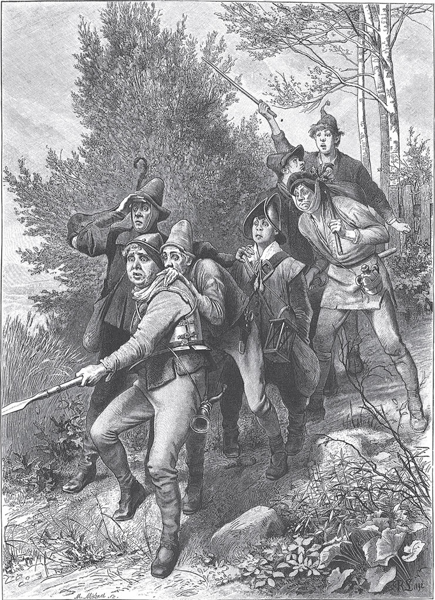

## Die sieben Schwaben

Einmal waren sieben <abbr title="der Schwabe, die Schwaben — шваб (житель Швабии)">Schwaben</abbr> zusammen. Der erste war der Herr Schulz, der zweite der Jackli, der dritte der Marli, der vierte der Jergli, der fünfte der Michal, der sechste der Hans und der siebte der Veitli. Alle sieben <abbr title="sich vornehmen (nahm vor, hat vorgenommen) — намереваться, решить">hatten sich vorgenommen</abbr>, durch die Welt zu ziehen, Abenteuer zu suchen und große Taten zu vollbringen. Damit sie aber auch <abbr title="bewaffnet — вооружённый">bewaffnet</abbr> und sicher unterwegs waren, hielten sie es für klug, sich einen einzigen, aber sehr starken und langen Spieß machen zu lassen. Diesen Spieß hielten sie alle sieben zusammen fest. Vorne ging der <abbr title="kühn — смелый, отважный">kühnste</abbr> und <abbr title="männlich — мужественный">männlichste</abbr> – das musste natürlich der Herr Schulz sein. Dann folgten die anderen der Reihe nach, und der Veitli war der letzte.

Eines Tages im <abbr title="der Hochsommer — разгар лета">Hochsommer</abbr> waren sie schon einen weiten Weg gegangen, und bis zum Dorf, wo sie übernachten mussten, war es noch ein gutes Stück. In der Dämmerung flog auf einer Wiese nicht weit von ihnen ein großer <abbr title="der Käfer, die Käfer — жук">Käfer</abbr> oder eine Hornisse hinter einem Strauch vorbei und brummte <abbr title="feindlich — враждебно">feindlich</abbr>. Der Herr Schulz erschrak so sehr, dass er fast den Spieß fallen ließ. Am ganzen Körper brach ihm der <abbr title="der Angstschweiß — холодный пот от страха">Angstschweiß</abbr> aus.

— Horcht, horcht! — rief er seinen Gefährten zu. — <abbr title="um Gottes willen — ради бога, боже мой">Um Gottes willen</abbr>, ich höre eine Trommel!

Der Jackli, der hinter ihm den Spieß hielt, hatte plötzlich irgendeinen Geruch in der Nase. Er sagte:

— Da ist ohne <abbr title="der Zweifel, die Zweifel — сомнение">Zweifel</abbr> etwas los. Ich rieche das <abbr title="das Schießpulver — порох">Schießpulver</abbr> und die <abbr title="die Lunte, die Lunten — фитиль">Lunte</abbr>.

Bei diesen Worten wollte der Herr Schulz <abbr title="die Flucht ergreifen (ergriff, hat ergriffen) — обратиться в бегство">die Flucht ergreifen</abbr>. Blitzschnell sprang er über einen <abbr title="der Zaun, die Zäune — забор">Zaun</abbr>. Aber er sprang genau auf die <abbr title="der Zinken, die Zinken — зубец">Zinken</abbr> von einem <abbr title="der Rechen, die Rechen — грабли">Rechen</abbr>, der vom <abbr title="das Heumachen — сенокос">Heumachen</abbr> dort liegen geblieben war. Der Stiel schnellte ihm ins Gesicht und gab ihm einen kräftigen Schlag.

— Oh weh, oh weh! — schrie der Herr Schulz. — Nimm mich gefangen, ich ergebe mich, ich ergebe mich!

Die anderen sechs hüpften alle übereinander herbei und schrien:

— Ergibst du dich, so ergebe ich mich auch! Ergibst du dich, so ergebe ich mich auch!

Endlich merkten sie, dass gar kein Feind da war, der sie fesseln und wegführen wollte. Sie hatten sich <abbr title="sich täuschen — ошибаться, обманываться">getäuscht</abbr>. Damit die Geschichte nicht unter die Leute kam und niemand sie auslachte oder verspottete, schworen sie einander, so lange davon zu schweigen, bis einer zufällig den Mund aufmachte.

Dann zogen sie weiter. Die zweite Gefahr, die sie erlebten, war aber mit der ersten gar nicht zu <abbr title="vergleichen (verglich, hat verglichen) — сравнивать">vergleichen</abbr>. Nach einigen Tagen führte ihr Weg über ein <abbr title="brachliegend — невспаханный, под паром">brachliegendes</abbr> Feld. Dort saß ein Hase in der Sonne und schlief. Er hatte die Ohren in die Höhe gestreckt, und seine großen gläsernen Augen standen starr offen. Bei dem <abbr title="der Anblick — вид, зрелище">Anblick</abbr> dieses grausamen und wilden Tieres erschraken sie alle zusammen. Sie berieten, was am wenigsten gefährlich wäre. Wenn sie fliehen würden, so fürchteten sie, könnte das Ungeheuer sie verfolgen und alle mit Haut und Haar verschlingen. Also sagten sie:

— Wir müssen einen großen und gefährlichen Kampf bestehen. <abbr title="frisch gewagt ist halb gewonnen — смелость города берёт">Frisch gewagt ist halb gewonnen</abbr>!

Alle sieben fassten den Spieß an, der Herr Schulz vorne und der Veitli hinten. Der Herr Schulz wollte den Spieß immer noch zurückhalten. Aber der Veitli war hinten ganz mutig geworden. Er wollte <abbr title="losstürmen — ринуться вперёд">losstürmen</abbr> und rief:

> «Stoßt zu in aller Schwaben Namen,  
> sonst wünsch ich, dass ihr möcht <abbr title="erlahmen — охрометь, ослабеть">erlahmen</abbr>!»

Aber der Hans wusste, wie er ihn treffen konnte, und sagte:

> «Beim <abbr title="beim Element! — чёрт возьми!">Element</abbr>, du hast gut <abbr title="schwätzen — болтать">schwätzen</abbr>,  
> bist stets der Letzte beim <abbr title="das Drachenhetzen — травля дракона">Drachenhetzen</abbr>.»

Der Michal rief:

> «Es wird nicht fehlen um ein Haar,  
> so ist es wohl der Teufel gar.»

Dann war der Jergli an der Reihe. Er sagte:

> «Ist er es nicht, so ist's die Mutter  
> oder des Teufels <abbr title="der Stiefbruder, die Stiefbrüder — сводный брат">Stiefbruder</abbr>.»

Der Marli hatte eine gute Idee und sagte zum Veitli:

> «Geh, Veitli, geh, geh du voran,  
> ich stell mich hinten vor dich dann.»

Aber der Veitli hörte nicht darauf, und der Jackli sagte:

> «Der Schulz, der muss der Erste sein,  
> denn ihm <abbr title="gebühren — подобать, причитаться">gebührt</abbr> die Ehr allein.»

Da fasste der Herr Schulz sich ein Herz und sprach würdevoll:

> «So zieht denn <abbr title="herzhaft — смело, решительно">herzhaft</abbr> in den Streit,  
> daran erkennt man tapfre Leut.»

Da gingen sie alle zusammen auf den Drachen los. Der Herr Schulz <abbr title="sich bekreuzigen — креститься">bekreuzigte sich</abbr> und bat Gott um Hilfe. Aber das alles half nichts, und er kam dem Feind immer näher. Da schrie er in großer Angst:

— Hau! Hurlehau! Hau! Hauhau!

Davon wachte der Hase auf, erschrak und sprang schnell davon. Als der Herr Schulz sah, wie der Feind vom <abbr title="das Schlachtfeld, die Schlachtfelder — поле битвы">Schlachtfeld</abbr> floh, rief er voller Freude auf Schwäbisch:

> «Potz, Veitli, lueg, lueg, was isch das?  
> Das Ungehüer ischt a Has.»

Das heißt: «Schau, Veitli, schau, was ist denn das? Das Ungeheuer ist ein Hase!»

Der <abbr title="der Schwabenbund — швабский союз">Schwabenbund</abbr> suchte aber weiter nach Abenteuern und kam an die Mosel. Die Mosel ist ein <abbr title="moosig — замшелый, заросший мхом">moosiges</abbr>, stilles und tiefes Wasser. Es gibt nicht viele Brücken darüber, und an vielen Orten muss man sich mit einem Boot <abbr title="übersetzen (setzte über, hat übergesetzt) — переправлять (через реку)">übersetzen</abbr> lassen. Das wussten die sieben Schwaben aber nicht. Auf der anderen Seite des Flusses arbeitete ein Mann. Sie riefen ihm zu und fragten, wie man hinüberkommen könne. Der Mann verstand wegen der <abbr title="die Entfernung, die Entfernungen — расстояние">Entfernung</abbr> und wegen ihres <abbr title="der Dialekt, die Dialekte — диалект">Dialekts</abbr> nicht, was sie wollten. Er fragte in seinem Trierer Platt:

— Wat? Wat?

Der Herr Schulz glaubte, er sage: «<abbr title="waten — переходить вброд">Wate</abbr>, wate durchs Wasser!» Weil er der Vorderste war, machte er sich als Erster auf den Weg und ging in die Mosel hinein. Es dauerte nicht lange, da versank er im <abbr title="der Schlamm — ил, грязь">Schlamm</abbr> und in den tiefen Wellen, die ihm entgegenkamen. Seinen Hut aber trieb der Wind hinüber ans andere Ufer. Ein Frosch setzte sich daneben und quakte:

— Wat, wat, wat.

Die sechs anderen hörten das und sagten:

— Unser Gefährte, der Herr Schulz, ruft uns. Wenn er hinüberwaten kann, warum wir nicht auch?

Darum sprangen sie alle zusammen schnell ins Wasser und ertranken. So <abbr title="ums Leben bringen — погубить, лишить жизни">brachte</abbr> ein einziger Frosch sechs von ihnen ums Leben, und niemand vom Schwabenbund kam je wieder nach Hause.

---

### Neue Wörter

- **der Schwabe, die Schwaben** — шваб (житель Швабии)
- **sich vornehmen (nahm vor, hat vorgenommen)** — намереваться, решить
- **bewaffnet** — вооружённый
- **kühn** — смелый, отважный
- **männlich** — мужественный
- **der Hochsommer** — разгар лета
- **der Käfer, die Käfer** — жук
- **feindlich** — враждебно
- **der Angstschweiß** — холодный пот от страха
- **um Gottes willen** — ради бога, боже мой
- **der Zweifel, die Zweifel** — сомнение
- **das Schießpulver** — порох
- **die Lunte, die Lunten** — фитиль
- **die Flucht ergreifen (ergriff, hat ergriffen)** — обратиться в бегство
- **der Zaun, die Zäune** — забор
- **der Zinken, die Zinken** — зубец
- **der Rechen, die Rechen** — грабли
- **das Heumachen** — сенокос
- **sich täuschen** — ошибаться, обманываться
- **vergleichen (verglich, hat verglichen)** — сравнивать
- **brachliegend** — невспаханный, под паром
- **der Anblick** — вид, зрелище
- **frisch gewagt ist halb gewonnen** — смелость города берёт
- **losstürmen** — ринуться вперёд
- **erlahmen** — охрометь, ослабеть
- **beim Element!** — чёрт возьми!
- **schwätzen** — болтать
- **das Drachenhetzen** — травля дракона
- **der Stiefbruder, die Stiefbrüder** — сводный брат
- **gebühren** — подобать, причитаться
- **herzhaft** — смело, решительно
- **sich bekreuzigen** — креститься
- **das Schlachtfeld, die Schlachtfelder** — поле битвы
- **der Schwabenbund** — швабский союз
- **moosig** — замшелый, заросший мхом
- **übersetzen (setzte über, hat übergesetzt)** — переправлять (через реку)
- **die Entfernung, die Entfernungen** — расстояние
- **der Dialekt, die Dialekte** — диалект
- **waten** — переходить вброд
- **der Schlamm** — ил, грязь
- **ums Leben bringen** — погубить, лишить жизни

[← Zurück](kapitel-118.md) · [Inhalt](README.md) · [Weiter →](kapitel-120.md)
