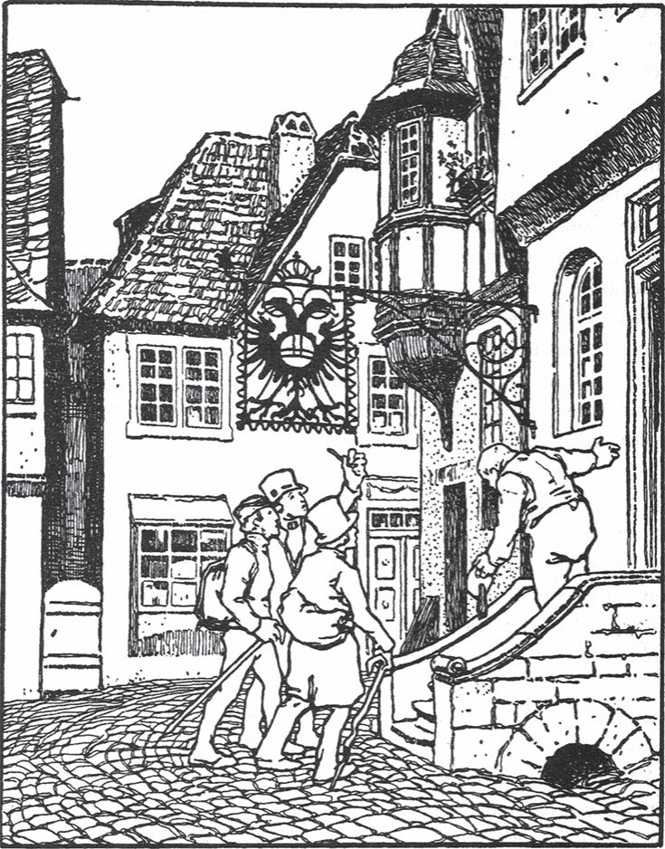

## Die drei Handwerksburschen

Es waren einmal drei Handwerksburschen. Sie hatten verabredet, auf ihrer Wanderschaft zusammenzubleiben und immer in derselben Stadt zu arbeiten. Aber eine Zeit lang fanden sie bei ihren Meistern keinen <abbr title="der Verdienst — заработок">Verdienst</abbr> mehr. Am Ende waren ihre Kleider ganz zerlumpt, und sie hatten nichts mehr zum Leben. Da sagte der eine:

— Was sollen wir tun? Hier können wir nicht länger bleiben. Wir wollen wieder wandern. Wenn wir in der nächsten Stadt keine Arbeit finden, dann vereinbaren wir mit dem <abbr title="der Herbergsvater, die Herbergsväter — хозяин ночлежки (для подмастерьев)">Herbergsvater</abbr>, dass wir ihm schreiben, wo wir sind. So kann jeder von den anderen Nachricht bekommen. Und dann trennen wir uns.

Das fanden auch die anderen am besten. Sie zogen los. Unterwegs kam ihnen ein reich gekleideter Mann entgegen und fragte, wer sie seien.

— Wir sind Handwerker und suchen Arbeit. Bisher sind wir zusammengeblieben. Aber wenn wir keine Arbeit mehr finden, wollen wir uns trennen.

— Das ist nicht nötig, — sagte der Mann. — Wenn ihr tut, was ich euch sage, dann wird es euch weder an Geld noch an Arbeit fehlen. Ja, ihr sollt sogar große Herren werden und in Kutschen fahren.

Der eine sagte:

— Wenn es unserer Seele und unserer <abbr title="die Seligkeit — блаженство, спасение души">Seligkeit</abbr> nicht schadet, dann wollen wir es gern tun.

— Nein, — antwortete der Mann, — ich will nichts von euch.

Der andere aber hatte auf die Füße des Mannes geschaut. Als er dort einen Pferdefuß und einen Menschenfuß erblickte, wollte er nichts mit ihm zu tun haben. Der Teufel aber sagte:

— Beruhigt euch. Ich will nicht euch, sondern die Seele von einem anderen. Der gehört schon halb mir, und jetzt soll nur noch sein Maß voll werden.

Weil sie nun sicher waren, willigten sie ein. Der Teufel sagte ihnen, was er verlangte: Auf jede Frage sollte der erste antworten: «Wir alle drei», der zweite: «Ums Geld», und der dritte: «Und das war recht.» Das sollten sie immer nacheinander sagen, aber sonst durften sie kein einziges Wort sprechen. Wenn sie dieses <abbr title="das Gebot, die Gebote — запрет, заповедь">Gebot</abbr> brachen, war sofort alles Geld verschwunden. Aber solange sie es befolgten, sollten ihre Taschen immer voll sein. Für den Anfang gab er ihnen gleich so viel Geld, wie sie tragen konnten. Dann schickte er sie in die Stadt, in ein bestimmtes Wirtshaus.

Sie gingen hinein. Der Wirt kam ihnen entgegen und fragte:

— Wollt ihr etwas essen?

Der erste antwortete:

— Wir alle drei.

— Ja, — sagte der Wirt, — das meine ich auch.

Der zweite:

— Ums Geld.

— <abbr title="das versteht sich — само собой разумеется">Das versteht sich</abbr>, — sagte der Wirt.

Der dritte:

— Und das war recht.

— Jawohl, das war recht, — sagte der Wirt.

Nun brachte man ihnen gutes Essen und Trinken und bediente sie gut. Nach dem Essen mussten sie bezahlen. Der Wirt hielt dem einen die Rechnung hin. Der sagte: «Wir alle drei», der zweite: «Ums Geld», der dritte: «Und das war recht.»

— Freilich ist das recht, — sagte der Wirt. — Alle drei bezahlen, und ohne Geld kann ich nichts geben.

Sie bezahlten aber sogar noch mehr, als er gefordert hatte. Die anderen Gäste sahen das und sagten:

— Die Leute müssen verrückt sein.

— Ja, das sind sie auch, — sagte der Wirt. — Sie sind nicht ganz richtig im Kopf.

So blieben sie eine Zeit lang in dem Wirtshaus und sprachen kein anderes Wort als: «Wir alle drei», «Ums Geld» und «Und das war recht». Aber sie sahen alles und wussten alles, was dort vorging.

Eines Tages kam ein reicher Kaufmann mit viel Geld. Er sagte:

— Herr Wirt, bewahrt mir mein Geld auf. Da sind die drei närrischen Handwerksburschen, die könnten es mir stehlen.

Das tat der Wirt. Als er den <abbr title="der Mantelsack, die Mantelsäcke — дорожный мешок, баул">Mantelsack</abbr> in sein Zimmer trug, merkte er, dass er schwer von Gold war. Den drei Handwerkern gab er unten ein Nachtlager. Der Kaufmann aber bekam oben ein eigenes Zimmer. Um Mitternacht, als der Wirt dachte, dass alle schliefen, kam er mit seiner Frau. Sie hatten eine Axt und erschlugen den reichen Kaufmann. Nach dem <abbr title="der Mord, die Morde — убийство">Mord</abbr> legten sie sich wieder schlafen.

Als es Tag wurde, gab es großen Lärm. Der Kaufmann lag tot im Bett und schwamm in seinem Blut. Alle Gäste liefen zusammen. Der Wirt aber sagte:

— Das haben die drei verrückten Handwerker getan.

Die Gäste <abbr title="bestätigen — подтверждать">bestätigten</abbr> es und sagten:

— Niemand anders kann es gewesen sein.

Der Wirt ließ die drei rufen und fragte sie:

— Habt ihr den Kaufmann getötet?

— Wir alle drei, — sagte der erste.

— Ums Geld, — sagte der zweite.

— Und das war recht, — sagte der dritte.

— Da hört ihr es, — sagte der Wirt. — Sie gestehen es selbst.

Sie wurden also ins Gefängnis gebracht und sollten verurteilt werden. Als sie sahen, wie ernst die Sache wurde, bekamen sie doch Angst. Aber in der Nacht kam der Teufel und sagte:

— Haltet nur noch einen Tag durch und verspielt euer Glück nicht. Man wird euch kein Haar krümmen.

Am nächsten Morgen wurden sie vor Gericht geführt. Der Richter fragte:

— Seid ihr die Mörder?

— Wir alle drei.

— Warum habt ihr den Kaufmann erschlagen?

— Ums Geld.

— Ihr Schurken! — sagte der Richter. — Hattet ihr denn keine Angst vor der Sünde?

— Und das war recht.

— Sie haben gestanden und sind dazu noch <abbr title="starrköpfig — упрямый, твердолобый">starrköpfig</abbr>, — sagte der Richter. — Führt sie sofort zur Hinrichtung!

Also wurden sie hinausgebracht, und der Wirt musste mit in den Kreis der Zuschauer treten. Die <abbr title="der Henkersknecht, die Henkersknechte — подручный палача">Henkersknechte</abbr> packten die drei und führten sie hinauf aufs <abbr title="das Gerüst, die Gerüste — помост, эшафот">Gerüst</abbr>. Dort stand der <abbr title="der Scharfrichter, die Scharfrichter — палач">Scharfrichter</abbr> mit blankem Schwert. Da kam auf einmal eine Kutsche, <abbr title="bespannt mit + Dat. — запряжённый">bespannt</abbr> mit vier blutroten Füchsen. Sie fuhr so schnell, dass die Funken aus den Steinen sprangen. Aus dem Fenster winkte jemand mit einem weißen Tuch. Da sagte der Scharfrichter:

— Da kommt Gnade.

Und auch aus dem Wagen rief man:

— Gnade! Gnade!

Da stieg der Teufel aus, als sehr vornehmer Herr, prächtig gekleidet, und sagte:

— Ihr drei seid unschuldig. Jetzt dürft ihr sprechen. Sagt, was ihr gesehen und gehört habt.

Da sagte der älteste:

— Wir haben den Kaufmann nicht getötet. Der Mörder steht da im Kreis.

Und er <abbr title="zeigen auf + Akk. — указывать на">zeigte</abbr> auf den Wirt.

— Als Beweis geht in seinen Keller. Dort hängen noch viele andere, die er ums Leben gebracht hat.

Da schickte der Richter die Henkersknechte hin. Sie fanden alles so, wie es gesagt worden war. Als sie es dem Richter <abbr title="berichten — докладывать, сообщать">berichtet</abbr> hatten, ließ er den Wirt hinaufführen und ihm den Kopf abschlagen. Da sagte der Teufel zu den dreien:

— Jetzt habe ich die Seele, die ich haben wollte. Ihr aber seid frei und habt Geld für euer ganzes Leben.

---

### Neue Wörter

- **der Verdienst** — заработок
- **der Herbergsvater, die Herbergsväter** — хозяин ночлежки (для подмастерьев)
- **die Seligkeit** — блаженство, спасение души
- **das Gebot, die Gebote** — запрет, заповедь
- **das versteht sich** — само собой разумеется
- **der Mantelsack, die Mantelsäcke** — дорожный мешок, баул
- **der Mord, die Morde** — убийство
- **bestätigen** — подтверждать
- **starrköpfig** — упрямый, твердолобый
- **der Henkersknecht, die Henkersknechte** — подручный палача
- **das Gerüst, die Gerüste** — помост, эшафот
- **der Scharfrichter, die Scharfrichter** — палач
- **bespannt mit + Dat.** — запряжённый
- **zeigen auf + Akk.** — указывать на
- **berichten** — докладывать, сообщать

[← Zurück](kapitel-119.md) · [Inhalt](README.md) · [Weiter →](kapitel-121.md)
