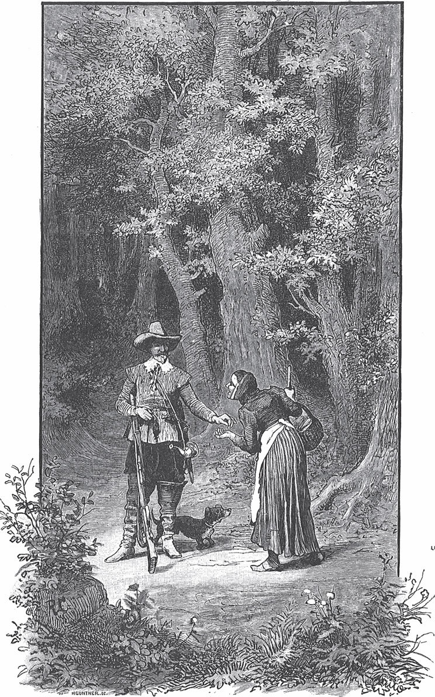

## Der Krautesel

Es war einmal ein junger Jäger, der ging in den Wald, um auf Wild zu <abbr title="lauern auf + Akk. — подстерегать">lauern</abbr>. Er hatte ein frisches und fröhliches Herz. Als er so dahinging und auf einem Blatt pfiff, kam ein altes, hässliches Mütterchen. Sie sprach ihn an und sagte:

— Guten Tag, lieber Jäger. Du bist wohl lustig und vergnügt, aber ich leide Hunger und Durst. Gib mir doch ein Almosen.

Das arme Mütterchen tat dem Jäger leid. Er griff in seine Tasche und gab ihr so viel, wie er konnte. Dann wollte er weitergehen, aber die alte Frau hielt ihn auf und sagte:

— Hör zu, lieber Jäger, was ich dir sage. Für dein gutes Herz will ich dir ein Geschenk machen. Geh nur deinen Weg weiter. Nach einer Weile kommst du an einen Baum. Darauf sitzen neun Vögel, die haben einen Mantel in den Krallen und <abbr title="sich streiten um + Akk. (stritt, hat gestritten) — ссориться, драться из-за">streiten sich</abbr> darum. Dann leg du dein Gewehr an und schieß mitten hinein. Den Mantel werden sie fallen lassen, aber auch einer von den Vögeln wird getroffen sein und tot herunterfallen. Den Mantel nimm mit. Es ist ein <abbr title="der Wunschmantel — волшебный плащ (исполняющий желания)">Wunschmantel</abbr>. Wenn du ihn dir um die Schultern wirfst, brauchst du dich nur an einen Ort zu wünschen, und im Nu bist du dort. Aus dem toten Vogel nimm das Herz heraus und schluck es ganz hinunter. Dann wirst du jeden Morgen beim Aufstehen ein Goldstück unter deinem Kopfkissen finden.

Der Jäger dankte der weisen Frau und dachte bei sich: «Schöne Dinge hat sie mir versprochen. Wenn das nur alles auch einträfe!» Doch als er etwa hundert Schritte gegangen war, hörte er über sich in den Ästen ein Geschrei und <abbr title="das Gezwitscher — щебет">Gezwitscher</abbr>. Er schaute hinauf. Da sah er einen Haufen Vögel, die mit den Schnäbeln und Füßen an einem Tuch rissen. Sie schrien, zerrten und <abbr title="sich balgen — драться, возиться">balgten sich</abbr>, als wollte jeder es allein haben.

— Na, — sagte der Jäger, — das ist seltsam. Es kommt ja genau so, wie das Mütterchen gesagt hat.

Er nahm das Gewehr von der Schulter, legte an und schoss mitten hinein, sodass die Federn herumflogen. Sofort ergriffen die Vögel mit großem Geschrei die Flucht. Aber einer fiel tot herunter, und der Mantel fiel ebenfalls zu Boden. Der Jäger tat, was die Alte ihm gesagt hatte. Er schnitt den Vogel auf, suchte das Herz, schluckte es hinunter und nahm den Mantel mit nach Hause.

Als er am nächsten Morgen aufwachte, fiel ihm das Versprechen ein. Er wollte sehen, ob es sich auch erfüllt hatte. Als er sein Kopfkissen hochhob, schimmerte ihm das Goldstück entgegen. Am nächsten Morgen fand er wieder eins, und so jedes Mal, wenn er aufstand. Er sammelte einen ganzen Haufen Gold. Endlich aber dachte er: «Was hilft mir all mein Gold, wenn ich zu Hause bleibe? Ich will hinausziehen und mich in der Welt umsehen.»

Er verabschiedete sich von seinen Eltern, hängte sich seinen <abbr title="der Jägerranzen, die Jägerranzen — охотничья сумка, ягдташ">Jägerranzen</abbr> und seine Flinte um und zog in die Welt. Eines Tages kam er durch einen dichten Wald. Als der Wald zu Ende war, lag vor ihm in der Ebene ein stattliches Schloss. An einem der Fenster standen eine Alte und eine wunderschöne Jungfrau und schauten herunter. Die Alte aber war eine Hexe und sagte zu dem Mädchen:

— Dort kommt einer aus dem Wald. Der hat einen wunderbaren Schatz in seinem Körper. Den müssen wir ihm mit einer List abnehmen, mein <abbr title="das Herzenstöchterchen — доченька, душенька">Herzenstöchterchen</abbr>. Uns steht er besser als ihm. Er trägt ein <abbr title="das Vogelherz — птичье сердце">Vogelherz</abbr> in sich, deshalb liegt jeden Morgen ein Goldstück unter seinem Kopfkissen.

Sie erzählte ihr, wie es damit war und wie sie es anstellen sollte. Zum Schluss drohte sie ihr und sagte mit zornigen Augen:

— Und wenn du mir nicht gehorchst, dann wirst du unglücklich.

Als der Jäger näher kam, erblickte er das Mädchen und sagte zu sich: «Ich bin jetzt so lange herumgezogen. Ich will mich einmal ausruhen und in dem schönen Schloss einkehren. Geld habe ich ja reichlich.» Der eigentliche Grund aber war, dass er <abbr title="ein Auge auf jemanden werfen — положить глаз на кого-то">ein Auge auf</abbr> das schöne Mädchen geworfen hatte.

Er ging in das Schloss und wurde freundlich empfangen und höflich <abbr title="bewirten — угощать">bewirtet</abbr>. Es dauerte nicht lange, da war er so in das Hexenmädchen <abbr title="verliebt sein in + Akk. — быть влюблённым в">verliebt</abbr>, dass er an nichts anderes mehr dachte. Er sah nur noch in ihre Augen, und was sie verlangte, das tat er gern. Da sagte die Alte:

— Jetzt müssen wir das Vogelherz haben. Er wird gar nicht spüren, dass es ihm fehlt.

Sie brauten einen <abbr title="der Trank, die Tränke — напиток, зелье">Trank</abbr>. Als er fertig gekocht war, goss die Alte ihn in einen Becher und gab ihn dem Mädchen. Sie musste ihn dem Jäger reichen und sagte:

— Nun, mein Liebster, trink auf mein Wohl.

Er nahm den Becher. Als er den Trank geschluckt hatte, <abbr title="erbrechen (erbrach, hat erbrochen) — изрыгнуть, вырвать">erbrach</abbr> er das Herz des Vogels. Das Mädchen musste es heimlich wegbringen und dann selbst hinunterschlucken, denn so wollte es die Alte. Von nun an fand der Jäger kein Gold mehr unter seinem Kopfkissen. Es lag jetzt unter dem Kissen des Mädchens, und die Alte holte es jeden Morgen. Aber er war so verliebt und <abbr title="vernarrt in + Akk. — без ума от">vernarrt</abbr>, dass er an nichts anderes dachte, als mit dem Mädchen die Zeit zu vertreiben.

Da sagte die alte Hexe:

— Das Vogelherz haben wir. Aber den Wunschmantel müssen wir ihm auch abnehmen.

Das Mädchen antwortete:

— Den wollen wir ihm lassen. Er hat doch schon seinen Reichtum verloren.

Da wurde die Alte böse und sagte:

— So ein Mantel ist ein wunderbares Ding, das man nur selten auf der Welt findet. Den soll und muss ich haben.

Sie gab dem Mädchen <abbr title="die Anweisung, die Anweisungen — указание">Anweisungen</abbr> und sagte, wenn sie ihr nicht gehorche, werde es ihr schlecht gehen. Da tat das Mädchen, was die Alte befohlen hatte. Sie stellte sich ans Fenster und schaute in die weite Gegend, als wäre sie sehr traurig.

— Warum stehst du so traurig da? — fragte der Jäger.

— Ach, mein Schatz, — antwortete sie, — da drüben liegt der <abbr title="der Granatenberg — Гранатовая гора">Granatenberg</abbr>, wo die köstlichen Edelsteine wachsen. Ich <abbr title="sich sehnen nach + Dat. — тосковать по, страстно желать">sehne mich</abbr> so sehr danach, dass ich ganz traurig werde, wenn ich daran denke. Aber wer kann sie holen? Nur die Vögel, die fliegen, kommen dorthin, ein Mensch niemals.

— Wenn das dein einziger Kummer ist, — sagte der Jäger, — den nehme ich dir bald vom Herzen.

Er nahm sie unter seinen Mantel und wünschte sich hinüber auf den Granatenberg. Im selben Augenblick saßen sie beide dort. Die edlen Steine funkelten von allen Seiten, dass es eine Freude war, sie anzusehen. Sie sammelten die schönsten und kostbarsten Stücke. Die Alte hatte aber mit ihrer Hexenkunst dafür gesorgt, dass dem Jäger die Augen schwer wurden. Er sagte zu dem Mädchen:

— Lass uns ein wenig sitzen und ausruhen. Ich bin so müde, dass ich mich nicht mehr auf den Beinen halten kann.

Sie setzten sich, und er legte seinen Kopf in ihren Schoß und schlief ein. Als er eingeschlafen war, band sie ihm den Mantel von den Schultern und hängte ihn sich selbst um. Sie sammelte die <abbr title="der Granat, die Granate — гранат (камень)">Granaten</abbr> und Steine auf und wünschte sich damit nach Hause.

Als der Jäger ausgeschlafen hatte und aufwachte, sah er, dass seine Liebste ihn betrogen und allein auf dem wilden <abbr title="das Gebirge, die Gebirge — горы">Gebirge</abbr> gelassen hatte.

— Oh, — sagte er, — wie groß ist die Untreue auf der Welt!

Er saß da voller Sorge und Herzeleid und wusste nicht, was er tun sollte. Der Berg aber gehörte wilden und ungeheuren Riesen, die dort wohnten und ihr <abbr title="sein Unwesen treiben — бесчинствовать">Unwesen trieben</abbr>. Er saß noch nicht lange da, da sah er drei von ihnen <abbr title="herbeischreiten (schritt herbei, ist herbeigeschritten) — подходить широким шагом">herbeischreiten</abbr>. Er legte sich hin, als wäre er in tiefen Schlaf versunken. Die Riesen kamen heran. Der erste stieß ihn mit dem Fuß an und sagte:

— Was liegt denn da für ein <abbr title="der Erdwurm, die Erdwürmer — земляной червь">Erdwurm</abbr> und schaut sich <abbr title="von innen — изнутри">von innen</abbr> an?

Der zweite sagte:

— Tritt ihn tot.

Der dritte aber sagte verächtlich:

— Das wäre der Mühe wert! Lasst ihn nur leben. Hier kann er nicht bleiben. Und wenn er höher steigt, bis auf die <abbr title="die Bergspitze, die Bergspitzen — вершина горы">Bergspitze</abbr>, dann packen ihn die Wolken und tragen ihn fort.

Während sie so sprachen, gingen sie vorbei. Der Jäger aber hatte sich ihre Worte gemerkt. Sobald sie weg waren, stand er auf und kletterte auf den Gipfel. Als er eine Weile dort gesessen hatte, schwebte eine Wolke heran. Sie ergriff ihn, trug ihn fort und zog eine Zeit lang am Himmel dahin. Dann senkte sich sie und ließ sich über einem großen <abbr title="der Krautgarten, die Krautgärten — огород">Krautgarten</abbr> nieder, der ringsum von Mauern umgeben war. So kam er sanft zwischen Kohl und Gemüse auf den Boden.

Der Jäger sah sich um und sagte:

— Wenn ich nur etwas zu essen hätte! Ich bin so hungrig, und das Weiterkommen wird mir schwerfallen. Aber hier sehe ich keinen Apfel, keine Birne und kein Obst, überall nur Kraut.

Endlich dachte er: «<abbr title="zur Not — на худой конец">Zur Not</abbr> kann ich von dem Salat essen. Der schmeckt nicht besonders, aber er wird mich <abbr title="erfrischen — освежать">erfrischen</abbr>.» Also suchte er sich einen schönen <abbr title="der Salatkopf, die Salatköpfe — кочан салата">Salatkopf</abbr> aus und aß davon. Aber kaum hatte er ein paar Bissen hinuntergeschluckt, da wurde ihm ganz seltsam <abbr title="jemandem ist seltsam zumute — кому-то не по себе">zumute</abbr>, und er fühlte sich ganz <abbr title="verändern — изменять">verändert</abbr>. Es wuchsen ihm vier Beine, ein dicker Kopf und zwei lange Ohren. Mit Schrecken sah er, dass er in einen Esel verwandelt war. Aber weil er immer noch großen Hunger hatte und ihm der saftige Salat als Esel gut schmeckte, fraß er mit großer Gier immer weiter. Endlich kam er an eine andere Sorte Salat. Kaum hatte er etwas davon geschluckt, spürte er wieder eine <abbr title="die Veränderung, die Veränderungen — перемена">Veränderung</abbr>, und er bekam seine menschliche Gestalt zurück.

Nun legte sich der Jäger hin und schlief seine Müdigkeit aus. Als er am nächsten Morgen aufwachte, brach er einen Kopf von dem bösen und einen von dem guten Salat ab und dachte: «Das soll mir helfen, wieder zu meinem Eigentum zu kommen, und die <abbr title="die Treulosigkeit — вероломство">Treulosigkeit</abbr> bestrafen.» Er steckte die Salatköpfe ein, kletterte über die Mauer und ging los, um das Schloss seiner Liebsten zu suchen. Nachdem er ein paar Tage <abbr title="umherstreifen (ist umhergestreift) — бродить, скитаться">umhergestreift</abbr> war, fand er es <abbr title="zum Glück — к счастью">zum Glück</abbr> wieder. Schnell färbte er sich das Gesicht braun, sodass ihn nicht einmal seine eigene Mutter erkannt hätte. Dann ging er in das Schloss und bat um ein <abbr title="das Nachtquartier, die Nachtquartiere — ночлег">Nachtquartier</abbr>.

— Ich bin so müde, — sagte er, — ich kann nicht weiter.

Die Hexe fragte:

— <abbr title="der Landsmann, die Landsleute — земляк, приятель">Landsmann</abbr>, wer seid Ihr, und was ist Euer <abbr title="das Gewerbe, die Gewerbe — занятие, ремесло">Gewerbe</abbr>?

Er antwortete:

— Ich bin ein Bote des Königs. Man hat mich ausgeschickt, den köstlichsten Salat zu suchen, der unter der Sonne wächst. Ich hatte auch das Glück, ihn zu finden, und trage ihn bei mir. Aber die <abbr title="die Sonnenhitze — солнечный зной">Sonnenhitze</abbr> brennt so stark, dass das zarte Kraut zu <abbr title="welken — вянуть">welken</abbr> <abbr title="drohen zu + Inf. — грозить (что-то сделать)">droht</abbr>. Ich weiß nicht, ob ich es noch weit bringen kann.

Als die Alte von dem köstlichen Salat hörte, bekam sie großen Appetit und sagte:

— Lieber Landsmann, lasst mich doch den wunderbaren Salat probieren.

— Warum nicht? — antwortete er. — Ich habe zwei Köpfe mitgebracht, einen will ich Euch geben.

Er machte seinen Sack auf und reichte ihr den bösen. Die Hexe ahnte nichts Böses. Ihr lief das Wasser im Mund zusammen bei dem neuen Gericht, sodass sie selbst in die Küche ging und es zubereitete. Als es fertig war, konnte sie nicht warten, bis es auf dem Tisch stand. Sie nahm gleich ein paar Blätter und steckte sie in den Mund. Aber kaum hatte sie sie geschluckt, war auch ihre menschliche Gestalt verloren, und sie lief als <abbr title="die Eselin, die Eselinnen — ослица">Eselin</abbr> hinunter in den Hof.

Nun kam die Magd in die Küche, sah den fertigen Salat dort stehen und wollte ihn auftragen. Aber unterwegs bekam sie, wie es ihre alte Gewohnheit war, Lust zu naschen, und sie aß ein paar Blätter. Sofort zeigte sich die Wunderkraft: Auch sie wurde zu einer Eselin und lief hinaus zu der Alten. Die Schüssel mit dem Salat fiel auf den Boden.

Der Bote saß in dieser Zeit bei dem schönen Mädchen. Als niemand mit dem Salat kam, und sie doch auch Appetit darauf hatte, sagte sie:

— Ich weiß nicht, wo der Salat bleibt.

Da dachte der Jäger: «Das Kraut hat wohl schon gewirkt», und sagte:

— Ich will in die Küche gehen und mich <abbr title="sich erkundigen — осведомляться, справляться">erkundigen</abbr>.

Als er hinunterkam, sah er die zwei Eselinnen im Hof herumlaufen, und der Salat lag auf dem Boden.

— Schon recht, — sagte er, — die zwei haben ihren <abbr title="der Teil, die Teile — часть, доля">Teil</abbr> bekommen.

Er hob die übrigen Blätter auf, legte sie auf die Schüssel und brachte sie dem Mädchen.

— Ich bringe Euch das köstliche Essen selbst, — sagte er, — damit Ihr nicht länger warten müsst.

Sie aß davon und verlor sofort, wie die anderen, ihre menschliche Gestalt und lief als Eselin in den Hof.

Danach wusch sich der Jäger das Gesicht, sodass die Verwandelten ihn erkennen konnten. Er ging hinunter in den Hof und sagte:

— Jetzt sollt ihr den Lohn für eure Untreue bekommen.

Er band alle drei an ein Seil und trieb sie fort, bis er zu einer Mühle kam. Er klopfte ans Fenster. Der Müller steckte den Kopf heraus und fragte, was er wünsche.

— Ich habe drei böse Tiere, — antwortete er, — die ich nicht länger behalten will. Wenn Ihr sie bei Euch aufnehmt, ihnen Futter und einen Schlafplatz gebt und sie so haltet, wie ich es Euch sage, dann zahle ich Euch dafür, was Ihr verlangt.

— Warum nicht? — sagte der Müller. — Aber wie soll ich sie halten?

Da sagte der Jäger: Der alten Eselin – das war die Hexe – solle er jeden Tag dreimal Prügel und einmal zu fressen geben. Der jüngeren, die die Magd war, einmal Prügel und dreimal Futter. Und der jüngsten, die das Mädchen war, keinmal Prügel und dreimal zu fressen. Denn er brachte es doch nicht übers Herz, dass das Mädchen geschlagen würde. Dann ging er zurück in das Schloss, und was er brauchte, das fand er alles dort.

Nach ein paar Tagen kam der Müller und sagte, er müsse melden, dass die alte Eselin, die nur Prügel und nur einmal Futter bekommen habe, gestorben sei.

— Die zwei anderen, — sagte er weiter, — sind zwar nicht gestorben und bekommen auch dreimal zu fressen. Aber sie sind so traurig, dass sie es nicht mehr lange machen werden.

Da <abbr title="Mitleid haben mit + Dat. — жалеть, сочувствовать">bekam</abbr> der Jäger Mitleid. Er ließ seinen Zorn fahren und sagte zum Müller, er solle sie wieder herbringen. Als sie kamen, gab er ihnen von dem guten Salat zu fressen, und sie wurden wieder zu Menschen. Da fiel das schöne Mädchen vor ihm auf die Knie und sagte:

— Ach, mein Liebster, verzeiht mir, was ich Euch Böses getan habe. Meine Mutter hat mich dazu gezwungen. Es ist gegen meinen Willen geschehen, denn ich liebe Euch von Herzen. Euer Wunschmantel hängt in einem Schrank. Und um Euch das Vogelherz zurückzugeben, will ich ein <abbr title="das Brechmittel, die Brechmittel — рвотное средство">Brechmittel</abbr> nehmen.

Da <abbr title="es sich anders überlegen — передумать">überlegte</abbr> er es sich anders und sagte:

— Behalte es nur. Es ist doch <abbr title="einerlei — всё равно">einerlei</abbr>, denn ich will dich zu meiner treuen <abbr title="die Ehefrau, die Ehefrauen — жена, супруга">Ehefrau</abbr> nehmen.

Dann wurde Hochzeit gefeiert, und sie lebten glücklich miteinander bis an ihr Ende.

---

### Neue Wörter

- **lauern auf + Akk.** — подстерегать
- **sich streiten um + Akk. (stritt, hat gestritten)** — ссориться, драться из-за
- **der Wunschmantel** — волшебный плащ (исполняющий желания)
- **das Gezwitscher** — щебет
- **sich balgen** — драться, возиться
- **der Jägerranzen, die Jägerranzen** — охотничья сумка, ягдташ
- **das Herzenstöchterchen** — доченька, душенька
- **das Vogelherz** — птичье сердце
- **ein Auge auf jemanden werfen** — положить глаз на кого-то
- **bewirten** — угощать
- **verliebt sein in + Akk.** — быть влюблённым в
- **der Trank, die Tränke** — напиток, зелье
- **erbrechen (erbrach, hat erbrochen)** — изрыгнуть, вырвать
- **vernarrt in + Akk.** — без ума от
- **die Anweisung, die Anweisungen** — указание
- **der Granatenberg** — Гранатовая гора
- **sich sehnen nach + Dat.** — тосковать по, страстно желать
- **der Granat, die Granate** — гранат (камень)
- **das Gebirge, die Gebirge** — горы
- **sein Unwesen treiben** — бесчинствовать
- **herbeischreiten (schritt herbei, ist herbeigeschritten)** — подходить широким шагом
- **der Erdwurm, die Erdwürmer** — земляной червь
- **von innen** — изнутри
- **die Bergspitze, die Bergspitzen** — вершина горы
- **der Krautgarten, die Krautgärten** — огород
- **zur Not** — на худой конец
- **erfrischen** — освежать
- **der Salatkopf, die Salatköpfe** — кочан салата
- **jemandem ist seltsam zumute** — кому-то не по себе
- **verändern** — изменять
- **die Veränderung, die Veränderungen** — перемена
- **die Treulosigkeit** — вероломство
- **umherstreifen (ist umhergestreift)** — бродить, скитаться
- **zum Glück** — к счастью
- **das Nachtquartier, die Nachtquartiere** — ночлег
- **der Landsmann, die Landsleute** — земляк, приятель
- **das Gewerbe, die Gewerbe** — занятие, ремесло
- **die Sonnenhitze** — солнечный зной
- **welken** — вянуть
- **drohen zu + Inf.** — грозить (что-то сделать)
- **die Eselin, die Eselinnen** — ослица
- **sich erkundigen** — осведомляться, справляться
- **der Teil, die Teile** — часть, доля
- **Mitleid haben mit + Dat.** — жалеть, сочувствовать
- **das Brechmittel, die Brechmittel** — рвотное средство
- **es sich anders überlegen** — передумать
- **einerlei** — всё равно
- **die Ehefrau, die Ehefrauen** — жена, супруга

[← Zurück](kapitel-121.md) · [Inhalt](README.md) · [Weiter →](kapitel-123.md)
