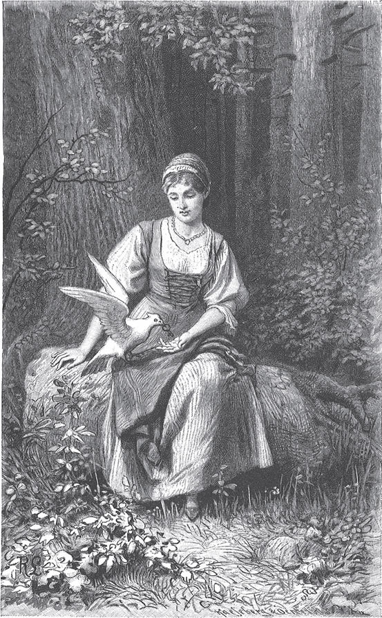

## Die Alte im Wald

Es fuhr einmal ein armes Dienstmädchen mit seiner Herrschaft durch einen großen Wald. Als sie mitten im Wald waren, kamen Räuber aus dem Dickicht und ermordeten alle, die sie fanden. Alle kamen ums Leben, nur das Mädchen nicht. Es war vor Angst aus dem Wagen gesprungen und hatte sich hinter einem Baum versteckt. Als die Räuber mit ihrer Beute weg waren, kam es hervor und sah das große Unglück. Da fing es an, bitterlich zu weinen, und sagte:

— Was soll ich armes Mädchen jetzt tun? Ich finde nicht aus dem Wald heraus. Keine Menschenseele wohnt hier. Ich muss bestimmt verhungern.

Es irrte umher und suchte einen Weg, aber es konnte keinen finden. Als es Abend wurde, setzte es sich unter einen Baum und befahl sich Gott. Es wollte dort sitzen bleiben und nicht weggehen, was auch immer geschehen mochte. Als es eine Weile dort gesessen hatte, kam ein weißes Täubchen geflogen. Es hatte ein kleines goldenes <abbr title="das Schlüsselchen, die Schlüsselchen — ключик">Schlüsselchen</abbr> im Schnabel. Das Schlüsselchen legte es dem Mädchen in die Hand und sagte:

— Siehst du dort den großen Baum? Daran ist ein kleines Schloss. Das schließ mit dem Schlüsselchen auf. Dann wirst du genug zu essen finden und keinen Hunger mehr leiden.

Da ging das Mädchen zu dem Baum, schloss ihn auf und fand Milch in einem kleinen Schüsselchen und Weißbrot zum Einbrocken. So konnte es sich satt essen. Als es satt war, sagte es:

— Jetzt ist die Zeit, wo zu Hause die Hühner auf die Stange fliegen. Ich bin so müde. Könnte ich mich doch auch in mein Bett legen!

Da kam das Täubchen wieder geflogen. Es brachte ein anderes goldenes Schlüsselchen im Schnabel und sagte:

— Schließ dort den Baum auf, dann wirst du ein Bett finden.

Das Mädchen schloss auf und fand ein schönes, weiches Bettchen. Es betete zum lieben Gott, dass er es in der Nacht behüten möge, legte sich hin und schlief ein. Am Morgen kam das Täubchen zum dritten Mal. Es brachte wieder ein Schlüsselchen und sagte:

— Schließ dort den Baum auf, dann wirst du Kleider finden.

Als das Mädchen aufschloss, fand es Kleider, die mit Gold und Edelsteinen besetzt waren, so herrlich, wie sie keine Königstochter hat. So lebte es eine Zeit lang dort. Das Täubchen kam jeden Tag und sorgte für alles, was das Mädchen brauchte. Es war ein stilles, gutes Leben.

Einmal aber kam das Täubchen und sagte:

— Willst du mir zuliebe etwas tun?

— Von Herzen gern, — sagte das Mädchen.

Da sagte das Täubchen:

— Ich will dich zu einem kleinen Häuschen führen. Dort geh hinein. Mitten im Raum am Herd wird eine alte Frau sitzen und «Guten Tag» sagen. Aber gib ihr um Himmels willen keine Antwort, egal, was sie auch tut. Geh rechts an ihr vorbei weiter. Da ist eine Tür, die mach auf. Dann kommst du in ein Zimmer, wo eine Menge Ringe aller Art auf dem Tisch liegen. Darunter sind prächtige mit glitzernden Steinen. Die lass aber liegen. Such einen schlichten Ring heraus, der auch dabei sein muss, und bring ihn mir, so schnell du kannst.

Das Mädchen ging zu dem Häuschen und trat durch die Tür ein. Da saß eine Alte. Als sie das Mädchen erblickte, machte sie große Augen und sagte:

— Guten Tag, mein Kind.

Das Mädchen gab ihr aber keine Antwort und ging auf die Tür zu.

— Wohin denn? — rief die Alte. Sie fasste das Mädchen am Rock und wollte es festhalten. — Das ist mein Haus. Hier darf niemand hinein, wenn ich es nicht will.

Aber das Mädchen schwieg, riss sich los und ging direkt in das Zimmer hinein. Da lag auf dem Tisch eine riesige Menge Ringe, die vor seinen Augen glitzerten und funkelten. Es wühlte darin herum und suchte den schlichten, aber es konnte ihn nicht finden. Während es so suchte, sah es, wie die Alte <abbr title="vorbeischleichen (schlich vorbei, ist vorbeigeschlichen) — прокрасться мимо">vorbeischlich</abbr>. Sie hatte einen <abbr title="der Vogelkäfig, die Vogelkäfige — птичья клетка">Vogelkäfig</abbr> in der Hand und wollte damit verschwinden. Da ging das Mädchen auf sie zu und nahm ihr den Käfig aus der Hand. Als es ihn hochhob und hineinschaute, saß ein Vogel darin, der hatte den schlichten Ring im Schnabel. Das Mädchen nahm den Ring und lief ganz froh damit aus dem Haus. Es dachte, das weiße Täubchen würde kommen und den Ring holen, aber es kam nicht.

Da <abbr title="sich lehnen an + Akk. — прислоняться к">lehnte</abbr> es sich an einen Baum und wollte auf das Täubchen warten. Und während es so dastand, war es, als würde der Baum weich und <abbr title="biegsam — гибкий">biegsam</abbr> und senkte seine Zweige herab. Auf einmal <abbr title="sich schlingen um + Akk. (schlang, hat geschlungen) — обвиваться вокруг">schlangen sich</abbr> die Zweige um das Mädchen, und sie waren zwei Arme. Als es sich umsah, war der Baum ein schöner Mann. Er umarmte es, küsste es <abbr title="herzlich — сердечно, горячо">herzlich</abbr> und sagte:

— Du hast mich erlöst und aus der Macht der Alten befreit. Sie ist eine böse Hexe. Sie hatte mich in einen Baum verwandelt, und jeden Tag war ich ein paar Stunden lang eine weiße Taube. Solange sie den Ring <abbr title="besitzen (besaß, hat besessen) — владеть, обладать">besaß</abbr>, konnte ich meine menschliche Gestalt nicht zurückbekommen.

Da waren auch seine <abbr title="der/die Bedienstete, die Bediensteten — слуга, прислуга">Bediensteten</abbr> und Pferde vom Zauber frei, die die Hexe ebenfalls in Bäume verwandelt hatte, und sie standen neben ihm. Sie fuhren alle zusammen fort in sein Reich, denn er war ein Königssohn. Die beiden heirateten und lebten glücklich.

---

### Neue Wörter

- **das Schlüsselchen, die Schlüsselchen** — ключик
- **vorbeischleichen (schlich vorbei, ist vorbeigeschlichen)** — прокрасться мимо
- **der Vogelkäfig, die Vogelkäfige** — птичья клетка
- **sich lehnen an + Akk.** — прислоняться к
- **biegsam** — гибкий
- **sich schlingen um + Akk. (schlang, hat geschlungen)** — обвиваться вокруг
- **herzlich** — сердечно, горячо
- **besitzen (besaß, hat besessen)** — владеть, обладать
- **der/die Bedienstete, die Bediensteten** — слуга, прислуга

[← Zurück](kapitel-122.md) · [Inhalt](README.md) · [Weiter →](kapitel-124.md)
