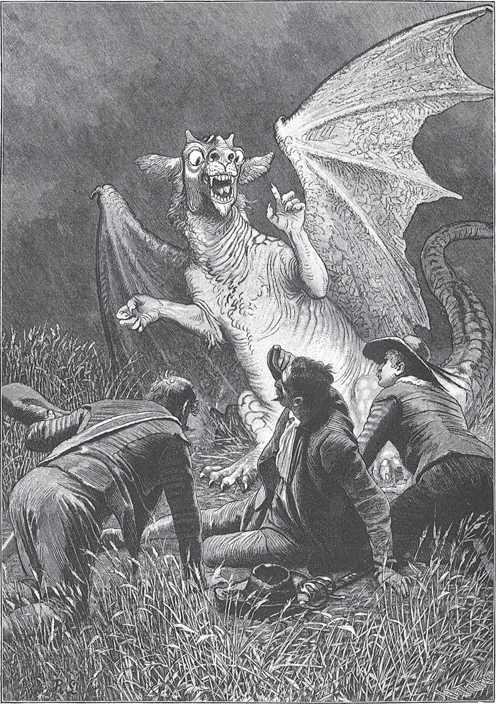

## Der Teufel und seine Großmutter

Es war einmal ein großer Krieg. Der König hatte viele Soldaten, aber er gab ihnen wenig <abbr title="der Sold — жалованье (солдатское)">Sold</abbr>, sodass sie nicht davon leben konnten. Da taten sich drei zusammen und wollten <abbr title="desertieren — дезертировать">desertieren</abbr>. Einer sagte zum anderen:

— Wenn sie uns erwischen, hängt man uns am Galgen auf. Wie wollen wir es machen?

Der andere sagte:

— Seht ihr dort das große <abbr title="das Kornfeld, die Kornfelder — хлебное поле">Kornfeld</abbr>? Wenn wir uns dort verstecken, findet uns kein Mensch. Das Heer darf nicht hinein und muss morgen weiterziehen.

Sie krochen in das Korn. Aber das Heer zog nicht weiter, sondern blieb rundherum <abbr title="lagern — стоять лагерем">lagern</abbr>. Zwei Tage und zwei Nächte saßen sie im Korn und hatten so großen Hunger, dass sie beinahe gestorben wären. Aber wenn sie herausgingen, war ihnen der Tod sicher. Da sagten sie:

— Was hilft uns unsere Flucht? Wir müssen hier elend sterben.

In diesem Augenblick kam ein feuriger Drache durch die Luft geflogen. Er ließ sich zu ihnen herab und fragte, warum sie sich dort versteckt hätten. Sie antworteten:

— Wir sind drei Soldaten und sind <abbr title="davonlaufen (lief davon, ist davongelaufen) — убегать">davongelaufen</abbr>, weil unser Sold so gering war. Jetzt müssen wir hier verhungern, wenn wir liegen bleiben, oder wir müssen am Galgen <abbr title="baumeln — болтаться">baumeln</abbr>, wenn wir herausgehen.

— Wenn ihr mir sieben Jahre dienen wollt, — sagte der Drache, — dann führe ich euch mitten durch das Heer, und niemand wird euch erwischen.

— Wir haben keine <abbr title="die Wahl — выбор">Wahl</abbr>, wir müssen es annehmen, — antworteten sie.

Da packte der Drache sie mit seinen <abbr title="die Klaue, die Klauen — коготь, лапа">Klauen</abbr>, trug sie durch die Luft über das Heer hinweg und setzte sie weit davon wieder auf die Erde. Der Drache aber war niemand anders als der Teufel. Er gab ihnen eine kleine Peitsche und sagte:

— Wenn ihr damit <abbr title="peitschen — хлестать">peitscht</abbr> und knallt, dann springt so viel Geld um euch herum, wie ihr wollt. Dann könnt ihr wie große Herren leben, Pferde halten und in Wagen fahren. Aber nach sieben Jahren gehört ihr mir.

Dann hielt er ihnen ein Buch hin, in das mussten alle drei ihre Unterschrift setzen.

— Aber vorher, — sagte er, — gebe ich euch noch ein Rätsel auf. Wenn ihr es erraten könnt, sollt ihr frei sein und aus meiner Gewalt entlassen werden.

Dann flog der Drache weg. Die drei reisten mit ihrer Peitsche weiter. Sie hatten Geld in Hülle und Fülle, ließen sich vornehme Kleider machen und zogen durch die Welt. Wo sie auch waren, lebten sie in Freude und Pracht. Sie fuhren mit Pferden und Wagen, aßen und tranken, taten aber nichts Böses. Die Zeit verging schnell. Als die sieben Jahre zu Ende gingen, bekamen zwei von ihnen schreckliche Angst. Der dritte aber <abbr title="etwas auf die leichte Schulter nehmen — относиться легкомысленно">nahm</abbr> es auf die leichte Schulter und sagte:

— Brüder, habt keine Angst. Ich bin nicht <abbr title="nicht auf den Kopf gefallen sein — быть не дураком">auf den Kopf gefallen</abbr>. Ich errate das Rätsel.

Sie gingen hinaus aufs Feld und setzten sich dort hin. Die zwei machten betrübte Gesichter. Da kam eine alte Frau <abbr title="vorbeikommen (kam vorbei, ist vorbeigekommen) — проходить мимо">vorbei</abbr> und fragte, warum sie so traurig seien.

— Ach, was <abbr title="jemanden etwas angehen — касаться кого-то">geht</abbr> Euch das an? Ihr könnt uns ja doch nicht helfen.

— Wer weiß, — antwortete sie. — Vertraut mir nur euren Kummer an.

Da erzählten sie ihr, dass sie fast sieben Jahre lang Diener des Teufels gewesen seien. Er habe ihnen Geld <abbr title="Geld wie Heu haben — денег куры не клюют">wie Heu</abbr> verschafft. Aber sie hätten sich ihm mit ihrer Unterschrift <abbr title="sich verschreiben (verschrieb, hat verschrieben) — продаться (по договору)">verschrieben</abbr> und würden ihm gehören, wenn sie nach den sieben Jahren ein Rätsel nicht lösen könnten. Die Alte sagte:

— Wenn euch geholfen werden soll, muss einer von euch in den Wald gehen. Dort kommt er an eine <abbr title="einstürzen (ist eingestürzt) — обрушиться">eingestürzte</abbr> <abbr title="die Felswand, die Felswände — скальная стена">Felswand</abbr>, die wie ein kleines Häuschen aussieht. Dort muss er hineingehen, dann wird er Hilfe finden.

Die zwei Traurigen dachten: «Das wird uns doch nicht retten», und blieben sitzen. Der dritte aber, der Lustige, machte sich auf den Weg und ging so weit in den Wald, bis er die <abbr title="die Felsenhütte, die Felsenhütten — хижина в скале">Felsenhütte</abbr> fand. In dem Häuschen saß eine steinalte Frau. Das war die Großmutter des Teufels. Sie fragte ihn, woher er komme und was er hier wolle. Er erzählte ihr alles, was geschehen war. Und weil er ihr gut gefiel, hatte sie Erbarmen mit ihm und sagte, sie wolle ihm helfen. Sie hob einen großen Stein hoch, der über einem Keller lag, und sagte:

— Versteck dich da. Du kannst alles hören, was hier gesprochen wird. Sitz nur still und rühr dich nicht. Wenn der Drache kommt, will ich ihn nach dem Rätsel fragen. Mir sagt er alles. Und dann achte gut auf das, was er antwortet.

Um zwölf Uhr nachts kam der Drache angeflogen und wollte sein Essen haben. Die Großmutter deckte den Tisch und trug Getränke und Speisen auf, sodass er zufrieden war, und sie aßen und tranken zusammen. Im Gespräch fragte sie ihn, wie sein Tag <abbr title="verlaufen (verlief, ist verlaufen) — проходить, протекать">verlaufen</abbr> sei und wie viele Seelen er bekommen habe.

— Heute wollte es mir nicht so recht gelingen, — antwortete er. — Aber ich habe drei Soldaten gepackt. Die sind mir sicher.

— So, drei Soldaten, — sagte sie. — Soldaten haben es <abbr title="es in sich haben — быть непростым">in sich</abbr>. Die können dir noch entkommen.

Der Teufel sagte höhnisch:

— Die gehören mir. Ich gebe ihnen noch ein Rätsel auf, das sie niemals erraten können.

— Was ist das für ein Rätsel? — fragte sie.

— Das will ich dir sagen: In der großen <abbr title="die Nordsee — Северное море">Nordsee</abbr> liegt eine tote Meerkatze, das soll ihr Braten sein. Und die Rippe von einem <abbr title="der Walfisch, die Walfische — кит">Walfisch</abbr>, das soll ihr silberner Löffel sein. Und ein alter, hohler Pferdefuß, das soll ihr Weinglas sein.

Als der Teufel ins Bett gegangen war, hob die alte Großmutter den Stein hoch und ließ den Soldaten heraus.

— Hast du dir auch alles gut gemerkt?

— Ja, — sagte er. — Ich weiß genug und werde mir schon helfen.

Dann musste er auf einem anderen Weg, heimlich durchs Fenster und <abbr title="in aller Eile — в спешке, второпях">in aller Eile</abbr>, zu seinen Kameraden zurückgehen. Er erzählte ihnen, wie die alte Großmutter den Teufel überlistet hatte und wie er die <abbr title="die Lösung, die Lösungen — разгадка, решение">Lösung</abbr> des Rätsels von ihm gehört hatte. Da waren sie alle fröhlich und guter Dinge. Sie nahmen die Peitsche und schlugen sich so viel Geld, dass es auf der Erde herumsprang.

Als die sieben Jahre ganz vorbei waren, kam der Teufel mit dem Buch, zeigte ihnen die Unterschriften und sagte:

— Ich will euch mit in die Hölle nehmen. Dort sollt ihr eine Mahlzeit bekommen. Wenn ihr erraten könnt, was für einen Braten ihr zu essen bekommt, dann sollt ihr frei sein, und ihr dürft auch die Peitsche behalten.

Da fing der erste Soldat an:

— In der großen Nordsee liegt eine tote Meerkatze, das wird wohl der Braten sein.

Der Teufel ärgerte sich, machte «Hm! Hm! Hm!» und fragte den zweiten:

— Und was soll euer Löffel sein?

— Die Rippe von einem Walfisch, das soll unser silberner Löffel sein.

Der Teufel <abbr title="eine Grimasse schneiden (schnitt, hat geschnitten) — скорчить гримасу">schnitt eine Grimasse</abbr>, knurrte wieder dreimal «Hm! Hm! Hm!» und sagte zum dritten:

— Wisst ihr auch, was euer Weinglas sein soll?

— Ein alter Pferdefuß, das soll unser Weinglas sein.

Da flog der Teufel mit einem lauten Schrei davon und hatte keine Macht mehr über sie. Die drei aber behielten die Peitsche, schlugen so viel Geld heraus, wie sie wollten, und lebten glücklich bis an ihr Ende.

---

### Neue Wörter

- **der Sold** — жалованье (солдатское)
- **desertieren** — дезертировать
- **das Kornfeld, die Kornfelder** — хлебное поле
- **lagern** — стоять лагерем
- **davonlaufen (lief davon, ist davongelaufen)** — убегать
- **baumeln** — болтаться
- **die Wahl** — выбор
- **die Klaue, die Klauen** — коготь, лапа
- **peitschen** — хлестать
- **etwas auf die leichte Schulter nehmen** — относиться легкомысленно
- **nicht auf den Kopf gefallen sein** — быть не дураком
- **vorbeikommen (kam vorbei, ist vorbeigekommen)** — проходить мимо
- **jemanden etwas angehen** — касаться кого-то
- **Geld wie Heu haben** — денег куры не клюют
- **sich verschreiben (verschrieb, hat verschrieben)** — продаться (по договору)
- **einstürzen (ist eingestürzt)** — обрушиться
- **die Felswand, die Felswände** — скальная стена
- **die Felsenhütte, die Felsenhütten** — хижина в скале
- **verlaufen (verlief, ist verlaufen)** — проходить, протекать
- **es in sich haben** — быть непростым
- **die Nordsee** — Северное море
- **der Walfisch, die Walfische** — кит
- **in aller Eile** — в спешке, второпях
- **die Lösung, die Lösungen** — разгадка, решение
- **eine Grimasse schneiden (schnitt, hat geschnitten)** — скорчить гримасу

[← Zurück](kapitel-124.md) · [Inhalt](README.md) · [Weiter →](kapitel-126.md)
