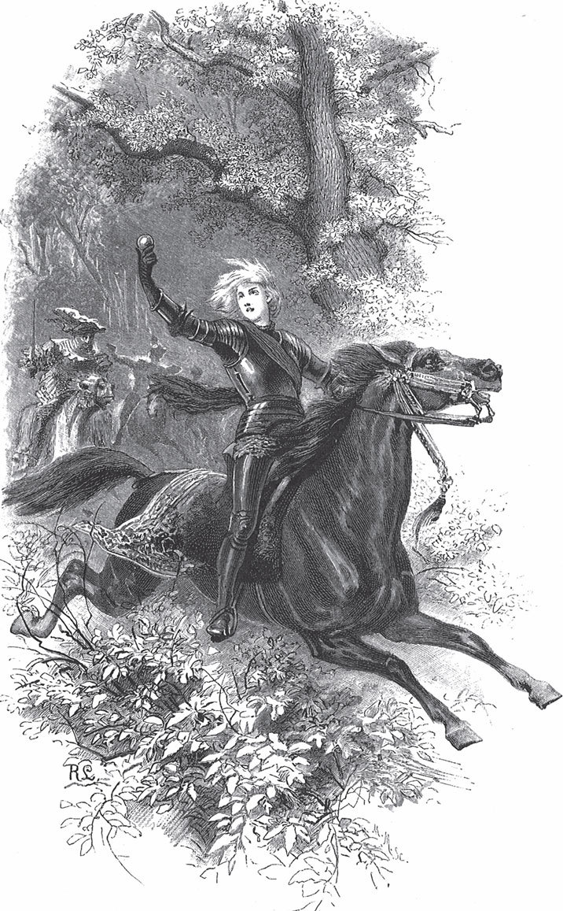

## Ferdinand getreu und Ferdinand ungetreu

Es waren einmal ein Mann und eine Frau. Solange sie reich waren, hatten sie keine Kinder. Aber als sie arm geworden waren, bekamen sie einen kleinen Jungen. Doch sie konnten keinen Paten für ihn finden. Da sagte der Mann, er wolle einmal in den nächsten Ort gehen und sehen, ob er dort einen bekäme.

Unterwegs begegnete ihm ein armer Mann. Der fragte ihn, wohin er wolle. Er sagte, er wolle sehen, dass er einen Paten bekäme. Er sei arm, und deshalb wolle kein Mensch Gevatter bei ihm stehen.

— Oh, — sagte der arme Mann, — Ihr seid arm, und ich bin arm. Ich will Euer Gevatter werden. Aber ich bin so arm, dass ich dem Kind nichts schenken kann. Geht nach Hause und sagt der <abbr title="die Hebamme, die Hebammen — повитуха, акушерка">Hebamme</abbr>, sie soll nur mit dem Kind in die Kirche kommen.

Als sie dann zusammen in die Kirche kamen, war der Bettler schon drinnen. Er gab dem Kind den Namen Ferdinand getreu.

Als sie aus der Kirche gingen, sagte der Bettler:

— Jetzt geht nur nach Hause. Ich kann Euch nichts geben, und Ihr sollt mir auch nichts geben.

Der Hebamme aber gab er einen Schlüssel. Sie solle ihn dem Vater geben, wenn sie nach Hause käme. Der Vater solle ihn aufbewahren, bis das Kind vierzehn Jahre alt sei. Dann solle es auf die Heide gehen. Dort stehe ein Schloss, zu dem der Schlüssel <abbr title="passen zu + Dat. — подходить к">passe</abbr>. Was darin sei, das solle dem Jungen gehören.

Als das Kind sieben Jahre alt und schon ordentlich gewachsen war, ging es einmal mit anderen Jungen spielen. Da <abbr title="prahlen mit + Dat. — хвастаться чем-то">prahlte</abbr> der eine, er habe vom Paten dies bekommen, und der andere, er habe noch mehr bekommen. Aber Ferdinand konnte nichts sagen. Da heulte er, ging nach Hause und sagte zum Vater:

— Habe ich denn gar nichts vom Paten bekommen?

— Oh doch, — sagte der Vater. — Du hast einen Schlüssel bekommen. Wenn auf der Heide ein Schloss steht, dann geh nur hin und schließ es auf.

Da ging er hin, aber von einem Schloss war nichts zu hören und zu sehen. Sieben Jahre später, als er vierzehn Jahre alt war, ging er noch einmal hin. Da stand ein Schloss auf der Heide. Als er es aufgeschlossen hatte, war nichts <abbr title="darin — внутри">darin</abbr> als ein Pferd, ein Schimmel. Der Junge war so voller Freude, dass er ein Pferd hatte, dass er sich <abbr title="sich daraufsetzen — садиться верхом">daraufsetzte</abbr> und zu seinem Vater galoppierte.

— Jetzt habe ich auch einen Schimmel, jetzt will ich auch reisen, — sagte er.

Da zog er fort. Unterwegs lag eine <abbr title="die Schreibfeder, die Schreibfedern — писчее перо">Schreibfeder</abbr> auf dem Weg. Zuerst wollte er sie aufheben. Aber dann dachte er <abbr title="bei sich denken — думать про себя">bei sich</abbr>: «Ach, du kannst sie auch liegen lassen. Wo du hinkommst, findest du schon eine Schreibfeder, wenn du eine brauchst.» Als er weiterritt, rief es hinter ihm auf Plattdeutsch:

«Ferenand getrü, nümm se mit.»

Das heißt: «Ferdinand getreu, nimm sie mit.»

Er sah sich um, aber er sah niemanden. Da ging er wieder zurück und hob die Feder auf.

Als er wieder eine Weile geritten war, kam er an einem Wasser vorbei. Da lag ein Fisch am Ufer und <abbr title="schnappen nach + Dat. — хватать ртом">schnappte</abbr> und <abbr title="japsen — задыхаться, хватать воздух">japste</abbr> nach Luft. Da sagte er:

— Warte, mein lieber Fisch, ich helfe dir, dass du ins Wasser kommst.

Er packte ihn am Schwanz und warf ihn ins Wasser. Da steckte der Fisch den Kopf aus dem Wasser und sagte:

— Weil du mir aus dem <abbr title="der Schmutz — грязь">Schmutz</abbr> geholfen hast, will ich dir eine Flöte geben. Wenn du in Not bist, dann <abbr title="flöten — играть на флейте, свистеть">flöte</abbr> darauf, und ich werde dir helfen. Und wenn du einmal etwas ins Wasser fallen lässt, dann flöte nur, und ich bringe es dir heraus.

Nun ritt er weiter. Da kam ein Mensch auf ihn zu und fragte ihn, wohin er wolle.

— Oh, in den nächsten Ort.

Wie er denn heiße?

— Ferdinand getreu.

— Sieh an, da haben wir ja fast denselben Namen. Ich heiße Ferdinand ungetreu.

Da zogen die beiden zusammen in den nächsten Ort ins Wirtshaus.

Nun war es schlimm, dass Ferdinand ungetreu alles wusste, was ein anderer dachte und tun wollte. Das wusste er durch allerlei böse Künste. Im Wirtshaus aber war ein tüchtiges Mädchen. Es hatte ein klares Gesicht und benahm sich sehr hübsch. Das Mädchen verliebte sich in Ferdinand getreu, denn er war ein hübscher junger Mann. Es fragte ihn, wohin er wolle.

— Oh, einfach so herumreisen.

Da sagte sie, er solle doch hierbleiben. Hier im Land gebe es einen König, der gern einen Diener oder einen <abbr title="der Vorreiter, die Vorreiter — форейтор, верховой (едущий впереди)">Vorreiter</abbr> hätte. Bei ihm solle er <abbr title="in den Dienst gehen — поступить на службу">in den Dienst gehen</abbr>. Er antwortete, er könne nicht so einfach zu einem hingehen und sich anbieten.

— Oh, — sagte das Mädchen, — das will ich dann schon tun.

Und so ging sie sofort zum König und sagte ihm, sie wisse einen hübschen Diener für ihn. Damit war der König zufrieden. Er ließ ihn zu sich kommen und wollte ihn zu seinem Diener machen. Ferdinand getreu wollte aber lieber Vorreiter sein, denn wo sein Pferd war, da musste er auch sein. Also machte ihn der König zum Vorreiter.

Als Ferdinand ungetreu das erfuhr, sagte er zu dem Mädchen:

— Halt, dem hilfst du, und mir nicht?

— Oh, — sagte das Mädchen, — ich will dir auch helfen.

Sie dachte: «Den musst du dir zum Freund halten, denn man kann ihm nicht trauen.» Also ging sie zum König und bot ihn als Diener an. Damit war der König zufrieden.

Wenn Ferdinand ungetreu nun morgens seinen Herrn anzog, jammerte der König immer:

— Ach, wenn ich doch nur meine Liebste bei mir hätte!

Ferdinand ungetreu war aber Ferdinand getreu immer <abbr title="feindlich gesinnt sein — быть враждебно настроенным">feindlich gesinnt</abbr>. Als der König wieder einmal so jammerte, sagte er:

— Sie haben doch den Vorreiter. Den schicken Sie hin, der muss sie herbringen. Und wenn er es nicht tut, dann soll man ihm den Kopf vor die Füße legen.

Da ließ der König Ferdinand getreu zu sich kommen und sagte ihm, er habe da und da eine Liebste. Die solle er ihm herbringen. Wenn er das nicht tue, müsse er sterben.

Ferdinand getreu ging in den Stall zu seinem Schimmel, weinte und jammerte:

— Oh, was bin ich für ein unglückliches Menschenkind!

Da rief jemand hinter ihm:

— Ferdinand getreu, was weinst du?

Er sah sich um, aber er sah niemanden und jammerte immer weiter:

— Oh, mein lieber <abbr title="das Schimmelchen — беляночка, белая лошадка">Schimmelchen</abbr>, jetzt muss ich dich verlassen, jetzt muss ich sterben.

Da rief es wieder:

— Ferdinand getreu, was weinst du?

Erst jetzt merkte er, dass sein Schimmelchen ihn fragte.

— Bist du das, mein Schimmelchen? Kannst du sprechen?

Und er sagte weiter:

— Ich soll da und da hingehen und die Braut holen. Weißt du nicht, wie ich das <abbr title="etwas anfangen (fing an, hat angefangen) — взяться за что-то">anfangen</abbr> soll?

Da antwortete das Schimmelchen:

— Geh zum König und sag ihm: Wenn er dir gibt, was du brauchst, dann holst du sie ihm. Wenn er dir ein Schiff voll Fleisch und ein Schiff voll Brot gibt, dann wird es gelingen. Denn auf dem Wasser sind die großen Riesen. Wenn du ihnen kein Fleisch mitbringst, zerreißen sie dich. Und da sind die großen Vögel. Die picken dir die Augen aus dem Kopf, wenn du kein Brot für sie hast.

Da ließ der König alle <abbr title="der Schlachter, die Schlachter — мясник">Schlachter</abbr> im Land schlachten und alle Bäcker backen, bis die Schiffe voll waren. Als sie voll waren, sagte das Schimmelchen zu Ferdinand getreu:

— Jetzt setz dich auf mich und reite mit mir aufs Schiff. Wenn dann die Riesen kommen, dann sag:

> «Still, still, meine lieben Rieschen,  
> ich hab euch wohl bedacht,  
> ich hab euch was mitgebracht.»

Und wenn die Vögel kommen, dann sagst du wieder:

> «Still, still, meine lieben Vögelchen,  
> ich hab euch wohl bedacht,  
> ich hab euch was mitgebracht.»

Dann tun sie dir nichts. Und wenn du dann zum Schloss kommst, helfen dir die Riesen. Dann geh ins Schloss hinauf und nimm ein paar Riesen mit. Dort liegt die Prinzessin und schläft. Du darfst sie aber nicht aufwecken, sondern die Riesen müssen sie mit dem Bett hochheben und ins Schiff tragen.

Und es geschah alles so, wie das Schimmelchen gesagt hatte. Ferdinand getreu gab den Riesen und den Vögeln, was er ihnen mitgebracht hatte. Dafür wurden die Riesen <abbr title="willig — послушный, охотный">willig</abbr> und trugen die Prinzessin in ihrem Bett zum König.

Als sie aber zum König kam, sagte sie, sie könne nicht leben, sie müsse ihre <abbr title="die Schrift, die Schriften — бумаги, записи">Schriften</abbr> haben. Die seien in ihrem Schloss liegen geblieben. Da wurde Ferdinand getreu auf <abbr title="das Anstiften — подстрекательство">Anstiften</abbr> von Ferdinand ungetreu wieder gerufen. Der König befahl ihm, die Schriften aus dem Schloss zu holen, sonst müsse er sterben. Da ging er wieder in den Stall, weinte und sagte:

— Oh, mein liebes Schimmelchen, jetzt soll ich noch einmal weg. Wie sollen wir das machen?

Da sagte der Schimmel, sie sollten das Schiff nur wieder <abbr title="vollladen (lud voll, hat vollgeladen) — нагружать доверху">vollladen</abbr>. Es ging wieder wie beim vorigen Mal: Die Riesen und die Vögel wurden mit dem Fleisch satt gemacht und besänftigt. Als sie zum Schloss kamen, sagte der Schimmel zu ihm, er solle nur hineingehen, ins Schlafzimmer der Prinzessin. Dort auf dem Tisch lägen die Schriften. Da ging Ferdinand getreu hin und holte sie.

Als sie wieder auf dem Wasser waren, ließ er seine Schreibfeder ins Wasser fallen. Da sagte der Schimmel:

— Jetzt kann ich dir aber nicht helfen.

Da fiel ihm die Flöte ein. Er fing an zu flöten. Da kam der Fisch, hatte die Feder im Maul und reichte sie ihm. Nun brachte er die Schriften zum Schloss, wo die Hochzeit gefeiert wurde.

Die Königin mochte den König aber nicht, weil er keine Nase hatte. Sie mochte lieber Ferdinand getreu. Als einmal alle Herren vom Hof zusammen waren, sagte die Königin, sie könne auch <abbr title="das Kunststück, die Kunststücke — фокус, трюк">Kunststücke</abbr> machen. Sie könne einem den Kopf abschlagen und wieder aufsetzen. Es solle es nur einer ausprobieren. Da wollte aber keiner der Erste sein. So musste Ferdinand getreu herhalten, wieder auf Anstiften von Ferdinand ungetreu. Sie schlug ihm den Kopf ab und setzte ihn ihm auch wieder auf. Er <abbr title="zusammenheilen — срастаться">heilte</abbr> auch gleich wieder zusammen, sodass es nur aussah, als hätte er einen roten Faden um den Hals. Da sagte der König zu ihr:

— Mein Kind, wo hast du denn das gelernt?

— Ja, — sagte sie, — die Kunst beherrsche ich. Soll ich es an dir auch einmal versuchen?

— Oh ja, — sagte er.

Da schlug sie ihm den Kopf ab, setzte ihn aber nicht wieder auf. Sie tat so, als ob sie ihn nicht daraufbekäme und als ob er nicht festsitzen wolle. Da wurde der König begraben, und sie heiratete Ferdinand getreu.

Er ritt aber immer noch seinen Schimmel. Als er einmal darauf saß, sagte der Schimmel zu ihm, er solle auf eine andere Heide reiten, die er ihm zeigte, und dort dreimal mit ihm herumgaloppieren. Als er das getan hatte, stellte sich der Schimmel auf die Hinterbeine und verwandelte sich in einen Königssohn.

---

### Neue Wörter

- **die Hebamme, die Hebammen** — повитуха, акушерка
- **passen zu + Dat.** — подходить к
- **prahlen mit + Dat.** — хвастаться чем-то
- **darin** — внутри
- **sich daraufsetzen** — садиться верхом
- **die Schreibfeder, die Schreibfedern** — писчее перо
- **bei sich denken** — думать про себя
- **schnappen nach + Dat.** — хватать ртом
- **japsen** — задыхаться, хватать воздух
- **der Schmutz** — грязь
- **flöten** — играть на флейте, свистеть
- **der Vorreiter, die Vorreiter** — форейтор, верховой (едущий впереди)
- **in den Dienst gehen** — поступить на службу
- **feindlich gesinnt sein** — быть враждебно настроенным
- **das Schimmelchen** — беляночка, белая лошадка
- **etwas anfangen (fing an, hat angefangen)** — взяться за что-то
- **der Schlachter, die Schlachter** — мясник
- **willig** — послушный, охотный
- **die Schrift, die Schriften** — бумаги, записи
- **das Anstiften** — подстрекательство
- **vollladen (lud voll, hat vollgeladen)** — нагружать доверху
- **das Kunststück, die Kunststücke** — фокус, трюк
- **zusammenheilen** — срастаться

[← Zurück](kapitel-125.md) · [Inhalt](README.md) · [Weiter →](kapitel-127.md)
