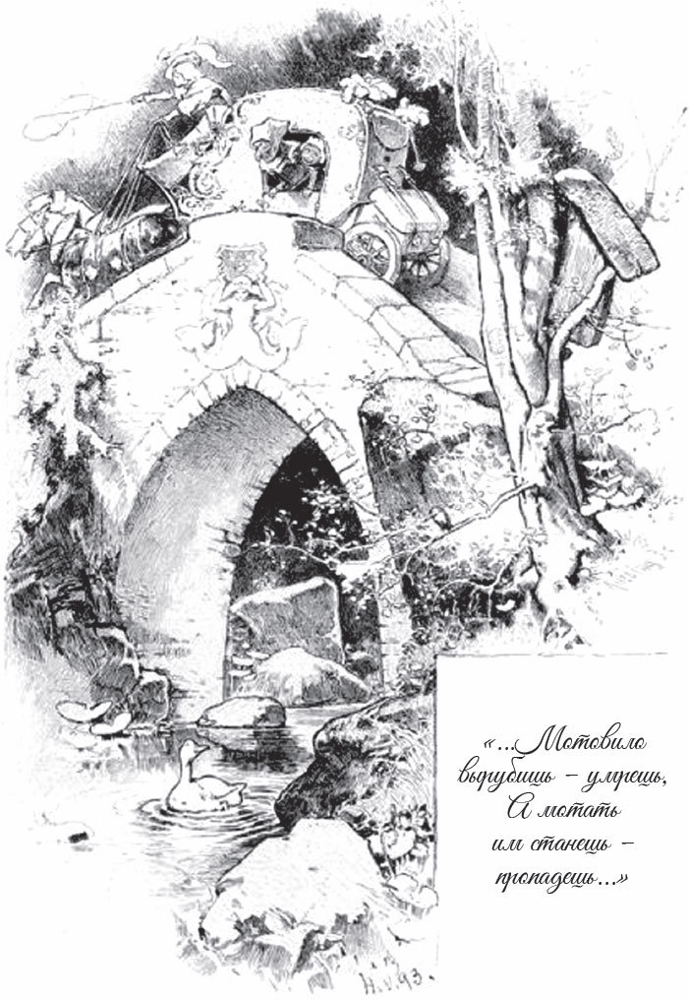

## Die faule Spinnerin

In einem Dorf lebten ein Mann und eine Frau. Die Frau war so faul, dass sie nie arbeiten wollte. Was ihr der Mann zum Spinnen gab, das spann sie nicht fertig. Und was sie doch gesponnen hatte, das <abbr title="haspeln — мотать (пряжу) на мотовило">haspelte</abbr> sie nicht, sondern ließ alles <abbr title="aufwickeln — намотать">aufgewickelt</abbr> auf dem Knäuel liegen. Wenn der Mann mit ihr <abbr title="schimpfen mit + Dat. — ругать кого-то">schimpfte</abbr>, war sie mit ihrem <abbr title="das Mundwerk — язык (болтливый), «язычок»">Mundwerk</abbr> doch immer schneller als er und sagte:

— Ach, wie soll ich denn haspeln, wenn ich keine Haspel habe? Geh du zuerst in den Wald und besorg mir eine.

— Wenn es nur daran liegt, — sagte der Mann, — dann gehe ich in den Wald und hole <abbr title="das Haspelholz — дерево для мотовила">Haspelholz</abbr>.

Da bekam die Frau Angst. Wenn er das Holz hatte, dann machte er daraus eine Haspel, und dann musste sie das Garn abhaspeln und danach wieder neu spinnen. Sie überlegte ein bisschen, da kam ihr eine gute <abbr title="die Idee, die Ideen — идея, мысль">Idee</abbr>. Sie lief dem Mann heimlich in den Wald nach. Er kletterte auf einen Baum, um das richtige Holz auszusuchen und abzuhacken. Da schlich sie unter den Baum ins Gebüsch, wo er sie nicht sehen konnte, und rief nach oben:

«Wer Haspelholz haut, der stirbt,

wer da haspelt, der verdirbt.»

Der Mann horchte. Er legte die Axt eine Weile hin und dachte nach, was das wohl bedeuten sollte.

— Ach was, — sagte er schließlich, — was soll das schon gewesen sein! Du hast dir das nur eingebildet, es hat dir in den Ohren geklungen. Mach dir keine unnötige Angst.

Also packte er die Axt wieder und wollte zuschlagen. Da rief es wieder von unten herauf:

«Wer Haspelholz haut, der stirbt,

wer da haspelt, der verdirbt.»

Er hörte auf, bekam es mit der Angst zu tun und dachte über die Sache nach. Aber nach einem Weilchen kam sein Mut zurück, und er griff zum dritten Mal nach der Axt und wollte zuschlagen. Doch zum dritten Mal rief es, und zwar laut:

«Wer Haspelholz haut, der stirbt,

wer da haspelt, der verdirbt.»

Jetzt hatte er genug, und alle Lust war ihm vergangen. Er stieg eilig vom Baum herunter und machte sich auf den Heimweg. Die Frau lief, so schnell sie konnte, auf <abbr title="der Nebenweg, die Nebenwege — окольная дорога">Nebenwegen</abbr>, damit sie vor ihm zu Hause war. Als er in die Stube kam, tat sie ganz unschuldig, als ob nichts geschehen wäre, und fragte:

— Na, bringst du gutes Haspelholz mit?

— Nein, — sagte er, — ich sehe schon, mit dem Haspeln wird das nichts.

Er erzählte ihr, was ihm im Wald passiert war, und ließ sie von da an mit dem Haspeln in Ruhe.

Doch bald danach fing der Mann wieder an, sich über die <abbr title="die Unordnung — беспорядок">Unordnung</abbr> im Haus zu ärgern.

— Frau, — sagte er, — es ist doch eine Schande, dass das gesponnene Garn da einfach auf dem Knäuel liegen bleibt.

— Weißt du was? — sagte sie. — Weil wir doch keine Haspel bekommen, stellst du dich oben auf den Dachboden, und ich stehe unten. Ich werfe dir das Knäuel hinauf, und du wirfst es herunter. So gibt es doch einen Strang.

— Ja, so geht das, — sagte der Mann.

Also machten sie es so. Als sie fertig waren, sagte er:

— Das Garn ist jetzt in Strängen, nun muss es auch noch gekocht werden.

Da bekam die Frau wieder Angst. Sie sagte zwar: «Ja, wir kochen es gleich morgen früh», aber <abbr title="insgeheim — втайне">insgeheim</abbr> dachte sie schon an einen neuen Streich. Früh am Morgen stand sie auf, machte Feuer und stellte den Kessel darauf. Aber statt des Garns legte sie einen Klumpen <abbr title="das Werg — пакля, очёски">Werg</abbr> hinein und ließ es immer weiter kochen. Dann ging sie zu ihrem Mann, der noch im Bett lag, und sagte:

— Ich muss mal weggehen. Steh du inzwischen auf und sieh nach dem Garn, das im Kessel über dem Feuer steht. Aber du musst es rechtzeitig tun, pass gut auf! Denn wenn der Hahn kräht und du hast nicht nachgesehen, dann wird das Garn zu Werg.

Der Mann war eifrig und wollte nichts <abbr title="versäumen — упустить, пропустить">versäumen</abbr>. Er sprang aus dem Bett, so schnell er konnte, und lief in die Küche. Doch als er zum Kessel kam und hineinsah, erblickte er zu seinem Schrecken nichts als einen Klumpen Werg. Da blieb der arme Mann mäuschenstill. Er dachte, er hätte den Moment verpasst und wäre selbst schuld daran. Und in Zukunft sprach er nie wieder von Garn und Spinnen.

Aber das musst du selbst zugeben: Es war eine garstige Frau.

---

### Neue Wörter

- **haspeln** — мотать (пряжу) на мотовило
- **aufwickeln** — намотать
- **schimpfen mit + Dat.** — ругать кого-то
- **das Mundwerk** — язык (болтливый), «язычок»
- **das Haspelholz** — дерево для мотовила
- **die Idee, die Ideen** — идея, мысль
- **der Nebenweg, die Nebenwege** — окольная дорога
- **die Unordnung** — беспорядок
- **insgeheim** — втайне
- **das Werg** — пакля, очёски
- **versäumen** — упустить, пропустить

[← Zurück](kapitel-127.md) · [Inhalt](README.md) · [Weiter →](kapitel-129.md)
