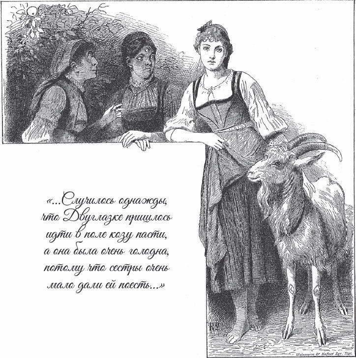

## Einäuglein, Zweiäuglein und Dreiäuglein

Es war einmal eine Frau, die hatte drei Töchter. Die älteste hieß Einäuglein, weil sie nur ein einziges Auge mitten auf der Stirn hatte. Die mittlere hieß Zweiäuglein, weil sie zwei Augen hatte wie andere Menschen. Und die jüngste hieß Dreiäuglein, weil sie drei Augen hatte; das dritte saß bei ihr ebenfalls mitten auf der Stirn. Aber gerade weil Zweiäuglein nicht anders aussah als andere Menschenkinder, konnten die Schwestern und die Mutter sie nicht leiden. Sie sagten zu ihr:

— Du mit deinen zwei Augen bist nicht besser als das <abbr title="das einfache Volk — простой народ, чернь">einfache Volk</abbr>. Du gehörst nicht zu uns.

Sie stießen sie herum, warfen ihr schlechte Kleider hin und gaben ihr nur das zu essen, was sie selbst <abbr title="übrig lassen — оставлять (объедки)">übrig ließen</abbr>. Wo sie nur konnten, taten sie ihr <abbr title="jemandem Leid antun — причинять кому-то горе">Leid</abbr> an.

Eines Tages musste Zweiäuglein hinaus aufs Feld gehen und die Ziege hüten. Sie war aber noch ganz hungrig, weil ihr die Schwestern so wenig zu essen gegeben hatten. Da setzte sie sich auf einen <abbr title="der Feldrain, die Feldraine — межа">Feldrain</abbr> und fing an zu weinen, und sie weinte so sehr, dass zwei kleine Bäche aus ihren Augen flossen. Als sie in ihrem Kummer einmal aufblickte, stand eine Frau neben ihr und fragte:

— Zweiäuglein, warum weinst du?

— Soll ich etwa nicht weinen? — antwortete Zweiäuglein. — Weil ich zwei Augen habe wie andere Menschen, können mich meine Schwestern und meine Mutter nicht leiden. Sie stoßen mich aus einer Ecke in die andere, werfen mir alte Kleider hin und geben mir nur das zu essen, was sie übrig lassen. Heute haben sie mir so wenig gegeben, dass ich noch ganz hungrig bin.

Da sagte die weise Frau:

— Zweiäuglein, <abbr title="trocknen — вытирать, сушить">trockne</abbr> dir die Tränen ab. Ich will dir etwas sagen, damit du nie mehr hungern musst. Sag nur zu deiner Ziege:

«<abbr title="das Zicklein, die Zicklein — козлёнок, козочка">Zicklein</abbr>, meck,

Tischlein, deck»,

dann steht ein sauber gedecktes Tischlein vor dir, mit dem schönsten Essen darauf, und du kannst essen, so viel du Lust hast. Und wenn du satt bist und das Tischlein nicht mehr brauchst, dann sag nur:

«Zicklein, meck,

Tischlein, weg»,

dann verschwindet es wieder vor deinen Augen.

Danach ging die weise Frau fort. Zweiäuglein aber dachte: «Ich muss gleich einmal ausprobieren, ob es wahr ist, was sie gesagt hat, denn ich habe so großen Hunger.» Und sie sagte:

«Zicklein, meck,

Tischlein, deck.»

Kaum hatte sie die Worte ausgesprochen, da stand vor ihr ein Tischlein mit einem weißen Tuch. Darauf lagen ein Teller, Messer und Gabel und ein silberner Löffel. Rundherum standen die schönsten Speisen. Sie dampften und waren noch warm, als ob sie gerade aus der Küche kämen. Da sprach Zweiäuglein das kürzeste Gebet, das sie kannte: «Herr Gott, sei unser Gast zu aller Zeit, Amen.» Dann griff sie zu und ließ es sich gut schmecken. Als sie satt war, sagte sie, wie es die weise Frau ihr beigebracht hatte:

«Zicklein, meck,

Tischlein, weg.»

Sofort waren das Tischchen und alles, was darauf stand, wieder verschwunden. «Das ist ja ein schöner Haushalt», dachte Zweiäuglein und war ganz vergnügt und guter Dinge.

Als sie am Abend mit ihrer Ziege nach Hause kam, fand sie ein irdenes Schüsselchen mit Essen, das ihr die Schwestern hingestellt hatten. Aber sie rührte nichts davon an. Am nächsten Tag zog sie wieder mit ihrer Ziege hinaus und ließ die paar Brocken, die man ihr gab, liegen. Beim ersten und beim zweiten Mal <abbr title="beachten — обращать внимание">beachteten</abbr> die Schwestern es gar nicht. Doch als es jedes Mal so war, wurden sie <abbr title="aufmerksam werden — насторожиться, обратить внимание">aufmerksam</abbr> und sagten:

— Mit Zweiäuglein stimmt etwas nicht. Jedes Mal lässt sie das Essen stehen, und früher hat sie doch alles aufgegessen, was man ihr gab. Sie muss etwas anderes gefunden haben.

Um hinter die Wahrheit zu kommen, sollte Einäuglein mitgehen, wenn Zweiäuglein die Ziege auf die Weide trieb. Sie sollte beobachten, was Zweiäuglein dort tat und ob ihr jemand etwas zu essen und zu trinken brachte.

Als Zweiäuglein wieder losging, kam Einäuglein zu ihr und sagte:

— Ich will mit aufs Feld gehen und sehen, ob die Ziege auch richtig gehütet und auf gutes Futter getrieben wird.

Aber Zweiäuglein merkte, was Einäuglein <abbr title="im Sinn haben — иметь на уме">im Sinn hatte</abbr>. Sie trieb die Ziege hinaus ins hohe Gras und sagte:

— Komm, Einäuglein, wir setzen uns hin. Ich will dir etwas vorsingen.

Einäuglein setzte sich. Sie war von dem <abbr title="ungewohnt — непривычный">ungewohnten</abbr> Weg und von der Sonnenhitze müde, und Zweiäuglein sang immer wieder:

«Einäuglein, wachst du?

Einäuglein, schläfst du?»

Da machte Einäuglein ihr eines Auge zu und schlief ein. Als Zweiäuglein sah, dass Einäuglein fest schlief und nichts verraten konnte, sagte sie:

«Zicklein, meck,

Tischlein, deck»,

setzte sich an ihr Tischlein und aß und trank, bis sie satt war. Dann rief sie wieder:

«Zicklein, meck,

Tischlein, weg»,

und augenblicklich war alles verschwunden. Nun weckte Zweiäuglein ihre Schwester und sagte:

— Einäuglein, du willst die Ziege hüten und schläfst dabei ein! Inzwischen hätte die Ziege in alle Welt laufen können. Komm, wir gehen nach Hause.

Da gingen sie nach Hause, und Zweiäuglein ließ ihr Schüsselchen wieder <abbr title="unberührt — нетронутый">unberührt</abbr> stehen. Einäuglein konnte der Mutter nicht verraten, warum sie nicht essen wollte, und sagte zu ihrer <abbr title="die Entschuldigung, die Entschuldigungen — оправдание">Entschuldigung</abbr>:

— Ich bin draußen eingeschlafen.

Am nächsten Tag sagte die Mutter zu Dreiäuglein:

— Diesmal sollst du mitgehen und aufpassen, ob Zweiäuglein draußen isst und ob ihr jemand Essen und Trinken bringt. Denn heimlich muss sie essen und trinken.

Da kam Dreiäuglein zu Zweiäuglein und sagte:

— Ich will mitgehen und sehen, ob die Ziege auch richtig gehütet und auf gutes Futter getrieben wird.

Aber Zweiäuglein merkte, was Dreiäuglein im Sinn hatte. Sie trieb die Ziege hinaus ins hohe Gras und sagte:

— Wir setzen uns hierhin, Dreiäuglein. Ich will dir etwas vorsingen.

Dreiäuglein setzte sich. Sie war müde von dem Weg und der Sonnenhitze, und Zweiäuglein fing wieder das Liedchen von vorher an und sang:

«Dreiäuglein, wachst du?»

Doch statt nun zu singen:

«Dreiäuglein, schläfst du?»,

sang sie aus <abbr title="die Unachtsamkeit — невнимательность, оплошность">Unachtsamkeit</abbr>:

«Zweiäuglein, schläfst du?»

Und so sang sie immer wieder:

«Dreiäuglein, wachst du?

Zweiäuglein, schläfst du?»

Da fielen Dreiäuglein zwei Augen zu, und sie schliefen ein. Aber das dritte Auge schlief nicht ein, weil das Sprüchlein es nicht angesprochen hatte. Zwar machte Dreiäuglein es auch zu, aber nur aus List, als ob es ebenfalls schliefe. Doch sie <abbr title="blinzeln — моргать, подглядывать сквозь ресницы">blinzelte</abbr> und konnte alles sehr gut sehen. Als Zweiäuglein glaubte, Dreiäuglein schliefe fest, sagte sie ihr Sprüchlein:

«Zicklein, meck,

Tischlein, deck»,

aß und trank nach Herzenslust und schickte dann das Tischlein wieder fort:

«Zicklein, meck,

Tischlein, weg.»

Und Dreiäuglein hatte alles mit angesehen. Da kam Zweiäuglein zu ihr, weckte sie und sagte:

— Na, Dreiäuglein, bist du eingeschlafen? Du kannst ja gut hüten! Komm, wir gehen nach Hause.

Als sie nach Hause kamen, aß Zweiäuglein wieder nicht. Dreiäuglein aber sagte zur Mutter:

— Jetzt weiß ich, warum das hochmütige Ding nicht isst. Wenn sie draußen zur Ziege sagt:

«Zicklein, meck,

Tischlein, deck»,

dann steht ein Tischlein vor ihr mit dem besten Essen, viel besser, als wir es hier haben. Und wenn sie satt ist, sagt sie:

«Zicklein, meck,

Tischlein, weg»,

und alles ist wieder verschwunden. Ich habe alles genau gesehen. Zwei Augen hat sie mir mit einem Sprüchlein <abbr title="einschläfern — усыпить">eingeschläfert</abbr>, aber das eine auf der Stirn ist zum Glück wach geblieben.

Da rief die neidische Mutter:

— Du willst es besser haben als wir? Die Lust soll dir vergehen!

Sie holte ein <abbr title="das Schlachtmesser, die Schlachtmesser — мясницкий нож">Schlachtmesser</abbr> und stieß es der Ziege ins Herz, sodass sie tot umfiel.

Als Zweiäuglein das sah, ging sie voller Trauer hinaus, setzte sich auf den Feldrain und weinte bittere Tränen. Da stand auf einmal wieder die weise Frau neben ihr und sagte:

— Zweiäuglein, warum weinst du?

— Soll ich etwa nicht weinen? — antwortete sie. — Die Ziege, die mir jeden Tag so schön den Tisch gedeckt hat, wenn ich Euer Sprüchlein <abbr title="aufsagen — произносить, читать наизусть">aufsagte</abbr>, hat meine Mutter <abbr title="totstechen (stach tot, hat totgestochen) — заколоть">totgestochen</abbr>. Jetzt muss ich wieder Hunger und Kummer leiden.

Die weise Frau sagte:

— Zweiäuglein, ich will dir einen guten Rat geben. Bitte deine Schwestern, dass sie dir die <abbr title="die Eingeweide (Pl.) — внутренности, потроха">Eingeweide</abbr> der geschlachteten Ziege geben, und vergrab sie vor der Haustür in der Erde. Das wird dein Glück sein.

Dann verschwand sie. Zweiäuglein ging nach Hause und sagte zu den Schwestern:

— Liebe Schwestern, gebt mir doch etwas von meiner Ziege. Ich verlange nichts Gutes, gebt mir nur die Eingeweide.

Da lachten sie und sagten:

— Die kannst du haben, wenn du sonst nichts willst.

Zweiäuglein nahm die Eingeweide und vergrub sie am Abend <abbr title="in aller Stille — потихоньку, тайно">in aller Stille</abbr> vor der Haustür, wie es die weise Frau ihr geraten hatte.

Am nächsten Morgen wachten alle auf und traten vor die Haustür. Da stand dort ein wunderbarer, prächtiger Baum. Er hatte Blätter aus Silber, und dazwischen hingen Früchte aus Gold. Auf der ganzen weiten Welt gab es wohl nichts Schöneres und Kostbareres. Sie wussten aber nicht, wie der Baum in der Nacht dorthin gekommen war. Nur Zweiäuglein merkte, dass er aus den Eingeweiden der Ziege gewachsen war, denn er stand genau dort, wo sie sie in die Erde begraben hatte. Da sagte die Mutter zu Einäuglein:

— Steig hinauf, mein Kind, und pflück uns die Früchte vom Baum.

Einäuglein stieg hinauf. Aber jedes Mal, wenn sie einen der goldenen Äpfel greifen wollte, <abbr title="entgleiten (entglitt, ist entglitten) + Dat. — выскользнуть из рук">entglitt</abbr> ihr der Zweig. Und das geschah jedes Mal, sodass sie keinen einzigen Apfel pflücken konnte, ganz gleich, wie sie es anstellte. Da sagte die Mutter:

— Dreiäuglein, steig du hinauf. Mit deinen drei Augen kannst du besser um dich schauen als Einäuglein.

Einäuglein rutschte herunter, und Dreiäuglein stieg hinauf. Aber Dreiäuglein war nicht geschickter. Sie konnte schauen, so viel sie wollte, die goldenen Äpfel <abbr title="zurückweichen (wich zurück, ist zurückgewichen) — отступать, отклоняться">wichen</abbr> immer zurück. Endlich wurde die Mutter ungeduldig und stieg selbst hinauf. Aber sie konnte die Früchte genauso wenig fassen wie Einäuglein und Dreiäuglein und griff immer nur in die leere Luft. Da sagte Zweiäuglein:

— Ich will auch einmal hinaufsteigen, vielleicht gelingt es mir besser.

Die Schwestern riefen zwar:

— Du, mit deinen zwei Augen, was willst du denn schon!

Aber Zweiäuglein stieg hinauf, und die goldenen Äpfel wichen nicht vor ihr zurück, sondern senkten sich von selbst in ihre Hand. So konnte sie einen nach dem anderen pflücken und brachte eine ganze Schürze voll mit herunter. Die Mutter nahm ihr die Äpfel ab. Doch statt das arme Zweiäuglein nun besser zu behandeln, wurden die Mutter, Einäuglein und Dreiäuglein nur neidisch, dass sie allein die Früchte holen konnte, und gingen noch härter mit ihr um.

Eines Tages, als sie alle zusammen bei dem Baum standen, kam ein junger Ritter <abbr title="daherreiten (ritt daher, ist dahergeritten) — подъехать верхом">dahergeritten</abbr>.

— Schnell, Zweiäuglein, — riefen die beiden Schwestern, — kriech da unter, damit wir uns nicht für dich schämen müssen!

In aller Eile <abbr title="stülpen über + Akk. — опрокинуть, накрыть сверху">stülpten</abbr> sie ein leeres Fass, das gerade neben dem Baum stand, über das arme Zweiäuglein. Auch die goldenen Äpfel, die sie gepflückt hatte, schoben sie darunter. Als der Ritter näher kam, sahen sie, dass er ein schöner Herr war. Er hielt an, bewunderte den prächtigen Baum aus Gold und Silber und sagte zu den beiden Schwestern:

— Wem gehört dieser schöne Baum? Wer mir einen Zweig davon gibt, der kann dafür verlangen, was er will.

Da antworteten Einäuglein und Dreiäuglein, der Baum gehöre ihnen, und sie wollten ihm gern einen Zweig abbrechen. Sie gaben sich beide große Mühe, aber sie schafften es nicht, denn die Zweige und Früchte wichen jedes Mal vor ihnen zurück. Da sagte der Ritter:

— Das ist aber merkwürdig: Der Baum gehört euch, und doch könnt ihr nichts davon abbrechen!

Sie <abbr title="bei etwas bleiben — стоять на своём">blieben dabei</abbr>, der Baum sei ihr Eigentum. Während sie so redeten, rollte Zweiäuglein ein paar goldene Äpfel unter dem Fass hervor, sodass sie dem Ritter vor die Füße rollten. Denn Zweiäuglein war böse, dass Einäuglein und Dreiäuglein nicht die Wahrheit sagten. Als der Ritter die Äpfel sah, staunte er und fragte, woher sie kämen. Einäuglein und Dreiäuglein antworteten, sie hätten noch eine Schwester. Die dürfe sich aber nicht sehen lassen, weil sie nur zwei Augen habe wie andere gewöhnliche Menschen. Der Ritter aber wollte sie sehen und rief:

— Zweiäuglein, komm heraus!

Da kam Zweiäuglein ganz getrost unter dem Fass hervor. Der Ritter war verwundert über ihre große Schönheit und sagte:

— Du, Zweiäuglein, kannst mir sicher einen Zweig von dem Baum abbrechen.

— Ja, — antwortete Zweiäuglein, — das kann ich wohl, denn der Baum gehört mir.

Sie stieg hinauf, brach ganz leicht einen Zweig mit silbernen Blättern und goldenen Früchten ab und reichte ihn dem Ritter. Da sagte der Ritter:

— Zweiäuglein, was soll ich dir dafür geben?

— Ach, — antwortete Zweiäuglein, — ich leide Hunger und Durst, Kummer und Not vom frühen Morgen bis zum späten Abend. Wenn Ihr mich mitnehmen und erlösen wollt, dann wäre ich glücklich.

Da hob der Ritter Zweiäuglein auf sein Pferd und brachte sie nach Hause, auf das Schloss seines Vaters. Dort gab er ihr schöne Kleider und zu essen und zu trinken nach Herzenslust. Und weil er sie so lieb hatte, ließ er sich mit ihr trauen, und die Hochzeit wurde mit großer Freude gefeiert.

Als Zweiäuglein so von dem schönen Ritter fortgeführt wurde, <abbr title="beneiden um + Akk. — завидовать кому-то в чём-то">beneideten</abbr> die beiden Schwestern sie erst recht um ihr Glück. «Der wunderbare Baum bleibt uns doch», dachten sie. «Auch wenn wir keine Früchte davon pflücken können, so wird doch jeder davor stehen bleiben, zu uns kommen und ihn <abbr title="rühmen — хвалить, прославлять">rühmen</abbr>. Wer weiß, vielleicht <abbr title="jemandem blüht der Weizen — кому-то ещё повезёт, «пшеница зацветёт»">blüht uns noch der Weizen</abbr>!» Aber am nächsten Morgen war der Baum verschwunden, und ihre Hoffnung war dahin. Und als Zweiäuglein aus ihrem Kämmerlein hinausschaute, stand er zu ihrer großen Freude vor dem Fenster. Er war ihr also <abbr title="folgen (ist gefolgt) + Dat. — следовать за">gefolgt</abbr>.

Zweiäuglein lebte lange Zeit glücklich und zufrieden. Einmal kamen zwei arme Frauen zu ihr aufs Schloss und baten um ein Almosen. Zweiäuglein sah ihnen ins Gesicht und erkannte ihre Schwestern Einäuglein und Dreiäuglein. Sie waren so <abbr title="in Armut geraten (geriet, ist geraten) — впасть в нищету">in Armut geraten</abbr>, dass sie <abbr title="umherziehen (zog umher, ist umhergezogen) — скитаться">umherziehen</abbr> und vor fremden Türen um ihr Brot betteln mussten. Zweiäuglein aber hieß sie willkommen, tat ihnen Gutes und pflegte sie. Da bereuten die beiden von ganzem Herzen, was sie ihrer Schwester in der Jugend Böses angetan hatten.

---

### Neue Wörter

- **das einfache Volk** — простой народ, чернь
- **übrig lassen** — оставлять (объедки)
- **jemandem Leid antun** — причинять кому-то горе
- **der Feldrain, die Feldraine** — межа
- **trocknen** — вытирать, сушить
- **das Zicklein, die Zicklein** — козлёнок, козочка
- **beachten** — обращать внимание
- **aufmerksam werden** — насторожиться, обратить внимание
- **im Sinn haben** — иметь на уме
- **ungewohnt** — непривычный
- **unberührt** — нетронутый
- **die Entschuldigung, die Entschuldigungen** — оправдание
- **die Unachtsamkeit** — невнимательность, оплошность
- **blinzeln** — моргать, подглядывать сквозь ресницы
- **einschläfern** — усыпить
- **das Schlachtmesser, die Schlachtmesser** — мясницкий нож
- **aufsagen** — произносить, читать наизусть
- **totstechen (stach tot, hat totgestochen)** — заколоть
- **die Eingeweide (Pl.)** — внутренности, потроха
- **in aller Stille** — потихоньку, тайно
- **entgleiten (entglitt, ist entglitten) + Dat.** — выскользнуть из рук
- **zurückweichen (wich zurück, ist zurückgewichen)** — отступать, отклоняться
- **daherreiten (ritt daher, ist dahergeritten)** — подъехать верхом
- **stülpen über + Akk.** — опрокинуть, накрыть сверху
- **bei etwas bleiben** — стоять на своём
- **beneiden um + Akk.** — завидовать кому-то в чём-то
- **rühmen** — хвалить, прославлять
- **jemandem blüht der Weizen** — кому-то ещё повезёт, «пшеница зацветёт»
- **folgen (ist gefolgt) + Dat.** — следовать за
- **in Armut geraten (geriet, ist geraten)** — впасть в нищету
- **umherziehen (zog umher, ist umhergezogen)** — скитаться

[← Zurück](kapitel-129.md) · [Inhalt](README.md) · [Weiter →](kapitel-131.md)
