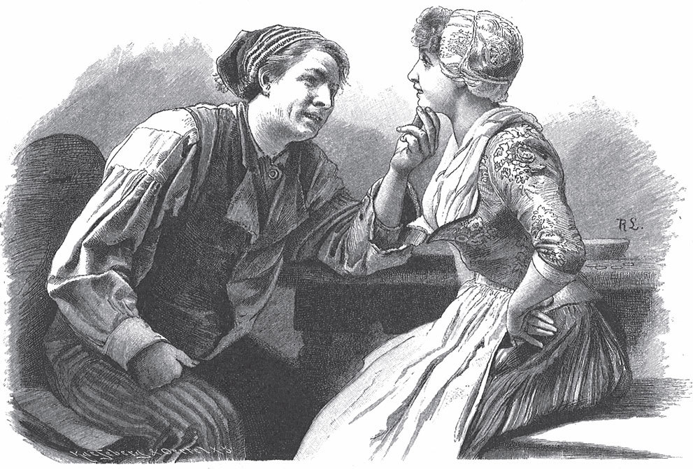

## Die schöne Katrinelje und Pif Paf Poltrie

— Guten Tag, Vater Hollenthe.

— Vielen Dank, Pif Paf Poltrie.

— Könnte ich wohl Eure Tochter bekommen?

— Oh ja, wenn die Mutter Malcho, der Bruder Hohenstolz, die Schwester Käsetraut und die schöne Katrinelje es wollen, dann kann es geschehen.

— Wo ist denn die Mutter Malcho?

— Sie ist im Stall und melkt die Kuh.

— Guten Tag, Mutter Malcho.

— Vielen Dank, Pif Paf Poltrie.

— Könnte ich wohl Eure Tochter bekommen?

— Oh ja, wenn der Vater Hollenthe, der Bruder Hohenstolz, die Schwester Käsetraut und die schöne Katrinelje es wollen, dann kann es geschehen.

— Wo ist denn der Bruder Hohenstolz?

— Er ist in der Kammer und hackt das Holz.

— Guten Tag, Bruder Hohenstolz.

— Vielen Dank, Pif Paf Poltrie.

— Könnte ich wohl Eure Schwester bekommen?

— Oh ja, wenn der Vater Hollenthe, die Mutter Malcho, die Schwester Käsetraut und die schöne Katrinelje es wollen, dann kann es geschehen.

— Wo ist denn die Schwester Käsetraut?

— Sie ist im Garten und schneidet das Kraut.

— Guten Tag, Schwester Käsetraut.

— Vielen Dank, Pif Paf Poltrie.

— Könnte ich wohl Eure Schwester bekommen?

— Oh ja, wenn der Vater Hollenthe, die Mutter Malcho, der Bruder Hohenstolz und die schöne Katrinelje es wollen, dann kann es geschehen.

— Wo ist denn die schöne Katrinelje?

— Sie ist in der Kammer und zählt ihre Pfennige.

— Guten Tag, schöne Katrinelje.

— Vielen Dank, Pif Paf Poltrie.

— Willst du wohl mein Schatz sein?

— Oh ja, wenn der Vater Hollenthe, die Mutter Malcho, der Bruder Hohenstolz und die Schwester Käsetraut es wollen, dann kann es geschehen.

— Schöne Katrinelje, wie viel hast du als Mitgift?

— Vierzehn Pfennige <abbr title="bares Geld — наличные деньги">bares Geld</abbr>, zweieinhalb Groschen <abbr title="die Schulden (Pl.) — долги">Schulden</abbr>, ein halbes Pfund <abbr title="die Hutzel, die Hutzeln — сушёная груша">Hutzeln</abbr>, eine Handvoll <abbr title="die Prutzel, die Prutzeln — сушёный фрукт (диал.)">Prutzeln</abbr>, eine Handvoll Wurzeln,

un so der watt:

is dat nig en guden Brutschatt?

(Das heißt: Und noch so manches dazu, ist das nicht eine gute Mitgift?)

— Pif Paf Poltrie, was hast du für ein Handwerk? Bist du ein Schneider?

— Noch viel besser.

— Ein Schuster?

— Noch viel besser.

— Ein Bauer?

— Noch viel besser.

— Ein Schreiner?

— Noch viel besser.

— Ein Schmied?

— Noch viel besser.

— Ein Müller?

— Noch viel besser.

— Vielleicht ein Besenbinder?

— Ja, das bin ich. Ist das nicht ein schönes Handwerk?

---

### Neue Wörter

- **bares Geld** — наличные деньги
- **die Schulden (Pl.)** — долги
- **die Hutzel, die Hutzeln** — сушёная груша
- **die Prutzel, die Prutzeln** — сушёный фрукт (диал.)

[← Zurück](kapitel-130.md) · [Inhalt](README.md) · [Weiter →](kapitel-132.md)
