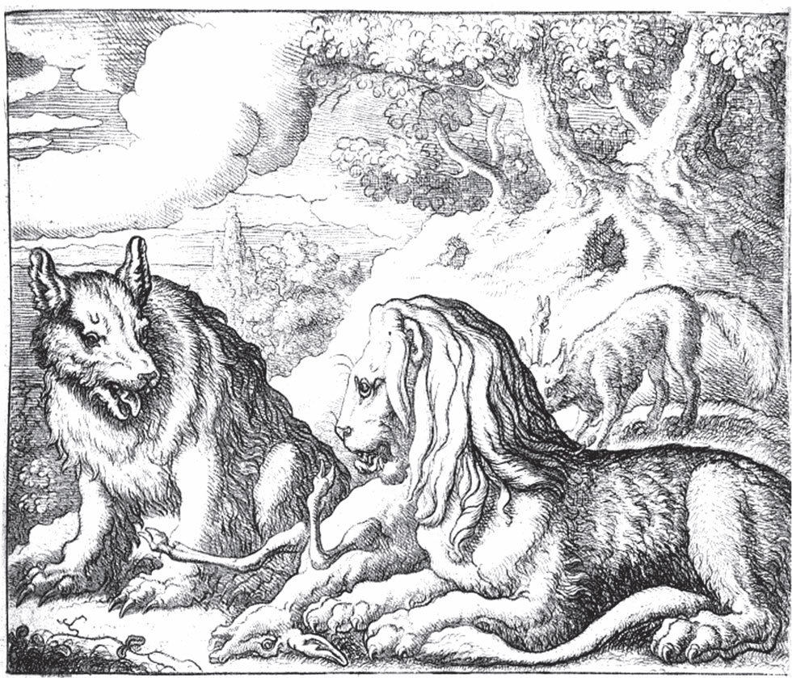

## Der Fuchs und das Pferd

Ein Bauer hatte ein treues Pferd. Es war alt geworden und konnte nicht mehr arbeiten. Darum wollte sein Herr ihm nichts mehr zu fressen geben und sagte:

— Brauchen kann ich dich freilich nicht mehr. Trotzdem meine ich es gut mit dir: Wenn du noch so stark bist, dass du mir einen Löwen hierherbringst, dann will ich dich behalten. Jetzt aber verschwinde aus meinem Stall!

Und damit jagte er es hinaus aufs weite Feld. Das Pferd war traurig und ging zum Wald, um dort ein wenig Schutz vor dem Wetter zu suchen. Da begegnete ihm der Fuchs und sagte:

— Warum <abbr title="den Kopf hängen lassen — повесить голову, унывать">lässt</abbr> du so den Kopf hängen und gehst so einsam umher?

— Ach, — antwortete das Pferd, — <abbr title="der Geiz — скупость">Geiz</abbr> und Treue wohnen nicht zusammen in einem Haus. Mein Herr hat vergessen, wie viele Dienste ich ihm in so vielen Jahren geleistet habe. Und weil ich nicht mehr richtig pflügen kann, will er mir kein Futter mehr geben und hat mich fortgejagt.

— Ganz ohne <abbr title="der Trost — утешение">Trost</abbr>? — fragte der Fuchs.

— Der Trost war schlecht. Er hat gesagt, wenn ich noch so stark wäre, dass ich ihm einen Löwen brächte, dann wollte er mich behalten. Aber er weiß genau, dass ich das nicht vermag.

Der Fuchs sagte:

— Da will ich dir helfen. Leg dich nur hin, streck dich aus und rühr dich nicht, als ob du tot wärst.

Das Pferd tat, was der Fuchs verlangte. Der Fuchs aber ging zum Löwen, der nicht weit davon seine Höhle hatte, und sagte:

— Da draußen liegt ein totes Pferd. Komm doch mit hinaus, da kannst du eine fette Mahlzeit halten.

Der Löwe ging mit. Als sie bei dem Pferd standen, sagte der Fuchs:

— Hier hast du es doch nicht bequem. Weißt du was? Ich binde es mit dem <abbr title="der Schweif, die Schweife — хвост">Schweif</abbr> an dir fest. Dann kannst du es in deine Höhle ziehen und dort in aller Ruhe verzehren.

Dem Löwen gefiel der Rat. Er stellte sich hin und hielt ganz still, damit der Fuchs das Pferd an ihm festbinden konnte. Der Fuchs aber band dem Löwen mit dem Schweif des Pferdes die Beine zusammen. Er drehte und schnürte alles so fest und stark, dass keine Kraft der Welt es zerreißen konnte. Als er mit seinem Werk fertig war, klopfte er dem Pferd auf die Schulter und sagte:

— Zieh, Schimmel, zieh!

Da sprang das Pferd mit einem Mal auf und zog den Löwen mit sich fort. Der Löwe fing an zu brüllen, sodass im ganzen Wald die Vögel vor Schreck aufflogen. Aber das Pferd ließ ihn brüllen. Es zog und schleppte ihn über das Feld bis vor die Tür seines Herrn. Als der Herr das sah, <abbr title="sich eines Besseren besinnen — передумать, одуматься">besann er sich eines Besseren</abbr> und sagte zu dem Pferd:

— Du sollst bei mir bleiben und es gut haben.

Und er gab ihm genug zu fressen, bis es starb.

---

### Neue Wörter

- **den Kopf hängen lassen** — повесить голову, унывать
- **der Geiz** — скупость
- **der Trost** — утешение
- **der Schweif, die Schweife** — хвост
- **sich eines Besseren besinnen** — передумать, одуматься

[← Zurück](kapitel-131.md) · [Inhalt](README.md) · [Weiter →](kapitel-133.md)
