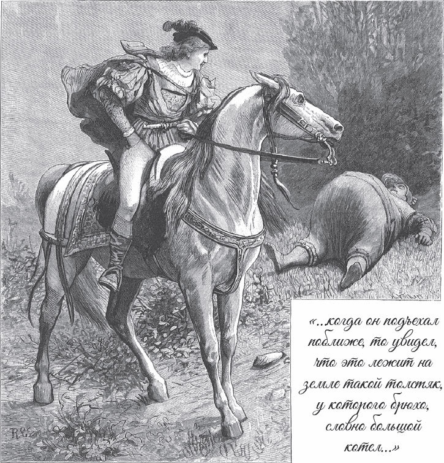

## Die sechs Diener

Vor langer Zeit lebte eine alte Königin, die war eine Zauberin. Ihre Tochter war das schönste Mädchen unter der Sonne. Die Alte aber dachte an nichts anderes, als wie sie die Menschen <abbr title="ins Verderben locken — заманить на погибель">ins Verderben locken</abbr> konnte. Wenn ein Freier kam, sagte sie: Wer ihre Tochter haben wolle, der müsse zuerst eine Aufgabe lösen, sonst müsse er sterben. Viele waren von der Schönheit des Mädchens geblendet und wagten es. Aber sie konnten nicht vollbringen, was die Alte ihnen <abbr title="auferlegen — возлагать, задавать">auferlegte</abbr>. Und dann gab es keine Gnade: Sie mussten niederknien, und man schlug ihnen den Kopf ab.

Ein Königssohn hatte auch von der großen Schönheit des Mädchens gehört und sagte zu seinem Vater:

— Lasst mich hinziehen, ich will um sie werben.

— Niemals, — antwortete der König. — Wenn du fortgehst, gehst du in deinen Tod.

Da legte sich der Sohn ins Bett und wurde sterbenskrank. Sieben Jahre lang lag er da, und kein Arzt konnte ihm helfen. Als der Vater sah, dass es keine Hoffnung mehr gab, sagte er voller Traurigkeit zu ihm:

— Zieh hin und versuche dein Glück. Ich weiß sonst nicht, wie ich dir helfen soll.

Als der Sohn das hörte, stand er von seinem Lager auf, war gesund und machte sich fröhlich auf den Weg.

Als er über eine Heide ritt, sah er von Weitem etwas auf der Erde liegen, das aussah wie ein großer <abbr title="der Heuhaufen, die Heuhaufen — стог сена">Heuhaufen</abbr>. Als er näher kam, konnte er erkennen, dass es der Bauch eines Menschen war, der sich dort ausgestreckt hatte. Der Bauch aber sah aus wie ein kleiner Berg. Als der Dicke den <abbr title="der Reisende, die Reisenden — путник">Reisenden</abbr> erblickte, richtete er sich auf und sagte:

— Wenn Ihr jemanden braucht, dann nehmt mich in Euren Dienst.

— Was soll ich mit einem so <abbr title="unförmig — бесформенный, громоздкий">unförmigen</abbr> Mann anfangen? — antwortete der Königssohn.

— Oh, — sagte der Dicke, — das ist noch gar nichts. Wenn ich mich richtig <abbr title="sich ausdehnen — растягиваться, расширяться">ausdehne</abbr>, bin ich noch dreitausendmal so dick.

— Wenn das so ist, — sagte der Königssohn, — dann kann ich dich brauchen. Komm mit mir.

Da ging der Dicke hinter dem Königssohn her. Nach einer Weile fanden sie einen anderen Mann, der auf der Erde lag und das Ohr auf den <abbr title="der Rasen — газон, дёрн">Rasen</abbr> gelegt hatte.

— Was machst du da? — fragte der Königssohn.

— Ich horche, — antwortete der Mann.

— Und worauf horchst du so <abbr title="aufmerksam — внимательно">aufmerksam</abbr>?

— Ich horche auf das, was gerade in der Welt geschieht. Meinen Ohren <abbr title="entgehen (entging, ist entgangen) + Dat. — ускользать от">entgeht</abbr> nichts. Ich höre sogar das Gras wachsen.

— Sag mir, — fragte der Königssohn, — was hörst du am Hof der alten Königin, die die schöne Tochter hat?

— Ich höre das Schwert sausen, das einem Freier den Kopf abschlägt.

— Ich kann dich brauchen, — sagte der Königssohn. — Komm mit mir.

Sie zogen weiter. Einmal sahen sie ein Paar Füße daliegen und auch ein Stück von den Beinen, aber das Ende konnten sie nicht sehen. Nachdem sie eine gute <abbr title="die Strecke, die Strecken — отрезок пути, расстояние">Strecke</abbr> gegangen waren, kamen sie zum Körper und endlich auch zum Kopf.

— Na, — sagte der Königssohn, — was bist du für ein langer Strick!

— Oh, — antwortete der Lange, — das ist noch gar nichts. Wenn ich meine Glieder erst richtig ausstrecke, bin ich noch dreitausendmal so lang und größer als der höchste Berg der Erde. Ich will Euch gern dienen, wenn Ihr mich nehmen wollt.

— Komm mit, — sagte der Königssohn, — ich kann dich brauchen.

Sie zogen weiter und fanden einen Mann am Weg sitzen, der hatte die Augen verbunden. Der Königssohn sagte zu ihm:

— Hast du schwache Augen, dass du nicht ins Licht sehen kannst?

— Nein, — antwortete der Mann. — Ich darf die <abbr title="die Binde, die Binden — повязка">Binde</abbr> nicht abnehmen. Denn alles, was ich mit meinen Augen ansehe, zerspringt, so gewaltig ist mein Blick. Wenn Euch das nützen kann, will ich Euch gern dienen.

— Komm mit, — antwortete der Königssohn, — ich kann dich brauchen.

Sie zogen weiter und fanden einen Mann, der mitten im heißen Sonnenschein lag. Er zitterte und fror am ganzen Körper, sodass kein Glied still blieb.

— Wie kannst du frieren, — sagte der Königssohn, — wo die Sonne doch so warm scheint?

— Ach, — antwortete der Mann, — meine <abbr title="die Natur — натура, природа">Natur</abbr> ist ganz anders. <abbr title="je … desto — чем … тем">Je</abbr> heißer es ist, desto mehr friere ich, und der Frost dringt mir durch alle Knochen. Und je kälter es ist, desto heißer wird mir. Mitten im Eis kann ich es vor Hitze nicht aushalten, und mitten im Feuer nicht vor Kälte.

— Du bist ein wunderlicher Kerl, — sagte der Königssohn. — Aber wenn du mir dienen willst, dann komm mit.

Nun zogen sie weiter und sahen einen Mann dastehen, der <abbr title="den Hals recken — вытягивать шею">reckte den Hals</abbr>, sich umschaute und über alle Berge hinausblickte.

— Wonach schaust du so eifrig? — fragte der Königssohn.

— Ich habe so scharfe Augen, — antwortete der Mann, — dass ich über alle Wälder und Felder, Täler und Berge hinweg durch die ganze Welt sehen kann.

— Wenn du willst, dann komm mit mir, — sagte der Königssohn. — Denn so einer hat mir noch gefehlt.

Nun zog der Königssohn mit seinen sechs Dienern in die Stadt, in der die alte Königin lebte. Er sagte nicht, wer er war, sondern sprach:

— Wenn Ihr mir Eure schöne Tochter geben wollt, dann will ich vollbringen, was Ihr mir auferlegt.

Die Zauberin freute sich, dass wieder ein so schöner junger Mann in ihre Netze ging, und sagte:

— Dreimal will ich dir eine Aufgabe stellen. Wenn du sie jedes Mal löst, sollst du der Herr und Gemahl meiner Tochter werden.

— Was soll die erste sein? — fragte er.

— Du sollst mir einen Ring bringen, den ich ins Rote Meer habe fallen lassen.

Da ging der Königssohn zu seinen Dienern und sagte:

— Die erste Aufgabe ist nicht leicht. Ein Ring soll aus dem Roten Meer geholt werden. Nun <abbr title="Rat schaffen — найти выход, придумать что-то">schafft Rat</abbr>!

Da sagte der mit den scharfen Augen:

— Ich will sehen, wo er liegt.

Er schaute ins Meer hinab und sagte:

— Dort hängt er an einem spitzen Stein.

Der Lange trug sie alle hin und sagte:

— Ich würde ihn gern herausholen, wenn ich ihn nur sehen könnte.

— Wenn es weiter nichts ist! — rief der Dicke. Er legte sich hin und hielt seinen Mund ans Wasser. Da fielen die Wellen hinein wie in einen Abgrund, und er trank das ganze Meer aus, bis es trocken war wie eine Wiese. Der Lange bückte sich ein wenig und holte den Ring mit der Hand heraus.

Der Königssohn war froh, als er den Ring hatte, und brachte ihn der Alten. Sie staunte und sagte:

— Ja, es ist der richtige Ring. Die erste Aufgabe hast du glücklich gelöst, aber jetzt kommt die zweite. Siehst du dort auf der Wiese vor meinem Schloss? Da weiden dreihundert fette Ochsen. Die musst du mit Haut und Haar, mit Knochen und Hörnern verzehren. Und unten im Keller liegen dreihundert Fässer Wein, die musst du dazu austrinken. Wenn von den Ochsen ein Haar und von dem Wein ein Tröpfchen übrig bleibt, dann gehört mir dein Leben.

— Darf ich mir keine Gäste dazu einladen? — fragte der Königssohn. — Ohne Gesellschaft schmeckt keine Mahlzeit.

Die Alte lachte boshaft und antwortete:

— Einen darfst du dir einladen, damit du Gesellschaft hast, aber nicht mehr.

Da ging der Königssohn zu seinen Dienern und sagte zu dem Dicken:

— Du sollst heute mein Gast sein und dich einmal richtig satt essen.

Da dehnte sich der Dicke aus und aß die dreihundert Ochsen, sodass kein Haar übrig blieb, und fragte, ob es außer dem Frühstück nichts gebe. Den Wein trank er gleich aus den Fässern, ohne ein Glas zu brauchen, und den letzten Tropfen leckte er noch vom <abbr title="der Fingernagel, die Fingernägel — ноготь">Fingernagel</abbr> ab. Als die Mahlzeit zu Ende war, ging der Königssohn zur Alten und sagte ihr, die zweite Aufgabe sei gelöst. Sie wunderte sich und sagte:

— So weit hat es noch keiner gebracht. Aber eine Aufgabe ist noch übrig.

Und sie dachte: «Du wirst mir nicht entkommen, und deinen Kopf wirst du nicht behalten.»

— Heute Abend, — sagte sie, — bringe ich meine Tochter zu dir in deine Kammer, und du sollst sie mit deinem Arm <abbr title="umschlingen (umschlang, hat umschlungen) — обнять, обвить">umschlingen</abbr>. Und während ihr da zusammensitzt, hüte dich, dass du nicht einschläfst. Ich komme <abbr title="Schlag zwölf (Uhr) — ровно в двенадцать">Schlag zwölf</abbr>, und wenn sie dann nicht mehr in deinen Armen ist, hast du verloren.

Der Königssohn dachte: «Die Aufgabe ist leicht, ich werde meine Augen schon offen halten.» Trotzdem rief er seine Diener, erzählte ihnen, was die Alte gesagt hatte, und sagte:

— Wer weiß, was für eine List dahintersteckt. <abbr title="die Vorsicht — осторожность">Vorsicht</abbr> ist gut. Haltet Wache und sorgt dafür, dass das Mädchen nicht wieder aus meiner Kammer kommt.

Als die Nacht hereinbrach, kam die Alte mit ihrer Tochter und führte sie in die Arme des Königssohns. Dann legte sich der Lange in einem Kreis um die beiden herum, und der Dicke stellte sich vor die Tür, sodass keine <abbr title="keine lebendige Seele — ни одна живая душа">lebendige Seele</abbr> hereinkommen konnte. Da saßen die beiden, und das Mädchen sagte kein Wort. Aber der Mond schien durch das Fenster auf ihr Gesicht, sodass er ihre wunderbare Schönheit sehen konnte. Er tat nichts anderes, als sie anzuschauen. Er war voller Freude und Liebe, und keine Müdigkeit kam in seine Augen. So ging es bis elf Uhr. Da warf die Alte einen Zauber über alle, sodass sie einschliefen, und im selben Augenblick war auch das Mädchen <abbr title="entrücken — унести (волшебством)">entrückt</abbr>.

Nun schliefen sie fest bis Viertel vor zwölf. Da verlor der Zauber seine Kraft, und alle wachten wieder auf.

— Oh Jammer und Unglück! — rief der Königssohn. — Jetzt bin ich verloren!

Auch die treuen Diener fingen an zu klagen. Aber der <abbr title="der Horcher, die Horcher — слухач">Horcher</abbr> sagte:

— Seid still, ich will horchen.

Er horchte einen Augenblick und sagte dann:

— Sie sitzt in einem Felsen, dreihundert <abbr title="die Wegstunde, die Wegstunden — час пути (мера расстояния)">Wegstunden</abbr> von hier, und beklagt ihr Schicksal. Du allein kannst helfen, Langer. Wenn du dich aufrichtest, bist du mit ein paar Schritten dort.

— Ja, — antwortete der Lange, — aber der mit den scharfen Augen muss mitkommen, damit wir den Felsen <abbr title="beseitigen — устранить, убрать">beseitigen</abbr>.

Da nahm der Lange den mit den verbundenen Augen huckepack, und so schnell, wie man eine Hand umdreht, waren sie vor dem verzauberten Felsen. Sofort nahm der Lange dem anderen die Binde von den Augen. Der schaute sich nur um, und schon zersprang der Felsen in tausend Stücke. Da nahm der Lange das Mädchen auf den Arm und trug sie im Nu zurück. Ebenso schnell holte er auch noch seinen Kameraden, und bevor es zwölf schlug, saßen alle wieder da wie vorher und waren munter und guter Dinge.

Als es zwölf schlug, kam die alte Zauberin herbeigeschlichen. Sie machte ein höhnisches Gesicht, als wollte sie sagen: «Jetzt gehört er mir!» Denn sie glaubte, ihre Tochter säße dreihundert Wegstunden weit im Felsen. Als sie aber ihre Tochter in den Armen des Königssohns erblickte, erschrak sie und sagte:

— Da ist einer, der kann mehr als ich.

Aber sie durfte nichts <abbr title="einwenden (wandte ein, hat eingewandt) — возражать">einwenden</abbr> und musste ihm das Mädchen versprechen. Da flüsterte sie ihrer Tochter ins Ohr:

— Was für eine Schande für dich, dass du einfachem Volk gehorchen musst und dir keinen Gemahl nach deinem Geschmack wählen darfst!

Da füllte sich das stolze Herz des Mädchens mit Zorn, und sie dachte an <abbr title="die Rache — месть">Rache</abbr>. Am nächsten Morgen ließ sie dreihundert Malter Holz zusammenfahren und sagte zu dem Königssohn: Die drei Aufgaben seien zwar gelöst, aber sie werde erst dann seine Gemahlin, wenn einer bereit sei, sich mitten in das Holz zu setzen und das Feuer auszuhalten. Sie dachte, keiner seiner Diener würde sich für ihn verbrennen lassen. Aus Liebe zu ihr würde er sich dann selbst hineinsetzen, und dann wäre sie frei. Die Diener aber sagten:

— Wir haben alle schon etwas getan, nur der <abbr title="frostig — зябкий, мерзлявый">Frostige</abbr> noch nicht. Jetzt ist er dran.

Sie setzten ihn mitten auf den <abbr title="der Holzstoß, die Holzstöße — поленница, костёр">Holzstoß</abbr> und zündeten ihn an. Da fing das Feuer an zu brennen, und es brannte drei Tage, bis alles Holz verbrannt war. Als die Flammen sich legten, stand der Frostige mitten in der Asche, zitterte wie <abbr title="zittern wie Espenlaub — дрожать как осиновый лист">Espenlaub</abbr> und sagte:

— So einen Frost habe ich in meinem ganzen Leben noch nicht ausgehalten. Hätte er noch länger gedauert, wäre ich <abbr title="erstarren (ist erstarrt) — окоченеть, застыть">erstarrt</abbr>.

Nun gab es keinen Ausweg mehr: Die schöne Jungfrau musste den unbekannten jungen Mann zum Gemahl nehmen. Doch als sie zur Kirche fuhren, sagte die Alte: «Ich kann die Schande nicht ertragen!» Und sie schickte ihnen ihre Krieger nach. Die sollten alles <abbr title="niedermachen — перебить, изрубить">niedermachen</abbr>, was ihnen in den Weg kam, und ihr die Tochter zurückbringen. Aber der Horcher hatte die Ohren gespitzt und die heimlichen Reden der Alten gehört.

— Was machen wir nun? — fragte er den Dicken.

Aber der wusste Rat. Er spuckte ein- oder zweimal ein bisschen von dem Meerwasser, das er getrunken hatte, hinter dem Wagen aus. Da entstand ein großer See, in dem die Krieger stecken blieben und ertranken. Als die Zauberin das hörte, schickte sie ihre Reiter in <abbr title="die Rüstung, die Rüstungen — доспехи">Rüstung</abbr>. Aber der Horcher hörte ihre Rüstungen rasseln und nahm dem einen die Binde von den Augen. Der schaute die Feinde ein bisschen scharf an, und schon zersprangen sie wie Glas.

Nun fuhren sie ungestört weiter. Als die beiden in der Kirche getraut worden waren, nahmen die sechs Diener Abschied und sagten zu ihrem Herrn:

— Eure Wünsche sind erfüllt, Ihr braucht uns nicht mehr. Wir wollen weiterziehen und unser Glück versuchen.

Eine halbe Stunde vor dem Schloss lag ein Dorf. Davor hütete ein Schweinehirt seine Herde. Als sie dort ankamen, sagte der Königssohn zu seiner Frau:

— Weißt du eigentlich, wer ich bin? Ich bin kein Königssohn, sondern ein Schweinehirt, und der Mann mit der Herde dort ist mein Vater. Wir zwei müssen jetzt auch mit anpacken und ihm beim Hüten helfen.

Dann kehrte er mit ihr im Wirtshaus ein und sagte heimlich zu den <abbr title="die Wirtsleute (Pl.) — хозяева трактира">Wirtsleuten</abbr>, sie sollten ihr in der Nacht die königlichen Kleider wegnehmen. Als sie am Morgen aufwachte, hatte sie nichts anzuziehen. Die Wirtin gab ihr einen alten Rock und ein Paar alte <abbr title="wollen — шерстяной">wollene</abbr> Strümpfe und tat dabei noch so, als wäre das ein großes Geschenk:

— Wenn Euer Mann nicht wäre, hätte ich es Euch gar nicht gegeben.

Da glaubte sie, er sei wirklich ein Schweinehirt. Sie hütete mit ihm die Herde und dachte: «Das habe ich mit meinem Übermut und meinem Stolz verdient.» So ging es acht Tage lang. Dann konnte sie es nicht mehr aushalten, denn ihre Füße waren wund geworden. Da kamen ein paar Leute und fragten, ob sie wisse, wer ihr Mann sei.

— Ja, — antwortete sie, — er ist ein Schweinehirt. Er ist gerade weggegangen, um mit Bändern und Schnüren ein bisschen <abbr title="Handel treiben — торговать">Handel zu treiben</abbr>.

Sie aber sagten:

— Kommt einmal mit, wir wollen Euch zu ihm bringen.

Und sie führten sie hinauf ins Schloss. Als sie in den Saal kam, stand dort ihr Mann in königlichen Kleidern. Sie erkannte ihn aber nicht, bis er ihr um den Hals fiel, sie küsste und sagte:

— Ich habe so viel für dich gelitten, da solltest du auch für mich leiden.

Nun erst wurde die Hochzeit richtig gefeiert. Und der es erzählt hat, der wünschte, er wäre auch dabei gewesen.

---

### Neue Wörter

- **ins Verderben locken** — заманить на погибель
- **auferlegen** — возлагать, задавать
- **der Heuhaufen, die Heuhaufen** — стог сена
- **der Reisende, die Reisenden** — путник
- **unförmig** — бесформенный, громоздкий
- **sich ausdehnen** — растягиваться, расширяться
- **der Rasen** — газон, дёрн
- **aufmerksam** — внимательно
- **entgehen (entging, ist entgangen) + Dat.** — ускользать от
- **die Strecke, die Strecken** — отрезок пути, расстояние
- **die Binde, die Binden** — повязка
- **die Natur** — натура, природа
- **je … desto** — чем … тем
- **den Hals recken** — вытягивать шею
- **Rat schaffen** — найти выход, придумать что-то
- **der Fingernagel, die Fingernägel** — ноготь
- **umschlingen (umschlang, hat umschlungen)** — обнять, обвить
- **Schlag zwölf (Uhr)** — ровно в двенадцать
- **die Vorsicht** — осторожность
- **keine lebendige Seele** — ни одна живая душа
- **entrücken** — унести (волшебством)
- **der Horcher, die Horcher** — слухач
- **die Wegstunde, die Wegstunden** — час пути (мера расстояния)
- **beseitigen** — устранить, убрать
- **einwenden (wandte ein, hat eingewandt)** — возражать
- **die Rache** — месть
- **frostig** — зябкий, мерзлявый
- **der Holzstoß, die Holzstöße** — поленница, костёр
- **zittern wie Espenlaub** — дрожать как осиновый лист
- **erstarren (ist erstarrt)** — окоченеть, застыть
- **niedermachen** — перебить, изрубить
- **die Rüstung, die Rüstungen** — доспехи
- **die Wirtsleute (Pl.)** — хозяева трактира
- **wollen** — шерстяной
- **Handel treiben** — торговать

[← Zurück](kapitel-133.md) · [Inhalt](README.md) · [Weiter →](kapitel-135.md)
