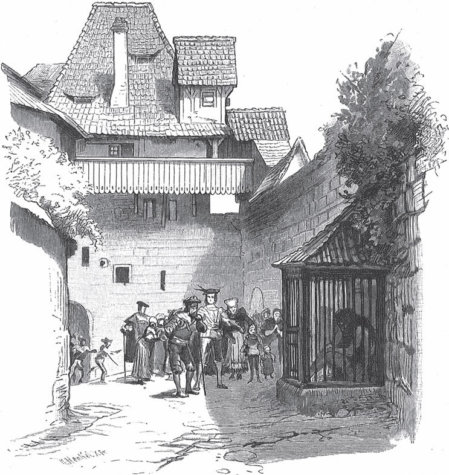

## Der Eisenhans

Es war einmal ein König, der hatte bei seinem Schloss einen großen Wald, in dem Wild aller Art lebte. Eines Tages schickte er einen Jäger hinaus, der sollte ein Reh schießen, aber der Jäger kam nicht wieder.

— Vielleicht ist ihm ein Unglück zugestoßen, — sagte der König und schickte am folgenden Tag zwei andere Jäger hinaus, die ihn suchen sollten; aber auch sie blieben weg. Da ließ er am dritten Tag alle seine Jäger kommen und sprach:

— Streift durch den ganzen Wald und <abbr title="von etwas ablassen (ließ ab, hat abgelassen) — отступиться, прекратить">lasst nicht ab</abbr>, bis ihr alle drei gefunden habt.

Aber auch von diesen kam keiner wieder heim, und von der Meute Hunde, die sie mitgenommen hatten, ließ sich kein einziger mehr sehen. Von da an <abbr title="sich wagen — осмелиться пойти">wagte sich</abbr> niemand mehr in den Wald, und er lag in tiefer Stille und Einsamkeit da; nur <abbr title="zuweilen — порой, иногда">zuweilen</abbr> sah man einen <abbr title="der Adler, die Adler — орёл">Adler</abbr> oder einen Habicht darüber hinfliegen. So ging es viele Jahre, bis sich ein fremder Jäger beim König meldete, eine Stelle suchte und <abbr title="sich erbieten (erbot, hat erboten) — вызваться, предложить себя">sich erbot</abbr>, in den gefährlichen Wald zu gehen. Der König aber wollte seine <abbr title="die Einwilligung, die Einwilligungen — согласие, позволение">Einwilligung</abbr> nicht geben und sprach:

— Es ist <abbr title="nicht geheuer sein — быть жутким, нечистым (о месте)">nicht geheuer</abbr> darin. Ich fürchte, es wird dir nicht besser gehen als den anderen, und du kommst nicht wieder heraus.

Der Jäger antwortete:

— Herr, ich will es <abbr title="auf eigene Gefahr — на свой страх и риск">auf meine Gefahr</abbr> wagen. Von Furcht weiß ich nichts.

Der Jäger ging also mit seinem Hund in den Wald. Es dauerte nicht lange, da kam der Hund einem Wild auf die <abbr title="die Fährte, die Fährten — след (зверя)">Fährte</abbr> und wollte hinter ihm her. Doch kaum war er ein paar Schritte gelaufen, da stand er vor einem tiefen <abbr title="der Pfuhl, die Pfuhle — омут, лужа, болотце">Pfuhl</abbr> und konnte nicht weiter; ein nackter Arm streckte sich aus dem Wasser, packte ihn und zog ihn hinab. Als der Jäger das sah, ging er zurück und holte drei Männer, die mit Eimern kommen und das Wasser <abbr title="ausschöpfen — вычерпать">ausschöpfen</abbr> mussten. Als sie auf den Grund sehen konnten, lag dort ein wilder Mann, dessen Körper braun war wie <abbr title="rostig — ржавый">rostiges</abbr> Eisen und dem die Haare über das Gesicht bis zu den Knien herabhingen. Sie fesselten ihn mit Stricken und führten ihn fort ins Schloss. Dort war die Verwunderung über den wilden Mann groß. Der König ließ ihn in einen eisernen Käfig auf seinem Hof setzen und verbot <abbr title="bei Todesstrafe — под страхом смерти">bei Todesstrafe</abbr>, die Tür des Käfigs zu öffnen, und die Königin musste den Schlüssel selbst <abbr title="etwas in Verwahrung nehmen — взять на хранение">in Verwahrung nehmen</abbr>. Von nun an konnte jeder wieder ohne Gefahr in den Wald gehen.

Der König hatte einen Sohn von acht Jahren. Der spielte einmal auf dem Hof, und dabei fiel ihm sein goldener Ball in den Käfig. Der Junge lief hin und sagte:

— Gib mir meinen Ball heraus.

— Nicht eher, — antwortete der Mann, — als bis du mir die Tür aufgemacht hast.

— Nein, — sagte der Junge, — das tue ich nicht, das hat der König verboten.

Und er lief fort. Am nächsten Tag kam er wieder und forderte seinen Ball. Der wilde Mann sagte: «Öffne meine Tür», aber der Junge wollte nicht. Am dritten Tag war der König auf die Jagd geritten; da kam der Junge noch einmal und sagte:

— Selbst wenn ich wollte, ich kann die Tür nicht öffnen. Ich habe den Schlüssel nicht.

Da sprach der wilde Mann:

— Er liegt unter dem Kopfkissen deiner Mutter, dort kannst du ihn holen.

Der Junge, der seinen Ball wiederhaben wollte, <abbr title="etwas in den Wind schlagen — пренебречь, пропустить мимо ушей">schlug alle Bedenken in den Wind</abbr> und brachte den Schlüssel. Die Tür ging schwer auf, und der Junge <abbr title="sich etwas klemmen — прищемить себе">klemmte sich</abbr> den Finger. Als sie offen war, trat der wilde Mann heraus, gab ihm den goldenen Ball und eilte davon. Dem Jungen wurde angst; er schrie und rief ihm nach:

— Ach, wilder Mann, geh nicht fort, sonst bekomme ich <abbr title="die Schläge (Pl.) — побои, порка">Schläge</abbr>!

Der wilde Mann kehrte um, hob ihn hoch, setzte ihn sich auf den Nacken und ging mit schnellen Schritten in den Wald hinein. Als der König heimkam, bemerkte er den leeren Käfig und fragte die Königin, wie das geschehen sei. Sie wusste nichts davon und suchte den Schlüssel, aber er war weg. Sie rief nach dem Jungen, aber niemand antwortete. Der König schickte Leute aus, die ihn auf dem Feld suchen sollten, doch sie fanden ihn nicht. Da konnte er leicht erraten, was geschehen war, und am königlichen Hof herrschte große Trauer.

Als der wilde Mann wieder im finsteren Wald <abbr title="anlangen — прибыть, добраться">angelangt</abbr> war, setzte er den Jungen von den Schultern herab und sprach zu ihm:

— Vater und Mutter siehst du nicht wieder, aber ich will dich bei mir behalten, denn du hast mich befreit, und ich habe Mitleid mit dir. Wenn du alles tust, was ich dir sage, sollst du es gut haben. Schätze und Gold habe ich genug, mehr als irgendjemand auf der Welt.

Er machte dem Jungen ein Lager aus Moos, auf dem er einschlief. Am anderen Morgen führte ihn der Mann zu einem Brunnen und sprach:

— Siehst du, der Goldbrunnen ist hell und klar wie Kristall. Du sollst dabei sitzen und aufpassen, dass nichts hineinfällt, sonst ist er <abbr title="entehren — осквернить, обесчестить">entehrt</abbr>. Jeden Abend komme ich und sehe nach, ob du mein Gebot befolgt hast.

Der Junge setzte sich an den Rand des Brunnens. Er sah, wie sich darin manchmal ein goldener Fisch, manchmal eine goldene Schlange zeigte, und passte auf, dass nichts hineinfiel. Als er so dasaß, <abbr title="schmerzen — болеть">schmerzte</abbr> ihn einmal der Finger so heftig, dass er ihn <abbr title="unwillkürlich — невольно">unwillkürlich</abbr> ins Wasser steckte. Er zog ihn schnell wieder heraus, sah aber, dass er ganz <abbr title="vergoldet — позолоченный">vergoldet</abbr> war, und so viel Mühe er sich auch gab, das Gold wieder abzuwischen – es war alles vergeblich. Abends kam der Eisenhans zurück, sah den Jungen an und sprach:

— Was ist mit dem Brunnen geschehen?

— Nichts, nichts, — antwortete er und hielt den Finger hinter den Rücken, damit der Mann ihn nicht sehen sollte. Aber der Mann sagte:

— Du hast den Finger ins Wasser getaucht. Diesmal mag es hingehen, aber hüte dich, dass du nicht wieder etwas hineinfallen lässt.

Am frühesten Morgen saß der Junge schon am Brunnen und bewachte ihn. Der Finger tat ihm wieder weh, und er fuhr damit über seinen Kopf; da fiel unglücklicherweise ein Haar hinab in den Brunnen. Er nahm es schnell heraus, aber es war schon ganz vergoldet. Der Eisenhans kam und wusste schon, was geschehen war.

— Du hast ein Haar in den Brunnen fallen lassen, — sagte er. — Ich will es dir noch einmal <abbr title="jemandem etwas nachsehen — простить, спустить кому-то">nachsehen</abbr>. Aber wenn es zum dritten Mal geschieht, ist der Brunnen entehrt, und du kannst nicht länger bei mir bleiben.

Am dritten Tag saß der Junge am Brunnen und bewegte den Finger nicht, so weh er ihm auch tat. Aber die Zeit wurde ihm lang, und er betrachtete sein <abbr title="das Antlitz — лик, лицо">Antlitz</abbr>, das sich im <abbr title="der Wasserspiegel — водная гладь">Wasserspiegel</abbr> zeigte. Und als er sich dabei immer tiefer beugte, weil er sich recht in die Augen sehen wollte, fielen ihm seine langen Haare von den Schultern hinab ins Wasser. Er richtete sich schnell auf, aber das ganze <abbr title="das Haupthaar — волосы на голове">Haupthaar</abbr> war schon vergoldet und glänzte wie eine Sonne. Ihr könnt euch denken, wie der arme Junge erschrak. Er nahm sein Taschentuch und band es sich um den Kopf, damit der Mann es nicht sehen sollte. Als der kam, wusste er schon alles und sprach:

— Binde das Tuch ab.

Da <abbr title="hervorquellen (quoll hervor, ist hervorgequollen) — хлынуть, выбиться наружу">quollen</abbr> die goldenen Haare hervor, und der Junge mochte sich entschuldigen, wie er wollte, es half ihm nichts.

— Du hast die Probe nicht bestanden und kannst nicht länger hierbleiben. Geh hinaus in die Welt, dort wirst du erfahren, wie die Armut tut. Aber weil du kein böses Herz hast und ich es gut mit dir meine, will ich dir eines erlauben: Wenn du in Not gerätst, dann geh zum Wald und rufe «Eisenhans», dann will ich kommen und dir helfen. Meine Macht ist groß, größer als du denkst, und Gold und Silber habe ich im Überfluss.

Da verließ der Königssohn den Wald und ging über <abbr title="gebahnt — проторённый">gebahnte</abbr> und <abbr title="ungebahnt — непроторённый">ungebahnte</abbr> Wege immer weiter, bis er zuletzt in eine große Stadt kam. Dort suchte er Arbeit, aber er konnte keine finden, und er hatte auch nichts gelernt, womit er sich hätte durchschlagen können. Endlich ging er ins Schloss und fragte, ob man ihn behalten wolle. Die Hofleute wussten nicht, wozu sie ihn brauchen sollten, aber er gefiel ihnen, und sie ließen ihn bleiben. Zuletzt nahm ihn der Koch in Dienst und sagte, er könne Holz und Wasser tragen und die Asche zusammenkehren. Einmal, als gerade kein anderer <abbr title="zur Hand sein — быть под рукой">zur Hand</abbr> war, befahl ihm der Koch, die Speisen zur königlichen Tafel zu tragen. Weil er aber seine goldenen Haare nicht sehen lassen wollte, behielt er sein Hütchen auf. So etwas war dem König noch nie <abbr title="vorkommen (kam vor, ist vorgekommen) — встречаться, случаться">vorgekommen</abbr>, und er sprach:

— Wenn du an die königliche Tafel kommst, musst du deinen Hut abnehmen.

— Ach Herr, — antwortete er, — ich kann nicht, ich habe einen bösen <abbr title="der Grind — парша, струпья">Grind</abbr> auf dem Kopf.

Da ließ der König den Koch rufen, <abbr title="schelten (schalt, hat gescholten) — бранить">schalt</abbr> ihn und fragte, wie er einen solchen Jungen in seinen Dienst habe nehmen können; er solle ihn sofort fortjagen. Der Koch aber hatte Mitleid mit ihm und tauschte ihn gegen den Gärtnerjungen.

Nun musste der Junge im Garten pflanzen und gießen, hacken und graben und Wind und schlechtes Wetter <abbr title="etwas über sich ergehen lassen — терпеть, сносить">über sich ergehen lassen</abbr>. Einmal im Sommer, als er allein im Garten arbeitete, war der Tag so heiß, dass er sein Hütchen abnahm, damit die Luft ihn kühlte. Als die Sonne auf sein Haar schien, glitzerte und blitzte es so, dass die Strahlen bis in das Schlafzimmer der Königstochter fielen und sie aufsprang, um zu sehen, was das sei. Da erblickte sie den Jungen und rief ihm zu:

— Junge, bring mir einen Blumenstrauß!

In aller Eile setzte er sein Hütchen auf, pflückte wilde Feldblumen und band sie zusammen. Als er damit die Treppe hinaufstieg, begegnete ihm der Gärtner und sprach:

— Wie kannst du der Königstochter einen Strauß von so schlechten Blumen bringen? Schnell, hol andere und such die schönsten und seltensten aus!

— Ach nein, — antwortete der Junge, — die wilden duften kräftiger und werden ihr besser gefallen.

Als er in ihr Zimmer kam, sprach die Königstochter:

— Nimm dein Hütchen ab, es gehört sich nicht, dass du es vor mir aufbehältst.

Er antwortete wieder:

— Ich darf nicht, ich habe einen <abbr title="grindig — паршивый">grindigen</abbr> Kopf.

Sie aber griff nach dem Hütchen und zog es ihm ab; da rollten seine goldenen Haare auf die Schultern herab, dass es prächtig anzusehen war. Er wollte davonspringen, aber sie hielt ihn am Arm fest und gab ihm eine Handvoll Dukaten. Er ging damit fort, achtete aber nicht auf das Gold, sondern brachte es dem Gärtner und sprach:

— Ich schenke es deinen Kindern, die können damit spielen.

Am nächsten Tag rief ihm die Königstochter wieder zu, er solle ihr einen Strauß Feldblumen bringen. Und als er damit eintrat, <abbr title="grapschen — цапнуть, схватить">grapschte</abbr> sie gleich nach seinem Hütchen und wollte es ihm wegnehmen; aber er hielt es mit beiden Händen fest. Sie gab ihm wieder eine Handvoll Dukaten, aber er wollte sie nicht behalten und gab sie dem Gärtner als Spielzeug für seine Kinder. Am dritten Tag ging es nicht anders: Sie konnte ihm sein Hütchen nicht wegnehmen, und er wollte ihr Gold nicht.

Nicht lange danach wurde das Land mit Krieg <abbr title="überziehen (überzog, hat überzogen) — охватить, накрыть">überzogen</abbr>. Der König sammelte sein Volk und wusste nicht, ob er dem Feind, der <abbr title="übermächtig — превосходящий силой">übermächtig</abbr> war und ein großes Heer hatte, <abbr title="Widerstand leisten — оказать сопротивление">Widerstand leisten</abbr> könne. Da sagte der Gärtnerjunge:

— Ich bin herangewachsen und will mit in den Krieg ziehen, gebt mir nur ein Pferd.

Die anderen lachten und sprachen:

— Wenn wir fort sind, dann such dir eins. Wir lassen dir eins im Stall zurück.

Als sie ausgezogen waren, ging er in den Stall und zog das Pferd heraus. Es war an einem Fuß lahm und humpelte: hunkepuus, hunkepuus. Trotzdem setzte er sich darauf und ritt fort zum dunklen Wald. Als er an seinen Rand gekommen war, rief er dreimal «Eisenhans», so laut, dass es durch die Bäume schallte. Gleich darauf erschien der wilde Mann und sprach:

— Was verlangst du?

— Ich verlange ein starkes Ross, denn ich will in den Krieg ziehen.

— Das sollst du haben, und noch mehr, als du verlangst.

Dann ging der wilde Mann in den Wald zurück, und es dauerte nicht lange, da kam ein Stallknecht aus dem Wald und führte ein Ross herbei, das aus den <abbr title="die Nüster, die Nüstern — ноздря (у лошади)">Nüstern</abbr> schnaubte und kaum zu bändigen war. Und hinterher folgte eine große Schar <abbr title="das Kriegsvolk — воины, ратники">Kriegsvolk</abbr>, ganz in Eisen <abbr title="gerüstet — снаряжённый, в доспехах">gerüstet</abbr>, und ihre Schwerter blitzten in der Sonne. Der junge Mann übergab dem Stallknecht sein dreibeiniges Pferd, <abbr title="besteigen (bestieg, hat bestiegen) — сесть верхом, взойти">bestieg</abbr> das andere und ritt vor der Schar her. Als er sich dem Schlachtfeld näherte, war schon ein großer Teil der Leute des Königs gefallen, und es fehlte nicht viel, so hätten die übrigen weichen müssen. Da jagte der junge Mann mit seiner eisernen Schar heran, fuhr wie ein <abbr title="das Unwetter, die Unwetter — буря, гроза">Unwetter</abbr> über die Feinde und schlug alles nieder, was sich ihm <abbr title="sich widersetzen + Dat. — сопротивляться">widersetzte</abbr>. Sie wollten fliehen, aber der junge Mann <abbr title="jemandem im Nacken sitzen — сидеть у кого-то на хвосте">saß ihnen im Nacken</abbr> und ließ nicht ab, bis kein Mann mehr übrig war. Statt aber zum König zurückzukehren, führte er seine Schar auf <abbr title="der Umweg, die Umwege — обходной путь">Umwegen</abbr> wieder zum Wald und rief den Eisenhans heraus.

— Was verlangst du? — fragte der wilde Mann.

— Nimm dein Ross und deine Schar zurück und gib mir mein dreibeiniges Pferd wieder.

Es geschah alles, was er verlangte, und er ritt auf seinem dreibeinigen Pferd heim. Als der König wieder in sein Schloss kam, ging ihm seine Tochter entgegen und <abbr title="jemandem Glück wünschen — поздравить кого-то">wünschte ihm Glück</abbr> zu seinem Sieg.

— Nicht ich habe den Sieg <abbr title="davontragen (trug davon, hat davongetragen) — одержать (победу)">davongetragen</abbr>, — sprach er, — sondern ein fremder Ritter, der mir mit seiner Schar zu Hilfe kam.

Die Tochter wollte wissen, wer der fremde Ritter sei, aber der König wusste es nicht und sagte:

— Er hat die Feinde verfolgt, und ich habe ihn nicht wiedergesehen.

Sie erkundigte sich beim Gärtner nach seinem Jungen. Der aber lachte und sprach:

— Eben ist er auf seinem dreibeinigen Pferd heimgekommen, und die anderen haben <abbr title="spotten — насмехаться">gespottet</abbr> und gerufen: «Da kommt unser Hunkepuus wieder an!» Sie haben auch gefragt: «Hinter welcher Hecke hast du <abbr title="derweil — тем временем">derweil</abbr> gelegen und geschlafen?» Er aber hat gesagt: «Ich habe das Beste getan, und ohne mich wäre es schlecht gegangen.» Da wurde er noch mehr ausgelacht.

Der König sprach zu seiner Tochter:

— Ich will ein großes Fest <abbr title="ankündigen — объявить">ankündigen</abbr> lassen, das drei Tage dauern soll, und du sollst einen goldenen Apfel werfen. Vielleicht kommt der Unbekannte herbei.

Als das Fest verkündet war, ging der junge Mann hinaus zum Wald und rief den Eisenhans.

— Was verlangst du? — fragte der.

— Dass ich den goldenen Apfel der Königstochter fange.

— Es ist so gut, als hättest du ihn schon, — sagte Eisenhans. — Du sollst auch eine rote Rüstung dazu haben und auf einem stolzen Fuchs reiten.

Als der Tag kam, <abbr title="heransprengen — примчаться галопом">sprengte</abbr> der junge Mann heran, stellte sich unter die Ritter, und niemand erkannte ihn. Die Königstochter trat hervor und warf den Rittern einen goldenen Apfel zu, aber keiner fing ihn außer ihm allein; und sobald er ihn hatte, jagte er davon. Am zweiten Tag hatte ihn Eisenhans als weißen Ritter <abbr title="ausrüsten — снарядить">ausgerüstet</abbr> und ihm einen Schimmel gegeben. Wieder fing nur er den Apfel, <abbr title="verweilen — задерживаться, медлить">verweilte</abbr> aber keinen Augenblick, sondern jagte damit fort. Der König wurde böse und sprach:

— Das ist nicht erlaubt, er muss vor mir erscheinen und seinen Namen nennen.

Er gab den Befehl: Wenn der Ritter, der den Apfel gefangen habe, sich wieder davonmache, solle man ihm <abbr title="nachsetzen + Dat. — погнаться за">nachsetzen</abbr>, und wenn er nicht <abbr title="gutwillig — добровольно, по-доброму">gutwillig</abbr> zurückkehre, solle man auf ihn hauen und stechen. Am dritten Tag erhielt er vom Eisenhans eine schwarze Rüstung und einen <abbr title="der Rappe, die Rappen — вороной конь">Rappen</abbr> und fing auch wieder den Apfel. Als er aber damit davonjagte, verfolgten ihn die Leute des Königs, und einer kam ihm so nahe, dass er ihm mit der Spitze des Schwertes das Bein verwundete. Er entkam ihnen trotzdem, aber sein Pferd sprang so gewaltig, dass ihm der <abbr title="der Helm, die Helme — шлем">Helm</abbr> vom Kopf fiel, und sie konnten sehen, dass er goldene Haare hatte. Sie ritten zurück und meldeten dem König alles.

Am nächsten Tag fragte die Königstochter den Gärtner nach seinem Jungen.

— Er arbeitet im Garten. Der <abbr title="ein wunderlicher Kauz — чудак, странный малый">wunderliche Kauz</abbr> ist auch bei dem Fest gewesen und erst gestern Abend wiedergekommen. Er hat meinen Kindern auch drei goldene Äpfel gezeigt, die er gewonnen hat.

Der König ließ ihn vor sich rufen, und er erschien und hatte wieder sein Hütchen auf dem Kopf. Aber die Königstochter ging auf ihn zu und nahm es ihm ab, und da fielen seine goldenen Haare über die Schultern, und er war so schön, dass alle staunten.

— Bist du der Ritter gewesen, der jeden Tag zu dem Fest gekommen ist, immer in einer anderen Farbe, und der die drei goldenen Äpfel gefangen hat? — fragte der König.

— Ja, — antwortete er, — und da sind die Äpfel. — Er holte sie aus seiner Tasche und reichte sie dem König. — Wenn Ihr noch mehr Beweise verlangt, so könnt Ihr die Wunde sehen, die mir Eure Leute geschlagen haben, als sie mich verfolgten. Aber ich bin auch der Ritter, der Euch zum Sieg über die Feinde geholfen hat.

— Wenn du solche Taten vollbringen kannst, dann bist du kein Gärtnerjunge. Sag mir, wer ist dein Vater?

— Mein Vater ist ein mächtiger König, und Gold habe ich in Hülle und Fülle, so viel ich nur verlange.

— Ich sehe wohl, — sprach der König, — ich bin dir Dank schuldig. Kann ich dir einen Gefallen tun?

— Ja, — antwortete er, — das könnt Ihr wohl: Gebt mir Eure Tochter zur Frau.

Da lachte die Jungfrau und sprach:

— Der macht keine <abbr title="Umstände machen — церемониться">Umstände</abbr>! Aber ich habe schon an seinen goldenen Haaren gesehen, dass er kein Gärtnerjunge ist.

Dann ging sie hin und küsste ihn. Zur Vermählung kamen sein Vater und seine Mutter und waren voller Freude, denn sie hatten schon alle Hoffnung aufgegeben, ihren lieben Sohn wiederzusehen. Und als sie an der Hochzeitstafel saßen, da <abbr title="verstummen — умолкнуть">verstummte</abbr> auf einmal die Musik, die Türen gingen auf, und ein stolzer König trat herein mit großem Gefolge. Er ging auf den jungen Mann zu, umarmte ihn und sprach:

— Ich bin der Eisenhans und war in einen wilden Mann verwunschen, aber du hast mich erlöst. Alle Schätze, die ich besitze, sollen dein Eigentum sein.

---

### Neue Wörter

- **von etwas ablassen (ließ ab, hat abgelassen)** — отступиться, прекратить
- **sich wagen** — осмелиться пойти
- **zuweilen** — порой, иногда
- **der Adler, die Adler** — орёл
- **sich erbieten (erbot, hat erboten)** — вызваться, предложить себя
- **die Einwilligung, die Einwilligungen** — согласие, позволение
- **nicht geheuer sein** — быть жутким, нечистым (о месте)
- **auf eigene Gefahr** — на свой страх и риск
- **die Fährte, die Fährten** — след (зверя)
- **der Pfuhl, die Pfuhle** — омут, лужа, болотце
- **ausschöpfen** — вычерпать
- **rostig** — ржавый
- **bei Todesstrafe** — под страхом смерти
- **etwas in Verwahrung nehmen** — взять на хранение
- **etwas in den Wind schlagen** — пренебречь, пропустить мимо ушей
- **sich etwas klemmen** — прищемить себе
- **die Schläge (Pl.)** — побои, порка
- **anlangen** — прибыть, добраться
- **entehren** — осквернить, обесчестить
- **schmerzen** — болеть
- **unwillkürlich** — невольно
- **vergoldet** — позолоченный
- **jemandem etwas nachsehen** — простить, спустить кому-то
- **das Antlitz** — лик, лицо
- **der Wasserspiegel** — водная гладь
- **das Haupthaar** — волосы на голове
- **hervorquellen (quoll hervor, ist hervorgequollen)** — хлынуть, выбиться наружу
- **gebahnt** — проторённый
- **ungebahnt** — непроторённый
- **zur Hand sein** — быть под рукой
- **vorkommen (kam vor, ist vorgekommen)** — встречаться, случаться
- **der Grind** — парша, струпья
- **schelten (schalt, hat gescholten)** — бранить
- **etwas über sich ergehen lassen** — терпеть, сносить
- **grindig** — паршивый
- **grapschen** — цапнуть, схватить
- **überziehen (überzog, hat überzogen)** — охватить, накрыть
- **übermächtig** — превосходящий силой
- **Widerstand leisten** — оказать сопротивление
- **die Nüster, die Nüstern** — ноздря (у лошади)
- **das Kriegsvolk** — воины, ратники
- **gerüstet** — снаряжённый, в доспехах
- **besteigen (bestieg, hat bestiegen)** — сесть верхом, взойти
- **das Unwetter, die Unwetter** — буря, гроза
- **sich widersetzen + Dat.** — сопротивляться
- **jemandem im Nacken sitzen** — сидеть у кого-то на хвосте
- **der Umweg, die Umwege** — обходной путь
- **jemandem Glück wünschen** — поздравить кого-то
- **davontragen (trug davon, hat davongetragen)** — одержать (победу)
- **spotten** — насмехаться
- **derweil** — тем временем
- **ankündigen** — объявить
- **heransprengen** — примчаться галопом
- **ausrüsten** — снарядить
- **verweilen** — задерживаться, медлить
- **nachsetzen + Dat.** — погнаться за
- **gutwillig** — добровольно, по-доброму
- **der Rappe, die Rappen** — вороной конь
- **der Helm, die Helme** — шлем
- **ein wunderlicher Kauz** — чудак, странный малый
- **Umstände machen** — церемониться
- **verstummen** — умолкнуть

[← Zurück](kapitel-135.md) · [Inhalt](README.md) · [Weiter →](kapitel-137.md)
