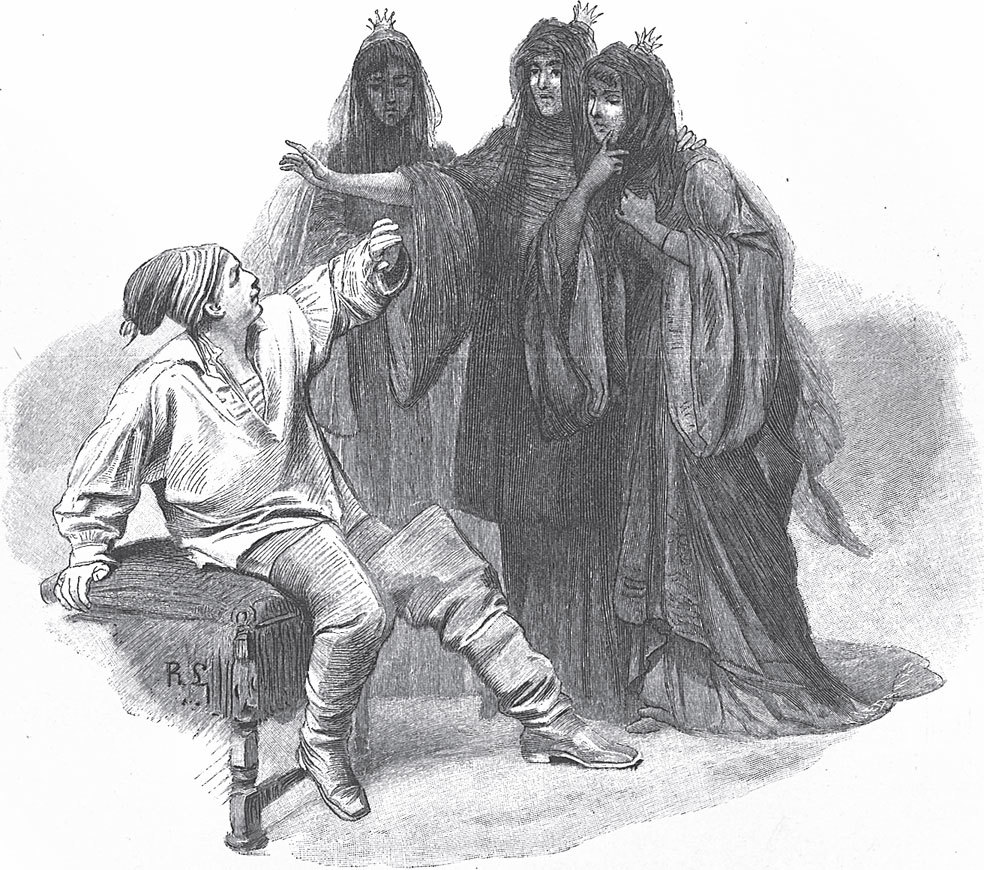

## Die drei schwarzen Prinzessinnen

Ostindien wurde vom Feind <abbr title="belagern — осаждать">belagert</abbr>. Der Feind wollte die Stadt nicht <abbr title="freigeben (gab frei, hat freigegeben) — освободить, отпустить">freigeben</abbr>, bevor er nicht sechshundert Taler bekommen hätte. Da ließ man in der Stadt <abbr title="austrommeln — объявить под барабанный бой">austrommeln</abbr>: Wer das Geld beschaffen könne, der solle Bürgermeister werden. Nun lebte dort ein armer Fischer, der mit seinem Sohn auf dem Meer fischte. Da kam der Feind, nahm den Sohn gefangen und gab dem Vater dafür sechshundert Taler. Der Vater ging hin und gab das Geld den Ratsherren der Stadt; der Feind zog ab, und der Fischer wurde Bürgermeister. Dann wurde ausgerufen: Wer nicht «Herr Bürgermeister» zu ihm sage, der solle am Galgen gerichtet werden.

Der Sohn aber entkam dem Feind wieder aus den Händen und kam in einen großen Wald auf einen hohen Berg. Der Berg tat sich auf, und er gelangte in ein großes verwunschenes Schloss, in dem Stühle, Tische und Bänke alle schwarz <abbr title="verhängen — завесить, задрапировать">verhängt</abbr> waren. Da kamen drei Prinzessinnen, die ganz in Schwarz gekleidet waren und nur ein klein wenig Weiß im Gesicht hatten. Sie sagten zu ihm, er solle nur keine Angst haben, sie wollten ihm nichts tun; er könne sie erlösen. Da sagte er, das wolle er gern tun, wenn er nur wüsste, wie er es anfangen solle. Sie sagten, er solle ein ganzes Jahr lang nicht mit ihnen sprechen und sie auch nicht ansehen. Was er gern haben wolle, das solle er nur sagen; wenn sie Antwort geben dürften, wollten sie es tun. Als er eine Zeit lang dort gewesen war, sagte er, er würde gern einmal zu seinem Vater gehen. Da sagten sie, das solle er nur tun: Diesen Beutel mit Geld solle er mitnehmen, diese Kleider solle er anziehen, und in acht Tagen müsse er wieder da sein.

Da wurde er hochgehoben und war im Nu in Ostindien. Er konnte seinen Vater in der Fischerhütte nicht mehr finden und fragte die Leute, wo denn der arme Fischer geblieben sei. Da sagten sie, das dürfe er nicht sagen, sonst käme er an den Galgen. Dann kam er zu seinem Vater und sagte:

— Fischer, wie seid Ihr denn hierhergekommen?

Da sagte der:

— Das dürft Ihr nicht sagen! Wenn die Herren der Stadt das <abbr title="einer Sache gewahr werden — заметить, узнать">gewahr</abbr> werden, kommt Ihr an den Galgen.

Er wollte es aber gar nicht lassen und wurde zum Galgen gebracht. Als er dort war, sagte er:

— O meine Herren, gebt mir Erlaubnis, dass ich noch einmal zur alten Fischerhütte gehen darf.

Dort zog er seinen alten Kittel an, kam wieder zu den Herren und sagte:

— «Seih ji et nu wull, sin ick nig en armen Fisker sinen Sohn?» Seht ihr es nun wohl, bin ich nicht der Sohn eines armen Fischers? In diesem <abbr title="das Zeug — одежда, тряпьё">Zeug</abbr> habe ich für meinen Vater und meine Mutter das Brot verdient.

Da erkannten sie ihn, baten um <abbr title="die Vergebung — прощение">Vergebung</abbr> und nahmen ihn mit nach Hause. Dort erzählte er alles, wie es ihm ergangen war: dass er in einen Wald auf einen hohen Berg gekommen sei, dass sich der Berg aufgetan habe, dass er in ein verwunschenes Schloss gekommen sei, wo alles schwarz gewesen sei, und dass drei Prinzessinnen gekommen seien, die schwarz gewesen seien, nur ein wenig weiß im Gesicht. Die hätten ihm gesagt, er solle keine Angst haben, er könne sie erlösen. Da sagte seine Mutter, das könne wohl nicht gut sein; er solle eine <abbr title="geweiht — освящённый">geweihte</abbr> <abbr title="die Wachskerze, die Wachskerzen — восковая свеча">Wachskerze</abbr> mitnehmen und ihnen glühendes Wachs ins Gesicht tropfen.

Er ging wieder hin, und es graute ihm sehr; er tropfte ihnen Wachs ins Gesicht, als sie schliefen, und sie wurden alle halb weiß. Da sprangen die drei Prinzessinnen auf und sagten:

— Du <abbr title="verflucht — проклятый">verfluchter</abbr> Hund, unser Blut soll über dich nach Rache schreien! Nun ist kein Mensch auf der Welt geboren und wird keiner geboren, der uns erlösen kann. Wir haben noch drei Brüder, die sind mit sieben Ketten <abbr title="anschließen (schloss an, hat angeschlossen) — приковать">angeschlossen</abbr>, die sollen dich zerreißen!

Da erhob sich ein <abbr title="das Gekreische — визг, вопли">Gekreische</abbr> im ganzen Schloss, und er sprang noch aus dem Fenster und brach sich das Bein. Das Schloss versank wieder in der Erde, der Berg war wieder zu, und niemand wusste, wo es gewesen war.

---

### Neue Wörter

- **belagern** — осаждать
- **freigeben (gab frei, hat freigegeben)** — освободить, отпустить
- **austrommeln** — объявить под барабанный бой
- **verhängen** — завесить, задрапировать
- **einer Sache gewahr werden** — заметить, узнать
- **das Zeug** — одежда, тряпьё
- **die Vergebung** — прощение
- **geweiht** — освящённый
- **die Wachskerze, die Wachskerzen** — восковая свеча
- **verflucht** — проклятый
- **anschließen (schloss an, hat angeschlossen)** — приковать
- **das Gekreische** — визг, вопли

[← Zurück](kapitel-136.md) · [Inhalt](README.md) · [Weiter →](kapitel-138.md)
