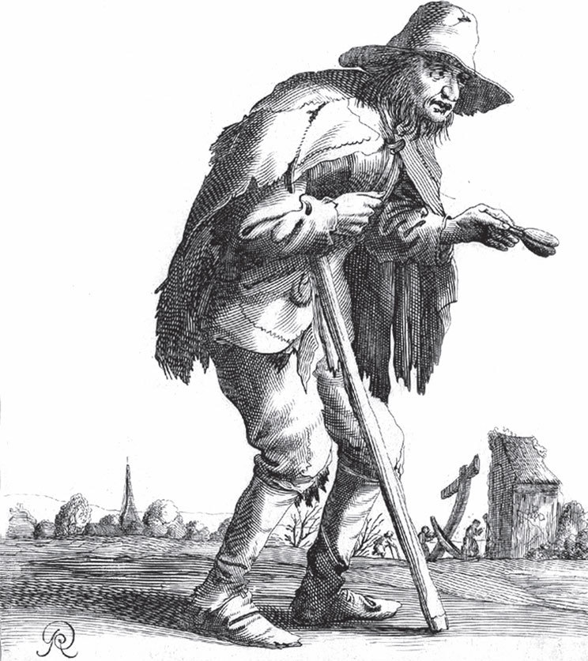

## Auf Reisen gehen

Es war einmal eine arme Frau, die hatte einen Sohn, der wollte so gern reisen. Da sagte die Mutter:

— Wie kannst du reisen? Wir haben doch gar kein Geld, das du mitnehmen kannst.

Da sagte der Sohn:

— Ich will mir schon <abbr title="sich behelfen (behalf, hat beholfen) — обходиться, выкручиваться">behelfen</abbr>. Ich will immer sagen: «Nig viel, nig viel, nig viel» – nicht viel, nicht viel, nicht viel.

Da ging er eine gute Zeit lang und sagte immer: «Nicht viel, nicht viel, nicht viel.» Er kam zu einem <abbr title="der Trupp, die Trupps — группа, ватага">Trupp</abbr> Fischer und sagte:

— Gott helfe euch! Nicht viel, nicht viel, nicht viel.

— Was sagst du, Kerl, «nicht viel»?

Und als sie das Netz herauszogen, fingen sie auch wirklich nicht viele Fische. Da gingen sie mit einem Stock auf den Jungen los:

— Hast du mich noch nie dreschen sehen?

— Was soll ich denn sagen? — fragte der Junge.

— Du sollst sagen: «Fang voll, Fang voll.»

Da ging er wieder eine ganze Zeit und sagte: «Fang voll, Fang voll», bis er an einen Galgen kam. Dort hatten sie einen armen Sünder, den wollten sie hinrichten. Da sagte er:

— Guten Morgen, Fang voll, Fang voll!

— Was sagst du, Kerl, «Fang voll»? Soll es noch mehr böse Leute auf der Welt geben? Ist das hier noch nicht genug?

Und er bekam wieder etwas auf den Buckel.

— Was soll ich denn sagen?

— Du sollst sagen: «Gott tröste die arme Seele.»

Der Junge ging wieder eine ganze Zeit und sagte: «Gott tröste die arme Seele!» Da kam er an einen Graben, dort stand ein Abdecker, der zog einem Pferd die Haut ab. Der Junge sagte:

— Guten Morgen, Gott tröste die arme Seele!

— Was sagst du, du böser Kerl?

Und er schlug ihm mit seinem <abbr title="der Abdeckerhaken, die Abdeckerhaken — крюк живодёра">Abdeckerhaken</abbr> um die Ohren, dass er aus den Augen nicht mehr sehen konnte.

— Wie soll ich denn sagen?

— Du sollst sagen: «Da liegst du, <abbr title="das Aas — падаль">Aas</abbr>, im Graben!»

Da ging er und sagte immerzu: «Da liegst du, Aas, im Graben! Da liegst du, Aas, im Graben!» Nun kam er an einen Wagen voller Leute, da sagte er:

— Guten Morgen, da liegst du, Aas, im Graben!

Da fiel der Wagen um in einen Graben. Der Knecht griff nach der Peitsche und <abbr title="verdreschen (verdrosch, hat verdroschen) — отколотить, отлупить">verdrosch</abbr> den Jungen so, dass er wieder zu seiner Mutter kriechen musste. Und er ist sein Lebtag nicht wieder auf Reisen gegangen.

---

### Neue Wörter

- **sich behelfen (behalf, hat beholfen)** — обходиться, выкручиваться
- **der Trupp, die Trupps** — группа, ватага
- **der Abdeckerhaken, die Abdeckerhaken** — крюк живодёра
- **das Aas** — падаль
- **verdreschen (verdrosch, hat verdroschen)** — отколотить, отлупить

[← Zurück](kapitel-142.md) · [Inhalt](README.md) · [Weiter →](kapitel-144.md)
