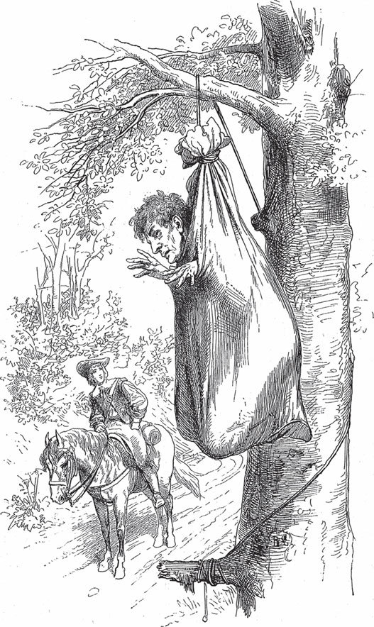

## Die Rübe

Es waren einmal zwei Brüder, die dienten beide als Soldaten; der eine war reich, der andere arm. Da wollte der Arme sich aus seiner Not helfen, zog den <abbr title="der Soldatenrock, die Soldatenröcke — солдатский мундир">Soldatenrock</abbr> aus und wurde Bauer. Also grub und hackte er sein Stückchen Acker und säte <abbr title="der Rübensamen — семена репы">Rübensamen</abbr>. Der Samen ging auf, und es wuchs dort eine Rübe, die wurde groß und stark und <abbr title="zusehends — на глазах">zusehends</abbr> dicker und wollte gar nicht aufhören zu wachsen, sodass man sie eine <abbr title="die Fürstin, die Fürstinnen — княгиня">Fürstin</abbr> aller Rüben nennen konnte; denn <abbr title="nie und nimmer — никогда в жизни">nie und nimmer</abbr> hatte man so eine gesehen, und man wird auch nie wieder eine sehen. Zuletzt war sie so groß, dass sie allein einen ganzen Wagen füllte und zwei Ochsen daran ziehen mussten. Und der Bauer wusste nicht, was er damit anfangen sollte und ob es sein Glück oder sein Unglück sei. Endlich dachte er: «Verkaufst du sie, was wirst du schon Großes dafür bekommen? Und willst du sie selbst essen, dann tun die kleinen Rüben denselben Dienst. Am besten bringst du sie dem König und machst ihm damit ein <abbr title="die Verehrung — почтение, подношение">Geschenk zur Verehrung</abbr>.» Also lud er sie auf den Wagen, spannte zwei Ochsen davor, brachte sie an den Hof und schenkte sie dem König.

— Was ist das für ein seltsames Ding? — sagte der König. — Mir ist schon viel Wunderliches vor die Augen gekommen, aber so ein Ungetüm noch nicht. Aus was für einem Samen mag die gewachsen sein? Oder gerät es nur dir, und du bist ein Glückskind?

— Ach nein, — sagte der Bauer, — ein Glückskind bin ich nicht. Ich bin ein armer Soldat, der, weil er sich nicht mehr <abbr title="sich ernähren — прокормиться">ernähren</abbr> konnte, den Soldatenrock <abbr title="etwas an den Nagel hängen — бросить (занятие), повесить на гвоздь">an den Nagel hängte</abbr> und das Land <abbr title="bebauen — возделывать">bebaute</abbr>. Ich habe noch einen Bruder, der ist reich und Euch, Herr König, wohl auch bekannt. Ich aber bin, weil ich nichts habe, von aller Welt vergessen.

Da empfand der König Mitleid mit ihm und sprach:

— Von deiner Armut sollst du <abbr title="befreien von + Dat. — освободить от">befreit</abbr> und von mir so beschenkt werden, dass du deinem reichen Bruder wohl <abbr title="gleichkommen + Dat. (kam gleich, ist gleichgekommen) — сравняться с">gleichkommst</abbr>.

Da schenkte er ihm eine Menge Gold, Äcker, Wiesen und Herden und machte ihn <abbr title="steinreich — очень богатый, богатейший">steinreich</abbr>, sodass sich der Reichtum des anderen Bruders gar nicht damit vergleichen ließ. Als dieser hörte, was sein Bruder mit einer einzigen Rübe erworben hatte, <abbr title="beneiden — завидовать">beneidete</abbr> er ihn und <abbr title="sinnen (sann, hat gesonnen) — размышлять, замышлять">sann</abbr> hin und her, wie er auch sich ein solches Glück <abbr title="zuwenden — обратить к себе, доставить">zuwenden</abbr> könne. Er wollte es aber noch viel gescheiter anfangen, nahm Gold und Pferde, brachte sie dem König und meinte nicht anders, als dass der ihm ein viel größeres <abbr title="das Gegengeschenk, die Gegengeschenke — ответный подарок">Gegengeschenk</abbr> machen würde. Denn hatte sein Bruder so viel für eine Rübe bekommen, was würde es ihm für so schöne Dinge erst alles einbringen! Der König nahm das Geschenk und sagte, er wisse ihm nichts zurückzugeben, das seltener und besser sei als die große Rübe. Also musste der Reiche die Rübe seines Bruders auf einen Wagen legen und nach Hause fahren lassen. Daheim wusste er nicht, an wem er seinen Zorn und Ärger <abbr title="etwas an jemandem auslassen — сорвать (злость) на ком-то">auslassen</abbr> sollte, bis ihm böse Gedanken kamen und er beschloss, seinen Bruder zu töten. Er gewann Mörder, die sich in einen <abbr title="der Hinterhalt, die Hinterhalte — засада">Hinterhalt</abbr> legen mussten. Darauf ging er zu seinem Bruder und sprach:

— Lieber Bruder, ich weiß einen heimlichen Schatz, den wollen wir miteinander heben und teilen.

Der andere war damit einverstanden und ging <abbr title="ohne Arg — без задней мысли, простодушно">ohne Arg</abbr> mit. Als sie aber hinauskamen, stürzten die Mörder über ihn her, fesselten ihn und wollten ihn an einen Baum hängen. Gerade als sie dabei waren, <abbr title="erschallen (erscholl, ist erschollen) — раздаться, зазвучать">erscholl</abbr> aus der Ferne lauter Gesang und <abbr title="der Hufschlag — стук копыт">Hufschlag</abbr>, sodass ihnen der Schrecken in die Glieder fuhr. <abbr title="Hals über Kopf — сломя голову">Hals über Kopf</abbr> steckten sie ihren Gefangenen in den Sack, zogen ihn an einem Ast hinauf und ergriffen die Flucht. Er aber arbeitete oben, bis er ein Loch im Sack hatte, durch das er den Kopf stecken konnte. Wer aber des Weges kam, war nichts als ein <abbr title="der fahrende Schüler — странствующий школяр">fahrender Schüler</abbr>, ein junger Geselle, der fröhlich sein Lied singend auf der Straße durch den Wald dahergeritten kam. Als der oben nun merkte, dass einer unter ihm vorbeiging, rief er:

— Sei mir gegrüßt, zu guter Stunde!

Der Schüler schaute sich überall um und wusste nicht, woher die Stimme schallte. Endlich sprach er:

— Wer ruft mich?

Da antwortete es aus dem Wipfel:

— Erhebe deine Augen, ich sitze hier oben im Sack der Weisheit. In kurzer Zeit habe ich große Dinge gelernt, dagegen sind alle Schulen nur Wind. Es fehlt nur noch ein Weniges, dann habe ich ausgelernt, steige herab und bin weiser als alle Menschen. Ich verstehe die <abbr title="das Gestirn, die Gestirne — светило, созвездие">Gestirne</abbr> und <abbr title="das Himmelszeichen, die Himmelszeichen — небесное знамение">Himmelszeichen</abbr>, das Wehen aller Winde, den Sand im Meer, die <abbr title="die Heilung — исцеление">Heilung</abbr> der Krankheiten, die Kräfte der Kräuter, der Vögel und der Steine. Wärst du einmal darin, du würdest fühlen, was für eine Herrlichkeit aus dem Sack der Weisheit fließt.

Als der Schüler das alles hörte, staunte er und sprach:

— Gesegnet sei die Stunde, in der ich dich gefunden habe! Könnte ich nicht auch ein wenig in den Sack kommen?

Der oben antwortete, als täte er es nicht gern:

— Eine kleine Weile will ich dich wohl hineinlassen, für Lohn und gute Worte. Aber du musst noch eine Stunde warten, es ist noch ein Stück übrig, das ich erst lernen muss.

Als der Schüler ein wenig gewartet hatte, wurde ihm die Zeit zu lang, und er bat, dass man ihn doch hineinlasse, sein Durst nach Weisheit sei gar zu groß. Da tat der oben so, als gebe er endlich nach, und sprach:

— Damit ich aus dem Haus der Weisheit herauskann, musst du den Sack am Strick herunterlassen, dann sollst du hinein.

Also ließ der Schüler ihn herunter, band den Sack auf und befreite ihn. Dann rief er selbst:

— Nun zieh mich recht schnell hinauf!

Und er wollte aufrecht stehend in den Sack steigen.

— Halt! — sagte der andere. — So geht das nicht.

Er packte ihn beim Kopf, steckte ihn <abbr title="kopfüber — вниз головой">kopfüber</abbr> in den Sack, schnürte ihn zu und zog den <abbr title="der Jünger, die Jünger — ученик, последователь">Jünger</abbr> der Weisheit am Strick zum Baum hinauf. Dann ließ er ihn in der Luft baumeln und sprach:

— Wie steht es, mein lieber Geselle? Siehe, schon fühlst du, dass dir die Weisheit kommt, und machst gute Erfahrung. Sitz also fein still, bis du klüger wirst.

Damit stieg er auf das Pferd des Schülers und ritt fort. Nach einer Stunde aber schickte er jemanden, der ihn wieder herunterlassen musste.

---

### Neue Wörter

- **der Soldatenrock, die Soldatenröcke** — солдатский мундир
- **der Rübensamen** — семена репы
- **zusehends** — на глазах
- **die Fürstin, die Fürstinnen** — княгиня
- **nie und nimmer** — никогда в жизни
- **die Verehrung** — почтение, подношение
- **sich ernähren** — прокормиться
- **etwas an den Nagel hängen** — бросить (занятие), повесить на гвоздь
- **bebauen** — возделывать
- **befreien von + Dat.** — освободить от
- **gleichkommen + Dat. (kam gleich, ist gleichgekommen)** — сравняться с
- **steinreich** — очень богатый, богатейший
- **beneiden** — завидовать
- **sinnen (sann, hat gesonnen)** — размышлять, замышлять
- **zuwenden** — обратить к себе, доставить
- **das Gegengeschenk, die Gegengeschenke** — ответный подарок
- **etwas an jemandem auslassen** — сорвать (злость) на ком-то
- **der Hinterhalt, die Hinterhalte** — засада
- **ohne Arg** — без задней мысли, простодушно
- **erschallen (erscholl, ist erschollen)** — раздаться, зазвучать
- **der Hufschlag** — стук копыт
- **Hals über Kopf** — сломя голову
- **der fahrende Schüler** — странствующий школяр
- **das Gestirn, die Gestirne** — светило, созвездие
- **das Himmelszeichen, die Himmelszeichen** — небесное знамение
- **die Heilung** — исцеление
- **kopfüber** — вниз головой
- **der Jünger, die Jünger** — ученик, последователь

[← Zurück](kapitel-145.md) · [Inhalt](README.md) · [Weiter →](kapitel-147.md)
