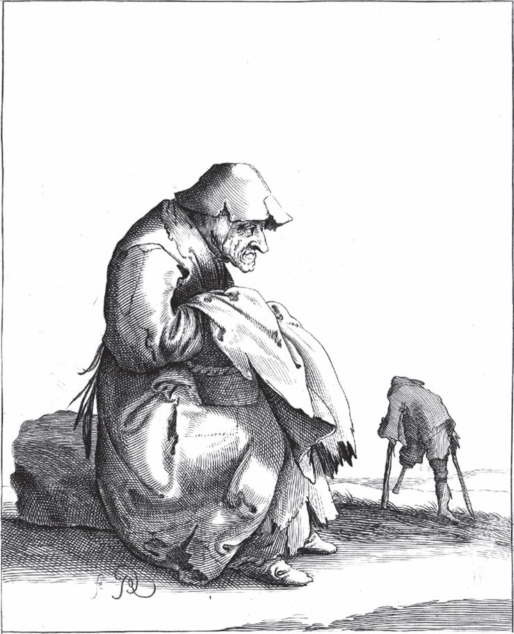

## Die alte Bettelfrau

Es war einmal eine alte Frau – du hast wohl schon einmal eine alte Frau betteln gehen sehen? Diese Frau bettelte auch, und wenn sie etwas bekam, dann sagte sie: «Gott lohne es euch.» Die <abbr title="die Bettelfrau, die Bettelfrauen — нищенка">Bettelfrau</abbr> kam an eine Tür, da stand ein freundlicher Schelm von einem Jungen am Feuer und wärmte sich. Als die arme alte Frau so an der Tür stand und zitterte, sagte der Junge freundlich zu ihr:

— Kommt, <abbr title="die Altmutter — бабушка, старушка">Altmutter</abbr>, und wärmt Euch!

Sie kam herbei, stellte sich aber zu nah ans Feuer, sodass ihre alten Lumpen zu brennen anfingen, und sie merkte es nicht. Der Junge stand da und sah das; er hätte es doch löschen sollen? Nicht wahr, er hätte es löschen sollen? Und wenn er kein Wasser gehabt hätte, dann hätte er alles Wasser in seinem Leib zu den Augen herausweinen sollen; das hätte zwei hübsche <abbr title="das Bächlein, die Bächlein — ручеёк">Bächlein</abbr> zum Löschen gegeben.

---

### Neue Wörter

- **die Bettelfrau, die Bettelfrauen** — нищенка
- **die Altmutter** — бабушка, старушка
- **das Bächlein, die Bächlein** — ручеёк

[← Zurück](kapitel-149.md) · [Inhalt](README.md) · [Weiter →](kapitel-151.md)
