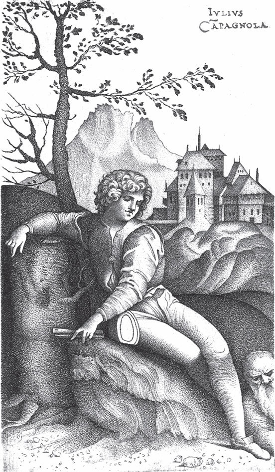

## Das Hirtenbüblein

Es war einmal ein <abbr title="das Hirtenbübchen — пастушок">Hirtenbübchen</abbr>, das war wegen seiner weisen Antworten, die es auf alle Fragen gab, weit und breit berühmt. Auch der König des Landes hörte davon, glaubte es nicht und ließ das <abbr title="das Bübchen — мальчуган">Bübchen</abbr> kommen. Da sprach er zu ihm:

— Kannst du mir auf drei Fragen, die ich dir vorlegen will, eine Antwort geben, dann will ich dich <abbr title="jemanden ansehen als/wie — считать кого-то кем-то">ansehen</abbr> wie mein eigenes Kind, und du sollst bei mir in meinem königlichen Schloss wohnen.

Sprach das Büblein:

— Wie <abbr title="lauten — гласить, звучать">lauten</abbr> die drei Fragen?

Der König sagte:

— Die erste lautet: Wie viele Tropfen Wasser sind im <abbr title="das Weltmeer, die Weltmeere — мировой океан">Weltmeer</abbr>?

Das Hirtenbüblein antwortete:

— Herr König, lasst alle Flüsse auf der Erde verstopfen, damit kein <abbr title="das Tröpflein — капелька">Tröpflein</abbr> mehr daraus ins Meer läuft, das ich nicht erst gezählt habe, dann will ich Euch sagen, wie viele Tropfen im Meer sind.

Sprach der König:

— Die zweite Frage lautet: Wie viele Sterne stehen am Himmel?

Das Hirtenbübchen sagte:

— Gebt mir einen großen Bogen weißes Papier.

Und dann machte es mit der Feder so viele feine Punkte darauf, dass sie kaum zu sehen und fast gar nicht zu zählen waren und einem die Augen vergingen, wenn man darauf blickte. Darauf sprach es:

— So viele Sterne stehen am Himmel, wie hier Punkte auf dem Papier sind. Zählt sie nur.

Aber niemand war dazu <abbr title="imstande sein — быть в состоянии">imstande</abbr>. Sprach der König:

— Die dritte Frage lautet: Wie viele Sekunden hat die Ewigkeit?

Da sagte das Hirtenbüblein:

— In Hinterpommern liegt der <abbr title="der Diamantberg — алмазная гора">Diamantberg</abbr>, der ist eine Stunde hoch, eine Stunde breit und eine Stunde tief. Dorthin kommt alle hundert Jahre ein Vögelein und wetzt sein <abbr title="das Schnäblein — клювик">Schnäblein</abbr> daran, und wenn der ganze Berg <abbr title="abwetzen — сточить, стереть">abgewetzt</abbr> ist, dann ist die erste Sekunde der Ewigkeit vorbei.

Sprach der König:

— Du hast die drei Fragen gelöst wie ein Weiser und sollst <abbr title="fortan — отныне">fortan</abbr> bei mir in meinem königlichen Schloss wohnen, und ich will dich ansehen wie mein eigenes Kind.

---

### Neue Wörter

- **das Hirtenbübchen** — пастушок
- **das Bübchen** — мальчуган
- **jemanden ansehen als/wie** — считать кого-то кем-то
- **lauten** — гласить, звучать
- **das Weltmeer, die Weltmeere** — мировой океан
- **das Tröpflein** — капелька
- **imstande sein** — быть в состоянии
- **der Diamantberg** — алмазная гора
- **das Schnäblein** — клювик
- **abwetzen** — сточить, стереть
- **fortan** — отныне

[← Zurück](kapitel-152.md) · [Inhalt](README.md) · [Weiter →](kapitel-154.md)
