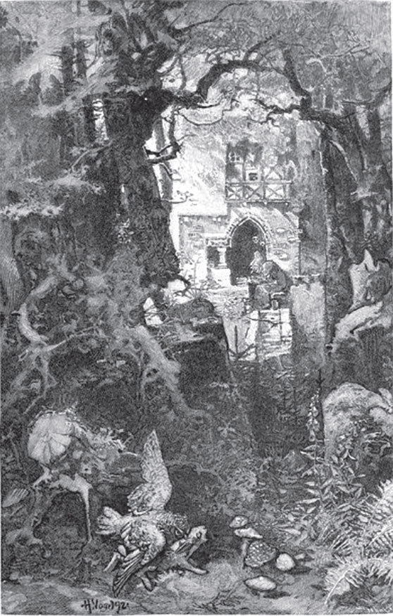

## Rätselmärchen

Drei Frauen waren in Blumen verwandelt, die auf dem Feld standen; eine von ihnen aber durfte nachts in ihrem Haus sein. Da sprach sie einmal zu ihrem Mann, als der Tag nahte und sie wieder zu ihren <abbr title="die Gespielin, die Gespielinnen — подружка (по играм)">Gespielinnen</abbr> auf das Feld gehen und eine Blume werden musste:

— Wenn du heute Vormittag kommst und mich abbrichst, werde ich erlöst und bleibe fortan bei dir.

Und so geschah es auch. Nun ist die Frage, wie ihr Mann sie erkannt hat, da die Blumen doch ganz gleich und ohne Unterschied waren.

Antwort: Weil sie die Nacht in ihrem Haus und nicht auf dem Feld verbracht hatte, war der Tau nicht auf sie gefallen wie auf die anderen zwei; daran erkannte sie der Mann.

---

### Neue Wörter

- **die Gespielin, die Gespielinnen** — подружка (по играм)

[← Zurück](kapitel-160.md) · [Inhalt](README.md) · [Weiter →](kapitel-162.md)
