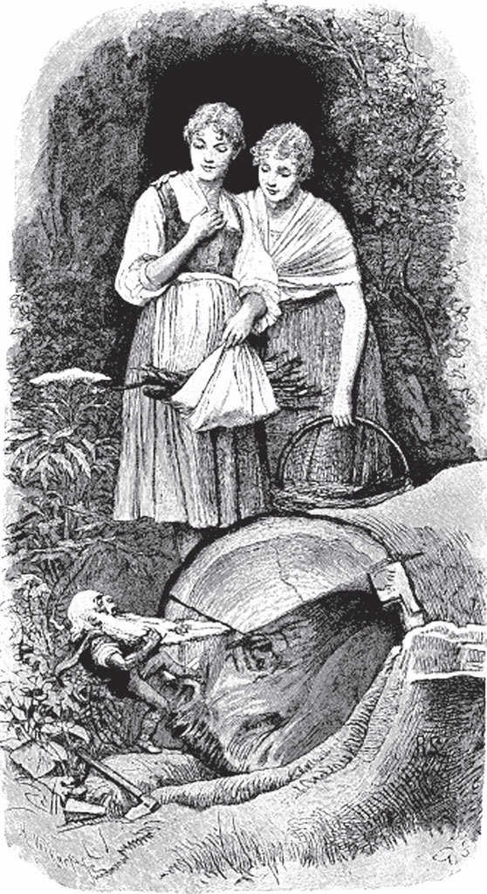

## Schneeweißchen und Rosenrot

Eine arme Witwe lebte einsam in einer kleinen Hütte. Vor der Hütte lag ein Garten, und darin standen zwei kleine <abbr title="der Rosenbaum, die Rosenbäume — розовый куст (деревце)">Rosenbäume</abbr>: Der eine trug weiße, der andere rote Rosen. Die Frau hatte zwei Kinder, die glichen den beiden Rosenbäumchen, und das eine hieß Schneeweißchen, das andere Rosenrot. Sie waren so fromm und gut, so fleißig und unermüdlich, wie nur je zwei Kinder auf der Welt gewesen sind; Schneeweißchen war nur stiller und sanfter als Rosenrot. Rosenrot sprang lieber auf den Wiesen und Feldern <abbr title="umherspringen (sprang umher, ist umhergesprungen) — прыгать, бегать туда-сюда">umher</abbr>, suchte Blumen und fing <abbr title="der Schmetterling, die Schmetterlinge — бабочка">Schmetterlinge</abbr>; Schneeweißchen aber saß zu Hause bei der Mutter, half ihr im Haushalt oder las ihr vor, wenn nichts zu tun war.

Die beiden Kinder hatten einander so lieb, dass sie sich immer an den Händen fassten, sooft sie zusammen ausgingen. Und wenn Schneeweißchen sagte: «Wir wollen uns nicht verlassen», so antwortete Rosenrot: «Solange wir leben, nicht», und die Mutter <abbr title="hinzufügen — добавлять">fügte hinzu</abbr>: «Was das eine hat, soll es mit dem andern teilen.» Oft liefen sie allein im Wald umher und sammelten rote Beeren, aber kein Tier tat ihnen etwas zuleide; im Gegenteil, die Tiere kamen ganz <abbr title="zutraulich — доверчиво">zutraulich</abbr> herbei. Das Häschen fraß ein <abbr title="das Kohlblatt, die Kohlblätter — капустный лист">Kohlblatt</abbr> aus ihren Händen, das Reh <abbr title="grasen — пастись, щипать траву">graste</abbr> an ihrer Seite, der Hirsch sprang ganz lustig vorbei, und die Vögel blieben auf den Ästen sitzen und sangen, was sie nur konnten. Kein Unglück traf sie. Wenn sie sich im Wald <abbr title="sich verspäten — опаздывать, задерживаться">verspätet</abbr> hatten und die Nacht sie <abbr title="überraschen — заставать врасплох">überraschte</abbr>, so legten sie sich nebeneinander auf das Moos und schliefen, bis der Morgen kam; die Mutter wusste das und machte sich ihretwegen keine Sorgen.

Einmal, als sie im Wald übernachtet hatten und das Morgenrot sie weckte, da sahen sie ein schönes Kind in einem weißen, glänzenden Kleidchen neben ihrem Lager sitzen. Es stand auf und blickte sie ganz freundlich an, sagte aber nichts und ging in den Wald hinein. Und als sie sich umsahen, merkten sie, dass sie ganz nahe an einem Abgrund geschlafen hatten. Sie <abbr title="sein (Konj. II: wäre) — был бы">wären</abbr> gewiss hineingefallen, wenn sie in der Dunkelheit noch ein paar Schritte weitergegangen wären. Die Mutter aber sagte ihnen, das müsse der Engel gewesen sein, der gute Kinder bewache.

Schneeweißchen und Rosenrot hielten die Hütte der Mutter so sauber, dass es eine Freude war hineinzuschauen. Im Sommer besorgte Rosenrot das Haus und stellte der Mutter jeden Morgen, bevor sie aufwachte, einen Blumenstrauß ans Bett, in dem von jedem Bäumchen eine Rose war. Im Winter zündete Schneeweißchen das Feuer an und hängte den Kessel an den <abbr title="der Feuerhaken, die Feuerhaken — крюк над очагом">Feuerhaken</abbr>. Der Kessel war aus Messing, glänzte aber wie Gold, so sauber war er gescheuert. Abends, wenn die <abbr title="die Flocke, die Flocken — хлопья (снега)">Flocken</abbr> fielen, sagte die Mutter: «Geh, Schneeweißchen, und schieb den Riegel vor.» Dann setzten sie sich an den Herd, die Mutter nahm die Brille und las aus einem großen Buch vor, und die beiden Mädchen hörten zu, saßen und spannen. Neben ihnen lag ein Lämmchen auf dem Boden, und hinter ihnen saß auf einer Stange ein weißes Täubchen und hatte seinen Kopf unter den Flügel gesteckt.

Eines Abends, als sie so gemütlich beisammensaßen, klopfte jemand an die Tür, als wollte er <abbr title="einlassen (ließ ein, hat eingelassen) — впускать">eingelassen</abbr> werden. Die Mutter sprach:

— Geschwind, Rosenrot, mach auf, es wird ein Wanderer sein, der ein Obdach sucht.

Rosenrot ging und schob den Riegel weg und dachte, es sei ein armer Mann. Aber es war keiner: Es war ein Bär, der seinen dicken schwarzen Kopf zur Tür hereinstreckte. Rosenrot schrie laut und sprang zurück, das Lämmchen blökte, das Täubchen <abbr title="aufflattern — вспорхнуть">flatterte</abbr> auf, und Schneeweißchen versteckte sich hinter dem Bett der Mutter. Der Bär aber fing an zu sprechen und sagte:

— Fürchtet euch nicht, ich tue euch nichts zuleide. Ich bin halb erfroren und will mich nur ein wenig bei euch wärmen.

— Du armer Bär, — sprach die Mutter, — leg dich ans Feuer und gib nur acht, dass dir dein Pelz nicht brennt.

Dann rief sie:

— Schneeweißchen, Rosenrot, kommt hervor, der Bär tut euch nichts, er meint es ehrlich.

Da kamen beide heran, und nach und nach näherten sich auch das Lämmchen und das Täubchen und hatten keine Angst vor ihm. Der Bär sprach:

— Ihr Kinder, klopft mir den Schnee ein wenig aus dem Fell.

Sie holten den Besen und fegten dem Bären das Fell sauber; er aber streckte sich am Feuer aus und brummte ganz vergnügt und <abbr title="behaglich — уютно, с удовольствием">behaglich</abbr>. Es dauerte nicht lange, da waren sie ganz vertraut mit ihm und trieben <abbr title="der Mutwille — озорство, шалость">Mutwillen</abbr> mit dem <abbr title="unbeholfen — неуклюжий">unbeholfenen</abbr> Gast. Sie <abbr title="zausen — трепать, ерошить">zausten</abbr> ihm das Fell mit den Händen, setzten ihre Füßchen auf seinen Rücken und <abbr title="wälzen — катать, переваливать">wälzten</abbr> ihn hin und her, oder sie nahmen eine Haselrute und schlugen auf ihn los, und wenn er brummte, so lachten sie. Der Bär ließ es sich gern gefallen; nur wenn sie es gar zu <abbr title="arg — сильно, чересчур">arg</abbr> trieben, rief er: «Lasst mich am Leben, ihr Kinder:

> Schneeweißchen, Rosenrot,  
> schlägst dir den Freier tot.»

Als es Zeit zum Schlafen war und die andern zu Bett gingen, sagte die Mutter zu dem Bären:

— Du kannst in Gottes Namen da am Herd liegen bleiben, so bist du vor der Kälte und dem bösen Wetter geschützt.

Sobald der Tag graute, ließen ihn die beiden Kinder hinaus, und er trabte über den Schnee in den Wald hinein. Von nun an kam der Bär jeden Abend zur bestimmten Stunde, legte sich an den Herd und erlaubte den Kindern, mit ihm zu spielen und <abbr title="die Kurzweil — забава, развлечение">Kurzweil</abbr> zu treiben, so viel sie wollten. Sie hatten sich so an ihn gewöhnt, dass die Tür nicht eher verriegelt wurde, als bis der schwarze Geselle angekommen war.

Als das <abbr title="das Frühjahr — весна">Frühjahr</abbr> gekommen und draußen alles grün war, sagte der Bär eines Morgens zu Schneeweißchen:

— Nun muss ich fort und darf den ganzen Sommer nicht wiederkommen.

— Wohin gehst du denn, lieber Bär? — fragte Schneeweißchen.

— Ich muss in den Wald und meine Schätze vor den bösen Zwergen hüten. Im Winter, wenn die Erde hart gefroren ist, müssen sie unten bleiben und können sich nicht <abbr title="sich durcharbeiten — пробиваться">durcharbeiten</abbr>. Aber jetzt, da die Sonne die Erde <abbr title="auftauen — оттаивать, растапливать">aufgetaut</abbr> und <abbr title="erwärmen — согревать">erwärmt</abbr> hat, brechen sie durch, steigen herauf, suchen und stehlen. Und was einmal in ihren Händen ist und in ihren Höhlen liegt, das kommt so leicht nicht wieder ans Tageslicht.

Schneeweißchen war ganz traurig über den Abschied. Als es ihm die Tür <abbr title="aufriegeln — отпирать засов">aufriegelte</abbr> und der Bär sich hinausdrängte, blieb er an dem <abbr title="der Türhaken, die Türhaken — дверной крюк">Türhaken</abbr> hängen, und ein Stück seiner Haut riss auf. Da war es Schneeweißchen, als hätte es Gold <abbr title="durchschimmern — просвечивать, мерцать сквозь">durchschimmern</abbr> sehen; aber es war sich seiner Sache nicht sicher. Der Bär lief eilig fort und war bald hinter den Bäumen verschwunden.

Nach einiger Zeit schickte die Mutter die Kinder in den Wald, um Reisig zu sammeln. Da fanden sie draußen einen großen Baum, der gefällt auf dem Boden lag, und am Stamm sprang zwischen dem Gras etwas auf und ab; sie konnten aber nicht erkennen, was es war. Als sie näher kamen, sahen sie einen Zwerg mit einem alten, <abbr title="verwelkt — увядший, сморщенный">verwelkten</abbr> Gesicht und einem <abbr title="ellenlang — длиной в локоть, очень длинный">ellenlangen</abbr> schneeweißen Bart. Das Ende des Bartes war in einem Spalt des Baumes eingeklemmt, und der Kleine sprang hin und her wie ein Hündchen an einem Seil und wusste nicht, wie er sich helfen sollte. Er <abbr title="glotzen — таращиться, пялиться">glotzte</abbr> die Mädchen mit seinen roten, feurigen Augen an und schrie:

— Was steht ihr da! Könnt ihr nicht herkommen und mir <abbr title="Beistand leisten — оказать помощь">Beistand leisten</abbr>?

— Was hast du denn gemacht, kleines Männchen? — fragte Rosenrot.

— Dumme, neugierige Gans, — antwortete der Zwerg. — Den Baum habe ich mir spalten wollen, um kleines Holz für die Küche zu haben. Bei den dicken Klötzen verbrennt sofort das bisschen Speise, das unsereiner braucht, der nicht so viel <abbr title="hinunterschlingen (schlang hinunter, hat hinuntergeschlungen) — заглатывать, жадно глотать">hinunterschlingt</abbr> wie ihr, grobes, gieriges Volk. Ich hatte den Keil schon glücklich hineingetrieben, und alles wäre nach Wunsch gegangen, aber das verwünschte Holz war zu glatt und sprang <abbr title="unversehens — неожиданно, нечаянно">unversehens</abbr> heraus, und der Baum fuhr so schnell zusammen, dass ich meinen schönen weißen Bart nicht mehr herausziehen konnte. Nun steckt er drin, und ich kann nicht fort. Da lachen die albernen, glatten <abbr title="das Milchgesicht, die Milchgesichter — молокосос">Milchgesichter</abbr>! <abbr title="pfui! — фу!">Pfui</abbr>, wie garstig ihr seid!

Die Kinder gaben sich alle Mühe, aber sie konnten den Bart nicht herausziehen, er steckte zu fest.

— Ich will laufen und Leute holen, — sagte Rosenrot.

— Wahnsinnige Schafsköpfe, — <abbr title="schnarren — скрипеть, трещать (голосом)">schnarrte</abbr> der Zwerg, — wer wird denn gleich Leute herbeirufen! Ihr seid mir schon um zwei zu viel. Fällt euch nichts Besseres ein?

— Sei nur nicht ungeduldig, — sagte Schneeweißchen, — ich weiß schon <abbr title="Rat wissen / Rat schaffen — найти выход">Rat</abbr>.

Es holte sein Scherchen aus der Tasche und schnitt das Ende des Bartes ab. Sobald der Zwerg sich frei fühlte, griff er nach einem Sack, der zwischen den Wurzeln des Baumes steckte und mit Gold gefüllt war, hob ihn heraus und brummte vor sich hin:

— <abbr title="ungehobelt — неотёсанный, грубый">Ungehobeltes</abbr> Volk, schneidet mir ein Stück von meinem stolzen Bart ab! <abbr title="Lohn&#x27;s euch der Kuckuck! — чёрт бы вас побрал! (букв. пусть кукушка вам заплатит)">Lohn's euch der Kuckuck!</abbr>

Damit schwang er seinen Sack auf den Rücken und ging fort, ohne die Kinder auch nur noch einmal anzusehen.

Einige Zeit danach wollten Schneeweißchen und Rosenrot sich ein Gericht Fische angeln. Als sie nahe am Bach waren, sahen sie, dass etwas wie eine große <abbr title="die Heuschrecke, die Heuschrecken — кузнечик, саранча">Heuschrecke</abbr> zum Wasser hin hüpfte, als wollte es hineinspringen. Sie liefen heran und erkannten den Zwerg.

— Wo willst du hin? — sagte Rosenrot. — Du willst doch nicht ins Wasser?

— So ein Narr bin ich nicht, — schrie der Zwerg. — Seht ihr nicht, der verwünschte Fisch will mich hineinziehen?

Der Kleine hatte dort gesessen und geangelt, und unglücklicherweise hatte der Wind seinen Bart mit der <abbr title="die Angelschnur, die Angelschnüre — леска">Angelschnur</abbr> <abbr title="verflechten (verflocht, hat verflochten) — сплетать, переплетать">verflochten</abbr>. Als gleich darauf ein großer Fisch anbiss, fehlten dem schwachen Geschöpf die Kräfte, ihn herauszuziehen: Der Fisch <abbr title="die Oberhand behalten — взять верх">behielt die Oberhand</abbr> und riss den Zwerg zu sich hin. Zwar hielt er sich an allen Halmen und Binsen fest, aber das half nicht viel; er musste den Bewegungen des Fisches folgen und war in ständiger Gefahr, ins Wasser gezogen zu werden. Die Mädchen kamen <abbr title="zur rechten Zeit — вовремя">zur rechten Zeit</abbr>, hielten ihn fest und versuchten, den Bart von der Schnur loszumachen, aber <abbr title="vergebens — напрасно, тщетно">vergebens</abbr>: Bart und Schnur waren fest ineinander <abbr title="verwirren — запутывать">verwirrt</abbr>. Es blieb nichts anderes übrig, als das Scherchen hervorzuholen und den Bart abzuschneiden, wobei ein kleiner Teil davon verloren ging. Als der Zwerg das sah, schrie er sie an:

— Ist das eine <abbr title="die Art — манера, обхождение">Art</abbr>, ihr Kröten, einem das Gesicht zu <abbr title="verschandeln — уродовать, портить">verschandeln</abbr>? Nicht genug, dass ihr mir den Bart unten gestutzt habt, jetzt schneidet ihr mir den besten Teil davon ab! Ich darf mich vor den Meinen gar nicht mehr sehen lassen. Dass ihr laufen müsstet und die Schuhsohlen verlieren solltet!

Dann holte er einen Sack Perlen, der im Schilf lag, und ohne ein weiteres Wort schleppte er ihn fort und verschwand hinter einem Stein.

Es trug sich zu, dass die Mutter die beiden Mädchen bald darauf in die Stadt schickte, um Zwirn, Nadeln, Schnüre und Bänder einzukaufen. Der Weg führte sie über eine Heide, auf der hier und da mächtige Felsbrocken <abbr title="verstreut — разбросанный">verstreut</abbr> lagen. Da sahen sie einen großen Vogel in der Luft schweben, der langsam über ihnen <abbr title="kreisen — кружить">kreiste</abbr>, sich immer tiefer <abbr title="sich herabsenken — опускаться">herabsenkte</abbr> und endlich nicht weit von ihnen bei einem Felsen <abbr title="niederstoßen (stieß nieder, ist niedergestoßen) — камнем падать вниз (о хищной птице)">niederstieß</abbr>. Gleich darauf hörten sie einen durchdringenden, jämmerlichen Schrei. Sie liefen hin und sahen mit Schrecken, dass der Adler ihren alten Bekannten, den Zwerg, gepackt hatte und ihn forttragen wollte. Die mitleidigen Kinder hielten das Männchen gleich fest und zerrten so lange mit dem Adler herum, bis er seine Beute <abbr title="fahren lassen — выпустить, отпустить">fahren ließ</abbr>.

Als der Zwerg sich von dem ersten Schrecken erholt hatte, schrie er mit seiner <abbr title="kreischend — визгливый">kreischenden</abbr> Stimme:

— Konntet ihr nicht behutsamer mit mir umgehen? Gerissen habt ihr an meinem dünnen Röckchen, dass es überall zerfetzt und durchlöchert ist, <abbr title="tollpatschig — неуклюжий">tollpatschiges</abbr> Gesindel, das ihr seid!

Dann nahm er einen Sack mit Edelsteinen und schlüpfte wieder unter den Felsen in seine Höhle. Die Mädchen waren an seinen <abbr title="der Undank — неблагодарность">Undank</abbr> schon gewöhnt, setzten ihren Weg fort und erledigten ihre <abbr title="die Besorgung, die Besorgungen — покупка, поручение">Besorgungen</abbr> in der Stadt. Als sie auf dem Heimweg wieder über die Heide kamen, überraschten sie den Zwerg, der auf einem sauberen Plätzchen seinen Sack mit Edelsteinen ausgeschüttet hatte und nicht daran gedacht hatte, dass so spät noch jemand vorbeikommen würde. Die Abendsonne schien über die glänzenden Steine, sie schimmerten und leuchteten so prächtig in allen Farben, dass die Kinder stehen blieben und sie betrachteten.

— Was steht ihr da und <abbr title="Maulaffen feilhalten — глазеть разинув рот, ротозейничать">haltet Maulaffen feil</abbr>! — schrie der Zwerg, und sein <abbr title="aschgrau — пепельно-серый">aschgraues</abbr> Gesicht wurde <abbr title="zinnoberrot — киноварно-красный, багровый">zinnoberrot</abbr> vor Zorn.

Er wollte mit seinen Schimpfworten fortfahren, als sich ein lautes Brummen hören ließ und ein schwarzer Bär aus dem Wald herantrabte. Erschrocken sprang der Zwerg auf, aber er konnte nicht mehr in sein <abbr title="das Versteck, die Verstecke — укрытие, тайник">Versteck</abbr> gelangen, der Bär war schon in seiner Nähe. Da rief er in Todesangst:

— Lieber Herr Bär, verschont mich, ich will Euch alle meine Schätze geben! Seht, die schönen Edelsteine, die da liegen! Schenkt mir das Leben! Was habt Ihr an mir kleinem, <abbr title="schmächtig — тщедушный, худосочный">schmächtigem</abbr> Kerl? Ihr spürt mich ja nicht einmal zwischen den Zähnen. Da, die beiden gottlosen Mädchen, packt die, das sind für Euch zarte Bissen, fett wie junge <abbr title="die Wachtel, die Wachteln — перепёлка">Wachteln</abbr>, die fresst in Gottes Namen!

Der Bär kümmerte sich nicht um seine Worte, gab dem boshaften Geschöpf einen einzigen Schlag mit der Tatze, und es regte sich nicht mehr.

Die Mädchen waren davongelaufen, aber der Bär rief ihnen nach:

— Schneeweißchen und Rosenrot, fürchtet euch nicht! Wartet, ich will mit euch gehen.

Da erkannten sie seine Stimme und blieben stehen, und als der Bär bei ihnen war, fiel plötzlich die Bärenhaut ab, und er stand da als schöner Mann, ganz in Gold gekleidet.

— Ich bin eines Königs Sohn, — sprach er, — und der gottlose Zwerg, der mir meine Schätze gestohlen hatte, hatte mich verwünscht, als wilder Bär im Wald umherzulaufen, bis ich durch seinen Tod erlöst würde. Jetzt hat er seine wohlverdiente Strafe bekommen.

Schneeweißchen wurde mit ihm <abbr title="vermählen — обвенчать, выдать замуж">vermählt</abbr> und Rosenrot mit seinem Bruder, und sie teilten die großen Schätze miteinander, die der Zwerg in seiner Höhle <abbr title="zusammentragen (trug zusammen, hat zusammengetragen) — собирать, сносить в одно место">zusammengetragen</abbr> hatte. Die alte Mutter lebte noch lange Jahre ruhig und glücklich bei ihren Kindern. Die zwei Rosenbäumchen aber nahm sie mit, und sie standen vor ihrem Fenster und trugen jedes Jahr die schönsten Rosen, weiß und rot.

---

### Neue Wörter

- **der Rosenbaum, die Rosenbäume** — розовый куст (деревце)
- **umherspringen (sprang umher, ist umhergesprungen)** — прыгать, бегать туда-сюда
- **der Schmetterling, die Schmetterlinge** — бабочка
- **hinzufügen** — добавлять
- **zutraulich** — доверчиво
- **das Kohlblatt, die Kohlblätter** — капустный лист
- **grasen** — пастись, щипать траву
- **sich verspäten** — опаздывать, задерживаться
- **überraschen** — заставать врасплох
- **sein (Konj. II: wäre)** — был бы
- **der Feuerhaken, die Feuerhaken** — крюк над очагом
- **die Flocke, die Flocken** — хлопья (снега)
- **einlassen (ließ ein, hat eingelassen)** — впускать
- **aufflattern** — вспорхнуть
- **behaglich** — уютно, с удовольствием
- **der Mutwille** — озорство, шалость
- **unbeholfen** — неуклюжий
- **zausen** — трепать, ерошить
- **wälzen** — катать, переваливать
- **arg** — сильно, чересчур
- **die Kurzweil** — забава, развлечение
- **das Frühjahr** — весна
- **sich durcharbeiten** — пробиваться
- **auftauen** — оттаивать, растапливать
- **erwärmen** — согревать
- **aufriegeln** — отпирать засов
- **der Türhaken, die Türhaken** — дверной крюк
- **durchschimmern** — просвечивать, мерцать сквозь
- **verwelkt** — увядший, сморщенный
- **ellenlang** — длиной в локоть, очень длинный
- **glotzen** — таращиться, пялиться
- **Beistand leisten** — оказать помощь
- **hinunterschlingen (schlang hinunter, hat hinuntergeschlungen)** — заглатывать, жадно глотать
- **unversehens** — неожиданно, нечаянно
- **das Milchgesicht, die Milchgesichter** — молокосос
- **pfui!** — фу!
- **schnarren** — скрипеть, трещать (голосом)
- **Rat wissen / Rat schaffen** — найти выход
- **ungehobelt** — неотёсанный, грубый
- **Lohn's euch der Kuckuck!** — чёрт бы вас побрал! (букв. пусть кукушка вам заплатит)
- **die Heuschrecke, die Heuschrecken** — кузнечик, саранча
- **die Angelschnur, die Angelschnüre** — леска
- **verflechten (verflocht, hat verflochten)** — сплетать, переплетать
- **die Oberhand behalten** — взять верх
- **zur rechten Zeit** — вовремя
- **vergebens** — напрасно, тщетно
- **verwirren** — запутывать
- **die Art** — манера, обхождение
- **verschandeln** — уродовать, портить
- **verstreut** — разбросанный
- **kreisen** — кружить
- **sich herabsenken** — опускаться
- **niederstoßen (stieß nieder, ist niedergestoßen)** — камнем падать вниз (о хищной птице)
- **fahren lassen** — выпустить, отпустить
- **kreischend** — визгливый
- **tollpatschig** — неуклюжий
- **der Undank** — неблагодарность
- **die Besorgung, die Besorgungen** — покупка, поручение
- **Maulaffen feilhalten** — глазеть разинув рот, ротозейничать
- **aschgrau** — пепельно-серый
- **zinnoberrot** — киноварно-красный, багровый
- **das Versteck, die Verstecke** — укрытие, тайник
- **schmächtig** — тщедушный, худосочный
- **die Wachtel, die Wachteln** — перепёлка
- **vermählen** — обвенчать, выдать замуж
- **zusammentragen (trug zusammen, hat zusammengetragen)** — собирать, сносить в одно место

[← Zurück](kapitel-161.md) · [Inhalt](README.md) · [Weiter →](kapitel-163.md)
