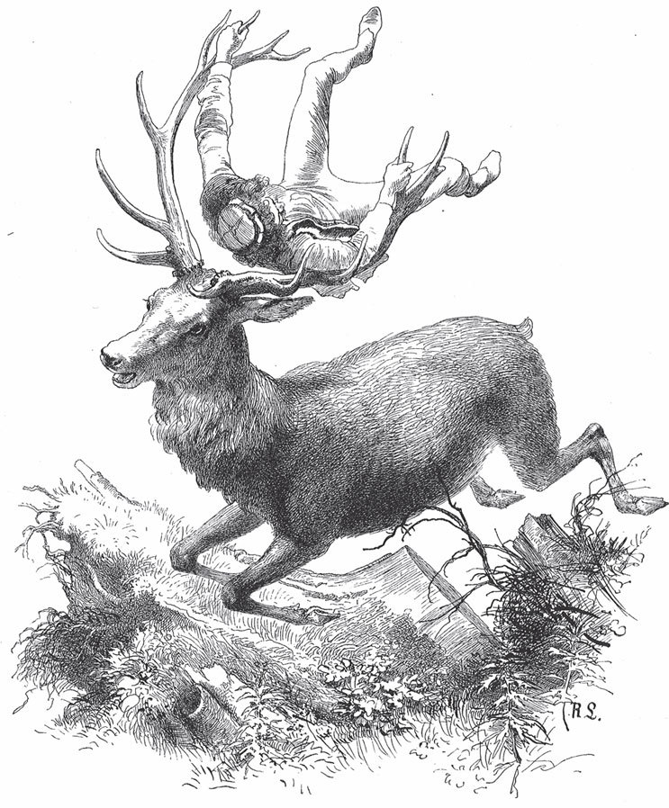

## Der gläserne Sarg

Niemand soll sagen, dass ein armer Schneider es nicht weit bringen und nicht zu hohen Ehren gelangen könne. Es ist weiter gar nichts nötig, als dass er <abbr title="an die richtige Schmiede kommen — обратиться по адресу, попасть куда надо">an die richtige Schmiede kommt</abbr> und, was die <abbr title="die Hauptsache — главное">Hauptsache</abbr> ist, dass er Glück hat. Ein solches artiges und flinkes Schneiderbürschchen war einmal auf Wanderschaft und kam in einen großen Wald, und weil es den Weg nicht kannte, verirrte es sich. Die Nacht brach herein, und es blieb ihm nichts anderes übrig, als in dieser <abbr title="schaurig — жуткий">schaurigen</abbr> Einsamkeit ein Lager zu suchen. Auf dem weichen Moos hätte er freilich ein gutes Bett gefunden, aber die Angst vor den wilden Tieren ließ ihm keine Ruhe, und er musste sich endlich entschließen, auf einem Baum zu übernachten. Er suchte eine hohe Eiche, stieg bis in den Wipfel hinauf und dankte Gott, dass er sein Bügeleisen bei sich trug, denn sonst hätte ihn der Wind, der über die Wipfel der Bäume wehte, fortgetragen.

Nachdem er einige Stunden in der <abbr title="die Finsternis — тьма, мрак">Finsternis</abbr>, nicht ohne <abbr title="mit Zittern und Zagen — в страхе и трепете">Zittern und Zagen</abbr>, <abbr title="zubringen (brachte zu, hat zugebracht) — проводить (время)">zugebracht</abbr> hatte, erblickte er nicht weit entfernt den <abbr title="der Schein — свет, отблеск">Schein</abbr> eines Lichtes. Und weil er dachte, dass dort wohl eine menschliche Wohnung sei, wo es ihm besser gehen würde als auf den Ästen eines Baumes, stieg er vorsichtig herab und ging dem Licht nach. Es führte ihn zu einem kleinen Häuschen, das aus <abbr title="das Rohr — тростник">Rohr</abbr> und Binsen geflochten war. Er klopfte mutig an, die Tür öffnete sich, und im Schein des herausfallenden Lichtes sah er ein altes, <abbr title="eisgrau — седой как лунь">eisgraues</abbr> Männchen, das ein Kleid aus bunten Lappen anhatte.

— Wer seid Ihr, und was wollt Ihr? — fragte es mit einer <abbr title="schnarrend — скрипучий, дребезжащий">schnarrenden</abbr> Stimme.

— Ich bin ein armer Schneider, — antwortete er, — den die Nacht hier in der Wildnis überrascht hat, und ich bitte Euch inständig, mich bis morgen in Eurer Hütte aufzunehmen.

— Geh deiner Wege, — erwiderte der Alte mürrisch, — mit <abbr title="der Landstreicher, die Landstreicher — бродяга">Landstreichern</abbr> will ich nichts zu schaffen haben. Such dir anderswo eine Unterkunft.

Nach diesen Worten wollte er wieder in sein Haus schlüpfen, aber der Schneider hielt ihn am Rockzipfel fest und bat so rührend, dass der Alte, der gar nicht so böse war, wie er sich anstellte, endlich weich wurde und ihn mit in seine Hütte nahm. Dort gab er ihm zu essen und wies ihm dann in einem Winkel ein ganz gutes Nachtlager <abbr title="zuweisen (wies zu, hat zugewiesen) — отводить, указывать">zu</abbr>.

Der müde Schneider brauchte kein <abbr title="das Wiegenlied, die Wiegenlieder — колыбельная">Wiegenlied</abbr>, sondern schlief sanft bis zum Morgen, und er hätte auch noch nicht ans Aufstehen gedacht, wenn ihn nicht ein lauter Lärm <abbr title="aufschrecken — вспугнуть, разбудить испугом">aufgeschreckt</abbr> hätte. Ein heftiges Schreien und Brüllen drang durch die dünnen Wände des Hauses. Den Schneider <abbr title="überkommen (überkam, hat überkommen) — охватывать (о чувстве)">überkam</abbr> ein unerwarteter Mut, er sprang auf, zog in der Hast seine Kleider an und eilte hinaus. Da erblickte er nahe bei dem Häuschen einen großen schwarzen <abbr title="der Stier, die Stiere — бык">Stier</abbr> und einen schönen Hirsch, die in einen heftigen Kampf <abbr title="verwickelt sein in + Akk. — быть втянутым во что-то">verwickelt</abbr> waren. Sie gingen mit so großer Wut aufeinander los, dass der Boden von ihrem <abbr title="das Getrampel — топот">Getrampel</abbr> <abbr title="erzittern — задрожать, содрогнуться">erzitterte</abbr> und die Luft von ihrem Geschrei <abbr title="dröhnen — грохотать, гудеть">dröhnte</abbr>. Lange war es <abbr title="ungewiss — неясный, неизвестный">ungewiss</abbr>, welcher von beiden den Sieg <abbr title="den Sieg davontragen — одержать победу">davontragen</abbr> würde; endlich stieß der Hirsch seinem Gegner das <abbr title="das Geweih, die Geweihe — рога (оленя)">Geweih</abbr> in den Leib, worauf der Stier mit entsetzlichem Brüllen zu Boden sank und durch einige Schläge des Hirsches völlig getötet wurde.

Der Schneider, der dem Kampf mit <abbr title="das Erstaunen — изумление">Erstaunen</abbr> zugesehen hatte, stand noch unbeweglich da, als der Hirsch in vollen Sprüngen auf ihn zukam und ihn, bevor er fliehen konnte, mit seinem großen Geweih geradezu <abbr title="aufgabeln — поддеть (как на вилы)">aufgabelte</abbr>. Er konnte sich nicht lange <abbr title="sich besinnen (besann sich, hat sich besonnen) — опомниться, раздумывать">besinnen</abbr>, denn es ging in schnellem Lauf fort, über Stock und Stein, Berg und Tal, Wiese und Wald. Er hielt sich mit beiden Händen an den Enden des Geweihs fest und <abbr title="sich überlassen (überließ sich, hat sich überlassen) + Dat. — отдаться (на волю)">überließ sich</abbr> seinem Schicksal. Es kam ihm aber nicht anders vor, als ob er davonflöge. Endlich hielt der Hirsch vor einer Felswand still und ließ den Schneider sanft herabfallen. Der Schneider, mehr tot als lebendig, brauchte längere Zeit, um wieder <abbr title="zur Besinnung kommen — прийти в себя">zur Besinnung zu kommen</abbr>. Als er sich einigermaßen erholt hatte, stieß der Hirsch, der neben ihm stehen geblieben war, sein Geweih mit solcher Gewalt gegen eine Tür im Felsen, dass sie aufsprang. Flammen schlugen heraus, und ihnen folgte ein dichter Dampf, der den Hirsch seinen Augen <abbr title="entziehen (entzog, hat entzogen) — скрывать, лишать">entzog</abbr>. Der Schneider wusste nicht, was er tun und wohin er sich wenden sollte, um aus dieser Einöde wieder unter Menschen zu kommen. Während er so <abbr title="unschlüssig — нерешительно">unschlüssig</abbr> dastand, <abbr title="ertönen — раздаваться, звучать">ertönte</abbr> eine Stimme aus dem Felsen, die ihm zurief:

— Tritt ohne Furcht herein, dir soll kein Leid <abbr title="widerfahren (widerfuhr, ist widerfahren) + Dat. — случиться, приключиться">widerfahren</abbr>.

Er zögerte zwar, doch, von einer geheimen Macht angetrieben, gehorchte er der Stimme und gelangte durch die eiserne Tür in einen großen, <abbr title="geräumig — просторный">geräumigen</abbr> Saal. Decke, Wände und Boden waren aus glänzend geschliffenen <abbr title="der Quader, die Quader — тёсаный камень, квадр">Quadern</abbr>, und in jeden waren ihm unbekannte Zeichen <abbr title="einmeißeln — высекать (резцом)">eingemeißelt</abbr>. Er betrachtete alles voller <abbr title="die Bewunderung — восхищение">Bewunderung</abbr> und wollte gerade wieder hinausgehen, als er <abbr title="abermals — снова, опять">abermals</abbr> die Stimme vernahm, die ihm sagte:

— Tritt auf den Stein, der in der Mitte des Saales liegt, und großes Glück wartet auf dich.

Sein Mut war schon so weit gewachsen, dass er dem Befehl <abbr title="einer Sache Folge leisten — последовать, подчиниться">Folge leistete</abbr>. Der Stein begann unter seinen Füßen nachzugeben und sank langsam in die Tiefe hinab. Als er wieder feststand und der Schneider sich umsah, befand er sich in einem Saal, der ebenso groß war wie der vorige. Hier aber gab es mehr zu betrachten und zu bewundern. In die Wände waren <abbr title="die Nische, die Nischen — ниша">Nischen</abbr> gehauen, in denen Gefäße aus durchsichtigem Glas standen, die mit farbigem <abbr title="der Spiritus — спирт">Spiritus</abbr> oder mit einem <abbr title="bläulich — голубоватый">bläulichen</abbr> Rauch gefüllt waren. Auf dem Boden des Saales standen einander gegenüber zwei große gläserne Kästen, die sofort seine Neugier <abbr title="reizen — возбуждать, дразнить">reizten</abbr>. Als er an den einen trat, erblickte er darin ein schönes Gebäude, das einem Schloss <abbr title="ähneln + Dat. — быть похожим на">ähnelte</abbr>, umgeben von <abbr title="das Wirtschaftsgebäude, die Wirtschaftsgebäude — хозяйственная постройка">Wirtschaftsgebäuden</abbr>, Ställen und Scheunen und einer Menge anderer hübscher Dinge. Alles war klein, aber <abbr title="überaus — чрезвычайно">überaus</abbr> sorgfältig und zierlich gearbeitet und schien von einer kunstreichen Hand mit der höchsten <abbr title="die Genauigkeit — точность">Genauigkeit</abbr> geschnitzt zu sein.

Er hätte seine Augen von diesen <abbr title="die Seltenheit, die Seltenheiten — редкость, диковина">Seltenheiten</abbr> noch lange nicht abgewendet, wenn sich nicht die Stimme abermals hätte hören lassen. Sie forderte ihn auf, sich umzudrehen und den gegenüberstehenden Glaskasten anzuschauen. Wie wuchs seine Verwunderung, als er darin ein Mädchen von größter Schönheit erblickte! Es lag wie im Schlaf und war in lange blonde Haare wie in einen kostbaren Mantel <abbr title="einhüllen — закутывать, окутывать">eingehüllt</abbr>. Die Augen waren fest geschlossen, doch die <abbr title="lebhaft — живой, яркий">lebhafte</abbr> <abbr title="die Gesichtsfarbe — цвет лица">Gesichtsfarbe</abbr> und ein Band, das der Atem hin und her bewegte, ließen keinen Zweifel daran, dass sie lebte. Der Schneider betrachtete die Schöne mit klopfendem Herzen, als sie plötzlich die Augen aufschlug und bei seinem Anblick in freudigem Schrecken zusammenfuhr.

— <abbr title="gerechter Himmel! — праведное небо! боже правый!">Gerechter Himmel</abbr>, — rief sie, — meine Befreiung naht! Schnell, schnell, hilf mir aus meinem Gefängnis! Wenn du den Riegel an diesem gläsernen Sarg wegschiebst, so bin ich erlöst.

Der Schneider gehorchte ohne <abbr title="das Zaudern — промедление, колебание">Zaudern</abbr>. Sogleich hob sie den <abbr title="der Glasdeckel, die Glasdeckel — стеклянная крышка">Glasdeckel</abbr> in die Höhe, stieg heraus und eilte in die Ecke des Saales, wo sie sich in einen weiten Mantel hüllte. Dann setzte sie sich auf einen Stein, hieß den jungen Mann näher kommen, und nachdem sie ihm einen freundlichen Kuss auf den Mund gedrückt hatte, sprach sie:

— Mein lang <abbr title="ersehnt — долгожданный, желанный">ersehnter</abbr> <abbr title="der Befreier, die Befreier — освободитель">Befreier</abbr>, der <abbr title="gütig — милостивый, добрый">gütige</abbr> Himmel hat mich zu dir geführt und meinen Leiden ein Ende gesetzt. Am selben Tag, an dem sie enden, soll dein Glück beginnen. Du bist der vom Himmel bestimmte Gemahl und sollst, von mir geliebt und mit allen <abbr title="irdisch — земной">irdischen</abbr> Gütern <abbr title="überhäufen mit + Dat. — осыпать, заваливать">überhäuft</abbr>, in ungestörter Freude dein Leben verbringen. Setz dich und höre die Geschichte meines Schicksals.

Ich bin die Tochter eines reichen Grafen. Meine Eltern starben, als ich noch ganz jung war, und <abbr title="anvertrauen + Dat. — поручать, доверять">vertrauten</abbr> mich in ihrem <abbr title="der letzte Wille — последняя воля, завещание">letzten Willen</abbr> meinem älteren Bruder an, bei dem ich aufwuchs. Wir liebten uns so zärtlich und waren uns in unserer <abbr title="die Denkart — образ мыслей">Denkart</abbr> und unseren <abbr title="die Neigung, die Neigungen — склонность">Neigungen</abbr> so einig, dass wir beide den Entschluss fassten, niemals zu heiraten, sondern bis an das Ende unseres Lebens <abbr title="beisammenbleiben — оставаться вместе">beisammenzubleiben</abbr>. In unserem Haus fehlte es nie an Gesellschaft: Nachbarn und Freunde besuchten uns häufig, und wir übten <abbr title="die Gastfreundschaft — гостеприимство">Gastfreundschaft</abbr> gegen alle <abbr title="in vollem Maße — в полной мере">in vollem Maße</abbr>. So geschah es auch eines Abends, dass ein Fremder in unser Schloss geritten kam und unter dem <abbr title="der Vorwand, die Vorwände — предлог">Vorwand</abbr>, er könne den nächsten Ort nicht mehr erreichen, um ein Nachtlager bat. Wir gewährten seine Bitte mit <abbr title="zuvorkommend — предупредительный, любезный">zuvorkommender</abbr> <abbr title="die Höflichkeit — вежливость">Höflichkeit</abbr>, und er unterhielt uns während des Abendessens mit seinem Gespräch und <abbr title="einstreuen — вставлять, вкраплять">eingestreuten</abbr> Geschichten auf das <abbr title="anmutig — прелестный, изящный">anmutigste</abbr>. Mein Bruder hatte so großes <abbr title="das Wohlgefallen — удовольствие, симпатия">Wohlgefallen</abbr> an ihm, dass er ihn bat, ein paar Tage bei uns zu verweilen, worin er nach einigem Zögern <abbr title="einwilligen in + Akk. — соглашаться">einwilligte</abbr>. Wir standen erst spät in der Nacht vom Tisch auf, dem Fremden wurde ein Zimmer zugewiesen, und ich eilte, erschöpft wie ich war, meine Glieder in die weichen Federn zu legen.

Kaum war ich ein wenig eingeschlummert, da weckten mich die Töne einer zarten und lieblichen Musik. Da ich nicht begreifen konnte, woher sie kam, wollte ich meine Kammerzofe rufen, die im Nebenzimmer schlief. Aber zu meinem Erstaunen merkte ich, dass mir eine unbekannte Macht die Sprache geraubt hatte, als läge ein <abbr title="der Alp, die Alpe — домовой-душитель, кошмар">Alp</abbr> auf meiner Brust, und ich war nicht imstande, auch nur den geringsten Laut von mir zu geben. Da sah ich beim Schein der <abbr title="die Nachtlampe, die Nachtlampen — ночник">Nachtlampe</abbr> den Fremden in mein Zimmer treten, das doch durch zwei Türen fest verschlossen war. Er näherte sich mir und sagte, er habe durch Zauberkräfte, die ihm <abbr title="zu Gebote stehen — быть в распоряжении">zu Gebote ständen</abbr>, die liebliche Musik ertönen lassen, um mich aufzuwecken, und er dringe jetzt selbst durch alle Schlösser, in der Absicht, mir <abbr title="jemandem Herz und Hand anbieten — предложить руку и сердце">Herz und Hand</abbr> anzubieten. Mein <abbr title="der Widerwille — отвращение">Widerwille</abbr> gegen seine Zauberkünste war aber so groß, dass ich ihn keiner Antwort <abbr title="jemanden keiner Antwort würdigen — не удостоить ответом">würdigte</abbr>. Er blieb eine Zeit lang unbeweglich stehen, wahrscheinlich in der Hoffnung auf einen <abbr title="günstig — благоприятный">günstigen</abbr> Entschluss. Als ich aber weiter schwieg, erklärte er zornig, er werde sich rächen und Mittel finden, meinen Hochmut zu bestrafen, und verließ das Zimmer wieder. Ich verbrachte die Nacht in höchster Unruhe und schlummerte erst gegen Morgen ein. Als ich erwacht war, eilte ich zu meinem Bruder, um ihm zu berichten, was <abbr title="vorfallen (fiel vor, ist vorgefallen) — случиться, произойти">vorgefallen</abbr> war; aber ich fand ihn nicht in seinem Zimmer, und der Diener sagte mir, er sei bei Tagesanbruch mit dem Fremden auf die Jagd geritten.

Ich ahnte gleich nichts Gutes. Ich kleidete mich schnell an, ließ mein <abbr title="das Reitpferd, die Reitpferde — верховая лошадь">Reitpferd</abbr> satteln und ritt, nur von einem Diener begleitet, in vollem Galopp zum Wald. Der Diener stürzte mit dem Pferd und konnte mir nicht folgen, weil das Pferd sich den Fuß gebrochen hatte. Ich setzte, ohne mich aufzuhalten, meinen Weg fort, und nach wenigen Minuten sah ich den Fremden mit einem schönen Hirsch, den er an der <abbr title="die Leine, die Leinen — поводок, верёвка">Leine</abbr> führte, auf mich zukommen. Ich fragte ihn, wo er meinen Bruder gelassen habe und wie er zu diesem Hirsch gekommen sei, aus dessen großen Augen ich Tränen fließen sah. Statt mir zu antworten, fing er an, laut zu lachen. Darüber <abbr title="in Zorn geraten (geriet, ist geraten) — прийти в ярость">geriet ich in Zorn</abbr>, zog eine <abbr title="die Pistole, die Pistolen — пистолет">Pistole</abbr> und drückte sie auf das Ungeheuer ab. Aber die Kugel <abbr title="abprallen (ist abgeprallt) — отскакивать, рикошетить">prallte</abbr> von seiner Brust ab und fuhr meinem Pferd in den Kopf. Ich stürzte zu Boden, und der Fremde murmelte einige Worte, die mir das <abbr title="das Bewusstsein — сознание">Bewusstsein</abbr> raubten.

Als ich wieder zu mir kam, fand ich mich in dieser unterirdischen <abbr title="die Gruft, die Grüfte — склеп">Gruft</abbr> in einem gläsernen Sarg. Der <abbr title="der Schwarzkünstler, die Schwarzkünstler — чернокнижник, колдун">Schwarzkünstler</abbr> erschien noch einmal und sagte, er habe meinen Bruder in einen Hirsch verwandelt, mein Schloss mit allem <abbr title="das Zubehör — всё принадлежащее, угодья">Zubehör</abbr> <abbr title="verkleinern — уменьшать">verkleinert</abbr> und in den anderen Glaskasten eingeschlossen, und meine Leute habe er in Rauch verwandelt und in Glasflaschen <abbr title="bannen — заточить (чарами)">gebannt</abbr>. Wolle ich mich jetzt seinem Wunsch <abbr title="sich fügen + Dat. — покориться, подчиниться">fügen</abbr>, so sei es ihm ein Leichtes, alles wieder in den vorigen <abbr title="der Zustand, die Zustände — состояние">Zustand</abbr> zu bringen: Er brauche nur die Gefäße zu öffnen, so werde alles wieder in seine natürliche Gestalt zurückkehren. Ich antwortete ihm so wenig wie das erste Mal. Er verschwand und ließ mich in meinem Gefängnis liegen, wo mich ein tiefer Schlaf <abbr title="befallen (befiel, hat befallen) — охватить, напасть">befiel</abbr>. Unter den Bildern, die an meiner Seele <abbr title="vorüberziehen (zog vorüber, ist vorübergezogen) — проходить мимо">vorüberzogen</abbr>, war auch das <abbr title="tröstlich — утешительный">tröstliche</abbr>, dass ein junger Mann kam und mich befreite. Und als ich heute die Augen öffne, erblicke ich dich und sehe meinen Traum erfüllt. Hilf mir vollbringen, was in jener <abbr title="die Vision, die Visionen — видение">Vision</abbr> noch weiter geschah. Das Erste ist, dass wir den Glaskasten, in dem sich mein Schloss befindet, auf jenen breiten Stein heben.

Sobald der Stein beladen war, hob er sich mit dem Fräulein und dem Jüngling in die Höhe und stieg durch die Öffnung in der Decke in den oberen Saal, von wo sie dann leicht ins Freie gelangen konnten. Hier öffnete das Fräulein den Deckel, und es war wunderbar anzusehen, wie Schloss, Häuser und <abbr title="das Gehöft, die Gehöfte — усадьба, двор">Gehöfte</abbr> sich ausdehnten und mit größter Schnelligkeit zu ihrer natürlichen Größe heranwuchsen. Danach kehrten sie in die unterirdische Höhle zurück und ließen die mit Rauch gefüllten Gläser von dem Stein heraufbringen. Kaum hatte das Fräulein die Flaschen geöffnet, da <abbr title="dringen (drang, ist gedrungen) — проникать, вырываться">drang</abbr> der blaue Rauch heraus und verwandelte sich in lebendige Menschen, in denen das Fräulein ihre Diener und Leute erkannte. Ihre Freude wurde noch größer, als ihr Bruder, der den Zauberer in Gestalt des Stieres getötet hatte, in menschlicher Gestalt aus dem Wald herankam. Und noch am selben Tag reichte das Fräulein, wie sie es versprochen hatte, dem glücklichen Schneider am Altar die Hand.

---

### Neue Wörter

- **an die richtige Schmiede kommen** — обратиться по адресу, попасть куда надо
- **die Hauptsache** — главное
- **schaurig** — жуткий
- **die Finsternis** — тьма, мрак
- **mit Zittern und Zagen** — в страхе и трепете
- **zubringen (brachte zu, hat zugebracht)** — проводить (время)
- **der Schein** — свет, отблеск
- **das Rohr** — тростник
- **eisgrau** — седой как лунь
- **schnarrend** — скрипучий, дребезжащий
- **der Landstreicher, die Landstreicher** — бродяга
- **zuweisen (wies zu, hat zugewiesen)** — отводить, указывать
- **das Wiegenlied, die Wiegenlieder** — колыбельная
- **aufschrecken** — вспугнуть, разбудить испугом
- **überkommen (überkam, hat überkommen)** — охватывать (о чувстве)
- **der Stier, die Stiere** — бык
- **verwickelt sein in + Akk.** — быть втянутым во что-то
- **das Getrampel** — топот
- **erzittern** — задрожать, содрогнуться
- **dröhnen** — грохотать, гудеть
- **ungewiss** — неясный, неизвестный
- **den Sieg davontragen** — одержать победу
- **das Geweih, die Geweihe** — рога (оленя)
- **das Erstaunen** — изумление
- **aufgabeln** — поддеть (как на вилы)
- **sich besinnen (besann sich, hat sich besonnen)** — опомниться, раздумывать
- **sich überlassen (überließ sich, hat sich überlassen) + Dat.** — отдаться (на волю)
- **zur Besinnung kommen** — прийти в себя
- **entziehen (entzog, hat entzogen)** — скрывать, лишать
- **unschlüssig** — нерешительно
- **ertönen** — раздаваться, звучать
- **widerfahren (widerfuhr, ist widerfahren) + Dat.** — случиться, приключиться
- **geräumig** — просторный
- **der Quader, die Quader** — тёсаный камень, квадр
- **einmeißeln** — высекать (резцом)
- **die Bewunderung** — восхищение
- **abermals** — снова, опять
- **einer Sache Folge leisten** — последовать, подчиниться
- **die Nische, die Nischen** — ниша
- **der Spiritus** — спирт
- **bläulich** — голубоватый
- **reizen** — возбуждать, дразнить
- **ähneln + Dat.** — быть похожим на
- **das Wirtschaftsgebäude, die Wirtschaftsgebäude** — хозяйственная постройка
- **überaus** — чрезвычайно
- **die Genauigkeit** — точность
- **die Seltenheit, die Seltenheiten** — редкость, диковина
- **einhüllen** — закутывать, окутывать
- **lebhaft** — живой, яркий
- **die Gesichtsfarbe** — цвет лица
- **gerechter Himmel!** — праведное небо! боже правый!
- **das Zaudern** — промедление, колебание
- **der Glasdeckel, die Glasdeckel** — стеклянная крышка
- **ersehnt** — долгожданный, желанный
- **der Befreier, die Befreier** — освободитель
- **gütig** — милостивый, добрый
- **irdisch** — земной
- **überhäufen mit + Dat.** — осыпать, заваливать
- **anvertrauen + Dat.** — поручать, доверять
- **der letzte Wille** — последняя воля, завещание
- **die Denkart** — образ мыслей
- **die Neigung, die Neigungen** — склонность
- **beisammenbleiben** — оставаться вместе
- **die Gastfreundschaft** — гостеприимство
- **in vollem Maße** — в полной мере
- **der Vorwand, die Vorwände** — предлог
- **zuvorkommend** — предупредительный, любезный
- **die Höflichkeit** — вежливость
- **einstreuen** — вставлять, вкраплять
- **anmutig** — прелестный, изящный
- **das Wohlgefallen** — удовольствие, симпатия
- **einwilligen in + Akk.** — соглашаться
- **der Alp, die Alpe** — домовой-душитель, кошмар
- **die Nachtlampe, die Nachtlampen** — ночник
- **zu Gebote stehen** — быть в распоряжении
- **jemandem Herz und Hand anbieten** — предложить руку и сердце
- **der Widerwille** — отвращение
- **jemanden keiner Antwort würdigen** — не удостоить ответом
- **günstig** — благоприятный
- **vorfallen (fiel vor, ist vorgefallen)** — случиться, произойти
- **das Reitpferd, die Reitpferde** — верховая лошадь
- **die Leine, die Leinen** — поводок, верёвка
- **in Zorn geraten (geriet, ist geraten)** — прийти в ярость
- **die Pistole, die Pistolen** — пистолет
- **abprallen (ist abgeprallt)** — отскакивать, рикошетить
- **das Bewusstsein** — сознание
- **die Gruft, die Grüfte** — склеп
- **der Schwarzkünstler, die Schwarzkünstler** — чернокнижник, колдун
- **das Zubehör** — всё принадлежащее, угодья
- **verkleinern** — уменьшать
- **bannen** — заточить (чарами)
- **sich fügen + Dat.** — покориться, подчиниться
- **der Zustand, die Zustände** — состояние
- **befallen (befiel, hat befallen)** — охватить, напасть
- **vorüberziehen (zog vorüber, ist vorübergezogen)** — проходить мимо
- **tröstlich** — утешительный
- **die Vision, die Visionen** — видение
- **das Gehöft, die Gehöfte** — усадьба, двор
- **dringen (drang, ist gedrungen)** — проникать, вырываться

[← Zurück](kapitel-163.md) · [Inhalt](README.md) · [Weiter →](kapitel-165.md)
