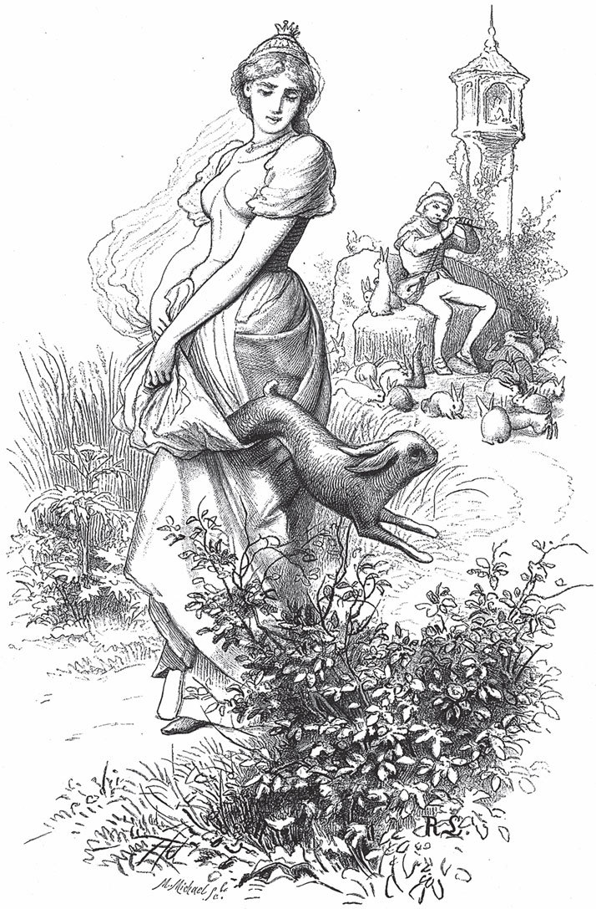

## Der Vogel Greif

Es war einmal ein König, aber wo er regiert hat und wie er geheißen hat, weiß ich nicht mehr. Der hatte keinen Sohn, nur eine einzige Tochter, und die war immer krank, und kein Doktor konnte sie heilen. Da wurde dem König <abbr title="prophezeien — предсказывать, пророчить">prophezeit</abbr>, seine Tochter werde sich an Äpfeln gesund essen. Also ließ er in seinem ganzen Land bekannt machen: Wer seiner Tochter Äpfel bringe, an denen sie sich gesund essen könne, der solle sie zur Frau bekommen und König werden.

Das vernahm auch ein Bauer, der drei Söhne hatte. Da sagte er zum ältesten:

— Geh hinauf auf den <abbr title="der Speicher, die Speicher — чердак, амбар">Speicher</abbr>, nimm einen Korb voll von den schönen Äpfeln mit roten Backen und trag sie an den Hof. Vielleicht kann sich die Königstochter an ihnen gesund essen, und dann darfst du sie heiraten und wirst König.

Der Bursche tat es so und machte sich auf den Weg. Als er eine Zeit lang gegangen war, begegnete ihm ein kleines eisgraues Männlein, das fragte ihn, was er da in dem Korb habe. Da sagte Ueli – denn so hieß er –:

— <abbr title="der Froschschenkel, die Froschschenkel — лягушачья лапка">Froschschenkel</abbr>.

Das Männlein sagte darauf in seinem Schweizer Dialekt:

— No, es sölle si und blibe, — das heißt: «Nun, so soll es sein und bleiben», — und ging weiter.

Endlich kam Ueli vor das Schloss und ließ sich anmelden: Er habe Äpfel, die die Tochter gesund machten, wenn sie davon esse. Darüber freute sich der König gewaltig und ließ Ueli vor sich kommen. Aber, oh weh! Als er den Korb aufdeckte, hatte er statt Äpfeln Froschschenkel darin, die noch zappelten. Darüber wurde der König böse und ließ ihn aus dem Haus jagen. Als Ueli heimkam, erzählte er dem Vater, wie es ihm ergangen war.

Da schickte der Vater den nächstälteren Sohn, der Sami hieß; aber dem ging es ganz genauso wie Ueli. Auch ihm begegnete ein kleines eisgraues Männlein und fragte ihn, was er da in dem Korb habe. Sami sagte:

— <abbr title="die Schweineborste, die Schweineborsten — свиная щетина">Schweineborsten</abbr>.

Und das eisgraue Männlein sagte:

— Nun, so soll es sein und bleiben.

Als er nun vor das Königsschloss kam und sagte, er habe Äpfel, an denen sich die Königstochter gesund essen könne, wollten sie ihn nicht hineinlassen und sagten, es sei schon einer da gewesen und habe sie zum Narren gehalten. Sami aber bestand darauf, er habe gewiss solche Äpfel, sie sollten ihn nur hineinlassen. Endlich glaubten sie ihm und führten ihn vor den König. Aber als er seinen Korb aufdeckte, hatte er eben Schweineborsten. Das <abbr title="erzürnen — разгневать">erzürnte</abbr> den König gar schrecklich, sodass er Sami aus dem Haus peitschen ließ. Als er heimkam, erzählte er, wie es ihm ergangen war.

Da kam der jüngste Junge, den sie nur den dummen Hans nannten, und fragte den Vater, ob er auch mit Äpfeln gehen dürfe.

— Ja, — sagte der Vater, — du wärst der rechte Kerl dafür! Wenn die Gescheiten nichts ausrichten, was willst denn du ausrichten?

Der Junge aber gab nicht nach:

— Doch, Vater, ich will auch gehen.

— Geh mir doch weg, du dummer Kerl, du musst warten, bis du gescheiter wirst, — sagte darauf der Vater und kehrte ihm den Rücken.

Hans aber zupfte ihn hinten am Kittel:

— Doch, Vater, ich will auch gehen.

— Na, meinetwegen, so geh, du wirst schon wiederkommen, — gab der Vater in <abbr title="gehässig — злобный, недоброжелательный">gehässigem</abbr> Ton zur Antwort.

Der Junge aber freute sich riesig und sprang in die Höhe.

— Ja, tu jetzt nur wie ein Narr, du wirst von einem Tag zum andern noch dümmer, — sagte der Vater wieder.

Das machte Hans aber nichts aus, und er ließ sich in seiner Freude nicht stören. Weil es aber bald Nacht war, dachte er, er wolle bis zum Morgen warten, heute komme er doch nicht mehr an den Hof. In der Nacht konnte er im Bett nicht schlafen, und wenn er auch ein wenig einschlummerte, so träumte er von schönen Jungfrauen, von Schlössern, Gold und Silber und allerhand solchen Sachen mehr. Am Morgen früh machte er sich auf den Weg, und gleich darauf begegnete ihm ein kleines, stämmiges Männlein in einem eisgrauen <abbr title="das Kleidchen, die Kleidchen — платьице, одёжка">Kleidchen</abbr> und fragte ihn, was er da in dem Korb habe. Hans gab ihm zur Antwort, er habe Äpfel, an denen sich die Königstochter gesund essen solle.

— Nun, — sagte das Männlein, — so sollen es solche sein und bleiben.

Aber am Hof wollten sie Hans <abbr title="partout — ни в какую, во что бы то ни стало">partout</abbr> nicht hineinlassen, denn es seien schon zwei da gewesen und hätten gesagt, sie brächten Äpfel, und dann habe der eine Froschschenkel und der andere Schweineborsten gehabt. Hans aber bestand hartnäckig darauf, er habe gewiss keine Froschschenkel, sondern von den schönsten Äpfeln, die im ganzen Königreich wüchsen. Weil er so ordentlich redete, dachten die Torwächter, der könne nicht lügen, und ließen ihn hinein. Und sie hatten auch recht, denn als Hans seinen Korb vor dem König aufdeckte, kamen <abbr title="goldgelb — золотисто-жёлтый">goldgelbe</abbr> Äpfel zum Vorschein. Der König freute sich und ließ gleich der Tochter davon bringen und wartete nun in <abbr title="bang — тревожный, боязливый">banger</abbr> <abbr title="die Erwartung, die Erwartungen — ожидание">Erwartung</abbr>, bis man ihm <abbr title="der Bericht, die Berichte — донесение, сообщение">Bericht</abbr> brächte, welche <abbr title="die Wirkung, die Wirkungen — действие, эффект">Wirkung</abbr> sie gehabt hätten. Es verging nicht lange Zeit, da brachte ihm jemand Bericht – aber was meint ihr, wer war das? Die Tochter selbst war es! Sobald sie von den Äpfeln gegessen hatte, war sie gesund aus dem Bett gesprungen. Wie groß die Freude des Königs war, kann man nicht beschreiben.

Aber jetzt wollte er die Tochter dem Hans nicht zur Frau geben und sagte, er müsse ihm zuerst noch ein Boot machen, das auf dem trockenen Land flinker fahre als im Wasser. Hans nahm die Bedingung an, ging heim und erzählte, wie es ihm ergangen war. Da schickte der Vater Ueli in den Wald, um ein solches Boot zu machen. Er arbeitete fleißig und pfiff dazu. Zu Mittag, als die Sonne am höchsten stand, kam ein kleines eisgraues Männlein und fragte, was er da mache. Ueli gab ihm zur Antwort:

— <abbr title="die Kelle, die Kellen — половник, ковш (деревянный)">Kellen</abbr>.

Das eisgraue Männlein sagte:

— Nun, so soll es sein und bleiben.

Am Abend meinte Ueli, er habe jetzt ein Boot gemacht; aber als er einsteigen wollte, waren es lauter Kellen. Am nächsten Tag ging Sami in den Wald, aber es ging ihm ganz genauso wie Ueli. Am dritten Tag ging der dumme Hans. Er arbeitete recht fleißig, dass es im ganzen Wald von seinen kräftigen Schlägen <abbr title="widerhallen — раздаваться эхом">widerhallte</abbr>, und dazu sang und pfiff er recht lustig. Da kam wieder das kleine Männlein zu Mittag, als es am heißesten war, und fragte, was er da mache.

— Ein Boot, das auf dem trockenen Land flinker fährt als auf dem Wasser, — sagte Hans, und wenn er damit fertig sei, so bekomme er die Königstochter zur Frau.

— Nun, — sagte das Männlein, — so soll es ein solches geben und bleiben.

Am Abend, als die Sonne <abbr title="golden — золотой">golden</abbr> unterging, war auch Hans fertig mit seinem Boot und allem Zubehör. Er setzte sich hinein und ruderte der <abbr title="die Residenz, die Residenzen — резиденция, столица">Residenz</abbr> zu. Das Boot aber fuhr so schnell wie der Wind. Der König sah es von weitem, wollte dem Hans seine Tochter aber noch immer nicht geben und sagte, er müsse zuerst noch hundert Hasen hüten, vom frühen Morgen bis zum späten Abend, und wenn ihm einer davonlaufe, so bekomme er die Tochter nicht.

Hans war damit zufrieden, und gleich am nächsten Tag ging er mit seiner Herde auf die Weide und passte gewaltig auf, dass ihm keiner davonlief. Nicht viele Stunden waren vergangen, da kam eine Magd vom Schloss und sagte zu Hans, er solle ihr schnell einen Hasen geben, sie hätten Besuch bekommen. Hans aber merkte wohl, <abbr title="auf etwas hinauswollen — клонить к чему-то">worauf das hinauswollte</abbr>, und sagte, er gebe keinen; der König könne seinem Besuch dann morgen mit <abbr title="der Hasenpfeffer — рагу из зайчатины">Hasenpfeffer</abbr> <abbr title="aufwarten mit + Dat. — угощать, подавать">aufwarten</abbr>. Die Magd aber gab nicht nach und fing am Ende noch an zu schimpfen. Da sagte Hans, wenn die Königstochter selbst komme, so wolle er ihr einen Hasen geben. Das sagte die Magd im Schloss, und die Tochter ging selbst hin.

<abbr title="unterdessen — тем временем">Unterdessen</abbr> aber war das kleine Männlein wieder zu Hans gekommen und fragte ihn, was er da tue.

— Ach, da muss ich hundert Hasen hüten, dass mir keiner davonläuft, und dann darf ich die Königstochter heiraten und werde König.

— Gut, — sagte das Männlein, — da hast du ein <abbr title="das Pfeifchen, die Pfeifchen — дудочка, свисток">Pfeifchen</abbr>, und wenn dir einer fortläuft, so pfeif nur, dann kommt er wieder zurück.

Als nun die Tochter kam, gab ihr Hans einen Hasen in die Schürze. Aber als sie etwa hundert Schritte weit gegangen war, pfiff Hans, und der Hase sprang ihr aus der Schürze und lief, <abbr title="was gibst du, was hast du — со всех ног, что есть духу">was gibst du, was hast du</abbr>, wieder zu der Herde. Als es Abend war, pfiff der <abbr title="der Hasenhirt, die Hasenhirten — заячий пастух">Hasenhirt</abbr> noch einmal, sah nach, ob alle da waren, und trieb sie dann zum Schloss. Der König wunderte sich, wie Hans es imstande gewesen war, hundert Hasen zu hüten, ohne dass ihm einer davongelaufen war. Er wollte ihm die Tochter aber trotzdem noch nicht geben und sagte, er müsse ihm noch eine Feder aus dem Schwanz des Vogels <abbr title="der Greif, die Greife — гриф (сказочная птица)">Greif</abbr> bringen.

Hans machte sich gleich auf den Weg und marschierte recht tüchtig vorwärts. Am Abend kam er zu einem Schloss, da bat er um ein Nachtlager, denn damals gab es noch keine Wirtshäuser. Das sagte ihm der Herr des Schlosses mit großer Freude zu und fragte ihn, wohin er wolle. Hans gab darauf zur Antwort:

— Zum Vogel Greif.

— So, zum Vogel Greif! Man sagt immer, er wisse alles, und ich habe einen Schlüssel zu einer eisernen <abbr title="die Geldkiste, die Geldkisten — денежный сундук">Geldkiste</abbr> verloren. Ihr könntet doch so gut sein und ihn fragen, wo er sei.

— Ja, freilich, — sagte Hans, — das will ich schon tun.

Am Morgen früh ging er weiter und kam unterwegs zu einem anderen Schloss, in dem er wieder über Nacht blieb. Als die Leute dort erfuhren, dass er zum Vogel Greif wolle, sagten sie, im Haus sei eine Tochter krank, und sie hätten schon alle Mittel angewandt, aber keins wolle <abbr title="anschlagen (schlug an, hat angeschlagen) — подействовать (о лекарстве)">anschlagen</abbr>; er solle doch so gut sein und den Vogel Greif fragen, was die Tochter wieder gesund machen könne. Hans sagte, das wolle er gern tun, und ging weiter.

Da kam er an ein Wasser, und statt einer <abbr title="die Fähre, die Fähren — паром">Fähre</abbr> war dort ein großer, großer Mann, der alle Leute hinübertragen musste. Der Mann fragte Hans, wohin seine Reise gehe.

— Zum Vogel Greif, — sagte Hans.

— Nun, wenn Ihr zu ihm kommt, — sagte da der Mann, — so fragt ihn doch, warum ich alle Leute über das Wasser tragen muss.

Da sagte Hans:

— Ja, mein Gott, ja, das will ich schon tun.

Der Mann nahm ihn darauf auf die Schultern und trug ihn hinüber. Endlich kam Hans zum Haus des Vogels Greif, aber da war nur die Frau daheim und der Vogel Greif selbst nicht. Die Frau fragte ihn, was er wolle. Da erzählte ihr Hans alles: dass er eine Feder aus dem Schwanz des Vogels Greif haben solle; dann hätten sie in einem Schloss den Schlüssel zu einer Geldkiste verloren, und er solle den Vogel Greif fragen, wo der Schlüssel sei; dann sei in einem anderen Schloss eine Tochter krank, und er solle wissen, was die Tochter gesund machen könne; dann sei nicht weit von hier ein Wasser und ein Mann dabei, der die Leute hinübertragen müsse, und er möchte auch gern wissen, warum der Mann alle Leute hinübertragen müsse. Da sagte die Frau:

— Ja, seht, mein guter Freund, kein <abbr title="der Christenmensch, die Christenmenschen — христианская душа, человек">Christenmensch</abbr> kann mit dem Vogel Greif reden, er frisst sie alle. Wenn Ihr aber wollt, so könnt Ihr Euch unter sein Bett legen, und in der Nacht, wenn er recht fest schläft, könnt Ihr hinauflangen und ihm eine Feder aus dem Schwanz reißen. Und wegen der Sachen, die Ihr wissen sollt, will ich ihn selbst fragen.

Hans war mit allem zufrieden und legte sich unter das Bett. Am Abend kam der Vogel Greif heim, und als er in die Stube kam, sagte er:

— Frau, ich rieche einen Christen.

— Ja, — sagte da die Frau, — es ist heute einer da gewesen, aber er ist wieder fort.

Und damit sagte der Vogel Greif nichts mehr. Mitten in der Nacht, als der Vogel Greif recht schnarchte, langte Hans hinauf und riss ihm eine Feder aus dem Schwanz. Da <abbr title="auffahren (fuhr auf, ist aufgefahren) — вскочить, встрепенуться">fuhr</abbr> der Vogel Greif plötzlich auf und sagte:

— Frau, ich rieche einen Christen, und mir ist, als habe mich jemand am Schwanz gezogen.

Da sagte die Frau:

— Du hast gewiss geträumt, und ich habe dir ja heute schon gesagt, es ist ein Christ da gewesen, aber er ist wieder fort. Der hat mir allerhand Sachen erzählt. In einem Schloss hätten sie den Schlüssel zu einer Geldkiste verloren und könnten ihn nicht mehr finden.

— Oh, die Narren, — sagte der Vogel Greif, — der Schlüssel liegt im <abbr title="der Holzschuppen, die Holzschuppen — дровяной сарай">Holzschuppen</abbr> hinter der Tür unter dem Holzstoß.

— Und dann hat er auch gesagt, in einem Schloss sei eine Tochter krank, und sie wüssten kein Mittel, um sie gesund zu machen.

— Oh, die Narren, — sagte der Vogel Greif, — unter der Kellertreppe hat eine Kröte ein Nest aus ihren Haaren gemacht, und wenn sie die Haare wiederhat, so wird sie gesund.

— Und dann hat er auch noch gesagt, es sei an einem Ort ein Wasser und ein Mann dabei, der müsse alle Leute hinübertragen.

— Oh, der Narr, — sagte der Vogel Greif, — wenn er nur einmal einen mitten hineinstellte, dann müsste er keinen mehr hinübertragen.

Am Morgen früh stand der Vogel Greif auf und ging fort. Da kam Hans unter dem Bett hervor und hatte eine schöne Feder; auch hatte er gehört, was der Vogel Greif wegen des Schlüssels, der Tochter und des Mannes gesagt hatte. Die Frau des Vogels Greif erzählte ihm alles noch einmal, damit er nichts vergaß, und dann machte er sich wieder auf den Heimweg.

Zuerst kam er zu dem Mann am Wasser, der fragte ihn gleich, was der Vogel Greif gesagt habe. Da sagte Hans, er solle ihn zuerst hinübertragen, drüben wolle er es ihm dann sagen. Da trug ihn der Mann hinüber. Als er drüben war, sagte ihm Hans, er solle nur einmal einen mitten hineinstellen, dann müsse er keinen mehr hinübertragen. Da freute sich der Mann gewaltig und sagte zu Hans, er wolle ihn zum Dank noch einmal hin und her tragen. Hans aber sagte nein, er wolle ihm die Mühe <abbr title="ersparen — избавлять от, сберегать">ersparen</abbr>, er sei auch so mit ihm zufrieden, und ging weiter.

Da kam er zu dem Schloss, wo die Tochter krank war. Er nahm sie auf die Schultern, denn sie konnte nicht laufen, trug sie die Kellertreppe hinunter, holte das <abbr title="das Krötennest, die Krötennester — жабье гнездо">Krötennest</abbr> unter der untersten Stufe hervor und gab es der Tochter in die Hände. Und sie sprang ihm von der Schulter herab, lief vor ihm die Treppe hinauf und war ganz gesund. Jetzt hatten Vater und Mutter eine riesige Freude und machten Hans Geschenke aus Gold und Silber, und was er nur haben wollte, das gaben sie ihm.

Als Hans zu dem anderen Schloss kam, ging er gleich in den Holzschuppen und fand hinter der Tür unter dem Holzstoß wirklich den Schlüssel und brachte ihn dem Herrn. Der freute sich auch nicht wenig und gab Hans zur Belohnung viel von dem Gold, das in der Kiste war, und sonst noch allerhand Dinge, Kühe und Schafe und Ziegen.

Als Hans mit all diesen Sachen zum König kam, mit dem Geld und dem Gold und Silber und den Kühen, Schafen und Ziegen, fragte ihn der König, wo er denn das alles <abbr title="herbekommen (bekam her, hat herbekommen) — раздобыть, получить">herbekommen</abbr> habe. Da sagte Hans, der Vogel Greif gebe einem, so viel man wolle. Da dachte der König, das könne er auch brauchen, und machte sich ebenfalls auf den Weg zum Vogel Greif. Aber als er an das Wasser kam, war er eben der Erste, der nach Hans kam, und der Mann stellte ihn mitten hinein und ging fort, und der König ertrank. Hans aber heiratete die Tochter und wurde König.

---

### Neue Wörter

- **prophezeien** — предсказывать, пророчить
- **der Speicher, die Speicher** — чердак, амбар
- **der Froschschenkel, die Froschschenkel** — лягушачья лапка
- **die Schweineborste, die Schweineborsten** — свиная щетина
- **erzürnen** — разгневать
- **gehässig** — злобный, недоброжелательный
- **das Kleidchen, die Kleidchen** — платьице, одёжка
- **partout** — ни в какую, во что бы то ни стало
- **goldgelb** — золотисто-жёлтый
- **bang** — тревожный, боязливый
- **die Erwartung, die Erwartungen** — ожидание
- **der Bericht, die Berichte** — донесение, сообщение
- **die Wirkung, die Wirkungen** — действие, эффект
- **die Kelle, die Kellen** — половник, ковш (деревянный)
- **widerhallen** — раздаваться эхом
- **golden** — золотой
- **die Residenz, die Residenzen** — резиденция, столица
- **auf etwas hinauswollen** — клонить к чему-то
- **der Hasenpfeffer** — рагу из зайчатины
- **aufwarten mit + Dat.** — угощать, подавать
- **unterdessen** — тем временем
- **das Pfeifchen, die Pfeifchen** — дудочка, свисток
- **was gibst du, was hast du** — со всех ног, что есть духу
- **der Hasenhirt, die Hasenhirten** — заячий пастух
- **der Greif, die Greife** — гриф (сказочная птица)
- **die Geldkiste, die Geldkisten** — денежный сундук
- **anschlagen (schlug an, hat angeschlagen)** — подействовать (о лекарстве)
- **die Fähre, die Fähren** — паром
- **der Christenmensch, die Christenmenschen** — христианская душа, человек
- **auffahren (fuhr auf, ist aufgefahren)** — вскочить, встрепенуться
- **der Holzschuppen, die Holzschuppen** — дровяной сарай
- **ersparen** — избавлять от, сберегать
- **das Krötennest, die Krötennester** — жабье гнездо
- **herbekommen (bekam her, hat herbekommen)** — раздобыть, получить

[← Zurück](kapitel-165.md) · [Inhalt](README.md) · [Weiter →](kapitel-167.md)
