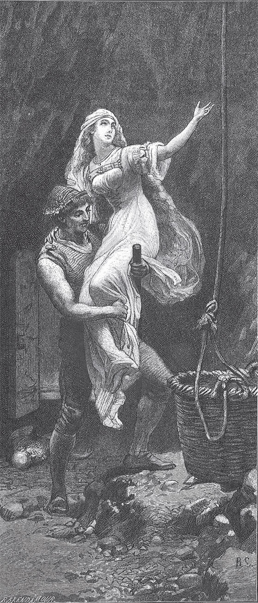

## Der starke Hans

Es war einmal ein Mann und eine Frau, die hatten nur ein einziges Kind und lebten ganz allein in einem <abbr title="abgelegen — отдалённый, глухой">abgelegenen</abbr> Tal. Es trug sich zu, dass die Mutter einmal in den Wald ging, um <abbr title="der Tannenzweig, die Tannenzweige — еловая ветка">Tannenzweige</abbr> zu sammeln, und den kleinen Hans, der erst zwei Jahre alt war, mitnahm. Da es gerade Frühling war und das Kind seine Freude an den bunten Blumen hatte, ging sie immer weiter mit ihm in den Wald hinein. Plötzlich sprangen aus dem Gebüsch zwei Räuber hervor, packten die Mutter und das Kind und führten sie tief in den schwarzen Wald, wohin jahraus, jahrein kein Mensch kam. Die arme Frau bat die Räuber inständig, sie mit ihrem Kind freizulassen, aber das Herz der Räuber war aus Stein: Sie hörten nicht auf ihr Bitten und Flehen und trieben sie mit Gewalt weiter. Nachdem sie sich etwa zwei Stunden lang durch Sträucher und Dornen hatten <abbr title="sich durchkämpfen — продираться, пробиваться">durchkämpfen</abbr> müssen, kamen sie zu einem Felsen, in dem eine Tür war. Die Räuber klopften an, und sie öffnete sich sogleich. Sie mussten durch einen langen dunklen Gang und kamen endlich in eine große Höhle, die von einem Feuer auf dem Herd <abbr title="erleuchten — освещать">erleuchtet</abbr> war. An der Wand hingen Schwerter, Säbel und andere <abbr title="die Mordwaffe, die Mordwaffen — смертоносное оружие">Mordwaffen</abbr>, die im Licht blinkten, und in der Mitte stand ein schwarzer Tisch, an dem vier andere Räuber saßen und spielten, und oben am Tisch saß der Hauptmann. Als dieser die Frau sah, kam er herbei, sprach sie an und sagte, sie solle nur ruhig und ohne Angst sein, sie täten ihr nichts zuleide; aber sie müsse den Haushalt führen, und wenn sie alles in Ordnung halte, solle sie es bei ihnen nicht schlecht haben. Darauf gaben sie ihr etwas zu essen und zeigten ihr ein Bett, in dem sie mit ihrem Kind schlafen könne.

Die Frau blieb viele Jahre bei den Räubern, und Hans wurde groß und stark. Die Mutter erzählte ihm Geschichten und lehrte ihn aus einem alten <abbr title="das Ritterbuch, die Ritterbücher — рыцарский роман">Ritterbuch</abbr>, das sie in der Höhle fand, lesen. Als Hans neun Jahre alt war, machte er sich aus einem <abbr title="der Tannenast, die Tannenäste — еловый сук">Tannenast</abbr> einen starken Knüppel und versteckte ihn hinter dem Bett. Dann ging er zu seiner Mutter und sprach:

— Liebe Mutter, sag mir jetzt einmal, wer mein Vater ist. Ich will und muss es wissen.

Die Mutter schwieg still und wollte es ihm nicht sagen, damit er kein Heimweh bekäme; sie wusste auch, dass die gottlosen Räuber Hans ohnehin nicht fortlassen würden. Aber es hätte ihr fast das Herz zerrissen, dass Hans nicht zu seinem Vater kommen sollte. In der Nacht, als die Räuber von ihrem <abbr title="der Raubzug, die Raubzüge — разбойничий набег">Raubzug</abbr> heimkehrten, holte Hans seinen Knüppel hervor, stellte sich vor den Hauptmann und sagte:

— Jetzt will ich wissen, wer mein Vater ist, und wenn du es mir nicht gleich sagst, so schlage ich dich nieder.

Da lachte der Hauptmann und gab Hans eine Ohrfeige, dass er unter den Tisch <abbr title="kugeln — катиться кубарем">kugelte</abbr>. Hans <abbr title="sich aufrappeln — подняться, встать на ноги">rappelte sich</abbr> wieder auf, schwieg und dachte: «Ich will noch ein Jahr warten und es dann noch einmal versuchen, vielleicht geht es dann besser.» Als das Jahr um war, holte er seinen Knüppel wieder hervor, wischte den Staub ab, betrachtete ihn und sprach: «Es ist ein tüchtiger, wackerer Knüppel.» Nachts kamen die Räuber heim, tranken Wein, einen Krug nach dem anderen, und fingen an, die Köpfe hängen zu lassen. Da holte Hans seinen Knüppel herbei, stellte sich wieder vor den Hauptmann und fragte ihn, wer sein Vater sei. Der Hauptmann gab ihm abermals eine so kräftige Ohrfeige, dass Hans unter den Tisch rollte. Aber es dauerte nicht lange, da war er wieder oben und schlug mit seinem Knüppel so auf den Hauptmann und die Räuber ein, dass sie Arme und Beine nicht mehr regen konnten. Die Mutter stand in einer Ecke und war voller Verwunderung über seine Tapferkeit und Stärke. Als Hans mit seiner Arbeit fertig war, ging er zu seiner Mutter und sagte:

— Jetzt war es mir ernst, aber jetzt muss ich auch wissen, wer mein Vater ist.

— Lieber Hans, — antwortete die Mutter, — komm, wir wollen gehen und ihn suchen, bis wir ihn finden.

Sie nahm dem Hauptmann den Schlüssel zur <abbr title="die Eingangstür, die Eingangstüren — входная дверь">Eingangstür</abbr> ab, und Hans holte einen großen <abbr title="der Mehlsack, die Mehlsäcke — мешок для муки">Mehlsack</abbr> und packte Gold, Silber und was er sonst noch an schönen Sachen fand hinein, bis er voll war, und nahm ihn dann auf den Rücken. Sie verließen die Höhle – aber wie staunte Hans, als er aus der Finsternis ins Tageslicht kam und den grünen Wald, Blumen und Vögel und die Morgensonne am Himmel erblickte! Er stand da und <abbr title="anstarren — уставиться, глазеть">starrte</abbr> alles an, als wäre er nicht recht gescheit. Die Mutter suchte den Weg nach Hause, und als sie ein paar Stunden gegangen waren, kamen sie glücklich in ihr einsames Tal und zu ihrem Häuschen. Der Vater saß in der Tür; er weinte vor Freude, als er seine Frau erkannte und hörte, dass Hans sein Sohn war, denn er hatte beide längst für tot gehalten. Hans aber, obwohl erst zwölf Jahre alt, war schon einen Kopf größer als sein Vater.

Sie gingen zusammen in das <abbr title="das Stübchen, die Stübchen — горенка, комнатка">Stübchen</abbr>, aber kaum hatte Hans seinen Sack auf die Ofenbank gesetzt, da fing das ganze Haus an zu krachen: Die Bank brach ein und dann auch der <abbr title="der Fußboden, die Fußböden — пол">Fußboden</abbr>, und der schwere Sack sank in den Keller hinab.

— <abbr title="Gott behüte! — Боже упаси!">Gott behüte uns</abbr>, — rief der Vater, — was ist das? Jetzt hast du unser Häuschen zerbrochen!

— Lasst Euch darüber keine grauen Haare wachsen, lieber Vater, — antwortete Hans, — da in dem Sack steckt mehr, als für ein neues Haus nötig ist.

Der Vater und Hans fingen auch gleich an, ein neues Haus zu bauen, Vieh zu <abbr title="erhandeln — выторговать, купить">erhandeln</abbr>, Land zu kaufen und zu <abbr title="wirtschaften — хозяйничать, вести хозяйство">wirtschaften</abbr>. Hans pflügte die Felder, und wenn er hinter dem Pflug ging und ihn in die Erde hineinschob, so brauchten die Stiere fast nicht zu ziehen. Im nächsten Frühling sagte Hans:

— Vater, behaltet alles Geld und lasst mir einen <abbr title="zentnerschwer — весом в центнер, пудовый">zentnerschweren</abbr> <abbr title="der Spazierstock, die Spazierstöcke — трость, посох">Spazierstock</abbr> machen, damit ich <abbr title="in die Fremde gehen — отправиться в чужие края">in die Fremde</abbr> gehen kann.

Als der verlangte Stock fertig war, verließ er das Haus seines Vaters, zog fort und kam in einen tiefen und finsteren Wald. Da hörte er etwas <abbr title="knistern — потрескивать">knistern</abbr> und <abbr title="knacken — трещать, хрустеть">knacken</abbr>, schaute sich um und sah eine Tanne, die von unten bis oben wie ein Seil <abbr title="winden (wand, hat gewunden) — скручивать, вить">gewunden</abbr> war; und als er die Augen nach oben richtete, erblickte er einen großen Kerl, der den Baum gepackt hatte und ihn wie eine Weidenrute umdrehte.

— He! — rief Hans. — Was machst du da oben?

Der Kerl antwortete:

— Ich habe gestern <abbr title="das Reisigbündel, die Reisigbündel — вязанка хвороста">Reisigbündel</abbr> zusammengetragen und will mir ein Seil dazu drehen.

«Das lasse ich mir gefallen», dachte Hans, «der hat Kräfte», und rief ihm zu:

— Lass das gut sein und komm mit mir.

Der Kerl kletterte herab und war einen ganzen Kopf größer als Hans, und der war doch auch nicht klein.

— Du heißt jetzt <abbr title="der Tannendreher — Елекрут (букв. «вертящий ели»)">Tannendreher</abbr>, — sagte Hans zu ihm.

Sie gingen darauf weiter und hörten etwas klopfen und hämmern, so stark, dass bei jedem Schlag der Erdboden zitterte. Bald darauf kamen sie zu einem mächtigen Felsen; davor stand ein Riese und schlug mit der Faust große Stücke davon ab. Als Hans fragte, was er da vorhabe, antwortete er:

— Wenn ich nachts schlafen will, so kommen Bären, Wölfe und anderes Ungeziefer dieser Art, die schnuppern und schnüffeln an mir herum und lassen mich nicht schlafen. Da will ich mir ein Haus bauen und mich hineinlegen, damit ich Ruhe habe.

«Ei ja», dachte Hans, «den kannst du auch noch brauchen», und sprach zu ihm:

— Lass das Hausbauen gut sein und geh mit mir. Du sollst <abbr title="der Felsenklipperer — Скалобой (букв. «стучащий по скалам»)">Felsenklipperer</abbr> heißen.

Er willigte ein, und sie streiften alle drei durch den Wald, und wohin sie kamen, wurden die wilden Tiere aufgeschreckt und liefen vor ihnen davon. Abends kamen sie in ein altes, verlassenes Schloss, stiegen hinauf und legten sich im Saal schlafen. Am anderen Morgen ging Hans hinab in den Garten; der war ganz <abbr title="verwildert — одичавший, заросший">verwildert</abbr> und stand voller Dornen und Gebüsch. Und als er so herumging, sprang ein Wildschwein auf ihn los; er gab ihm aber mit seinem Stock einen Schlag, dass es gleich niederfiel. Dann nahm er es auf die Schulter und brachte es hinauf. Da steckten sie es an einen Spieß, machten sich einen Braten zurecht und waren guter Dinge. Nun verabredeten sie, dass jeden Tag der Reihe nach zwei auf die Jagd gehen und einer daheimbleiben und kochen sollte, für jeden neun <abbr title="das Pfund, die Pfunde — фунт">Pfund</abbr> Fleisch.

Am ersten Tag blieb der Tannendreher daheim, und Hans und der Felsenklipperer gingen auf die Jagd. Als der Tannendreher mit dem Kochen beschäftigt war, kam ein kleines, altes, <abbr title="verschrumpelt — сморщенный">verschrumpeltes</abbr> Männchen zu ihm aufs Schloss und forderte Fleisch.

— Pack dich, <abbr title="der Duckmäuser, die Duckmäuser — тихоня, трусишка">Duckmäuser</abbr>, — antwortete er, — du brauchst kein Fleisch.

Aber wie wunderte sich der Tannendreher, als das kleine, <abbr title="unscheinbar — невзрачный">unscheinbare</abbr> Männlein an ihm hinaufsprang und mit Fäusten so auf ihn losschlug, dass er sich nicht wehren konnte, zu Boden fiel und nach Atem schnappte. Das Männlein ging nicht eher fort, als bis es seinen Zorn völlig an ihm <abbr title="seinen Zorn an jemandem auslassen — сорвать гнев на ком-то">ausgelassen</abbr> hatte. Als die zwei anderen von der Jagd heimkamen, sagte ihnen der Tannendreher nichts von dem alten Männchen und den Schlägen, die er bekommen hatte, und dachte: «Wenn sie daheimbleiben, können sie es auch einmal mit der kleinen <abbr title="die Kratzbürste, die Kratzbürsten — колючка, ершистый человек">Kratzbürste</abbr> versuchen», und schon der bloße Gedanke machte ihm Vergnügen.

Am folgenden Tag blieb der Felsenklipperer daheim, und dem ging es genauso wie dem Tannendreher: Er wurde von dem Männlein übel zugerichtet, weil er ihm kein Fleisch hatte geben wollen. Als die anderen abends nach Hause kamen, sah ihm der Tannendreher wohl an, was er erlebt hatte, aber beide schwiegen still und dachten: «Der Hans muss auch <abbr title="von der Suppe kosten — отведать того же, хлебнуть лиха">von der Suppe kosten</abbr>.»

Hans, der am nächsten Tag daheimbleiben musste, tat seine Arbeit in der Küche, wie es sich gehörte, und als er oben stand und den Kessel <abbr title="abschäumen — снимать пену">abschäumte</abbr>, kam das Männchen und forderte <abbr title="ohne Weiteres — без лишних слов">ohne Weiteres</abbr> ein Stück Fleisch. Da dachte Hans: «Es ist ein armer Wicht, ich will ihm von meinem <abbr title="der Anteil, die Anteile — доля, часть">Anteil</abbr> geben, damit die anderen nicht <abbr title="zu kurz kommen — оказаться обделённым">zu kurz kommen</abbr>», und reichte ihm ein Stück Fleisch. Als der Zwerg es verzehrt hatte, verlangte er noch einmal Fleisch, und der gutmütige Hans gab es ihm und sagte, da sei noch ein schönes Stück, damit solle er zufrieden sein. Der Zwerg aber forderte zum dritten Mal.

— Du wirst unverschämt, — sagte Hans und gab ihm nichts.

Da wollte der boshafte Zwerg an ihm hinaufspringen und ihn wie den Tannendreher und den Felsenklipperer behandeln, aber da <abbr title="an den Unrechten geraten / kommen — нарваться не на того">kam er an den Unrechten</abbr>. Hans gab ihm, ohne sich anzustrengen, ein paar Hiebe, dass er die Schlosstreppe hinabsprang. Hans wollte ihm nachlaufen, fiel aber <abbr title="der Länge nach hinfallen — растянуться во весь рост">der Länge nach</abbr> über ihn hin. Als er sich wieder aufgerichtet hatte, hatte der Zwerg einen <abbr title="der Vorsprung, die Vorsprünge — преимущество, фора">Vorsprung</abbr>. Hans eilte ihm bis in den Wald nach und sah, wie er in eine <abbr title="die Felsenhöhle, die Felsenhöhlen — пещера в скале">Felsenhöhle</abbr> schlüpfte. Hans kehrte nun heim, hatte sich aber die Stelle gemerkt.

Die beiden anderen wunderten sich, als sie nach Hause kamen, dass Hans so <abbr title="wohlauf — здоровый, в добром здравии">wohlauf</abbr> war. Er erzählte ihnen, was sich zugetragen hatte, und da verschwiegen sie nicht länger, wie es ihnen ergangen war. Hans lachte und sagte:

— Es geschieht euch ganz recht, warum seid ihr so geizig mit eurem Fleisch gewesen? Aber es ist eine Schande: Ihr seid so groß und habt euch von dem Zwerg Schläge geben lassen!

Darauf nahmen sie Korb und Seil und gingen alle drei zu der Felsenhöhle, in die der Zwerg geschlüpft war, und ließen Hans mit seinem Stock im Korb hinab. Als Hans auf dem Grund angelangt war, fand er eine Tür, und als er sie öffnete, saß da eine bildschöne Jungfrau, nein, so schön, dass man es gar nicht sagen kann, und neben ihr saß der Zwerg und grinste Hans an wie eine Meerkatze. Sie aber war mit Ketten gefesselt und blickte ihn so traurig an, dass Hans großes Mitleid empfand und dachte: «Du musst sie aus der Gewalt des bösen Zwerges erlösen», und er gab ihm einen Streich mit seinem Stock, dass er tot niedersank. Sogleich fielen die Ketten von der Jungfrau ab, und Hans war wie <abbr title="verzückt — восхищённый, в экстазе">verzückt</abbr> von ihrer Schönheit. Sie erzählte ihm, sie sei eine Königstochter, die ein wilder Graf aus ihrer Heimat geraubt und hier in den Felsen eingesperrt habe, weil sie nichts von ihm habe wissen wollen. Den Zwerg aber habe der Graf zum Wächter gesetzt, und der habe ihr <abbr title="Leid und Drangsal — горе и мучения">Leid und Drangsal</abbr> genug angetan.

Darauf setzte Hans die Jungfrau in den Korb und ließ sie hinaufziehen. Der Korb kam wieder herab, aber Hans traute den beiden Gesellen nicht und dachte: «Sie haben sich schon falsch gezeigt und dir nichts von dem Zwerg gesagt; wer weiß, was sie gegen dich im Schilde führen.» Da legte er seinen Stock in den Korb, und das war sein Glück: Denn als der Korb halb oben war, ließen sie ihn fallen, und hätte Hans wirklich darin gesessen, so wäre es sein Tod gewesen. Aber nun wusste er nicht, wie er sich aus der Tiefe herausarbeiten sollte, und wie er auch hin und her dachte, er fand keinen Rat.

— Es ist doch traurig, — sagte er, — dass du da unten verschmachten sollst.

Und als er so auf und ab ging, kam er wieder zu dem Kämmerchen, wo die Jungfrau gesessen hatte, und sah, dass der Zwerg einen Ring am Finger hatte, der glänzte und schimmerte. Da zog er ihn ab und steckte ihn an, und als er ihn am Finger umdrehte, hörte er plötzlich etwas über seinem Kopf rauschen. Er blickte in die Höhe und sah da <abbr title="der Luftgeist, die Luftgeister — дух воздуха">Luftgeister</abbr> schweben, die sagten, er sei ihr Herr, und fragten, was sein Begehren sei. Hans war zuerst ganz verstummt, dann aber sagte er, sie sollten ihn hinauftragen. Augenblicklich gehorchten sie, und es war nicht anders, als flöge er hinauf.

Als er aber oben war, war kein Mensch mehr zu sehen, und als er in das Schloss ging, fand er auch dort niemand. Der Tannendreher und der Felsenklipperer waren <abbr title="forteilen (ist fortgeeilt) — поспешно уйти">fortgeeilt</abbr> und hatten die schöne Jungfrau mitgenommen. Aber Hans drehte den Ring, da kamen die Luftgeister und sagten ihm, die zwei seien auf dem Meer. Hans lief und lief <abbr title="in einem fort — без остановки">in einem fort</abbr>, bis er an den <abbr title="der Meeresstrand, die Meeresstrände — морской берег">Meeresstrand</abbr> kam; da erblickte er weit, weit auf dem Wasser ein Schiffchen, in dem seine <abbr title="treulos — вероломный">treulosen</abbr> Gefährten saßen. Und in heftigem Zorn sprang er, ohne sich zu besinnen, samt seinem Stock ins Wasser und fing an zu schwimmen; aber der zentnerschwere Stock zog ihn tief hinab, sodass er fast ertrunken wäre. Da drehte er noch zur rechten Zeit den Ring, sogleich kamen die Luftgeister und trugen ihn so schnell wie der Blitz in das Schiffchen. Da schwang er seinen Stock, gab den bösen Gesellen ihren verdienten Lohn und warf sie hinab ins Wasser. Dann aber ruderte er mit der schönen Jungfrau, die in den größten Ängsten gewesen war und die er zum zweiten Mal befreit hatte, heim zu ihrem Vater und ihrer Mutter und wurde mit ihr verheiratet, und alle haben sich gewaltig gefreut.

---

### Neue Wörter

- **abgelegen** — отдалённый, глухой
- **der Tannenzweig, die Tannenzweige** — еловая ветка
- **sich durchkämpfen** — продираться, пробиваться
- **erleuchten** — освещать
- **die Mordwaffe, die Mordwaffen** — смертоносное оружие
- **das Ritterbuch, die Ritterbücher** — рыцарский роман
- **der Tannenast, die Tannenäste** — еловый сук
- **der Raubzug, die Raubzüge** — разбойничий набег
- **kugeln** — катиться кубарем
- **sich aufrappeln** — подняться, встать на ноги
- **die Eingangstür, die Eingangstüren** — входная дверь
- **der Mehlsack, die Mehlsäcke** — мешок для муки
- **anstarren** — уставиться, глазеть
- **das Stübchen, die Stübchen** — горенка, комнатка
- **der Fußboden, die Fußböden** — пол
- **Gott behüte!** — Боже упаси!
- **erhandeln** — выторговать, купить
- **wirtschaften** — хозяйничать, вести хозяйство
- **zentnerschwer** — весом в центнер, пудовый
- **der Spazierstock, die Spazierstöcke** — трость, посох
- **in die Fremde gehen** — отправиться в чужие края
- **knistern** — потрескивать
- **knacken** — трещать, хрустеть
- **winden (wand, hat gewunden)** — скручивать, вить
- **das Reisigbündel, die Reisigbündel** — вязанка хвороста
- **der Tannendreher** — Елекрут (букв. «вертящий ели»)
- **der Felsenklipperer** — Скалобой (букв. «стучащий по скалам»)
- **verwildert** — одичавший, заросший
- **das Pfund, die Pfunde** — фунт
- **verschrumpelt** — сморщенный
- **der Duckmäuser, die Duckmäuser** — тихоня, трусишка
- **unscheinbar** — невзрачный
- **seinen Zorn an jemandem auslassen** — сорвать гнев на ком-то
- **die Kratzbürste, die Kratzbürsten** — колючка, ершистый человек
- **von der Suppe kosten** — отведать того же, хлебнуть лиха
- **abschäumen** — снимать пену
- **ohne Weiteres** — без лишних слов
- **der Anteil, die Anteile** — доля, часть
- **zu kurz kommen** — оказаться обделённым
- **an den Unrechten geraten / kommen** — нарваться не на того
- **der Länge nach hinfallen** — растянуться во весь рост
- **der Vorsprung, die Vorsprünge** — преимущество, фора
- **die Felsenhöhle, die Felsenhöhlen** — пещера в скале
- **wohlauf** — здоровый, в добром здравии
- **verzückt** — восхищённый, в экстазе
- **Leid und Drangsal** — горе и мучения
- **der Luftgeist, die Luftgeister** — дух воздуха
- **forteilen (ist fortgeeilt)** — поспешно уйти
- **in einem fort** — без остановки
- **der Meeresstrand, die Meeresstrände** — морской берег
- **treulos** — вероломный

[← Zurück](kapitel-166.md) · [Inhalt](README.md) · [Weiter →](kapitel-168.md)
