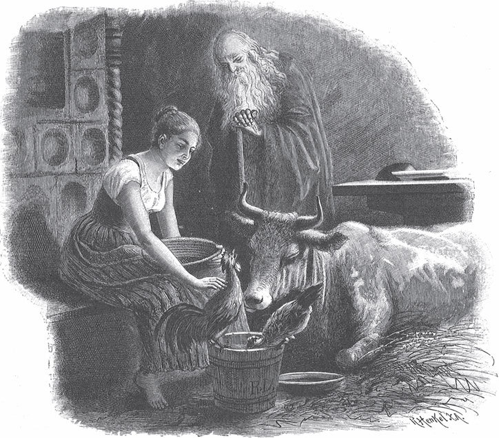

## Das Waldhaus

Ein armer Holzfäller lebte mit seiner Frau und drei Töchtern in einer kleinen Hütte am Rand eines einsamen Waldes. Eines Morgens, als er wieder an seine Arbeit gehen wollte, sagte er zu seiner Frau:

— Lass mir mein <abbr title="das Mittagsbrot — обед">Mittagsbrot</abbr> von dem ältesten Mädchen hinaus in den Wald bringen, sonst werde ich nicht fertig. Und damit es sich nicht verirrt, — fügte er hinzu, — will ich einen Beutel mit Hirse mitnehmen und die Körner auf den Weg streuen.

Als nun die Sonne mitten über dem Wald stand, machte sich das Mädchen mit einem Topf voll Suppe auf den Weg. Aber die Feld- und Waldsperlinge, die Lerchen und <abbr title="der Fink, die Finken — зяблик">Finken</abbr>, Amseln und <abbr title="der Zeisig, die Zeisige — чиж">Zeisige</abbr> hatten die Hirse schon längst aufgepickt, und das Mädchen konnte die Spur nicht finden. Da ging es auf gut Glück immer weiter, bis die Sonne sank und die Nacht hereinbrach. Die Bäume rauschten in der Dunkelheit, die Eulen schnarrten, und ihm wurde angst. Da erblickte es in der Ferne ein Licht, das zwischen den Bäumen blinkte. «Dort wohnen wohl Leute», dachte es, «die mich über Nacht behalten», und ging auf das Licht zu.

Es dauerte nicht lange, da kam es an ein Haus, dessen Fenster erleuchtet waren. Es klopfte an, und eine raue Stimme rief von drinnen: «Herein!» Das Mädchen trat in den dunklen Flur und <abbr title="pochen — стучать">pochte</abbr> an die Stubentür. «Nur herein!», rief die Stimme, und als es öffnete, saß da ein alter, eisgrauer Mann am Tisch, hatte das Gesicht auf beide Hände <abbr title="stützen — подпирать">gestützt</abbr>, und sein weißer Bart floss über den Tisch herab fast bis auf den Boden. Am Ofen aber lagen drei Tiere: ein Hühnchen, ein Hähnchen und eine bunt <abbr title="gescheckt — пёстрый, пятнистый">gescheckte</abbr> Kuh. Das Mädchen erzählte dem Alten, was ihm widerfahren war, und bat um ein Nachtlager. Der Mann sprach:

> «Schön Hühnchen,  
> schön Hähnchen,  
> und du schöne bunte Kuh,  
> was sagst du dazu?»

«Duks!», antworteten die Tiere, und das musste wohl heißen: «Wir sind einverstanden», denn der Alte sprach weiter:

— Hier ist Hülle und Fülle. Geh hinaus an den Herd und koch uns ein Abendessen.

Das Mädchen fand in der Küche von allem einen <abbr title="der Überfluss — избыток, изобилие">Überfluss</abbr> und kochte eine gute Speise, aber an die Tiere dachte es nicht. Es trug die volle Schüssel auf den Tisch, setzte sich zu dem grauen Mann, aß und stillte seinen Hunger. Als es satt war, sprach es:

— Aber jetzt bin ich müde. Wo ist ein Bett, in das ich mich legen und schlafen kann?

Die Tiere antworteten:

> «Du hast mit ihm gegessen,  
> du hast mit ihm getrunken,  
> du hast an uns gar nicht gedacht,  
> nun sieh auch, wo du bleibst die Nacht.»

Da sprach der Alte:

— Steig nur die Treppe hinauf, dort wirst du eine Kammer mit zwei Betten finden. Schüttle sie auf und bezieh sie mit weißem Leinen, dann will ich auch kommen und mich schlafen legen.

Das Mädchen stieg hinauf, und als es die Betten aufgeschüttelt und frisch bezogen hatte, legte es sich in das eine, ohne weiter auf den Alten zu warten. Nach einiger Zeit aber kam der graue Mann, <abbr title="leuchten + Dat. — светить (кому-то)">leuchtete</abbr> dem Mädchen mit dem Licht ins Gesicht und schüttelte den Kopf. Und als er sah, dass es fest eingeschlafen war, öffnete er eine Falltür und ließ es in den Keller sinken.

Der Holzfäller kam am späten Abend nach Hause und machte seiner Frau Vorwürfe, dass sie ihn den ganzen Tag habe hungern lassen.

— Ich bin nicht schuld, — antwortete sie, — das Mädchen ist mit dem Mittagessen hinausgegangen. Es muss sich verirrt haben; morgen wird es schon wiederkommen.

Noch vor Tag aber stand der Holzfäller auf, wollte in den Wald und verlangte, die zweite Tochter solle ihm diesmal das Essen bringen.

— Ich will einen Beutel mit Linsen mitnehmen, — sagte er, — die Körner sind größer als Hirse, das Mädchen wird sie besser sehen und kann den Weg nicht verfehlen.

Zur Mittagszeit trug auch dieses Mädchen das Essen hinaus, aber die Linsen waren verschwunden: Die Waldvögel hatten sie wie am Tag zuvor aufgepickt und keine übrig gelassen. Das Mädchen irrte im Wald umher, bis es Nacht wurde; da kam es ebenfalls zum Haus des Alten, wurde hereingerufen und bat um Essen und ein Nachtlager. Der Mann mit dem weißen Bart fragte wieder die Tiere:

> «Schön Hühnchen,  
> schön Hähnchen,  
> und du schöne bunte Kuh,  
> was sagst du dazu?»

Die Tiere antworteten abermals: «Duks», und es geschah alles wie am Tag zuvor. Das Mädchen kochte eine gute Speise, aß und trank mit dem Alten und kümmerte sich nicht um die Tiere. Und als es sich nach seinem Nachtlager erkundigte, antworteten sie:

> «Du hast mit ihm gegessen,  
> du hast mit ihm getrunken,  
> du hast an uns gar nicht gedacht,  
> nun sieh auch, wo du bleibst die Nacht.»

Als es eingeschlafen war, kam der Alte, betrachtete es <abbr title="kopfschüttelnd — качая головой">kopfschüttelnd</abbr> und ließ es in den Keller hinab.

Am dritten Morgen sprach der Holzfäller zu seiner Frau:

— Schick mir heute unser jüngstes Kind mit dem Essen hinaus. Das ist immer gut und gehorsam gewesen, das wird auf dem rechten Weg bleiben und nicht wie seine Schwestern, die wilden Hummeln, <abbr title="herumschwärmen — порхать, носиться туда-сюда">herumschwärmen</abbr>.

Die Mutter wollte nicht und sprach:

— Soll ich mein liebstes Kind auch noch verlieren?

— Sei ohne Sorge, — antwortete er, — das Mädchen verirrt sich nicht, es ist zu klug und <abbr title="verständig — рассудительный">verständig</abbr>. <abbr title="zum Überfluss — вдобавок, для верности">Zum Überfluss</abbr> will ich Erbsen mitnehmen und <abbr title="ausstreuen — рассыпать">ausstreuen</abbr>, die sind noch größer als Linsen und werden ihm den Weg zeigen.

Aber als das Mädchen mit dem Korb am Arm hinauskam, hatten die <abbr title="die Waldtaube, die Waldtauben — лесной голубь, вяхирь">Waldtauben</abbr> die Erbsen schon im <abbr title="der Kropf, die Kröpfe — зоб">Kropf</abbr>, und es wusste nicht, wohin es sich wenden sollte. Es war voller Sorgen und dachte ständig daran, wie der arme Vater hungern und die gute Mutter jammern würde, wenn es ausbliebe. Endlich, als es finster wurde, erblickte es das Lichtchen und kam an das Waldhaus. Es bat ganz freundlich, sie möchten es über Nacht beherbergen, und der Mann mit dem weißen Bart fragte wieder seine Tiere:

> «Schön Hühnchen,  
> schön Hähnchen,  
> und du schöne bunte Kuh,  
> was sagst du dazu?»

«Duks», sagten sie. Da trat das Mädchen an den Ofen, wo die Tiere lagen, und streichelte Hühnchen und Hähnchen, indem es mit der Hand über die glatten Federn strich, und die bunte Kuh <abbr title="kraulen — почёсывать">kraulte</abbr> es zwischen den Hörnern. Und als es <abbr title="auf Geheiß + Gen. — по велению, по приказу">auf Geheiß</abbr> des Alten eine gute Suppe zubereitet hatte und die Schüssel auf dem Tisch stand, sprach es:

— Soll ich mich <abbr title="sich sättigen — насыщаться">sättigen</abbr>, und die guten Tiere sollen nichts haben? Draußen ist Hülle und Fülle, erst will ich für sie sorgen.

Da ging es, holte Gerste und streute sie dem Hühnchen und dem Hähnchen hin und brachte der Kuh <abbr title="duftend — душистый, ароматный">duftendes</abbr> Heu, einen ganzen Arm voll.

— Lasst es euch schmecken, ihr lieben Tiere, — sagte es, — und wenn ihr durstig seid, sollt ihr auch einen frischen Trunk haben.

Dann trug es einen Eimer voll Wasser herein, und Hühnchen und Hähnchen sprangen auf den Rand, steckten den Schnabel hinein und hielten den Kopf dann in die Höhe, wie die Vögel trinken, und die bunte Kuh tat auch einen herzhaften Zug. Als die Tiere gefüttert waren, setzte sich das Mädchen zu dem Alten an den Tisch und aß, was er ihm übrig gelassen hatte. Es dauerte nicht lange, da fingen Hühnchen und Hähnchen an, das Köpfchen zwischen die Flügel zu stecken, und die bunte Kuh blinzelte mit den Augen. Da sprach das Mädchen:

— Sollen wir uns nicht <abbr title="sich zur Ruhe begeben — отойти ко сну">zur Ruhe begeben</abbr>?

> «Schön Hühnchen,  
> schön Hähnchen,  
> und du schöne bunte Kuh,  
> was sagst du dazu?»

Die Tiere antworteten:

> «Duks,  
> du hast mit uns gegessen,  
> du hast mit uns getrunken,  
> du hast uns alle wohl bedacht,  
> wir wünschen dir eine gute Nacht.»

Da ging das Mädchen die Treppe hinauf, schüttelte die <abbr title="das Federkissen, die Federkissen — пуховая подушка">Federkissen</abbr> auf und bezog sie mit frischem Leinen, und als es fertig war, kam der Alte und legte sich in das eine Bett, und sein weißer Bart reichte ihm bis an die Füße. Das Mädchen legte sich in das andere, sprach sein Gebet und schlief ein.

Es schlief ruhig bis Mitternacht; da wurde es so unruhig im Haus, dass das Mädchen erwachte. In den Ecken fing es an zu knistern und zu <abbr title="knattern — трещать">knattern</abbr>, und die Tür sprang auf und schlug an die Wand. Die Balken dröhnten, als würden sie aus ihren <abbr title="die Fuge, die Fugen — шов, паз">Fugen</abbr> gerissen, und es war, als ob die Treppe herabstürzte, und endlich krachte es, als ob das ganze Dach zusammenfiele. Da es aber wieder still wurde und dem Mädchen nichts <abbr title="zuleide — во вред">zuleide</abbr> geschah, blieb es ruhig liegen und schlief wieder ein.

Als es aber am Morgen bei hellem Sonnenschein aufwachte, was erblickten seine Augen? Es lag in einem großen Saal, und ringsumher glänzte alles in königlicher Pracht: An den Wänden wuchsen auf grünem seidenem Grund goldene Blumen in die Höhe, das Bett war aus Elfenbein und die Decke darauf aus rotem Samt, und auf einem Stuhl daneben stand ein Paar mit Perlen bestickter Pantoffeln. Das Mädchen glaubte, es sei ein Traum, aber da traten drei reich gekleidete Diener herein und fragten, was es zu befehlen habe.

— Geht nur, — antwortete das Mädchen, — ich will gleich aufstehen und dem Alten eine Suppe kochen und dann auch schön Hühnchen, schön Hähnchen und die schöne bunte Kuh füttern.

Es dachte, der Alte sei schon aufgestanden, und sah sich nach seinem Bett um; aber er lag nicht darin, sondern ein fremder Mann. Und als es ihn betrachtete und sah, dass er jung und schön war, erwachte er, richtete sich auf und sprach:

— Ich bin ein Königssohn und war von einer bösen Hexe verwünscht worden, als alter eisgrauer Mann im Wald zu leben. Niemand durfte um mich sein als meine drei Diener in Gestalt eines Hühnchens, eines Hähnchens und einer bunten Kuh. Und nicht eher sollte die <abbr title="die Verwünschung, die Verwünschungen — заклятие, проклятие">Verwünschung</abbr> aufhören, als bis ein Mädchen zu uns käme, so gut von Herzen, dass es nicht nur zu den Menschen, sondern auch zu den Tieren <abbr title="liebevoll — ласковый, любящий">liebevoll</abbr> wäre. Und das bist du gewesen, und heute um Mitternacht sind wir durch dich erlöst worden, und das alte Waldhaus ist wieder in meinen königlichen Palast verwandelt worden.

Und als sie aufgestanden waren, sagte der Königssohn den drei Dienern, sie sollten hinfahren und Vater und Mutter des Mädchens zur <abbr title="die Hochzeitsfeier, die Hochzeitsfeiern — свадебное торжество">Hochzeitsfeier</abbr> herbeiholen.

— Aber wo sind meine zwei Schwestern? — fragte das Mädchen.

— Die habe ich in den Keller <abbr title="sperren — запирать">gesperrt</abbr>, und morgen sollen sie in den Wald geführt werden und bei einem Köhler so lange als Mägde dienen, bis sie sich gebessert haben und auch die armen Tiere nicht mehr hungern lassen.

---

### Neue Wörter

- **das Mittagsbrot** — обед
- **der Fink, die Finken** — зяблик
- **der Zeisig, die Zeisige** — чиж
- **pochen** — стучать
- **stützen** — подпирать
- **gescheckt** — пёстрый, пятнистый
- **der Überfluss** — избыток, изобилие
- **leuchten + Dat.** — светить (кому-то)
- **kopfschüttelnd** — качая головой
- **herumschwärmen** — порхать, носиться туда-сюда
- **verständig** — рассудительный
- **zum Überfluss** — вдобавок, для верности
- **ausstreuen** — рассыпать
- **die Waldtaube, die Waldtauben** — лесной голубь, вяхирь
- **der Kropf, die Kröpfe** — зоб
- **kraulen** — почёсывать
- **auf Geheiß + Gen.** — по велению, по приказу
- **sich sättigen** — насыщаться
- **duftend** — душистый, ароматный
- **sich zur Ruhe begeben** — отойти ко сну
- **das Federkissen, die Federkissen** — пуховая подушка
- **knattern** — трещать
- **die Fuge, die Fugen** — шов, паз
- **zuleide** — во вред
- **die Verwünschung, die Verwünschungen** — заклятие, проклятие
- **liebevoll** — ласковый, любящий
- **die Hochzeitsfeier, die Hochzeitsfeiern** — свадебное торжество
- **sperren** — запирать

[← Zurück](kapitel-169.md) · [Inhalt](README.md) · [Weiter →](kapitel-171.md)
