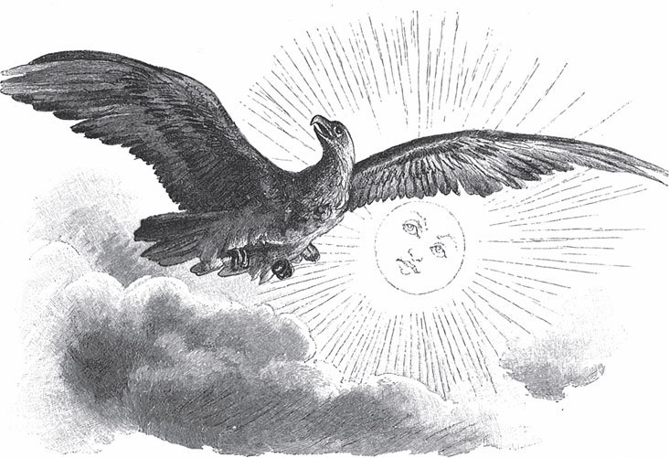

## Der Zaunkönig

In den alten Zeiten hatte jeder Klang noch Sinn und <abbr title="die Bedeutung, die Bedeutungen — значение">Bedeutung</abbr>. Wenn der Hammer des Schmieds ertönte, dann rief er: «Smiet mi to! Smiet mi to!» – das heißt: «Schmiede mich! Schmiede mich!» Wenn der <abbr title="der Hobel, die Hobel — рубанок">Hobel</abbr> des <abbr title="der Tischler, die Tischler — столяр">Tischlers</abbr> schnarrte, dann sagte er: «Dor häst! Dor, dor häst!» – «Da hast du's! Da, da hast du's!» Fing das <abbr title="das Räderwerk — колёсный механизм">Räderwerk</abbr> der Mühle an zu klappern, dann sprach es: «Help, Herr Gott! Help, Herr Gott!» – «Hilf, Herr Gott!» Und war der Müller ein <abbr title="der Betrüger, die Betrüger — обманщик, мошенник">Betrüger</abbr> und ließ die Mühle laufen, dann sprach sie Hochdeutsch und fragte zuerst langsam: «Wer ist da? Wer ist da?» Dann antwortete sie schnell: «Der Müller! Der Müller!» Und zuletzt ganz geschwind: «Stiehlt tapfer, stiehlt tapfer, vom <abbr title="das Achtel, die Achtel — восьмушка (мера зерна)">Achtel</abbr> drei <abbr title="der Sechter, die Sechter — шестерик (старая мера)">Sechter</abbr>.»

Zu dieser Zeit hatten auch die Vögel ihre eigene Sprache, die jeder Mensch verstand. Heute klingt sie nur wie ein <abbr title="zwitschern — щебетать">Zwitschern</abbr>, Kreischen und Pfeifen, und bei einigen wie Musik ohne Worte. Nun <abbr title="in den Sinn kommen — прийти в голову">kam</abbr> es den Vögeln aber in den Sinn, dass sie nicht länger ohne Herrn sein wollten; sie wollten einen aus ihrer Mitte zu ihrem König wählen. Nur einer von ihnen, der <abbr title="der Kiebitz, die Kiebitze — чибис">Kiebitz</abbr>, war dagegen: Frei hatte er gelebt, und frei wollte er sterben. <abbr title="ängstlich — боязливо, тревожно">Ängstlich</abbr> flog er hin und her und rief: «Wo bliew ick? Wo bliew ick?» – «Wo bleibe ich?» Er <abbr title="sich zurückziehen (zog sich zurück, hat sich zurückgezogen) — удаляться, уединяться">zog sich</abbr> in einsame, <abbr title="unbesucht — нехоженый">unbesuchte</abbr> Sümpfe zurück und zeigte sich nie wieder unter <abbr title="seinesgleichen — себе подобные">seinesgleichen</abbr>.

Die Vögel wollten nun über die Sache beraten, und an einem schönen Maimorgen kamen sie alle aus Wäldern und Feldern zusammen: Adler und <abbr title="der Buchfink, die Buchfinken — зяблик">Buchfink</abbr>, Eule und Krähe, Lerche und Spatz – was soll ich sie alle nennen? Sogar der <abbr title="der Kuckuck, die Kuckucke — кукушка">Kuckuck</abbr> kam, und der <abbr title="der Wiedehopf, die Wiedehopfe — удод">Wiedehopf</abbr>, sein Küster, der so heißt, weil er sich immer ein paar Tage früher hören lässt. Auch ein ganz kleiner Vogel, der noch keinen Namen hatte, <abbr title="sich mischen unter + Akk. — смешаться с">mischte sich</abbr> unter die Schar. Das Huhn, das zufällig von der ganzen Sache nichts gehört hatte, wunderte sich über die große <abbr title="die Versammlung, die Versammlungen — собрание">Versammlung</abbr>. «Wat, wat, wat is denn dar to don?» – «Was, was, was ist denn da los?» – <abbr title="gackern — кудахтать">gackerte</abbr> es. Aber der Hahn beruhigte seine liebe <abbr title="die Henne, die Hennen — курица, несушка">Henne</abbr> und sagte: «Luter riek Lüd» – «Lauter reiche Leute» – und erzählte ihr auch, was sie vorhatten. Man beschloss nämlich, dass der König sein sollte, der am höchsten fliegen könne. Ein <abbr title="der Laubfrosch, die Laubfrösche — квакша, древесная лягушка">Laubfrosch</abbr>, der im Gebüsch saß, hörte das und rief warnend: «Natt, natt, natt! Natt, natt, natt!» – «Nass, nass, nass!» –, denn er meinte, deswegen würden viele Tränen <abbr title="vergießen (vergoss, hat vergossen) — проливать">vergossen</abbr> werden. Die Krähe aber sagte: «Quark ok!» – «Ach was, Unsinn!» –, es werde alles friedlich ablaufen.

Man beschloss nun, gleich an diesem schönen Morgen aufzusteigen, damit hinterher niemand sagen könne: «Ich wäre wohl noch höher geflogen, aber dann kam der Abend, und ich konnte nicht mehr.» Auf ein verabredetes Zeichen erhob sich also die ganze Schar in die Lüfte. Der Staub stieg vom Feld auf, es war ein gewaltiges <abbr title="das Sausen und Brausen — свист и гул">Sausen und Brausen</abbr> und <abbr title="das Flügelschlagen — хлопанье крыльев">Flügelschlagen</abbr>, und es sah aus, als ob eine schwarze Wolke über das Land zöge. Die kleineren Vögel aber <abbr title="zurückbleiben (blieb zurück, ist zurückgeblieben) — отставать">blieben</abbr> bald zurück, konnten nicht weiter und fielen wieder auf die Erde. Die größeren hielten es länger durch, aber keiner konnte es dem Adler <abbr title="es jemandem gleichtun — сравняться с кем-л.">gleichtun</abbr>. Der stieg so hoch, dass er der Sonne die Augen hätte aushacken können. Und als er sah, dass die anderen nicht zu ihm hinaufkamen, dachte er: «Warum willst du noch höher fliegen? Du bist ja doch der König», und fing an, sich wieder <abbr title="sich herablassen (ließ sich herab, hat sich herabgelassen) — спускаться">herabzulassen</abbr>. Die Vögel unter ihm riefen ihm alle zugleich zu: «Du musst unser König sein, keiner ist höher geflogen als du.»

— <abbr title="ausgenommen — кроме, за исключением">Ausgenommen</abbr> ich! — schrie der kleine Kerl ohne Namen, der sich in die <abbr title="die Brustfeder, die Brustfedern — перо на груди">Brustfedern</abbr> des Adlers verkrochen hatte.

Und weil er nicht müde war, stieg er auf und stieg so hoch, dass er Gott auf seinem Stuhl sitzen sehen konnte. Als er aber so weit gekommen war, legte er seine Flügel zusammen, sank herab und rief unten mit seiner feinen, durchdringenden Stimme: «König bün ick! König bün ick!» – «König bin ich! König bin ich!»

— Du unser König? — schrien die Vögel zornig. — Durch <abbr title="die Ränke (Pl.) — козни, интриги">Ränke</abbr> und Listen hast du es so weit gebracht.

Sie stellten eine andere Bedingung: Der solle ihr König sein, der am tiefsten in die Erde fallen könne. Wie klatschte da die Gans mit ihrer breiten Brust wieder auf das Land! Wie schnell scharrte der Hahn ein Loch! Am schlimmsten erging es der Ente: Sie sprang in einen Graben, <abbr title="sich verrenken — вывихнуть">verrenkte sich</abbr> aber die Beine und watschelte zum nahen Teich davon und rief: «Pracherwerk! Pracherwerk!» – «Bettelarbeit! Bettelarbeit!» Der Kleine ohne Namen aber suchte sich ein Mauseloch, schlüpfte hinein und rief mit seiner feinen Stimme heraus: «König bün ick! König bün ick!»

— Du unser König? — riefen die Vögel noch zorniger. — Meinst du, deine Listen sollen gelten?

Sie beschlossen, ihn in seinem Loch gefangen zu halten und <abbr title="aushungern — заморить голодом">auszuhungern</abbr>. Die Eule wurde als Wache davorgestellt: Sie sollte den Schelm nicht herauslassen, so lieb ihr ihr Leben sei. Als es aber Abend geworden war und die Vögel nach der <abbr title="die Anstrengung, die Anstrengungen — напряжение, усилие">Anstrengung</abbr> des Fliegens große Müdigkeit empfanden, gingen sie mit Frau und Kind zu Bett. Die Eule allein blieb vor dem Mauseloch stehen und blickte mit ihren großen Augen <abbr title="unverwandt — неотрывно">unverwandt</abbr> hinein. Inzwischen war aber auch sie müde geworden und dachte: «Ein Auge kannst du wohl <abbr title="zumachen — закрывать">zumachen</abbr>, du wachst ja noch mit dem anderen, und der kleine Bösewicht soll nicht aus seinem Loch heraus.» Also machte sie das eine Auge zu und schaute mit dem anderen starr auf das Mauseloch. Der kleine Kerl guckte mit dem Kopf heraus und wollte <abbr title="wegwitschen — ускользнуть, шмыгнуть">wegwitschen</abbr>, aber die Eule trat sofort davor, und er zog den Kopf wieder zurück. Dann machte die Eule das eine Auge wieder auf und das andere zu und wollte so die ganze Nacht <abbr title="abwechseln — чередовать, сменять">abwechseln</abbr>. Aber als sie das eine Auge wieder zumachte, vergaß sie, das andere aufzumachen, und sobald beide Augen zu waren, schlief sie ein. Der Kleine merkte das bald und schlüpfte weg.

Seit dieser Zeit darf sich die Eule nicht mehr am Tag sehen lassen, sonst sind die anderen Vögel hinter ihr her und zerzausen ihr das Gefieder. Sie fliegt nur in der Nacht aus, hasst und verfolgt aber die Mäuse, weil sie so böse Löcher machen. Auch der kleine Vogel lässt sich nicht gern sehen, weil er fürchtet, es ginge ihm an den Kragen, wenn man ihn erwischte. Er schlüpft in den Zäunen herum, und wenn er ganz sicher ist, ruft er wohl zuweilen: «König bün ick!» Und deshalb nennen ihn die anderen Vögel zum Spott Zaunkönig.

Niemand aber war froher als die Lerche, dass sie dem Zaunkönig nicht zu gehorchen brauchte. Sobald sich die Sonne <abbr title="sich blicken lassen — показываться">blicken lässt</abbr>, steigt sie in die Lüfte und ruft: «Ach, wo is dat schön! Schön is dat! Schön! Schön! Ach, wo is dat schön!» – «Ach, wie ist das schön!»

---

### Neue Wörter

- **die Bedeutung, die Bedeutungen** — значение
- **der Hobel, die Hobel** — рубанок
- **der Tischler, die Tischler** — столяр
- **das Räderwerk** — колёсный механизм
- **der Betrüger, die Betrüger** — обманщик, мошенник
- **das Achtel, die Achtel** — восьмушка (мера зерна)
- **der Sechter, die Sechter** — шестерик (старая мера)
- **zwitschern** — щебетать
- **in den Sinn kommen** — прийти в голову
- **der Kiebitz, die Kiebitze** — чибис
- **ängstlich** — боязливо, тревожно
- **sich zurückziehen (zog sich zurück, hat sich zurückgezogen)** — удаляться, уединяться
- **unbesucht** — нехоженый
- **seinesgleichen** — себе подобные
- **der Buchfink, die Buchfinken** — зяблик
- **der Kuckuck, die Kuckucke** — кукушка
- **der Wiedehopf, die Wiedehopfe** — удод
- **sich mischen unter + Akk.** — смешаться с
- **die Versammlung, die Versammlungen** — собрание
- **gackern** — кудахтать
- **die Henne, die Hennen** — курица, несушка
- **der Laubfrosch, die Laubfrösche** — квакша, древесная лягушка
- **vergießen (vergoss, hat vergossen)** — проливать
- **das Sausen und Brausen** — свист и гул
- **das Flügelschlagen** — хлопанье крыльев
- **zurückbleiben (blieb zurück, ist zurückgeblieben)** — отставать
- **es jemandem gleichtun** — сравняться с кем-л.
- **sich herablassen (ließ sich herab, hat sich herabgelassen)** — спускаться
- **ausgenommen** — кроме, за исключением
- **die Brustfeder, die Brustfedern** — перо на груди
- **die Ränke (Pl.)** — козни, интриги
- **sich verrenken** — вывихнуть
- **aushungern** — заморить голодом
- **die Anstrengung, die Anstrengungen** — напряжение, усилие
- **unverwandt** — неотрывно
- **zumachen** — закрывать
- **wegwitschen** — ускользнуть, шмыгнуть
- **abwechseln** — чередовать, сменять
- **sich blicken lassen** — показываться

[← Zurück](kapitel-171.md) · [Inhalt](README.md) · [Weiter →](kapitel-173.md)
