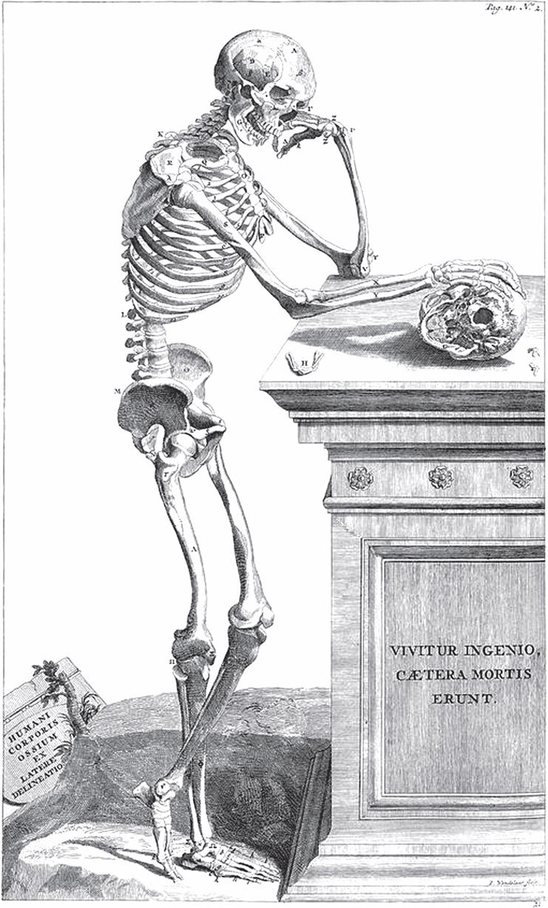

## Die Lebenszeit

Als Gott die Welt geschaffen hatte und allen <abbr title="die Kreatur, die Kreaturen — тварь, создание">Kreaturen</abbr> ihre <abbr title="die Lebenszeit — срок жизни">Lebenszeit</abbr> bestimmen wollte, kam der Esel und fragte:

— Herr, wie lange soll ich leben?

— Dreißig Jahre, — antwortete Gott. — Ist dir das recht?

— Ach Herr, — erwiderte der Esel, — das ist eine lange Zeit. Bedenke mein mühseliges <abbr title="das Dasein — существование">Dasein</abbr>: vom Morgen bis in die Nacht schwere Lasten tragen, <abbr title="der Kornsack, die Kornsäcke — мешок с зерном">Kornsäcke</abbr> in die Mühle schleppen, damit andere das Brot essen, und zur <abbr title="die Ermunterung — ободрение">Ermunterung</abbr> nichts als Schläge und <abbr title="der Fußtritt, die Fußtritte — пинок">Fußtritte</abbr>! <abbr title="erlassen (erließ, hat erlassen) — освобождать от, прощать">Erlass</abbr> mir einen Teil der langen Zeit.

Da erbarmte sich Gott und schenkte ihm achtzehn Jahre. Der Esel ging getröstet weg, und der Hund erschien.

— Wie lange willst du leben? — sprach Gott zu ihm. — Dem Esel sind dreißig Jahre zu viel, du aber wirst damit zufrieden sein.

— Herr, — antwortete der Hund, — ist das dein Wille? Bedenke, was ich laufen muss; das halten meine Füße so lange nicht aus. Und wenn ich erst die Stimme zum Bellen und die Zähne zum Beißen verloren habe, was bleibt mir dann noch übrig, als aus einer Ecke in die andere zu laufen und zu knurren?

Gott sah, dass er recht hatte, und erließ ihm zwölf Jahre. Darauf kam der Affe.

— Du willst wohl gern dreißig Jahre leben? — sprach der Herr zu ihm. — Du brauchst nicht zu arbeiten wie der Esel und der Hund und bist immer guter Dinge.

— Ach Herr, — antwortete er, — das sieht so aus, ist aber anders. Wenn es Hirsebrei regnet, habe ich keinen Löffel. Ich soll immer lustige Streiche machen und <abbr title="Grimassen schneiden — корчить рожи">Grimassen schneiden</abbr>, damit die Leute lachen; und wenn sie mir einen Apfel reichen und ich beiße hinein, dann ist er sauer. Wie oft steckt die Traurigkeit hinter dem Spaß! Dreißig Jahre halte ich das nicht aus.

Gott war gnädig und schenkte ihm zehn Jahre.

Endlich erschien der Mensch, <abbr title="freudig — радостный">freudig</abbr>, gesund und frisch, und bat Gott, ihm seine Zeit zu bestimmen.

— Dreißig Jahre sollst du leben, — sprach der Herr. — Ist dir das genug?

— Was für eine kurze Zeit! — rief der Mensch. — Wenn ich mein Haus gebaut habe und das Feuer auf meinem eigenen Herd brennt, wenn ich Bäume gepflanzt habe, die blühen und Früchte tragen, und wenn ich gerade meines Lebens froh werden will, dann soll ich sterben! O Herr, <abbr title="verlängern — продлевать">verlängere</abbr> meine Zeit.

— Ich will dir die achtzehn Jahre des Esels <abbr title="dazugeben (gab dazu, hat dazugegeben) — прибавлять">dazugeben</abbr>, — sagte Gott.

— Das ist nicht genug, — erwiderte der Mensch.

— Du sollst auch die zwölf Jahre des Hundes haben.

— Immer noch zu wenig.

— Wohlan, — sagte Gott, — ich will dir noch die zehn Jahre des Affen geben, aber mehr bekommst du nicht.

Der Mensch ging fort, war aber nicht <abbr title="zufriedenstellen — удовлетворять">zufriedengestellt</abbr>.

So lebt der Mensch siebzig Jahre. Die ersten dreißig sind seine menschlichen Jahre, die vergehen schnell; da ist er gesund und heiter, arbeitet mit Lust und freut sich seines Daseins. Darauf folgen die achtzehn Jahre des Esels: Da wird ihm eine Last nach der anderen aufgeladen, er muss das Korn tragen, das andere ernährt, und Schläge und Tritte sind der Lohn für seine treuen Dienste. Dann kommen die zwölf Jahre des Hundes: Da liegt er in den Ecken, knurrt und hat keine Zähne mehr zum Beißen. Und wenn diese Zeit vorüber ist, machen die zehn Jahre des Affen den Schluss. Da ist der Mensch <abbr title="schwachköpfig — слабоумный">schwachköpfig</abbr> und närrisch, treibt alberne Dinge und wird zum <abbr title="das Gespött — посмешище">Gespött</abbr> der Kinder.

---

### Neue Wörter

- **die Kreatur, die Kreaturen** — тварь, создание
- **die Lebenszeit** — срок жизни
- **das Dasein** — существование
- **der Kornsack, die Kornsäcke** — мешок с зерном
- **die Ermunterung** — ободрение
- **der Fußtritt, die Fußtritte** — пинок
- **erlassen (erließ, hat erlassen)** — освобождать от, прощать
- **Grimassen schneiden** — корчить рожи
- **freudig** — радостный
- **verlängern** — продлевать
- **dazugeben (gab dazu, hat dazugegeben)** — прибавлять
- **zufriedenstellen** — удовлетворять
- **schwachköpfig** — слабоумный
- **das Gespött** — посмешище

[← Zurück](kapitel-176.md) · [Inhalt](README.md) · [Weiter →](kapitel-178.md)
