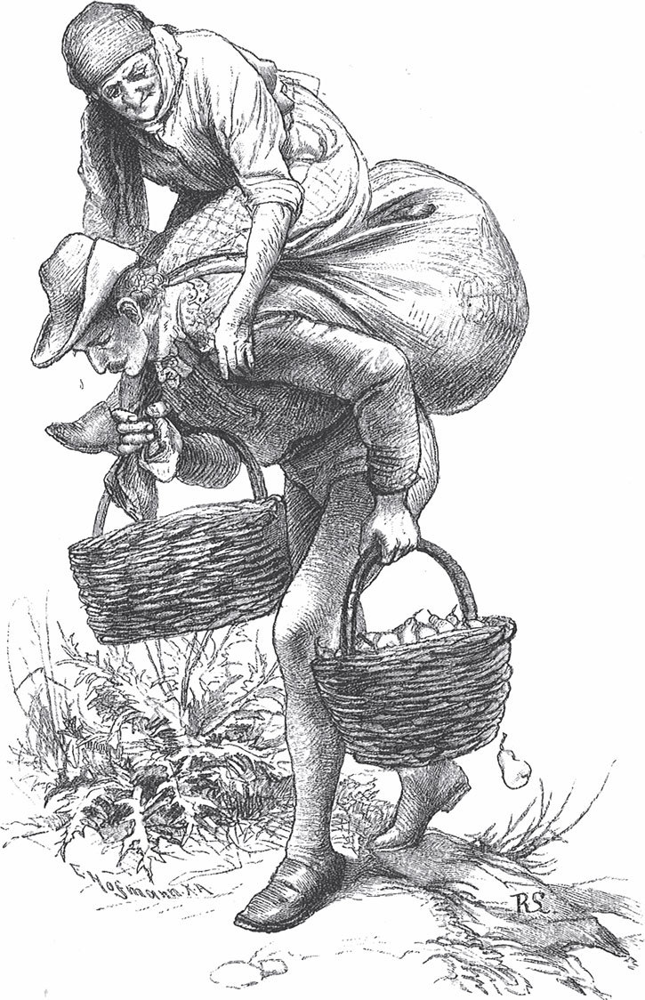

## Die Gänsehirtin am Brunnen

Es war einmal ein steinaltes Mütterchen, das lebte mit seiner Herde Gänse in einer Einöde zwischen Bergen und hatte dort ein kleines Haus. Die Einöde war von einem großen Wald umgeben, und jeden Morgen nahm die Alte ihre Krücke und wackelte in den Wald. Dort war das Mütterchen ganz <abbr title="geschäftig — хлопотливый, деятельный">geschäftig</abbr>, mehr, als man ihm in seinem hohen Alter <abbr title="zutrauen — считать способным">zugetraut</abbr> hätte: Es sammelte Gras für seine Gänse, pflückte sich das wilde Obst, so weit es mit den Händen reichen konnte, und trug alles auf dem Rücken heim. Man hätte meinen sollen, die schwere Last müsste sie zu Boden drücken, aber sie brachte sie immer glücklich nach Hause. Wenn ihr jemand begegnete, grüßte sie ganz freundlich:

— Guten Tag, lieber Landsmann, heute ist schönes Wetter. Ja, Ihr wundert Euch, dass ich das Gras schleppe, aber jeder muss seine Last auf den Rücken nehmen.

Doch die Leute begegneten ihr nicht gern und machten lieber einen Umweg, und wenn ein Vater mit seinem Knaben an ihr vorbeiging, sagte er leise zu ihm:

— Nimm dich in Acht vor der Alten, die <abbr title="es faustdick hinter den Ohren haben — быть себе на уме, хитрецом">hat es faustdick hinter den Ohren</abbr>: Das ist eine Hexe.

Eines Morgens ging ein hübscher junger Mann durch den Wald. Die Sonne schien hell, die Vögel sangen, ein kühles Lüftchen strich durch das Laub, und er war voller Freude und Lust. Noch war ihm kein Mensch begegnet, als er plötzlich die alte Hexe erblickte, die auf den Knien am Boden saß und mit einer <abbr title="die Sichel, die Sicheln — серп">Sichel</abbr> Gras abschnitt. Eine ganze Last hatte sie schon in ihr <abbr title="das Tragtuch, die Tragtücher — заплечный платок для ноши">Tragtuch</abbr> geschoben, und daneben standen zwei Körbe, die mit wilden Birnen und Äpfeln gefüllt waren.

— Aber Mütterchen, — sprach er, — wie kannst du das alles fortschaffen?

— Ich muss es tragen, lieber Herr, — antwortete sie. — Die Kinder reicher Leute brauchen das nicht. Aber beim Bauern heißt es:

Schau dich nicht um,

dein Buckel ist krumm.

— Wollt Ihr mir helfen? — sprach sie, als er bei ihr stehen blieb. — Ihr habt noch einen geraden Rücken und junge Beine, es wird Euch ein Leichtes sein. Auch ist mein Haus nicht so weit von hier: Hinter dem Berg dort steht es auf einer Heide. Wie schnell seid Ihr da hinaufgesprungen!

Der junge Mann empfand Mitleid mit der Alten.

— Mein Vater ist zwar kein Bauer, — antwortete er, — sondern ein reicher Graf; aber damit Ihr seht, dass nicht nur die Bauern tragen können, will ich Euer Bündel nehmen.

— Wenn Ihr es versuchen wollt, — sprach sie, — soll es mir recht sein. Eine Stunde weit werdet Ihr freilich gehen müssen, aber was macht Euch das schon aus! Die Äpfel und Birnen dort müsst Ihr auch tragen.

Es kam dem jungen Grafen doch ein wenig bedenklich vor, als er von einer Stunde Weg hörte, aber die Alte ließ ihn nicht wieder los. Sie <abbr title="aufpacken — навьючивать">packte</abbr> ihm das Tragtuch auf den Rücken und hängte ihm die beiden Körbe an den Arm.

— Seht Ihr, es geht ganz leicht, — sagte sie.

— Nein, es geht nicht leicht, — antwortete der Graf und machte ein <abbr title="schmerzlich — страдальческий">schmerzliches</abbr> Gesicht. — Das Bündel drückt ja so schwer, als wären lauter Wackersteine darin, und die Äpfel und Birnen haben ein Gewicht, als wären sie aus Blei. Ich kann kaum atmen.

Er hatte Lust, alles wieder abzulegen, aber die Alte ließ es nicht zu.

— Seht einmal, — sprach sie spöttisch, — der junge Herr will nicht tragen, was ich alte Frau schon so oft fortgeschleppt habe. Mit schönen Worten sind sie schnell <abbr title="bei der Hand sein — быть наготове">bei der Hand</abbr>, aber wenn es ernst wird, wollen sie sich aus dem Staub machen. Was steht Ihr da, — fuhr sie fort, — und zaudert? Hebt die Beine! Das Bündel nimmt Euch niemand wieder ab.

Solange er auf <abbr title="eben — ровный">ebener</abbr> Erde ging, war es noch auszuhalten; aber als sie an den Berg kamen und steigen mussten und die Steine hinter seinen Füßen hinabrollten, als wären sie lebendig, da ging es über seine Kräfte. Die Schweißtropfen standen ihm auf der Stirn und liefen ihm bald heiß, bald kalt den Rücken hinunter.

— Mütterchen, — sagte er, — ich kann nicht weiter, ich will ein wenig ruhen.

— <abbr title="nichts da! — ещё чего!">Nichts da</abbr>, — antwortete die Alte. — Wenn wir angekommen sind, könnt Ihr ausruhen, aber jetzt müsst Ihr vorwärts. Wer weiß, wozu es Euch gut ist.

— Alte, du wirst unverschämt! — sagte der Graf und wollte das Tragtuch abwerfen. Aber er bemühte sich vergeblich: Es hing so fest an seinem Rücken, als wäre es angewachsen. Er drehte und wendete sich, aber er konnte es nicht wieder loswerden. Die Alte lachte dazu und sprang ganz vergnügt auf ihrer Krücke herum.

— <abbr title="sich erzürnen — гневаться">Erzürnt</abbr> Euch nicht, lieber Herr, — sprach sie, — Ihr werdet ja so rot im Gesicht wie ein <abbr title="der Truthahn, die Truthähne — индюк">Truthahn</abbr>. Tragt Euer Bündel mit Geduld; wenn wir zu Hause angekommen sind, will ich Euch schon ein gutes <abbr title="das Trinkgeld, die Trinkgelder — чаевые, на водку">Trinkgeld</abbr> geben.

Was sollte er machen? Er musste sich in sein Schicksal <abbr title="sich fügen in + Akk. — покориться">fügen</abbr> und geduldig hinter der Alten <abbr title="herschleichen (schlich her, ist hergeschlichen) — плестись следом">herschleichen</abbr>. Sie schien immer flinker zu werden und seine Last immer schwerer. Auf einmal machte sie einen Satz, sprang auf das Tragtuch und setzte sich oben darauf; so <abbr title="zaundürr — тощий как жердь">zaundürr</abbr> sie war, hatte sie doch mehr Gewicht als die dickste <abbr title="die Bauernmagd, die Bauernmägde — крестьянская девка, батрачка">Bauernmagd</abbr>. Dem Jüngling zitterten die Knie, aber wenn er nicht weiterging, schlug ihn die Alte mit einer Gerte und mit <abbr title="die Brennnessel, die Brennnesseln — крапива">Brennnesseln</abbr> auf die Beine. Unter <abbr title="beständig — постоянный">beständigem</abbr> Ächzen stieg er den Berg hinauf und kam endlich beim Haus der Alten an, gerade als er <abbr title="niedersinken (sank nieder, ist niedergesunken) — рухнуть, опуститься">niedersinken</abbr> wollte.

Als die Gänse die Alte erblickten, streckten sie die Flügel in die Höhe und die Hälse nach vorn, liefen ihr entgegen und schrien: «Wulle, wulle!» Hinter der Herde, mit einer Rute in der Hand, ging eine <abbr title="bejahrt — пожилой">bejahrte</abbr> <abbr title="die Trulle, die Trullen — бабища, неряха">Trulle</abbr>, stark und groß, aber <abbr title="hässlich wie die Nacht — страшна как ночь">hässlich wie die Nacht</abbr>.

— Frau Mutter, — sprach sie zu der Alten, — ist Euch etwas zugestoßen? Ihr seid so lange ausgeblieben.

— Bewahre, mein Töchterchen, — erwiderte sie, — mir ist nichts Böses begegnet. Im Gegenteil, der liebe Herr da hat mir meine Last getragen; denk dir, als ich müde war, hat er mich sogar selbst noch auf den Rücken genommen. Der Weg ist uns auch gar nicht lang geworden, wir waren lustig und haben die ganze Zeit Spaß miteinander gemacht.

Endlich rutschte die Alte herunter, nahm dem jungen Mann das Bündel vom Rücken und die Körbe vom Arm, sah ihn ganz freundlich an und sprach:

— Nun setzt Euch auf die Bank vor der Tür und ruht Euch aus. Ihr habt Euren Lohn redlich verdient, und er soll auch nicht ausbleiben.

Dann sprach sie zu der <abbr title="die Gänsehirtin, die Gänsehirtinnen — пастушка гусей">Gänsehirtin</abbr>:

— Geh du ins Haus, mein Töchterchen. Es <abbr title="sich schicken — подобать, приличествовать">schickt sich</abbr> nicht, dass du mit einem jungen Herrn allein bist; man soll nicht <abbr title="Öl ins Feuer gießen — подливать масла в огонь">Öl ins Feuer gießen</abbr>. Er könnte sich in dich verlieben.

Der Graf wusste nicht, ob er weinen oder lachen sollte. «So ein <abbr title="das Schätzchen — милашка, сокровище">Schätzchen</abbr>», dachte er, «und wenn es dreißig Jahre jünger wäre, könnte es mein Herz doch nicht rühren.» Inzwischen <abbr title="hätscheln — нежить, баловать">hätschelte</abbr> und streichelte die Alte ihre Gänse wie Kinder und ging dann mit ihrer Tochter ins Haus. Der Jüngling streckte sich auf der Bank unter einem wilden Apfelbaum aus. Die Luft war <abbr title="lau — тёплый, мягкий">lau</abbr> und mild; rings umher breitete sich eine grüne Wiese aus, die mit Himmelsschlüsseln, wildem <abbr title="der Thymian — чабрец, тимьян">Thymian</abbr> und tausend anderen Blumen <abbr title="übersät mit + Dat. — усеянный">übersät</abbr> war; mitten hindurch rauschte ein klarer Bach, auf dem die Sonne glitzerte; und die weißen Gänse gingen auf und ab spazieren oder <abbr title="plantschen — плескаться">plantschten</abbr> im Wasser.

— Es ist recht lieblich hier, — sagte er, — aber ich bin so müde, dass ich die Augen nicht offen halten mag; ich will ein wenig schlafen. Wenn nur kein Windstoß kommt und mir die Beine vom Leib bläst, denn sie sind <abbr title="mürbe wie Zunder — хрупкий как трут">mürbe wie Zunder</abbr>.

Als er ein Weilchen geschlafen hatte, kam die Alte und schüttelte ihn wach.

— Steh auf, — sagte sie, — hier kannst du nicht bleiben. Freilich habe ich es dir <abbr title="jemandem etwas sauer machen — сильно осложнить кому-л. жизнь">sauer</abbr> genug gemacht, aber das Leben hat es dich doch nicht gekostet. Jetzt will ich dir deinen Lohn geben. <abbr title="Geld und Gut — деньги и добро">Geld und Gut</abbr> brauchst du nicht; da hast du etwas anderes.

Damit drückte sie ihm ein <abbr title="das Büchslein / die Büchse — коробочка, шкатулочка">Büchslein</abbr> in die Hand, das aus einem einzigen <abbr title="der Smaragd, die Smaragde — изумруд">Smaragd</abbr> geschnitten war.

— <abbr title="bewahren — хранить, беречь">Bewahr</abbr> es gut, — fügte sie hinzu, — es wird dir Glück bringen.

Der Graf sprang auf, und da er fühlte, dass er ganz frisch und wieder bei Kräften war, dankte er der Alten für ihr Geschenk und machte sich auf den Weg, ohne sich auch nur ein einziges Mal nach dem schönen Töchterchen <abbr title="sich umblicken — оглядываться">umzublicken</abbr>. Als er schon ein Stück weit weg war, hörte er noch aus der Ferne das lustige Geschrei der Gänse.

Der Graf musste drei Tage in der Wildnis umherirren, bevor er herausfinden konnte. Da kam er in eine große Stadt, und weil ihn niemand kannte, wurde er ins königliche Schloss geführt, wo der König und die Königin auf dem Thron saßen. Der Graf ließ sich auf ein Knie nieder, zog das <abbr title="smaragden — изумрудный">smaragdene</abbr> Gefäß aus der Tasche und legte es der Königin zu Füßen. Sie hieß ihn aufstehen, und er musste ihr das Büchslein hinaufreichen. Kaum aber hatte sie es geöffnet und hineingeblickt, da fiel sie wie tot zu Boden. Die Diener des Königs hielten den Grafen fest und wollten ihn ins Gefängnis führen, da schlug die Königin die Augen auf und rief, man solle ihn freilassen, und alle sollten hinausgehen; sie wolle <abbr title="unter vier Augen — с глазу на глаз">unter vier Augen</abbr> mit ihm reden.

Als die Königin allein war, fing sie bitterlich an zu weinen und sprach:

— Was helfen mir Glanz und Ehre, die mich umgeben? Jeden Morgen erwache ich mit Sorgen und Kummer. Ich habe drei Töchter gehabt; die jüngste davon war so schön, dass alle Welt sie für ein Wunder hielt. Sie war so weiß wie Schnee, so rot wie <abbr title="die Apfelblüte, die Apfelblüten — цвет яблони">Apfelblüte</abbr>, und ihr Haar glänzte wie Sonnenstrahlen. Wenn sie weinte, fielen keine Tränen aus ihren Augen, sondern lauter Perlen und Edelsteine. Als sie fünfzehn Jahre alt war, ließ der König alle drei Schwestern vor seinen Thron kommen. Da hättet Ihr sehen sollen, was die Leute für Augen machten, als die jüngste eintrat: Es war, als ob die Sonne aufginge. Der König sprach: «Meine Töchter, ich weiß nicht, wann mein letzter Tag kommt; ich will heute bestimmen, was jede von euch nach meinem Tod bekommen soll. Ihr habt mich alle lieb, aber die von euch, die mich am liebsten hat, soll das Beste haben.» Jede sagte, sie habe ihn am liebsten. «Könnt ihr mir nicht <abbr title="ausdrücken — выражать">ausdrücken</abbr>», erwiderte der König, «wie lieb ihr mich habt? Daran werde ich sehen, wie ihr es meint.» Die älteste sprach: «Ich habe den Vater so lieb wie den süßesten Zucker.» Die zweite: «Ich habe den Vater so lieb wie mein schönstes Kleid.» Die jüngste aber schwieg. Da fragte der Vater: «Und du, mein liebstes Kind, wie lieb hast du mich?» — «Ich weiß es nicht», antwortete sie, «und kann meine Liebe mit nichts vergleichen.» Aber der Vater bestand darauf, sie müsse etwas nennen. Da sagte sie endlich: «Die beste Speise schmeckt mir nicht ohne Salz; darum habe ich den Vater so lieb wie Salz.» Als der König das hörte, geriet er in Zorn und sprach: «Wenn du mich so liebst wie Salz, dann soll deine Liebe auch mit Salz belohnt werden.» Da teilte er das Reich zwischen den beiden älteren auf; der jüngsten aber ließ er einen Sack mit Salz auf den Rücken binden, und zwei Knechte mussten sie hinaus in den wilden Wald führen. Wir haben alle für sie gefleht und gebeten, aber der Zorn des Königs ließ sich nicht <abbr title="erweichen — смягчать">erweichen</abbr>. Wie hat sie geweint, als sie uns verlassen musste! Der ganze Weg war mit Perlen <abbr title="besäen — усеивать">besät</abbr>, die ihr aus den Augen geflossen waren. Bald darauf hat den König seine große <abbr title="die Härte — жестокость, суровость">Härte</abbr> <abbr title="reuen — раскаиваться, сожалеть">gereut</abbr>, und er hat das arme Kind im ganzen Wald suchen lassen, aber niemand konnte sie finden. Wenn ich daran denke, dass die wilden Tiere sie gefressen haben, weiß ich mich vor Traurigkeit nicht zu fassen. Manchmal tröste ich mich mit der Hoffnung, sie sei noch am Leben und habe sich in einer Höhle versteckt oder bei mitleidigen Menschen Schutz gefunden. Aber stellt Euch vor: Als ich Euer Smaragdbüchslein aufmachte, lag eine Perle darin, genau von der Art, wie sie meiner Tochter aus den Augen geflossen sind; und da könnt Ihr Euch vorstellen, wie mir der Anblick das Herz bewegt hat. Ihr sollt mir sagen, wie Ihr zu der Perle gekommen seid.

Der Graf erzählte ihr, er habe sie von der Alten im Wald bekommen, die ihm nicht geheuer vorgekommen sei und eine Hexe sein müsse; von ihrem Kind aber habe er nichts gehört und gesehen. Der König und die Königin fassten den Entschluss, die Alte aufzusuchen; sie dachten, wo die Perle gewesen sei, da müssten sie auch Nachricht von ihrer Tochter finden.

Die Alte saß draußen in der Einöde an ihrem Spinnrad und spann. Es war schon dunkel geworden, und ein <abbr title="der Span, die Späne — лучина">Span</abbr>, der unten am Herd brannte, gab ein <abbr title="spärlich — скудный">spärliches</abbr> Licht. Auf einmal wurde es draußen laut: Die Gänse kamen heim von der Weide und ließen ihr <abbr title="heiser — хриплый">heiseres</abbr> <abbr title="das Gekreisch — визг, гвалт">Gekreisch</abbr> hören. Bald darauf trat auch die Tochter herein. Aber die Alte dankte ihr kaum und schüttelte nur ein wenig den Kopf. Die Tochter setzte sich zu ihr, nahm ihr Spinnrad und drehte den Faden so flink wie ein junges Mädchen. So saßen beide zwei Stunden lang und sprachen kein Wort miteinander. Endlich <abbr title="rascheln — шуршать">raschelte</abbr> etwas am Fenster, und zwei feurige Augen glotzten herein. Es war eine alte Nachteule, die dreimal «Uhu» schrie. Die Alte schaute nur ein wenig auf, dann sprach sie:

— Jetzt ist es Zeit, Töchterchen, dass du hinausgehst. Tu deine Arbeit.

Sie stand auf und ging hinaus. Wohin ist sie denn gegangen? Über die Wiesen immer weiter bis ins Tal. Endlich kam sie zu einem Brunnen, an dem drei alte Eichen standen. Der Mond war inzwischen rund und groß über dem Berg aufgestiegen, und es war so hell, dass man eine Stecknadel hätte finden können. Sie zog eine Haut ab, die auf ihrem Gesicht lag, bückte sich dann zum Brunnen und fing an, sich zu waschen. Als sie fertig war, tauchte sie auch die Haut ins Wasser und legte sie dann auf die Wiese, damit sie im Mondschein wieder <abbr title="bleichen — белеть, отбеливаться">bleichen</abbr> und trocknen sollte. Aber wie war das Mädchen verwandelt! So etwas habt ihr noch nie gesehen! Als der graue Zopf abfiel, da quollen die goldenen Haare wie Sonnenstrahlen hervor und breiteten sich wie ein Mantel über ihre ganze Gestalt. Nur die Augen blitzten daraus hervor, so glänzend wie die Sterne am Himmel, und die Wangen schimmerten in sanfter <abbr title="die Röte — румянец">Röte</abbr> wie die Apfelblüte.

Aber das schöne Mädchen war traurig. Es setzte sich nieder und weinte bitterlich. Eine Träne nach der anderen drang aus seinen Augen und rollte zwischen den langen Haaren auf den Boden. So saß es da und wäre noch lange sitzen geblieben, wenn es nicht in den Ästen des nahen Baumes geknackt und gerauscht hätte. Sie sprang auf wie ein Reh, das den Schuss des Jägers hört. Gerade wurde der Mond von einer schwarzen Wolke bedeckt, und im Nu war das Mädchen wieder in die alte Haut geschlüpft und verschwand wie ein Licht, das der Wind ausbläst.

Zitternd wie Espenlaub lief sie zum Haus zurück. Die Alte stand vor der Tür, und das Mädchen wollte ihr erzählen, was ihm begegnet war, aber die Alte lachte freundlich und sagte:

— Ich weiß schon alles.

Sie führte es in die Stube und zündete einen neuen Span an. Aber sie setzte sich nicht wieder ans Spinnrad, sondern holte einen Besen und fing an zu kehren und zu scheuern.

— Es muss alles rein und sauber sein, — sagte sie zu dem Mädchen.

— Aber Mutter, — sprach das Mädchen, — warum fangt Ihr zu so später Stunde mit der Arbeit an? Was habt Ihr vor?

— Weißt du denn, welche Stunde es ist? — fragte die Alte.

— Noch nicht Mitternacht, — antwortete das Mädchen, — aber schon nach elf Uhr.

— Denkst du nicht daran, — fuhr die Alte fort, — dass du heute vor drei Jahren zu mir gekommen bist? Deine Zeit ist um, wir können nicht länger zusammenbleiben.

Das Mädchen erschrak und sagte:

— Ach, liebe Mutter, wollt Ihr mich verstoßen? Wohin soll ich gehen? Ich habe keine Freunde und keine Heimat, an die ich mich wenden kann. Ich habe alles getan, was Ihr verlangt habt, und Ihr seid immer mit mir zufrieden gewesen. Schickt mich nicht fort.

Die Alte wollte dem Mädchen nicht sagen, was ihm bevorstand.

— Ich kann nicht länger hierbleiben, — sprach sie zu ihm, — aber wenn ich ausziehe, müssen Haus und Stube sauber sein. Darum halt mich nicht bei meiner Arbeit auf. Deinetwegen <abbr title="ohne Sorge sein — не беспокоиться">sei ohne Sorge</abbr>: Du sollst ein Dach finden, unter dem du wohnen kannst, und mit dem Lohn, den ich dir geben will, wirst du auch zufrieden sein.

— Aber sagt mir nur, was geht hier vor? — fragte das Mädchen weiter.

— Ich sage dir noch einmal: Stör mich nicht bei meiner Arbeit. Rede kein Wort weiter, geh in deine Kammer, nimm die Haut vom Gesicht und zieh das seidene Kleid an, das du trugst, als du zu mir kamst; und dann <abbr title="harren — ждать, ожидать (высок.)">harre</abbr> in deiner Kammer, bis ich dich rufe.

Aber ich muss wieder vom König und der Königin erzählen, die mit dem Grafen ausgezogen waren, um die Alte in der Einöde aufzusuchen. Der Graf war in der Nacht im Wald von ihnen <abbr title="abkommen von + Dat. (kam ab, ist abgekommen) — отбиться, сбиться">abgekommen</abbr> und musste allein weitergehen. Am nächsten Tag schien es ihm, als sei er auf dem rechten Weg. Er ging immer weiter, bis die Dunkelheit hereinbrach; da stieg er auf einen Baum und wollte dort übernachten, denn er fürchtete, er könnte sich verirren. Als der Mond die Gegend <abbr title="erhellen — освещать">erhellte</abbr>, erblickte er eine Gestalt, die den Berg <abbr title="herabwandeln — спускаться (неспешно)">herabwandelte</abbr>. Sie hatte keine Rute in der Hand, aber er konnte doch sehen, dass es die Gänsehirtin war, die er früher beim Haus der Alten gesehen hatte.

— Oho! — rief er. — Da kommt sie, und habe ich erst die eine Hexe, soll mir die andere auch nicht entgehen.

Wie staunte er aber, als sie zum Brunnen trat, die Haut ablegte und sich wusch, als die goldenen Haare über sie herabfielen und sie so schön war, wie er noch niemanden auf der Welt gesehen hatte! Er wagte kaum zu atmen, aber er streckte den Hals zwischen dem Laub so weit vor, wie er nur konnte, und schaute sie mit unverwandten Blicken an. Ob er sich zu weit vorbeugte oder was sonst schuld war – plötzlich krachte der Ast, und im selben Augenblick schlüpfte das Mädchen in die Haut, sprang wie ein Reh davon, und da sich zugleich der Mond <abbr title="sich verhüllen — скрываться, закрываться">verhüllte</abbr>, war sie seinen Blicken entzogen.

Kaum war sie verschwunden, stieg der Graf vom Baum herab und eilte ihr mit <abbr title="behände — проворный, ловкий">behänden</abbr> Schritten nach. Er war noch nicht lange gegangen, da sah er in der Dämmerung zwei Gestalten über die Wiese <abbr title="wandeln — бродить, ступать">wandeln</abbr>. Es waren der König und die Königin; sie hatten aus der Ferne das Licht im Häuschen der Alten erblickt und waren darauf zugegangen. Der Graf erzählte ihnen, was er beim Brunnen für Wunderdinge gesehen hatte, und sie zweifelten nicht, dass das ihre verlorene Tochter gewesen war. Voller Freude gingen sie weiter und kamen bald beim Häuschen an. Die Gänse saßen rings herum, hatten den Kopf in die Flügel gesteckt und schliefen, und keine regte sich. Sie schauten zum Fenster hinein: Da saß die Alte ganz still und spann, nickte mit dem Kopf und sah sich nicht um. Es war ganz sauber in der Stube, als ob dort die kleinen <abbr title="das Nebelmännlein, die Nebelmännlein — туманный человечек (дух)">Nebelmännlein</abbr> wohnten, die keinen Staub an den Füßen tragen. Ihre Tochter aber sahen sie nicht. Eine Zeit lang schauten sie sich das alles an; endlich fassten sie sich ein Herz und klopften leise ans Fenster. Die Alte schien sie erwartet zu haben; sie stand auf und rief ganz freundlich:

— Nur herein, ich kenne euch schon.

Als sie in die Stube getreten waren, sprach die Alte:

— Den weiten Weg hättet ihr euch sparen können, wenn ihr euer Kind, das so gut und <abbr title="liebreich — ласковый, любящий">liebreich</abbr> ist, nicht vor drei Jahren <abbr title="ungerechterweise — несправедливо">ungerechterweise</abbr> verstoßen hättet. Ihr hat es nicht geschadet: Sie hat drei Jahre lang die Gänse hüten müssen; sie hat dabei nichts Böses gelernt, sondern ihr reines Herz behalten. Ihr aber seid durch die Angst, in der ihr gelebt habt, <abbr title="hinlänglich — достаточно">hinlänglich</abbr> gestraft.

Dann ging sie an die Kammer und rief:

— Komm heraus, mein Töchterchen.

Da ging die Tür auf, und die Königstochter trat heraus in ihrem seidenen <abbr title="das Gewand, die Gewänder — одеяние, платье">Gewand</abbr>, mit ihren goldenen Haaren und ihren leuchtenden Augen, und es war, als ob ein Engel vom Himmel käme.

Sie ging auf ihren Vater und ihre Mutter zu, fiel ihnen um den Hals und küsste sie; es half nichts, sie mussten alle vor Freude weinen. Der junge Graf stand neben ihnen, und als sie ihn erblickte, wurde sie so rot im Gesicht wie eine <abbr title="die Moosrose, die Moosrosen — мускусная (моховая) роза">Moosrose</abbr>; sie wusste selbst nicht, warum. Der König sprach:

— Liebes Kind, mein Königreich habe ich verschenkt; was soll ich dir geben?

— Sie braucht nichts, — sagte die Alte. — Ich schenke ihr die Tränen, die sie um euch geweint hat. Das sind lauter Perlen, schöner, als man sie im Meer findet, und sie sind mehr wert als euer ganzes Königreich. Und als Lohn für ihre Dienste gebe ich ihr mein Häuschen.

Als die Alte das gesagt hatte, verschwand sie vor ihren Augen. Es knatterte ein wenig in den Wänden, und als sie sich umsahen, war das Häuschen in einen prächtigen Palast verwandelt, eine königliche Tafel war gedeckt, und die Bediensteten liefen hin und her.

Die Geschichte geht noch weiter, aber meiner Großmutter, die sie mir erzählt hat, war das <abbr title="das Gedächtnis — память">Gedächtnis</abbr> schwach geworden: Sie hatte den Rest vergessen. Ich glaube immer, die schöne Königstochter wurde mit dem Grafen vermählt, und sie sind zusammen im Schloss geblieben und haben dort in aller Glückseligkeit gelebt, solange Gott es wollte. Ob die schneeweißen Gänse, die beim Häuschen gehütet wurden, lauter Mädchen waren (das braucht niemand <abbr title="übel nehmen (nahm übel, hat übel genommen) — обижаться">übel zu nehmen</abbr>), die die Alte zu sich genommen hatte, und ob sie jetzt ihre menschliche Gestalt wieder bekamen und als <abbr title="die Dienerin, die Dienerinnen — служанка">Dienerinnen</abbr> bei der jungen Königin blieben, das weiß ich nicht genau, aber ich vermute es doch. So viel ist gewiss: Die Alte war keine Hexe, wie die Leute glaubten, sondern eine weise Frau, die es gut meinte. Wahrscheinlich war sie es auch, die der Königstochter schon bei der Geburt die Gabe <abbr title="verleihen (verlieh, hat verliehen) — даровать">verliehen</abbr> hatte, Perlen statt Tränen zu weinen. Heutzutage kommt das nicht mehr vor, sonst könnten die Armen bald reich werden.

---

### Neue Wörter

- **geschäftig** — хлопотливый, деятельный
- **zutrauen** — считать способным
- **es faustdick hinter den Ohren haben** — быть себе на уме, хитрецом
- **die Sichel, die Sicheln** — серп
- **das Tragtuch, die Tragtücher** — заплечный платок для ноши
- **aufpacken** — навьючивать
- **schmerzlich** — страдальческий
- **bei der Hand sein** — быть наготове
- **eben** — ровный
- **nichts da!** — ещё чего!
- **sich erzürnen** — гневаться
- **der Truthahn, die Truthähne** — индюк
- **das Trinkgeld, die Trinkgelder** — чаевые, на водку
- **sich fügen in + Akk.** — покориться
- **herschleichen (schlich her, ist hergeschlichen)** — плестись следом
- **zaundürr** — тощий как жердь
- **die Bauernmagd, die Bauernmägde** — крестьянская девка, батрачка
- **die Brennnessel, die Brennnesseln** — крапива
- **beständig** — постоянный
- **niedersinken (sank nieder, ist niedergesunken)** — рухнуть, опуститься
- **bejahrt** — пожилой
- **die Trulle, die Trullen** — бабища, неряха
- **hässlich wie die Nacht** — страшна как ночь
- **die Gänsehirtin, die Gänsehirtinnen** — пастушка гусей
- **sich schicken** — подобать, приличествовать
- **Öl ins Feuer gießen** — подливать масла в огонь
- **das Schätzchen** — милашка, сокровище
- **hätscheln** — нежить, баловать
- **lau** — тёплый, мягкий
- **der Thymian** — чабрец, тимьян
- **übersät mit + Dat.** — усеянный
- **plantschen** — плескаться
- **mürbe wie Zunder** — хрупкий как трут
- **jemandem etwas sauer machen** — сильно осложнить кому-л. жизнь
- **Geld und Gut** — деньги и добро
- **das Büchslein / die Büchse** — коробочка, шкатулочка
- **der Smaragd, die Smaragde** — изумруд
- **bewahren** — хранить, беречь
- **sich umblicken** — оглядываться
- **smaragden** — изумрудный
- **unter vier Augen** — с глазу на глаз
- **die Apfelblüte, die Apfelblüten** — цвет яблони
- **ausdrücken** — выражать
- **erweichen** — смягчать
- **besäen** — усеивать
- **die Härte** — жестокость, суровость
- **reuen** — раскаиваться, сожалеть
- **der Span, die Späne** — лучина
- **spärlich** — скудный
- **heiser** — хриплый
- **das Gekreisch** — визг, гвалт
- **rascheln** — шуршать
- **bleichen** — белеть, отбеливаться
- **die Röte** — румянец
- **ohne Sorge sein** — не беспокоиться
- **harren** — ждать, ожидать (высок.)
- **abkommen von + Dat. (kam ab, ist abgekommen)** — отбиться, сбиться
- **erhellen** — освещать
- **herabwandeln** — спускаться (неспешно)
- **sich verhüllen** — скрываться, закрываться
- **behände** — проворный, ловкий
- **wandeln** — бродить, ступать
- **das Nebelmännlein, die Nebelmännlein** — туманный человечек (дух)
- **liebreich** — ласковый, любящий
- **ungerechterweise** — несправедливо
- **hinlänglich** — достаточно
- **das Gewand, die Gewänder** — одеяние, платье
- **die Moosrose, die Moosrosen** — мускусная (моховая) роза
- **das Gedächtnis** — память
- **übel nehmen (nahm übel, hat übel genommen)** — обижаться
- **die Dienerin, die Dienerinnen** — служанка
- **verleihen (verlieh, hat verliehen)** — даровать

[← Zurück](kapitel-179.md) · [Inhalt](README.md) · [Weiter →](kapitel-181.md)
