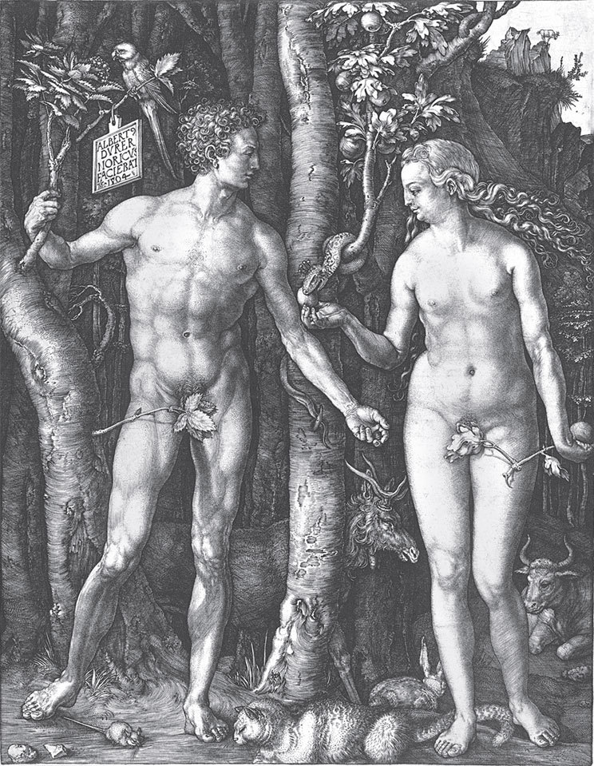

## Die ungleichen Kinder Evas

Als Adam und Eva aus dem Paradies vertrieben worden waren, mussten sie sich auf unfruchtbarer Erde ein Haus bauen und <abbr title="im Schweiße seines Angesichts — в поте лица своего">im Schweiße ihres Angesichts</abbr> ihr Brot essen. Adam hackte das Feld, und Eva spann Wolle. Eva brachte jedes Jahr ein Kind zur Welt; die Kinder waren aber <abbr title="ungleich — неодинаковый">ungleich</abbr>, einige schön, andere hässlich. Nachdem eine <abbr title="geraum — долгий, значительный">geraume</abbr> Zeit vergangen war, sandte Gott einen Engel zu den beiden und ließ ihnen ausrichten, dass er kommen und ihren Haushalt ansehen wolle. Eva freute sich, dass der Herr so gnädig war, säuberte eifrig ihr Haus, schmückte es mit Blumen und streute Binsen auf den <abbr title="der Lehmboden — глинобитный пол">Lehmboden</abbr>. Dann holte sie ihre Kinder herbei, aber nur die schönen. Sie wusch und badete sie, kämmte ihnen die Haare, zog ihnen frisch gewaschene Hemden an und <abbr title="ermahnen — наставлять, увещевать">ermahnte</abbr> sie, sich in der <abbr title="die Gegenwart — присутствие">Gegenwart</abbr> des Herrn anständig und <abbr title="sittsam — благонравно, скромно">sittsam</abbr> zu <abbr title="sich betragen (betrug sich, hat sich betragen) — вести себя">betragen</abbr>. Sie sollten sich artig vor ihm verneigen, ihm die Hand reichen und auf seine Fragen bescheiden und verständig antworten. Die hässlichen Kinder aber sollten sich nicht sehen lassen. Das eine versteckte sie unter dem Heu, das andere unter dem Dach, das dritte im Stroh, das vierte im Ofen, das fünfte im Keller, das sechste unter einem Bottich, das siebte unter dem Weinfass, das achte unter ihrem alten Pelz, das neunte und zehnte unter dem Tuch, aus dem sie ihnen gewöhnlich Kleider machte, und das elfte und zwölfte unter dem Leder, aus dem sie ihnen die Schuhe zuschnitt.

Eben war sie fertig geworden, als es an die Haustür klopfte. Adam blickte durch eine <abbr title="die Spalte, die Spalten — щель">Spalte</abbr> und sah, dass es der Herr war. <abbr title="ehrerbietig — почтительно">Ehrerbietig</abbr> öffnete er, und der himmlische Vater trat ein. Da standen die schönen Kinder in einer Reihe, verneigten sich, reichten ihm die Hände und knieten nieder. Der Herr aber fing an, sie zu segnen. Er legte dem ersten die Hände auf und sprach: «Du sollst ein mächtiger König werden»; ebenso zum zweiten: «Du ein Fürst»; zum dritten: «Du ein Graf»; zum vierten: «Du ein Ritter»; zum fünften: «Du ein Edelmann»; zum sechsten: «Du ein Bürger»; zum siebten: «Du ein Kaufmann»; zum achten: «Du ein <abbr title="gelehrt — учёный">gelehrter</abbr> Mann.» So <abbr title="erteilen — давать, преподавать">erteilte</abbr> er ihnen allen seinen reichen Segen.

Als Eva sah, dass der Herr so <abbr title="mild — кроткий, мягкий">mild</abbr> und gnädig war, dachte sie: «Ich will meine <abbr title="ungestalt — уродливый, безобразный">ungestalten</abbr> Kinder herbeiholen; vielleicht gibt er ihnen auch seinen Segen.» Sie lief also und holte sie aus dem Heu, dem Stroh, dem Ofen und wo sie sonst versteckt waren, hervor. Da kam die ganze grobe, schmutzige, grindige und rußige Schar. Der Herr lächelte, betrachtete sie alle und sprach: «Auch diese will ich segnen.» Er legte dem ersten die Hände auf und sprach zu ihm: «Du sollst ein Bauer werden»; zum zweiten: «Du ein Fischer»; zum dritten: «Du ein Schmied»; zum vierten: «Du ein <abbr title="der Gerber, die Gerber — кожевник, дубильщик">Gerber</abbr>»; zum fünften: «Du ein <abbr title="der Weber, die Weber — ткач">Weber</abbr>»; zum sechsten: «Du ein <abbr title="der Schuhmacher, die Schuhmacher — сапожник">Schuhmacher</abbr>»; zum siebten: «Du ein Schneider»; zum achten: «Du ein Töpfer»; zum neunten: «Du ein Fuhrmann»; zum zehnten: «Du ein Schiffer»; zum elften: «Du ein Bote»; zum zwölften: «Du ein Hausknecht dein Leben lang.»

Als Eva das alles mit angehört hatte, sagte sie:

— Herr, wie ungleich teilst du deinen Segen aus! Es sind doch alle meine Kinder, die ich geboren habe; deine Gnade sollte über alle gleich kommen.

Gott aber erwiderte:

— Eva, das verstehst du nicht. Es gebührt mir und ist <abbr title="nötig — необходимый">nötig</abbr>, dass ich die ganze Welt mit deinen Kindern versorge. Wenn sie alle Fürsten und Herren wären, wer sollte dann Korn <abbr title="anbauen — выращивать">anbauen</abbr>, dreschen, mahlen und backen? Wer sollte schmieden, weben, zimmern, bauen, graben, schneiden und nähen? Jeder soll seinen <abbr title="der Stand, die Stände — сословие">Stand</abbr> <abbr title="vertreten (vertrat, hat vertreten) — представлять">vertreten</abbr>, damit einer den anderen erhält und alle ernährt werden wie die Glieder am Leib.

Da antwortete Eva:

— Ach, Herr, vergib, ich war zu <abbr title="rasch — поспешный">rasch</abbr>, dass ich dir widersprochen habe. Dein göttlicher Wille geschehe auch an meinen Kindern.

---

### Neue Wörter

- **im Schweiße seines Angesichts** — в поте лица своего
- **ungleich** — неодинаковый
- **geraum** — долгий, значительный
- **der Lehmboden** — глинобитный пол
- **ermahnen** — наставлять, увещевать
- **die Gegenwart** — присутствие
- **sittsam** — благонравно, скромно
- **sich betragen (betrug sich, hat sich betragen)** — вести себя
- **die Spalte, die Spalten** — щель
- **ehrerbietig** — почтительно
- **gelehrt** — учёный
- **erteilen** — давать, преподавать
- **mild** — кроткий, мягкий
- **ungestalt** — уродливый, безобразный
- **der Gerber, die Gerber** — кожевник, дубильщик
- **der Weber, die Weber** — ткач
- **der Schuhmacher, die Schuhmacher** — сапожник
- **nötig** — необходимый
- **anbauen** — выращивать
- **der Stand, die Stände** — сословие
- **vertreten (vertrat, hat vertreten)** — представлять
- **rasch** — поспешный

[← Zurück](kapitel-180.md) · [Inhalt](README.md) · [Weiter →](kapitel-182.md)
