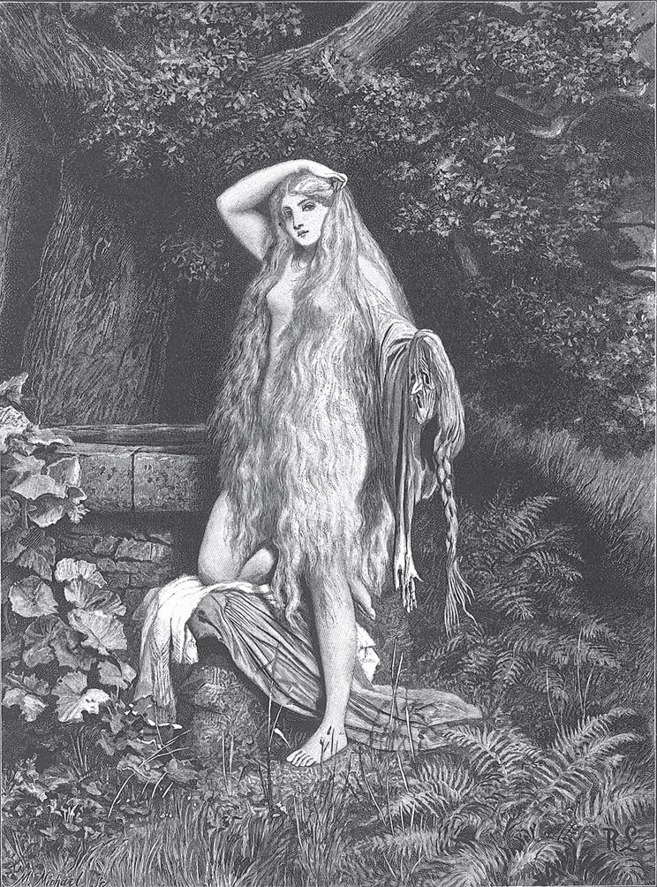

## Die Nixe im Teich

Es war einmal ein Müller, der führte mit seiner Frau ein vergnügtes Leben. Sie hatten Geld und Gut, und ihr <abbr title="der Wohlstand — достаток, благосостояние">Wohlstand</abbr> wuchs von Jahr zu Jahr. Aber Unglück kommt über Nacht: So wie ihr Reichtum gewachsen war, so schwand er von Jahr zu Jahr wieder dahin, und zuletzt konnte der Müller kaum noch die Mühle, in der er saß, sein Eigentum nennen. Er war voller Kummer, und wenn er sich nach der Arbeit des Tages hinlegte, fand er keine Ruhe, sondern wälzte sich voller Sorgen in seinem Bett.

Eines Morgens stand er schon vor Tagesanbruch auf, ging hinaus ins Freie und dachte, es werde ihm dort leichter ums Herz werden. Als er über den <abbr title="der Mühldamm, die Mühldämme — мельничная плотина">Mühldamm</abbr> schritt, brach gerade der erste Sonnenstrahl hervor, und er hörte im <abbr title="der Weiher, die Weiher — пруд">Weiher</abbr> etwas rauschen. Er drehte sich um und erblickte eine schöne Frau, die sich langsam aus dem Wasser erhob. Ihre langen Haare, die sie mit ihren zarten Händen über den Schultern gefasst hatte, flossen zu beiden Seiten herab und bedeckten ihren weißen Leib. Er sah wohl, dass es die <abbr title="die Nixe, die Nixen — русалка, водяная дева">Nixe</abbr> des Teiches war, und wusste vor Furcht nicht, ob er davongehen oder stehen bleiben sollte. Aber die Nixe ließ ihre sanfte Stimme hören, nannte ihn bei seinem Namen und fragte, warum er so traurig sei. Der Müller war zuerst verstummt; als er sie aber so freundlich sprechen hörte, fasste er sich ein Herz und erzählte ihr, dass er früher in Glück und Reichtum gelebt habe, jetzt aber so arm sei, dass er sich keinen Rat mehr wisse.

— Sei ruhig, — antwortete die Nixe, — ich will dich reicher und glücklicher machen, als du je gewesen bist. Nur musst du mir versprechen, dass du mir geben willst, was gerade in deinem Haus jung geworden ist.

«Was kann das anderes sein», dachte der Müller, «als ein junger Hund oder ein junges Kätzchen?», und er sagte ihr zu, was sie verlangte. Die Nixe stieg wieder ins Wasser hinab, und er eilte getröstet und guten Mutes zu seiner Mühle. Noch hatte er sie nicht erreicht, da trat die Magd aus der Haustür und rief ihm zu, er solle sich freuen, seine Frau habe ihm einen kleinen Knaben geboren. Der Müller stand da wie vom Blitz getroffen; er sah wohl, dass die tückische Nixe das gewusst und ihn betrogen hatte. Mit gesenktem Haupt trat er an das Bett seiner Frau, und als sie ihn fragte: «Warum freust du dich nicht über den schönen Knaben?», erzählte er ihr, was ihm begegnet war und was für ein Versprechen er der Nixe gegeben hatte.

— Was hilft mir Glück und Reichtum, — fügte er hinzu, — wenn ich mein Kind verlieren soll? Aber was kann ich tun?

Auch die Verwandten, die herbeigekommen waren, um Glück zu wünschen, wussten keinen Rat.

<abbr title="indessen — тем временем">Indessen</abbr> kehrte das Glück in das Haus des Müllers zurück. Was er unternahm, gelang; es war, als ob sich <abbr title="Kisten und Kasten — сундуки и лари">Kisten und Kasten</abbr> von selbst füllten und das Geld im Schrank sich über Nacht <abbr title="sich vermehren — умножаться">vermehrte</abbr>. Es dauerte nicht lange, da war sein Reichtum größer als je zuvor. Aber er konnte sich nicht ungestört darüber freuen: Die <abbr title="die Zusage, die Zusagen — обещание, согласие">Zusage</abbr>, die er der Nixe gegeben hatte, quälte sein Herz. Sooft er am Teich vorbeikam, fürchtete er, sie könnte <abbr title="auftauchen — всплывать, появляться">auftauchen</abbr> und ihn an seine Schuld <abbr title="mahnen an + Akk. — напоминать (о долге)">mahnen</abbr>. Den Knaben selbst ließ er nicht in die Nähe des Wassers.

— Hüte dich, — sagte er zu ihm, — wenn du das Wasser berührst, kommt eine Hand heraus, <abbr title="haschen — хватать, ловить">hascht</abbr> dich und zieht dich hinab.

Doch als Jahr um Jahr verging und die Nixe sich nicht wieder zeigte, fing der Müller an, sich zu beruhigen.

Der Knabe wuchs zum Jüngling heran und kam bei einem Jäger <abbr title="in die Lehre kommen — поступить в ученье">in die Lehre</abbr>. Als er ausgelernt hatte und ein tüchtiger Jäger geworden war, nahm ihn der Herr des Dorfes in seine Dienste. Im Dorf gab es ein schönes und treues Mädchen, das gefiel dem Jäger; und als sein Herr das bemerkte, schenkte er ihm ein kleines Haus. Die beiden hielten Hochzeit, lebten ruhig und glücklich und liebten sich von Herzen.

Einmal verfolgte der Jäger ein Reh. Als das Tier aus dem Wald ins freie Feld <abbr title="abbiegen (bog ab, ist abgebogen) — сворачивать">abbog</abbr>, setzte er ihm nach und <abbr title="niederstrecken — сразить, уложить">streckte</abbr> es endlich mit einem Schuss nieder. Er bemerkte nicht, dass er sich in der Nähe des gefährlichen Weihers befand, und nachdem er das Tier <abbr title="ausweiden — потрошить">ausgeweidet</abbr> hatte, ging er zum Wasser, um seine mit Blut <abbr title="beflecken — запятнать, испачкать">befleckten</abbr> Hände zu waschen. Kaum aber hatte er sie hineingetaucht, da stieg die Nixe <abbr title="emporsteigen (stieg empor, ist emporgestiegen) — подниматься ввысь">empor</abbr>, umschlang ihn lachend mit ihren nassen Armen und zog ihn so schnell hinab, dass die Wellen über ihm zusammenschlugen.

Als es Abend war und der Jäger nicht nach Hause kam, bekam seine Frau Angst. Sie ging hinaus, um ihn zu suchen, und da er ihr oft erzählt hatte, dass er sich vor den <abbr title="die Nachstellung, die Nachstellungen — преследование, козни">Nachstellungen</abbr> der Nixe in Acht nehmen müsse und sich nicht in die Nähe des Weihers wagen dürfe, ahnte sie schon, was geschehen war. Sie eilte zum Wasser, und als sie am Ufer seine <abbr title="die Jagdtasche, die Jagdtaschen — ягдташ">Jagdtasche</abbr> liegen fand, konnte sie nicht länger an dem Unglück zweifeln. <abbr title="wehklagen — причитать, голосить">Wehklagend</abbr> und <abbr title="händeringend — заламывая руки">händeringend</abbr> rief sie ihren Liebsten beim Namen, aber vergeblich. Sie eilte hinüber auf die andere Seite des Weihers und rief ihn aufs Neue; sie schalt die Nixe mit harten Worten, aber es kam keine Antwort. Der Wasserspiegel blieb ruhig, nur das halbe Gesicht des Mondes blickte unbeweglich zu ihr herauf.

Die arme Frau verließ den Teich nicht. Mit schnellen Schritten, ohne Rast und Ruhe, <abbr title="umkreisen — кружить вокруг">umkreiste</abbr> sie ihn immer wieder, manchmal still, manchmal mit einem heftigen Schrei, manchmal leise wimmernd. Endlich waren ihre Kräfte zu Ende: Sie sank zu Boden und fiel in einen tiefen Schlaf. Bald überkam sie ein Traum.

Sie stieg <abbr title="angstvoll — в страхе">angstvoll</abbr> zwischen großen <abbr title="der Felsblock, die Felsblöcke — каменная глыба">Felsblöcken</abbr> aufwärts; Dornen und <abbr title="die Ranke, die Ranken — усик, плеть (растения)">Ranken</abbr> <abbr title="sich festhaken — цепляться">hakten sich</abbr> an ihren Füßen fest, der Regen schlug ihr ins Gesicht, und der Wind zauste ihr langes Haar. Als sie die <abbr title="die Anhöhe, die Anhöhen — возвышенность, холм">Anhöhe</abbr> erreicht hatte, <abbr title="sich bieten (bot sich, hat sich geboten) — открываться (о виде)">bot sich</abbr> ihr ein ganz anderer Anblick. Der Himmel war blau, die Luft mild, der Boden senkte sich sanft hinab, und auf einer grünen, bunt <abbr title="beblümt — усыпанный цветами">beblümten</abbr> Wiese stand eine <abbr title="reinlich — опрятный, чистый">reinliche</abbr> Hütte. Sie ging darauf zu und öffnete die Tür; da saß eine Alte mit weißen Haaren, die ihr freundlich winkte. In diesem Augenblick erwachte die arme Frau. Der Tag war schon angebrochen, und sie entschloss sich, dem Traum sofort <abbr title="Folge leisten + Dat. — последовать, подчиниться">Folge zu leisten</abbr>. Sie stieg <abbr title="mühsam — с трудом">mühsam</abbr> den Berg hinauf, und es war alles so, wie sie es in der Nacht gesehen hatte. Die Alte empfing sie freundlich und zeigte ihr einen Stuhl, auf den sie sich setzen sollte.

— Du musst ein Unglück erlebt haben, — sagte sie, — weil du meine einsame Hütte <abbr title="aufsuchen — навещать, разыскивать">aufsuchst</abbr>.

Die Frau erzählte ihr unter Tränen, was ihr begegnet war.

— Tröste dich, — sagte die Alte, — ich will dir helfen. Da hast du einen goldenen Kamm. Harre, bis der <abbr title="der Vollmond — полнолуние, полная луна">Vollmond</abbr> aufgestiegen ist; dann geh zum Weiher, setz dich am Rand nieder und kämme dein langes schwarzes Haar mit diesem Kamm. Wenn du aber fertig bist, dann leg ihn am Ufer nieder, und du wirst sehen, was geschieht.

Die Frau kehrte zurück, aber die Zeit bis zum Vollmond <abbr title="verstreichen (verstrich, ist verstrichen) — проходить (о времени)">verstrich</abbr> ihr nur langsam. Endlich erschien die leuchtende Scheibe am Himmel. Da ging sie hinaus an den Weiher, setzte sich nieder und kämmte ihre langen schwarzen Haare mit dem goldenen Kamm, und als sie fertig war, legte sie ihn am Rand des Wassers nieder. Nicht lange, da brauste es aus der Tiefe: Eine Welle erhob sich, rollte ans Ufer und nahm den Kamm mit sich fort. Es dauerte nicht länger, als der Kamm brauchte, um auf den Grund zu sinken, da teilte sich der Wasserspiegel, und der Kopf des Jägers stieg in die Höhe. Er sprach nicht, schaute aber seine Frau mit traurigen Blicken an. Im selben Augenblick kam eine zweite Welle <abbr title="heranrauschen — набежать с шумом">herangerauscht</abbr> und bedeckte das Haupt des Mannes. Alles war verschwunden; der Weiher lag so ruhig da wie zuvor, und nur das Gesicht des Vollmondes glänzte darauf.

<abbr title="trostlos — безутешный">Trostlos</abbr> kehrte die Frau zurück, doch der Traum zeigte ihr die Hütte der Alten. Abermals machte sie sich am nächsten Morgen auf den Weg und klagte der weisen Frau ihr Leid. Die Alte gab ihr eine goldene Flöte und sprach:

— Harre, bis der Vollmond wiederkommt; dann nimm diese Flöte, setz dich ans Ufer, blas ein schönes Lied darauf, und wenn du damit fertig bist, dann leg sie auf den Sand. Du wirst sehen, was geschieht.

Die Frau tat, wie die Alte gesagt hatte. Kaum lag die Flöte auf dem Sand, da brauste es aus der Tiefe: Eine Welle erhob sich, zog heran und nahm die Flöte mit sich fort. Bald darauf teilte sich das Wasser, und nicht nur der Kopf, sondern der Mann bis zur Hälfte des Leibes stieg hervor. Er breitete voller <abbr title="die Sehnsucht — тоска, страстное желание">Sehnsucht</abbr> seine Arme nach ihr aus, aber eine zweite Welle rauschte heran, bedeckte ihn und zog ihn wieder hinab.

— Ach, was hilft es mir, — sagte die Unglückliche, — dass ich meinen Liebsten nur erblicke, um ihn wieder zu verlieren!

Der <abbr title="der Gram — скорбь, горе">Gram</abbr> erfüllte aufs Neue ihr Herz, aber der Traum führte sie zum dritten Mal in das Haus der Alten. Sie machte sich auf den Weg, und die weise Frau gab ihr ein goldenes Spinnrad, tröstete sie und sprach:

— Es ist noch nicht alles vollbracht. Harre, bis der Vollmond kommt; dann nimm das Spinnrad, setz dich ans Ufer und spinn die Spule voll; und wenn du fertig bist, dann stell das Spinnrad nahe ans Wasser, und du wirst sehen, was geschieht.

Die Frau befolgte alles genau. Sobald sich der Vollmond zeigte, trug sie das goldene Spinnrad ans Ufer und spann emsig, bis der Flachs zu Ende und die Spule ganz mit dem Faden gefüllt war. Kaum aber stand das Rad am Ufer, da brauste es noch heftiger als sonst in der Tiefe des Wassers; eine mächtige Welle eilte herbei und trug das Rad mit sich fort. Alsbald stiegen mit einem Wasserstrahl der Kopf und der ganze Leib des Mannes in die Höhe. Schnell sprang er ans Ufer, fasste seine Frau bei der Hand und floh. Aber kaum hatten sie sich ein kleines Stück entfernt, da erhob sich mit entsetzlichem Brausen der ganze Weiher und strömte mit <abbr title="reißend — стремительный, бурный">reißender</abbr> Gewalt in das weite Feld hinein. Schon sahen die <abbr title="der/die Fliehende — беглец">Fliehenden</abbr> ihren Tod vor Augen, da rief die Frau in ihrer Angst die Alte um Hilfe an, und im selben Augenblick waren sie verwandelt, sie in eine Kröte, er in einen Frosch. Die Flut, die sie erreicht hatte, konnte sie nicht töten, aber sie riss die beiden auseinander und trug sie weit fort.

Als sich das Wasser verlaufen hatte und beide wieder trockenen Boden berührten, kam ihre menschliche Gestalt zurück. Aber keiner wusste, wo der andere geblieben war; sie befanden sich unter fremden Menschen, die ihre Heimat nicht kannten. Hohe Berge und tiefe Täler lagen zwischen ihnen. Um ihr Leben zu <abbr title="sein Leben fristen — влачить существование">fristen</abbr>, mussten beide Schafe hüten. Lange Jahre trieben sie ihre Herden durch Feld und Wald und waren voller Trauer und Sehnsucht.

Als wieder einmal der Frühling aus der Erde hervorgebrochen war, zogen beide am selben Tag mit ihren Herden aus, und der <abbr title="der Zufall, die Zufälle — случай">Zufall</abbr> wollte es, dass sie einander entgegenzogen. Er erblickte an einem fernen <abbr title="der Berghang, die Berghänge — склон горы">Berghang</abbr> eine Herde und trieb seine Schafe in diese Richtung. Sie kamen in einem Tal zusammen, aber sie erkannten sich nicht; doch sie freuten sich, dass sie nicht mehr so einsam waren. Von nun an trieben sie jeden Tag ihre Herden nebeneinander; sie sprachen nicht viel, aber sie fühlten sich getröstet. Eines Abends, als der Vollmond am Himmel schien und die Schafe schon ruhten, holte der Schäfer die Flöte aus seiner Tasche und blies ein schönes, aber trauriges Lied. Als er fertig war, bemerkte er, dass die Schäferin bitterlich weinte.

— Warum weinst du? — fragte er.

— Ach, — antwortete sie, — so schien auch der Vollmond, als ich zum letzten Mal dieses Lied auf der Flöte blies und das Haupt meines Liebsten aus dem Wasser hervorkam.

Er sah sie an, und es war ihm, als fiele ihm eine Binde von den Augen: Er erkannte seine liebste Frau. Und als sie ihn anschaute und der Mond auf sein Gesicht schien, erkannte sie ihn auch. Sie umarmten und küssten sich, und ob sie <abbr title="glückselig — счастливый, блаженный">glückselig</abbr> waren, braucht keiner zu fragen.

---

### Neue Wörter

- **der Wohlstand** — достаток, благосостояние
- **der Mühldamm, die Mühldämme** — мельничная плотина
- **der Weiher, die Weiher** — пруд
- **die Nixe, die Nixen** — русалка, водяная дева
- **indessen** — тем временем
- **Kisten und Kasten** — сундуки и лари
- **sich vermehren** — умножаться
- **die Zusage, die Zusagen** — обещание, согласие
- **auftauchen** — всплывать, появляться
- **mahnen an + Akk.** — напоминать (о долге)
- **haschen** — хватать, ловить
- **in die Lehre kommen** — поступить в ученье
- **abbiegen (bog ab, ist abgebogen)** — сворачивать
- **niederstrecken** — сразить, уложить
- **ausweiden** — потрошить
- **beflecken** — запятнать, испачкать
- **emporsteigen (stieg empor, ist emporgestiegen)** — подниматься ввысь
- **die Nachstellung, die Nachstellungen** — преследование, козни
- **die Jagdtasche, die Jagdtaschen** — ягдташ
- **wehklagen** — причитать, голосить
- **händeringend** — заламывая руки
- **umkreisen** — кружить вокруг
- **angstvoll** — в страхе
- **der Felsblock, die Felsblöcke** — каменная глыба
- **die Ranke, die Ranken** — усик, плеть (растения)
- **sich festhaken** — цепляться
- **die Anhöhe, die Anhöhen** — возвышенность, холм
- **sich bieten (bot sich, hat sich geboten)** — открываться (о виде)
- **beblümt** — усыпанный цветами
- **reinlich** — опрятный, чистый
- **Folge leisten + Dat.** — последовать, подчиниться
- **mühsam** — с трудом
- **aufsuchen** — навещать, разыскивать
- **der Vollmond** — полнолуние, полная луна
- **verstreichen (verstrich, ist verstrichen)** — проходить (о времени)
- **heranrauschen** — набежать с шумом
- **trostlos** — безутешный
- **die Sehnsucht** — тоска, страстное желание
- **der Gram** — скорбь, горе
- **reißend** — стремительный, бурный
- **der/die Fliehende** — беглец
- **sein Leben fristen** — влачить существование
- **der Zufall, die Zufälle** — случай
- **der Berghang, die Berghänge** — склон горы
- **glückselig** — счастливый, блаженный

[← Zurück](kapitel-181.md) · [Inhalt](README.md) · [Weiter →](kapitel-183.md)
