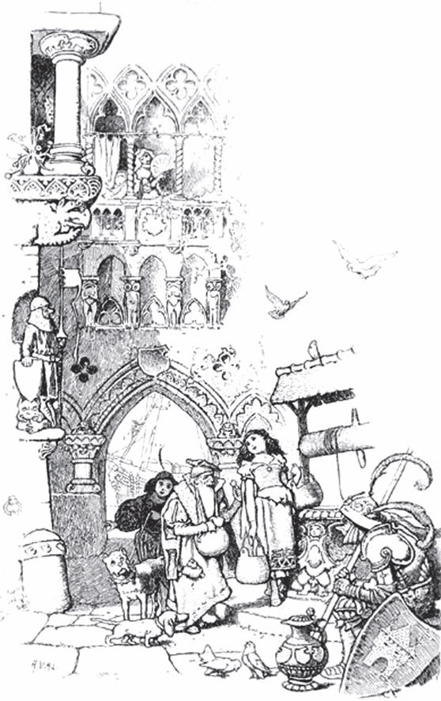

## Der Nagel

Ein Kaufmann hatte auf der Messe gute Geschäfte gemacht, alle Waren verkauft und seine Geldkatze mit Gold und Silber <abbr title="vollstopfen — набить битком">vollgestopft</abbr>. Jetzt wollte er <abbr title="heimreisen — ехать домой">heimreisen</abbr> und noch vor Einbruch der Nacht zu Hause sein. Er packte also den Mantelsack mit dem Geld auf sein Pferd und ritt los. Zu Mittag <abbr title="rasten — делать привал, отдыхать">rastete</abbr> er in einer Stadt. Als er weiterwollte, führte ihm der Hausknecht das Ross vor, sagte aber:

— Herr, am linken Hinterfuß fehlt im Hufeisen ein Nagel.

— <abbr title="etwas fehlen lassen — пусть не хватает, ну и ладно">Lass ihn fehlen</abbr>, — erwiderte der Kaufmann, — die sechs Stunden, die ich noch vor mir habe, wird das Eisen wohl halten. Ich habe es eilig.

Am Nachmittag, als er wieder abgestiegen war und dem Pferd Brot geben ließ, kam der Knecht in die Stube und sagte:

— Herr, Eurem Pferd fehlt am linken Hinterfuß ein Hufeisen. Soll ich es zum Schmied führen?

— Lass es fehlen, — erwiderte der Herr, — die paar Stunden, die noch übrig sind, wird das Pferd wohl aushalten. Ich habe es eilig.

Er ritt weiter, aber nicht lange, da fing das Pferd an zu hinken. Es hinkte nicht lange, da fing es an zu stolpern. Und es stolperte nicht lange, da stürzte es und brach sich ein Bein. Der Kaufmann musste das Pferd liegen lassen, den Mantelsack abschnallen, ihn auf die Schulter nehmen und zu Fuß nach Hause gehen. Dort kam er erst spät in der Nacht an.

— An allem Unglück, — sagte er zu sich selbst, — ist der verwünschte Nagel schuld.

<abbr title="Eile mit Weile — тише едешь — дальше будешь">Eile mit Weile</abbr>.

---

### Neue Wörter

- **vollstopfen** — набить битком
- **heimreisen** — ехать домой
- **rasten** — делать привал, отдыхать
- **etwas fehlen lassen** — пусть не хватает, ну и ладно
- **Eile mit Weile** — тише едешь — дальше будешь

[← Zurück](kapitel-184.md) · [Inhalt](README.md) · [Weiter →](kapitel-186.md)
