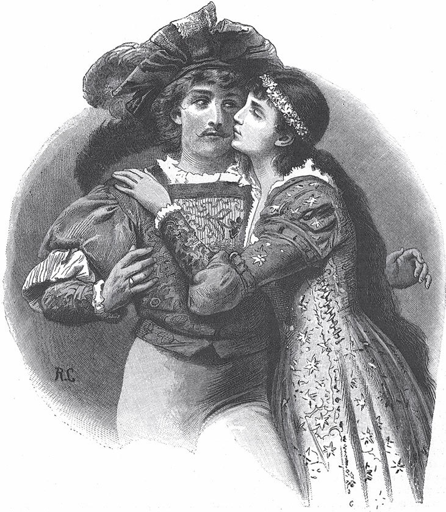

## Die wahre Braut

Es war einmal ein Mädchen, das war jung und schön. Aber seine Mutter war ihm früh gestorben, und die Stiefmutter tat ihm alles nur erdenkliche Herzeleid an. Wenn sie ihm eine Arbeit auftrug, mochte sie noch so schwer sein, so ging es <abbr title="unverdrossen — неутомимо, без жалоб">unverdrossen</abbr> daran und tat, was in seinen Kräften stand. Aber es konnte damit das Herz der bösen Frau nicht rühren: Immer war sie unzufrieden, immer war es nicht genug. Je fleißiger es arbeitete, desto mehr wurde ihm aufgeladen, und die Stiefmutter hatte keinen anderen Gedanken, als ihm eine immer größere Last <abbr title="aufbürden — взвалить (бремя)">aufzubürden</abbr> und ihm das Leben recht sauer zu machen.

Eines Tages sagte sie zu ihm:

— Da hast du zwölf Pfund Federn, die sollst du <abbr title="schleißen (schliss, hat geschlissen) — щипать (перо, отделяя пух от стержня)">schleißen</abbr>. Und wenn du heute Abend nicht damit fertig bist, so wartet eine Tracht Prügel auf dich. Meinst du, du könntest den ganzen Tag faulenzen?

Das arme Mädchen setzte sich an die Arbeit, aber dabei flossen ihm die Tränen über die Wangen, denn es sah wohl, dass es unmöglich war, an einem Tag damit fertig zu werden. Wenn es ein <abbr title="das Häufchen, die Häufchen — кучка">Häufchen</abbr> Federn vor sich liegen hatte und seufzte oder in seiner Angst die Hände zusammenschlug, so <abbr title="stieben (stob, ist gestoben) — разлетаться (пылью, искрами)">stoben</abbr> sie auseinander, und es musste sie wieder auflesen und von Neuem anfangen. Da stützte es einmal die Ellenbogen auf den Tisch, legte das Gesicht in beide Hände und rief:

— Ist denn niemand auf Gottes <abbr title="der Erdboden — земля, белый свет">Erdboden</abbr>, der sich meiner erbarmt?

Da hörte es eine sanfte Stimme, die sagte:

— Tröste dich, mein Kind, ich bin gekommen, um dir zu helfen.

Das Mädchen blickte auf, und eine alte Frau stand neben ihm. Sie fasste das Mädchen freundlich an der Hand und sagte:

— Vertrau mir nur an, was dich bedrückt.

Weil sie so herzlich sprach, erzählte ihr das Mädchen von seinem traurigen Leben: dass ihm eine Last auf die andere gelegt werde und dass es mit den Arbeiten, die man ihm aufgebe, nicht mehr fertig werden könne.

— Wenn ich mit diesen Federn heute Abend nicht fertig bin, so schlägt mich die Stiefmutter. Sie hat es mir <abbr title="androhen — пригрозить">angedroht</abbr>, und ich weiß, sie hält Wort.

Wieder fingen ihre Tränen an zu fließen, aber die gute Alte sagte:

— Sei <abbr title="unbesorgt — спокойный, беззаботный">unbesorgt</abbr>, mein Kind, ruh dich aus, ich will derweil deine Arbeit <abbr title="verrichten — выполнять">verrichten</abbr>.

Das Mädchen legte sich auf sein Bett und schlief bald ein. Die Alte setzte sich an den Tisch zu den Federn, und hu! wie flogen sie von den <abbr title="der Kiel, die Kiele — стержень пера">Kielen</abbr>, die sie mit ihren dürren Händen kaum berührte. Bald war sie mit den zwölf Pfund fertig. Als das Mädchen erwachte, lagen große schneeweiße Haufen <abbr title="auftürmen — нагромождать">aufgetürmt</abbr> da, alles im Zimmer war sauber aufgeräumt, aber die Alte war verschwunden. Das Mädchen dankte Gott und saß still, bis der Abend kam. Da trat die Stiefmutter herein und <abbr title="staunen über + Akk. — удивляться">staunte</abbr> über die vollbrachte Arbeit.

— Siehst du, Trulle, — sagte sie, — was man ausrichtet, wenn man fleißig ist? Hättest du nicht noch etwas anderes <abbr title="sich etwas vornehmen — взяться за что-то">vornehmen</abbr> können? Aber da sitzt du und legst die Hände in den Schoß.

Als sie hinausging, sagte sie:

— Das Geschöpf kann mehr als Brot essen. Ich muss ihm schwerere Arbeit auflegen.

Am anderen Morgen rief sie das Mädchen und sagte:

— Da hast du einen Löffel. Damit schöpfst du mir den großen Teich aus, der beim Garten liegt. Und wenn du bis zum Abend nicht damit <abbr title="mit etwas zu Rande kommen — справиться с чем-то">zu Rande gekommen</abbr> bist, so weißt du, was dann folgt.

Das Mädchen nahm den Löffel und sah, dass er durchlöchert war. Und wäre er es auch nicht gewesen, es hätte nimmermehr damit den Teich ausgeschöpft. Es machte sich gleich an die Arbeit, kniete am Wasser, in das seine Tränen fielen, und schöpfte. Aber die gute Alte erschien wieder, und als sie den Grund für seinen Kummer erfuhr, sagte sie:

— Sei getrost, mein Kind, geh ins Gebüsch und leg dich schlafen. Ich will deine Arbeit schon tun.

Als die Alte allein war, berührte sie den Teich nur, und wie ein <abbr title="der Dunst — пар, дымка">Dunst</abbr> stieg das Wasser in die Höhe und <abbr title="sich vermischen — смешаться">vermischte sich</abbr> mit den Wolken. Allmählich wurde der Teich leer. Als das Mädchen vor Sonnenuntergang erwachte und herbeikam, sah es nur noch die Fische, die im Schlamm zappelten. Es ging zur Stiefmutter und meldete ihr, dass die Arbeit getan sei.

— Du hättest längst fertig sein sollen, — sagte sie und wurde blass vor Ärger. Aber sie <abbr title="sich etwas ausdenken — придумать">dachte</abbr> sich etwas Neues aus.

Am dritten Morgen sagte sie zu dem Mädchen:

— Dort in der Ebene musst du mir ein schönes Schloss bauen, und bis zum Abend muss es fertig sein.

Das Mädchen erschrak und sagte:

— Wie kann ich ein so großes Werk vollbringen?

— Ich dulde keinen Widerspruch! — schrie die Stiefmutter. — Kannst du mit einem durchlöcherten Löffel einen Teich ausschöpfen, so kannst du auch ein Schloss bauen. Noch heute will ich es beziehen, und wenn etwas fehlt, und sei es das Geringste in Küche oder Keller, so weißt du, was dir bevorsteht.

Sie trieb das Mädchen fort. Als es ins Tal kam, lagen da die <abbr title="der Fels(en), die Felsen — скала, глыба">Felsen</abbr> übereinander aufgetürmt, und mit aller Kraft konnte es nicht einmal den kleinsten bewegen. Es setzte sich hin und weinte, doch hoffte es auf den <abbr title="der Beistand — помощь, поддержка">Beistand</abbr> der guten Alten. Die ließ auch nicht lange <abbr title="auf sich warten lassen — заставлять себя ждать">auf sich warten</abbr>, kam und sprach ihm Trost zu:

— Leg dich nur dort in den Schatten und schlaf, ich will dir das Schloss schon bauen. Wenn es dir Freude macht, kannst du selbst darin wohnen.

Als das Mädchen weggegangen war, rührte die Alte die grauen Felsen an. Alsbald regten sie sich, rückten zusammen und standen da, als hätten Riesen die Mauer gebaut. Darauf erhob sich das Gebäude, und es war, als ob unzählige unsichtbare Hände arbeiteten und Stein auf Stein legten. Der Boden dröhnte, große <abbr title="die Säule, die Säulen — колонна">Säulen</abbr> stiegen von selbst in die Höhe und stellten sich ordentlich nebeneinander. Auf dem Dach legten sich die Ziegel <abbr title="sich zurechtlegen — улечься как надо">zurecht</abbr>, und als es Mittag war, drehte sich schon die große <abbr title="die Wetterfahne, die Wetterfahnen — флюгер">Wetterfahne</abbr> wie eine goldene Jungfrau mit fliegendem Gewand auf der Spitze des Turms. Das Innere des Schlosses war bis zum Abend <abbr title="vollenden — завершить">vollendet</abbr>. Wie die Alte das anstellte, weiß ich nicht, aber die Wände der Zimmer waren mit Seide und Samt bezogen, bunt bestickte Stühle standen da und reich <abbr title="verzieren — украшать">verzierte</abbr> <abbr title="der Armsessel, die Armsessel — кресло">Armsessel</abbr> an Tischen aus Marmor. <abbr title="kristallen — хрустальный">Kristallene</abbr> Kronleuchter hingen von der Decke herab und spiegelten sich im glatten Boden. Grüne <abbr title="der Papagei, die Papageien — попугай">Papageien</abbr> saßen in goldenen Käfigen, dazu fremde Vögel, die lieblich sangen. Überall war eine Pracht, als sollte ein König dort einziehen.

Die Sonne wollte gerade untergehen, als das Mädchen erwachte und ihm der Glanz von tausend Lichtern <abbr title="entgegenleuchten — сиять навстречу">entgegenleuchtete</abbr>. Mit schnellen Schritten kam es heran und trat durch das offene Tor ins Schloss. Die Treppe war mit rotem Tuch belegt und das goldene <abbr title="das Geländer, die Geländer — перила">Geländer</abbr> mit blühenden Bäumchen besetzt. Als es die Pracht der Zimmer erblickte, blieb es wie erstarrt stehen. Wer weiß, wie lange es so gestanden hätte, wenn ihm nicht der Gedanke an die Stiefmutter gekommen wäre.

— Ach, — sagte es zu sich selbst, — wenn sie doch endlich zufrieden wäre und mir das Leben nicht länger zur Qual machen wollte!

Das Mädchen ging und meldete ihr, dass das Schloss fertig sei.

— Gleich will ich einziehen, — sagte sie und erhob sich von ihrem Sitz.

Als sie ins Schloss trat, musste sie die Hand vor die Augen halten, so sehr blendete sie der Glanz.

— Siehst du, — sagte sie zu dem Mädchen, — wie leicht es dir gefallen ist? Ich hätte dir etwas Schwereres aufgeben sollen.

Sie ging durch alle Zimmer und <abbr title="spähen — высматривать">spähte</abbr> in alle Ecken, ob etwas fehle oder <abbr title="mangelhaft — с изъяном, неисправный">mangelhaft</abbr> sei, aber sie konnte nichts finden.

— Jetzt wollen wir hinabsteigen, — sagte sie und sah das Mädchen mit boshaften Blicken an. — Küche und Keller müssen noch untersucht werden, und hast du etwas vergessen, so sollst du deiner Strafe nicht entgehen.

Aber das Feuer brannte auf dem Herd, in den Töpfen kochten die Speisen, <abbr title="die Feuerzange, die Feuerzangen — каминные щипцы">Feuerzange</abbr> und Schaufel lehnten an der Wand, und an den Wänden stand das blanke Geschirr aus Messing. Nichts fehlte, nicht einmal der <abbr title="der Kohlenkasten, die Kohlenkästen — ящик для угля">Kohlenkasten</abbr> und die Wassereimer.

— Wo ist der Eingang zum Keller? — rief sie. — Wenn der nicht reichlich mit Weinfässern gefüllt ist, so wird es dir schlecht ergehen.

Sie hob selbst die Falltür auf und stieg die Treppe hinab. Aber kaum hatte sie zwei Schritte getan, da stürzte die schwere Falltür, die nur <abbr title="anlehnen — прислонить">angelehnt</abbr> war, herunter. Das Mädchen hörte einen Schrei, hob die Tür schnell auf, um ihr zu Hilfe zu kommen, aber sie war hinabgestürzt, und es fand sie leblos unten auf dem Boden liegen.

Nun gehörte das prächtige Schloss dem Mädchen ganz allein. In der ersten Zeit konnte es sich in sein Glück gar nicht <abbr title="sich in etwas finden — освоиться с чем-то">finden</abbr>. Schöne Kleider hingen in den Schränken, die Truhen waren mit Gold und Silber oder mit Perlen und Edelsteinen gefüllt, und es hatte keinen Wunsch, den es sich nicht erfüllen konnte. Bald ging der Ruf von der Schönheit und dem Reichtum des Mädchens durch die ganze Welt. Alle Tage meldeten sich Freier, aber keiner gefiel ihr. Endlich kam auch der Sohn eines Königs, der ihr Herz zu rühren wusste, und sie <abbr title="sich verloben mit + Dat. — обручиться с">verlobte sich</abbr> mit ihm.

Im Schlossgarten stand eine grüne Linde. Darunter saßen sie eines Tages vertraut beisammen, da sagte er zu ihr:

— Ich will nach Hause ziehen und die Einwilligung meines Vaters zu unserer Vermählung holen. Ich bitte dich, <abbr title="harren + Gen./auf + Akk. — ждать, дожидаться">harre</abbr> hier unter dieser Linde auf mich, in wenigen Stunden bin ich wieder zurück.

Das Mädchen küsste ihn auf die linke Backe und sagte:

— Bleib mir treu und lass dich von keiner anderen auf diese Backe küssen. Ich will hier unter der Linde warten, bis du wieder zurückkommst.

Das Mädchen blieb unter der Linde sitzen, bis die Sonne unterging, aber er kam nicht zurück. Drei Tage saß sie von morgens bis abends und erwartete ihn, aber vergeblich. Als er am vierten Tag noch immer nicht da war, sagte sie:

— Gewiss ist ihm ein Unglück zugestoßen. Ich will ausziehen und ihn suchen und nicht eher wiederkommen, als bis ich ihn gefunden habe.

Sie packte drei von ihren schönsten Kleidern zusammen: eins mit glänzenden Sternen bestickt, das zweite mit silbernen Monden, das dritte mit goldenen Sonnen. Eine Handvoll Edelsteine band sie in ihr Tuch und machte sich auf. Sie fragte <abbr title="allerorten — повсюду">allerorten</abbr> nach ihrem Bräutigam, aber niemand hatte ihn gesehen, niemand wusste von ihm. Weit und breit wanderte sie durch die Welt, aber sie fand ihn nicht. Endlich verdingte sie sich bei einem Bauern als <abbr title="die Hirtin, die Hirtinnen — пастушка">Hirtin</abbr> und vergrub ihre Kleider und Edelsteine unter einem Stein.

Nun lebte sie als Hirtin, hütete ihre Herde, war traurig und voller Sehnsucht nach ihrem <abbr title="der/die Geliebte, die Geliebten — возлюбленный">Geliebten</abbr>. Sie hatte ein Kälbchen, das <abbr title="gewöhnen an + Akk. — приучить к">gewöhnte</abbr> sie an sich und fütterte es aus der Hand, und wenn sie sprach:

«Kälbchen, Kälbchen, knie nieder,

vergiss nicht deine Hirtin wieder,

wie der Königssohn die Braut vergaß,

die unter der grünen Linde saß»,

so kniete das Kälbchen nieder und wurde von ihr gestreichelt.

Als sie ein paar Jahre einsam und <abbr title="kummervoll — печально, в горе">kummervoll</abbr> gelebt hatte, verbreitete sich im Land das <abbr title="das Gerücht, die Gerüchte — слух">Gerücht</abbr>, die Tochter des Königs wolle Hochzeit feiern. Der Weg in die Stadt führte an dem Dorf vorbei, wo das Mädchen wohnte, und es trug sich zu, dass, als sie einmal ihre Herde austrieb, der Bräutigam vorüberzog. Er saß stolz auf seinem Pferd und sah sie nicht an. Sie aber sah ihn an und erkannte ihren Liebsten. Es war, als ob ihr ein scharfes Messer ins Herz schnitte.

— Ach, — sagte sie, — ich glaubte, er wäre mir treu geblieben, aber er hat mich vergessen.

Am nächsten Tag kam er wieder <abbr title="des Weges kommen — идти/ехать той же дорогой">des Weges</abbr>. Als er in ihrer Nähe war, sprach sie zu dem Kälbchen:

«Kälbchen, Kälbchen, knie nieder,

vergiss nicht deine Hirtin wieder,

wie der Königssohn die Braut vergaß,

die unter der grünen Linde saß.»

Als er die Stimme hörte, blickte er herab und hielt sein Pferd an. Er schaute der Hirtin ins Gesicht und hielt dann die Hand vor die Augen, als wollte er <abbr title="sich besinnen auf + Akk. — припомнить">sich</abbr> auf etwas besinnen. Aber schnell ritt er weiter und war bald verschwunden.

— Ach, — sagte sie, — er kennt mich nicht mehr.

Und ihre Trauer wurde immer größer.

Bald darauf sollte am Hof des Königs drei Tage lang ein großes Fest gefeiert werden, und das ganze Land wurde dazu eingeladen. «Nun will ich das Letzte versuchen», dachte das Mädchen, und als der Abend kam, ging es zu dem Stein, unter dem es seine Schätze vergraben hatte. Sie holte das Kleid mit den goldenen Sonnen hervor, zog es an und <abbr title="sich schmücken — украсить себя, нарядиться">schmückte sich</abbr> mit den Edelsteinen. Ihre Haare, die sie unter einem Tuch verborgen hatte, band sie auf, und sie fielen in langen Locken an ihr herab. So ging sie in die Stadt und wurde in der Dunkelheit von niemandem bemerkt. Als sie in den hell erleuchteten Saal trat, wichen alle voll Verwunderung zurück, aber niemand wusste, wer sie war. Der Königssohn ging ihr entgegen, doch er erkannte sie nicht. Er führte sie zum Tanz und war so entzückt von ihrer Schönheit, dass er an die andere Braut gar nicht mehr dachte. Als das Fest vorüber war, verschwand sie im Gedränge und eilte vor Tagesanbruch ins Dorf, wo sie ihr <abbr title="das Hirtenkleid, die Hirtenkleider — пастушеская одежда">Hirtenkleid</abbr> wieder anzog.

Am nächsten Abend nahm sie das Kleid mit den silbernen Monden heraus und steckte einen <abbr title="der Halbmond, die Halbmonde — полумесяц">Halbmond</abbr> aus Edelsteinen in ihr Haar. Als sie sich auf dem Fest zeigte, wandten sich alle Augen nach ihr. Der Königssohn aber eilte ihr entgegen, und ganz von Liebe erfüllt tanzte er mit ihr allein und blickte keine andere mehr an. Bevor sie wegging, musste sie ihm versprechen, am letzten Abend noch einmal zum Fest zu kommen.

Als sie zum dritten Mal erschien, hatte sie das <abbr title="das Sternenkleid, die Sternenkleider — звёздное платье">Sternenkleid</abbr> an, das bei jedem ihrer Schritte funkelte, und <abbr title="das Haarband, die Haarbänder — лента для волос">Haarband</abbr> und Gürtel waren Sterne aus Edelsteinen. Der Königssohn hatte schon lange auf sie gewartet und drängte sich zu ihr hin.

— Sag mir nur, wer du bist, — sagte er. — Mir ist, als hätte ich dich schon lange gekannt.

— Weißt du nicht mehr, — antwortete sie, — was ich tat, als du von mir schiedest?

Da trat sie zu ihm heran und küsste ihn auf die linke Backe, und in diesem Augenblick <abbr title="es fällt einem wie Schuppen von den Augen — пелена спала с глаз">fiel es ihm wie Schuppen von den Augen</abbr>, und er erkannte die wahre Braut.

— Komm, — sagte er zu ihr, — hier kann ich nicht länger bleiben.

Er reichte ihr die Hand und führte sie hinunter zum Wagen. Als wäre der Wind vorgespannt, so eilten die Pferde zu dem <abbr title="das Wunderschloss, die Wunderschlösser — чудесный замок">Wunderschloss</abbr>. Schon von Weitem glänzten die erleuchteten Fenster. Als sie an der Linde vorbeifuhren, schwärmten unzählige <abbr title="das Glühwürmchen, die Glühwürmchen — светлячок">Glühwürmchen</abbr> darin, sie schüttelte ihre Äste und sandte ihre Düfte herab. Auf der Treppe blühten die Blumen, aus dem Zimmer schallte der Gesang der fremden Vögel, im Saal aber stand der ganze Hof versammelt, und der Priester wartete, um den Bräutigam mit der wahren Braut zu vermählen.

---

### Neue Wörter

- **unverdrossen** — неутомимо, без жалоб
- **aufbürden** — взвалить (бремя)
- **schleißen (schliss, hat geschlissen)** — щипать (перо, отделяя пух от стержня)
- **das Häufchen, die Häufchen** — кучка
- **stieben (stob, ist gestoben)** — разлетаться (пылью, искрами)
- **der Erdboden** — земля, белый свет
- **androhen** — пригрозить
- **unbesorgt** — спокойный, беззаботный
- **verrichten** — выполнять
- **der Kiel, die Kiele** — стержень пера
- **auftürmen** — нагромождать
- **staunen über + Akk.** — удивляться
- **sich etwas vornehmen** — взяться за что-то
- **mit etwas zu Rande kommen** — справиться с чем-то
- **der Dunst** — пар, дымка
- **sich vermischen** — смешаться
- **sich etwas ausdenken** — придумать
- **der Fels(en), die Felsen** — скала, глыба
- **der Beistand** — помощь, поддержка
- **auf sich warten lassen** — заставлять себя ждать
- **die Säule, die Säulen** — колонна
- **sich zurechtlegen** — улечься как надо
- **die Wetterfahne, die Wetterfahnen** — флюгер
- **vollenden** — завершить
- **verzieren** — украшать
- **der Armsessel, die Armsessel** — кресло
- **kristallen** — хрустальный
- **der Papagei, die Papageien** — попугай
- **entgegenleuchten** — сиять навстречу
- **das Geländer, die Geländer** — перила
- **spähen** — высматривать
- **mangelhaft** — с изъяном, неисправный
- **die Feuerzange, die Feuerzangen** — каминные щипцы
- **der Kohlenkasten, die Kohlenkästen** — ящик для угля
- **anlehnen** — прислонить
- **sich in etwas finden** — освоиться с чем-то
- **sich verloben mit + Dat.** — обручиться с
- **harren + Gen./auf + Akk.** — ждать, дожидаться
- **allerorten** — повсюду
- **die Hirtin, die Hirtinnen** — пастушка
- **der/die Geliebte, die Geliebten** — возлюбленный
- **gewöhnen an + Akk.** — приучить к
- **kummervoll** — печально, в горе
- **das Gerücht, die Gerüchte** — слух
- **des Weges kommen** — идти/ехать той же дорогой
- **sich besinnen auf + Akk.** — припомнить
- **sich schmücken** — украсить себя, нарядиться
- **das Hirtenkleid, die Hirtenkleider** — пастушеская одежда
- **der Halbmond, die Halbmonde** — полумесяц
- **das Sternenkleid, die Sternenkleider** — звёздное платье
- **das Haarband, die Haarbänder** — лента для волос
- **es fällt einem wie Schuppen von den Augen** — пелена спала с глаз
- **das Wunderschloss, die Wunderschlösser** — чудесный замок
- **das Glühwürmchen, die Glühwürmchen** — светлячок

[← Zurück](kapitel-186.md) · [Inhalt](README.md) · [Weiter →](kapitel-188.md)
