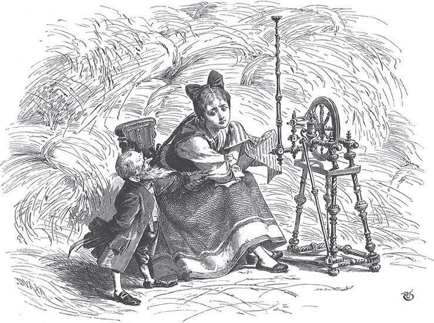

## Spindel, Weberschiffchen und Nadel

Es war einmal ein Mädchen, dem starben Vater und Mutter, als es noch ein kleines Kind war. Am Ende des Dorfes wohnte in einem Häuschen ganz allein seine Patin, die sich vom Spinnen, Weben und Nähen ernährte. Die Alte nahm das verlassene Kind zu sich, hielt es zur Arbeit an und erzog es in aller <abbr title="die Frömmigkeit — благочестие">Frömmigkeit</abbr>. Als das Mädchen fünfzehn Jahre alt war, erkrankte die Alte, rief das Kind an ihr Bett und sagte:

— Liebe Tochter, ich fühle, dass mein Ende <abbr title="herannahen — приближаться">herannaht</abbr>. Ich <abbr title="hinterlassen (hinterließ, hat hinterlassen) — оставить (в наследство)">hinterlasse</abbr> dir das Häuschen, darin bist du vor Wind und Wetter geschützt, dazu Spindel, <abbr title="das Weberschiffchen, die Weberschiffchen — ткацкий челнок">Weberschiffchen</abbr> und Nadel. Damit kannst du dir dein Brot verdienen.

Sie legte ihm noch die Hände auf den Kopf, segnete es und sprach:

— Behalt nur Gott im Herzen, so wird es dir gut gehen.

Darauf schloss sie die Augen. Als sie <abbr title="bestatten — хоронить, погребать">bestattet</abbr> wurde, ging das Mädchen bitterlich weinend hinter dem Sarg her und erwies ihr die <abbr title="jemandem die letzte Ehre erweisen — отдать последний долг">letzte Ehre</abbr>.

Das Mädchen lebte nun ganz allein in dem kleinen Haus, war fleißig, spann, webte und nähte, und auf allem, was es tat, <abbr title="ruhen — покоиться, лежать">ruhte</abbr> der Segen der guten Alten. Es war, als ob sich der Flachs in der Kammer von selbst vermehrte. Und wenn es ein Stück Tuch oder einen Teppich gewebt oder ein Hemd genäht hatte, so fand sich gleich ein Käufer, der es reichlich bezahlte, sodass es keine Not litt und anderen noch etwas abgeben konnte.

Um diese Zeit zog der Sohn des Königs im Land umher und wollte sich eine Braut suchen. Eine arme sollte er nicht wählen, und eine reiche wollte er nicht. Da sprach er:

— Die soll meine Frau werden, die zugleich die ärmste und die reichste ist.

Als er in das Dorf kam, wo das Mädchen lebte, fragte er, wie er es überall tat, wer im Ort die reichste und die ärmste sei. Man nannte ihm zuerst die reichste. Die ärmste, sagten sie, sei das Mädchen, das in dem kleinen Haus ganz am Ende wohne. Die Reiche saß vor der Haustür in vollem <abbr title="der Putz — наряд, убранство">Putz</abbr>, und als der Königssohn sich näherte, stand sie auf, ging ihm entgegen und verneigte sich vor ihm. Er sah sie an, sprach kein Wort und ritt weiter.

Als er zum Haus der Armen kam, stand das Mädchen nicht an der Tür, sondern saß in seinem Stübchen. Er hielt das Pferd an und sah durch das Fenster, durch das die helle Sonne schien, das Mädchen am Spinnrad sitzen und emsig spinnen. Es blickte auf, und als es bemerkte, dass der Königssohn hereinschaute, wurde es <abbr title="über und über — сплошь, с головы до ног">über und über</abbr> rot, <abbr title="die Augen niederschlagen — опустить глаза">schlug die Augen nieder</abbr> und spann weiter. Ob der Faden diesmal ganz gleichmäßig wurde, weiß ich nicht, aber es spann so lange, bis der Königssohn wieder weggeritten war. Dann trat es ans Fenster, öffnete es und sagte: «Es ist so heiß in der Stube.» Aber es blickte ihm nach, solange es noch die weißen Federn an seinem Hut erkennen konnte.

Das Mädchen setzte sich wieder in seiner Stube an die Arbeit und spann weiter. Da kam ihm ein Spruch in den Sinn, den die Alte manchmal gesagt hatte, wenn es bei der Arbeit saß, und es sang so vor sich hin:

«Spindel, Spindel, geh du aus,

bring den Freier in mein Haus.»

Was geschah? Die Spindel sprang ihm augenblicklich aus der Hand und zur Tür hinaus. Und als es vor Verwunderung aufstand und ihr nachblickte, sah es, dass sie lustig ins Feld hinein tanzte und einen glänzenden goldenen Faden hinter sich herzog. Nicht lange, da war sie ihm aus den Augen <abbr title="entschwinden (entschwand, ist entschwunden) — скрыться, исчезнуть">entschwunden</abbr>. Weil das Mädchen keine Spindel mehr hatte, nahm es das Weberschiffchen in die Hand, setzte sich an den <abbr title="der Webstuhl, die Webstühle — ткацкий станок">Webstuhl</abbr> und fing an zu weben.

Die Spindel aber tanzte immer weiter, und gerade als der Faden zu Ende war, hatte sie den Königssohn erreicht.

— Was sehe ich? — rief er. — Die Spindel will mir wohl den Weg zeigen?

Er drehte sein Pferd um und ritt an dem goldenen Faden entlang zurück. Das Mädchen aber saß an seiner Arbeit und sang:

«Schiffchen, Schiffchen, webe fein,

führ den Freier mir herein.»

Sofort sprang ihm das Schiffchen aus der Hand und zur Tür hinaus. Vor der Türschwelle aber fing es an, einen Teppich zu weben, schöner, als man je einen gesehen hat. Auf beiden Seiten blühten Rosen und Lilien, und in der Mitte auf goldenem Grund stiegen grüne Ranken empor. Darin sprangen Hasen und <abbr title="das Kaninchen, die Kaninchen — кролик">Kaninchen</abbr>, Hirsche und Rehe streckten die Köpfe dazwischen, oben in den Zweigen saßen bunte Vögel. Es fehlte nichts, als dass sie gesungen hätten. Das Schiffchen sprang hin und her, und es war, als wüchse alles von selbst.

Weil das Schiffchen fortgelaufen war, hatte sich das Mädchen zum Nähen hingesetzt. Es hielt die Nadel in der Hand und sang:

«Nadel, Nadel, spitz und fein,

mach das Haus dem Freier rein.»

Da sprang ihm die Nadel aus den Fingern und flog in der Stube hin und her, so schnell wie der Blitz. Es war nicht anders, als wenn unsichtbare Geister arbeiteten: Sogleich <abbr title="sich überziehen mit + Dat. — покрыться чем-то">überzogen sich</abbr> Tisch und Bänke mit grünem Tuch, die Stühle mit Samt, und an den Fenstern hingen seidene Vorhänge herab. Kaum hatte die Nadel den letzten Stich getan, da sah das Mädchen schon durch das Fenster die weißen Federn vom Hut des Königssohns, den die Spindel an dem goldenen Faden herbeigeholt hatte.

Er stieg ab, schritt über den Teppich ins Haus herein, und als er in die Stube trat, stand das Mädchen da in seinem ärmlichen Kleid, aber es glühte darin wie eine Rose im Busch.

— Du bist die Ärmste und auch die Reichste, — sprach er zu ihm. — Komm mit mir, du sollst meine Braut sein.

Es schwieg, aber es reichte ihm die Hand. Da gab er ihm einen Kuss, führte es hinaus, hob es auf sein Pferd und brachte es ins königliche Schloss, wo die Hochzeit mit großer Freude gefeiert wurde. Spindel, Weberschiffchen und Nadel wurden in der Schatzkammer <abbr title="verwahren — хранить">verwahrt</abbr> und in großen Ehren gehalten.

---

### Neue Wörter

- **die Frömmigkeit** — благочестие
- **herannahen** — приближаться
- **hinterlassen (hinterließ, hat hinterlassen)** — оставить (в наследство)
- **das Weberschiffchen, die Weberschiffchen** — ткацкий челнок
- **bestatten** — хоронить, погребать
- **jemandem die letzte Ehre erweisen** — отдать последний долг
- **ruhen** — покоиться, лежать
- **der Putz** — наряд, убранство
- **über und über** — сплошь, с головы до ног
- **die Augen niederschlagen** — опустить глаза
- **entschwinden (entschwand, ist entschwunden)** — скрыться, исчезнуть
- **der Webstuhl, die Webstühle** — ткацкий станок
- **das Kaninchen, die Kaninchen** — кролик
- **sich überziehen mit + Dat.** — покрыться чем-то
- **verwahren** — хранить

[← Zurück](kapitel-188.md) · [Inhalt](README.md) · [Weiter →](kapitel-190.md)
