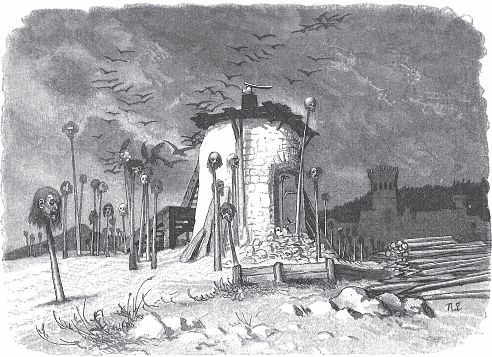

## Das Meerhäschen

Es war einmal eine Königstochter, die hatte in ihrem Schloss hoch oben unter den <abbr title="die Zinne, die Zinnen — зубец (крепостной стены)">Zinnen</abbr> einen Saal mit zwölf Fenstern, die gingen nach allen Himmelsrichtungen. Wenn sie hinaufstieg und umherschaute, konnte sie ihr ganzes Reich <abbr title="überblicken — обозревать">überblicken</abbr>. Aus dem ersten Fenster sah sie schon schärfer als andere Menschen, aus dem zweiten noch besser, aus dem dritten noch deutlicher und so immer weiter bis zum zwölften, aus dem sie alles sah, was über und unter der Erde war, sodass ihr nichts verborgen bleiben konnte. Weil sie aber stolz war, sich niemandem <abbr title="sich unterwerfen + Dat. (unterwarf sich, hat sich unterworfen) — подчиниться">unterwerfen</abbr> und die Herrschaft allein behalten wollte, ließ sie bekannt machen, keiner solle ihr Gemahl werden, der sich nicht so vor ihr verstecken könne, dass es ihr unmöglich sei, ihn zu finden. Wer es aber versuche und von ihr entdeckt werde, dem werde der Kopf abgeschlagen und auf einen Pfahl gesteckt. Schon standen siebenundneunzig Pfähle mit toten Köpfen vor dem Schloss, und lange Zeit meldete sich niemand mehr. Die Königstochter war vergnügt und dachte: «Nun werde ich mein Lebtag frei bleiben.»

Da erschienen drei Brüder vor ihr und kündigten ihr an, sie wollten ihr Glück versuchen. Der älteste glaubte sicher zu sein, wenn er in eine <abbr title="die Kalkgrube, die Kalkgruben — известковая яма">Kalkgrube</abbr> kröche. Aber sie erblickte ihn schon aus dem ersten Fenster, ließ ihn herausziehen und ihm den Kopf abschlagen. Der zweite kroch in den Keller des Schlosses, aber auch ihn erblickte sie aus dem ersten Fenster, und es war um ihn geschehen: Sein Kopf kam auf den neunundneunzigsten Pfahl. Da trat der jüngste vor sie hin und bat, sie möge ihm einen Tag Bedenkzeit geben und auch so gnädig sein, es ihm zweimal zu <abbr title="jemandem etwas schenken — простить, спустить кому-то">schenken</abbr>, wenn sie ihn entdecke. Misslinge es ihm zum dritten Mal, so wolle er nichts mehr auf sein Leben geben. Weil er so schön war und so herzlich bat, sagte sie:

— Ja, ich will dir das <abbr title="bewilligen — разрешить, даровать">bewilligen</abbr>, aber es wird dir nicht <abbr title="glücken — удаваться">glücken</abbr>.

Am folgenden Tag sann er lange nach, wie er sich verstecken sollte, aber es war vergeblich. Da griff er nach seiner Büchse und ging hinaus auf die Jagd. Er sah einen Raben und <abbr title="jemanden aufs Korn nehmen — взять на мушку, прицелиться">nahm ihn aufs Korn</abbr>. Gerade wollte er abdrücken, da rief der Rabe:

— Schieß nicht, ich will es dir vergelten!

Er <abbr title="absetzen — опустить (ружьё)">setzte</abbr> das Gewehr ab, ging weiter und kam an einen See, wo er einen großen Fisch überraschte, der aus der Tiefe an die <abbr title="die Oberfläche, die Oberflächen — поверхность">Oberfläche</abbr> des Wassers heraufgekommen war. Als er angelegt hatte, rief der Fisch:

— Schieß nicht, ich will es dir vergelten!

Er ließ ihn untertauchen, ging weiter und begegnete einem Fuchs, der hinkte. Er schoss und verfehlte ihn. Da rief der Fuchs:

— Komm lieber her und zieh mir den Dorn aus dem Fuß.

Das tat er zwar, wollte aber dann den Fuchs töten und ihm den <abbr title="der Balg, die Bälge — шкура">Balg</abbr> abziehen. Der Fuchs sprach:

— Lass ab, ich will es dir vergelten!

Der Jüngling ließ ihn laufen, und weil es Abend war, kehrte er heim.

Am nächsten Tag sollte er sich verkriechen, aber wie er sich auch <abbr title="sich den Kopf zerbrechen — ломать себе голову">den Kopf zerbrach</abbr>, er wusste nicht, wohin. Er ging in den Wald zu dem Raben und sprach:

— Ich habe dich leben lassen. Jetzt sag mir, wohin ich mich verkriechen soll, damit mich die Königstochter nicht sieht.

Der Rabe senkte den Kopf und <abbr title="sich bedenken (bedachte sich, hat sich bedacht) — подумать, поразмыслить">bedachte sich</abbr> lange. Endlich krächzte er:

— Ich hab's heraus!

Er holte ein Ei aus seinem Nest, teilte es in zwei Teile und schloss den Jüngling darin ein. Dann machte er es wieder ganz und setzte sich darauf. Als die Königstochter an das erste Fenster trat, konnte sie ihn nicht entdecken, auch nicht an den folgenden, und es wurde ihr schon bange. Doch am elften erblickte sie ihn. Sie ließ den Raben schießen, das Ei holen und zerbrechen, und der Jüngling musste herauskommen. Sie sprach:

— Einmal ist es dir geschenkt. Wenn du es nicht besser machst, so bist du verloren.

Am folgenden Tag ging er an den See, rief den Fisch herbei und sprach:

— Ich habe dich leben lassen. Nun sag mir, wohin soll ich mich verbergen, damit mich die Königstochter nicht sieht?

Der Fisch besann sich, endlich rief er:

— Ich hab's heraus! Ich will dich in meinem Bauch einschließen.

Er verschluckte ihn und fuhr hinab auf den Grund des Sees. Die Königstochter blickte durch ihre Fenster, auch durch das elfte sah sie ihn nicht und war bestürzt, doch endlich durch das zwölfte entdeckte sie ihn. Sie ließ den Fisch fangen und töten, und der Jüngling kam zum Vorschein. Jeder kann sich denken, wie ihm <abbr title="jemandem ist zumute — у кого-то на душе">zumute</abbr> war. Sie sprach:

— Zweimal ist es dir geschenkt, aber dein Kopf wird wohl auf den hundertsten Pfahl kommen.

Am letzten Tag ging er mit schwerem Herzen aufs Feld und begegnete dem Fuchs.

— Du weißt alle Schlupfwinkel zu finden, — sprach er. — Ich habe dich leben lassen. Jetzt rate mir, wohin ich mich verstecken soll, damit mich die Königstochter nicht findet.

— Ein schweres Stück, — antwortete der Fuchs und machte ein bedenkliches Gesicht. Endlich rief er: — Ich hab's heraus!

Er ging mit ihm zu einer Quelle, tauchte hinein und kam als <abbr title="der Marktkrämer, die Marktkrämer — рыночный торговец">Marktkrämer</abbr> und <abbr title="der Tierhändler, die Tierhändler — торговец животными">Tierhändler</abbr> wieder heraus. Auch der Jüngling musste ins Wasser tauchen und wurde in ein kleines <abbr title="das Meerhäschen, die Meerhäschen — морской зайчик (зверёк)">Meerhäschen</abbr> verwandelt. Der Kaufmann zog in die Stadt und zeigte das artige <abbr title="das Tierchen, die Tierchen — зверёк">Tierchen</abbr>. Viel Volk lief zusammen, um es anzusehen. Zuletzt kam auch die Königstochter, und weil sie großen <abbr title="Gefallen finden an + Dat. — находить удовольствие в">Gefallen</abbr> daran fand, kaufte sie es und gab dem Kaufmann viel Geld dafür. Bevor er es ihr reichte, sagte er zu ihm:

— Wenn die Königstochter ans Fenster geht, so kriech schnell unter ihren Zopf.

Nun kam die Zeit, da sie ihn suchen sollte. Sie trat der Reihe nach an die Fenster, vom ersten bis zum elften, und sah ihn nicht. Als sie ihn auch am zwölften nicht sah, war sie voller Angst und Zorn und schlug es so heftig zu, dass das Glas in allen Fenstern in tausend Stücke zersprang und das ganze Schloss erzitterte.

Sie ging zurück und fühlte das Meerhäschen unter ihrem Zopf. Da packte sie es, warf es zu Boden und rief:

— Fort mit dir, mir aus den Augen!

Es lief zum Kaufmann, und beide eilten zur Quelle, wo sie untertauchten und ihre wahre Gestalt zurückerhielten. Der Jüngling dankte dem Fuchs und sprach:

— Der Rabe und der Fisch sind <abbr title="strohdumm — тупой как пробка">strohdumm</abbr> gegen dich. Du kennst die richtigen <abbr title="der Kniff, die Kniffe — уловка, хитрость">Kniffe</abbr>, das muss man sagen!

Der Jüngling ging geradewegs ins Schloss. Die Königstochter wartete schon auf ihn und fügte sich ihrem Schicksal. Die Hochzeit wurde gefeiert, und er war nun König und Herr des ganzen Reichs. Er erzählte ihr niemals, wohin er sich beim dritten Mal versteckt und wer ihm geholfen hatte. Und so glaubte sie, er habe alles aus eigener Kunst getan, und hatte <abbr title="die Achtung — уважение">Achtung</abbr> vor ihm, denn sie dachte bei sich: «Der kann doch mehr als du!»

---

### Neue Wörter

- **die Zinne, die Zinnen** — зубец (крепостной стены)
- **überblicken** — обозревать
- **sich unterwerfen + Dat. (unterwarf sich, hat sich unterworfen)** — подчиниться
- **die Kalkgrube, die Kalkgruben** — известковая яма
- **jemandem etwas schenken** — простить, спустить кому-то
- **bewilligen** — разрешить, даровать
- **glücken** — удаваться
- **jemanden aufs Korn nehmen** — взять на мушку, прицелиться
- **absetzen** — опустить (ружьё)
- **die Oberfläche, die Oberflächen** — поверхность
- **der Balg, die Bälge** — шкура
- **sich den Kopf zerbrechen** — ломать себе голову
- **sich bedenken (bedachte sich, hat sich bedacht)** — подумать, поразмыслить
- **jemandem ist zumute** — у кого-то на душе
- **der Marktkrämer, die Marktkrämer** — рыночный торговец
- **der Tierhändler, die Tierhändler** — торговец животными
- **das Meerhäschen, die Meerhäschen** — морской зайчик (зверёк)
- **das Tierchen, die Tierchen** — зверёк
- **Gefallen finden an + Dat.** — находить удовольствие в
- **strohdumm** — тупой как пробка
- **der Kniff, die Kniffe** — уловка, хитрость
- **die Achtung** — уважение

[← Zurück](kapitel-191.md) · [Inhalt](README.md) · [Weiter →](kapitel-193.md)
