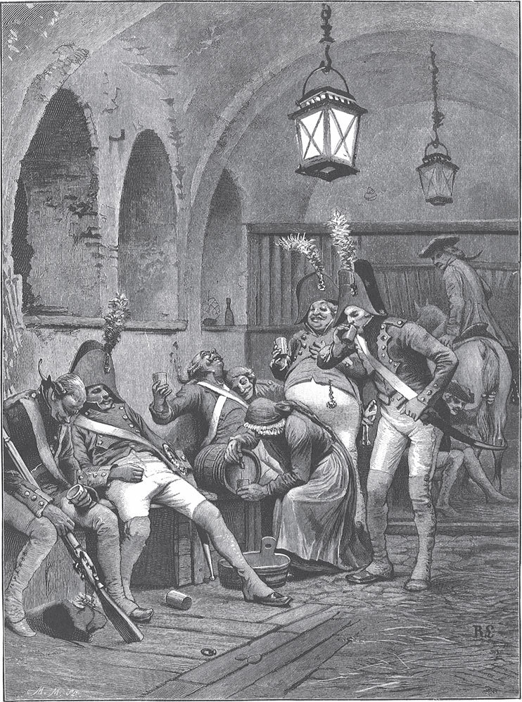

## Der Meisterdieb

Eines Tages saß vor einem ärmlichen Haus ein alter Mann mit seiner Frau, und sie wollten sich von der Arbeit ein wenig ausruhen. Da kam auf einmal ein prächtiger, mit vier Rappen <abbr title="bespannen — запрячь">bespannter</abbr> Wagen herangefahren, aus dem ein reich gekleideter Herr stieg. Der Bauer stand auf, trat zu dem Herrn und fragte, was er wünsche und womit er ihm dienen könne. Der Fremde reichte dem Alten die Hand und sagte:

— Ich wünsche nichts, als einmal ein <abbr title="ländlich — деревенский, сельский">ländliches</abbr> Gericht zu genießen. Bereitet mir Kartoffeln, wie Ihr sie zu essen pflegt, dann will ich mich an Euren Tisch setzen und sie mit Freude verzehren.

Der Bauer lächelte und sagte:

— Ihr seid ein Graf oder Fürst oder gar ein Herzog. Vornehme Herren haben manchmal solche <abbr title="das Gelüst(e), die Gelüste — прихоть, вожделение">Gelüste</abbr>. Euer Wunsch soll aber erfüllt werden.

Die Frau ging in die Küche, fing an, Kartoffeln zu waschen und zu reiben, und wollte Klöße daraus machen, wie die Bauern sie essen. Während sie bei der Arbeit stand, sagte der Bauer zu dem Fremden:

— Kommt einstweilen mit mir in meinen Garten, ich habe dort noch etwas zu schaffen.

Im Garten hatte er Löcher gegraben und wollte jetzt Bäume einsetzen.

— Habt Ihr keine Kinder, — fragte der Fremde, — die Euch bei der Arbeit helfen könnten?

— Nein, — antwortete der Bauer. — Ich habe freilich einen Sohn gehabt, — fügte er hinzu, — aber der ist schon vor langer Zeit in die weite Welt gegangen. Er war ein <abbr title="missraten — непутёвый, неудавшийся">missratener</abbr> Junge, klug und <abbr title="verschlagen — хитрый, пронырливый">verschlagen</abbr>, aber er wollte nichts lernen und machte lauter böse Streiche. Zuletzt lief er mir fort, und seitdem habe ich nichts von ihm gehört.

Der Alte nahm ein Bäumchen, setzte es in ein Loch und stieß einen Pfahl daneben. Und als er Erde hineingeschaufelt und sie <abbr title="feststampfen — утрамбовать">festgestampft</abbr> hatte, band er den Stamm unten, oben und in der Mitte mit einem <abbr title="das Strohseil, die Strohseile — соломенный жгут">Strohseil</abbr> fest an den Pfahl.

— Aber sagt mir, — sprach der Herr, — warum bindet Ihr den krummen, <abbr title="knorrig — сучковатый, корявый">knorrigen</abbr> Baum, der dort in der Ecke fast bis auf den Boden <abbr title="beugen — гнуть, сгибать">gebeugt</abbr> liegt, nicht auch an einen Pfahl wie diesen, damit er gerade wächst?

Der Alte lächelte und sagte:

— Herr, Ihr redet, wie Ihr es versteht. Man sieht wohl, dass Ihr Euch nie mit der <abbr title="die Gärtnerei — садоводство">Gärtnerei</abbr> abgegeben habt. Der Baum dort ist alt und <abbr title="verkrüppelt — искривлённый, изуродованный">verkrüppelt</abbr>, den kann niemand mehr gerade machen. Bäume muss man ziehen, solange sie jung sind.

— Es ist wie bei Eurem Sohn, — sagte der Fremde. — Hättet Ihr den gezogen, als er noch jung war, so wäre er nicht fortgelaufen. Jetzt wird er wohl auch hart und knorrig geworden sein.

— Freilich, — antwortete der Alte, — es ist schon lange her, dass er fortgegangen ist. Er wird sich verändert haben.

— Würdet Ihr ihn noch erkennen, wenn er vor Euch träte? — fragte der Fremde.

— Am Gesicht <abbr title="schwerlich — едва ли, вряд ли">schwerlich</abbr>, — antwortete der Bauer. — Aber er hat ein Zeichen an sich, ein <abbr title="das Muttermal, die Muttermale — родимое пятно">Muttermal</abbr> auf der Schulter, das wie eine Bohne aussieht.

Als er das gesagt hatte, zog der Fremde den Rock aus, <abbr title="entblößen — обнажить">entblößte</abbr> seine Schulter und zeigte dem Bauern die Bohne.

— Herrgott, — rief der Alte, — du bist wahrhaftig mein Sohn!

Und die Liebe zu seinem Kind regte sich in seinem Herzen.

— Aber, — fügte er hinzu, — wie kannst du mein Sohn sein? Du bist ein großer Herr geworden und lebst in Reichtum und Überfluss. Auf welchem Weg bist du dazu <abbr title="gelangen zu + Dat. — достичь чего-то">gelangt</abbr>?

— Ach, Vater, — erwiderte der Sohn, — der junge Baum war an keinen Pfahl gebunden und ist krumm gewachsen. Jetzt ist er zu alt, er wird nicht wieder gerade. Wie ich das alles erworben habe? Ich bin ein Dieb geworden. Aber erschreckt nicht, ich bin ein <abbr title="der Meisterdieb, die Meisterdiebe — вор-мастер, искусный вор">Meisterdieb</abbr>. Für mich gibt es weder Schloss noch Riegel. Wonach mich <abbr title="es gelüstet jemanden nach + Dat. — кому-то хочется чего-то">gelüstet</abbr>, das ist mein. Glaubt nicht, dass ich stehle wie ein gemeiner Dieb. Ich nehme nur vom Überfluss der Reichen. Arme Leute sind sicher vor mir, ich gebe ihnen lieber, als dass ich ihnen etwas nehme. Und was ich ohne Mühe, List und <abbr title="die Gewandtheit — ловкость">Gewandtheit</abbr> haben kann, das rühre ich nicht an.

— Ach, mein Sohn, — sagte der Vater, — es gefällt mir trotzdem nicht. Ein Dieb bleibt ein Dieb. Ich sage dir, das nimmt kein gutes Ende.

Er führte ihn zu der Mutter, und als sie hörte, dass es ihr Sohn war, weinte sie vor Freude. Als er ihr aber sagte, er sei ein Meisterdieb geworden, flossen ihr zwei Ströme über das Gesicht. Endlich sagte sie:

— Wenn er auch ein Dieb geworden ist, so ist er doch mein Sohn, und meine Augen haben ihn noch einmal gesehen.

Sie setzten sich an den Tisch, und er aß mit seinen Eltern wieder einmal die <abbr title="kärglich — скудный">kärgliche</abbr> <abbr title="die Kost — пища, еда">Kost</abbr>, die er lange nicht gegessen hatte. Der Vater sprach:

— Wenn unser Herr, der Graf drüben im Schloss, erfährt, wer du bist und was du treibst, so nimmt er dich nicht auf die Arme und wiegt dich darin, wie damals, als er dich am <abbr title="der Taufstein, die Taufsteine — купель">Taufstein</abbr> hielt, sondern er lässt dich am <abbr title="der Galgenstrick, die Galgenstricke — верёвка виселицы">Galgenstrick</abbr> <abbr title="schaukeln — качаться">schaukeln</abbr>.

— Seid ohne Sorge, Vater, er wird mir nichts tun, denn ich verstehe mein Handwerk. Ich will heute noch selbst zu ihm gehen.

Als es Abend wurde, setzte sich der Meisterdieb in seinen Wagen und fuhr zum Schloss. Der Graf empfing ihn mit Höflichkeit, weil er ihn für einen vornehmen Mann hielt. Als sich der Fremde aber zu erkennen gab, <abbr title="erbleichen — побледнеть">erbleichte</abbr> er und schwieg eine Zeit lang ganz still. Endlich sprach er:

— Du bist mein <abbr title="der Patensohn, die Patensöhne — крестник">Patensohn</abbr>, deshalb will ich Gnade vor Recht ergehen lassen und <abbr title="nachsichtig — снисходительный">nachsichtig</abbr> mit dir <abbr title="verfahren (verfuhr, ist verfahren) — поступать, обходиться">verfahren</abbr>. Weil du dich <abbr title="sich rühmen + Gen. — хвалиться чем-то">rühmst</abbr>, ein Meisterdieb zu sein, will ich deine Kunst auf die Probe stellen. Wenn du aber nicht bestehst, so musst du mit des Seilers Tochter Hochzeit halten, und das <abbr title="das Gekrächze — карканье">Gekrächze</abbr> der Raben soll deine Musik dabei sein.

— Herr Graf, — antwortete der Meister, — denkt Euch drei Stücke aus, so schwer Ihr wollt, und wenn ich Eure Aufgabe nicht löse, so tut mit mir, was Euch gefällt.

Der Graf dachte einige Augenblicke nach, dann sprach er:

— Wohlan! Erstens sollst du mir mein <abbr title="das Leibpferd, die Leibpferde — любимый конь">Leibpferd</abbr> aus dem Stall stehlen. Zweitens sollst du mir und meiner Gemahlin, wenn wir eingeschlafen sind, das <abbr title="das Betttuch, die Betttücher — простыня">Betttuch</abbr> unter dem Leib wegnehmen, ohne dass wir es merken, und dazu meiner Gemahlin den <abbr title="der Trauring, die Trauringe — обручальное кольцо">Trauring</abbr> vom Finger. Drittens und letztens sollst du mir den Pfarrer und den Küster aus der Kirche wegstehlen. Merke dir alles gut, denn es <abbr title="es geht jemandem an den Hals — кому-то грозит виселица, дело идёт о жизни">geht dir an den Hals</abbr>.

Der Meister begab sich in die nächste Stadt. Dort kaufte er einer alten Bauersfrau die Kleider ab und zog sie an. Dann färbte er sich das Gesicht braun und malte sich noch <abbr title="die Runzel, die Runzeln — морщина">Runzeln</abbr> hinein, sodass ihn kein Mensch wiedererkannt hätte. Endlich füllte er ein <abbr title="das Fässchen, die Fässchen — бочонок">Fässchen</abbr> mit altem Ungarwein, in den ein starker Schlaftrunk gemischt war. Das Fässchen legte er in eine Kiepe, die er auf den Rücken nahm, und ging mit <abbr title="bedächtig — неторопливый, осторожный">bedächtigen</abbr>, schwankenden Schritten zum Schloss des Grafen.

Es war schon dunkel, als er ankam. Er setzte sich im Hof auf einen Stein, fing an zu husten wie eine alte, <abbr title="brustkrank — с больной грудью, чахоточный">brustkranke</abbr> Frau und rieb sich die Hände, als ob er fröre. Vor der Tür des Pferdestalls lagen Soldaten um ein Feuer. Einer von ihnen bemerkte die Frau und rief ihr zu:

— Komm näher, altes Mütterchen, und wärm dich bei uns. Du hast doch kein Nachtlager und nimmst es, wo du es findest.

Die Alte trippelte herbei, bat, man möge ihr die Kiepe vom Rücken heben, und setzte sich zu ihnen ans Feuer.

— Was hast du da in deinem Fässchen, du alte Schachtel? — fragte einer.

— Einen guten Schluck Wein, — antwortete sie. — Ich ernähre mich vom Handel. Für Geld und gute Worte gebe ich euch gern ein Glas.

— Nur her damit, — sagte der Soldat. Und als er ein Glas gekostet hatte, rief er: — Wenn der Wein gut ist, so trinke ich lieber ein Glas mehr.

Er ließ sich noch einmal einschenken, und die anderen folgten seinem Beispiel.

— Heda, Kameraden! — rief einer denen zu, die im Stall saßen. — Hier ist ein Mütterchen, das hat Wein, der so alt ist wie sie selbst. Nehmt auch einen Schluck, der wärmt euch den Magen noch besser als unser Feuer.

Die Alte trug ihr Fässchen in den Stall. Einer hatte sich auf das gesattelte Leibpferd gesetzt, ein anderer hielt den Zaum in der Hand, ein dritter hatte den Schwanz gepackt. Sie schenkte ein, so viel man verlangte, bis die Quelle versiegte. Es dauerte nicht lange, da fiel dem einen der Zaum aus der Hand, er sank nieder und fing an zu schnarchen. Der andere ließ den Schwanz los, legte sich nieder und schnarchte noch lauter. Der im Sattel saß, blieb zwar sitzen, beugte sich aber mit dem Kopf fast bis auf den Hals des Pferdes, schlief und blies mit dem Mund wie ein Blasebalg. Die Soldaten draußen waren schon längst eingeschlafen, lagen auf der Erde und rührten sich nicht, als wären sie aus Stein.

Als der Meisterdieb sah, dass es ihm geglückt war, gab er dem einen statt des Zaums ein Seil in die Hand und dem anderen, der den Schwanz gehalten hatte, einen <abbr title="der Strohwisch, die Strohwische — пучок соломы">Strohwisch</abbr>. Aber was sollte er mit dem anfangen, der auf dem Rücken des Pferdes saß? Herunterwerfen wollte er ihn nicht, er hätte erwachen und ein Geschrei erheben können. Er wusste aber guten Rat: Er schnallte den <abbr title="der Sattelgurt, die Sattelgurte — подпруга">Sattelgurt</abbr> auf, knüpfte ein paar Seile, die in Ringen an der Wand hingen, am Sattel fest und zog den schlafenden Reiter mit dem Sattel in die Höhe. Dann schlang er die Seile um den <abbr title="der Pfosten, die Pfosten — столб, стойка">Pfosten</abbr> und machte sie fest. Das Pferd hatte er bald von der Kette losgebunden. Aber wenn er über das steinerne Pflaster des Hofes geritten wäre, so hätte man den Lärm im Schloss gehört. Er <abbr title="umwickeln — обмотать">umwickelte</abbr> ihm also zuvor die Hufe mit alten Lappen, führte es dann vorsichtig hinaus, schwang sich hinauf und jagte davon.

Als der Tag angebrochen war, <abbr title="sprengen — мчаться галопом">sprengte</abbr> der Meister auf dem gestohlenen Pferd zum Schloss. Der Graf war gerade aufgestanden und blickte aus dem Fenster.

— Guten Morgen, Herr Graf, — rief er ihm zu, — hier ist das Pferd, das ich glücklich aus dem Stall geholt habe. Schaut nur, wie schön Eure Soldaten da liegen und schlafen. Und wenn Ihr in den Stall gehen wollt, so werdet Ihr sehen, wie bequem es sich Eure Wächter gemacht haben.

Der Graf musste lachen, dann sprach er:

— Einmal ist es dir gelungen, aber das zweite Mal wird es nicht so glücklich ablaufen. Und ich warne dich: Wenn du mir als Dieb begegnest, so behandle ich dich auch wie einen Dieb.

Als die Gräfin abends zu Bett gegangen war, schloss sie die Hand mit dem Trauring fest zu, und der Graf sagte:

— Alle Türen sind verschlossen und verriegelt. Ich bleibe wach und will den Dieb erwarten. Steigt er aber zum Fenster herein, so schieße ich ihn nieder.

Der Meisterdieb aber ging in der Dunkelheit hinaus zum Galgen, schnitt einen <abbr title="der arme Sünder — (здесь) казнённый преступник">armen Sünder</abbr>, der dort hing, vom Strick ab und trug ihn auf dem Rücken zum Schloss. Dort stellte er eine Leiter an das Schlafgemach, setzte den Toten auf seine Schultern und fing an hinaufzusteigen. Als er so hoch gekommen war, dass der Kopf des Toten im Fenster erschien, drückte der Graf, der in seinem Bett lauerte, eine Pistole auf ihn ab. Sofort ließ der Meister den armen Sünder hinunterfallen, sprang selbst die Leiter hinab und versteckte sich in einer Ecke. Die Nacht war vom Mond so weit erhellt, dass der Meister deutlich sehen konnte, wie der Graf aus dem Fenster auf die Leiter stieg, herabkam und den Toten in den Garten trug. Dort fing er an, ein Loch zu graben, in das er ihn legen wollte.

«Jetzt», dachte der Dieb, «ist der günstige Augenblick gekommen.» Er schlich behände aus seinem Winkel und stieg die Leiter hinauf, geradewegs ins Schlafgemach der Gräfin.

— Liebe Frau, — fing er mit der Stimme des Grafen an, — der Dieb ist tot. Aber er ist doch mein Patensohn und mehr ein Schelm als ein Bösewicht gewesen. Ich will ihn nicht der öffentlichen Schande <abbr title="preisgeben (gab preis, hat preisgegeben) — выдать, отдать на (позор)">preisgeben</abbr>, auch mit den armen Eltern habe ich Mitleid. Ich will ihn, bevor der Tag anbricht, selbst im Garten begraben, damit die Sache nicht <abbr title="ruchbar werden — стать известным, получить огласку">ruchbar</abbr> wird. Gib mir auch das Betttuch, damit ich die Leiche einhüllen kann und ihn nicht wie einen Hund <abbr title="verscharren — закопать кое-как">verscharre</abbr>.

Die Gräfin gab ihm das Tuch.

— Weißt du was, — sagte der Dieb weiter, — ich habe eine <abbr title="die Anwandlung, die Anwandlungen — приступ, порыв">Anwandlung</abbr> von <abbr title="die Großmut — великодушие">Großmut</abbr>. Gib mir noch den Ring. Der Unglückliche hat sein Leben gewagt, so mag er ihn mit ins Grab nehmen.

Sie wollte dem Grafen nicht widersprechen, und obwohl sie es ungern tat, zog sie doch den Ring vom Finger und reichte ihn hin. Der Dieb machte sich mit beiden Stücken davon und kam glücklich nach Hause, bevor der Graf im Garten mit seiner <abbr title="die Totengräberarbeit — работа могильщика">Totengräberarbeit</abbr> fertig war.

Was machte der Graf für ein langes Gesicht, als am nächsten Morgen der Meister kam und ihm das Betttuch und den Ring brachte!

— Kannst du hexen? — sagte er zu ihm. — Wer hat dich aus dem Grab geholt, in das ich selbst dich gelegt habe, und wer hat dich wieder lebendig gemacht?

— Mich habt Ihr nicht begraben, — sagte der Dieb, — sondern den armen Sünder vom Galgen.

Und er erzählte ausführlich, wie es zugegangen war. Der Graf musste ihm <abbr title="zugestehen (gestand zu, hat zugestanden) — признать, согласиться">zugestehen</abbr>, dass er ein gescheiter und listiger Dieb sei.

— Aber noch bist du nicht am Ende, — fügte er hinzu. — Du hast noch die dritte Aufgabe zu lösen, und wenn dir die nicht gelingt, so hilft dir alles nichts.

Der Meister lächelte und gab keine Antwort.

Als die Nacht <abbr title="einbrechen (brach ein, ist eingebrochen) — наступить (о ночи)">eingebrochen</abbr> war, kam er mit einem langen Sack auf dem Rücken, einem Bündel unter dem Arm und einer Laterne in der Hand zur Dorfkirche. In dem Sack hatte er Krebse, in dem Bündel aber kurze <abbr title="das Wachslicht, die Wachslichter — восковая свеча">Wachslichter</abbr>. Er setzte sich auf den <abbr title="der Gottesacker, die Gottesäcker — кладбище (устар.)">Gottesacker</abbr>, holte einen Krebs heraus und klebte ihm ein Wachslichtchen auf den Rücken. Dann zündete er das Lichtchen an, setzte den Krebs auf den Boden und ließ ihn kriechen. Er holte einen zweiten aus dem Sack, machte es mit diesem ebenso und fuhr so fort, bis auch der letzte aus dem Sack war. Darauf zog er ein langes schwarzes Gewand an, das wie eine <abbr title="die Mönchskutte, die Mönchskutten — монашеская ряса">Mönchskutte</abbr> aussah, und klebte sich einen grauen Bart ans Kinn. Als er endlich ganz <abbr title="unkenntlich — неузнаваемый">unkenntlich</abbr> war, nahm er den Sack, in dem die Krebse gewesen waren, ging in die Kirche und stieg auf die Kanzel.

Die <abbr title="die Turmuhr, die Turmuhren — башенные часы">Turmuhr</abbr> schlug gerade zwölf. Als der letzte Schlag <abbr title="verklingen (verklang, ist verklungen) — отзвучать, стихнуть">verklungen</abbr> war, rief er mit lauter, <abbr title="gellend — пронзительный">gellender</abbr> Stimme:

— Hört her, ihr <abbr title="sündig — грешный">sündigen</abbr> Menschen, das Ende aller Dinge ist gekommen, der <abbr title="der Jüngste Tag — Судный день">Jüngste Tag</abbr> ist nahe! Hört her, hört her! Wer mit mir in den Himmel will, der krieche in den Sack. Ich bin Petrus, der die <abbr title="die Himmelstür — райские врата">Himmelstür</abbr> öffnet und schließt. Seht ihr, draußen auf dem Gottesacker wandeln die <abbr title="der/die Verstorbene, die Verstorbenen — покойник">Verstorbenen</abbr> und sammeln ihre Gebeine zusammen. Kommt, kommt und kriecht in den Sack, die Welt geht unter!

Das Geschrei erschallte durch das ganze Dorf. Der Pfarrer und der Küster, die am nächsten an der Kirche wohnten, hatten es zuerst gehört. Und als sie die Lichter erblickten, die auf dem Gottesacker umherwandelten, merkten sie, dass etwas Ungewöhnliches vorging, und traten in die Kirche. Sie hörten der Predigt eine Weile zu, da stieß der Küster den Pfarrer an und sprach:

— Es wäre nicht übel, wenn wir die Gelegenheit nutzten und vor dem Anbruch des Jüngsten Tages zusammen auf leichte Art in den Himmel kämen.

— Freilich, — erwiderte der Pfarrer, — das sind auch meine Gedanken gewesen. Habt Ihr Lust, so wollen wir uns auf den Weg machen.

— Ja, — antwortete der Küster, — aber Ihr, Herr Pfarrer, habt den <abbr title="der Vortritt — право идти первым">Vortritt</abbr>, ich folge nach.

Der Pfarrer schritt also voran und stieg auf die Kanzel, wo der Meister den Sack öffnete. Der Pfarrer kroch zuerst hinein, dann der Küster. Sofort band der Meister den Sack fest zu, packte ihn am <abbr title="der Bausch, die Bausche — (здесь) горловина, сборка (мешка)">Bausch</abbr> und schleifte ihn die Kanzeltreppe hinab. Sooft die Köpfe der beiden Toren auf die Stufen schlugen, rief er:

— Jetzt geht's schon über die Berge!

Dann zog er sie auf gleiche Weise durch das Dorf, und wenn sie durch Pfützen kamen, rief er:

— Jetzt geht's schon durch die nassen Wolken!

Und als er sie endlich die Schlosstreppe hinaufzog, rief er:

— Jetzt sind wir auf der <abbr title="die Himmelstreppe — небесная лестница">Himmelstreppe</abbr> und werden bald im <abbr title="der Vorhof, die Vorhöfe — преддверие, передний двор">Vorhof</abbr> sein!

Als er oben angelangt war, schob er den Sack in den <abbr title="der Taubenschlag, die Taubenschläge — голубятня">Taubenschlag</abbr>, und als die Tauben flatterten, sagte er:

— Hört ihr, wie die Engel sich freuen und mit den <abbr title="der Fittich, die Fittiche — крыло (поэт.)">Fittichen</abbr> schlagen?

Dann schob er den Riegel vor und ging fort.

Am nächsten Morgen begab er sich zum Grafen und sagte ihm, er habe auch die dritte Aufgabe gelöst und den Pfarrer und den Küster aus der Kirche weggeführt.

— Wo hast du sie gelassen? — fragte der Herr.

— Sie liegen in einem Sack oben im Taubenschlag und bilden sich ein, sie wären im Himmel.

Der Graf stieg selbst hinauf und <abbr title="sich überzeugen von + Dat. — убедиться в">überzeugte sich</abbr>, dass er die Wahrheit gesagt hatte. Als er den Pfarrer und den Küster aus ihrem Gefängnis befreit hatte, sprach er:

— Du bist ein <abbr title="der Erzdieb, die Erzdiebe — архивор, отъявленный вор">Erzdieb</abbr> und hast deine Sache gewonnen. Für diesmal kommst du mit heiler Haut davon. Aber sieh zu, dass du aus meinem Land fortkommst. Denn wenn du dich wieder darin blicken lässt, so kannst du auf deine <abbr title="die Erhöhung — возвышение (здесь ирон.: на виселицу)">Erhöhung</abbr> am Galgen rechnen.

Der Erzdieb nahm Abschied von seinen Eltern, ging wieder in die weite Welt, und niemand hat je wieder etwas von ihm gehört.

---

### Neue Wörter

- **bespannen** — запрячь
- **ländlich** — деревенский, сельский
- **das Gelüst(e), die Gelüste** — прихоть, вожделение
- **missraten** — непутёвый, неудавшийся
- **verschlagen** — хитрый, пронырливый
- **feststampfen** — утрамбовать
- **das Strohseil, die Strohseile** — соломенный жгут
- **knorrig** — сучковатый, корявый
- **beugen** — гнуть, сгибать
- **die Gärtnerei** — садоводство
- **verkrüppelt** — искривлённый, изуродованный
- **schwerlich** — едва ли, вряд ли
- **das Muttermal, die Muttermale** — родимое пятно
- **entblößen** — обнажить
- **gelangen zu + Dat.** — достичь чего-то
- **der Meisterdieb, die Meisterdiebe** — вор-мастер, искусный вор
- **es gelüstet jemanden nach + Dat.** — кому-то хочется чего-то
- **die Gewandtheit** — ловкость
- **kärglich** — скудный
- **die Kost** — пища, еда
- **der Taufstein, die Taufsteine** — купель
- **der Galgenstrick, die Galgenstricke** — верёвка виселицы
- **schaukeln** — качаться
- **erbleichen** — побледнеть
- **der Patensohn, die Patensöhne** — крестник
- **nachsichtig** — снисходительный
- **verfahren (verfuhr, ist verfahren)** — поступать, обходиться
- **sich rühmen + Gen.** — хвалиться чем-то
- **das Gekrächze** — карканье
- **das Leibpferd, die Leibpferde** — любимый конь
- **das Betttuch, die Betttücher** — простыня
- **der Trauring, die Trauringe** — обручальное кольцо
- **es geht jemandem an den Hals** — кому-то грозит виселица, дело идёт о жизни
- **die Runzel, die Runzeln** — морщина
- **das Fässchen, die Fässchen** — бочонок
- **bedächtig** — неторопливый, осторожный
- **brustkrank** — с больной грудью, чахоточный
- **der Strohwisch, die Strohwische** — пучок соломы
- **der Sattelgurt, die Sattelgurte** — подпруга
- **der Pfosten, die Pfosten** — столб, стойка
- **umwickeln** — обмотать
- **sprengen** — мчаться галопом
- **der arme Sünder** — (здесь) казнённый преступник
- **preisgeben (gab preis, hat preisgegeben)** — выдать, отдать на (позор)
- **ruchbar werden** — стать известным, получить огласку
- **verscharren** — закопать кое-как
- **die Anwandlung, die Anwandlungen** — приступ, порыв
- **die Großmut** — великодушие
- **die Totengräberarbeit** — работа могильщика
- **zugestehen (gestand zu, hat zugestanden)** — признать, согласиться
- **einbrechen (brach ein, ist eingebrochen)** — наступить (о ночи)
- **das Wachslicht, die Wachslichter** — восковая свеча
- **der Gottesacker, die Gottesäcker** — кладбище (устар.)
- **die Mönchskutte, die Mönchskutten** — монашеская ряса
- **unkenntlich** — неузнаваемый
- **die Turmuhr, die Turmuhren** — башенные часы
- **verklingen (verklang, ist verklungen)** — отзвучать, стихнуть
- **gellend** — пронзительный
- **sündig** — грешный
- **der Jüngste Tag** — Судный день
- **die Himmelstür** — райские врата
- **der/die Verstorbene, die Verstorbenen** — покойник
- **der Vortritt** — право идти первым
- **der Bausch, die Bausche** — (здесь) горловина, сборка (мешка)
- **die Himmelstreppe** — небесная лестница
- **der Vorhof, die Vorhöfe** — преддверие, передний двор
- **der Taubenschlag, die Taubenschläge** — голубятня
- **der Fittich, die Fittiche** — крыло (поэт.)
- **sich überzeugen von + Dat.** — убедиться в
- **der Erzdieb, die Erzdiebe** — архивор, отъявленный вор
- **die Erhöhung** — возвышение (здесь ирон.: на виселицу)

[← Zurück](kapitel-192.md) · [Inhalt](README.md) · [Weiter →](kapitel-194.md)
