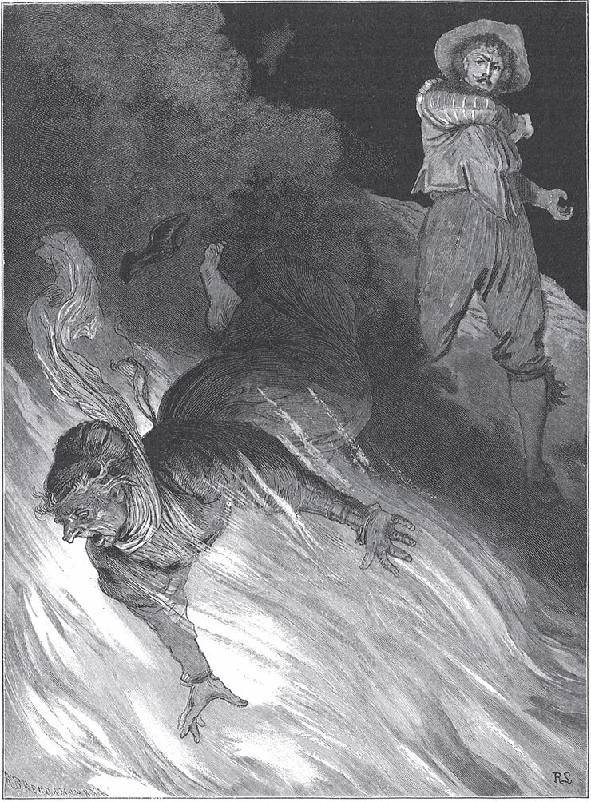

## Der Trommler

Eines Abends ging ein junger <abbr title="der Trommler, die Trommler — барабанщик">Trommler</abbr> ganz allein über das Feld und kam an einen See. Da sah er am Ufer drei kleine Stücke weißes Leinen liegen.

— Was für feines Leinen! — sagte er und steckte eines davon in die Tasche.

Er ging nach Hause, dachte nicht weiter an seinen <abbr title="der Fund, die Funde — находка">Fund</abbr> und legte sich ins Bett. Gerade als er einschlafen wollte, kam es ihm vor, als ob jemand seinen Namen riefe. Er horchte und vernahm eine leise Stimme, die ihm zurief:

— Trommler, Trommler, wach auf!

Weil es finstere Nacht war, konnte er niemanden sehen, aber es schien ihm, als schwebte eine Gestalt vor seinem Bett auf und ab.

— Was willst du? — fragte er.

— Gib mir mein Hemdchen zurück, — antwortete die Stimme, — das du mir gestern Abend am See weggenommen hast.

— Du sollst es wiederhaben, — sagte der Trommler, — wenn du mir sagst, wer du bist.

— Ach, — erwiderte die Stimme, — ich bin die Tochter eines mächtigen Königs. Aber ich bin in die Gewalt einer Hexe geraten und auf den Glasberg gebannt. Jeden Tag muss ich mit meinen zwei Schwestern im See baden, aber ohne mein Hemdchen kann ich nicht wieder fortfliegen. Meine Schwestern sind <abbr title="davonfliegen (flog davon, ist davongeflogen) — улететь прочь">davongeflogen</abbr>, ich aber musste zurückbleiben. Ich bitte dich, gib mir mein Hemdchen wieder.

— Sei ruhig, armes Kind, — sagte der Trommler, — ich gebe es dir gern zurück.

Er holte es aus der Tasche und reichte es ihr in der Dunkelheit hin. Sie ergriff es hastig und wollte damit fort.

— Warte einen Augenblick, — sagte er, — vielleicht kann ich dir helfen.

— Helfen kannst du mir nur, wenn du auf den Glasberg steigst und mich aus der Gewalt der Hexe befreist. Aber zum Glasberg kommst du nicht, und selbst wenn du ganz nahe daran wärst, könntest du nicht hinauf.

— Was ich will, das kann ich, — sagte der Trommler. — Ich habe Mitleid mit dir, und ich fürchte mich vor nichts. Aber ich kenne den Weg nicht, der zum Glasberg führt.

— Der Weg geht durch den großen Wald, in dem die Menschenfresser hausen, — antwortete sie. — Mehr darf ich dir nicht sagen.

Dann hörte er, wie sie davonschwirrte.

Bei <abbr title="der Anbruch des Tages — рассвет">Anbruch des Tages</abbr> machte sich der Trommler auf, hängte sich seine Trommel um und ging ohne Furcht geradewegs in den Wald hinein. Als er eine Weile gegangen war und keinen Riesen erblickte, dachte er: «Ich muss die <abbr title="der Langschläfer, die Langschläfer — соня, любитель поспать">Langschläfer</abbr> aufwecken.» Er hängte die Trommel nach vorn und schlug einen <abbr title="der Wirbel, die Wirbel — барабанная дробь">Wirbel</abbr>, dass die Vögel mit Geschrei aus den Bäumen aufflogen. Es dauerte nicht lange, da erhob sich auch ein Riese, der im Gras gelegen und geschlafen hatte. Er war so groß wie eine Tanne.

— Du Wicht, — rief er ihm zu, — was trommelst du hier und weckst mich aus dem besten Schlaf?

— Ich trommle, — antwortete der Trommler, — weil viele Tausende hinter mir herkommen, damit sie den Weg finden.

— Was wollen die hier in meinem Wald? — fragte der Riese.

— Sie wollen dir den Garaus machen und den Wald von einem Ungeheuer, wie du eines bist, säubern.

— Oho, — sagte der Riese, — ich trete euch tot wie Ameisen.

— Meinst du, du könntest gegen sie etwas ausrichten? — sagte der Trommler. — Wenn du dich bückst, um einen zu packen, springt er weg und versteckt sich. Sobald du dich aber hinlegst und schläfst, kommen sie aus allen Gebüschen herbei und kriechen an dir hinauf. Jeder hat einen Hammer aus Stahl im Gürtel stecken, und damit schlagen sie dir den Schädel ein.

Der Riese wurde verdrießlich und dachte: «Wenn ich mich mit dem listigen Volk <abbr title="sich einlassen mit + Dat. (ließ sich ein, hat sich eingelassen) — связываться с">einlasse</abbr>, könnte es mir am Ende doch schaden. Wölfen und Bären drücke ich die <abbr title="die Gurgel, die Gurgeln — глотка, горло">Gurgel</abbr> zu, aber vor diesen Erdwürmern kann ich mich nicht schützen.»

— Hör, kleiner Kerl, — sagte er, — zieh wieder ab. Ich verspreche dir, dass ich dich und deine Gesellen künftig in Ruhe lasse. Und hast du noch einen Wunsch, so sag es mir. Ich will dir gern einen Gefallen tun.

— Du hast lange Beine, — sagte der Trommler, — und kannst schneller laufen als ich. Trag mich zum Glasberg, dann gebe ich den Meinen ein Zeichen zum <abbr title="der Rückzug — отступление">Rückzug</abbr>, und sie sollen dich diesmal in Ruhe lassen.

— Komm her, <abbr title="der Wurm, die Würmer — червяк">Wurm</abbr>, — sagte der Riese, — setz dich auf meine Schulter. Ich trage dich, wohin du willst.

Der Riese hob ihn hinauf, und der Trommler fing oben an, nach Herzenslust auf der Trommel zu wirbeln. Der Riese dachte: «Das wird das Zeichen sein, dass das andere Volk zurückgehen soll.» Nach einer Weile stand ein zweiter Riese am Weg. Der nahm dem ersten den Trommler ab und steckte ihn in sein <abbr title="das Knopfloch, die Knopflöcher — петлица">Knopfloch</abbr>. Der Trommler fasste den Knopf, der so groß wie eine Schüssel war, hielt sich daran fest und schaute ganz lustig umher. Dann kamen sie zu einem dritten. Der nahm ihn aus dem Knopfloch und setzte ihn auf den Rand seines Hutes. Da ging der Trommler oben auf und ab und sah über die Bäume hinaus. Als er in blauer Ferne einen Berg erblickte, dachte er: «Das ist gewiss der Glasberg», und so war es auch. Der Riese machte nur noch ein paar Schritte, da waren sie schon am <abbr title="der Fuß des Berges — подножие">Fuß</abbr> des Berges angelangt, und dort setzte er ihn ab. Der Trommler verlangte, er solle ihn auch auf den Gipfel des Glasbergs tragen, aber der Riese schüttelte den Kopf, brummte etwas in seinen Bart und ging in den Wald zurück.

Nun stand der arme Trommler vor dem Berg, der so hoch war, als hätte man drei Berge aufeinandergesetzt, und dabei so glatt wie ein Spiegel, und er wusste nicht, wie er hinaufkommen sollte. Er fing an zu klettern, aber vergeblich: Immer wieder rutschte er hinunter. «Wenn ich jetzt ein Vogel wäre!», dachte er. Aber was half das Wünschen? Es wuchsen ihm keine Flügel. Während er so dastand und sich keinen Rat wusste, erblickte er nicht weit von sich zwei Männer, die heftig miteinander stritten. Er ging auf sie zu und sah, dass sie sich wegen eines Sattels nicht einig waren, der vor ihnen auf der Erde lag und den jeder von ihnen haben wollte.

— Was seid ihr für Narren, — sagte er, — ihr zankt euch um einen Sattel und habt kein Pferd dazu.

— Der Sattel ist es wert, dass man um ihn streitet, — antwortete einer der Männer. — Wer darauf sitzt und sich irgendwohin wünscht, und wäre es am Ende der Welt, der ist im selben Augenblick dort, in dem er den Wunsch ausgesprochen hat. Der Sattel gehört uns gemeinsam. Ich bin an der Reihe, darauf zu reiten, aber der andere will es nicht zulassen.

— Den Streit will ich schnell <abbr title="schlichten — уладить (спор)">schlichten</abbr>, — sagte der Trommler. Er ging ein Stück weit weg und steckte einen weißen Stab in die Erde. Dann kam er zurück und sagte: — Jetzt lauft zum Ziel. Wer zuerst dort ist, der reitet zuerst.

Beide <abbr title="sich in Trab setzen — пуститься рысью">setzten sich in Trab</abbr>, aber kaum waren sie ein paar Schritte weg, da schwang sich der Trommler auf den Sattel, wünschte sich auf den Glasberg, und <abbr title="ehe man die Hand umdreht — в мгновение ока">ehe man die Hand umdrehte</abbr>, war er dort.

Oben auf dem Berg war eine Ebene. Da stand ein altes steinernes Haus, vor dem Haus lag ein großer <abbr title="der Fischteich, die Fischteiche — рыбный пруд">Fischteich</abbr>, dahinter aber ein finsterer Wald. Menschen und Tiere sah er nicht. Alles war still, nur der Wind raschelte in den Bäumen, und die Wolken zogen ganz nah über seinen Kopf hinweg. Er trat an die Tür und klopfte. Als er zum dritten Mal geklopft hatte, öffnete eine Alte mit braunem Gesicht und roten Augen. Sie hatte eine Brille auf ihrer langen Nase, sah ihn scharf an und fragte dann, was er begehre.

— Einlass, Kost und Nachtlager, — antwortete der Trommler.

— Das sollst du haben, — sagte die Alte, — wenn du dafür drei Arbeiten verrichtest.

— Warum nicht? — antwortete er. — Ich scheue keine Arbeit, und wenn sie noch so schwer ist.

Die Alte ließ ihn herein, gab ihm zu essen und am Abend ein gutes Bett. Am Morgen, als er ausgeschlafen hatte, nahm die Alte einen Fingerhut von ihrem dürren Finger, reichte ihn dem Trommler und sagte:

— Jetzt geh an die Arbeit und schöpfe den Teich draußen mit diesem Fingerhut aus. Aber bevor es Nacht wird, musst du fertig sein, und alle Fische, die im Wasser sind, müssen nach ihrer Art und Größe <abbr title="sortieren — сортировать">sortiert</abbr> und nebeneinandergelegt sein.

— Das ist eine seltsame Arbeit, — sagte der Trommler, ging aber zum Teich und fing an zu schöpfen.

Er schöpfte den ganzen Morgen. Aber was kann man mit einem Fingerhut bei einem großen Wasser ausrichten, und wenn man tausend Jahre schöpft? Als es Mittag war, dachte er: «Es ist alles umsonst, und es ist einerlei, ob ich arbeite oder nicht.» Er hörte auf und setzte sich hin. Da kam ein Mädchen aus dem Haus, stellte ihm ein Körbchen mit Essen hin und sagte:

— Du sitzt so traurig da. Was fehlt dir?

Er sah es an und sah, dass es wunderschön war.

— Ach, — sagte er, — ich kann schon die erste Arbeit nicht vollbringen, wie soll es dann mit den anderen werden? Ich bin ausgezogen, um eine Königstochter zu suchen, die hier wohnen soll, aber ich habe sie nicht gefunden. Ich will weitergehen.

— Bleib hier, — sagte das Mädchen, — ich will dir aus deiner Not helfen. Du bist müde. Leg deinen Kopf in meinen Schoß und schlaf. Wenn du wieder aufwachst, ist die Arbeit getan.

Das ließ sich der Trommler nicht zweimal sagen. Sobald ihm die Augen zufielen, drehte sie an einem Wunschring und sprach:

— Wasser herauf, Fische heraus!

Sogleich stieg das Wasser wie ein weißer Nebel in die Höhe und zog mit den anderen Wolken fort. Die Fische schnalzten, sprangen ans Ufer und legten sich nebeneinander, jeder nach seiner Größe und Art. Als der Trommler erwachte, sah er voller Erstaunen, dass alles vollbracht war. Aber das Mädchen sagte:

— Einer von den Fischen liegt nicht bei seinesgleichen, sondern ganz allein. Wenn die Alte heute Abend kommt und sieht, dass alles getan ist, was sie verlangt hat, wird sie fragen: «Was soll dieser Fisch allein?» Dann wirf ihr den Fisch ins Gesicht und sag: «Der soll für dich sein, alte Hexe.»

Am Abend kam die Alte, und als sie die Frage gestellt hatte, warf er ihr den Fisch ins Gesicht. Sie tat so, als merke sie es nicht, und schwieg, aber sie sah ihn mit boshaften Augen an. Am nächsten Morgen sagte sie:

— Gestern hast du es zu leicht gehabt, ich muss dir schwerere Arbeit geben. Heute musst du den ganzen Wald fällen, das Holz in Scheite spalten und in Klaftern <abbr title="aufschichten — складывать штабелем">aufschichten</abbr>. Am Abend muss alles fertig sein.

Sie gab ihm eine Axt, einen <abbr title="der Schlegel, die Schlegel — колотушка, деревянный молот">Schlegel</abbr> und zwei Keile. Aber die Axt war aus Blei, der Schlegel und die Keile waren aus <abbr title="das Blech — жесть">Blech</abbr>. Als er anfing zu hauen, verbog sich die Axt, und Schlegel und Keile <abbr title="sich zusammendrücken — сплющиться">drückten sich zusammen</abbr>. Er wusste sich nicht zu helfen. Aber am Mittag kam das Mädchen wieder mit dem Essen und tröstete ihn.

— Leg deinen Kopf in meinen Schoß, — sagte sie, — und schlaf. Wenn du aufwachst, ist die Arbeit getan.

Sie drehte an ihrem Wunschring, und im selben Augenblick sank der ganze Wald mit Krachen zusammen. Das Holz spaltete sich von selbst und schichtete sich in Klaftern auf. Es war, als ob unsichtbare Riesen die Arbeit verrichteten. Als er aufwachte, sagte das Mädchen:

— Siehst du, das Holz ist gespalten und aufgeschichtet. Nur ein einziger Ast ist übrig. Wenn die Alte heute Abend kommt und fragt, was der Ast soll, dann gib ihr damit einen Schlag und sag: «Der soll für dich sein, du Hexe.»

Die Alte kam.

— Siehst du, — sagte sie, — wie leicht die Arbeit war? Aber für wen liegt der Ast noch da?

— Für dich, du Hexe! — antwortete er und gab ihr einen Schlag damit.

Aber sie tat, als fühlte sie es nicht, lachte höhnisch und sagte:

— Morgen früh sollst du alles Holz auf einen Haufen legen, es anzünden und verbrennen.

Er stand bei Tagesanbruch auf und fing an, das Holz herbeizuholen. Aber wie kann ein einziger Mensch einen ganzen Wald zusammentragen? Die Arbeit <abbr title="vorankommen (kam voran, ist vorangekommen) — продвигаться">kam nicht voran</abbr>. Doch das Mädchen verließ ihn nicht in der Not. Es brachte ihm am Mittag sein Essen, und als er gegessen hatte, legte er seinen Kopf in ihren Schoß und schlief ein. Als er erwachte, brannte der ganze Holzstoß in einer ungeheuren Flamme, die ihre Zungen bis in den Himmel ausstreckte.

— Hör mich an, — sagte das Mädchen. — Wenn die Hexe kommt, wird sie dir allerlei auftragen. Tust du ohne Furcht, was sie verlangt, so kann sie dir nichts anhaben. Fürchtest du dich aber, so packt dich das Feuer und verzehrt dich. Zuletzt, wenn du alles getan hast, pack sie mit beiden Händen und wirf sie mitten in die Glut.

Das Mädchen ging fort, und die Alte kam <abbr title="heranschleichen (schlich heran, ist herangeschlichen) — подкрасться">herangeschlichen</abbr>.

— Hu, mich friert! — sagte sie. — Aber das ist ein Feuer, das brennt! Das wärmt mir die alten Knochen, da wird mir wohl. Aber dort liegt ein Klotz, der will nicht brennen. Den hol mir heraus. Hast du das noch getan, so bist du frei und kannst ziehen, wohin du willst. Nur munter hinein!

Der Trommler besann sich nicht lange und sprang mitten in die Flammen. Aber sie taten ihm nichts, nicht einmal die Haare konnten sie ihm <abbr title="versengen — опалить">versengen</abbr>. Er trug den Klotz heraus und legte ihn hin. Kaum aber hatte das Holz die Erde berührt, da <abbr title="sich verwandeln — превращаться">verwandelte</abbr> es sich, und vor ihm stand das schöne Mädchen, das ihm in der Not geholfen hatte. An den seidenen, golden glänzenden Kleidern, die es trug, merkte er wohl, dass es die Königstochter war. Aber die Alte lachte giftig und sagte:

— Du meinst, du hättest sie, aber du hast sie noch nicht.

Eben wollte sie auf das Mädchen losgehen und es fortziehen, da packte er die Alte mit beiden Händen, hob sie hoch und warf sie den Flammen in den Rachen. Die Flammen <abbr title="zusammenschlagen über + Dat. — сомкнуться над">schlugen</abbr> über ihr zusammen, als freuten sie sich, dass sie eine Hexe verzehren durften.

Die Königstochter sah nun den Trommler an. Als sie sah, dass er ein schöner Jüngling war, und bedachte, dass er sein Leben aufs Spiel gesetzt hatte, um sie zu erlösen, reichte sie ihm die Hand und sagte:

— Du hast alles für mich gewagt, und ich will auch für dich alles tun. Versprichst du mir deine Treue, so sollst du mein Gemahl werden. An Reichtümern fehlt es uns nicht. Wir haben genug an dem, was die Hexe hier zusammengetragen hat.

Sie führte ihn ins Haus. Da standen <abbr title="Kisten und Kästen — сундуки и ящики">Kisten und Kästen</abbr>, die mit ihren Schätzen gefüllt waren. Sie ließen Gold und Silber liegen und nahmen nur die Edelsteine. Sie wollte nicht länger auf dem Glasberg bleiben. Da sagte er zu ihr:

— Setz dich zu mir auf meinen Sattel, dann fliegen wir hinunter wie die Vögel.

— Der alte Sattel gefällt mir nicht, — sagte sie. — Ich brauche nur an meinem Wunschring zu drehen, dann sind wir zu Hause.

— Wohlan, — antwortete der Trommler, — dann wünsch uns vor das Stadttor.

Im Nu waren sie dort. Der Trommler aber sagte:

— Ich will zuerst zu meinen Eltern gehen und ihnen Nachricht geben. <abbr title="harren + Gen. — ждать (кого-то)">Harre</abbr> meiner hier auf dem Feld, ich bin bald zurück.

— Ach, — sagte die Königstochter, — ich bitte dich, nimm dich in Acht. Küss deine Eltern bei deiner Ankunft nicht auf die rechte Wange, sonst wirst du alles vergessen, und ich bleibe hier allein und verlassen auf dem Feld zurück.

— Wie könnte ich dich vergessen? — sagte er und versprach ihr mit Handschlag, recht bald wiederzukommen.

Als er in sein <abbr title="väterlich — отцовский">väterliches</abbr> Haus trat, wusste niemand, wer er war, so sehr hatte er sich verändert. Denn die drei Tage, die er auf dem Glasberg verbracht hatte, waren drei lange Jahre gewesen. Da gab er sich zu erkennen, und seine Eltern fielen ihm vor Freude um den Hals. Er war in seinem Herzen so bewegt, dass er sie auf beide Wangen küsste und an die Worte des Mädchens nicht dachte. Kaum hatte er ihnen aber den Kuss auf die rechte Wange gegeben, da verschwand aus seinem Kopf jeder Gedanke an die Königstochter. Er leerte seine Taschen aus und legte Händevoll der größten Edelsteine auf den Tisch. Die Eltern wussten gar nicht, was sie mit dem Reichtum anfangen sollten. Da baute der Vater ein prächtiges Schloss, <abbr title="umgeben von + Dat. — окружённый">umgeben</abbr> von Gärten, Wäldern und Wiesen, als ob ein Fürst darin wohnen sollte. Und als es fertig war, sagte die Mutter:

— Ich habe ein Mädchen für dich ausgesucht. In drei Tagen soll die Hochzeit sein.

Der Sohn war mit allem zufrieden, was die Eltern wollten.

Die arme Königstochter hatte lange vor der Stadt gestanden und auf die <abbr title="die Rückkehr — возвращение">Rückkehr</abbr> des Jünglings gewartet. Als es Abend wurde, sagte sie:

— Gewiss hat er seine Eltern auf die rechte Wange geküsst und mich vergessen.

Ihr Herz war voller Trauer. Sie wünschte sich in ein einsames Häuschen im Wald und wollte nicht wieder an den Hof ihres Vaters zurück. Jeden Abend ging sie in die Stadt und ging an seinem Haus vorbei. Er sah sie manchmal, aber er erkannte sie nicht mehr. Endlich hörte sie, wie die Leute sagten: «Morgen wird seine Hochzeit gefeiert.» Da sagte sie:

— Ich will versuchen, ob ich sein Herz wiedergewinne.

Als der erste Hochzeitstag gefeiert wurde, drehte sie an ihrem Wunschring und sprach:

— Ein Kleid so glänzend wie die Sonne!

Sogleich lag das Kleid vor ihr und glänzte so, als wäre es aus <abbr title="lauter — сплошь, одни лишь">lauter</abbr> Sonnenstrahlen gewebt. Als alle Gäste versammelt waren, trat sie in den Saal. Jedermann wunderte sich über das schöne Kleid, am meisten aber die Braut. Und weil schöne Kleider ihre größte Lust waren, ging sie zu der Fremden und fragte, ob sie es ihr verkaufen wolle.

— Für Geld nicht, — antwortete sie, — aber wenn ich die erste Nacht vor der Tür verweilen darf, hinter der der Bräutigam schläft, dann gebe ich es her.

Die Braut konnte ihr Verlangen nicht <abbr title="bezwingen (bezwang, hat bezwungen) — побороть, одолеть">bezwingen</abbr> und willigte ein. Aber sie mischte dem Bräutigam einen Schlaftrunk in seinen Abendwein, sodass er in tiefen Schlaf fiel. Als nun alles still geworden war, <abbr title="sich kauern — присесть на корточки, съёжиться">kauerte sich</abbr> die Königstochter vor die Tür der Schlafkammer, öffnete sie ein wenig und rief hinein:

> «Trommler, Trommler, hör mich an,  
> hast du mich denn ganz vergessen?  
> Hast du auf dem Glasberg nicht bei mir gesessen?  
> Habe ich vor der Hexe nicht <abbr title="bewahren vor + Dat. — уберечь от">bewahrt</abbr> dein Leben?  
> Hast du mir auf Treue nicht die Hand gegeben?  
> Trommler, Trommler, hör mich an.»

Aber es war alles vergeblich. Der Trommler wachte nicht auf, und als der Morgen anbrach, musste die Königstochter unverrichteter Dinge wieder fortgehen. Am zweiten Abend drehte sie an ihrem Wunschring und sprach:

— Ein Kleid so silbern wie der Mond!

Als sie mit dem Kleid, das so zart war wie der Mondschein, auf dem Fest erschien, weckte sie wieder das Verlangen der Braut und gab es ihr für die Erlaubnis, auch die zweite Nacht vor der Tür der Schlafkammer zu verbringen. Da rief sie in der Stille der Nacht:

> «Trommler, Trommler, hör mich an,  
> hast du mich denn ganz vergessen?  
> Hast du auf dem Glasberg nicht bei mir gesessen?  
> Habe ich vor der Hexe nicht bewahrt dein Leben?  
> Hast du mir auf Treue nicht die Hand gegeben?  
> Trommler, Trommler, hör mich an.»

Aber der Trommler, vom Schlaftrunk betäubt, war nicht zu wecken. Traurig ging sie am Morgen wieder in ihr Waldhaus zurück. Die Leute im Haus aber hatten die <abbr title="die Klage, die Klagen — жалоба, плач">Klage</abbr> des fremden Mädchens gehört und erzählten dem Bräutigam davon. Sie sagten ihm auch, dass er nichts davon habe hören können, weil man ihm einen Schlaftrunk in den Wein geschüttet habe. Am dritten Abend drehte die Königstochter an ihrem Wunschring und sprach:

— Ein Kleid, <abbr title="flimmern — мерцать">flimmernd</abbr> wie die Sterne!

Als sie sich darin auf dem Fest zeigte, war die Braut über die Pracht des Kleides, das die anderen weit <abbr title="übertreffen (übertraf, hat übertroffen) — превосходить">übertraf</abbr>, ganz außer sich und sagte:

— Ich soll und muss es haben!

Das Mädchen gab es ihr wie die anderen, für die Erlaubnis, die Nacht vor der Tür des Bräutigams zu verbringen. Der Bräutigam aber trank den Wein nicht, den man ihm vor dem Schlafengehen reichte, sondern goss ihn hinter das Bett. Und als alles im Haus still geworden war, hörte er eine sanfte Stimme, die ihn rief:

> «Trommler, Trommler, hör mich an,  
> hast du mich denn ganz vergessen?  
> Hast du auf dem Glasberg nicht bei mir gesessen?  
> Habe ich vor der Hexe nicht bewahrt dein Leben?  
> Hast du mir auf Treue nicht die Hand gegeben?  
> Trommler, Trommler, hör mich an.»

Auf einmal kam ihm das Gedächtnis wieder.

— Ach, — rief er, — wie habe ich nur so treulos handeln können! Aber der Kuss, den ich meinen Eltern in der Freude meines Herzens auf die rechte Wange gegeben habe, der ist schuld daran, der hat mich betäubt.

Er sprang auf, nahm die Königstochter bei der Hand und führte sie zum Bett seiner Eltern.

— Das ist meine rechte Braut, — sagte er. — Wenn ich die andere heirate, tue ich großes Unrecht.

Als die Eltern hörten, wie sich alles zugetragen hatte, willigten sie ein. Da wurden die Lichter im Saal wieder angezündet, Pauken und Trompeten herbeigeholt, die Freunde und Verwandten eingeladen, wiederzukommen, und die wahre Hochzeit wurde mit großer Freude gefeiert. Die erste Braut behielt die schönen Kleider als <abbr title="die Entschädigung, die Entschädigungen — возмещение, компенсация">Entschädigung</abbr> und gab sich zufrieden.

---

### Neue Wörter

- **der Trommler, die Trommler** — барабанщик
- **der Fund, die Funde** — находка
- **davonfliegen (flog davon, ist davongeflogen)** — улететь прочь
- **der Anbruch des Tages** — рассвет
- **der Langschläfer, die Langschläfer** — соня, любитель поспать
- **der Wirbel, die Wirbel** — барабанная дробь
- **sich einlassen mit + Dat. (ließ sich ein, hat sich eingelassen)** — связываться с
- **die Gurgel, die Gurgeln** — глотка, горло
- **der Rückzug** — отступление
- **der Wurm, die Würmer** — червяк
- **das Knopfloch, die Knopflöcher** — петлица
- **der Fuß des Berges** — подножие
- **schlichten** — уладить (спор)
- **sich in Trab setzen** — пуститься рысью
- **ehe man die Hand umdreht** — в мгновение ока
- **der Fischteich, die Fischteiche** — рыбный пруд
- **sortieren** — сортировать
- **aufschichten** — складывать штабелем
- **der Schlegel, die Schlegel** — колотушка, деревянный молот
- **das Blech** — жесть
- **sich zusammendrücken** — сплющиться
- **vorankommen (kam voran, ist vorangekommen)** — продвигаться
- **heranschleichen (schlich heran, ist herangeschlichen)** — подкрасться
- **versengen** — опалить
- **sich verwandeln** — превращаться
- **zusammenschlagen über + Dat.** — сомкнуться над
- **Kisten und Kästen** — сундуки и ящики
- **harren + Gen.** — ждать (кого-то)
- **väterlich** — отцовский
- **umgeben von + Dat.** — окружённый
- **die Rückkehr** — возвращение
- **lauter** — сплошь, одни лишь
- **bezwingen (bezwang, hat bezwungen)** — побороть, одолеть
- **sich kauern** — присесть на корточки, съёжиться
- **bewahren vor + Dat.** — уберечь от
- **die Klage, die Klagen** — жалоба, плач
- **flimmern** — мерцать
- **übertreffen (übertraf, hat übertroffen)** — превосходить
- **die Entschädigung, die Entschädigungen** — возмещение, компенсация

[← Zurück](kapitel-193.md) · [Inhalt](README.md) · [Weiter →](kapitel-195.md)
