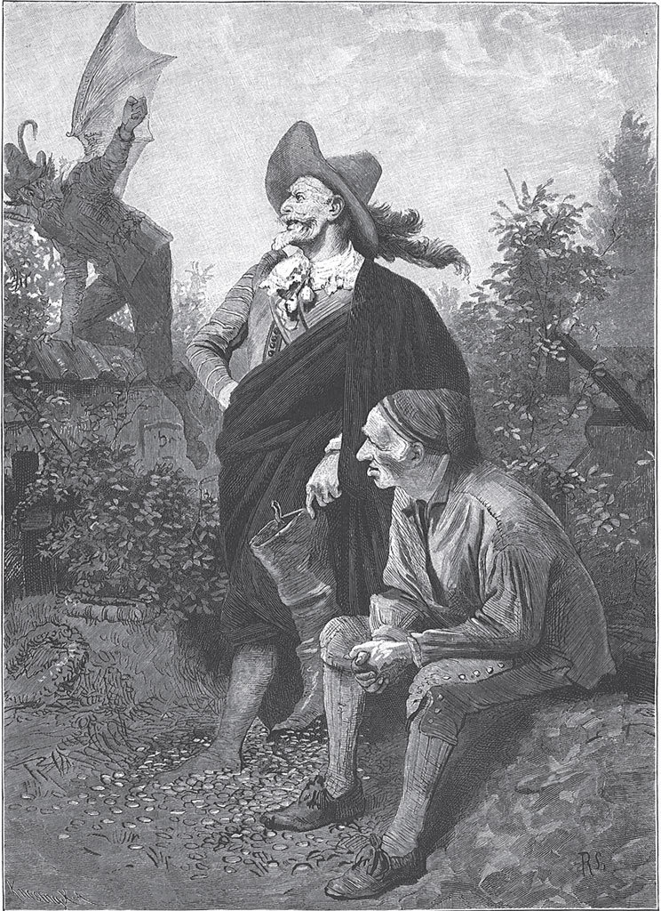

## Der Grabhügel

Ein reicher Bauer stand eines Tages in seinem Hof und schaute über seine Felder und Gärten. Das Korn wuchs kräftig heran, und die Obstbäume hingen voller Früchte. Das Getreide vom vorigen Jahr lag noch in so gewaltigen Haufen auf dem Dachboden, dass die Balken es kaum tragen konnten. Dann ging er in den Stall. Da standen die gemästeten Ochsen, die fetten Kühe und die <abbr title="spiegelglatt — гладкий как зеркало, лоснящийся">spiegelglatten</abbr> Pferde. Endlich ging er in seine Stube zurück und warf einen Blick auf die eisernen Kästen, in denen sein Geld lag.

Als er so dastand und seinen Reichtum überblickte, klopfte es auf einmal heftig bei ihm an. Es klopfte aber nicht an die Tür seiner Stube, sondern an die Tür seines Herzens. Sie tat sich auf, und er hörte eine Stimme, die zu ihm sagte:

— Hast du den Deinen damit Gutes getan? Hast du die Not der Armen angesehen? Hast du mit den Hungrigen dein Brot geteilt? War dir genug, was du besaßest, oder hast du immer noch mehr verlangt?

Das Herz zögerte nicht mit der Antwort:

— Ich bin hart und <abbr title="unerbittlich — неумолимый, безжалостный">unerbittlich</abbr> gewesen und habe den Meinen niemals etwas Gutes getan. Ist ein Armer gekommen, so habe ich die Augen abgewendet. Ich habe mich nicht um Gott gekümmert, sondern nur an die <abbr title="die Vermehrung — умножение">Vermehrung</abbr> meines Reichtums gedacht. Wäre alles mein Eigen gewesen, was der Himmel bedeckt, ich hätte dennoch nicht genug gehabt.

Als er diese Antwort hörte, erschrak er heftig. Die Knie fingen ihm an zu zittern, und er musste sich setzen. Da klopfte es abermals, aber diesmal an die Tür seiner Stube. Es war sein Nachbar, ein armer Mann mit einem Häufchen Kinder, die er nicht mehr satt machen konnte. «Ich weiß», hatte der Arme gedacht, «mein Nachbar ist reich, aber er ist ebenso hart. Ich glaube nicht, dass er mir hilft. Aber meine Kinder schreien nach Brot, da will ich es wagen.»

Er sagte zu dem Reichen:

— Ihr gebt nicht leicht etwas von dem Euren weg, aber mir steht das Wasser bis zum Hals. Meine Kinder hungern. Leiht mir vier Malter Korn.

Der Reiche sah ihn lange an. Da begann der erste Sonnenstrahl der Milde einen Tropfen vom Eis der <abbr title="die Habsucht — алчность, корыстолюбие">Habsucht</abbr> <abbr title="abschmelzen (schmolz ab, hat abgeschmolzen) — растопить">abzuschmelzen</abbr>.

— Vier Malter will ich dir nicht leihen, — antwortete er, — sondern acht will ich dir schenken. Aber eine Bedingung musst du erfüllen.

— Was soll ich tun? — fragte der Arme.

— Wenn ich tot bin, sollst du drei Nächte an meinem Grab wachen.

Dem Bauern wurde bei diesem <abbr title="der Antrag, die Anträge — предложение">Antrag</abbr> <abbr title="jemandem ist unheimlich zumute — кому-то жутко, не по себе">unheimlich zumute</abbr>, doch in der Not, in der er war, hätte er allem zugestimmt. Er sagte also zu und trug das Korn nach Hause.

Es war, als hätte der Reiche vorausgesehen, was geschehen würde: Nach drei Tagen fiel er plötzlich tot zu Boden. Man wusste nicht recht, wie es zugegangen war, aber niemand trauerte um ihn. Als er bestattet war, fiel dem Armen sein Versprechen ein. Gern wäre er davon <abbr title="entbinden von + Dat. (entband, hat entbunden) — освободить от (обязательства)">entbunden</abbr> gewesen, aber er dachte: «Er hat sich dir gegenüber doch <abbr title="mildtätig — милосердный, щедрый">mildtätig</abbr> gezeigt. Du hast mit seinem Korn deine hungrigen Kinder satt gemacht. Und selbst wenn das nicht so wäre: Du hast nun einmal das Versprechen gegeben und musst es halten.»

Bei Einbruch der Nacht ging er auf den Friedhof und setzte sich auf den <abbr title="der Grabhügel, die Grabhügel — могильный холм">Grabhügel</abbr>. Alles war still, nur der Mond schien über die Grabhügel, und manchmal flog eine Eule vorbei und ließ ihre kläglichen Töne hören. Als die Sonne aufging, kehrte der Arme <abbr title="unversehrt — невредимый">unversehrt</abbr> heim, und ebenso ruhig ging die zweite Nacht vorüber. Am Abend des dritten Tages empfand er eine besondere Angst. Es war ihm, als stünde noch etwas bevor.

Als er hinauskam, erblickte er an der Mauer des Friedhofs einen Mann, den er noch nie gesehen hatte. Er war nicht mehr jung, hatte <abbr title="die Narbe, die Narben — шрам">Narben</abbr> im Gesicht, und seine Augen blickten scharf und feurig umher. Er war ganz in einen alten Mantel gehüllt, und nur große <abbr title="der Reiterstiefel, die Reiterstiefel — ботфорт, кавалерийский сапог">Reiterstiefel</abbr> waren zu sehen.

— Was sucht Ihr hier? — sprach ihn der Bauer an. — <abbr title="es gruselt jemanden — кому-то жутко">Gruselt</abbr> es Euch nicht auf dem einsamen Friedhof?

— Ich suche nichts, — antwortete er, — aber ich fürchte auch nichts. Ich bin wie der Junge, der auszog, das <abbr title="das Gruseln — жуть, страх">Gruseln</abbr> zu lernen, und sich vergeblich bemühte. Nur bekam der die Königstochter zur Frau und mit ihr große Reichtümer, und ich bin immer arm geblieben. Ich bin nichts als ein <abbr title="abgedankt — отставной, уволенный">abgedankter</abbr> Soldat und will hier die Nacht verbringen, weil ich sonst kein Obdach habe.

— Wenn Ihr keine Furcht habt, — sagte der Bauer, — dann bleibt bei mir und helft mir, dort den Grabhügel zu bewachen.

— Wache halten ist Sache des Soldaten, — antwortete er. — Was uns hier begegnet, Gutes oder Böses, das wollen wir gemeinsam tragen.

Der Bauer schlug ein, und sie setzten sich zusammen auf das Grab.

Alles blieb still bis Mitternacht. Da ertönte auf einmal ein schneidendes Pfeifen in der Luft, und die beiden Wächter erblickten den Bösen, der leibhaftig vor ihnen stand.

— Fort, ihr Halunken! — rief er ihnen zu. — Der im Grab liegt, ist mein. Ich will ihn holen, und wenn ihr nicht weggeht, drehe ich euch die Hälse um.

— Herr mit der roten Feder, — sagte der Soldat, — Ihr seid nicht mein Hauptmann, ich brauche Euch nicht zu gehorchen, und das Fürchten habe ich noch nicht gelernt. Geht Eurer Wege, wir bleiben hier sitzen.

Der Teufel dachte: «Mit Gold fängst du die zwei Lumpen am besten.» Er <abbr title="andere Saiten aufziehen — сменить тон">zog mildere Saiten auf</abbr> und fragte ganz zutraulich, ob sie nicht einen Beutel mit Gold annehmen und damit nach Hause gehen wollten.

— Das lässt sich hören, — antwortete der Soldat, — aber mit einem einzigen Beutel voll Gold <abbr title="jemandem ist mit etwas nicht gedient — кому-то от чего-то мало проку">ist uns nicht gedient</abbr>. Wenn Ihr so viel Gold geben wollt, wie in einen von meinen Stiefeln geht, dann wollen wir Euch <abbr title="das Feld räumen — уступить поле боя">das Feld räumen</abbr> und abziehen.

— So viel habe ich nicht bei mir, — sagte der Teufel, — aber ich will es holen. In der benachbarten Stadt wohnt ein <abbr title="der Geldwechsler, die Geldwechsler — меняла">Geldwechsler</abbr>, der ist mein guter Freund. Der <abbr title="vorstrecken — ссужать, давать взаймы">streckt</abbr> mir gern so viel vor.

Als der Teufel verschwunden war, zog der Soldat seinen linken Stiefel aus und sagte:

— Dem <abbr title="der Kohlenbrenner, die Kohlenbrenner — угольщик">Kohlenbrenner</abbr> wollen wir schon <abbr title="jemandem eine Nase drehen — натянуть нос кому-то">eine Nase drehen</abbr>. Gebt mir nur Euer Messer, Gevatter.

Er schnitt die Sohle vom Stiefel ab und stellte ihn neben den Hügel ins hohe Gras, an den Rand einer halb <abbr title="zuwachsen (wuchs zu, ist zugewachsen) — зарасти">zugewachsenen</abbr> Grube.

— So ist alles gut, — sagte er. — Nun kann der <abbr title="der Schornsteinfeger, die Schornsteinfeger — трубочист">Schornsteinfeger</abbr> kommen.

Beide setzten sich und warteten. Es dauerte nicht lange, da kam der Teufel mit einem <abbr title="das Säckchen, die Säckchen — мешочек">Säckchen</abbr> Gold in der Hand.

— Schüttet es nur hinein, — sagte der Soldat und hob den Stiefel ein wenig in die Höhe. — Das wird aber nicht genug sein.

Der Schwarze leerte das Säckchen, das Gold fiel hindurch, und der Stiefel blieb leer.

— Dummer Teufel, — rief der Soldat, — das reicht nicht! Habe ich es nicht gleich gesagt? Kehrt nur wieder um und holt mehr.

Der Teufel schüttelte den Kopf, ging und kam nach einer Stunde mit einem viel größeren Sack unter dem Arm zurück.

— Nur hinein damit! — rief der Soldat. — Aber ich zweifle, dass der Stiefel voll wird.

Das Gold klimperte, als es hinunterfiel, und der Stiefel blieb leer. Der Teufel blickte mit seinen glühenden Augen selbst hinein und überzeugte sich von der Wahrheit.

— Ihr habt unverschämt dicke Waden! — rief er und <abbr title="verziehen (verzog, hat verzogen) — кривить">verzog</abbr> den Mund.

— Meint Ihr, — erwiderte der Soldat, — ich hätte einen Pferdefuß wie Ihr? Seit wann seid Ihr so <abbr title="knauserig — скупой, прижимистый">knauserig</abbr>? Seht zu, dass Ihr mehr Gold herbeischafft, sonst wird aus unserem Handel nichts.

Der <abbr title="der Unhold, die Unholde — злодей, чудовище">Unhold</abbr> trollte sich abermals davon. Diesmal blieb er länger aus, und als er endlich erschien, <abbr title="keuchen — пыхтеть, задыхаться">keuchte</abbr> er unter der Last eines Sackes, der auf seiner Schulter lag. Er schüttete ihn in den Stiefel, der sich aber ebenso wenig füllte wie vorher. Da wurde er wütend und wollte dem Soldaten den Stiefel aus der Hand reißen. Aber in diesem Augenblick drang der erste Strahl der aufgehenden Sonne am Himmel herauf, und der böse Geist floh mit lautem Geschrei. Die arme Seele war gerettet.

Der Bauer wollte das Gold teilen, aber der Soldat sagte:

— Gib den Armen, was mir zufällt. Ich ziehe zu dir in deine Hütte, und wir wollen mit dem Übrigen in Ruhe und Frieden zusammenleben, solange es Gott gefällt.

---

### Neue Wörter

- **spiegelglatt** — гладкий как зеркало, лоснящийся
- **unerbittlich** — неумолимый, безжалостный
- **die Vermehrung** — умножение
- **die Habsucht** — алчность, корыстолюбие
- **abschmelzen (schmolz ab, hat abgeschmolzen)** — растопить
- **der Antrag, die Anträge** — предложение
- **jemandem ist unheimlich zumute** — кому-то жутко, не по себе
- **entbinden von + Dat. (entband, hat entbunden)** — освободить от (обязательства)
- **mildtätig** — милосердный, щедрый
- **der Grabhügel, die Grabhügel** — могильный холм
- **unversehrt** — невредимый
- **die Narbe, die Narben** — шрам
- **der Reiterstiefel, die Reiterstiefel** — ботфорт, кавалерийский сапог
- **es gruselt jemanden** — кому-то жутко
- **das Gruseln** — жуть, страх
- **abgedankt** — отставной, уволенный
- **andere Saiten aufziehen** — сменить тон
- **jemandem ist mit etwas nicht gedient** — кому-то от чего-то мало проку
- **das Feld räumen** — уступить поле боя
- **der Geldwechsler, die Geldwechsler** — меняла
- **vorstrecken** — ссужать, давать взаймы
- **der Kohlenbrenner, die Kohlenbrenner** — угольщик
- **jemandem eine Nase drehen** — натянуть нос кому-то
- **zuwachsen (wuchs zu, ist zugewachsen)** — зарасти
- **der Schornsteinfeger, die Schornsteinfeger** — трубочист
- **das Säckchen, die Säckchen** — мешочек
- **verziehen (verzog, hat verzogen)** — кривить
- **knauserig** — скупой, прижимистый
- **der Unhold, die Unholde** — злодей, чудовище
- **keuchen** — пыхтеть, задыхаться

[← Zurück](kapitel-195.md) · [Inhalt](README.md) · [Weiter →](kapitel-197.md)
