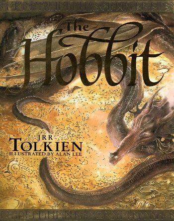
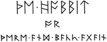
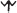
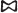
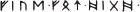
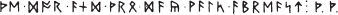
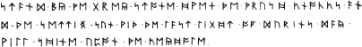

# Der Hobbit: Hin und zurück

Persönliche deutsche Lernfassung. Aktuelle Quelle: J. R. R. Tolkien, The Hobbit (englische FB2).
Kapitel 1–7: bisherige Lernfassung nach dem russischen Text; noch keine vollständige Neuübersetzung aus dem Englischen.
Russische Vorlage: Übersetzungen von К. Королев und В. Тихомиров (2001).
Bilder: aus der englischen Quelldatei, an den entsprechenden Textstellen.

**Alle 19 Kapitel sind als persönliche Lernfassung vollständig vorhanden.**

Neue und schwierige Wörter haben russische Hover-Erklärungen und stehen am Kapitelende.
Dort stehen auch schwierige Sätze mit russischer Übersetzung und Erklärung.
Tooltips benötigen einen Markdown-Reader, der HTML-`abbr` mit `title` zulässt.

Wortbudget: höchstens sechs neu eingeführte Lemmata je 300 laufende Wörter; angenommener A2-Grundwortschatz.
Das prüft markierte Einführungen, nicht den persönlichen Wortschatz oder die CEFR-Stufe.

## Inhalt

- [Kapitel 1: Ein unerwartetes Essen](kapitel-01.md) — A2
- [Kapitel 2: Gebratenes Schaffleisch](kapitel-02.md) — A2
- [Kapitel 3: Eine kurze Pause](kapitel-03.md) — upper A2
- [Kapitel 4: Über und unter den Bergen](kapitel-04.md) — upper A2
- [Kapitel 5: Rätsel im Dunkeln](kapitel-05.md) — upper A2
- [Kapitel 6: Vom Feuer in die Flammen](kapitel-06.md) — A2 → B1
- [Kapitel 7: Zu Gast bei Beorn](kapitel-07.md) — A2 → B1
- [Kapitel 8: Fliegen und Spinnen](kapitel-08.md) — B1
- [Kapitel 9: In Fässern in die Freiheit](kapitel-09.md) — B1
- [Kapitel 10: Ein herzlicher Empfang](kapitel-10.md) — B1
- [Kapitel 11: An der Türschwelle](kapitel-11.md) — B1
- [Kapitel 12: Nachrichten aus dem Inneren](kapitel-12.md) — B1
- [Kapitel 13: Nicht zu Hause](kapitel-13.md) — B2
- [Kapitel 14: Feuer und Wasser](kapitel-14.md) — B2
- [Kapitel 15: Die Wolken ziehen auf](kapitel-15.md) — B2
- [Kapitel 16: Ein Dieb in der Nacht](kapitel-16.md) — B2
- [Kapitel 17: Wolkenbruch](kapitel-17.md) — B2
- [Kapitel 18: Die Heimreise](kapitel-18.md) — B2
- [Kapitel 19: Die letzte Etappe](kapitel-19.md) — B2

[Wörterbuch](woerterbuch.md) · [Originalnamen und Zuordnung](../GLOSSAR.md) · [Alle Abbildungen](abbildungen.md)

## Bilder aus dem Vorspann

Umschlag und Runendiagramme stehen im Vorspann der englischen Quelle. Die Einleitungen und Anmerkungen werden nicht übersetzt.

