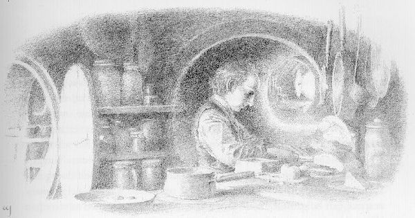
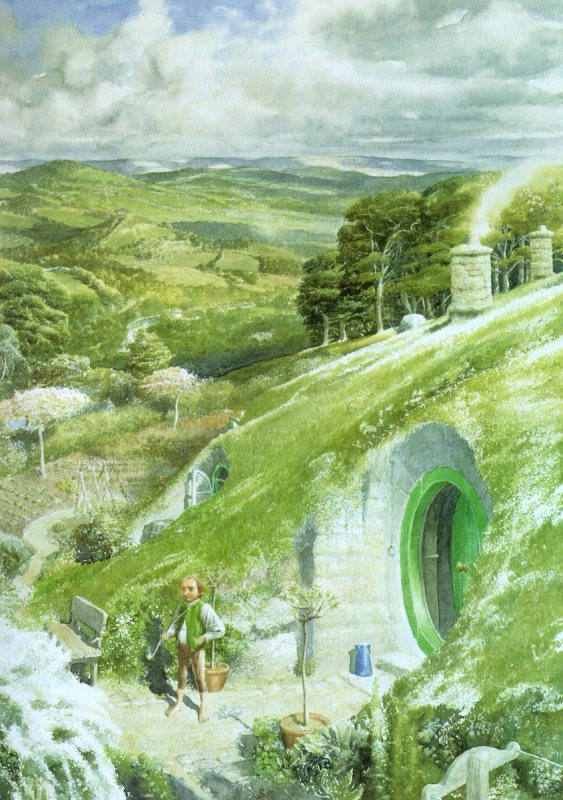
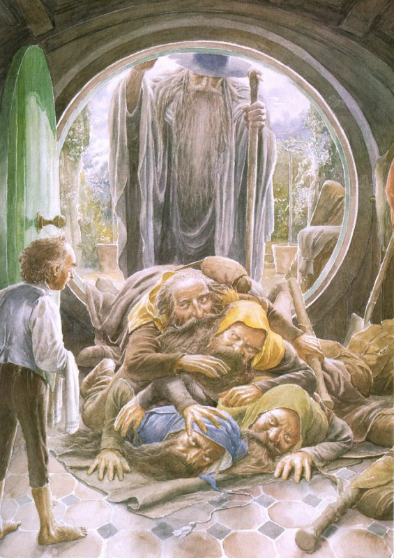
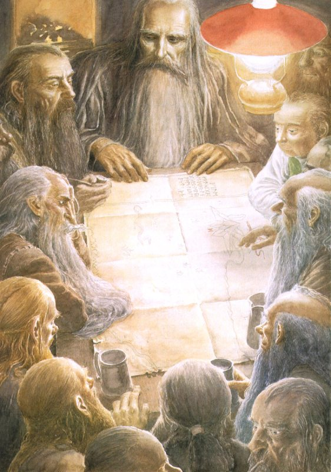

## Kapitel 1: Ein unerwartetes Essen

In der Erde ist eine <abbr title="die Höhle, die Höhlen — нора; пещера">Höhle</abbr>. In dieser <abbr title="die Höhle, die Höhlen — нора; пещера">Höhle</abbr> lebt ein Hobbit. Sie ist nicht schmutzig und auch nicht <abbr title="feucht — сырой; влажный">feucht</abbr>. Keine <abbr title="der Wurm, die Würmer — червь">Würmer</abbr> bewegen sich darin. An den Wänden sitzen keine <abbr title="die Schnecke, die Schnecken — слизень; улитка">Schnecken</abbr>. Nein, es ist trocken und warm. Es riecht gut. Man findet etwas zum Sitzen und etwas zum Essen. Kurz gesagt: Die <abbr title="die Höhle, die Höhlen — нора; пещера">Höhle</abbr> gehört einem Hobbit. Und eine Hobbit-Höhle ist natürlich in jeder Hinsicht <abbr title="gemütlich — уютный">gemütlich</abbr>.

Die Haustür ist rund wie eine kleine Tür auf einem Schiff. Sie ist grün. Genau in der Mitte hat sie einen glänzenden Griff aus <abbr title="das Kupfer — медь">Kupfer</abbr>. Hinter ihr liegt ein langer, breiter Flur. Er sieht wie eine <abbr title="die Höhle, die Höhlen — нора; пещера">Höhle</abbr> aus, ist aber sauber und ohne Rauch. Dort stehen Stühle. Auf dem Boden liegen Teppiche. Die Wände sind mit Holz bedeckt. Dort sind sehr viele kleine Haken für Mäntel und Hüte. Dieser Hobbit hat nämlich Gäste sehr gern. Der Flur macht eine Kurve und führt tief in den Hügel hinein. In der ganzen Gegend nennt man diesen Hügel einfach The Hill. Rechts und links liegen viele kleine, runde Türen. Dahinter sind die verschiedensten Zimmer. Der Hobbit muss deshalb nie nach oben oder nach unten steigen. Schlafzimmer, Badezimmer, Keller, Räume für Essen, Küchen und Esszimmer liegen nebeneinander. Es gibt so viele Räume für dieses Essen, dass man sie kaum zählen kann. Sogar für seine Kleidung hat er ein ganzes Zimmer. In jeden Raum kommt man aus demselben Flur. Die besten Zimmer liegen links, wenn man der Haustür den Rücken zeigt. Nur diese Zimmer haben Fenster. Die kleinen, runden Fenster sitzen tief in der Wand. Man sieht durch sie in den Garten. Dahinter führen grüne Wiesen langsam hinunter zum Fluss.

Der Hobbit ist ziemlich reich und heißt Baggins. Die Familie Baggins lebt schon sehr lange auf The Hill. Niemand weiß mehr, seit wann. Alle achten diese Familie. Das liegt nicht nur an ihrem Geld. Niemand in dieser Familie ist <abbr title="verrückt — сумасбродный; сумасшедший">verrückt</abbr>, und einem Baggins passiert niemals etwas Besonderes. Man weiß schon vorher, was ein Baggins auf eine Frage antwortet. Unsere Geschichte erzählt jedoch von einem anderen Baggins. Eines Tages macht er verrückte Dinge. Er sagt und tut Sachen, die man kaum glauben kann. Er weiß selbst nicht, warum. Danach achten die Nachbarn ihn vielleicht nicht mehr so sehr. Dafür gewinnt er aber … Nun, ihr erfahrt bald, ob er überhaupt etwas gewinnt.

Die Mutter unseres Hobbits … Ach ja, was sind eigentlich Hobbits? Heute sieht man sie nur noch selten. Sie gehen den Großen sehr sorgfältig aus dem Weg. So nennen sie nämlich die Menschen. Deshalb beschreibe ich sie hier ein wenig. Hobbits sind kleine Wesen. Sie reichen einem erwachsenen Menschen ungefähr bis zur Mitte des Körpers. Sie sind jedoch keine <abbr title="der Zwerg, die Zwerge — гном">Zwerge</abbr>. Hobbits sind noch kleiner und haben nie einen <abbr title="der Bart, die Bärte — борода">Bart</abbr>. Sie können nicht <abbr title="zaubern — колдовать">zaubern</abbr>. Aber sie können sofort verschwinden, wenn ein Großer in die Nähe kommt. Menschen machen beim Gehen ja so viel Lärm wie Elefanten! Hobbits werden leicht dick. Sie tragen gern Kleidung in hellen Farben, besonders Gelb und Grün. Sie gehen ohne Schuhe. Die <abbr title="die Haut, die Häute — кожа">Haut</abbr> unter ihren Füßen ist nämlich härter als das <abbr title="das Leder — кожа (материал)">Leder</abbr> unter einem Stiefel. Oben auf den Füßen haben sie dichtes, etwas rotes Haar. Das hält sie auch bei Kälte warm. Ihre Finger sind lang und fühlen sehr genau. Ihre Gesichter sehen freundlich aus. Sie lachen gern und richtig laut, besonders nach dem Essen. Und sie essen oft und viel. So, jetzt wisst ihr genug über Hobbits. Ich kann also weitererzählen.

Wie gesagt, die Mutter unseres Hobbits Bilbo Baggins war die berühmte Belladonna Took. Sie war eine von drei Töchtern des Old Took. Er war der oberste Hobbit und lebte jenseits von The Water. Dieser kleine Fluss liegt am Fuß von The Hill. Die Nachbarn erzählten etwas Merkwürdiges über die Familie. Vor sehr langer Zeit hat ein früheres Mitglied der Familie eine Frau aus dem Volk der <abbr title="der Elf, die Elfen — эльф">Elfen</abbr> geheiratet. Natürlich ist das völliger Unsinn. Trotzdem ist an den Tooks etwas nicht ganz hobbitmäßig. Manchmal erleben sie oder ihre <abbr title="der Verwandte, die Verwandten — родственник">Verwandten</abbr> ein <abbr title="das Abenteuer, die Abenteuer — приключение">Abenteuer</abbr>. Einer verschwindet einfach, und niemand weiß, wohin. Die anderen sagen dann nichts, wenn man sie fragt. Sie tun so, als wissen sie überhaupt nichts davon. Die Tooks sind sogar reicher als die Bagginses. Trotzdem achten die Leute in Hobbiton sie weniger.

Zum Glück hat Belladonna Took rechtzeitig Herrn Bungo Baggins geheiratet. Danach hat sie keine <abbr title="das Abenteuer, die Abenteuer — приключение">Abenteuer</abbr> mehr erlebt. Bungo ist Bilbos Vater. Er hat für seine Frau eine besonders schöne <abbr title="die Höhle, die Höhlen — нора; пещера">Höhle</abbr> gebaut. Ein Teil des Geldes kam von ihr und ihrer Familie zur Hochzeit. Keine andere <abbr title="die Höhle, die Höhlen — нора; пещера">Höhle</abbr> war so schön: unter The Hill, jenseits von The Hill oder jenseits von The Water. Dort haben die beiden bis zum Ende ihres Lebens gewohnt. Bilbo ist ihr einziger Sohn. Er sieht genauso aus wie sein Vater. Auch er ist freundlich und macht keine Schwierigkeiten. Vielleicht hat er aber von seiner Mutter etwas Besonderes <abbr title="erben — унаследовать">geerbt</abbr>. Diese besondere <abbr title="die Eigenschaft, die Eigenschaften — свойство; черта характера">Eigenschaft</abbr> der Tooks wartet vielleicht nur auf den richtigen Augenblick. Doch Bilbo wächst ohne Schwierigkeiten auf. Er ist jetzt ein geachteter Hobbit im besten Alter, fast fünfzig Jahre alt. Der richtige Augenblick kommt einfach nicht. Schon scheint es, dass Herr Baggins sein ganzes Leben in seiner <abbr title="die Höhle, die Höhlen — нора; пещера">Höhle</abbr> bleibt. Aber dann passiert etwas sehr Wichtiges.

Es ist ein ruhiger Morgen. Damals gab es weniger Lärm, mehr Grün und immer mehr glückliche Hobbits. Bilbo hat gut gefrühstückt. Vor seiner Tür raucht er eine lange hölzerne <abbr title="die Pfeife, die Pfeifen — курительная трубка">Pfeife</abbr>. Ihr Ende berührt fast seine Füße mit den ordentlich gekämmten Haaren. Da sieht er Gandalf. Oh, dieser Gandalf! Ich kenne nur wenige der vielen Geschichten über ihn. Schon ein Viertel davon zeigt euch: Unsere Geschichte wird wunderbar! Überall, wo er gewesen ist, erzählt man Unglaubliches über ihn. Seit dem Tod seines Freundes, des Old Took, hat Gandalf Hobbiton nicht besucht. Die jungen Hobbits wissen kaum noch, wie er aussieht. Sie waren noch Kleinkinder, als er The Hill verlassen hat. Damals ist er über Bywater in unbekannte Länder gegangen.

Bilbo denkt an nichts Böses und betrachtet freundlich den seltsam gekleideten alten Mann. Gandalf trägt einen langen grauen Mantel, einen silberfarbenen Schal und riesige schwarze Schuhe. Sein hoher blauer Hut ist <abbr title="spitz — остроконечный">spitz</abbr> und etwas <abbr title="abgetragen — поношенный">abgetragen</abbr>. Er hält einen <abbr title="der Stab, die Stäbe — посох">Stab</abbr>.

— Guten Morgen! — sagt Bilbo. Er ist wirklich gut: Die Sonne scheint, das Gras ist grün.

Gandalf schaut Bilbo genau an und streicht über seinen langen, weichen, grauen <abbr title="der Bart, die Bärte — борода">Bart</abbr>. Seine dichten <abbr title="die Augenbraue, die Augenbrauen — бровь">Augenbrauen</abbr> unter dem breiten Hutrand zieht er zusammen.

— Was bedeutet das? — fragt er. — Wünschst du mir einen guten Morgen? Oder war er vor meinem Besuch gut? Oder geht es dir gut, und du möchtest reden?

— Alles zusammen! — sagt Bilbo. — Setzen Sie sich, mein guter Herr. Heute muss man einfach draußen eine <abbr title="die Pfeife, die Pfeifen — курительная трубка">Pfeife</abbr> rauchen! Nehmen Sie von meinem wunderbaren <abbr title="der Tabak — табак">Tabak</abbr>. Keine Eile, wir haben den ganzen Tag.

Bilbo setzt sich mit gekreuzten Beinen auf eine Bank und bläst einen wunderschönen Rauchring. Ein leichter Wind trägt ihn Richtung Bywater.

— Danke, — sagt Gandalf. — Für Kleinigkeiten fehlt mir die Zeit. Ich suche jemanden für ein <abbr title="das Abenteuer, die Abenteuer — приключение">Abenteuer</abbr>. Leider will niemand mitkommen.

— Hier suchen Sie am falschen Ort! Wir leben ruhig und friedlich. <abbr title="das Abenteuer, die Abenteuer — приключение">Abenteuer</abbr> machen nur Sorgen und Schwierigkeiten. Ich brauche sie nicht. Schade, zum Frühstück sind Sie zu spät. Von Ihrem Besuch wusste ich nichts. Sonst war ein herrliches Frühstück für Sie möglich.

Bilbo bläst einen größeren Rauchring und steckt einen Finger hinter seine <abbr title="der Hosenträger, die Hosenträger — подтяжка">Hosenträger</abbr>. Er liest seine Morgenpost, als interessiert ihn der Fremde gar nicht. Der Alte macht ihm Angst. Am liebsten will er den ungebetenen Gast loswerden. Aber Gandalf bleibt, stützt sich auf seinen <abbr title="der Stab, die Stäbe — посох">Stab</abbr> und schaut Bilbo schweigend an. Bilbo wird ärgerlich.

— Guten Morgen! — sagt er. — Wir brauchen keine <abbr title="das Abenteuer, die Abenteuer — приключение">Abenteuer</abbr>. Gehen Sie doch nach Bywater. Vielleicht will dort jemand mitkommen.

Deutlicher kann man kaum sagen: Das Gespräch ist zu Ende. Aber der alte Mann ist <abbr title="stur — упрямый">stur</abbr> und geht nicht weg.

— Dein „Guten Morgen“ ist wirklich wunderbar, — sagt er. — Jetzt bedeutet es, dass du mich loswerden willst. Erst wenn ich weg bin, ist dein Morgen wieder richtig gut.

— Aber nein, mein guter Herr! Wirklich nicht! Entschuldigen Sie, ich weiß Ihren Namen nicht sicher …

— Wirklich nicht, mein guter Herr? Ich kenne deinen Namen, Bilbo Baggins. Meinen kennst du auch, du erinnerst dich nur nicht daran. Ich bin Gandalf, und Gandalf bin ich! So weit ist es gekommen! Belladonna Tooks Sohn bietet mir an seiner Tür nur gute Morgen an! Wie einem Verkäufer, der von Haus zu Haus geht!

— Gandalf? Warten Sie, warten Sie! Sind Sie der <abbr title="der Zauberer, die Zauberer — волшебник">Zauberer</abbr> Gandalf? Haben Sie dem Old Took grüne Knöpfe aus <abbr title="der Edelstein, die Edelsteine — драгоценный камень">Edelsteinen</abbr> für seine Hemdsärmel geschenkt? Mit diesen Knöpfen haben Sie doch gezaubert! Nach dem Schließen gehen sie nicht mehr auf. Man kann ziehen, so viel man will. Erst das richtige Wort öffnet sie wieder. Und Sie machen doch auch diese wunderbaren <abbr title="das Feuerwerk, die Feuerwerke — фейерверк">Feuerwerke</abbr>! Ja, daran erinnere ich mich!

Der Old Took hat Gandalf gewöhnlich um die Zeit des längsten Tages eingeladen. Gandalf ist immer gekommen und hat <abbr title="das Feuerwerk, die Feuerwerke — фейерверк">Feuerwerke</abbr> für die Hobbits gemacht. Dann war die Nacht hell wie der Tag. Es war herrlich! Am Abend sind die kleinen Feuerkörper in den Himmel geflogen. Dort haben sie sich wie Blumen geöffnet: gelbe <abbr title="die Lilie, die Lilien — лилия">Lilien</abbr>, rote <abbr title="die Mohnblume, die Mohnblumen — мак">Mohnblumen</abbr> und dazu auch die wirklich ganz schneeweißen <abbr title="die Ginsterblüte, die Ginsterblüten — цветок ракитника">Ginsterblüten</abbr>.

— Was für Wunder! — sagt Bilbo. — Sie sind also wirklich dieser Gandalf! Wegen Ihnen haben so viele Hobbits ihr Zuhause verlassen. Sie sind einfach irgendwohin gegangen! Sie haben sie wohl zu den <abbr title="der Elf, die Elfen — эльф">Elfen</abbr> eingeladen. Dort sind sie auf Bäume geklettert und in Booten gefahren. Mit Ihren schönen erfundenen Geschichten haben Sie damals alle ganz unruhig gemacht. <abbr title="der Drache, die Drachen — дракон">Drachen</abbr> und <abbr title="der Goblin, die Goblins — гоблин">Goblins</abbr>, gerettete Prinzessinnen und <abbr title="mutig — храбрый">mutige</abbr> Männer mit <abbr title="das Schwert, die Schwerter — меч">Schwertern</abbr> … Danke schön, so etwas brauchen wir nicht! Entschuldigen Sie bitte, aber ich habe gar nicht gedacht, dass Sie noch leben.

— Warum soll ich nicht mehr leben? — fragt der <abbr title="der Zauberer, die Zauberer — волшебник">Zauberer</abbr> mit einem kleinen Lächeln. — Schön, dass du dich an mich erinnerst. Wenigstens an meine <abbr title="das Feuerwerk, die Feuerwerke — фейерверк">Feuerwerke</abbr>. Das ist besser als nichts. Dein Großvater, der Old Took, und deine Mutter Belladonna waren mir wichtig. Deshalb schenke ich dir, was du gerade von mir gewünscht hast.

— Aber ich habe doch gar nichts gewünscht. Entschuldigen Sie bitte!

— Wirklich nicht? Du hast mich schon zweimal um Entschuldigung gebeten. Also entschuldige ich dich. Ganz offen: Ich bin nur wegen dir so weit gegangen. Komm mit mir. Das <abbr title="das Abenteuer, die Abenteuer — приключение">Abenteuer</abbr> macht mir bestimmt Spaß. Für dich ist es nützlich, und du kannst dabei viel gewinnen. Sag Ja, mein Lieber!

— Entschuldigen Sie! Ich brauche wirklich keine <abbr title="das Abenteuer, die Abenteuer — приключение">Abenteuer</abbr>, danke! Nicht heute! Guten Morgen! Kommen Sie doch zum Tee. Sie sind herzlich willkommen! Morgen. Ja, kommen Sie morgen. Auf Wiedersehen!

Damit verschwindet der Hobbit schnell hinter seiner runden grünen Tür. Aber sofort <abbr title="bereuen — сожалеть о сделанном">bereut</abbr> er seine Eile. Das war doch unhöflich. Mit <abbr title="der Zauberer, die Zauberer — волшебник">Zauberern</abbr> muss man besonders höflich sein. Sie werden vielleicht sonst plötzlich böse.

— Warum habe ich ihn bloß zum Tee eingeladen? — fragt Herr Baggins sich traurig.

Er geht in das Zimmer mit seinem Essen. Er hat eben erst gefrühstückt. Trotzdem muss er jetzt etwas essen. So kann er seine Angst vielleicht hinunterschlucken.

Gandalf lacht noch ein wenig. Dann geht er zur Tür. Mit dem Ende seines Stabes zeichnet er ein seltsames <abbr title="das Zeichen, die Zeichen — знак">Zeichen</abbr> darauf. Danach dreht er sich um und geht weg. Bilbo isst inzwischen sein zweites Stück Kuchen und wird langsam ruhiger. In Gedanken freut er sich schon: Er ist dem schrecklichen <abbr title="das Abenteuer, die Abenteuer — приключение">Abenteuer</abbr> so geschickt entkommen!

Am nächsten Morgen hat Bilbo Gandalf fast schon vergessen. So wenig denkt dieser Hobbit manchmal an wichtige Dinge! Gewöhnlich schreibt er alles Wichtige auf ein kleines Holzbrett. Aber gestern hat er fast Todesangst gehabt. Sonst steht auf seinem Brett vielleicht: „Gandalf, Tee, Mittwoch.“ Jetzt steht dort nichts. Er war so aufgeregt, dass er seine gute Gewohnheit völlig vergessen hat.

Es ist Zeit für den Tee. Plötzlich klingelt die Türglocke laut und wild. Da erinnert sich Bilbo! Er stellt den <abbr title="der Kessel, die Kessel — котелок; котёл">Kessel</abbr> auf das Feuer. Er holt eine zweite Tasse mit einem kleinen Teller darunter. Zwei weitere Stücke Kuchen legt er auf einen Teller. Dann läuft er zur Tür.

„Entschuldigen Sie, dass Sie warten mussten.“ Das will er zu Gandalf sagen.

Aber vor der Tür steht gar nicht Gandalf. Ein <abbr title="der Zwerg, die Zwerge — гном">Zwerg</abbr> schaut Bilbo genau an! Er trägt einen dunkelgrünen Mantel mit einer <abbr title="die Kapuze, die Kapuzen — капюшон">Kapuze</abbr>. Sein grauer <abbr title="der Bart, die Bärte — борода">Bart</abbr> steckt unter seinem goldenen Gürtel. Kaum öffnet sich die Tür, läuft der <abbr title="der Zwerg, die Zwerge — гном">Zwerg</abbr> hinein. Es sieht aus, als läuft jemand hinter ihm her.

Er wirft seinen Mantel auf den nächsten Haken. Dann <abbr title="sich verbeugen — поклониться">verbeugt</abbr> er sich tief.

— Dwalin, zu Ihren Diensten! — sagt er. Seine Augen sind ungewöhnlich klar.

— Bilbo Baggins, zu Ihren Diensten! — antwortet der Hobbit.

Er ist so erstaunt, dass er keine Fragen stellt. Beide sagen eine Weile nichts. Schließlich wird dieses Schweigen unangenehm.

— Ich wollte gerade Tee trinken, — sagt Bilbo. — Bitte trinken Sie mit mir.

Der Tee ist schon kalt geworden. Aber ein guter <abbr title="der Gastgeber, die Gastgeber — хозяин, принимающий гостей">Gastgeber</abbr> muss freundlich sein. Das ist wichtiger. Und was macht ihr selbst in so einer Lage? Ein fremder <abbr title="der Zwerg, die Zwerge — гном">Zwerg</abbr> kommt ohne Einladung in euer Haus. Er hängt einfach seinen Mantel in euren Flur und erklärt gar nichts!

Die beiden sitzen noch nicht lange am Tisch. Gerade beginnen sie mit dem dritten Stück Kuchen. Da klingelt die Glocke noch lauter als zuvor.

— Entschuldigen Sie bitte, — sagt der Hobbit und läuft zur Tür.

„Endlich sind Sie da!“ Das will er zu Gandalf sagen. Aber wieder ist es nicht Gandalf. Vor der Tür steht ein alter, <abbr title="ehrwürdig — почтенный">ehrwürdiger</abbr> <abbr title="der Zwerg, die Zwerge — гном">Zwerg</abbr>. Er hat einen weißen <abbr title="der Bart, die Bärte — борода">Bart</abbr> und trägt einen roten Mantel. Genau wie der erste <abbr title="der Zwerg, die Zwerge — гном">Zwerg</abbr> kommt er einfach hinein. Er fragt nicht um <abbr title="die Erlaubnis, die Erlaubnisse — разрешение">Erlaubnis</abbr>.

— Ich sehe, die anderen kommen schon, — sagt er.

Er hat nämlich den dunkelgrünen Mantel von Dwalin entdeckt. Nun hängt er seinen eigenen Mantel an einen Haken. Dann legt er die Hand auf seine Brust und stellt sich vor.

— Balin, zu Ihren Diensten!

— Sehr erfreut, — antwortet Bilbo und <abbr title="seufzen — вздохнуть">seufzt</abbr>.

Natürlich ist so ein Seufzen nicht sehr höflich. Aber Balins Worte haben ihn erschreckt: „Die anderen kommen schon.“ Bilbo hat gern Gäste. Doch er lädt lieber gute Bekannte ein, keine seltsamen Fremden von der Straße. Plötzlich kommt ihm ein schrecklicher Gedanke. Diese <abbr title="der Zwerg, die Zwerge — гном">Zwerge</abbr> essen bestimmt den ganzen Kuchen auf. Dann bleibt für ihn nichts übrig! Aber er kann nichts dagegen machen. Ein <abbr title="der Gastgeber, die Gastgeber — хозяин, принимающий гостей">Gastgeber</abbr> muss seinen Gästen genug geben. Sie sollen zufrieden nach Hause gehen.

— Kommen Sie doch, — sagt er mit Mühe. — Trinken Sie Tee mit uns.

— Wenn es Ihnen keine Mühe macht, mein Herr, hätte ich gern Bier statt Tee, — antwortet Balin. — Kuchen esse ich aber auch gern. Besonders Kuchen mit <abbr title="der Kümmel — тмин">Kümmel</abbr>.

— So viel Sie möchten!

Bilbo wundert sich selbst über seine Antwort. Er geht in den Keller und füllt einen Bierkrug bis zum Rand. In den <abbr title="der Krug, die Krüge — кувшин; большая кружка">Krug</abbr> passt ein Pint. Dann holt er zwei wunderbare Kümmelkuchen aus dem Raum für <abbr title="der Vorrat, die Vorräte — запас">Vorräte</abbr>. Er hat sie selbst gebacken, für sich allein, für heute Abend.

Balin und Dwalin sitzen im großen Zimmer und reden wie die besten Freunde. In Wirklichkeit sind sie Brüder. Bilbo stellt das Bier und den Teller mit Kuchen auf den Tisch. Da klingelt es zweimal hintereinander.

„Jetzt ist es ganz sicher Gandalf“, denkt Bilbo und läuft zur Tür.

Aber wieder täuscht er sich. Kaum ist die Tür offen, springen zwei <abbr title="der Zwerg, die Zwerge — гном">Zwerge</abbr> in den Flur. Beide tragen blaue Mäntel und silberne Gürtel. Ihre <abbr title="der Bart, die Bärte — борода">Bärte</abbr> haben die Farbe von trockenem <abbr title="das Stroh — солома">Stroh</abbr>. In den Händen halten sie <abbr title="der Sack, die Säcke — мешок">Säcke</abbr> mit <abbr title="das Werkzeug, die Werkzeuge — инструмент">Werkzeug</abbr> und <abbr title="die Schaufel, die Schaufeln — лопата">Schaufeln</abbr>. Bilbo beschließt, sich über nichts mehr zu wundern.

— Was kann ich für Sie tun, meine guten Herren? — fragt er.

— Kili, zu Ihren Diensten! — sagt der eine.

— Und Fili, — sagt der andere.

Beide ziehen ihre Mäntel aus und <abbr title="sich verbeugen — поклониться">verbeugen</abbr> sich.

— Sehr angenehm. Bilbo Baggins.

Endlich weiß der Hobbit wieder, wie man höflich mit Gästen spricht.

— Ich sehe, Balin und Dwalin sind schon da, — sagt Kili. — Unsere Gruppe kommt zusammen.

„Gruppe?“, wiederholt Herr Baggins in Gedanken. „Oh, das gefällt mir gar nicht. Ich setze mich wohl lieber in eine Ecke. Dort trinke ich etwas und denke nach.“

Er beginnt gerade, aus seinem <abbr title="der Krug, die Krüge — кувшин; большая кружка">Krug</abbr> zu trinken. Die vier <abbr title="der Zwerg, die Zwerge — гном">Zwerge</abbr> sitzen inzwischen um den Tisch. Sie reden von <abbr title="das Bergwerk, die Bergwerke — рудник; шахта">Bergwerken</abbr>, Gold und Kämpfen mit <abbr title="der Goblin, die Goblins — гоблин">Goblins</abbr>. Sie reden von <abbr title="der Drache, die Drachen — дракон">Drachen</abbr> und noch vielen anderen Sachen. Ein einfacher Hobbit versteht davon überhaupt nichts. Aber es klingt alles eindeutig nach <abbr title="das Abenteuer, die Abenteuer — приключение">Abenteuer</abbr>. Da klingelt die Glocke wieder. Diesmal so wild, als will ein ungezogenes Hobbitkind sie abreißen.

— Jetzt kommen wohl gleich vier, — sagt Fili. — Ja, wir haben sie unterwegs gesehen.

Der arme Hobbit läuft in den Flur. Er setzt sich einfach auf den Boden und hält den Kopf mit beiden Händen. Was soll das alles? Bleiben sie wirklich alle zum Essen? Die Glocke klingelt wieder, noch lauter. Bilbo steht auf und öffnet die Tür. Draußen stehen nicht vier Gäste, sondern fünf. Er macht die Tür nur ein wenig auf. Schon sind alle im Haus. Einer nach dem anderen <abbr title="sich verbeugen — поклониться">verbeugt</abbr> sich und sagt: „Zu Ihren Diensten!“ Die neuen <abbr title="der Zwerg, die Zwerge — гном">Zwerge</abbr> heißen Dori, Nori, Ori, Oin und Gloin. Bald hängen zwei dunkelrote Mäntel an den Haken. Dazu kommen ein grauer, ein brauner und ein weißer Mantel. Ihre Besitzer gehen ins große Zimmer. Wirklich eine ganze Gruppe! Einer bestellt helles englisches Bier, ein anderer dunkles Porterbier, ein dritter Kaffee. Und alle wollen Kuchen. Eine Zeit lang hat der Hobbit sehr viel zu tun.

Ein großer <abbr title="der Krug, die Krüge — кувшин; большая кружка">Krug</abbr> mit Kaffee steht jetzt am <abbr title="der Kamin, die Kamine — камин; очаг">Kamin</abbr>. Die Kümmelkuchen sind alle aufgegessen. Nun essen die <abbr title="der Zwerg, die Zwerge — гном">Zwerge</abbr> flache Kuchen mit Butter. Da klopft jemand laut. Ein Stock schlägt grob gegen die schöne grüne Tür: Bumm, bumm, bumm!

Bilbo ist nun ärgerlich und völlig durcheinander. So einen verrückten Tag hat er noch nie erlebt. Er läuft zur Tür und öffnet sie. Vier <abbr title="der Zwerg, die Zwerge — гном">Zwerge</abbr> fallen in den Flur, einer auf den anderen. Draußen steht Gandalf, stützt sich auf seinen <abbr title="der Stab, die Stäbe — посох">Stab</abbr> und sieht sehr zufrieden aus. In der Tür ist eine tiefe <abbr title="die Delle, die Dellen — вмятина">Delle</abbr>. Aber das <abbr title="das Zeichen, die Zeichen — знак">Zeichen</abbr> von gestern ist auf wunderbare Weise verschwunden.

— Vorsicht, Herr Baggins! — sagt der <abbr title="der Zauberer, die Zauberer — волшебник">Zauberer</abbr>. — Bist du das wirklich, Bilbo? Erst lässt du deine Freunde draußen warten. Dann öffnest du plötzlich die Tür ohne Warnung! Darf ich vorstellen: Bifur, Bofur, Bombur und natürlich Thorin.

— Zu Ihren Diensten! — sagen Bifur, Bofur und Bombur gemeinsam. Sie stehen nun nebeneinander.

Die <abbr title="der Zwerg, die Zwerge — гном">Zwerge</abbr> hängen ihre Mäntel an die freien Haken. Es sind zwei gelbe, ein hellgrüner und ein himmelblauer Mantel. Der blaue Mantel hat einen langen silbernen <abbr title="der Fadenbüschel, die Fadenbüschel — кисточка из нитей">Fadenbüschel</abbr> als Schmuck. Er gehört Thorin, einem sehr wichtigen <abbr title="der Zwerg, die Zwerge — гном">Zwerg</abbr>. Dieser <abbr title="der Zwerg, die Zwerge — гном">Zwerg</abbr> ist nämlich der große Thorin Oakenshield selbst! Er sieht wirklich böse aus. Wahrscheinlich gefällt ihm die Art seines Eintritts nicht. Außerdem lag er ganz unten, unter Bifur, Bofur und dem dicken Bombur. Zuerst sagt er kein Wort und schaut finster. Aber Herr Baggins entschuldigt sich immer wieder, bestimmt hundertmal. Endlich wird Thorin freundlicher.

— Vergessen wir es, — <abbr title="murmeln — пробормотать">murmelt</abbr> er. Nun schaut er nicht mehr ganz so böse.

— Jetzt sind alle da, — sagt Gandalf und schaut die Mäntel an. — Eine lustige Gruppe! Die letzten Gäste bekommen hoffentlich noch etwas zu essen? Was gibt es denn? Tee? Nein, danke. Ich nehme lieber ein wenig Rotwein.

— Ich auch, — sagt Thorin.

— Und ich möchte Himbeermarmelade und Apfelkuchen, — sagt Bifur.

— Ich möchte süßen Käsekuchen, — bestellt Bofur.

— Und ich einen Kuchen mit Schweinefleisch und Salat, — sagt Bombur.

— Für uns noch Kuchen, englisches Bier und Kaffee! — rufen die anderen <abbr title="der Zwerg, die Zwerge — гном">Zwerge</abbr>.

Bilbo geht langsam und müde zu seinen <abbr title="der Vorrat, die Vorräte — запас">Vorräten</abbr>.

— Bring bitte auch ein paar Eier mit! — ruft Gandalf hinter ihm her. — Und vergiss das kalte Hähnchen und das eingelegte Gemüse nicht!

„Er kennt meine <abbr title="der Vorrat, die Vorräte — запас">Vorräte</abbr> genauso gut wie ich selbst!“, denkt Herr Baggins. Er versteht die Welt nicht mehr. Ist das schon das <abbr title="das Abenteuer, die Abenteuer — приключение">Abenteuer</abbr>, von dem der <abbr title="der Zauberer, die Zauberer — волшебник">Zauberer</abbr> gesprochen hat? Bilbo holt Flaschen, große Schüsseln, Gläser, Teller, Messer und Gabeln. Dazu kommt natürlich das Essen. Er stellt alles auf <abbr title="das Tablett, die Tabletts — поднос">Tabletts</abbr>. Das viele Laufen macht ihn heiß, und sein Gesicht wird dunkelrot. Schließlich wird er wütend.

— Was für unangenehme Leute, diese <abbr title="der Zwerg, die Zwerge — гном">Zwerge</abbr>! — sagt er laut. — Können sie mir nicht einmal helfen?

Da öffnet sich plötzlich die Tür. Balin, Dwalin, Fili und Kili stehen vor ihm. Bilbo kann kaum Luft holen. Schon nehmen sie ihm die <abbr title="das Tablett, die Tabletts — поднос">Tabletts</abbr> aus den Händen und laufen zurück. Unterwegs nehmen sie noch zwei kleine Tische aus dem Flur mit. Nur für alle Fälle.

Gandalf sitzt oben am Tisch, die dreizehn <abbr title="der Zwerg, die Zwerge — гном">Zwerge</abbr> um ihn herum. Bilbo sitzt auf einem kleinen Stuhl ohne <abbr title="die Lehne, die Lehnen — спинка стула">Lehne</abbr> beim <abbr title="der Kamin, die Kamine — камин; очаг">Kamin</abbr>. Er <abbr title="knabbern — грызть; есть понемногу">knabbert</abbr> an einem Keks. Seltsamerweise hat er gar keinen Hunger mehr. Er tut so, als ist das alles ganz normal für ihn. Er tut so, als kennt er solche Abende schon lange. Aber das gelingt ihm nicht besonders gut. Die <abbr title="der Zwerg, die Zwerge — гном">Zwerge</abbr> essen und essen, reden und reden. Die Zeit vergeht. Endlich sitzen sie satt zurück. Bilbo steht auf und sammelt die Teller ein.

— Sie essen wohl auch heute Abend bei mir? — fragt er so höflich wie möglich.

— Natürlich, — antwortet Thorin. — Über unsere Sache reden wir heute Abend. Jetzt hören wir erst einmal Musik. Also los, eins, zwei!

Thorin bleibt am Tisch und redet weiter mit Gandalf. Die anderen <abbr title="der Zwerg, die Zwerge — гном">Zwerge</abbr> springen gemeinsam auf. Sie bauen hohe Türme aus schmutzigem <abbr title="das Geschirr — посуда">Geschirr</abbr>. Ganz oben auf jeden Turm setzen sie eine Flasche. Dann laufen sie damit in die Küche. Der arme Hobbit läuft um sie herum und ruft ängstlich:

— Bitte vorsichtig! Machen Sie sich keine Mühe! Ich mache das selbst!

Die <abbr title="der Zwerg, die Zwerge — гном">Zwerge</abbr> lachen über ihn und singen:

> Schlag das Glas und die Flaschen klein!  
> Auch die Teller müssen dran!  
> Bilbo Baggins soll sich ärgern.  
> <abbr title="biegen (bog, hat gebogen) — гнуть">Bieg</abbr> die Messer, mach die Gabeln krumm!  
> Dreh das ganze Haus auf den Kopf,  
> Tisch und Bänke, jeden Stuhl!  
> Jeder <abbr title="der Zwerg, die Zwerge — гном">Zwerg</abbr> wirft dann ins Bett  
> Alle Reste vom Essen hinein!  
> Schlag den Topf mit dem Eisen fürs Feuer!  
> Wo ist denn mein großer Stock?  
> Kein Stock da? Dann tritt mit dem Fuß!  
> Es gehört nicht uns, es tut uns nicht leid!  
> Bilbo Baggins soll sich ärgern …  
> He, vorsichtig, hier ist Glas!

Natürlich tun sie nichts von diesen schrecklichen Dingen. Der unglückliche Hobbit dreht sich mitten in der Küche hin und her. Wie ein langer, glatter Fisch im Wasser! Er will sehen, was eigentlich passiert. Aber schon ist das <abbr title="das Geschirr — посуда">Geschirr</abbr> sauber und steht ordentlich auf den Regalen. Nichts ist kaputt. Alles geht unglaublich schnell. Danach kehren alle ins große Zimmer zurück. Thorin sitzt dort mit seiner <abbr title="die Pfeife, die Pfeifen — курительная трубка">Pfeife</abbr> im Mund. Seine Füße liegen auf dem Eisengitter vor dem <abbr title="der Kamin, die Kamine — камин; очаг">Kamin</abbr>. Er bläst dicke Ringe aus Rauch. Sie bewegen sich genau dorthin, wo er sie haben will. Einer steigt im <abbr title="der Kamin, die Kamine — камин; очаг">Kamin</abbr> hoch. Ein anderer geht hinter die Uhr auf dem Regal. Wieder einer versteckt sich unter dem Tisch. Andere kreisen einfach unter der Decke. Doch für Gandalf sind sie viel zu langsam. Puh! Der <abbr title="der Zauberer, die Zauberer — волшебник">Zauberer</abbr> bläst in seine kurze <abbr title="die Pfeife, die Pfeifen — курительная трубка">Pfeife</abbr> aus gebrannter Erde. Ein kleiner Rauchring fliegt durch alle Ringe von Thorin. Dann wird er grün, fliegt zu Gandalf zurück und zittert über seinem Kopf. Schon hängen viele Rauchkringel um den <abbr title="der Zauberer, die Zauberer — волшебник">Zauberer</abbr>. Deshalb sieht er ganz fremd und besonders geheimnisvoll aus. Bilbo schaut ihn völlig <abbr title="verzaubert — зачарованный">verzaubert</abbr> an. Er selbst bläst ja auch gern Rauchringe. Plötzlich wird er rot. Erst gestern war er auf seine eigenen kümmerlichen Ringe so stolz!

— Jetzt Musik, — sagt Thorin. — Holt die Instrumente.

Die <abbr title="der Zwerg, die Zwerge — гном">Zwerge</abbr> laufen in den Flur. Kili und Fili suchen in ihren <abbr title="der Sack, die Säcke — мешок">Säcken</abbr> und holen kleine <abbr title="die Geige, die Geigen — скрипка">Geigen</abbr> heraus. Dori, Nori und Ori ziehen <abbr title="die Flöte, die Flöten — флейта">Flöten</abbr> unter ihren Mänteln hervor. Bombur rollt eine <abbr title="die Trommel, die Trommeln — барабан">Trommel</abbr> ins Zimmer. Bifur und Bofur kommen mit <abbr title="die Klarinette, die Klarinetten — кларнет">Klarinetten</abbr> zurück. Sie haben sie wohl neben ihren Stäben im Flur gelassen.

— Entschuldigung, ich bin gleich wieder da, — sagen Dwalin und Balin gleichzeitig.

— Dann bringt mein Instrument auch mit, — bittet Thorin.

Sie bringen zwei große Streichinstrumente. Jedes ist so groß wie ein <abbr title="der Zwerg, die Zwerge — гном">Zwerg</abbr>. Dann bringen sie auch das Instrument von Thorin, seine <abbr title="die Harfe, die Harfen — арфа">Harfe</abbr>. Die <abbr title="die Harfe, die Harfen — арфа">Harfe</abbr> ist ganz in grünen Stoff eingewickelt. Es ist eine wirklich wunderschöne <abbr title="die Harfe, die Harfen — арфа">Harfe</abbr> aus Gold. Dann legt Thorin seine Finger auf die <abbr title="die Harfe, die Harfen — арфа">Harfe</abbr> und berührt die <abbr title="die Saite, die Saiten — струна">Saiten</abbr> nur ganz leicht. Schon erklingt eine überraschend schöne Musik. Bilbo vergisst alles um sich herum. Er ist plötzlich wie in einem fremden Land unter einer unbekannten Sonne. Weit, weit weg von Bywater und von seinem geliebten Bag End!

Draußen wird es langsam dunkel. Die <abbr title="der Zwerg, die Zwerge — гном">Zwerge</abbr> spielen weiter und weiter. Der <abbr title="der Schatten, die Schatten — тень">Schatten</abbr> von Gandalfs <abbr title="der Bart, die Bärte — борода">Bart</abbr> bewegt sich an der Wand im Takt der Musik.

Nun ist es ganz dunkel. Das Feuer im <abbr title="der Kamin, die Kamine — камин; очаг">Kamin</abbr> geht aus. Die <abbr title="der Zwerg, die Zwerge — гном">Zwerge</abbr> spielen immer noch. Plötzlich beginnt einer zu singen. Bald singen auch die anderen mit. So haben schon ihre Väter und Großväter in ihren <abbr title="die Höhle, die Höhlen — нора; пещера">Höhlen</abbr> gesungen. Hier ist ihr Lied. Jedenfalls kann man die Worte ohne Musik vielleicht noch ein Lied nennen:

> Zeit für die Reise! Zeit für den Weg nach Haus!  
> Hinter den Bergen, tief unter dem Berg,  
> Liegt ein verzauberter großer <abbr title="der Schatz, die Schätze — клад; сокровище">Schatz</abbr>.  
> Die kostbaren Dinge liegen dort wie ein Berg!  
> Unsere Großväter und unsere Väter  
> Haben dort als <abbr title="der Schmied, die Schmiede — кузнец">Schmiede</abbr> gezaubert.  
> Damals hat es unter dem Berg  
> Wie viele kleine Glocken geklungen.  
> Sie haben <abbr title="der Edelstein, die Edelsteine — драгоценный камень">Edelsteine</abbr> in Schwertgriffe gesetzt  
> Und Licht darin festgehalten.  
> Ein <abbr title="der Fürst, die Fürsten — князь">Fürst</abbr> von den <abbr title="der Elf, die Elfen — эльф">Elfen</abbr> hat staunend zugeschaut:  
> Das <abbr title="das Schwert, die Schwerter — меч">Schwert</abbr> hat wie eine Kerze gebrannt.  
> Sternenlicht war gut für Ringe,  
> Drachenfeuer für eine Krone.  
> Mondlicht kam in jedes Ding,  
> Und ein weiser Mann fing Licht in einem Netz.  
> Zeit für die Reise! Zeit für den Weg nach Haus!  
> Hinter den Bergen, tief unter dem Berg,  
> Liegt ein verzauberter großer <abbr title="der Schatz, die Schätze — клад; сокровище">Schatz</abbr>.  
> Die kostbaren Dinge liegen dort wie ein Berg!  
> Dort in der Tiefe, weit weg von allen,  
> Hat man <abbr title="die Harfe, die Harfen — арфа">Harfen</abbr>, Lieder und Lachen gehört.  
> Weder Mensch noch <abbr title="der Elf, die Elfen — эльф">Elf</abbr> hat je  
> Von diesen Liedern etwas gewusst.  
> Die <abbr title="die Kiefer, die Kiefern — сосна">Kiefern</abbr> haben im Wind gerauscht.  
> Die Winde haben auf der offenen Höhe geheult.  
> Das Feuer war rot, der Wald hat gebrannt  
> Wie ein heißes großes Feuer.  
> Die Glocke warnt die ganze Stadt.  
> Die Leute schauen zum Himmel hinauf.  
> Ein <abbr title="der Drache, die Drachen — дракон">Drache</abbr> fliegt! Er macht alles kaputt,  
> Häuser und Türme, eines nach dem anderen.  
> Der Berg raucht, und jeder <abbr title="der Zwerg, die Zwerge — гном">Zwerg</abbr>  
> Hört die Schritte laut wie <abbr title="der Donner — гром">Donner</abbr>.  
> Der <abbr title="der Drache, die Drachen — дракон">Drache</abbr> ist da! Er tötet unsere ganze Familie  
> Und nimmt unser Zuhause für sich!  
> Zeit für die Reise! Zeit für den Weg nach Haus!  
> Hinter den Bergen, tief unter dem Berg,  
> Liegt ein verzauberter großer <abbr title="der Schatz, die Schätze — клад; сокровище">Schatz</abbr>.  
> Die kostbaren Dinge liegen dort wie ein Berg!

Die <abbr title="der Zwerg, die Zwerge — гном">Zwerge</abbr> singen. Dabei fühlt Bilbo etwas Neues in sich. Er beginnt, schöne Dinge genauso wie die <abbr title="der Zwerg, die Zwerge — гном">Zwerge</abbr> zu lieben. Manche dieser Dinge sind mit den Händen gemacht, andere durch Zauberei. Diese Liebe ist wild und will alles für sich allein haben. Sie tut den Herzen der <abbr title="der Zwerg, die Zwerge — гном">Zwerge</abbr> immer weh. Plötzlich wacht auch Bilbos Lust auf Reisen auf. Diese Lust hat er von den Tooks <abbr title="erben — унаследовать">geerbt</abbr>. Er möchte mit den Zwergen fortgehen. Er will die Großen Berge selbst sehen. Er will die <abbr title="die Kiefer, die Kiefern — сосна">Kiefern</abbr> rauschen hören und die <abbr title="der Wasserfall, die Wasserfälle — водопад">Wasserfälle</abbr> donnern. Er will in <abbr title="die Höhle, die Höhlen — нора; пещера">Höhlen</abbr> hinuntersteigen. Statt eines schweren Stocks möchte er ein <abbr title="das Schwert, die Schwerter — меч">Schwert</abbr> tragen. Bilbo schaut aus dem Fenster. Über dem dunklen Wald leuchten Sterne. Sie erinnern ihn an die <abbr title="der Edelstein, die Edelsteine — драгоценный камень">Edelsteine</abbr> der <abbr title="der Zwerg, die Zwerge — гном">Zwerge</abbr>. Plötzlich steigt zwischen den Bäumen Feuer hoch. Wahrscheinlich hat jemand draußen ein Feuer gemacht. Aber Bilbo denkt sofort an einen <abbr title="der Drache, die Drachen — дракон">Drachen</abbr>. Der <abbr title="der Drache, die Drachen — дракон">Drache</abbr> fliegt hierher und verbrennt ganz The Hill! Bilbo <abbr title="zucken — вздрогнуть">zuckt</abbr> zusammen. Sofort ist er wieder der alte Herr Baggins aus Bag End. Ihr habt es wahrscheinlich schon gemerkt: Er tut nur so, als ist er ein gewöhnlicher Hobbit. Das tut er vor anderen und sogar vor sich selbst. In Wirklichkeit hört er Gandalfs wunderbare Geschichten viel lieber, als sich um die alltäglichen Dinge zu kümmern.

Er steht auf. Als freundlicher <abbr title="der Gastgeber, die Gastgeber — хозяин, принимающий гостей">Gastgeber</abbr> muss er wohl eine Lampe holen. Aber eine Stimme in ihm gibt einen anderen Rat: „Geh aus dem Zimmer. Sag, du holst eine Lampe. Komm erst wieder, wenn die <abbr title="der Zwerg, die Zwerge — гном">Zwerge</abbr> fort sind!“ Er kann sich ja im Keller hinter den Bierfässern verstecken. Plötzlich merkt Bilbo, dass die Musik aufgehört hat. Alle <abbr title="der Zwerg, die Zwerge — гном">Zwerge</abbr> schauen ihn genau an. Ihre Augen leuchten im Dunkeln.

— Wohin wollen Sie? — fragt Thorin.

Seine Stimme klingt, als kennt er Bilbos Plan schon.

— Können wir etwas Licht haben? — bittet Bilbo.

— Wir mögen die Dunkelheit! — rufen die <abbr title="der Zwerg, die Zwerge — гном">Zwerge</abbr> durcheinander.

— Dunkle <abbr title="das Geschäft, die Geschäfte — дело; предприятие">Geschäfte</abbr> macht man im Dunkeln. Jetzt ist die richtige Zeit. Es ist noch nicht hell.

— Wie Sie meinen.

Bilbo setzt sich schnell wieder. Aber im Dunkeln sieht er nicht, wohin. Er verfehlt den Stuhl und landet auf dem Eisengitter vor dem <abbr title="der Kamin, die Kamine — камин; очаг">Kamin</abbr>. Es kracht laut. Das Eisen zum Bewegen des Feuers und die kleine <abbr title="die Schaufel, die Schaufeln — лопата">Schaufel</abbr> fallen auf den Boden.

— Pst! — <abbr title="zischen — прошипеть">zischt</abbr> Gandalf. — Lasst Thorin sprechen.

Und Thorin beginnt:

— Gandalf, <abbr title="der Zwerg, die Zwerge — гном">Zwerge</abbr> und Herr Baggins! Wir sind im Haus unseres guten Freundes und <abbr title="der Gefährte, die Gefährten — спутник; соратник">Gefährten</abbr> zusammengekommen. Er ist ein besonderer und <abbr title="furchtlos — неустрашимый">furchtloser</abbr> Hobbit, in jeder Hinsicht. Seine Füße sollen niemals ihre Haare verlieren! Sein Wein und sein englisches Bier sollen überall berühmt sein!

Thorin holt Luft. Offenbar wartet er auf Bilbos Dank. Aber diese seltsamen freundlichen Worte machen den Hobbit völlig <abbr title="sprachlos — лишившийся дара речи">sprachlos</abbr>. Thorin wartet vergeblich eine Weile und redet dann weiter:

— Wir wollen unsere Pläne besprechen und unsere nächsten Schritte bestimmen. Schon bald beginnt unsere lange Reise, noch in der Nacht. Einige von uns kommen von dieser Reise vielleicht nicht zurück. Einige, vielleicht sogar wir alle! Natürlich nicht unser alter Freund und <abbr title="der Ratgeber, die Ratgeber — советчик">Ratgeber</abbr> Gandalf, dieser geschickte <abbr title="der Zauberer, die Zauberer — волшебник">Zauberer</abbr>. Unser Ziel kennen wohl alle. Aber dem ehrwürdigen Herrn Baggins müssen wir noch ein wenig erklären. Auch den jungen Zwergen, zum Beispiel Fili und Kili. Sie sind mir hoffentlich deshalb nicht böse. Also erkläre ich es kurz …

So ist Thorin. Wenn ihn niemand unterbricht, kann er immer weiterreden, solange er noch Luft hat. Dabei sagt er erstaunlicherweise überhaupt nichts Neues. Aber heute unterbricht ihn jemand sehr grob. Der arme Bilbo hält es nicht mehr aus. Die Worte „vielleicht nicht zurück“ sind zu viel für ihn. Ein Schrei wächst in ihm und kommt plötzlich heraus. Er klingt wie das laute <abbr title="die Pfeife, die Pfeifen — курительная трубка">Pfeifen</abbr> einer <abbr title="die Lokomotive, die Lokomotiven — паровоз; локомотив">Lokomotive</abbr>. Die <abbr title="der Zwerg, die Zwerge — гном">Zwerge</abbr> springen gemeinsam auf und schlagen mit den <abbr title="die Faust, die Fäuste — кулак">Fäusten</abbr> auf den Tisch. Gandalf hebt seinen <abbr title="der Stab, die Stäbe — посох">Stab</abbr>. An seinem Ende leuchtet ein kleines blaues Licht. Jetzt sehen alle Bilbo. Er kniet auf dem Teppich vor dem <abbr title="der Kamin, die Kamine — камин; очаг">Kamin</abbr> und zittert am ganzen Körper. Kaum sieht er das Licht, fällt er nach hinten.

— Ein <abbr title="der Blitz, die Blitze — молния">Blitz</abbr>! Ein <abbr title="der Blitz, die Blitze — молния">Blitz</abbr>! — schreit er.

Niemand kann ihn wieder zu sich bringen. Deshalb tragen die <abbr title="der Zwerg, die Zwerge — гном">Zwerge</abbr> Herrn Baggins ins Wohnzimmer. Sie legen ihn aufs Sofa und stellen ein Glas Wasser daneben. Dann gehen sie zurück zu ihren dunklen Geschäften.

— Der Arme ist aufgeregt, — sagt Gandalf, als alle wieder am Tisch sitzen. — Das passiert ihm manchmal. Aber er ist wirklich einer der Besten. Wild wie ein wütender <abbr title="der Drache, die Drachen — дракон">Drache</abbr>!

Vielleicht habt ihr schon einmal einen wütenden <abbr title="der Drache, die Drachen — дракон">Drachen</abbr> gesehen. Dann wisst ihr, dass der <abbr title="der Zauberer, die Zauberer — волшебник">Zauberer</abbr> ein wenig <abbr title="übertreiben (übertrieb, hat übertrieben) — преувеличивать">übertreibt</abbr>. Ehrlich gesagt, sogar der Ururgroßvater des Old Took war nicht so wild. Er hieß Bullroarer Took und war für einen Hobbit ungewöhnlich groß. Er konnte sogar ohne Hilfe auf ein Pferd steigen. Beim Kampf auf den Green Fields ist er allein durch die Reihen der <abbr title="der Goblin, die Goblins — гоблин">Goblins</abbr> gelaufen. Diese <abbr title="der Goblin, die Goblins — гоблин">Goblins</abbr> kamen vom Mount Gram. Mit seinem schweren Stock hat Bullroarer Took ihrem <abbr title="der Anführer, die Anführer — предводитель">Anführer</abbr> Golfimbul den Kopf abgeschlagen. Der Kopf ist hundert Yards weit geflogen. Dann ist er auf den Boden gefallen und in ein Kaninchenloch gerollt. So hat Bullroarer Took den Kampf gewonnen. Und so ist gleichzeitig das Golfspiel entstanden.

Inzwischen kommt sein ängstlicher <abbr title="der Nachkomme, die Nachkommen — потомок">Nachkomme</abbr> langsam wieder zu sich. Bilbo trinkt ein wenig Wasser und geht vorsichtig zur Tür des großen Zimmers. Drinnen sprechen sie über ihn.

— Ha! — sagt Gloin mit sehr wenig Achtung in der Stimme. — Glaubst du wirklich, dass er das schafft? Gandalf kann ihn ruhig wild nennen. Aber so ein Schrei weckt den <abbr title="der Drache, die Drachen — дракон">Drachen</abbr> und bringt uns alle um! Ich glaube, er hat vor Angst geschrien, nicht vor Freude. Gandalf, dein <abbr title="das Zeichen, die Zeichen — знак">Zeichen</abbr> war an der Tür. Nur deshalb weiß ich, dass wir im richtigen Haus sind. Schon bei seinem Anblick hatte ich <abbr title="der Zweifel, die Zweifel — сомнение">Zweifel</abbr>. Dieser dicke <abbr title="der Sonderling, die Sonderlinge — чудак">Sonderling</abbr>! Er sieht eher wie ein Lebensmittelhändler aus als wie ein <abbr title="der Schatzsucher, die Schatzsucher — добытчик; искатель сокровищ">Schatzsucher</abbr>.

Da öffnet Herr Baggins die Tür ein wenig und kommt ins Zimmer. Die Reiselust der Tooks ist jetzt stärker als seine Angst. Plötzlich denkt er: Ein weiches Bett und ein zweites Frühstück sind nicht so wichtig. Die anderen sollen ihn wirklich wild wie einen <abbr title="der Drache, die Drachen — дракон">Drachen</abbr> finden! Außerdem machen ihn die Worte „dicker <abbr title="der Sonderling, die Sonderlinge — чудак">Sonderling</abbr>“ ärgerlich. Er fühlt sich <abbr title="beleidigt — оскорблённый">beleidigt</abbr>.

Später <abbr title="bereuen — сожалеть о сделанном">bereut</abbr> Bilbo diesen Entschluss oft. Dann sagt er zu sich: „Was bist du für ein Dummkopf, mein Lieber! Warum hast du dich da eingemischt?“ Aber das kommt erst später.

— Entschuldigen Sie bitte, — sagt er mit <abbr title="die Würde — достоинство">Würde</abbr>. — Ich habe Ihr Gespräch zufällig gehört. Ehrlich gesagt verstehe ich nicht, was Sie meinen. Was für <abbr title="der Schatzsucher, die Schatzsucher — добытчик; искатель сокровищ">Schatzsucher</abbr>? Aber Sie haben sich tatsächlich in mir geirrt. Das zeige ich Ihnen. Erst letzte Woche habe ich meine Tür gestrichen. Darauf sind keine <abbr title="das Zeichen, die Zeichen — знак">Zeichen</abbr>. Sie sind eindeutig im falschen Haus. Schon beim Anblick Ihrer fremden Gesichter hatte ich <abbr title="der Zweifel, die Zweifel — сомнение">Zweifel</abbr>. Aber gut. Sagen Sie mir, was ich tun soll. Ich versuche es. Zur Not gehe ich bis an die Grenze im Osten. Dort kämpfe ich in der Last Desert sogar mit den wilden Würmern, die ihre <abbr title="die Gestalt, die Gestalten — облик; форма">Gestalt</abbr> wechseln! Mein Ururururgroßvater Bullroarer Took …

— Lassen wir ihn doch in Ruhe, — unterbricht Gloin. — Warum reden wir immer über früher? Ich habe von dir gesprochen. Und an deiner Tür war ganz sicher ein <abbr title="das Zeichen, die Zeichen — знак">Zeichen</abbr>. Weißt du, was es bedeutet hat? „Ein erfahrener <abbr title="der Schatzsucher, die Schatzsucher — добытчик; искатель сокровищ">Schatzsucher</abbr> sucht gute Arbeit mit <abbr title="vernünftig — разумный">vernünftiger</abbr> Gefahr und guter <abbr title="die Belohnung, die Belohnungen — вознаграждение">Belohnung</abbr>.“ Gefällt dir das Wort „<abbr title="der Schatzsucher, die Schatzsucher — добытчик; искатель сокровищ">Schatzsucher</abbr>“ nicht? Dann sagen wir einfach „<abbr title="der Schatzjäger, die Schatzjäger — охотник за сокровищами">Schatzjäger</abbr>“. Das ist dasselbe. Wir sind jedenfalls auf Gandalfs Rat hierhergekommen. Er hat uns von dir erzählt. Am Mittwoch lädt ein <abbr title="der Schatzsucher, die Schatzsucher — добытчик; искатель сокровищ">Schatzsucher</abbr> zum Tee ein, hat er gesagt. Dabei will er über Arbeit sprechen.

— Natürlich war das <abbr title="das Zeichen, die Zeichen — знак">Zeichen</abbr> da, — sagt der <abbr title="der Zauberer, die Zauberer — волшебник">Zauberer</abbr>. — Ich habe es selbst gemacht, aus einem einfachen Grund. Ihr wolltet einen vierzehnten <abbr title="der Teilnehmer, die Teilnehmer — участник">Teilnehmer</abbr> für eure Reise. Ich habe Herrn Baggins gewählt. Soll nur jemand sagen, dass meine Wahl falsch ist! Dann seid ihr wieder dreizehn. Von mir bekommt ihr danach keine Hilfe mehr. Dann geht am besten gleich in eure <abbr title="die Höhle, die Höhlen — нора; пещера">Höhlen</abbr> zurück!

Er schaut Gloin so streng an, dass der <abbr title="der Zwerg, die Zwerge — гном">Zwerg</abbr> tief in seinen Stuhl sinkt. Bilbo öffnet den Mund. Da dreht sich Gandalf zu ihm und zieht drohend die <abbr title="die Augenbraue, die Augenbrauen — бровь">Augenbrauen</abbr> zusammen. Der Hobbit schließt den Mund so schnell, dass seine Zähne aufeinanderschlagen.

— So ist es gut. Genug gestritten. Ich habe Herrn Baggins gewählt. Damit müsst ihr zufrieden sein. Ich sage, dass er ein <abbr title="der Schatzsucher, die Schatzsucher — добытчик; искатель сокровищ">Schatzsucher</abbr> ist. Also ist er einer. Oder er wird sehr bald einer. In Herrn Baggins steckt viel mehr, als ihr denkt. Sogar er selbst ahnt es nicht. Vielleicht erlebt ihr noch den Tag, an dem ihr mir dankt. Und jetzt, Bilbo, mein Kleiner: Hol eine Lampe. Wir brauchen Licht.

Der Hobbit bringt eine Lampe mit einem roten Schirm darüber. Gandalf breitet ein Stück <abbr title="das Pergament — пергамент">Pergament</abbr> auf dem Tisch aus.

— Thorin, dein Großvater Thror hat diese Karte gezeichnet. Es ist ein Plan vom Berg.

— Was hilft uns die Karte? — <abbr title="murmeln — пробормотать">murmelt</abbr> Thorin enttäuscht. — Ich kenne den Berg und seine Umgebung schon sehr gut. Ich weiß auch, wo Mirkwood liegt. Und ich kenne Withered Heath. Dort kommen die <abbr title="der Drache, die Drachen — дракон">Drachen</abbr> zur Welt.

— Wenn wir den Berg erreichen, finden wir den <abbr title="der Drache, die Drachen — дракон">Drachen</abbr> auch ohne Karte, — sagt Balin.

— Ihr habt etwas übersehen, — sagt Gandalf. — Es gibt einen geheimen Weg in die Räume unter dem Berg. Seht ihr diese <abbr title="die Rune, die Runen — руна">Rune</abbr> auf der Westseite? Der lange Finger zeigt auch darauf. Dieses <abbr title="das Zeichen, die Zeichen — знак">Zeichen</abbr> bedeutet: geheimer Weg in die unteren Hallen.

Liebe Leser, schaut auf die Karte auf der nächsten Seite. Direkt am Berg findet ihr diese einzelne <abbr title="die Rune, die Runen — руна">Rune</abbr>.

— Vielleicht war der Weg früher geheim, — sagt Thorin. — Aber der <abbr title="verfluchen — проклясть">verfluchte</abbr> Smaug hat ihn sicher längst gefunden. Er lebt schon viele Jahre unter dem Berg.

— Vielleicht. Aber dieser Weg ist nicht für ihn.

— Warum nicht?

— Weil der <abbr title="der Drache, die Drachen — дракон">Drache</abbr> viel zu groß ist! Die <abbr title="die Rune, die Runen — руна">Runen</abbr> sagen: „Die Tür ist fünf Fuß hoch. Drei können nebeneinander hineingehen.“ Schon der junge Smaug war für so einen kleinen Eingang zu groß. In den letzten Jahren ist er außerdem sehr dick geworden. Er hatte ja genug zu essen: <abbr title="der Zwerg, die Zwerge — гном">Zwerge</abbr> unter dem Berg und Menschen aus Dale …

— Für mich ist diese <abbr title="die Höhle, die Höhlen — нора; пещера">Höhle</abbr> riesig, — sagt Bilbo mit hoher Stimme.

Er kennt nämlich nur Hobbit-Höhlen. Jetzt ist er so neugierig, dass er seinen Plan völlig vergisst. Er wollte ja den Mund halten! Aber wir verzeihen es ihm. Er ist schließlich nur ein kleiner Hobbit, und er liebt Karten. In seinem Wohnzimmer hängt zum Beispiel eine Karte von der Gegend um The Hill. Darauf sind seine liebsten Wege für Spaziergänge rot eingezeichnet.

— Aber warum ist der Eingang geheim? — fragt er. — Eine Tür ist doch eine Tür. Man soll sie von weitem sehen.

— Es gibt verschiedene Türen, — antwortet Gandalf. — Diese müssen wir lange suchen. Auf der Karte sieht es so aus: Die Tür fällt überhaupt nicht auf. Nur jemand, der von ihr weiß, kann sie finden. <abbr title="der Zwerg, die Zwerge — гном">Zwerge</abbr> verstecken ihre geheimen Türen gewöhnlich auf diese Weise. Fremde sollen sie nicht entdecken. Habe ich recht, Thorin?

— Ganz genau.

— Außerdem habe ich etwas vergessen, — sagt Gandalf weiter. — Zur Karte gehört noch ein Schlüssel. Er ist klein, aber sehr interessant. Hier ist er.

Er gibt Thorin einen silbernen Schlüssel. Sein Ende hat eine sehr seltsame Form.

— Pass auf ihn auf wie auf deine eigenen Augen.

— Natürlich.

Thorin hängt den Schlüssel an eine Kette und versteckt ihn unter seiner Jacke.

— Vielleicht haben wir jetzt eine Hoffnung. Du bringst gute Nachrichten, <abbr title="der Zauberer, die Zauberer — волшебник">Zauberer</abbr>. So weit haben wir noch gar nicht geplant. Wir wollten heimlich nach Osten bis zum Long Lake gehen. Danach mussten wir auf unser Glück hoffen. Auf jedem Schritt warten Gefahren …

— Das kannst du mir glauben, — sagt Gandalf. — Sie beginnen gleich hinter dieser Haustür.

Thorin hört nicht darauf und spricht weiter:

— Vom See können wir den River Running hinaufgehen. So kommen wir zu den <abbr title="die Ruine, die Ruinen — развалины">Ruinen</abbr> von Dale. So hieß die Stadt, die früher im <abbr title="der Schatten, die Schatten — тень">Schatten</abbr> des Berges stand. Direkt durch das Front Gate zu gehen ist jedoch <abbr title="verrückt — сумасбродный; сумасшедший">verrückt</abbr>. Dort fließt der Fluss aus dem Berg. Er kommt an einem riesigen <abbr title="der Felsen, die Felsen — скала; утёс">Felsen</abbr> an der Südseite vorbei. Und aus diesem Tor kommt jetzt auch der <abbr title="der Drache, die Drachen — дракон">Drache</abbr>. Smaug kommt meiner Meinung nach viel zu oft heraus. Jedenfalls, wenn er seine Gewohnheiten noch nicht geändert hat. Und warum soll er sie ändern?

— Ja, durch das Front Gate zu gehen ist wirklich <abbr title="verrückt — сумасбродный; сумасшедший">verrückt</abbr>, — sagt Gandalf. — Dafür brauchen wir einen <abbr title="mutig — храбрый">mutigen</abbr> Kämpfer oder sogar einen <abbr title="der Held, die Helden — герой">Helden</abbr>. Ich habe versucht, wenigstens einen zu finden. Aber die Kämpfer streiten und kämpfen in fernen Ländern miteinander. Und <abbr title="der Held, die Helden — герой">Helden</abbr> sind hier bei Hobbiton sehr selten. Ein scharfes <abbr title="das Schwert, die Schwerter — меч">Schwert</abbr> findet man hier kaum. Mit <abbr title="die Axt, die Äxte — топор">Äxten</abbr> fällt man nur Bäume. Auf <abbr title="der Schild, die Schilde — щит">Schilden</abbr> schaukeln Kinder. Oder die Leute legen sie als Deckel auf ihre <abbr title="der Kessel, die Kessel — котелок; котёл">Kessel</abbr>. <abbr title="der Drache, die Drachen — дракон">Drachen</abbr> hat es hier nie gegeben. Für Hobbits sind sie nur eine schreckliche Geschichte. Niemand hat sie je gesehen. Wir können also nicht einfach mit <abbr title="der Mut — смелость">Mut</abbr> gewinnen. Wir brauchen <abbr title="der Verstand — ум; рассудок">Verstand</abbr> und <abbr title="die List, die Listen — хитрость">List</abbr>. Da habe ich mich zum Glück an die geheime Tür erinnert. Ich habe verstanden: Wir brauchen jemanden, der sich durch jedes kleine Loch schieben kann! Und hier ist Herr Bilbo Baggins. Er kommt überall hinein und ist ein geborener <abbr title="der Schatzsucher, die Schatzsucher — добытчик; искатель сокровищ">Schatzsucher</abbr>. Also genug geredet. Kümmern wir uns lieber um unsere Arbeit.

— Vielleicht hören wir nun den geborenen <abbr title="der Schatzsucher, die Schatzsucher — добытчик; искатель сокровищ">Schatzsucher</abbr> selbst? — fragt Thorin.

Er <abbr title="sich verbeugen — поклониться">verbeugt</abbr> sich sehr feierlich vor Bilbo. Gleichzeitig macht er sich über ihn lustig.

— Ich möchte zuerst mehr wissen, — <abbr title="murmeln — пробормотать">murmelt</abbr> Bilbo.

Seine Gedanken sind durcheinander. Aber seine Reiselust ist immer noch stark.

— Über den <abbr title="der Drache, die Drachen — дракон">Drachen</abbr> und alles andere. Wie ist er dorthin gekommen? Was für ein <abbr title="der Schatz, die Schätze — клад; сокровище">Schatz</abbr> ist das? Und überhaupt …

— Was heißt „überhaupt“? — wiederholt Thorin spöttisch. — Die Karte liegt vor Ihnen. Schauen Sie, Herr <abbr title="der Schatzsucher, die Schatzsucher — добытчик; искатель сокровищ">Schatzsucher</abbr>! Haben Sie unsere Lieder nicht gehört? Wir reden doch schon eine ganze Stunde darüber!

— Trotzdem möchte ich mehr wissen.

Bilbo macht nun ein sehr geschäftliches Gesicht. Dieses Gesicht zeigt er sonst nur Nachbarn, die Geld von ihm leihen wollen. Er gibt sich große Mühe. Er will erfahren aussehen und wie ein Mann, der seine Arbeit gut kennt. Gandalf hat ihn schließlich sehr gelobt!

— Außerdem möchte ich die Gefahr genauer kennen, — sagt er. — Wie viel Zeit und Geld brauchen wir? Und wie hoch ist meine <abbr title="die Belohnung, die Belohnungen — вознаграждение">Belohnung</abbr>?

„Mit anderen Worten“, fügt er in Gedanken hinzu, „was habe ich davon? Und komme ich lebendig wieder nach Hause?“

— Also gut, — sagt Thorin unfreundlich. — Vor sehr langer Zeit lebte mein Großvater Thror. Damals mussten die <abbr title="der Zwerg, die Zwerge — гном">Zwerge</abbr> den fernen Norden verlassen. Feinde haben sie von dort vertrieben. Sie haben alle ihre Sachen mitgenommen und sind unter diesen Berg gezogen. Ihr seht ihn auf der Karte. Genauer gesagt: Sie sind nach Hause zurückgekehrt. Schon seit uralten Zeiten haben <abbr title="der Zwerg, die Zwerge — гном">Zwerge</abbr> dort gelebt. Schon zur Zeit von Thrain the Old, einem meiner frühen <abbr title="der Vorfahre, die Vorfahren — предок">Vorfahren</abbr>. Sie haben gegraben und gebaut. Die alten <abbr title="die Höhle, die Höhlen — нора; пещера">Höhlen</abbr> haben sie größer gemacht und neue Wege unter dem Berg geschaffen. Dabei haben sie wohl Gold im Stein und viele <abbr title="der Edelstein, die Edelsteine — драгоценный камень">Edelsteine</abbr> gefunden. Jedenfalls sind sie schnell reich geworden, und dann noch reicher. So ist das Königreich unter dem Berg wieder entstanden. Mein Großvater war der König des Berges. Nicht nur die <abbr title="der Zwerg, die Zwerge — гном">Zwerge</abbr> haben ihn geachtet. Auch Menschen aus dem Süden sind gekommen und haben am River Running gewohnt. Diese Menschen haben die fröhliche Stadt Dale im <abbr title="der Schatten, die Schatten — тень">Schatten</abbr> des Berges gebaut. Ihre Häuser haben fast bis zum Berg gereicht.

— Die Herren von Dale haben unsere <abbr title="der Schmied, die Schmiede — кузнец">Schmiede</abbr> gern zu sich geholt. Sie haben ihnen großzügige Geschenke gegeben. Sogar einem nicht besonders geschickten <abbr title="der Schmied, die Schmiede — кузнец">Schmied</abbr> haben sie viel bezahlt. Väter haben ihre Söhne als Schüler zu uns geschickt. Auch sie haben uns viele Geschenke gemacht. Gewöhnlich haben wir verschiedene Lebensmittel bekommen. Die haben wir dankbar angenommen. Wir hatten selbst keine Zeit, <abbr title="das Getreide — зерновые; хлебные злаки">Getreide</abbr> anzubauen oder wilde Tiere zu jagen. Wir haben ohne Pause gearbeitet. Wir haben Kleider aus Metall für Kämpfer gemacht und <abbr title="der Edelstein, die Edelsteine — драгоценный камень">Edelsteine</abbr> in Schmuck eingesetzt. Unsere Lieder waren fröhlich, und unsere Arbeit ist gut gegangen. Was für Wunder wir damals geschaffen haben! Die Dinge von heute sind nichts dagegen. Das waren goldene Tage! Immer hatten wir Geld und genug zu essen. Wir mussten nur mit dem Hammer auf den <abbr title="der Amboss, die Ambosse — наковальня">Amboss</abbr> schlagen. In den <abbr title="unterirdisch — подземный">unterirdischen</abbr> Hallen meines Großvaters haben sich viele kostbare Dinge gesammelt. <abbr title="das Schwert, die Schwerter — меч">Schwerter</abbr>, <abbr title="der Schild, die Schilde — щит">Schilde</abbr>, schöne Trinkbecher und glänzende <abbr title="der Edelstein, die Edelsteine — драгоценный камень">Edelsteine</abbr>! Auf den Markt von Dale sind Leute von überall gekommen. Manche wollten nur schauen. Andere haben ein Hemd aus kleinen Metallringen oder eine schöne <abbr title="die Halskette, die Halsketten — ожерелье">Halskette</abbr> gekauft.

— Sicher hat der <abbr title="der Drache, die Drachen — дракон">Drache</abbr> von unserem Reichtum gehört. Deshalb ist er gekommen. <abbr title="der Drache, die Drachen — дракон">Drachen</abbr> lieben die <abbr title="der Schatz, die Schätze — клад; сокровище">Schätze</abbr> von anderen. Am liebsten <abbr title="rauben — грабить">rauben</abbr> sie jeden Tag jemanden aus. <abbr title="der Elf, die Elfen — эльф">Elfen</abbr>, Menschen, <abbr title="der Zwerg, die Zwerge — гном">Zwerge</abbr>: Das ist ihnen gleich. Sie nehmen einfach alles, was sie finden. Schön geschmückte Kleidung aus Metall oder <abbr title="der Krug, die Krüge — кувшин; большая кружка">Krüge</abbr> aus <abbr title="das Kupfer — медь">Kupfer</abbr> — Hauptsache, sie können es mitnehmen. Selbst können sie aber gar nichts richtig machen. Nicht einmal ein kleines Loch in ihrer eigenen <abbr title="die Haut, die Häute — кожа">Haut</abbr> können sie schließen. Ihre <abbr title="die Haut, die Häute — кожа">Haut</abbr> besteht aus harten kleinen <abbr title="die Schuppe, die Schuppen — чешуйка">Schuppen</abbr>. Trotzdem wissen sie sehr genau, wie viel die <abbr title="rauben — грабить">geraubten</abbr> Dinge wert sind. Sie legen alles auf einen Haufen. Dann legen sie sich darauf und bewachen es bis zum Ende ihres Lebens. Und ein <abbr title="der Drache, die Drachen — дракон">Drache</abbr> lebt sehr lange! Wenn niemand ihn vorher tötet, lebt er länger als alle anderen.

— Damals gab es viele <abbr title="der Drache, die Drachen — дракон">Drachen</abbr> im Norden. Sie haben die <abbr title="der Zwerg, die Zwerge — гном">Zwerge</abbr> angegriffen, getötet und alles zerstört. Die <abbr title="der Zwerg, die Zwerge — гном">Zwerge</abbr> haben ihre Sachen zurückgelassen und sind nach Süden geflohen. Gold und <abbr title="der Edelstein, die Edelsteine — драгоценный камень">Edelsteine</abbr> haben die <abbr title="der Drache, die Drachen — дракон">Drachen</abbr> genommen. Der böseste <abbr title="der Drache, die Drachen — дракон">Drache</abbr> von allen hieß Smaug. Er war auch der falscheste und der <abbr title="gierig — жадный">gierigste</abbr>. An einem traurigen Tag für die <abbr title="der Zwerg, die Zwerge — гном">Zwerge</abbr> ist er nach Süden geflogen, zum Lonely Mountain. Wir haben ihn schon von weitem gehört. Er hat so viel Lärm gemacht wie ein gewaltiger Sturm. Seine Flügel haben einen starken Wind gemacht. Die <abbr title="die Kiefer, die Kiefern — сосна">Kiefern</abbr> am Berg haben sich darunter gebogen. Einige <abbr title="der Zwerg, die Zwerge — гном">Zwerge</abbr> waren zum Glück draußen. Ich war auch dabei, noch sehr jung. Meine <abbr title="die Neugier — любопытство">Neugier</abbr> hat mich nach oben getrieben. Genau diese <abbr title="die Neugier — любопытство">Neugier</abbr> hat mir das Leben gerettet. Wir haben gesehen, wie der <abbr title="der Drache, die Drachen — дракон">Drache</abbr> auf den Berg gekommen ist. Er hat Feuer ausgeatmet, und der Wald am Berg hat gebrannt.

— In Dale hat die Glocke Alarm geschlagen. Die Menschen haben schnell ihre <abbr title="die Waffe, die Waffen — оружие">Waffen</abbr> geholt. Die <abbr title="der Zwerg, die Zwerge — гном">Zwerge</abbr> sind aus dem Berg gelaufen. Aber am Tor hat der <abbr title="der Drache, die Drachen — дракон">Drache</abbr> schon auf sie gewartet. Keiner von ihnen hat überlebt. Das Wasser im Fluss ist zu <abbr title="der Dampf — пар">Dampf</abbr> geworden. <abbr title="der Nebel — туман">Nebel</abbr> hat die Stadt Dale bedeckt. Im <abbr title="der Nebel — туман">Nebel</abbr> ist der <abbr title="der Drache, die Drachen — дракон">Drache</abbr> auf die Stadt losgeflogen. Er hat fast alle getötet, die sie verteidigt haben. Solche Geschichten gab es damals oft. Danach ist er zum Berg zurückgekehrt. Durch das Front Gate ist er hineingekrochen. Er hat jede Halle durchsucht. Ebenso jede <abbr title="die Höhle, die Höhlen — нора; пещера">Höhle</abbr>, jeden Tunnel, jeden Keller und jeden Weg. Schließlich war unter dem Berg kein einziger <abbr title="der Zwerg, die Zwerge — гном">Zwerg</abbr> mehr am Leben. Da hat Smaug alle unsere <abbr title="der Schatz, die Schätze — клад; сокровище">Schätze</abbr> genommen. Wahrscheinlich hat er alles in der hintersten <abbr title="die Höhle, die Höhlen — нора; пещера">Höhle</abbr> zu einem riesigen Haufen zusammengeschoben. So machen es <abbr title="der Drache, die Drachen — дракон">Drachen</abbr> gewöhnlich. Darauf hat er sich wie auf ein Bett gelegt.

— Danach ist er nachts oft nach Dale geflogen und hat Menschen <abbr title="entführen — похитить человека">entführt</abbr>. Besonders gern hat er schöne Mädchen mitgenommen. Schließlich haben die Leute ihre Stadt verlassen. Jetzt liegen dort nur noch <abbr title="die Ruine, die Ruinen — развалины">Ruinen</abbr>. Seitdem hat sich wohl niemand in die Desolation of Smaug gewagt. So heißt die Gegend zwischen dem Berg und dem Long Lake.

— Wir waren nur noch eine kleine Gruppe. Wir haben geweint und uns unserer Tränen nicht geschämt. Wir haben Smaug <abbr title="verfluchen — проклясть">verflucht</abbr>. Da sind plötzlich mein Vater und mein Großvater zu uns gekommen. Beide hatten verbrannte <abbr title="der Bart, die Bärte — борода">Bärte</abbr>. Sie waren ernst und sehr traurig und haben nichts gesagt. Ich habe gefragt, wie sie entkommen sind. Sie haben mir nur gesagt, dass ich still sein soll. Zur richtigen Zeit erfahre ich alles. Dann sind wir fortgegangen. Lange sind wir von einem Land ins andere gewandert und hatten kaum etwas zu essen. Wir haben als <abbr title="der Schmied, die Schmiede — кузнец">Schmiede</abbr> in Dörfern gearbeitet. Wir haben auch Holz zu Kohle gebrannt. Aber unsere <abbr title="der Schatz, die Schätze — клад; сокровище">Schätze</abbr> unter dem Berg haben wir niemals vergessen. Jetzt haben wir wieder etwas für schlechte Zeiten gespart.

Thorin berührt die goldene Kette an seinem Hals.

— Trotzdem träumen wir immer noch davon, Smaug zu bestrafen. Wenn wir es schaffen. Ich habe oft über meinen Vater und meinen Großvater nachgedacht. Wie sind sie aus dem Berg entkommen? Sicher durch diesen geheimen Weg. Nur sie haben von ihm gewusst. Die Karte haben sie später gezeichnet. Übrigens: Warum hat Gandalf die Karte? Warum habe ich sie nicht? Ich bin doch der rechtmäßige <abbr title="der Erbe, die Erben — наследник">Erbe</abbr> von Thror und Thrain!

— Man hat sie mir gegeben, — antwortet der <abbr title="der Zauberer, die Zauberer — волшебник">Zauberer</abbr>. — Du erinnerst dich: Dein Großvater Thror ist in den <abbr title="die Höhle, die Höhlen — нора; пещера">Höhlen</abbr> von Moria gestorben. Der <abbr title="der Goblin, die Goblins — гоблин">Goblin</abbr> Azog hat ihn getötet …

— Sein Name soll für immer <abbr title="verfluchen — проклясть">verflucht</abbr> sein! — ruft Thorin.

— Dein Vater Thrain hat am einundzwanzigsten April sein Haus verlassen. Also letzte Woche, nur vor hundert Jahren. Seitdem hast du ihn nicht mehr gesehen …

— Ja, — sagt Thorin finster.

— Dein Vater hat mir diese Karte gegeben. Ich sollte sie dir geben. Ich habe sehr lange nach dir gesucht. Deshalb kannst du mir wohl nicht vorwerfen, dass du die Karte erst jetzt bekommst. Als ich deinen Vater zuletzt gesehen habe, wusste er seinen eigenen Namen nicht mehr. Deinen Namen wusste er erst recht nicht. Übrigens kannst du mir auch danken. Schließlich habe ich dich gefunden.

— Ich verstehe gar nichts, — sagt Thorin.

Bilbo versteht auch nichts. Gandalfs Erklärung macht alles nur noch schwieriger.

— Dein Großvater hat die Karte seinem Sohn gegeben, — sagt Gandalf streng. — Danach ist er nach Moria gegangen. Nach dem Tod von Thror ist dein Vater auch fortgegangen. Er wollte sein Glück versuchen. Viele Schwierigkeiten hat er geschafft, aber dem Berg ist er nie näher gekommen. Ich habe ihn im <abbr title="das Gefängnis, die Gefängnisse — тюрьма; темница">Gefängnis</abbr> des Necromancer gefunden.

Die <abbr title="der Zwerg, die Zwerge — гном">Zwerge</abbr> <abbr title="zucken — вздрагивать">zucken</abbr> zusammen.

— Wie bist du dorthin gekommen? — fragt Thorin mit Mühe.

— Das ist jetzt nicht wichtig. Ich hatte dort meine eigenen Angelegenheiten. Es ist ein schrecklicher Ort, das sage ich euch. Sogar ich, Gandalf the Grey, bin kaum entkommen. Ich habe versucht, deinen Vater zu retten. Aber es ist mir nicht gelungen. Er hat so viel <abbr title="leiden (litt, hat gelitten) — страдать">gelitten</abbr>. Man hat ihm dort mit Absicht große Schmerzen zugefügt. Davon ist er <abbr title="verrückt — сумасбродный; сумасшедший">verrückt</abbr> geworden und hat alles vergessen. Nur die Karte und den Schlüssel nicht. Sein letzter Wunsch war: Sein Sohn soll die Karte bekommen und den Schlüssel benutzen.

— Wir haben die <abbr title="der Goblin, die Goblins — гоблин">Goblins</abbr> von Moria schon bestraft, — sagt Thorin. — Jetzt können wir auch an den Necromancer denken.

— Dummkopf! Alle <abbr title="der Zwerg, die Zwerge — гном">Zwerge</abbr> der Welt zusammen können ihn nicht <abbr title="besiegen — победить">besiegen</abbr>! Ein <abbr title="der Drache, die Drachen — дракон">Drache</abbr> ist für dich genug.

— Hört, hört! — sagt Bilbo plötzlich.

Er wundert sich selbst darüber. Alle drehen sich zu ihm. Er wird <abbr title="verlegen — смущённый">verlegen</abbr> und <abbr title="murmeln — пробормотать">murmelt</abbr>:

— Nun, mir ist nur ein Gedanke gekommen …

— Welcher?

— Ich glaube, Sie sollen nicht einfach mit <abbr title="die Gewalt — сила; насилие">Gewalt</abbr> hineingehen. <abbr title="der Drache, die Drachen — дракон">Drachen</abbr> schlafen doch wie alle anderen, oder? Setzen Sie sich erst einmal vor die Tür und denken Sie nach. Früher oder später fällt Ihnen bestimmt etwas ein. Und noch etwas: Für heute haben wir wohl genug geredet. Ist es nicht Zeit, ins Bett zu gehen? Morgen müssen wir früh aufstehen und so weiter. Ich verspreche Ihnen ein gutes Frühstück vor Ihrer Abreise.

— Vor unserer Abreise, — verbessert Thorin. — Sie kommen doch mit uns? Sie sind doch der <abbr title="der Schatzsucher, die Schatzsucher — добытчик; искатель сокровищ">Schatzsucher</abbr>? Aber mit der späten Stunde und dem Frühstück haben Sie recht. Ich möchte bitte Schinken und sechs Eier, in der heißen Kohle gebacken. Und passen Sie auf, dass die Eier nicht kaputtgehen.

Nach Thorin bestellen auch die anderen <abbr title="der Zwerg, die Zwerge — гном">Zwerge</abbr> ihr Frühstück. Jeder will genauso viel Gutes essen. Bilbo wird wieder traurig. Dann muss er für jeden einen Schlafplatz finden und das Bett machen. Endlich legt er sich in sein eigenes Bett. Er ist müde und hat nur noch dunkle Gedanken.

„Nein“, denkt er. „Ich stehe nicht so früh auf. Sie sollen ihr Frühstück selbst machen.“

Seine Reiselust ist verschwunden, als war sie nie da. Er will die Welt überhaupt nicht mehr sehen.

Beim Einschlafen hört er Thorin durch die Wand. Thorin hat das beste Schlafzimmer bekommen und <abbr title="murmeln — пробормотать">murmelt</abbr>:

> Zeit für die Reise! Zeit für den Weg nach Haus!  
> Hinter den Bergen, tief unter dem Berg,  
> Liegt ein verzauberter großer <abbr title="der Schatz, die Schätze — клад; сокровище">Schatz</abbr>.  
> Die kostbaren Dinge liegen dort wie ein Berg!

Mit diesem Murmeln schläft der Hobbit ein. Seine Träume sind gar nicht schön. Als er aufwacht, ist es schon mitten am Vormittag.

---

### Neue und schwierige Wörter

- **die Höhle, die Höhlen** — нора; пещера *(neu)*
- **feucht** — сырой; влажный *(neu)*
- **der Wurm, die Würmer** — червь *(neu)*
- **die Schnecke, die Schnecken** — слизень; улитка *(neu)*
- **gemütlich** — уютный *(neu)*
- **das Kupfer** — медь *(neu)*
- **verrückt** — сумасбродный; сумасшедший *(neu)*
- **der Zwerg, die Zwerge** — гном *(neu)*
- **der Bart, die Bärte** — борода *(neu)*
- **zaubern** — колдовать *(neu)*
- **die Haut, die Häute** — кожа *(neu)*
- **das Leder** — кожа (материал) *(neu)*
- **der Elf, die Elfen** — эльф *(neu)*
- **der Verwandte, die Verwandten** — родственник *(neu)*
- **das Abenteuer, die Abenteuer** — приключение *(neu)*
- **erben** — унаследовать *(neu)*
- **die Eigenschaft, die Eigenschaften** — свойство; черта характера *(neu)*
- **die Pfeife, die Pfeifen** — курительная трубка *(neu)*
- **spitz** — остроконечный *(neu)*
- **abgetragen** — поношенный *(neu)*
- **der Stab, die Stäbe** — посох *(neu)*
- **die Augenbraue, die Augenbrauen** — бровь *(neu)*
- **der Tabak** — табак *(neu)*
- **der Hosenträger, die Hosenträger** — подтяжка *(neu)*
- **stur** — упрямый *(neu)*
- **der Zauberer, die Zauberer** — волшебник *(neu)*
- **der Edelstein, die Edelsteine** — драгоценный камень *(neu)*
- **das Feuerwerk, die Feuerwerke** — фейерверк *(neu)*
- **die Lilie, die Lilien** — лилия *(neu)*
- **die Mohnblume, die Mohnblumen** — мак *(neu)*
- **die Ginsterblüte, die Ginsterblüten** — цветок ракитника *(neu)*
- **der Drache, die Drachen** — дракон *(neu)*
- **der Goblin, die Goblins** — гоблин *(neu)*
- **mutig** — храбрый *(neu)*
- **das Schwert, die Schwerter** — меч *(neu)*
- **bereuen** — сожалеть о сделанном *(neu)*
- **das Zeichen, die Zeichen** — знак *(neu)*
- **der Kessel, die Kessel** — котелок; котёл *(neu)*
- **die Kapuze, die Kapuzen** — капюшон *(neu)*
- **sich verbeugen** — поклониться *(neu)*
- **der Gastgeber, die Gastgeber** — хозяин, принимающий гостей *(neu)*
- **ehrwürdig** — почтенный *(neu)*
- **die Erlaubnis, die Erlaubnisse** — разрешение *(neu)*
- **seufzen** — вздохнуть *(neu)*
- **der Kümmel** — тмин *(neu)*
- **der Krug, die Krüge** — кувшин; большая кружка *(neu)*
- **der Vorrat, die Vorräte** — запас *(neu)*
- **das Stroh** — солома *(neu)*
- **der Sack, die Säcke** — мешок *(neu)*
- **das Werkzeug, die Werkzeuge** — инструмент *(neu)*
- **die Schaufel, die Schaufeln** — лопата *(neu)*
- **das Bergwerk, die Bergwerke** — рудник; шахта *(neu)*
- **der Kamin, die Kamine** — камин; очаг *(neu)*
- **die Delle, die Dellen** — вмятина *(neu)*
- **der Fadenbüschel, die Fadenbüschel** — кисточка из нитей *(neu)*
- **murmeln** — пробормотать *(neu)*
- **das Tablett, die Tabletts** — поднос *(neu)*
- **die Lehne, die Lehnen** — спинка стула *(neu)*
- **knabbern** — грызть; есть понемногу *(neu)*
- **das Geschirr** — посуда *(neu)*
- **biegen (bog, hat gebogen)** — гнуть *(neu)*
- **verzaubert** — зачарованный *(neu)*
- **die Geige, die Geigen** — скрипка *(neu)*
- **die Flöte, die Flöten** — флейта *(neu)*
- **die Trommel, die Trommeln** — барабан *(neu)*
- **die Klarinette, die Klarinetten** — кларнет *(neu)*
- **die Harfe, die Harfen** — арфа *(neu)*
- **die Saite, die Saiten** — струна *(neu)*
- **der Schatten, die Schatten** — тень *(neu)*
- **der Schatz, die Schätze** — клад; сокровище *(neu)*
- **der Schmied, die Schmiede** — кузнец *(neu)*
- **der Fürst, die Fürsten** — князь *(neu)*
- **die Kiefer, die Kiefern** — сосна *(neu)*
- **der Donner** — гром *(neu)*
- **der Wasserfall, die Wasserfälle** — водопад *(neu)*
- **zucken** — вздрогнуть *(neu)*
- **das Geschäft, die Geschäfte** — дело; предприятие *(neu)*
- **zischen** — прошипеть *(neu)*
- **der Gefährte, die Gefährten** — спутник; соратник *(neu)*
- **furchtlos** — неустрашимый *(neu)*
- **sprachlos** — лишившийся дара речи *(neu)*
- **der Ratgeber, die Ratgeber** — советчик *(neu)*
- **die Lokomotive, die Lokomotiven** — паровоз; локомотив *(neu)*
- **die Faust, die Fäuste** — кулак *(neu)*
- **der Blitz, die Blitze** — молния *(neu)*
- **übertreiben (übertrieb, hat übertrieben)** — преувеличивать *(neu)*
- **der Anführer, die Anführer** — предводитель *(neu)*
- **der Nachkomme, die Nachkommen** — потомок *(neu)*
- **der Zweifel, die Zweifel** — сомнение *(neu)*
- **der Sonderling, die Sonderlinge** — чудак *(neu)*
- **der Schatzsucher, die Schatzsucher** — добытчик; искатель сокровищ *(neu)*
- **beleidigt** — оскорблённый *(neu)*
- **die Würde** — достоинство *(neu)*
- **die Gestalt, die Gestalten** — облик; форма *(neu)*
- **vernünftig** — разумный *(neu)*
- **die Belohnung, die Belohnungen** — вознаграждение *(neu)*
- **der Schatzjäger, die Schatzjäger** — охотник за сокровищами *(neu)*
- **der Teilnehmer, die Teilnehmer** — участник *(neu)*
- **das Pergament** — пергамент *(neu)*
- **die Rune, die Runen** — руна *(neu)*
- **verfluchen** — проклясть *(neu)*
- **die Ruine, die Ruinen** — развалины *(neu)*
- **der Felsen, die Felsen** — скала; утёс *(neu)*
- **der Held, die Helden** — герой *(neu)*
- **die Axt, die Äxte** — топор *(neu)*
- **der Schild, die Schilde** — щит *(neu)*
- **der Mut** — смелость *(neu)*
- **der Verstand** — ум; рассудок *(neu)*
- **die List, die Listen** — хитрость *(neu)*
- **der Vorfahre, die Vorfahren** — предок *(neu)*
- **das Getreide** — зерновые; хлебные злаки *(neu)*
- **der Amboss, die Ambosse** — наковальня *(neu)*
- **unterirdisch** — подземный *(neu)*
- **die Halskette, die Halsketten** — ожерелье *(neu)*
- **rauben** — грабить *(neu)*
- **die Schuppe, die Schuppen** — чешуйка *(neu)*
- **gierig** — жадный *(neu)*
- **die Neugier** — любопытство *(neu)*
- **die Waffe, die Waffen** — оружие *(neu)*
- **der Dampf** — пар *(neu)*
- **der Nebel** — туман *(neu)*
- **entführen** — похитить человека *(neu)*
- **der Erbe, die Erben** — наследник *(neu)*
- **das Gefängnis, die Gefängnisse** — тюрьма; темница *(neu)*
- **leiden (litt, hat gelitten)** — страдать *(neu)*
- **besiegen** — победить *(neu)*
- **verlegen** — смущённый *(neu)*
- **die Gewalt** — сила; насилие *(neu)*

### Schwierige Sätze

- **„Unsere Geschichte erzählt jedoch von einem anderen Baggins.“**  
  «Но наша история рассказывает о другом Бэггинсе». `von` требует Dativ: `einem anderen Baggins`. `jedoch` противопоставляет героя обычным членам семьи.
- **„Er liest seine Morgenpost, als interessiert ihn der Fremde gar nicht.“**  
  «Он читает утреннюю почту, словно незнакомец его совсем не интересует». Здесь используется простой разговорный Indikativ вместо более сложного Konjunktiv; после `als` глагол стоит сразу. По ситуации это притворство: Бильбо хочет, чтобы гость ушёл.
- **„Er ist so erstaunt, dass er keine Fragen stellt.“**  
  «Он так изумлён, что не задаёт вопросов». `so …, dass …` выражает следствие. В придаточной части глагол `stellt` стоит в конце.
- **„Wenn es Ihnen keine Mühe macht, mein Herr, hätte ich gern Bier statt Tee“**  
  «Если вас это не затруднит, сударь, я бы хотел пива вместо чая». `hätte gern` — устойчивая вежливая просьба; `Ihnen` — вежливое «вам» в Dativ.
- **„Der Hobbit schließt den Mund so schnell, dass seine Zähne aufeinanderschlagen.“**  
  «Он так быстро закрывает рот, что его зубы клацают друг о друга». `aufeinanderschlagen` — удариться друг о друга. В придаточном предложении отделяемая приставка не отделяется.
- **„Nur jemand, der von ihr weiß, kann sie finden.“**  
  «Найти её может только тот, кто о ней знает». `der von ihr weiß` — простое относительное предложение; `der` относится к `jemand`. `ihr` и `sie` обозначают дверь.
- **„Ich habe versucht, deinen Vater zu retten.“**  
  «Я пытался спасти твоего отца». После `versuchen` второе действие выражается инфинитивом с `zu`. Это не целевая конструкция `um … zu`.
- **„Ich verspreche Ihnen ein gutes Frühstück vor Ihrer Abreise.“**  
  «Я обещаю вам хороший завтрак перед вашим отъездом». В значении времени `vor` требует Dativ: `vor Ihrer Abreise`. Ответ Торина меняет `Ihrer` («вашим») на `unserer` («нашим»): Бильбо тоже должен идти.

[Inhalt](README.md) · [Weiter →](kapitel-02.md)
