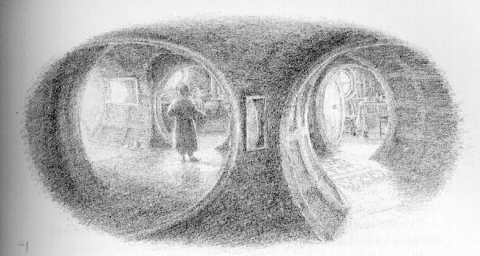
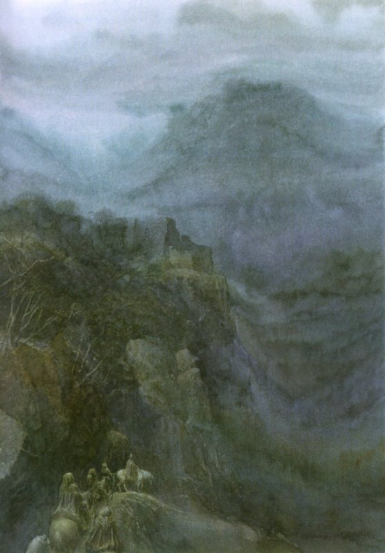
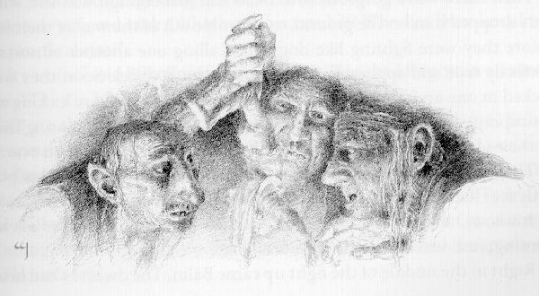
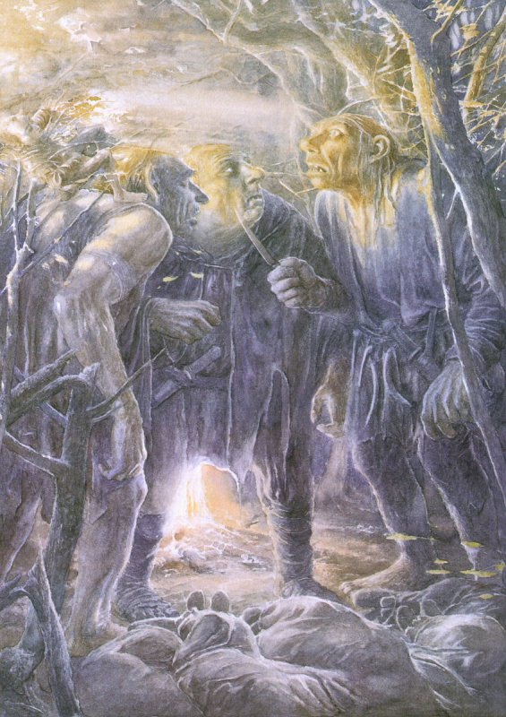

## Kapitel 2: Gebratenes Schaffleisch

Bilbo springt auf, zieht sich schnell an und läuft ins große Zimmer. Auf dem Tisch stehen die Reste von einem schnellen, aber großen Frühstück. Von den Zwergen sieht man nichts mehr. Nicht einmal Danke haben sie gesagt! Nun gut, wenigstens sind sie weg und haben ihn nicht geweckt. Im Zimmer ist eine schreckliche <abbr title="die Unordnung — беспорядок">Unordnung</abbr>. In der Küche liegt ein Berg von schmutzigem <abbr title="das Geschirr — посуда">Geschirr</abbr>. Offenbar haben die <abbr title="der Zwerg, die Zwerge — гном">Zwerge</abbr> fast alle Teller und <abbr title="der Kessel, die Kessel — котелок; котёл">Kessel</abbr> im Haus benutzt. Jetzt weiß Herr Baggins sicher: Gestern war kein böser Traum. Er hat nämlich immer noch gehofft, dass er den ganzen Abend nur geträumt hat. Seltsamerweise wird der Hobbit traurig.

— Sei nicht dumm, Bilbo Baggins, — sagt er zu sich. — In deinem Alter träumt man nicht mehr von <abbr title="der Drache, die Drachen — дракон">Drachen</abbr> und anderen fremden Ungeheuern.

Er zieht eine <abbr title="die Schürze, die Schürzen — фартук">Schürze</abbr> an und macht Feuer. Er kocht Wasser und wäscht das ganze <abbr title="das Geschirr — посуда">Geschirr</abbr>. Danach isst er eine Kleinigkeit.

Die Sonne scheint durch die Fenster. Durch die weit offene Haustür kommt warmer Frühlingswind. Bilbo beginnt zu <abbr title="pfeifen (pfiff, hat gepfiffen) — насвистывать">pfeifen</abbr>. Langsam vergisst er die Schwierigkeiten vom letzten Abend. Gerade setzt er sich ans Fenster für sein zweites Frühstück. Da kommt Gandalf.

— Mein Lieber! Du bist immer noch hier? Wolltest du nicht ganz früh losgehen? Frühstück um halb elf! Unglaublich! Die <abbr title="der Zwerg, die Zwerge — гном">Zwerge</abbr> konnten nicht so lange warten. Sie sind gegangen und haben dir eine Nachricht hinterlassen.

— Was für eine Nachricht? — fragt Herr Baggins erstaunt.

— Na so etwas! Was ist heute bloß mit dir los? Du hast nicht einmal den <abbr title="der Staub — пыль">Staub</abbr> vom Regal über dem <abbr title="der Kamin, die Kamine — камин; очаг">Kamin</abbr> gewischt.

— Das fehlt mir noch! Ich habe den ganzen Morgen <abbr title="das Geschirr — посуда">Geschirr</abbr> gewaschen!

— Beim Staubwischen findet man manchmal etwas. Zum Beispiel das hier.

Gandalf gibt Bilbo ein Blatt Papier. Natürlich stammt das Papier aus den <abbr title="der Vorrat, die Vorräte — запас">Vorräten</abbr> vom Hobbit. Darauf steht:

> Thorin und seine Gruppe grüßen Bilbo den <abbr title="der Schatzsucher, die Schatzsucher — добытчик; искатель сокровищ">Schatzsucher</abbr>!  
> Wir danken Ihnen herzlich für Ihre <abbr title="die Gastfreundschaft — гостеприимство">Gastfreundschaft</abbr>. Sie haben uns Hilfe bei unserer schwierigen Arbeit angeboten. Dieses Angebot nehmen wir mit Freude an.  
> Unsere Bedingungen: Sie bekommen ein Vierzehntel von der ganzen <abbr title="die Beute — добыча">Beute</abbr>, wenn wir welche finden. Ihre Reisekosten bezahlen wir auf jeden Fall. Auch Ihre <abbr title="die Beerdigung, die Beerdigungen — похороны">Beerdigung</abbr> bezahlen wir. Über alles andere sprechen wir einzeln.  
> Wir möchten Ihre Ruhe nicht stören. Deshalb gehen wir schon los und machen die nötigen Vorbereitungen. Wir erwarten den ehrwürdigen Herrn Baggins heute um genau elf Uhr. Unser Treffpunkt ist das Gasthaus „Green Dragon“ in Bywater. Wir rechnen mit Ihrer Pünktlichkeit.  
> Mit freundlichen Grüßen  
> Thorin und Co.

— Du hast noch zehn Minuten, — sagt Gandalf. — Wenn du rennst, schaffst du es.

— Aber … — beginnt der Hobbit.

— Keine Zeit!

— Aber …

— Noch weniger Zeit! Los!

Bilbo versteht auch später nie, wie er plötzlich auf die Straße kommt. Kein Geld, kein Hut, kein Wanderstab! Auch die anderen Dinge für eine Reise hat er nicht dabei. Das zweite Frühstück bleibt unberührt auf dem Tisch. Das <abbr title="das Geschirr — посуда">Geschirr</abbr> bleibt schmutzig. Bilbo drückt Gandalf die Schlüssel in die Hand und rennt den Hügel hinunter. Seine haarigen Füße laufen so schnell, wie sie nur können. Er läuft an der großen <abbr title="die Mühle, die Mühlen — мельница">Mühle</abbr> vorbei, überquert den Fluss und rennt die Straße entlang.

Mit dem ersten Schlag der Uhr kommt er in Bywater an. Die Uhr schlägt elf. Bilbo kann kaum noch atmen. Außerdem merkt er: Sein <abbr title="das Taschentuch, die Taschentücher — носовой платок">Taschentuch</abbr> liegt noch zu Hause.

— Bravo! — ruft Balin vor der Tür vom Gasthaus.

In diesem Augenblick kommen die anderen <abbr title="der Zwerg, die Zwerge — гном">Zwerge</abbr> um die Ecke. Sie reiten auf Ponys. An jedem <abbr title="der Sattel, die Sättel — седло">Sattel</abbr> hängen verschiedene Taschen und <abbr title="der Sack, die Säcke — мешок">Säcke</abbr>. Das kleinste Pony ist für Bilbo.

— Aufsteigen! — befiehlt Thorin. — Wir müssen los!

— Entschuldigen Sie bitte. Ich habe meinen Hut und mein <abbr title="das Taschentuch, die Taschentücher — носовой платок">Taschentuch</abbr> vergessen. Geld habe ich auch nicht mitgenommen. Genau gesagt habe ich Ihre Nachricht erst um zehn Uhr fünfundvierzig gesehen.

— Immer genau zu sein ist anstrengend, — sagt Dwalin freundlich. — Ohne <abbr title="das Taschentuch, die Taschentücher — носовой платок">Taschentuch</abbr> kommst du bald sehr gut aus, das verspreche ich dir. Und ich habe noch einen Mantel mit <abbr title="die Kapuze, die Kapuzen — капюшон">Kapuze</abbr>. Wegen deines Hutes musst du dir also keine Sorgen machen.

So beginnt alles an einem wunderschönen Morgen, ganz am Ende vom April. Die Ponys laufen vom Gasthaus weg. Bilbo dreht sich auf seinem Pony hin und her. Er muss sich an Dwalins dunkelgrünen Mantel gewöhnen. Wind und schlechtes Wetter haben dem Mantel schon viel geschadet. Er ist Bilbo etwas zu groß. Der Hobbit sieht darin ziemlich lächerlich aus. Was sagt wohl sein guter Vater Bungo dazu? Schon der Gedanke ist schrecklich! Nur eines freut Bilbo: Niemand kann ihn mit einem <abbr title="der Zwerg, die Zwerge — гном">Zwerg</abbr> verwechseln. Er hat nämlich keinen <abbr title="der Bart, die Bärte — борода">Bart</abbr>.

Bald holt Gandalf die Gruppe auf einem weißen Pferd ein. Er bringt viele <abbr title="das Taschentuch, die Taschentücher — носовой платок">Taschentücher</abbr>, Bilbos <abbr title="die Pfeife, die Pfeifen — курительная трубка">Pfeife</abbr> und seinen <abbr title="der Tabak — табак">Tabak</abbr> mit. Fröhlich reiten sie weiter. Den ganzen Tag erzählen sie Geschichten und singen Lieder. Nur für kleine Pausen mit etwas Essen hören sie auf. Bilbo findet, dass solche Pausen häufiger sein dürfen. Trotzdem beginnt er langsam zu denken: Ein <abbr title="das Abenteuer, die Abenteuer — приключение">Abenteuer</abbr> hat auch schöne Seiten.

Zuerst reiten sie durch die Shire. Die Gegend ist wunderbar gepflegt. Es gibt breite Straßen und Gasthäuser am Weg. Oft kommen ihnen <abbr title="der Zwerg, die Zwerge — гном">Zwerge</abbr> entgegen oder ehrwürdige Hobbits mit wichtigen Geschäften. Danach hören sie eine seltsame Sprache und Lieder, die Bilbo gar nicht kennt. Nun beginnen die Lone-lands. Keine Dörfer, keine Gasthäuser! Die Straßen werden immer schlechter. In der Ferne erscheinen Berge, schreckliche Berge bis hoch in den Himmel. Auf den bewaldeten Hängen stehen alte <abbr title="die Festung, die Festungen — крепость">Festungen</abbr>. Sie sind so finster, dass man an böse Mächte denken muss. Das Wetter wird langsam schlechter. Morgens war die Frühlingssonne noch warm. Am Mittag ist es schon kalt und <abbr title="feucht — сырой; влажный">feucht</abbr>. Für eine Pause ist alles zu nass.

— Wer sagt, dass bald Juni ist? — <abbr title="brummen — ворчать; бурчать">brummt</abbr> Bilbo leise.

Sein Pony läuft ganz hinten. Ein unangenehmer feiner Regen fällt. Von der <abbr title="die Kapuze, die Kapuzen — капюшон">Kapuze</abbr> tropft Wasser in Bilbos Gesicht. Sein Mantel ist völlig nass. Das müde Pony <abbr title="stolpern — спотыкаться">stolpert</abbr> immer wieder. Die <abbr title="der Zwerg, die Zwerge — гном">Zwerge</abbr> sind zu schlecht gelaunt für ein Gespräch. Außerdem ist jetzt Zeit für einen kleinen Imbiss am Nachmittag.

„Warum bin ich bloß mitgegangen?“, denkt Bilbo. „Zu Hause ist es warm und <abbr title="gemütlich — уютный">gemütlich</abbr>. Dort gibt es Tee. Aber nein, ich musste ja große Taten vollbringen! Was für große Taten? Hier ist alles nur nass!“

Nicht zum letzten Mal <abbr title="bereuen — сожалеть о сделанном">bereut</abbr> er seinen unvorsichtigen Entschluss.

Die <abbr title="der Zwerg, die Zwerge — гном">Zwerge</abbr> drehen sich nicht um und beachten ihn überhaupt nicht. Hinter den Wolken geht die Sonne wohl schon unter. Es wird nämlich dunkel. Die Reisenden gehen in ein tiefes kleines Tal hinunter. Unten fließt ein schneller Bach. <abbr title="die Weide, die Weiden — ива">Weiden</abbr> stehen an seinen Ufern. Ihre Blätter rauschen, und der Wind biegt die Bäume. Zum Glück ist die alte Steinbrücke noch ganz. Der Fluss ist vom Regen so hoch, dass niemand hindurchgehen kann.

Später am Abend treibt der Wind die Wolken fort. Der Mond erscheint. Thorin gibt das <abbr title="das Zeichen, die Zeichen — знак">Zeichen</abbr> zum Halten und <abbr title="murmeln — пробормотать">murmelt</abbr> etwas vom Abendessen.

— Wo finden wir einen trockeneren Platz?

Plötzlich merken alle: Gandalf ist verschwunden. Lange ist er mit ihnen geritten. Er hat geredet, gelacht und viel gegessen. Jetzt ist er weg. Vielleicht hat er eigene <abbr title="das Geschäft, die Geschäfte — дело; предприятие">Geschäfte</abbr> zu erledigen. Vielleicht findet er auch, dass er die Gruppe schon weit genug begleitet hat.

— Jetzt brauchen wir wirklich den <abbr title="der Zauberer, die Zauberer — волшебник">Zauberer</abbr>! — rufen Dori und Nori gleichzeitig.

Sie denken über ein warmes, gemütliches Leben genauso wie Bilbo.

Schließlich machen sie ihr <abbr title="das Lager, die Lager — лагерь">Lager</abbr> unten im Tal unter den Bäumen. Dort ist es ein wenig trockener. Aber von den Ästen tropft ständig Wasser. Das ist sehr ärgerlich. Mit dem Feuer haben sie große Schwierigkeiten. <abbr title="der Zwerg, die Zwerge — гном">Zwerge</abbr> können eigentlich überall Feuer machen, auch bei Wind. Heute Nacht gelingt es ihnen aber nicht. Sie versuchen alles. Sogar Oin und Gloin schaffen es nicht. Die beiden haben doch ein besonderes Talent fürs Feuermachen!

Ein Pony erschrickt und rennt weg. Sie können es nicht schnell genug fangen. Schon landet es im Fluss. Das Wasser trägt alle seine Taschen und <abbr title="der Sack, die Säcke — мешок">Säcke</abbr> fort. Fili und Kili ziehen das arme Tier heraus. Dabei <abbr title="ertrinken (ertrank, ist ertrunken) — утонуть">ertrinken</abbr> sie selbst beinahe. Mit den Taschen verschwindet auch der größte Teil vom Essen. Das macht Bilbo besonders traurig. Ihr Abendessen ist klein. Ein Frühstück scheint völlig unmöglich. Nass und finster sitzen sie da und warten auf Oins und Gloins Feuer. Die beiden sollen endlich aufhören zu streiten! Bilbo versteht langsam: Ein <abbr title="das Abenteuer, die Abenteuer — приключение">Abenteuer</abbr> ist kein Ponyritt an einem sonnigen Frühlingstag.

— Ein Licht! — ruft Balin.

Er soll gerade aufpassen, ob jemand kommt. Nun zeigt er auf einen Hügel mit vielen Bäumen. Dort sieht man wirklich ein kleines Licht. Vielleicht ein Feuer, vielleicht eine <abbr title="die Fackel, die Fackeln — факел">Fackel</abbr>.

Die Reisenden streiten, ob sie zum Licht gehen sollen. Einige sagen Ja, andere Nein. Wenigstens nachschauen, sagen die einen. Dort gibt es sicher etwas zu essen. Am Feuer können sie auch ihre Kleidung trocknen. Die anderen kennen die Gegend nicht gut genug. Die Berge sind schon nahe. Alte Karten helfen hier nicht. Alles ändert sich, und zwar zum Schlechteren. Um die Straßen kümmert sich niemand mehr. Eine zufällige Begegnung kann hier großen Ärger bringen. Also: Steck deine Nase nicht überall hinein, sonst reißt sie jemand ab!

— Aber wir sind doch vierzehn!

— Na und? Ohne Gandalf sind wir nicht viel wert.

— Wo ist Gandalf überhaupt?

Alle fragen durcheinander. Der Regen wird inzwischen noch stärker. Oin und Gloin beginnen sogar, einander zu schlagen.

Da fällt den Zwergen ihr geborener <abbr title="der Schatzsucher, die Schatzsucher — добытчик; искатель сокровищ">Schatzsucher</abbr> ein. Er kommt überall hinein! Also führen sie die Ponys leise zum Licht. Am Hügelfuß beginnt Wald. Einen Weg hinauf sehen sie nicht. Sie <abbr title="stolpern — спотыкаться">stolpern</abbr>, brechen laut krachende Äste ab, <abbr title="brummen — ворчать; бурчать">brummen</abbr> und schimpfen.

Plötzlich sehen sie das Feuer wieder zwischen den Bäumen.

— Jetzt sind Sie dran! — sagen alle und drehen sich zu Bilbo.

— Finden Sie heraus, was dort ist, — befiehlt Thorin. — Kommen Sie schnell zurück. Und geraten Sie möglichst nicht in eine <abbr title="die Falle, die Fallen — ловушка">Falle</abbr>. Wenn man Sie doch fängt, rufen Sie zweimal wie eine <abbr title="die Eule, die Eulen — сова">Eule</abbr>. Dann einmal wie ein <abbr title="der Uhu, die Uhus — филин">Uhu</abbr>. Wir kommen sofort und helfen Ihnen.

Bilbo kann nicht wie eine <abbr title="die Eule, die Eulen — сова">Eule</abbr> rufen. Genauso gut kann er fliegen! Er will das erklären, aber man befiehlt streng: Beeilung!

Hobbits gehen im Wald fast ohne Geräusch. Darauf sind sie stolz. Bilbo hat unterwegs über die <abbr title="der Zwerg, die Zwerge — гном">Zwerge</abbr> gelacht: Für ihn sind sie laut wie die Großen. Ihr und ich hören sogar eine ganze Zwergengruppe wenige Yards entfernt kaum. Nicht einmal ein <abbr title="das Wiesel, die Wiesel — ласка (животное)">Wiesel</abbr> bemerkt Bilbo. Geradewegs erreicht er eine <abbr title="die Lichtung, die Lichtungen — лесная поляна">Lichtung</abbr> zwischen den Bäumen mit dem rötlich leuchtenden Feuer. Dort sieht er Folgendes.

Um ein riesiges Feuer sitzen drei riesige Wesen. Auf langen Stöcken <abbr title="braten (briet, hat gebraten) — жарить">braten</abbr> sie <abbr title="das Schaffleisch — баранина">Schaffleisch</abbr>. Immer wieder lecken sie ihre fettigen Finger. Es riecht sehr gut. Alle drei trinken ständig aus großen Krügen. Die <abbr title="der Krug, die Krüge — кувшин; большая кружка">Krüge</abbr> füllen sie aus einem dicken <abbr title="das Fass, die Fässer — бочонок; бочка">Fass</abbr> in der Nähe. Es sind <abbr title="der Troll, die Trolle — тролль">Trolle</abbr>, wirkliche <abbr title="der Troll, die Trolle — тролль">Trolle</abbr>! Bilbo hat noch nie einen gesehen. Trotzdem erkennt er sie sofort. Sie sind groß, ihre Füße stehen seltsam nach außen, und ihre Gesichter sind dumm. Sie sprechen so grob, dass kein anständiges Haus sie hereinlässt.

— Der <abbr title="der Donner — гром">Donner</abbr> soll mich treffen! Schon wieder <abbr title="das Schaffleisch — баранина">Schaffleisch</abbr>! Seit drei Tagen <abbr title="fressen (fraß, hat gefressen) — жрать">fressen</abbr> wir das. Wie lange noch?

— Menschenfleisch habe ich schon lange nicht mehr probiert! Warum hat dieser Dummkopf William uns hierhergeschleppt? Ich soll verdammt sein!

Sein <abbr title="der Krug, die Krüge — кувшин; большая кружка">Krug</abbr> ist jedenfalls schon leer. Der <abbr title="der Troll, die Trolle — тролль">Troll</abbr> stößt seinen Freund am Ellbogen an. Der andere trinkt gerade und muss plötzlich husten. Das Bier läuft falsch hinunter.

— Halt die <abbr title="die Fresse, die Fressen — пасть; грубо: рот">Fresse</abbr>! — schreit er nach einem Hustenanfall. — Ihr Dummköpfe! Glaubt ihr, die Leute laufen euch einfach in den Mund? Du, Tom, hast schon anderthalb Dörfer aufgefressen. Bert war auch nicht faul! Was wollt ihr noch? Euch kann man nie satt machen! Sagt lieber Danke!

William schluckt ein großes Stück Fleisch und wischt den Mund mit seinem Ärmel ab.

Ich fürchte, alle <abbr title="der Troll, die Trolle — тролль">Trolle</abbr> benehmen sich so. Sogar die <abbr title="der Troll, die Trolle — тролль">Trolle</abbr> mit nur einem Kopf. Bilbo hört das Gespräch und weiß: Jetzt muss er handeln. Aber wie? Er kann leise zurückgehen und seine Freunde warnen. Drei riesige, hungrige <abbr title="der Troll, die Trolle — тролль">Trolle</abbr> sitzen hier. Sie essen sicher gern <abbr title="der Zwerg, die Zwerge — гном">Zwerge</abbr> und danach noch ein Pony. Oder soll er etwas stehlen? Ein wirklicher <abbr title="der Schatzsucher, die Schatzsucher — добытчик; искатель сокровищ">Schatzsucher</abbr> zögert natürlich nicht. Er leert die Taschen der <abbr title="der Troll, die Trolle — тролль">Trolle</abbr>. Dort findet man immer etwas. Er nimmt das Fleisch und das Bierfass mit und verschwindet. Für seine eigene Sicherheit kann er alle drei mit einem <abbr title="der Dolch, die Dolche — кинжал">Dolch</abbr> durchstechen. Danach steht ihm alles offen.

Bilbo ist aber kein wirklicher <abbr title="der Schatzsucher, die Schatzsucher — добытчик; искатель сокровищ">Schatzsucher</abbr>. Einen lebenden <abbr title="der Troll, die Trolle — тролль">Troll</abbr> kennt er nur aus Büchern. Er hat Angst und will am liebsten Hunderte von Meilen weit weg sein. Trotzdem kann er nicht mit leeren Händen zu Thorin zurückgehen! Woher kommt dieser Gedanke? Bilbo weiß es nicht. Aber der Gedanke lässt ihn nicht in Ruhe und zwingt ihn zum Handeln. Schließlich beschließt er, die Taschen der <abbr title="der Troll, die Trolle — тролль">Trolle</abbr> zu durchsuchen. Das scheint am einfachsten. Vorsichtig kommt er näher. Hinter einem Baum, genau hinter Williams Rücken, versteckt er sich.

Bert und Tom stehen auf und gehen zum <abbr title="das Fass, die Fässer — бочонок; бочка">Fass</abbr>. William trinkt weiter aus seinem <abbr title="der Krug, die Krüge — кувшин; большая кружка">Krug</abbr>. Bilbo fasst <abbr title="der Mut — смелость">Mut</abbr>. Seine winzige Hand greift in die Tasche vom <abbr title="der Troll, die Trolle — тролль">Troll</abbr>. Dort liegt ein <abbr title="der Geldbeutel, die Geldbeutel — кошель; кошелёк">Geldbeutel</abbr>. Er ist so groß wie Bilbos ganze Tasche.

„Ho! Was für ein Anfang!“, denkt Bilbo begeistert und zieht ihn heraus.

Ja … Mit Geldbeuteln von Trollen muss man vorsichtig sein. Kaum ist der <abbr title="der Geldbeutel, die Geldbeutel — кошель; кошелёк">Geldbeutel</abbr> draußen, schreit er mit einer schrecklichen Stimme:

— He! Wer bist du?

William dreht sich um. Bilbo ist nicht schnell genug, und der <abbr title="der Troll, die Trolle — тролль">Troll</abbr> packt ihn.

— Ich soll in die Erde sinken! Bert, schau, was ich gefangen habe!

— Was ist das?

— Ich soll platzen, wenn ich das weiß! Wer bist du, he?

— Bilbo Baggins … Schaaa … Hobbit, — sagt der arme Herr Baggins mit Mühe.

Er zittert wie ein Blatt im Wind. Plötzlich fragt er sich: Hat er noch Zeit für einen Eulenruf? Oder drücken sie ihm vorher schon den Hals zu?

— Schahobbit? — fragt der <abbr title="der Troll, die Trolle — тролль">Troll</abbr> verwirrt.

<abbr title="der Troll, die Trolle — тролль">Trolle</abbr> denken nämlich langsam und mögen Neues gar nicht.

— Warum greifst du in meine Tasche, Schahobbit?

Die anderen beiden schauen Bilbo neugierig an.

— Kann man ihn <abbr title="braten (briet, hat gebraten) — жарить">braten</abbr>? — fragt Tom.

— Probieren wir es, — sagt Bert und hebt einen Stock vom Boden auf.

— Sehr klein, — sagt William freundlich. Sein Bauch ist schon voll. — Die <abbr title="die Haut, die Häute — кожа">Haut</abbr> ziehen wir ab. Die <abbr title="der Knochen, die Knochen — кость">Knochen</abbr> werfen wir weg. Was bleibt dann noch?

— Vielleicht ist er nicht allein. Dann backen wir einen Kuchen, — sagt Bert. — He, du halbes Kaninchen! Gibt es noch mehr solche kleinen Quietscher in diesem Wald?

Er packt Bilbo an den Füßen und schüttelt ihn.

— Viele! — sagt Bilbo ohne Nachdenken. Dann merkt er seinen Fehler. — Nein, sonst niemand!

— Was? — Bert packt seine Haare und zieht schmerzhaft daran.

— Sie haben mich schon verstanden! — antwortet Bilbo mit hoher, ärgerlicher Stimme. — Bitte, meine guten Herren, <abbr title="braten (briet, hat gebraten) — жарить">braten</abbr> Sie mich nicht! Ich kann Ihnen helfen. Ich kann kochen. Ich mache Ihnen ein so gutes Frühstück, dass Sie sich die Finger lecken. Aber essen Sie mich nicht zum Abendbrot!

— Der Arme, — sagt William und <abbr title="rülpsen — рыгнуть">rülpst</abbr> zufrieden. — Ihr macht dem Kleinen Angst. Lass ihn los, Bert.

— Nein! Zuerst erklärt er uns, was „viele“ und „niemand“ bedeutet. Ich will nicht, dass man mir nachts den Hals durchschneidet. Ich halte seine Füße ins Feuer. Dann redet er schnell!

— Das lasse ich nicht zu! — ruft William. — Es ist mein Schahobbit. Ich habe ihn gefangen!

— William, du fetter alter Dummkopf! Ich habe es schon gesagt und sage es wieder!

— Und du bist ein Idiot!

— Das lasse ich mir nicht gefallen, Bill Huggins! — sagt Bert.

Er schlägt William mit der Faust ins Auge. Ein wunderbarer Kampf beginnt. Bert wirft Bilbo zur Seite. Der Hobbit ist klug genug, weiter wegzukriechen. Die <abbr title="der Troll, die Trolle — тролль">Trolle</abbr> kämpfen wie zwei Hunde ohne Herrn. Sie beschimpfen einander mit vielen verschiedenen Namen. Ehrlich gesagt passen die Namen sehr gut zu ihnen. Bald rollen sie auf dem Boden und schlagen einander gefährlich nah am Feuer. Tom schlägt mit einem Stock auf sie ein. Er will sie zur Vernunft bringen. Natürlich machen die Schläge sie nur noch wilder. Jetzt muss Bilbo weglaufen. Aber er kann nicht aufstehen. Bert hat ihm fast die Luft abgedrückt. Sein Kopf dreht sich. Deshalb kriecht er nur in die Dunkelheit und rollt sich am Boden zusammen.

Mitten im Kampf kommt Balin. Die <abbr title="der Zwerg, die Zwerge — гном">Zwerge</abbr> haben den Lärm gehört und sind unruhig geworden. Sie haben eine Weile gewartet. Bilbo ist nicht zurückgekommen, und Eulenrufe haben sie auch nicht gehört. Deshalb gehen sie ihm nach. Tom sieht Balin und brüllt. <abbr title="der Troll, die Trolle — тролль">Trolle</abbr> mögen lebende <abbr title="der Zwerg, die Zwerge — гном">Zwerge</abbr> überhaupt nicht. Gebraten essen sie sie aber mit großem Vergnügen. Bert und William hören sofort auf zu kämpfen.

— Einen <abbr title="der Sack, die Säcke — мешок">Sack</abbr>, Tom! Schnell!

Balin sucht auf der <abbr title="die Lichtung, die Lichtungen — лесная поляна">Lichtung</abbr> nach Bilbo. Er versteht noch gar nichts. Schon kommt ein <abbr title="der Sack, die Säcke — мешок">Sack</abbr> über seinen Kopf, und er fällt auf den Boden.

— Das ist sicher nicht der Letzte, — <abbr title="brummen — ворчать; бурчать">brummt</abbr> Tom. — „Schahobbit“, sagt er! „Niemand sonst“, sagt er! Das sind doch gar keine Schahobbits. Das sind richtige <abbr title="der Zwerg, die Zwerge — гном">Zwerge</abbr>.

— Genau, — sagt Bert. — Verstecken wir uns.

Sie nehmen zwölf leere <abbr title="der Sack, die Säcke — мешок">Säcke</abbr> und verstecken sich. Einer nach dem anderen kommt ein <abbr title="der Zwerg, die Zwerge — гном">Zwerg</abbr> auf die <abbr title="die Lichtung, die Lichtungen — лесная поляна">Lichtung</abbr>. Er bleibt erstaunt stehen. Er sieht das Feuer, die Bierkrüge und das halb aufgegessene Schaf. Schon fällt ein übel riechender <abbr title="der Sack, die Säcke — мешок">Sack</abbr> über seinen Kopf. Der <abbr title="der Zwerg, die Zwerge — гном">Zwerg</abbr> landet auf dem Boden. Bald liegen Oin, Gloin, Bifur, Bofur und Bombur in einer Reihe beim Feuer. Dwalin, Kili und Fili liegen neben Balin.

— Ruht euch ein bisschen aus, — empfiehlt Tom.

Bifur, Bofur und Bombur haben den Trollen nämlich viel Mühe gemacht. Sie haben sich wild <abbr title="sich wehren — сопротивляться">gewehrt</abbr>. So kämpfen nur <abbr title="der Zwerg, die Zwerge — гном">Zwerge</abbr>, wenn man sie plötzlich überrascht.

Thorin kommt zuletzt. Ihn können die <abbr title="der Troll, die Trolle — тролль">Trolle</abbr> nicht täuschen. Er passt gut auf und merkt sofort: Hier ist etwas Schlimmes passiert. Er bleibt ein Stück vom Feuer entfernt im Dunkeln stehen. Mit einer Stimme wie <abbr title="der Donner — гром">Donner</abbr> ruft er:

— Wer wagt es, meine <abbr title="der Untertan, die Untertanen — подданный">Untertanen</abbr> schlecht zu behandeln?

— <abbr title="der Troll, die Trolle — тролль">Trolle</abbr>! — sagt Bilbo mit hoher Stimme. In der Unruhe hat man ihn ganz vergessen. — Sie verstecken sich hinter den Bäumen!

— Wirklich?

Thorin springt zum Feuer. Er nimmt einen riesigen brennenden Ast heraus. Bert kann nicht ausweichen, und Thorin stößt ihm den Ast ins Auge. Bert brüllt und kann eine Weile nicht mehr kämpfen. Bilbo will Thorin helfen. Er packt Toms Bein, das so dick wie ein Baumstamm ist. Tom schüttelt das Bein, und Bilbo fliegt in die <abbr title="der Busch, die Büsche — куст">Büsche</abbr>. Dann wirft Tom Thorin eine Handvoll heiße Kohlen ins Gesicht. Dafür schlägt Thorin ihm den Ast gegen die Zähne. Tom verliert einen großen spitzen Zahn. Was für ein Gebrüll! Aber inzwischen kommt William leise von hinten und wirft einen <abbr title="der Sack, die Säcke — мешок">Sack</abbr> über Thorin. Der Kampf ist zu Ende.

Drei wütende <abbr title="der Troll, die Trolle — тролль">Trolle</abbr> streiten nun über ihr Essen. Zwei von ihnen haben verbrannte <abbr title="die Haut, die Häute — кожа">Haut</abbr>. Sollen sie ihre <abbr title="die Beute — добыча">Beute</abbr> <abbr title="braten (briet, hat gebraten) — жарить">braten</abbr>, kochen oder einfach ganz flach drücken? Bilbo liegt voller Kratzer in den Büschen. Vor Angst wagt er keine Bewegung.

Genau jetzt kommt Gandalf zurück. Niemand bemerkt ihn. Die <abbr title="der Troll, die Trolle — тролль">Trolle</abbr> entscheiden sich inzwischen fürs <abbr title="räuchern — коптить">Räuchern</abbr>. So haben sie etwas zum Frühstück. Bert hat zuerst diesen Gedanken. Nach langem Streit stimmen seine Freunde zu.

— Warum jetzt <abbr title="räuchern — коптить">räuchern</abbr>? Das dauert doch die ganze Nacht, — sagt eine Stimme.

Bert glaubt, dass William spricht.

— Genug, Bill! Wie lange willst du noch streiten?

— Ich streite gar nicht! — sagt William erstaunt.

— Doch, du!

— Du lügst!

Der Streit beginnt von vorn. Schließlich wollen sie die <abbr title="der Zwerg, die Zwerge — гном">Zwerge</abbr> in kleine Stücke schneiden und kochen. Sie holen einen großen <abbr title="der Kessel, die Kessel — котелок; котёл">Kessel</abbr> und ihre Messer.

— Lieber nicht, oder? Wir haben kein Wasser. Die <abbr title="die Quelle, die Quellen — родник">Quelle</abbr> ist weit weg, und überhaupt … — sagt die Stimme.

Bert und William schauen Tom böse an.

— Halt die <abbr title="die Fresse, die Fressen — пасть; грубо: рот">Fresse</abbr>! Sonst bekommen wir heute gar nichts zu <abbr title="fressen (fraß, hat gefressen) — жрать">fressen</abbr>! Noch ein Wort, und du holst das Wasser!

— Haltet selbst die <abbr title="die Fresse, die Fressen — пасть; грубо: рот">Fresse</abbr>! — sagt Tom ärgerlich. — Und du, Bill, sei still. Du musst immer widersprechen!

— Schweig, du <abbr title="die Vogelscheuche, die Vogelscheuchen — пугало">Vogelscheuche</abbr>! — schreit William.

— Selber <abbr title="die Vogelscheuche, die Vogelscheuchen — пугало">Vogelscheuche</abbr>!

Nun beschimpfen die <abbr title="der Troll, die Trolle — тролль">Trolle</abbr> also einander persönlich. Endlich werden sie ruhiger und einigen sich. Sie setzen sich nacheinander auf jeden <abbr title="der Sack, die Säcke — мешок">Sack</abbr> und drücken die <abbr title="der Zwerg, die Zwerge — гном">Zwerge</abbr> flach. Danach kochen sie sie.

— Auf wen setzen wir uns zuerst? — fragt die Stimme.

— Auf den Letzten, — sagt Bert.

Er meint Thorin, der sein Auge verletzt hat. Und er glaubt, dass er mit Tom spricht.

— Jetzt ist er völlig <abbr title="verrückt — сумасбродный; сумасшедший">verrückt</abbr>. Er redet schon mit sich selbst, — <abbr title="brummen — ворчать; бурчать">brummt</abbr> Tom. — Na, dann setz dich. Wo ist er?

— Dort, mit den gelben Socken.

— Unsinn! Graue Socken, keine gelben! — sagt die Stimme wie William.

— Gelbe, sage ich! — beharrt Bert.

— Stimmt, — sagt William. — Gelbe.

— Warum hast du dann graue gesagt?

— Ich? Das war Tom, nicht ich!

— Gar nicht! Das warst du, Bill!

— Zwei gegen einen. Also halt die <abbr title="die Fresse, die Fressen — пасть; грубо: рот">Fresse</abbr>, — sagt Bert.

— Mit wem redest du?

— Genug! — schreien Bert und Tom gemeinsam. — Die Zeit läuft! Bald wird es hell. Wir müssen endlich etwas tun!

— Der <abbr title="der Tagesanbruch — рассвет">Tagesanbruch</abbr> kommt und macht euch zu Stein, — sagt die Stimme feierlich.

In diesem Augenblick wird der Himmel über den Hügeln rosa. Vögel beginnen in den Ästen zu singen. William bleibt gebückt stehen. Bert und Tom bewegen sich auch nicht mehr. Noch heute stehen sie auf der <abbr title="die Lichtung, die Lichtungen — лесная поляна">Lichtung</abbr>. Zwei schauen den dritten an. Vögel bauen ihre <abbr title="das Nest, die Nester — гнездо">Nester</abbr> auf ihren Köpfen. Ihr wisst sicher: Sonnenlicht ist für <abbr title="der Troll, die Trolle — тролль">Trolle</abbr> gefährlich. Sie müssen rechtzeitig vor der Sonne unter die Erde. Sonst werden sie für immer zu Stein. Aus diesem Stein sind sie ja entstanden. Genau das passiert William, Tom und Bert.

— So ist es besser, — sagt Gandalf.

Er kommt hinter einem Baum hervor und hilft Bilbo aus dem stacheligen <abbr title="der Busch, die Büsche — куст">Busch</abbr>. Erst jetzt versteht der Hobbit: Der <abbr title="der Zauberer, die Zauberer — волшебник">Zauberer</abbr> hat die Stimmen der <abbr title="der Troll, die Trolle — тролль">Trolle</abbr> <abbr title="nachahmen — подражать; имитировать">nachgeahmt</abbr>. So hat er ihren Streit immer weitergeführt. Dabei haben sie nicht gemerkt, dass der Tag beginnt.

Gandalf und Bilbo öffnen gemeinsam die <abbr title="der Sack, die Säcke — мешок">Säcke</abbr> und befreien die <abbr title="der Zwerg, die Zwerge — гном">Zwerge</abbr>. Sie haben fast keine Luft mehr bekommen und sind außer sich vor Wut. Natürlich! Wie fühlt man sich in einem <abbr title="der Sack, die Säcke — мешок">Sack</abbr>? Man weiß nicht, ob man roh, gekocht oder gebraten auf den Tisch kommt! Bilbo erzählt seine Geschichte. Aber die <abbr title="der Zwerg, die Zwerge — гном">Zwerge</abbr> beruhigen sich nicht. Er muss alles noch einmal erzählen. Erst dann werden sie etwas ruhiger.

— Das war ja der richtige Augenblick zum Üben, — <abbr title="brummen — ворчать; бурчать">brummt</abbr> Bombur. — Einfach etwas Essen bringen, das war wohl zu schwer?

— „Einfach“ war es auf keinen Fall, — antwortet Gandalf. — Aber genug davon. Es ist vorbei. In der Nähe gibt es sicher eine <abbr title="die Höhle, die Höhlen — нора; пещера">Höhle</abbr>. Die <abbr title="der Troll, die Trolle — тролль">Trolle</abbr> müssen sich doch irgendwo vor der Sonne verstecken. Suchen wir sie.

Bald finden sie Spuren von Trollschuhen den Hang hinauf. Die Spuren führen zu einer <abbr title="die Höhle, die Höhlen — нора; пещера">Höhle</abbr>. Eine große <abbr title="die Steinplatte, die Steinplatten — каменная плита">Steinplatte</abbr> versperrt den Eingang. In ihr ist ein <abbr title="das Schlüsselloch, die Schlüssellöcher — замочная скважина">Schlüsselloch</abbr>. Die Reisenden können die Platte nicht bewegen. Sie drücken alle gemeinsam dagegen, aber nichts geschieht. Gandalf <abbr title="murmeln — пробормотать">murmelt</abbr> Zauberworte. Auch das hilft nicht.

— Wir machen vielleicht etwas falsch, — sagt Bilbo plötzlich.

Aus seiner Tasche zieht er einen riesigen Schlüssel. Für einen <abbr title="der Troll, die Trolle — тролль">Troll</abbr> ist er natürlich nur ein Schlüsselchen.

— Ich habe ihn beim Feuer gefunden. Wahrscheinlich hat jemand ihn aus seiner Tasche verloren.

— Warum hast du nichts gesagt? — rufen alle gemeinsam.

Gandalf nimmt den Schlüssel und steckt ihn ins <abbr title="das Schlüsselloch, die Schlüssellöcher — замочная скважина">Schlüsselloch</abbr>. Er dreht sich. Die <abbr title="der Zwerg, die Zwerge — гном">Zwerge</abbr> drücken wieder, und die Platte geht zur Seite. In der <abbr title="die Höhle, die Höhlen — нора; пещера">Höhle</abbr> <abbr title="stinken (stank, hat gestunken) — вонять">stinkt</abbr> es schrecklich. Auf dem Boden liegen <abbr title="der Knochen, die Knochen — кость">Knochen</abbr>. Überall liegen Lebensmittel und andere geraubte Dinge. Kupferknöpfe und Töpfe voller Goldmünzen, alles durcheinander! An den Wänden hängen Anzüge und Kleider, viel zu klein für <abbr title="der Troll, die Trolle — тролль">Trolle</abbr>. Ich fürchte, das ist die Kleidung der Leute, die sie gegessen haben. Auch <abbr title="das Schwert, die Schwerter — меч">Schwerter</abbr> hängen dort, lange und kurze. Zwei fallen sofort auf. Sie stecken in wunderschönen <abbr title="die Scheide, die Scheiden — ножны">Scheiden</abbr>. <abbr title="der Edelstein, die Edelsteine — драгоценный камень">Edelsteine</abbr> glänzen an ihren Griffen.

Diese <abbr title="das Schwert, die Schwerter — меч">Schwerter</abbr> nehmen Gandalf und Thorin. Bilbo wählt ein Messer in einer Hülle aus <abbr title="das Leder — кожа (материал)">Leder</abbr>. Für einen <abbr title="der Troll, die Trolle — тролль">Troll</abbr> ist das natürlich nur ein kleines Taschenmesser. Dem Hobbit passt die Waffe aber genau.

— Nicht schlecht, — sagt Gandalf.

Er zieht sein <abbr title="das Schwert, die Schwerter — меч">Schwert</abbr> halb aus der <abbr title="die Scheide, die Scheiden — ножны">Scheide</abbr> und schaut es genau an.

— Eine gute Waffe. Nicht die <abbr title="der Troll, die Trolle — тролль">Trolle</abbr> haben sie gemacht, auch nicht die Leute von hier. Und sie ist nicht aus unserer Zeit. Wenn wir die <abbr title="die Rune, die Runen — руна">Runen</abbr> lesen, wissen wir mehr.

— Gehen wir hinaus, — sagt Fili. — Hier riecht es schlecht.

Die Reisenden ziehen einige Töpfe mit Gold nach draußen. Sie rollen das Bierfass hinaus und nehmen alles mit, was essbar aussieht. Es ist Frühstückszeit, und sie haben großen Hunger. Deshalb sind sie beim Essen der <abbr title="der Troll, die Trolle — тролль">Trolle</abbr> nicht wählerisch. Essen ist schließlich Essen. Von ihren eigenen <abbr title="der Vorrat, die Vorräte — запас">Vorräten</abbr> ist fast nichts mehr da. Hier haben sie Käse, Brot, Brustfleisch vom Schwein und sehr, sehr viel Bier.

Nach dem Frühstück legen sich alle hin. Die Nacht war ja unruhig. Sie schlafen bis Mittag. Dann holen sie die Ponys. Sie bringen die Goldtöpfe an einen geheimen Ort nahe beim Weg und verstecken sie dort. Viele Zauber schützen das Versteck. Niemand soll sich ihre <abbr title="der Schatz, die Schätze — клад; сокровище">Schätze</abbr> „ausleihen“. Danach reiten sie auf der Straße nach Osten.

— Darf ich fragen, wo du warst? — fragt Thorin Gandalf neben sich.

— Ich habe nach vorn geschaut.

— Und warum bist du zurückgekommen, noch dazu genau zur richtigen Zeit?

— Ein Blick zurück.

— Aha. Geht es etwas genauer?

— Ich habe den Weg untersucht. Große Schwierigkeiten warten auf uns. Ich bin also geritten und habe die Gegend angeschaut. Plötzlich habe ich zwei alte Freunde aus Rivendell getroffen.

— Wo ist das? — fragt Bilbo.

— Unterbrich mich nicht, — sagt Gandalf streng. — Mit etwas Glück kommen wir in zwei oder drei Tagen dorthin. Also: Ich habe zwei <abbr title="der Elf, die Elfen — эльф">Elfen</abbr> von Elrond getroffen. Sie haben mich vor den Trollen gewarnt. Die <abbr title="der Troll, die Trolle — тролль">Trolle</abbr> sind von den Bergen in den Wald nahe der Straße gekommen. Viel habe ich nicht erfahren. Die <abbr title="der Elf, die Elfen — эльф">Elfen</abbr> hatten es sehr eilig. Aber ich wusste: Ich muss zurück. Ich habe mein Pferd gewendet und in der Ferne ein Licht gesehen. Dorthin bin ich geritten. So war es genauer. Seid in Zukunft bitte vorsichtiger. Sonst kommen wir überhaupt nirgendwo an.

— Ich danke dir, <abbr title="der Zauberer, die Zauberer — волшебник">Zauberer</abbr>, — sagt Thorin und <abbr title="sich verbeugen — поклониться">verbeugt</abbr> sich wichtig.

---

### Neue und schwierige Wörter

- **die Unordnung** — беспорядок *(neu)*
- **das Geschirr** — посуда *(Wiederholung)*
- **der Zwerg, die Zwerge** — гном *(Wiederholung)*
- **der Kessel, die Kessel** — котелок; котёл *(Wiederholung)*
- **der Drache, die Drachen** — дракон *(Wiederholung)*
- **die Schürze, die Schürzen** — фартук *(neu)*
- **pfeifen (pfiff, hat gepfiffen)** — насвистывать *(neu)*
- **der Staub** — пыль *(neu)*
- **der Kamin, die Kamine** — камин; очаг *(Wiederholung)*
- **der Vorrat, die Vorräte** — запас *(Wiederholung)*
- **der Schatzsucher, die Schatzsucher** — добытчик; искатель сокровищ *(Wiederholung)*
- **die Gastfreundschaft** — гостеприимство *(neu)*
- **die Beute** — добыча *(neu)*
- **die Beerdigung, die Beerdigungen** — похороны *(neu)*
- **die Mühle, die Mühlen** — мельница *(neu)*
- **das Taschentuch, die Taschentücher** — носовой платок *(neu)*
- **der Sattel, die Sättel** — седло *(neu)*
- **der Sack, die Säcke** — мешок *(Wiederholung)*
- **die Kapuze, die Kapuzen** — капюшон *(Wiederholung)*
- **der Bart, die Bärte** — борода *(Wiederholung)*
- **die Pfeife, die Pfeifen** — курительная трубка *(Wiederholung)*
- **der Tabak** — табак *(Wiederholung)*
- **das Abenteuer, die Abenteuer** — приключение *(Wiederholung)*
- **die Festung, die Festungen** — крепость *(neu)*
- **feucht** — сырой; влажный *(Wiederholung)*
- **brummen** — ворчать; бурчать *(neu)*
- **stolpern** — спотыкаться *(neu)*
- **gemütlich** — уютный *(Wiederholung)*
- **bereuen** — сожалеть о сделанном *(Wiederholung)*
- **die Weide, die Weiden** — ива *(neu)*
- **das Zeichen, die Zeichen** — знак *(Wiederholung)*
- **murmeln** — пробормотать *(Wiederholung)*
- **das Geschäft, die Geschäfte** — дело; предприятие *(Wiederholung)*
- **der Zauberer, die Zauberer** — волшебник *(Wiederholung)*
- **das Lager, die Lager** — лагерь *(neu)*
- **ertrinken (ertrank, ist ertrunken)** — утонуть *(neu)*
- **die Fackel, die Fackeln** — факел *(neu)*
- **die Falle, die Fallen** — ловушка *(neu)*
- **die Eule, die Eulen** — сова *(neu)*
- **der Uhu, die Uhus** — филин *(neu)*
- **das Wiesel, die Wiesel** — ласка (животное) *(neu)*
- **die Lichtung, die Lichtungen** — лесная поляна *(neu)*
- **braten (briet, hat gebraten)** — жарить *(neu)*
- **das Schaffleisch** — баранина *(neu)*
- **der Krug, die Krüge** — кувшин; большая кружка *(Wiederholung)*
- **das Fass, die Fässer** — бочонок; бочка *(neu)*
- **der Troll, die Trolle** — тролль *(neu)*
- **der Donner** — гром *(Wiederholung)*
- **fressen (fraß, hat gefressen)** — жрать *(neu)*
- **die Fresse, die Fressen** — пасть; грубо: рот *(neu)*
- **der Dolch, die Dolche** — кинжал *(neu)*
- **der Mut** — смелость *(Wiederholung)*
- **der Geldbeutel, die Geldbeutel** — кошель; кошелёк *(neu)*
- **die Haut, die Häute** — кожа *(Wiederholung)*
- **der Knochen, die Knochen** — кость *(neu)*
- **rülpsen** — рыгнуть *(neu)*
- **sich wehren** — сопротивляться *(neu)*
- **der Untertan, die Untertanen** — подданный *(neu)*
- **der Busch, die Büsche** — куст *(neu)*
- **räuchern** — коптить *(neu)*
- **die Quelle, die Quellen** — родник *(neu)*
- **die Vogelscheuche, die Vogelscheuchen** — пугало *(neu)*
- **verrückt** — сумасбродный; сумасшедший *(Wiederholung)*
- **der Tagesanbruch** — рассвет *(neu)*
- **das Nest, die Nester** — гнездо *(neu)*
- **nachahmen** — подражать; имитировать *(neu)*
- **die Höhle, die Höhlen** — нора; пещера *(Wiederholung)*
- **die Steinplatte, die Steinplatten** — каменная плита *(neu)*
- **das Schlüsselloch, die Schlüssellöcher** — замочная скважина *(neu)*
- **stinken (stank, hat gestunken)** — вонять *(neu)*
- **das Schwert, die Schwerter** — меч *(Wiederholung)*
- **die Scheide, die Scheiden** — ножны *(neu)*
- **der Edelstein, die Edelsteine** — драгоценный камень *(Wiederholung)*
- **das Leder** — кожа (материал) *(Wiederholung)*
- **die Rune, die Runen** — руна *(Wiederholung)*
- **der Schatz, die Schätze** — клад; сокровище *(Wiederholung)*
- **der Elf, die Elfen** — эльф *(Wiederholung)*
- **sich verbeugen** — поклониться *(Wiederholung)*

### Schwierige Sätze

- **„Er hat nämlich immer noch gehofft, dass er den ganzen Abend nur geträumt hat.“**  
  «Он ведь всё ещё надеялся, что весь вечер ему только приснился». `hoffen, dass …` вводит содержание надежды. В обеих частях Perfekt: речь о том, что было раньше.
- **„Beim Staubwischen findet man manchmal etwas.“**  
  «Вытирая пыль, иногда что-нибудь находишь». `beim` = `bei dem`; действие выражено существительным. `Staubwischen` — «вытирание пыли».
- **„Sie bekommen ein Vierzehntel von der ganzen Beute, wenn wir welche finden.“**  
  «Вы получите одну четырнадцатую всей добычи, если мы что-нибудь добудем». `ein Vierzehntel` — одна из четырнадцати равных частей. `welche` здесь заменяет повтор слова `Beute`.
- **„Wenn du rennst, schaffst du es.“**  
  «Если побежишь, успеешь». После придаточной части главная начинается с глагола: `schaffst du`. `es schaffen` — справиться, успеть.
- **„Ihr und ich hören sogar eine ganze Zwergengruppe wenige Yards entfernt kaum.“**  
  «Мы с вами даже целый отряд гномов в нескольких ярдах от нас почти не слышим». `kaum` — «едва; почти не». Начальное `Ihr und ich` — «вы и я», то есть рассказчик и читатели.
- **„Ich mache Ihnen ein so gutes Frühstück, dass Sie sich die Finger lecken.“**  
  «Я приготовлю вам такой вкусный завтрак, что вы пальчики оближете». `so …, dass …` выражает следствие. Здесь знакомое и русскому читателю образное выражение.
- **„Der Hobbit ist klug genug, weiter wegzukriechen.“**  
  «Ему хватает ума отползти подальше». `genug` стоит после прилагательного. У отделяемого глагола `wegkriechen` частица `zu` входит между приставкой и основой: `wegzukriechen`.
- **„Noch heute stehen sie auf der Lichtung.“**  
  «Они стоят на поляне и по сей день». `noch heute` — не «ещё сегодня вечером», а «до сих пор, поныне».
- **„Niemand soll sich ihre Schätze „ausleihen“.“**  
  «Чтобы никто не “позаимствовал” их сокровища». `sich etwas ausleihen` — взять что-то на время; кавычки передают иронию: речь о краже.

[← Zurück](kapitel-01.md) · [Inhalt](README.md) · [Weiter →](kapitel-03.md)
