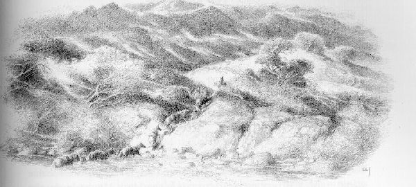
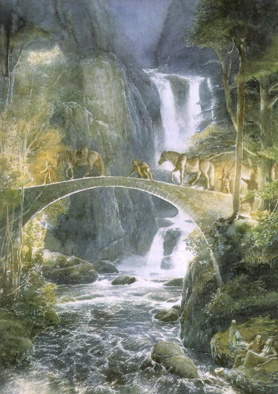

## Kapitel 3: Eine kurze Pause

Niemand singt mehr oder erzählt Geschichten. Das Wetter wird jeden Tag besser. Die Stimmung wird aber aus irgendeinem Grund immer schlechter. Ihre Sorgen wachsen. Gefahr scheint von allen Seiten zu kommen. Nachts schlafen sie draußen unter den Sternen. Die Ponys haben genug zu essen, denn Gras wächst überall. Die Reisenden bleiben dagegen hungrig. Ihre Taschen sind fast leer. Auch das Essen aus der Trollhöhle ist fast aufgebraucht. Eines Morgens gehen sie durch eine breite, flache Stelle im wilden Fluss. Mühsam steigen sie den steilen Hang hinauf. Jetzt stehen die Berge direkt vor ihnen. Zum nächsten Berg scheint es nur ein ruhiger Tagesmarsch zu sein. Die braunen <abbr title="der Felsen, die Felsen — скала; утёс">Felsen</abbr> leuchten in der Sonne und machen ihnen auf seltsame Weise Angst. Dahinter steigen weiße <abbr title="der Gipfel, die Gipfel — горная вершина">Gipfel</abbr> hoch in den Himmel.

— Ist das der Berg? — fragt Bilbo mit großen Augen.

So etwas Riesiges hat er noch nie gesehen.

— Nein, — sagt Balin. — Das sind nur die ersten Höhen vor den Misty Mountains. Über diese Berge müssen wir nach Wilderland gehen. Von dort geht es weiter zum Lonely Mountain. Dort liegt der <abbr title="verfluchen — проклясть">verfluchte</abbr> Smaug auf unseren Schätzen.

— Aha … — sagt Bilbo langsam.

Plötzlich fühlt er sich so müde wie noch nie. Er denkt an den bequemen Stuhl beim <abbr title="der Kamin, die Kamine — камин; очаг">Kamin</abbr> in seinem gemütlichen Wohnzimmer. Wieder <abbr title="bereuen — сожалеть о сделанном">bereut</abbr> er, dass er sein Zuhause verlassen hat. Nicht zum letzten Mal!

* * *

Jetzt führt Gandalf die Gruppe.

— Wenn wir den Weg verlieren, <abbr title="sich verirren — заблудиться">verirren</abbr> wir uns ganz bestimmt, — sagt er. — Vor der Reise über die Misty Mountains braucht ihr Essen und Ruhe. Außerdem suchen wir den Weg durch die Berge am besten zuerst auf der Karte. Sonst verirrt ihr euch nicht nur. Ihr kommt vielleicht überhaupt nicht mehr zurück. Oder ihr kehrt um und beginnt die Reise noch einmal.

Wo will er denn Essen, Ruhe und eine Karte finden?

— In Rivendell, — antwortet Gandalf. — Einige von euch kennen das wunderbare Tal an der Grenze zu Wilderland. Dort wohnt Elrond im Last Homely House. Ich habe ihm schon eine Nachricht geschickt. Man erwartet uns.

Diese Worte geben ihnen ein wenig Hoffnung. Aber zuerst müssen sie das Last Homely House erreichen. Vor ihnen liegen keine Bäume und keine kleinen Täler mit <abbr title="der Schatten, die Schatten — тень">Schatten</abbr>. Nur ein endloser Hang steigt langsam weiter hinauf. Dort wachsen <abbr title="das Heidekraut — вереск">Heidekraut</abbr>, grünes Gras und <abbr title="das Moos — мох">Moos</abbr> zwischen den Steinen. Unter dem <abbr title="das Moos — мох">Moos</abbr> liegen wohl <abbr title="die Quelle, die Quellen — родник">Quellen</abbr>.

Der Morgen vergeht. Es wird Mittag, aber die Landschaft bleibt genauso traurig. Die Reisenden machen sich immer mehr Sorgen. Finden sie Elronds Haus wirklich? Manchmal stehen plötzlich tiefe <abbr title="die Schlucht, die Schluchten — ущелье">Schluchten</abbr> mit fast senkrechten Wänden vor ihnen. Weit unten fließen kleine Bäche zwischen kümmerlichen Bäumen. Auch lange <abbr title="die Spalte, die Spalten — расселина; щель">Spalten</abbr> im Boden kreuzen ihren Weg. Einige sind breit. Über andere kann man fast ohne Anlauf springen. In den schmalen, tiefen <abbr title="die Spalte, die Spalten — расселина; щель">Spalten</abbr> hört man <abbr title="der Wasserfall, die Wasserfälle — водопад">Wasserfälle</abbr>. Manchmal gibt es auch <abbr title="die Falle, die Fallen — ловушка">Fallen</abbr> im Boden. Von oben sieht alles wie eine kleine Wiese aus, grün und voller Blumen. Aber ein Schritt darauf genügt. Schon ist man verschwunden und kommt nie wieder heraus.

Der Weg vom Fluss zu den Bergen ist doch länger als gedacht. Bilbo läuft den anderen nach und schaut ständig in alle Richtungen. Kleine weiße Steine zeigen den Weg. Sie sind aber so winzig, dass man sie kaum erkennt. Die größeren Steine verstecken sich im <abbr title="das Heidekraut — вереск">Heidekraut</abbr>. Deshalb bleibt sogar Gandalf immer wieder stehen und denkt nach. Er weiß doch so viel und kennt Rivendell wie seine eigenen Finger! Langsam wird es dunkel. Es scheint, dass sie heute keinen einzigen Schritt weitergekommen sind.

Die Zeit für den Imbiss am Nachmittag ist längst vorbei. Gegessen haben sie nicht. Mit dem Abendessen wird es wohl genauso. Kleine <abbr title="der Nachtfalter, die Nachtfalter — ночная бабочка; мотылёк">Nachtfalter</abbr> fliegen um sie herum. Die Dunkelheit wird tiefer, aber der Mond kommt noch nicht. Die Ponys <abbr title="stolpern — спотыкаться">stolpern</abbr> über Steine. Plötzlich endet der Hang an einem Abgrund. Gandalf fällt mit seinem Pferd beinahe hinunter.

— Endlich! — ruft er.

Alle schauen ins Tal unter ihnen. Wasser <abbr title="murmeln — пробормотать">murmelt</abbr> zwischen den Steinen im Fluss. Ein leichter Wind bringt den würzigen Geruch von <abbr title="die Kiefer, die Kiefern — сосна">Kiefern</abbr>. Auf der anderen Seite vom Fluss leuchtet Licht.

Sie gehen auf einem schmalen, gewundenen Weg ins Tal hinunter. Bilbo rutscht aus und rollt beinahe den ganzen Hang hinab. Diesen Abstieg vergisst er bestimmt sein Leben lang nicht! Bald wird der Hang flacher. Hier ist es wärmer als oben. Der Geruch nach <abbr title="die Kiefer, die Kiefern — сосна">Kiefern</abbr> macht ihn schläfrig. Ohne es zu merken, beginnt er zu nicken. Die Reisenden gehen hinunter, aber ihre Stimmung steigt hinauf. Bald lassen sie den Kiefernwald hinter sich. Aus der Dunkelheit tauchen Stämme von <abbr title="die Eiche, die Eichen — дуб">Eichen</abbr> und <abbr title="die Buche, die Buchen — бук">Buchen</abbr> auf. Die Dunkelheit ist jetzt nicht mehr schrecklich. Das Gras unter ihren Füßen kann man schon nicht mehr sehen.

Der Weg führt auf einen kleinen Hügel direkt über dem Fluss.

— Hm, — sagt Bilbo. — Hier riecht es nach <abbr title="der Elf, die Elfen — эльф">Elfen</abbr>.

Er schaut zu den hellen Sternen hinauf. Da hört er klares Lachen zwischen den Bäumen. Dann beginnt ein Lied:

> Ach, wohin? Ach, warum?  
> Warum geht ihr weiter?  
> Eure Ponys haben ihre <abbr title="das Hufeisen, die Hufeisen — подкова">Hufeisen</abbr>  
> Auf dem Weg schon abgenutzt!  
> Oh, tra-li-li-lin!  
> Kommt ins Tal hinunter!  
> Ach, wohin geht ihr?  
> Was wollt ihr dort?  
> Oh, tra-li-li-lal!  
> Heute sind wir im Tal!  
> Ho! Ho!  
> Warum habt ihr Eile  
> Wie die Vögel im Frühling?  
> Sie kennen, Herr Hobbit,  
> Ihr eigenes Ziel doch nicht!  
> Den Zwergen gefällt es jetzt im Tal, im Juni!  
> Ho! Ho!  
> Kommt ihr zu uns, ihr Armen,  
> Oder geht ihr weiter?  
> Die Pferde sind müde,  
> Und bald ist es Nacht!  
> Wer weitergeht, ist dumm!  
> Wer zu uns kommt, ist klug!  
> Für ihn singen wir dann  
> Lieder bis zum <abbr title="der Tagesanbruch — рассвет">Tagesanbruch</abbr>!  
> Ho! Ho!

So singen und lachen die <abbr title="der Elf, die Elfen — эльф">Elfen</abbr>. „Was für ein nettes Lied über gar nichts!“, sagt ihr vielleicht. Darüber sind die <abbr title="der Elf, die Elfen — эльф">Elfen</abbr> bestimmt nicht <abbr title="beleidigt — оскорблённый">beleidigt</abbr>. Sie lachen nur noch lauter. Bald erkennt Bilbo sie im dunkler werdenden Wald. Er mag alle <abbr title="der Elf, die Elfen — эльф">Elfen</abbr>, auch wenn er sie selten trifft. Er liebt sie und hat zugleich ein wenig Angst vor ihnen. Die <abbr title="der Zwerg, die Zwerge — гном">Zwerge</abbr> kommen dagegen mit <abbr title="der Elf, die Elfen — эльф">Elfen</abbr> nicht gut aus. Sogar ehrwürdige <abbr title="der Zwerg, die Zwerge — гном">Zwerge</abbr> wie Thorin und seine Freunde halten sie für <abbr title="der Nichtsnutz, die Nichtsnutze — бездельник; оболтус">Nichtsnutze</abbr> und leere Schwätzer. Das ist natürlich dumm. Die <abbr title="der Zwerg, die Zwerge — гном">Zwerge</abbr> ärgern sich besonders über ihre Späße. <abbr title="der Elf, die Elfen — эльф">Elfen</abbr> <abbr title="necken — дразнить">necken</abbr> <abbr title="der Zwerg, die Zwerge — гном">Zwerge</abbr> sehr gern und lachen vor allem über deren lange <abbr title="der Bart, die Bärte — борода">Bärte</abbr>.

— Na so etwas! Schaut nur! Bilbo der Hobbit auf einem Pony! Was für ein Anblick!

— Wunderbar! Herrlich!

Sie beginnen ein neues Lied, genauso unsinnig wie das erste. Ein junger, großer <abbr title="der Elf, die Elfen — эльф">Elf</abbr> springt von einem Baum herunter und <abbr title="sich verbeugen — поклониться">verbeugt</abbr> sich vor Gandalf und Thorin.

— Willkommen in Rivendell.

— Danke, — antwortet Thorin streng.

Gandalf steigt vom Pferd und mischt sich lachend unter die <abbr title="der Elf, die Elfen — эльф">Elfen</abbr>.

— Ihr habt den Weg ein wenig verfehlt, — sagt der große <abbr title="der Elf, die Elfen — эльф">Elf</abbr> weiter. — Wir zeigen euch gern den einzigen Weg zum Haus. Bis über die Brücke geht ihr besser zu Fuß. Oder sitzt ihr ein wenig bei uns? Wir können gemeinsam singen. Allerdings erwartet man euch in Rivendell schon und bereitet ein festliches Abendessen vor.

Er riecht in die Luft.

— Es riecht nach Feuer.

Der müde Bilbo möchte am liebsten hierbleiben. Wann hört er wieder solche Elfenlieder? Außerdem will er gern mit diesen Leuten sprechen. Woher kennen sie seinen Namen? Vielleicht erfährt er auch etwas über sein <abbr title="das Abenteuer, die Abenteuer — приключение">Abenteuer</abbr>. <abbr title="der Elf, die Elfen — эльф">Elfen</abbr> wissen sehr viel. Nachrichten über die Welt erreichen sie so schnell wie fließendes Wasser, vielleicht noch schneller.

Aber die <abbr title="der Zwerg, die Zwerge — гном">Zwerge</abbr> wollen endlich essen. Deshalb bleiben sie nicht. Sie steigen von den Ponys und führen sie zum Fluss. Er beginnt hoch in den Bergen. Dort schmilzt die Sonne den Schnee. Sein Wasser fließt schnell und laut. Vorsichtig gehen sie einzeln über eine schmale Brücke ohne <abbr title="das Geländer, die Geländer — перила">Geländer</abbr>. <abbr title="der Elf, die Elfen — эльф">Elfen</abbr> mit Laternen kommen ans Ufer und beginnen wieder zu <abbr title="necken — дразнить">necken</abbr>.

— He, Väterchen! — rufen sie Thorin zu. Er kriecht fast über die Brücke. — Mach den <abbr title="der Bart, die Bärte — борода">Bart</abbr> nicht nass! Er ist doch schon so lang! Was machst du, wenn er bis zu den Füßen wächst?

— Bilbo, iss nicht den ganzen Kuchen! Passt gut auf ihn auf! Sonst kommt er bestimmt nicht mehr durchs <abbr title="das Schlüsselloch, die Schlüssellöcher — замочная скважина">Schlüsselloch</abbr>!

— Leise, leise, Gutes Volk, — sagt Gandalf am Ende der Gruppe. — Auch Täler haben Ohren. Und einige <abbr title="der Elf, die Elfen — эльф">Elfen</abbr> haben viel zu lange Zungen. Gute Nacht.

Die Türen vom Last Homely House stehen weit offen. Man erwartet die Gäste.

Seltsamerweise sind Geschichten über Ruhe, Erholung und schöne Tage ziemlich langweilig. Es ist langweilig, sie zu erzählen, und langweilig, sie zu hören. Wenn etwas Schlechtes passiert, bekommt man dagegen eine wunderbare Geschichte. Die hören alle gern! Unsere Reisenden bleiben lange im Haus, mindestens vierzehn Tage. Es fällt ihnen schwer, wieder fortzugehen. Bilbo möchte dort gern für immer bleiben. Er mag das Haus so sehr, dass er seine gemütliche <abbr title="die Höhle, die Höhlen — нора; пещера">Höhle</abbr> kaum noch vermisst. Aber über ihre Zeit in Rivendell gibt es wenig zu erzählen.

Der Herr im Last Homely House ist Elrond, ein Freund von den <abbr title="der Elf, die Elfen — эльф">Elfen</abbr>. Über seine <abbr title="der Vorfahre, die Vorfahren — предок">Vorfahren</abbr> gibt es uralte Geschichten. Sie kommen aus der Zeit, als die Geschichte noch nicht begonnen hat. Damals kämpften böse <abbr title="der Goblin, die Goblins — гоблин">Goblins</abbr> gegen <abbr title="der Elf, die Elfen — эльф">Elfen</abbr>. Menschen aus dem Norden halfen den <abbr title="der Elf, die Elfen — эльф">Elfen</abbr>. In unserer Zeit leben noch <abbr title="der Nachkomme, die Nachkommen — потомок">Nachkommen</abbr> von diesen <abbr title="der Elf, die Elfen — эльф">Elfen</abbr> und nordischen Kämpfern. Elrond ist ihr <abbr title="der Anführer, die Anführer — предводитель">Anführer</abbr>.

Sein Gesicht ist schön wie das von einem Elfenfürsten. Er ist stark und <abbr title="mutig — храбрый">mutig</abbr> wie ein großer Kämpfer. Er ist weise wie ein <abbr title="der Zauberer, die Zauberer — волшебник">Zauberer</abbr> und würdevoll wie ein Zwergenkönig. Er ist freundlich und sanft wie der Sommer. Es gibt viele <abbr title="die Überlieferung, die Überlieferungen — предание">Überlieferungen</abbr> über ihn. Bilbo, Thorin und den anderen hilft er aber nur mit seinem Rat. Das seht ihr noch, wenn wir glücklich ans Ende unserer Geschichte kommen. Ein guter Rat ist übrigens auch viel wert. Im Haus von Elrond darf jeder tun, was er will. Essen, schlafen, arbeiten, reden, singen, nachdenken oder alles zusammen. Nur das Böse hat in Rivendell keinen Platz.

Gern erzähle ich euch einige der alten Geschichten und Lieder aus diesem Haus. Aber dann kommen wir von unserem Weg ab. Deshalb nur so viel: Alle ruhen sich gut aus und essen genug. Sie <abbr title="flicken — чинить одежду; штопать">flicken</abbr> ihre Kleidung. Die schmerzenden Stellen von der Reise heilen. Und sie bekommen wieder <abbr title="der Mut — смелость">Mut</abbr>.

Aber alles Gute hat ein Ende. Der längste Tag im Sommer ist bald da. Es ist Zeit für die Reise. Wieder hängen <abbr title="der Sack, die Säcke — мешок">Säcke</abbr> und Taschen an den Ponys. Sie sind voll mit Elfenessen. Das reicht wohl für den ganzen Weg über die Misty Mountains.

Am Tag vor der Abreise zeigt Gandalf Elrond die <abbr title="das Schwert, die Schwerter — меч">Schwerter</abbr> aus der Trollhöhle.

— Diese <abbr title="die Waffe, die Waffen — оружие">Waffen</abbr> sind sehr alt, — sagt Elrond. Er kennt alle <abbr title="die Rune, die Runen — руна">Runen</abbr>. — Sie gehörten früher meinen <abbr title="der Verwandte, die Verwandten — родственник">Verwandten</abbr>, den High Elves aus dem Westen. In uralten Zeiten haben <abbr title="der Schmied, die Schmiede — кузнец">Schmiede</abbr> in Gondolin sie gemacht. Wahrscheinlich hat später ein <abbr title="der Drache, die Drachen — дракон">Drache</abbr> oder ein <abbr title="der Goblin, die Goblins — гоблин">Goblin</abbr> sie geraubt. Feinde haben Gondolin zerstört und geplündert. Dabei sind die <abbr title="das Schwert, die Schwerter — меч">Schwerter</abbr> in fremde Hände gekommen. Dein <abbr title="das Schwert, die Schwerter — меч">Schwert</abbr>, Thorin, heißt in der alten Sprache Orcrist: Goblin-cleaver. Es ist berühmt aus Liedern und alten Geschichten. Dein <abbr title="das Schwert, die Schwerter — меч">Schwert</abbr>, Gandalf, heißt Glamdring: Foe-hammer. Früher kämpfte der König von Gondolin selbst damit. Passt gut auf eure <abbr title="das Schwert, die Schwerter — меч">Schwerter</abbr> auf.

— Wie sind sie zu den Trollen gekommen? — fragt Thorin und betrachtet seine Waffe neugierig.

— Sicher weiß ich es nicht, — sagt Elrond. — Vielleicht haben eure <abbr title="der Troll, die Trolle — тролль">Trolle</abbr> andere Diebe ausgeraubt. Vielleicht haben sie auch versteckte <abbr title="die Beute — добыча">Beute</abbr> in den Bergen gefunden. Man findet wohl noch heute alte <abbr title="der Schatz, die Schätze — клад; сокровище">Schätze</abbr> in den <abbr title="das Bergwerk, die Bergwerke — рудник; шахта">Bergwerken</abbr> von Moria. Die <abbr title="der Vorfahre, die Vorfahren — предок">Vorfahren</abbr> der heutigen <abbr title="der Zwerg, die Zwerge — гном">Zwerge</abbr> haben sie dort versteckt.

— Ich behalte dieses <abbr title="das Schwert, die Schwerter — меч">Schwert</abbr>, was auch passiert, — <abbr title="schwören (schwor, hat geschworen) — поклясться">schwört</abbr> Thorin. — Hoffentlich tötet es noch viele <abbr title="der Goblin, die Goblins — гоблин">Goblins</abbr>.

— In den Bergen kann sich deine Hoffnung erfüllen, — sagt Elrond. — Darf ich eure Karte sehen?

Er nimmt das <abbr title="das Pergament — пергамент">Pergament</abbr> und schaut es lange an. Dabei schüttelt er den Kopf. Elrond mag <abbr title="der Zwerg, die Zwerge — гном">Zwerge</abbr> mit ihrer großen Liebe zu Gold und <abbr title="der Edelstein, die Edelsteine — драгоценный камень">Edelsteinen</abbr> nicht besonders. Mit Zwergen kann man aber wenigstens reden. <abbr title="der Drache, die Drachen — дракон">Drachen</abbr> sind dagegen wild, böse und grausam. Noch niemand hat einen zur Vernunft gebracht. Wo ist die fröhliche Stadt Dale mit ihren Glocken? Nur <abbr title="die Ruine, die Ruinen — развалины">Ruinen</abbr> sind übrig. Drachenfeuer hat die Ufer vom River Running verbrannt. Elrond hebt die Karte zum Mondlicht.

— Was ist das? — ruft er plötzlich. — Hier sind nicht nur gewöhnliche <abbr title="die Rune, die Runen — руна">Runen</abbr>. Seht, eine <abbr title="die Inschrift, die Inschriften — надпись">Inschrift</abbr> aus Mondrunen!

— Was sind Mondrunen? — <abbr title="flüstern — шептать">flüstert</abbr> Bilbo ganz aufgeregt.

Ihr erinnert euch: Er liebt Karten. Auch alte, kunstvoll geformte Buchstaben und <abbr title="die Rune, die Runen — руна">Runen</abbr> liebt er. Seine eigene Schrift ist aber kaum lesbar. Er schreibt fast wie ein Huhn mit seiner Kralle.

— Mondrunen sieht man nur im Mondlicht, — erklärt Elrond. — Und der Mond muss dieselbe Form haben wie in der Nacht beim Schreiben. Diese <abbr title="die Rune, die Runen — руна">Runen</abbr> haben die <abbr title="der Zwerg, die Zwerge — гном">Zwerge</abbr> erfunden. Sie schrieben mit silbernen Federn auf <abbr title="das Pergament — пергамент">Pergament</abbr>. Frag deine Freunde danach, sie erklären es dir. Diese <abbr title="die Inschrift, die Inschriften — надпись">Inschrift</abbr> stammt wohl auch vom Abend vor dem längsten Sommertag.

— Was steht dort? — fragen Gandalf und Thorin gleichzeitig.

Sie ärgern sich ein wenig, dass sie die Schrift nicht selbst entdeckt haben. Als Trost bleibt nur: Bisher hatten sie keine Gelegenheit, die Karte so genau anzuschauen.

Elrond liest:

— „Steh am grauen Stein, wenn die <abbr title="die Drossel, die Drosseln — дрозд">Drossel</abbr> singt. Der letzte Strahl von der sinkenden Sonne fällt an Durin's Day auf das <abbr title="das Schlüsselloch, die Schlüssellöcher — замочная скважина">Schlüsselloch</abbr>.“

— Durin's Day, — wiederholt Thorin. — Durin hieß der allererste <abbr title="der Zwerg, die Zwerge — гном">Zwerg</abbr>. Er war der Älteste der Longbeards. Das ist unsere königliche Familie. Übrigens bin ich ein <abbr title="der Nachkomme, die Nachkommen — потомок">Nachkomme</abbr> von Durin.

— Und was ist Durin's Day? — fragt Elrond.

— Der erste Tag im neuen Jahr nach unserem Zwergenkalender. Am Ende vom Herbst steht der Mond dann im letzten Viertel. Er trifft sich mit der Sonne. Das wissen alle. Das ist Durin's Day. Aber die <abbr title="die Inschrift, die Inschriften — надпись">Inschrift</abbr> hilft uns wohl wenig. Heute kann niemand mehr den richtigen Zeitpunkt voraussagen.

— Das sehen wir noch, — sagt Gandalf. — Steht sonst nichts dort?

— Offenbar nicht.

Elrond gibt Thorin die Karte zurück. Danach gehen alle zum Fluss hinunter. Sie schauen den <abbr title="der Elf, die Elfen — эльф">Elfen</abbr> zu, die am Fluss tanzen, und hören ihre Lieder.

Der nächste Morgen ist so schön, dass man sich keinen besseren wünschen kann. Keine Wolke am Himmel! Die Sonne scheint strahlend hell, und das Flusswasser glitzert. Entschlossen gehen die Reisenden weiter. Hinter ihnen hört man Abschiedsgrüße, gute Wünsche und Elfenlieder. Vor ihnen stehen die Misty Mountains. Über diese Berge müssen sie gehen, was auch passiert.

---

### Neue und schwierige Wörter

- **der Felsen, die Felsen** — скала; утёс *(Wiederholung)*
- **der Gipfel, die Gipfel** — горная вершина *(neu)*
- **verfluchen** — проклясть *(Wiederholung)*
- **der Kamin, die Kamine** — камин; очаг *(Wiederholung)*
- **bereuen** — сожалеть о сделанном *(Wiederholung)*
- **sich verirren** — заблудиться *(neu)*
- **der Schatten, die Schatten** — тень *(Wiederholung)*
- **das Heidekraut** — вереск *(neu)*
- **das Moos** — мох *(neu)*
- **die Quelle, die Quellen** — родник *(Wiederholung)*
- **die Schlucht, die Schluchten** — ущелье *(neu)*
- **die Spalte, die Spalten** — расселина; щель *(neu)*
- **der Wasserfall, die Wasserfälle** — водопад *(Wiederholung)*
- **die Falle, die Fallen** — ловушка *(Wiederholung)*
- **der Nachtfalter, die Nachtfalter** — ночная бабочка; мотылёк *(neu)*
- **stolpern** — спотыкаться *(Wiederholung)*
- **murmeln** — пробормотать *(Wiederholung)*
- **die Kiefer, die Kiefern** — сосна *(Wiederholung)*
- **die Eiche, die Eichen** — дуб *(neu)*
- **die Buche, die Buchen** — бук *(neu)*
- **der Elf, die Elfen** — эльф *(Wiederholung)*
- **das Hufeisen, die Hufeisen** — подкова *(neu)*
- **der Tagesanbruch** — рассвет *(Wiederholung)*
- **beleidigt** — оскорблённый *(Wiederholung)*
- **der Zwerg, die Zwerge** — гном *(Wiederholung)*
- **der Nichtsnutz, die Nichtsnutze** — бездельник; оболтус *(neu)*
- **necken** — дразнить *(neu)*
- **der Bart, die Bärte** — борода *(Wiederholung)*
- **sich verbeugen** — поклониться *(Wiederholung)*
- **das Abenteuer, die Abenteuer** — приключение *(Wiederholung)*
- **das Geländer, die Geländer** — перила *(neu)*
- **das Schlüsselloch, die Schlüssellöcher** — замочная скважина *(Wiederholung)*
- **die Höhle, die Höhlen** — нора; пещера *(Wiederholung)*
- **der Vorfahre, die Vorfahren** — предок *(Wiederholung)*
- **der Goblin, die Goblins** — гоблин *(Wiederholung)*
- **der Nachkomme, die Nachkommen** — потомок *(Wiederholung)*
- **der Anführer, die Anführer** — предводитель *(Wiederholung)*
- **mutig** — храбрый *(Wiederholung)*
- **der Zauberer, die Zauberer** — волшебник *(Wiederholung)*
- **die Überlieferung, die Überlieferungen** — предание *(neu)*
- **flicken** — чинить одежду; штопать *(neu)*
- **der Mut** — смелость *(Wiederholung)*
- **der Sack, die Säcke** — мешок *(Wiederholung)*
- **das Schwert, die Schwerter** — меч *(Wiederholung)*
- **die Waffe, die Waffen** — оружие *(Wiederholung)*
- **die Rune, die Runen** — руна *(Wiederholung)*
- **der Verwandte, die Verwandten** — родственник *(Wiederholung)*
- **der Schmied, die Schmiede** — кузнец *(Wiederholung)*
- **der Drache, die Drachen** — дракон *(Wiederholung)*
- **der Troll, die Trolle** — тролль *(Wiederholung)*
- **die Beute** — добыча *(Wiederholung)*
- **der Schatz, die Schätze** — клад; сокровище *(Wiederholung)*
- **das Bergwerk, die Bergwerke** — рудник; шахта *(Wiederholung)*
- **schwören (schwor, hat geschworen)** — поклясться *(neu)*
- **das Pergament** — пергамент *(Wiederholung)*
- **der Edelstein, die Edelsteine** — драгоценный камень *(Wiederholung)*
- **die Ruine, die Ruinen** — развалины *(Wiederholung)*
- **die Inschrift, die Inschriften** — надпись *(neu)*
- **flüstern** — шептать *(neu)*
- **die Drossel, die Drosseln** — дрозд *(neu)*

### Schwierige Sätze

- **„Wenn wir den Weg verlieren, verirren wir uns ganz bestimmt“**  
  «Если собьёмся с пути, то наверняка заблудимся». `sich verirren` — возвратный глагол; для `wir` используется `uns`. Глагол главной части стоит сразу после придаточной.
- **„Sie sind aber so winzig, dass man sie kaum erkennt.“**  
  «Но они настолько крошечные, что их едва можно различить». `so …, dass …` — результат. Оба `sie` обозначают маленькие белые камни.
- **„Die Reisenden gehen hinunter, aber ihre Stimmung steigt hinauf.“**  
  «Путники спускаются вниз, зато их настроение поднимается». Противопоставление буквального движения и переносного «подъёма настроения» сохраняет шутку рассказчика.
- **„Ich behalte dieses Schwert, was auch passiert“**  
  «Я сохраню этот меч, что бы ни случилось». `was auch passiert` — простая формула без Konjunktiv II; `auch` здесь подчёркивает отсутствие исключений.
- **„Bisher hatten sie keine Gelegenheit, die Karte so genau anzuschauen.“**  
  «До сих пор у них не было возможности так внимательно рассмотреть карту». `Gelegenheit` — возможность, случай. У отделяемого `anschauen` форма с `zu`: `anzuschauen`.
- **„Und der Mond muss dieselbe Form haben wie in der Nacht beim Schreiben.“**  
  «И луна должна быть в той же фазе, что и в ночь, когда писали». `dieselbe … wie …` — «та же самая …, что и …». Под формой луны здесь понимается её фаза.
- **„Sie schauen den Elfen zu, die am Fluss tanzen, und hören ihre Lieder.“**  
  «Они смотрят на эльфов, которые танцуют у реки, и слушают их песни». `zuschauen` требует Dativ: `den Elfen`. В относительном предложении `die` — подлежащее в Nominativ, а глагол `tanzen` стоит в конце.

[← Zurück](kapitel-02.md) · [Inhalt](README.md) · [Weiter →](kapitel-04.md)
