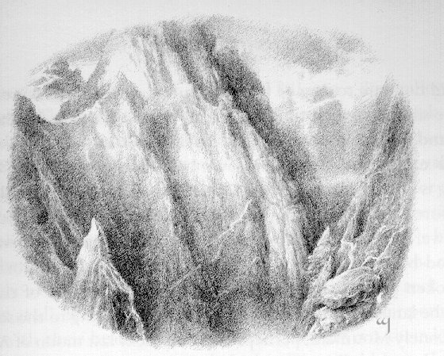
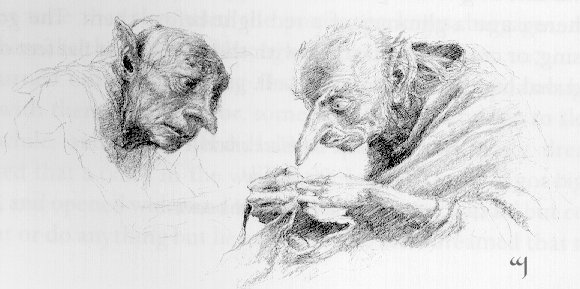
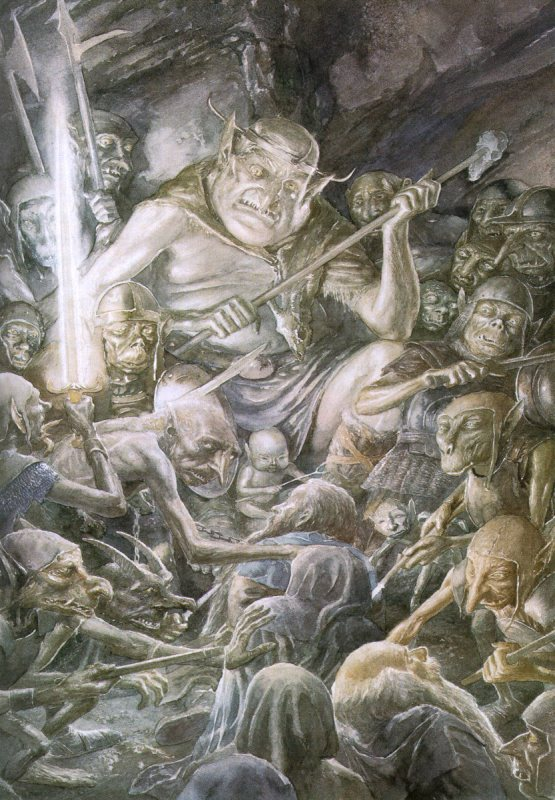
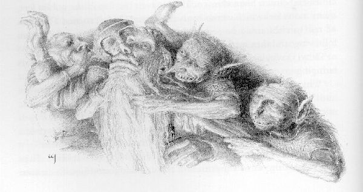

## Kapitel 4: Über und unter den Bergen

Viele Wege führen zu den Bergen, und viele <abbr title="der Pass, die Pässe — горный перевал">Pässe</abbr> führen darüber. Aber die meisten Wege sind wild und unsicher. Sie enden plötzlich oder führen überhaupt nirgendwohin. Die <abbr title="der Pass, die Pässe — горный перевал">Pässe</abbr> sind noch schlimmer. Dort leben zahllose böse Wesen, und schreckliche Dinge geschehen. Unsere Reisenden verlieren den Weg aber nicht. Elrond hat ihnen einen guten Rat gegeben, und Gandalf erinnert sich daran. Sie steigen auf dem richtigen Weg zum richtigen <abbr title="der Pass, die Pässe — горный перевал">Pass</abbr> hinauf.

Tag für Tag geht es höher. Das Tal und das Last Homely House liegen hinter ihnen. Immer hinauf, hinauf, hinauf! Der Weg ist schwer, gefährlich, lang und voller Kurven. Kaum jemand geht dort. Eines Tages drehen sie sich um. Jetzt sehen sie das ganze Land, das sie verlassen haben. Weit im Westen verschwindet die Welt im blauen <abbr title="der Dunst — дымка">Dunst</abbr>. Dort liegt irgendwo die geliebte Shire, weiß Bilbo. Dort wartet seine gemütliche <abbr title="die Höhle, die Höhlen — нора; пещера">Höhle</abbr> auf ihn. Er zieht sich fröstelnd zusammen.

Es ist schrecklich kalt, und der Wind heult. Manchmal löst die Mittagssonne große Steine aus dem Schnee. Sie rollen den Hang hinunter. Die <abbr title="der Felsbrocken, die Felsbrocken — валун; обломок скалы">Felsbrocken</abbr> <abbr title="pfeifen (pfiff, hat gepfiffen) — насвистывать">pfeifen</abbr> zwischen den Reisenden hindurch oder fliegen direkt über ihre Köpfe. Alle <abbr title="zucken — вздрагивать">zucken</abbr> vor Angst zusammen. Auch nachts finden sie keine Ruhe. Niemand wagt zu singen oder laut zu sprechen. Das <abbr title="das Echo, die Echos — эхо">Echo</abbr> trägt jedes Geräusch viele Meilen weit. Die Stille ringsum scheint fremde Geräusche nicht zu mögen. Sie kennt nur das Murmeln von Wasser, das Heulen vom Wind und den Lärm fallender Steine.

„Unten ist noch Sommer“, denkt Bilbo. „Dort macht man Heu und feiert Feste. Die Beeren sind bei uns sicher schon reif, wenn wir endlich über die Berge kommen.“

Die Gedanken von den Zwergen sind genauso traurig. Beim Abschied von Elrond waren sie noch fröhlich. Jetzt erinnern sie sich oft an ihre Pläne. Die scheinen inzwischen unmöglich. Schnell über die Misty Mountains und dann direkt zum Lonely Mountain! Zum ersten Herbstmond wollten sie schon dort sein.

— Vielleicht ist dann gerade Durin's Day, — sagen sie.

Gandalf schüttelt den Kopf, sagt aber nichts. Er weiß, wie viele Gefahren auf sie warten. In Wilderland gibt es jetzt viele böse Wesen. Die <abbr title="der Drache, die Drachen — дракон">Drachen</abbr> haben die Menschen von dort vertrieben. <abbr title="der Goblin, die Goblins — гоблин">Goblins</abbr> sind in die <abbr title="die Höhle, die Höhlen — нора; пещера">Höhlen</abbr> von Moria gekommen. Weise <abbr title="der Zauberer, die Zauberer — волшебник">Zauberer</abbr> und gute Freunde wie Elrond wissen: Wilderland kann den besten Plan verderben. Einen weiseren <abbr title="der Zauberer, die Zauberer — волшебник">Zauberer</abbr> als Gandalf findet man kaum. Auch einen zuverlässigeren Freund als Elrond muss man lange suchen.

* * *

Gandalf weiß, dass alles Mögliche passieren kann. Die Misty Mountains haben hohe <abbr title="der Gipfel, die Gipfel — горная вершина">Gipfel</abbr> und tiefe <abbr title="die Schlucht, die Schluchten — ущелье">Schluchten</abbr>. Von den Königen früherer Zeiten wissen sie schon lange nichts mehr. Sie lassen die Reisenden bestimmt nicht einfach hindurch. Gandalf hat recht. Ein Sturm beginnt. Ein Sturm? Nein, ein richtiger <abbr title="der Orkan, die Orkane — ураган">Orkan</abbr>! Schon in einer Ebene oder in einem Flusstal macht der Zusammenstoß von zwei starken Winden Angst. Stellt euch nun vor, wie westliche und östliche Winde in den Bergen kämpfen! Der <abbr title="der Donner — гром">Donner</abbr> kracht. <abbr title="der Blitz, die Blitze — молния">Blitze</abbr> schlagen in <abbr title="der Felsen, die Felsen — скала; утёс">Felsen</abbr> und erschüttern sie bis ganz nach unten. Riesige Steine fliegen durch die Luft. Sie rollen die Hänge hinab und <abbr title="zerspringen (zersprang, ist zersprungen) — разбиться вдребезги">zerspringen</abbr>. Helle <abbr title="der Blitz, die Blitze — молния">Blitze</abbr> reißen die Nacht auseinander. Danach hört man ungeheuren Lärm.

Bilbo hat so etwas noch nie gesehen. Er hat nicht einmal gewusst, dass es so etwas gibt. Der Sturm überrascht die Gruppe in einer schmalen <abbr title="die Schlucht, die Schluchten — ущелье">Schlucht</abbr> hoch in den Bergen. Auf einer Seite steht eine fast senkrechte Felswand. Auf der anderen liegt ein Abgrund voller <abbr title="der Nebel — туман">Nebel</abbr>. Sicher ist er endlos tief. Sie haben keine Wahl. Unter einem Stück Fels, das aus der Wand ragt, bleiben sie für die Nacht. Bilbo wickelt sich in eine Decke. Trotzdem zittert er am ganzen Körper vor Kälte und Angst.

Im Blitzlicht sieht er steinerne <abbr title="der Riese, die Riesen — великан">Riesen</abbr>. Sie freuen sich offen über das schlechte Wetter und spielen miteinander. Sie werfen riesige <abbr title="der Felsbrocken, die Felsbrocken — валун; обломок скалы">Felsbrocken</abbr>, fangen sie und werfen sie wieder hinunter. Unten stehen Bäume, die man im Dunkeln nicht sieht. Dort <abbr title="zerspringen (zersprang, ist zersprungen) — разбиться вдребезги">zerspringen</abbr> die Steine. Der Sturm wird immer wilder. Plötzliche Windstöße treffen den <abbr title="der Felsen, die Felsen — скала; утёс">Felsen</abbr>. Regen fällt in Strömen, und <abbr title="der Hagel — град">Hagel</abbr> trommelt gegen die Wand. Bald sind alle völlig nass. Die Ponys senken die Köpfe, ziehen ihre Schwänze ein und <abbr title="wiehern — ржать">wiehern</abbr> ängstlich.

Die <abbr title="der Riese, die Riesen — великан">Riesen</abbr> schreien und lachen laut. Es scheint, dass sie die nassen, frierenden Reisenden auslachen.

— Das geht nicht gut, — sagt Thorin finster. — Der Wind bläst uns weg, oder das Wasser nimmt uns mit. Vielleicht verbrennt uns auch vorher ein <abbr title="der Blitz, die Blitze — молния">Blitz</abbr>. Oder die <abbr title="der Riese, die Riesen — великан">Riesen</abbr> entdecken uns und benutzen uns als Bälle.

— Dann bring uns an einen besseren Ort, wenn du einen kennst! — sagt Gandalf ärgerlich. — Sonst hör auf zu <abbr title="brummen — ворчать; бурчать">brummen</abbr>.

Schließlich schicken sie Fili und Kili los. Die beiden sind die Jüngsten, etwa fünfzig Jahre jünger als die anderen <abbr title="der Zwerg, die Zwerge — гном">Zwerge</abbr>. Außerdem haben sie die besten Augen. Sie sollen einen sichereren Platz finden. Solche Aufgaben kennen sie schon. Natürlich ist es völlig sinnlos, Bilbo zum Suchen zu schicken. Das versteht ihr sicher.

— Wer sucht, der findet, — sagt Thorin ungefähr. — Aber gewöhnlich findet man nicht das, was man gesucht hat.

Bald zeigt sich, wie richtig diese Worte sind.

Fili und Kili kommen schnell zurück. Sie kriechen und halten sich an den Steinen fest. Der Wind soll sie ja nicht in den Abgrund blasen.

— Wir haben eine <abbr title="die Höhle, die Höhlen — нора; пещера">Höhle</abbr> gefunden! — rufen beide. — Ganz in der Nähe. Sie ist trocken und breit genug. Wir passen alle hinein, sogar die Ponys.

— Habt ihr sie genau untersucht? — fragt Gandalf.

Er weiß nämlich, dass <abbr title="die Höhle, die Höhlen — нора; пещера">Höhlen</abbr> in den Bergen selten ohne Besitzer sind.

— Natürlich! Sie ist nicht besonders groß oder tief. Aber es ist genug Platz für uns alle.

Ehrlich gesagt waren die beiden zu kurz weg für eine gründliche Untersuchung. Die Reisenden frieren aber so sehr, dass sie an Vorsicht nicht denken. Dabei sind bei einer <abbr title="die Höhle, die Höhlen — нора; пещера">Höhle</abbr> drei Fragen besonders wichtig. Wie tief ist sie? Wohin führt sie? Wohnt jemand darin? Alle stehen mühsam auf und gehen den Weg entlang. Die Ponys wollen nicht mit, und die <abbr title="der Zwerg, die Zwerge — гном">Zwerge</abbr> ziehen sie hinter sich her. Der Wind brüllt, und der <abbr title="der Donner — гром">Donner</abbr> kracht wild. Zum Glück ist es nicht weit. Ein <abbr title="der Felsen, die Felsen — скала; утёс">Felsen</abbr> steht etwas neben dem Weg. Sie gehen um ihn herum und finden eine dunkle Öffnung. Ein Pony ohne <abbr title="der Sattel, die Sättel — седло">Sattel</abbr> und Taschen passt gerade hindurch. Alle gehen hinein. Wie wunderbar! Endlich Schutz vor Regen, <abbr title="der Hagel — град">Hagel</abbr> und <abbr title="der Riese, die Riesen — великан">Riesen</abbr> mit ihren <abbr title="der Felsbrocken, die Felsbrocken — валун; обломок скалы">Felsbrocken</abbr>.

Nur Gandalf bleibt vernünftig. Sein <abbr title="der Stab, die Stäbe — посох">Stab</abbr> beginnt zu leuchten, wie damals in Bilbos <abbr title="die Höhle, die Höhlen — нора; пещера">Höhle</abbr>. Er verlangt, dass alle die <abbr title="die Höhle, die Höhlen — нора; пещера">Höhle</abbr> sorgfältig untersuchen.

Sie ist nicht klein, sondern genau richtig. Es gibt einige gemütliche Ecken. Der Boden ist trocken, und von der Decke tropft nichts in den Kragen. Die kalten, nassen Ponys freuen sich genauso wie ihre Besitzer. Die <abbr title="der Zwerg, die Zwerge — гном">Zwerge</abbr> führen sie in eine stille Ecke weit vom Eingang. Oin und Gloin wollen Feuer machen. Dann können sie sich wärmen und die Kleidung trocknen. Aber Gandalf verbietet es. Deshalb ziehen sie einfach trockene Sachen an. Die nasse Kleidung legen sie auf den Boden. Dann breiten sie ihre Decken aus und rauchen <abbr title="die Pfeife, die Pfeifen — курительная трубка">Pfeife</abbr>. Gandalf hat seinen Spaß. Er färbt die Rauchringe bunt und lässt sie unter der Höhlendecke tanzen.

Das schlechte Wetter ist nun vergessen. Sie reden darüber, was jeder mit seinem Anteil am <abbr title="der Schatz, die Schätze — клад; сокровище">Schatz</abbr> macht. Wofür gibt er das Geld aus? Natürlich sind alle ganz sicher, dass sie die <abbr title="der Schatz, die Schätze — клад; сокровище">Schätze</abbr> bekommen. Langsam schlafen sie ein. Niemand ahnt, dass sie ihre Ponys niemals wiederhaben. Auch ihre Reisetaschen und die <abbr title="der Sack, die Säcke — мешок">Säcke</abbr> mit <abbr title="das Werkzeug, die Werkzeuge — инструмент">Werkzeug</abbr> verlieren sie. Alles, was sie bisher dabeihatten!

Zum Glück ist der kleine Bilbo in dieser Nacht bei ihnen. Lange kann er nicht einschlafen. Endlich schläft er ein und hat einen schrecklichen Traum. Hinten in der <abbr title="die Höhle, die Höhlen — нора; пещера">Höhle</abbr> ist ein <abbr title="der Riss, die Risse — трещина">Riss</abbr> in der Wand. Im Traum wird er plötzlich immer breiter. Bilbo hat so viel Angst, dass er keinen Laut wagt. Er liegt nur da und schaut. Dann kippt der Boden zur Seite. Bilbo rutscht und fällt irgendwohin …

Er <abbr title="zucken — вздрагивать">zuckt</abbr> zusammen und merkt: Das ist kein Traum! Hinten in der <abbr title="die Höhle, die Höhlen — нора; пещера">Höhle</abbr> ist wirklich ein großes Loch offen. Darin verschwindet gerade der Schwanz vom letzten Pony. Bilbo schreit. So laut kann nur ein Hobbit schreien. Einen solchen Schrei habt ihr sicher noch nie gehört!

Schon kommen <abbr title="der Goblin, die Goblins — гоблин">Goblins</abbr> aus dem Loch. Große, starke, widerliche <abbr title="der Goblin, die Goblins — гоблин">Goblins</abbr>! Mindestens sechs stürzen sich auf jeden <abbr title="der Zwerg, die Zwerge — гном">Zwerg</abbr>. Zwei greifen Bilbo an. Niemand kann rechtzeitig etwas tun. Die <abbr title="der Goblin, die Goblins — гоблин">Goblins</abbr> packen ihre <abbr title="der Gefangene, die Gefangenen — пленник">Gefangenen</abbr> und ziehen sie ins Loch. Alle überrascht der Angriff, nur Gandalf nicht. Bilbos Schrei hat ihn geweckt, und er versteht sofort alles. Die <abbr title="der Goblin, die Goblins — гоблин">Goblins</abbr> laufen auf ihn zu. Da leuchtet die <abbr title="die Höhle, die Höhlen — нора; пещера">Höhle</abbr> plötzlich so hell wie bei einem <abbr title="der Blitz, die Blitze — молния">Blitz</abbr>. Es riecht nach <abbr title="das Schießpulver — порох">Schießpulver</abbr>. Einige <abbr title="der Goblin, die Goblins — гоблин">Goblins</abbr> fallen tot auf den Boden.

Der <abbr title="der Riss, die Risse — трещина">Riss</abbr> in der Wand geht mit einem Krachen zu. Bilbo und die <abbr title="der Zwerg, die Zwerge — гном">Zwerge</abbr> sind dahinter verschwunden. Wo ist Gandalf, fragt ihr?

Das wissen weder die <abbr title="der Gefangene, die Gefangenen — пленник">Gefangenen</abbr> noch die Angreifer. Die <abbr title="der Goblin, die Goblins — гоблин">Goblins</abbr> wollen den <abbr title="der Zauberer, die Zauberer — волшебник">Zauberer</abbr> auch gar nicht suchen. Ohne Pause gehen sie durch einen Weg im <abbr title="der Felsen, die Felsen — скала; утёс">Felsen</abbr>. Dort ist es völlig dunkel. In solcher Dunkelheit können nur Berggoblins leben. Unterirdische Flure kommen zusammen, trennen sich und kreuzen einander in alle Richtungen. Die <abbr title="der Goblin, die Goblins — гоблин">Goblins</abbr> kennen ihren Weg so gut wie ihr den Weg zur Post. Tiefer und tiefer gehen sie. Es wird unerträglich heiß. Die groben <abbr title="der Goblin, die Goblins — гоблин">Goblins</abbr> <abbr title="kneifen (kniff, hat gekniffen) — щипать">kneifen</abbr> ihre <abbr title="der Gefangene, die Gefangenen — пленник">Gefangenen</abbr> ohne Mitleid, schnauben und lachen hässlich. Bilbo hat noch mehr Angst als damals beim <abbr title="der Troll, die Trolle — тролль">Troll</abbr>. Wieder <abbr title="bereuen — сожалеть о сделанном">bereut</abbr> er seinen unvorsichtigen Entschluss. Jetzt in seiner gemütlichen <abbr title="die Höhle, die Höhlen — нора; пещера">Höhle</abbr> auf The Hill sein, das ist sein größter Wunsch!

Vorn erscheint rotes Feuer. Die <abbr title="der Goblin, die Goblins — гоблин">Goblins</abbr> schlagen mit ihren flachen Füßen den Takt. Sie schütteln ihre <abbr title="der Gefangene, die Gefangenen — пленник">Gefangenen</abbr> und singen laut:

> Knack! Krach! Der <abbr title="der Goblin, die Goblins — гоблин">Goblin</abbr> ist grob!  
> Raub! Mord! Schlag alles klein!  
> Hinunter, hinunter! Man wartet auf euch  
> Da unten, mein lieber Freund.  
> Knarr! Klirr! Dann kommt ein Schlag!  
> Schlüssel und Schloss, Tür und Eingang!  
> <abbr title="die Peitsche, die Peitschen — плеть; кнут">Peitsche</abbr> und Käfig! Denk daran:  
> Ich schlag dir ins Auge, mein lieber Freund!  
> Immer wieder bekommst du die <abbr title="die Peitsche, die Peitschen — плеть; кнут">Peitsche</abbr>!  
> Im Laufen verbrenne ich dich! Kein Wort von dir!  
> Arbeit und Arbeit wartet hier.  
> Der <abbr title="der Goblin, die Goblins — гоблин">Goblin</abbr> soll leben, der <abbr title="der Goblin, die Goblins — гоблин">Goblin</abbr> soll froh sein!  
> Hinunter ins Dunkel! Genau richtig,  
> Mein lieber Freund!

Es klingt wirklich schrecklich. Besonders „Knack! Krach!“ und „Knarr! Klirr!“. Das <abbr title="das Echo, die Echos — эхо">Echo</abbr> wiederholt das hässliche Lachen. Dann holen die bösen <abbr title="der Goblin, die Goblins — гоблин">Goblins</abbr> ihre <abbr title="die Peitsche, die Peitschen — плеть; кнут">Peitschen</abbr> hervor. Zisch! Schlag! Sie befehlen den <abbr title="der Gefangene, die Gefangenen — пленник">Gefangenen</abbr> zu rennen. Die <abbr title="der Zwerg, die Zwerge — гном">Zwerge</abbr> bekommen unterwegs viele Schläge.

Endlich erreichen sie eine riesige <abbr title="die Höhle, die Höhlen — нора; пещера">Höhle</abbr>. In der Mitte brennt ein großes Feuer. An den Wänden rauchen <abbr title="die Fackel, die Fackeln — факел">Fackeln</abbr>. Die Ponys stehen in einer Ecke. Weiter weg liegen ihre Taschen und <abbr title="der Sack, die Säcke — мешок">Säcke</abbr>. Alles ist ausgeraubt und nach außen umgedreht. 

Leider sehen die Reisenden ihre Ponys zum letzten Mal. Auch das starke weiße Pferd von Gandalf sehen sie nie wieder. Elrond hat es ihm geschenkt. <abbr title="der Goblin, die Goblins — гоблин">Goblins</abbr> sind nämlich immer hungrig. Sie essen gern Pferde, Ponys und <abbr title="der Esel, die Esel — осёл">Esel</abbr>. Und nicht nur die … Brr!

Die <abbr title="die Höhle, die Höhlen — нора; пещера">Höhle</abbr> ist voll von <abbr title="der Goblin, die Goblins — гоблин">Goblins</abbr>. Sie sehen die <abbr title="der Zwerg, die Zwerge — гном">Zwerge</abbr> und den armen Bilbo hinter ihnen. Schon lachen sie laut, stampfen und klatschen. Die <abbr title="der Aufseher, die Aufseher — надсмотрщик">Aufseher</abbr> brüllen und lassen ihre <abbr title="die Peitsche, die Peitschen — плеть; кнут">Peitschen</abbr> knallen. Sie treiben die <abbr title="der Gefangene, die Gefangenen — пленник">Gefangenen</abbr> zusammen. Sie legen ihnen <abbr title="die Handschelle, die Handschellen — ручные кандалы; наручники">Handschellen</abbr> an, binden eine lange <abbr title="die Leine, die Leinen — верёвка; поводок">Leine</abbr> um alle und ziehen sie in die dunkelste Ecke.

Dort sitzt ein widerlicher <abbr title="der Goblin, die Goblins — гоблин">Goblin</abbr> mit riesigem Kopf auf einem großen, flachen Stein. Andere stehen um ihn herum. Sie tragen Äxte oder krumme <abbr title="das Schwert, die Schwerter — меч">Schwerter</abbr>. Diese <abbr title="die Waffe, die Waffen — оружие">Waffen</abbr> mögen <abbr title="der Goblin, die Goblins — гоблин">Goblins</abbr> am liebsten. Heute sind <abbr title="der Goblin, die Goblins — гоблин">Goblins</abbr> anders als früher. Sie sind böse und grausam geworden. Ihre Herzen sind hart. Früher waren sie geschickte Handwerker. Niemand konnte unterirdische Wege so gut graben wie sie. Hämmer, <abbr title="das Schwert, die Schwerter — меч">Schwerter</abbr>, Äxte, <abbr title="der Dolch, die Dolche — кинжал">Dolche</abbr>, <abbr title="die Spitzhacke, die Spitzhacken — кирка">Spitzhacken</abbr>, Gongs und Werkzeuge für die Folter machten sie selbst. Oder sie zwangen ihre <abbr title="der Sklave, die Sklaven — раб">Sklaven</abbr> dazu. Die <abbr title="der Sklave, die Sklaven — раб">Sklaven</abbr> starben unter der Erde schnell. Sie hatten zu wenig Luft und großen Durst.

Vielleicht haben <abbr title="der Goblin, die Goblins — гоблин">Goblins</abbr> die Maschinen erfunden, die unsere Welt verändert haben. Besonders die Maschinen zum Töten. Sie mochten schon immer Räder, Motoren und <abbr title="die Explosion, die Explosionen — взрыв">Explosionen</abbr>. Sie sind schmutzig und unordentlich. Sie drücken sich vor der Arbeit und lassen ihre <abbr title="der Gefangene, die Gefangenen — пленник">Gefangenen</abbr> für sich arbeiten. <abbr title="der Zwerg, die Zwerge — гном">Zwerge</abbr> hassen sie nicht einmal besonders stark. Ehrlich gesagt nicht stärker als alle anderen. Es gab sogar <abbr title="der Zwerg, die Zwerge — гном">Zwerge</abbr>, die sich mit <abbr title="der Goblin, die Goblins — гоблин">Goblins</abbr> verbündet haben. Aber Thorins Familie wollen sie völlig vernichten. Das haben sie schon damals im Krieg geschworen, von dem ich erzählt habe.

Außerdem ist <abbr title="der Goblin, die Goblins — гоблин">Goblins</abbr> egal, wen sie fangen. Die Opfer sollen sich nur nicht wehren.

— Was sind das für elende Wesen? — fragt der Great Goblin.

— <abbr title="der Zwerg, die Zwerge — гном">Zwerge</abbr>. Und der da.

Ein <abbr title="der Aufseher, die Aufseher — надсмотрщик">Aufseher</abbr> zieht an der <abbr title="die Leine, die Leinen — верёвка; поводок">Leine</abbr>. Bilbo fällt auf die Knie.

— Sie haben sich am Haupteingang versteckt. Dort haben wir sie gefangen.

— Interessant.

Der Great Goblin dreht sich zu Thorin.

— Was bedeutet das alles? Ihr wolltet uns wohl ausspionieren? Lauschen und heimlich nachschauen? Widerliche Diebe! Ihr wolltet uns ausrauben! Ich kenne euch, Mörder und Elfenfreunde. Warum schweigst du?

— Ich heiße Thorin, — sagt Oakenshield streng. — Behalte deine Vermutungen für dich. Wir haben in der <abbr title="die Höhle, die Höhlen — нора; пещера">Höhle</abbr> nur Schutz vor dem Sturm gesucht. <abbr title="der Goblin, die Goblins — гоблин">Goblins</abbr> wollten wir nicht beobachten. Das brauchen wir nicht. Wir haben andere <abbr title="das Geschäft, die Geschäfte — дело; предприятие">Geschäfte</abbr>.

— Erzähl nur!

Der Great Goblin lacht verächtlich durch die Nase.

— Wie seid ihr in die Berge gekommen? Wohin geht ihr? Antworte! Die ganze Wahrheit, ohne Ausreden! Helfen kann dir das wohl trotzdem nicht, Thorin Oakenshield. Über dein elendes Volk weiß ich schon genug. Aber ich bin neugierig. Und wenn du lügst, wirst du es <abbr title="bereuen — сожалеть о сделанном">bereuen</abbr>!

— Wir besuchen unsere <abbr title="der Verwandte, die Verwandten — родственник">Verwandten</abbr>. Unsere Neffen, Brüder, Schwestern und alle anderen. Sie wohnen auf der Ostseite dieser gastfreundlichen Berge, — antwortet Thorin nach einer kurzen Pause.

Die Wahrheit darf er natürlich auf keinen Fall sagen.

— Er lügt, o Schrecklichster! — ruft der <abbr title="der Aufseher, die Aufseher — надсмотрщик">Aufseher</abbr>. — Wir haben sie höflich zum Mitkommen eingeladen. Da blitzte es in der <abbr title="die Höhle, die Höhlen — нора; пещера">Höhle</abbr>, und unsere Freunde fielen tot um. Und er hat uns nicht erklärt, woher er das hier hat!

Er zeigt seinem Herrn das <abbr title="das Schwert, die Schwerter — меч">Schwert</abbr> aus der Trollhöhle. 

Der Great Goblin brüllt vor Wut. Die anderen knirschen mit den Zähnen, schlagen gegen ihre <abbr title="der Schild, die Schilde — щит">Schilde</abbr> und stampfen. Sie erkennen die Waffe sofort. Früher hat sie Hunderte von <abbr title="der Goblin, die Goblins — гоблин">Goblins</abbr> getötet. Damals kämpften die Elfenzauberer von Gondolin gegen die <abbr title="die Festung, die Festungen — крепость">Festungen</abbr> ihrer Feinde. Die <abbr title="der Elf, die Elfen — эльф">Elfen</abbr> nannten das <abbr title="das Schwert, die Schwerter — меч">Schwert</abbr> Orcrist, also Goblin-cleaver. Die <abbr title="der Goblin, die Goblins — гоблин">Goblins</abbr> nennen es einfach den Biter. Sie hassen es fürchterlich. Genauso hassen sie jeden, der es trägt.

— Mörder und Elfenfreunde! — schreit der Great Goblin. — Schlagt sie! Beißt sie! Reißt sie auseinander! Werft sie zu den <abbr title="die Schlange, die Schlangen — змея">Schlangen</abbr> ins <abbr title="das Gefängnis, die Gefängnisse — тюрьма; темница">Gefängnis</abbr>! Sie sollen niemals wieder Licht sehen!

Er ist so wütend, dass er von seinem <abbr title="der Thron, die Throne — трон">Thron</abbr> springt. Mit weit offenem Mund läuft er auf Thorin zu.

Plötzlich gehen alle <abbr title="die Fackel, die Fackeln — факел">Fackeln</abbr> aus. Auch das große Feuer verschwindet. An seiner Stelle steigt eine leuchtende blaue Säule aus Rauch zur Decke. Sie streut weiße <abbr title="der Funke, die Funken — искра">Funken</abbr> ringsum.

Die <abbr title="die Höhle, die Höhlen — нора; пещера">Höhle</abbr> füllt sich mit Schreien, Kreischen, Stöhnen, Heulen, Brüllen und Flüchen. Dafür gibt es keine Beschreibung. Sogar hundert oder zweihundert wilde Katzen oder Wölfe sind nicht so laut. Auch nicht, wenn man sie lebendig langsam über einem kleinen Feuer brät. Die <abbr title="der Funke, die Funken — искра">Funken</abbr> brennen durch die <abbr title="der Goblin, die Goblins — гоблин">Goblins</abbr> hindurch. Im dichten Rauch sehen sie nichts. Bald fallen alle übereinander. Wie <abbr title="verrückt — сумасбродный; сумасшедший">verrückt</abbr> rollen sie auf dem Boden, treten und beißen einander.

Da beginnt Orcrist in der Hand eines Wächters zu leuchten. Bilbo sieht ein zweites <abbr title="das Schwert, die Schwerter — меч">Schwert</abbr> aus der Dunkelheit kommen. Die glänzende <abbr title="die Klinge, die Klingen — лезвие; клинок">Klinge</abbr> durchbohrt den Great Goblin. Er steht noch erstaunt neben seinem <abbr title="der Thron, die Throne — трон">Thron</abbr> und fällt plötzlich tot um. Seine Wächter fliehen schreiend vor dem <abbr title="das Schwert, die Schwerter — меч">Schwert</abbr> in die Dunkelheit.

Die Waffe leuchtet nun schwächer.

— Folgt mir! — befiehlt eine strenge Stimme.

Bilbo versteht noch gar nichts. Schon rennt er hinter den Zwergen durch einen <abbr title="unterirdisch — подземный">unterirdischen</abbr> Flur. Die Schreie werden in der Ferne leiser.

— Schneller! Schneller! Gleich zünden sie die <abbr title="die Fackel, die Fackeln — факел">Fackeln</abbr> wieder an!

— Einen Augenblick! — ruft Dori.

Er läuft vor Bilbo, bleibt stehen und wartet auf ihn. Er setzt sich den Hobbit auf den Rücken und rennt den anderen nach. Die <abbr title="die Handschelle, die Handschellen — ручные кандалы; наручники">Handschellen</abbr> klirren. Die <abbr title="der Zwerg, die Zwerge — гном">Zwerge</abbr> <abbr title="stolpern — спотыкаться">stolpern</abbr> und fallen oft. Ihre Hände sind in Ketten, und sie können sich nicht an den Wänden festhalten.

Erst tief im Herzen vom Berg bleiben sie stehen. Gandalf lässt seinen <abbr title="der Stab, die Stäbe — посох">Stab</abbr> leuchten. Natürlich ist die Stimme Gandalf gewesen. Wie immer ist er rechtzeitig zur Hilfe gekommen. Jetzt bleibt aber keine Zeit für Fragen. Sein <abbr title="das Schwert, die Schwerter — меч">Schwert</abbr> leuchtet kalt und bläulich. <abbr title="der Goblin, die Goblins — гоблин">Goblins</abbr> sind also in der Nähe. Mit derselben <abbr title="die Klinge, die Klingen — лезвие; клинок">Klinge</abbr> hat er den Great Goblin getötet. Jetzt schlägt er damit die Ketten an den Händen von den Zwergen durch. Ihr erinnert euch: Sein <abbr title="das Schwert, die Schwerter — меч">Schwert</abbr> heißt Glamdring, also Foe-hammer.

Die <abbr title="der Goblin, die Goblins — гоблин">Goblins</abbr> nennen es den Beater. Sie hassen es noch mehr als den Biter, wenn das überhaupt möglich ist. Gandalf gibt Thorin Orcrist mit einer Verbeugung zurück. In der Unruhe hat er einem <abbr title="der Goblin, die Goblins — гоблин">Goblin</abbr> das <abbr title="das Schwert, die Schwerter — меч">Schwert</abbr> aus der Hand gerissen. Gandalf hat sich wirklich um vieles gekümmert. Dass die Reisenden einige unangenehme Minuten erlebt haben, ist nicht seine Schuld.

— Sind alle hier? — fragt er. — Schauen wir. Thorin, eins. Zwei, drei, vier, fünf, sechs, sieben, acht, neun, zehn, elf … Wo sind Fili und Kili? Ah, dort. Zwölf, dreizehn. Und Herr Baggins, vierzehn. Wunderbar! Es kann viel schlimmer sein. Oder viel besser. Die Ponys sind weg, das Essen auch. Wir wissen nicht, wo wir sind oder wohin wir gehen müssen. Hinter uns sind sehr viele wütende <abbr title="der Goblin, die Goblins — гоблин">Goblins</abbr>. Nun gut, weiter!

Sie gehen einfach los. Bald hören sie viele Füße. Die <abbr title="der Goblin, die Goblins — гоблин">Goblins</abbr> haben sich von ihrer Überraschung erholt und <abbr title="verfolgen — преследовать">verfolgen</abbr> sie. Die Reisenden gehen schneller. Der arme Bilbo bleibt sofort zurück. Wieder nimmt ihn ein <abbr title="der Zwerg, die Zwerge — гном">Zwerg</abbr> auf den Rücken. Dann trägt ihn einer nach dem anderen.

Aber die <abbr title="der Goblin, die Goblins — гоблин">Goblins</abbr> kommen immer näher. Sie kennen den Weg besser, denn sie haben die <abbr title="die Höhle, die Höhlen — нора; пещера">Höhlen</abbr> selbst gegraben. Außerdem sind sie völlig außer sich vor Wut. Ihre bösen Schreie kommen von überall. Die Schritte sind schon sehr nah. Das Licht ihrer <abbr title="die Fackel, die Fackeln — факел">Fackeln</abbr> flackert an den Wänden.

Die <abbr title="der Zwerg, die Zwerge — гном">Zwerge</abbr> sind todmüde, laufen aber weiter.

— Warum bin ich nur mit euch gegangen?! — stöhnt Herr Baggins auf Bomburs Rücken.

— Warum trage ich nur diesen verfluchten Hobbit?! — antwortet Bombur im selben Ton.

Der dicke <abbr title="der Zwerg, die Zwerge — гном">Zwerg</abbr> schwankt und ist ganz nass vom Schweiß.

Gandalf und Thorin lassen die anderen vorbeilaufen und ziehen ihre <abbr title="das Schwert, die Schwerter — меч">Schwerter</abbr>.

— Einer nach dem anderen! — ruft der <abbr title="der Zauberer, die Zauberer — волшебник">Zauberer</abbr>. — Los, Thorin!

Die <abbr title="der Goblin, die Goblins — гоблин">Goblins</abbr> laufen schreiend um die Ecke, direkt gegen Orcrist und Glamdring. Die <abbr title="die Klinge, die Klingen — лезвие; клинок">Klingen</abbr> leuchten kalt. Die ersten Verfolger lassen ihre <abbr title="die Fackel, die Fackeln — факел">Fackeln</abbr> fallen und sterben. Die anderen weichen zurück. Aber von hinten kommen immer mehr. Alles gerät durcheinander. „Biter! Beater!“, schreien sie. Dann drehen sie sich um und rennen zurück. Dabei treten sie einander nieder. Lange wagen sie nicht, wiederzukommen.

Inzwischen sind die <abbr title="der Zwerg, die Zwerge — гном">Zwerge</abbr> weit weg. Nun löschen die <abbr title="der Goblin, die Goblins — гоблин">Goblins</abbr> ihre <abbr title="die Fackel, die Fackeln — факел">Fackeln</abbr>. Ihre schnellsten Leute mit den besten Augen gehen voraus. Sie ziehen weiche Schuhe an und gehen leiser als <abbr title="die Fledermaus, die Fledermäuse — летучая мышь">Fledermäuse</abbr> durch die Flure.

Niemand merkt etwas. Nicht Bilbo, nicht die <abbr title="der Zwerg, die Zwerge — гном">Zwerge</abbr>, nicht einmal Gandalf. Sie hören und sehen nichts. Die <abbr title="der Goblin, die Goblins — гоблин">Goblins</abbr> sehen sie aber schon von weitem im Dunkeln. Gandalf hat nämlich ein kleines Licht an seinem <abbr title="der Stab, die Stäbe — посох">Stab</abbr> gemacht. So können die Reisenden den Weg erkennen.

Genau da schreit Dori und fällt hin. Er trägt gerade wieder Bilbo auf dem Rücken. Im Dunkeln hat jemand sein Bein gepackt. Bilbo rollt auf den Boden. Sein Kopf schlägt gegen einen Stein. Dann spürt er nichts mehr.

---

### Neue und schwierige Wörter

- **der Pass, die Pässe** — горный перевал *(neu)*
- **der Dunst** — дымка *(neu)*
- **die Höhle, die Höhlen** — нора; пещера *(Wiederholung)*
- **der Felsbrocken, die Felsbrocken** — валун; обломок скалы *(neu)*
- **pfeifen (pfiff, hat gepfiffen)** — насвистывать *(Wiederholung)*
- **zucken** — вздрагивать *(Wiederholung)*
- **das Echo, die Echos** — эхо *(neu)*
- **der Drache, die Drachen** — дракон *(Wiederholung)*
- **der Goblin, die Goblins** — гоблин *(Wiederholung)*
- **der Zauberer, die Zauberer** — волшебник *(Wiederholung)*
- **der Gipfel, die Gipfel** — горная вершина *(Wiederholung)*
- **die Schlucht, die Schluchten** — ущелье *(Wiederholung)*
- **der Orkan, die Orkane** — ураган *(neu)*
- **der Donner** — гром *(Wiederholung)*
- **der Blitz, die Blitze** — молния *(Wiederholung)*
- **der Felsen, die Felsen** — скала; утёс *(Wiederholung)*
- **zerspringen (zersprang, ist zersprungen)** — разбиться вдребезги *(neu)*
- **der Nebel** — туман *(Wiederholung)*
- **der Riese, die Riesen** — великан *(neu)*
- **der Hagel** — град *(neu)*
- **wiehern** — ржать *(neu)*
- **brummen** — ворчать; бурчать *(Wiederholung)*
- **der Zwerg, die Zwerge** — гном *(Wiederholung)*
- **der Sattel, die Sättel** — седло *(Wiederholung)*
- **der Stab, die Stäbe** — посох *(Wiederholung)*
- **die Pfeife, die Pfeifen** — курительная трубка *(Wiederholung)*
- **der Schatz, die Schätze** — клад; сокровище *(Wiederholung)*
- **der Sack, die Säcke** — мешок *(Wiederholung)*
- **das Werkzeug, die Werkzeuge** — инструмент *(Wiederholung)*
- **der Riss, die Risse** — трещина *(neu)*
- **der Gefangene, die Gefangenen** — пленник *(neu)*
- **das Schießpulver** — порох *(neu)*
- **kneifen (kniff, hat gekniffen)** — щипать *(neu)*
- **der Troll, die Trolle** — тролль *(Wiederholung)*
- **bereuen** — сожалеть о сделанном *(Wiederholung)*
- **die Peitsche, die Peitschen** — плеть; кнут *(neu)*
- **die Fackel, die Fackeln** — факел *(Wiederholung)*
- **der Esel, die Esel** — осёл *(neu)*
- **der Aufseher, die Aufseher** — надсмотрщик *(neu)*
- **die Handschelle, die Handschellen** — ручные кандалы; наручники *(neu)*
- **die Leine, die Leinen** — верёвка; поводок *(neu)*
- **das Schwert, die Schwerter** — меч *(Wiederholung)*
- **die Waffe, die Waffen** — оружие *(Wiederholung)*
- **der Dolch, die Dolche** — кинжал *(Wiederholung)*
- **die Spitzhacke, die Spitzhacken** — кирка *(neu)*
- **der Sklave, die Sklaven** — раб *(neu)*
- **die Explosion, die Explosionen** — взрыв *(neu)*
- **das Geschäft, die Geschäfte** — дело; предприятие *(Wiederholung)*
- **der Verwandte, die Verwandten** — родственник *(Wiederholung)*
- **der Schild, die Schilde** — щит *(Wiederholung)*
- **die Festung, die Festungen** — крепость *(Wiederholung)*
- **der Elf, die Elfen** — эльф *(Wiederholung)*
- **die Schlange, die Schlangen** — змея *(neu)*
- **das Gefängnis, die Gefängnisse** — тюрьма; темница *(Wiederholung)*
- **der Thron, die Throne** — трон *(neu)*
- **der Funke, die Funken** — искра *(neu)*
- **verrückt** — сумасбродный; сумасшедший *(Wiederholung)*
- **die Klinge, die Klingen** — лезвие; клинок *(neu)*
- **unterirdisch** — подземный *(Wiederholung)*
- **stolpern** — спотыкаться *(Wiederholung)*
- **verfolgen** — преследовать *(neu)*
- **die Fledermaus, die Fledermäuse** — летучая мышь *(neu)*

### Schwierige Sätze

- **„Sie steigen auf dem richtigen Weg zum richtigen Pass hinauf.“**  
  «Они поднимаются по верной тропе к нужному перевалу». `hinaufsteigen` — отделяемый глагол. `auf dem … Weg` описывает путь движения, поэтому здесь Dativ.
- **„Die Beeren sind bei uns sicher schon reif, wenn wir endlich über die Berge kommen.“**  
  «Ягоды у нас наверняка уже поспеют, когда мы наконец перевалим через горы». В немецком Präsens может обозначать будущее. `wenn` здесь относится к будущему событию, а не к условию.
- **„Aber gewöhnlich findet man nicht das, was man gesucht hat.“**  
  «Но обычно находишь не то, что искал». `das, was …` — «то, что…». Perfekt обозначает поиск до находки.
- **„Er verlangt, dass alle die Höhle sorgfältig untersuchen.“**  
  «Он требует, чтобы все тщательно осмотрели пещеру». `verlangen, dass …` — требовать, чтобы…; глагол придаточного стоит в конце.
- **„Das wissen weder die Gefangenen noch die Angreifer.“**  
  «Этого не знают ни пленники, ни нападающие». `weder … noch …` объединяет два отрицания без отдельного `nicht`.
- **„Zwerge hassen sie nicht einmal besonders stark.“**  
  «Гномов они даже не особенно сильно ненавидят». `Zwerge` здесь дополнение, а `sie` — подлежащее: гоблины. Начальное место в предложении не всегда принадлежит подлежащему.
- **„Dass die Reisenden einige unangenehme Minuten erlebt haben, ist nicht seine Schuld.“**  
  «То, что путники пережили несколько неприятных минут, — не его вина». Всё придаточное с `dass` занимает место подлежащего главной части. `seine` относится к Гэндальфу.
- **„Die Goblins sehen sie aber schon von weitem im Dunkeln.“**  
  «Но гоблины видят их издалека в темноте». `sie` обозначает путников. `von weitem` — «издалека», `im Dunkeln` — «в темноте».

[← Zurück](kapitel-03.md) · [Inhalt](README.md) · [Weiter →](kapitel-05.md)
