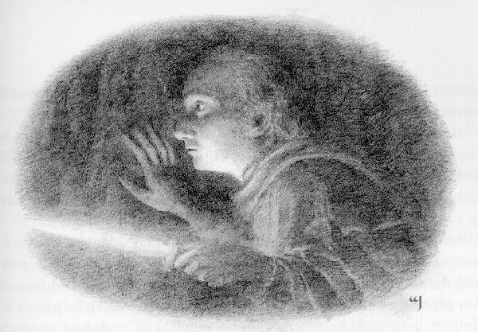
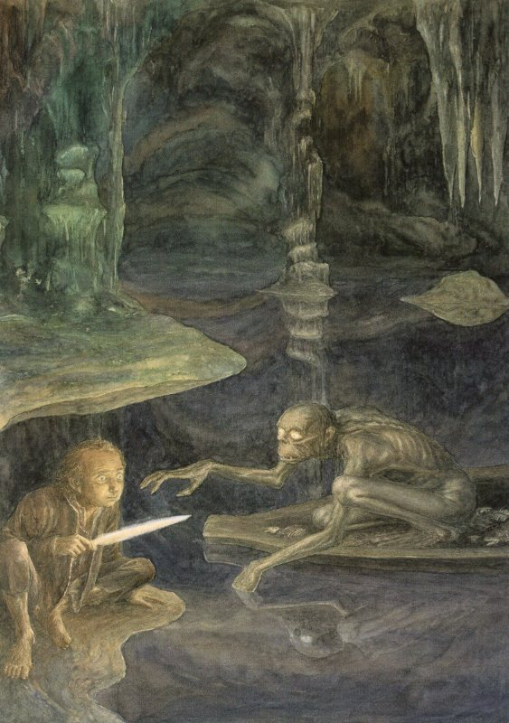
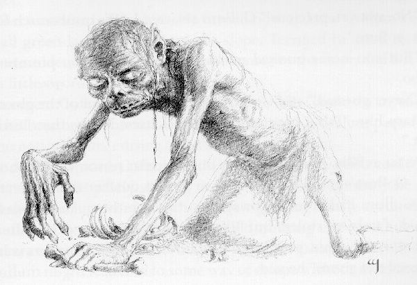
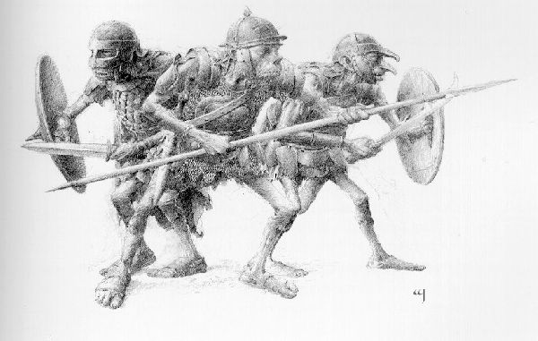
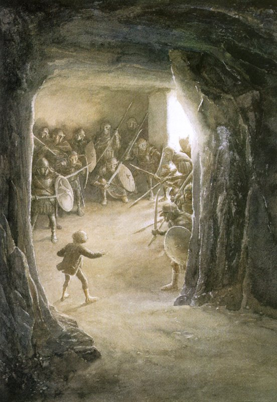

## Kapitel 5: Rätsel im Dunkeln

Bilbo öffnet die Augen und sieht gar nichts. Nicht das kleinste Licht! Auch keinen Laut hört er. Stellt euch die Angst des kleinen Hobbits vor! Nichts zu sehen, nichts zu hören. Nur eines ist sicher: Er ist noch unter der Erde.

Mühsam richtet er sich auf. Dann kriecht er <abbr title="auf allen vieren — на четвереньках">auf allen vieren</abbr> einfach irgendwohin. Er kriecht und kriecht, bis er an eine Wand kommt. Keine <abbr title="der Goblin, die Goblins — гоблин">Goblins</abbr>, keine <abbr title="der Zwerg, die Zwerge — гном">Zwerge</abbr>! Wo sind alle? Welche Richtung führt hinaus? Bilbo weiß es nicht. Sein Kopf dreht sich. Er sammelt seine Kräfte und kriecht weiter durch den Flur. Vielleicht kommt er irgendwo an. Plötzlich fühlen seine Finger etwas Rundes und Kaltes auf dem Boden: einen kleinen Ring aus Metall. Bilbo steckt ihn in die Tasche, nur für alle Fälle. Er kann ja nicht wissen, was das für ein Ring ist. Oder wozu er nützlich ist. Schließlich ist er zu müde zum Kriechen. Lange sitzt er im Dunkeln, traurig und völlig durcheinander. In Gedanken brät er zu Hause in seiner Küche Eier und Speck. Er hat so großen Hunger! Aber er findet nichts zu essen, nicht einmal eine Kleinigkeit. Diesmal ist seine Lage wirklich schlecht.

Was soll er jetzt machen? Was ist überhaupt passiert? Warum haben die anderen ihn allein gelassen? Warum haben die <abbr title="der Goblin, die Goblins — гоблин">Goblins</abbr> ihn nicht gefangen? Und warum tut sein Kopf so weh? Er weiß auf keine Frage eine Antwort. Nach einer Weile sucht er in seinen Taschen. Seine <abbr title="die Pfeife, die Pfeifen — курительная трубка">Pfeife</abbr> ist noch da! Wenigstens etwas Gutes. Auch sein Tabakbeutel ist da. Noch besser! Nur <abbr title="das Streichholz, die Streichhölzer — спичка">Streichhölzer</abbr> findet er nicht. Er wird wieder traurig. Dann denkt er aber vernünftig nach. Ein <abbr title="das Streichholz, die Streichhölzer — спичка">Streichholz</abbr> und der Geruch von <abbr title="der Tabak — табак">Tabak</abbr> locken vielleicht böse Wesen an. Sicher leben solche Wesen hier unten. Also muss er sich darüber nicht ärgern. Plötzlich fühlt seine Hand einen Schwertgriff. Es ist das Messer aus der Trollhöhle. Zum Glück haben die <abbr title="der Goblin, die Goblins — гоблин">Goblins</abbr> ihre <abbr title="der Gefangene, die Gefangenen — пленник">Gefangenen</abbr> nicht durchsucht. Deshalb haben sie ihm die Waffe nicht weggenommen.

Bilbo zieht die <abbr title="die Klinge, die Klingen — лезвие; клинок">Klinge</abbr> heraus. Sie leuchtet schwach.

„Also ist sie auch etwas Besonderes“, denkt er. „Eine Elfenwaffe! Wenn sie schwach leuchtet, sind <abbr title="der Goblin, die Goblins — гоблин">Goblins</abbr> nicht ganz nah. Aber sehr weit weg sind sie auch nicht.“

Nun bekommt er etwas <abbr title="der Mut — смелость">Mut</abbr>. Nicht jeder besitzt eine alte Elfenklinge aus dem berühmten Gondolin! Und Bilbo hat schon bemerkt, dass <abbr title="der Goblin, die Goblins — гоблин">Goblins</abbr> vor solchen <abbr title="die Waffe, die Waffen — оружие">Waffen</abbr> Angst haben.

— Wohin jetzt? — <abbr title="murmeln — пробормотать">murmelt</abbr> er. — Zurück? Was hilft das? Abbiegen kann ich hier nicht. Also vorwärts. Los, mein Freund.

Er steht auf und geht ins Dunkel. In einer Hand hält er die Waffe vor sich. Mit der anderen fühlt er die Wand. Sein Herz schlägt wild.

* * *

Man sagt manchmal: Jemand steckt in Schwierigkeiten. Genau darin steckt jetzt Bilbo Baggins. Ein Mensch hat es hier aber noch schwerer. Hobbits sind viel kleiner als wir. Ihre eigenen <abbr title="die Höhle, die Höhlen — нора; пещера">Höhlen</abbr> sind zwar heller und breiter als die der <abbr title="der Goblin, die Goblins — гоблин">Goblins</abbr>. Trotzdem kennen sie das Leben unter der Erde. Sie finden dort leicht den Weg, besonders mit einem klaren Kopf. Und wenn sie sicher auf ihren Füßen stehen, kaum <abbr title="stolpern — спотыкаться">stolpern</abbr> und nicht hinfallen! Außerdem kennen Hobbits eine alte Weisheit. Die Menschen haben sie schon lange vergessen. Vielleicht haben sie sie auch nie gekannt.

Ich möchte trotzdem nicht an Herrn Baggins' Stelle sein. Der Weg scheint endlos. Er führt hinunter und fast immer in derselben Richtung weiter. Nur ein- oder zweimal macht er eine Kurve. Im schwachen Licht der <abbr title="die Klinge, die Klingen — лезвие; клинок">Klinge</abbr> sieht Bilbo andere Flure an den Seiten. Schnell geht er daran vorbei. Vielleicht kommen dort <abbr title="der Goblin, die Goblins — гоблин">Goblins</abbr> heraus oder noch schrecklichere Wesen! Manchmal rauschen Flügel über seinem Kopf. <abbr title="die Fledermaus, die Fledermäuse — летучая мышь">Fledermäuse</abbr> fliegen an ihm vorbei. Zuerst erschrickt er. Langsam gewöhnt er sich daran und beachtet sie nicht mehr. Er ist todmüde, wagt aber keine Pause. Immer weiter geht er, ohne zu wissen, wohin. Noch nie in seinem Leben ist er so lange ohne Pause gegangen.

Plötzlich tritt sein Fuß in eiskaltes Wasser. Uff! Schnell zieht er ihn heraus und bleibt stehen. Ist es eine <abbr title="die Pfütze, die Pfützen — лужа">Pfütze</abbr>? Ein Fluss unter der Erde? Vielleicht ein tiefer See? Die <abbr title="die Klinge, die Klingen — лезвие; клинок">Klinge</abbr> leuchtet kaum noch. Bilbo hält den Atem an und <abbr title="lauschen — прислушиваться">lauscht</abbr>. Von der unsichtbaren Höhlendecke fallen Tropfen ins Wasser. Sonst hört er nichts.

Also wohl kein Fluss, eher ein See. Der Unterschied ist nicht groß. Bilbo kann sehr schlecht schwimmen. Er denkt sofort an hässliche, glatte Wesen mit großen, hervorstehenden Augen. Kaum kommt er ins Wasser, fallen sie über ihn her! Man erzählt von seltsamen Wesen tief unter den Bergen. Ihre <abbr title="der Vorfahre, die Vorfahren — предок">Vorfahren</abbr> haben sich vor sehr langer Zeit dort versteckt, weil sie das Sonnenlicht nicht mehr mochten. Einige dieser Geschichten stimmen. Sogar in Goblinhöhlen leben Wesen, von denen die <abbr title="der Goblin, die Goblins — гоблин">Goblins</abbr> selbst nichts wissen. Sie waren schon ganz am Anfang hier. Die <abbr title="der Goblin, die Goblins — гоблин">Goblins</abbr> haben einfach ihre <abbr title="die Höhle, die Höhlen — нора; пещера">Höhlen</abbr> genommen und Wege dazwischen gegraben.

Mitten im großen, tiefen, eiskalten See liegt eine kleine steinige Insel. Dort lebt der alte Gollum. Er ist klein und glatt wie ein Fisch. Wer er ist und woher er kommt, weiß ich nicht. Er ist einfach Gollum, schwarz wie die Nacht. Nur seine großen, hervorstehenden Augen leuchten in seinem dünnen Gesicht. Er besitzt ein Boot. Damit fährt er über den See. Statt <abbr title="das Ruder, die Ruder — весло">Rudern</abbr> benutzt er seine Hände. Im Dunkeln sieht er sehr gut. Er braucht keine Angel. Mit seinen langen Fingern fängt er die Fische direkt im Wasser. Fleisch isst er auch gern. Manchmal kommt ein <abbr title="der Goblin, die Goblins — гоблин">Goblin</abbr> an den See. Dann isst Gollum ihn. Die <abbr title="der Goblin, die Goblins — гоблин">Goblins</abbr> haben den See zufällig beim Graben gefunden. Gollum geht aber nicht weit vom Wasser weg. Er will nicht in ihre Hände geraten. Die <abbr title="der Goblin, die Goblins — гоблин">Goblins</abbr> spüren wohl, dass der See gefährlich ist. Sie bleiben lieber weg. Nur wenn der Great Goblin frischen Fisch möchte, schickt er jemanden hin. Meist wartet er danach vergeblich. Kein Fisch kommt, und auch kein fauler Fischer, auf den er wütend sein kann.

Gollum sieht Bilbo schon lange mit seinen großen Augen. Er fragt sich, was dieser Kleine ist. Kein <abbr title="der Zwerg, die Zwerge — гном">Zwerg</abbr> und offenbar auch kein <abbr title="der Goblin, die Goblins — гоблин">Goblin</abbr>. Schließlich steigt er ins Boot und fährt ans Ufer.

Bilbo setzt sich inzwischen hin und denkt nach. Plötzlich hört er aus dem Dunkeln ein Flüstern:

— Was für ein Glück, mein <abbr title="der Schatz, die Schätze — прелесссть; обращение Голлума к себе">Schatzzz</abbr>! Ein Mittagesssen, ein leckeres Mittagesssen, gollum!

Beim letzten Wort <abbr title="gurgeln — булькать; клокотать">gurgelt</abbr> es schrecklich in seinem Hals. Von diesem Geräusch hat er seinen Namen. Sich selbst nennt er immer „mein <abbr title="der Schatz, die Schätze — клад; сокровище">Schatz</abbr>“.

Bilbo hört das Flüstern und sieht die riesigen leuchtenden Augen. Fast wird er <abbr title="bewusstlos — без сознания">bewusstlos</abbr>.

— Wer bist du? — fragt er mit hoher Stimme und hält seine <abbr title="die Klinge, die Klingen — лезвие; клинок">Klinge</abbr> vor sich.

— Zuerst soll er uns sagen, wer er ist, mein <abbr title="der Schatz, die Schätze — прелесссть; обращение Голлума к себе">Schatzzz</abbr>, — <abbr title="zischen — прошипеть">zischt</abbr> Gollum.

Er spricht nämlich nur zu sich selbst. Er tut so, als gibt es sonst niemanden. Zum Glück ist er nicht besonders hungrig. Sonst <abbr title="erwürgen — задушить">erwürgt</abbr> er erst sein Opfer und stellt danach seine Fragen.

— Bilbo Baggins, zu Ihren Diensten. Ich habe meine <abbr title="der Zwerg, die Zwerge — гном">Zwerge</abbr> und den <abbr title="der Zauberer, die Zauberer — волшебник">Zauberer</abbr> verloren. Ich habe mich verirrt. Wo ich bin, weiß ich nicht und will es auch nicht wissen. Ich möchte nur hinaus!

— Was hat er da in der Hand, mein <abbr title="der Schatz, die Schätze — прелесссть; обращение Голлума к себе">Schatzzz</abbr>?

Gollum schaut die Waffe unzufrieden an.

— Eine <abbr title="die Klinge, die Klingen — лезвие; клинок">Klinge</abbr> aus Gondolin.

— Sss …

Plötzlich wird Gollum sehr höflich.

— Reden wir mit ihm, mein <abbr title="der Schatz, die Schätze — прелесссть; обращение Голлума к себе">Schatzzz</abbr>? Mag er <abbr title="das Rätsel, die Rätsel — загадка">Rätsel</abbr>? Spielt er mit uns?

Seine Freundlichkeit ist nicht ehrlich. Er will nur Zeit gewinnen. Wie lange ist Bilbo schon allein? Kann er mit seinem <abbr title="das Schwert, die Schwerter — меч">Schwert</abbr> kämpfen? Das möchte Gollum herausfinden. <abbr title="das Rätsel, die Rätsel — загадка">Rätsel</abbr> sind sein einziger Spaß. Früher hat er mit seinen Freunden <abbr title="das Rätsel, die Rätsel — загадка">Rätsel</abbr> gespielt. Damals hatte er noch Freunde, fürchtete das Licht nicht und lebte nicht unter der Erde.

— Natürlich spielt er mit, — sagt Bilbo.

Auch er will Zeit gewinnen. Wer weiß, was dieses Wesen tut? Vielleicht wird es bei einem Nein böse und greift an.

— Sie beginnen, — fügt er hinzu. Ihm fällt nämlich kein <abbr title="das Rätsel, die Rätsel — загадка">Rätsel</abbr> ein.

Gollum <abbr title="zischen — прошипеть">zischt</abbr>:

> Ein Wald ragt aus der Erde,  
> Höher als jeder Baum.  
> Er reicht bis in den Himmel,  
> Aber er wächst nicht.  
> Was ist das?

— Das ist leicht, — sagt Bilbo. — Natürlich ein Berg.

— Er sagt „leicht“, mein <abbr title="der Schatz, die Schätze — прелесссть; обращение Голлума к себе">Schatzzz</abbr>? — <abbr title="zischen — прошипеть">zischt</abbr> Gollum böse. — Gut, gut. Wir machen einen Vertrag mit ihm. Wenn mein <abbr title="der Schatz, die Schätze — клад; сокровище">Schatz</abbr> fragt und er nicht antwortet, <abbr title="fressen (fraß, hat gefressen) — жрать">fressen</abbr> wir ihn. Wenn er fragt und wir nicht antworten … Was will er dann, mein <abbr title="der Schatz, die Schätze — прелесссть; обращение Голлума к себе">Schatzzz</abbr>? Dann zeigen wir ihm den Weg hinaus.

— Einverstanden, — sagt Bilbo.

Schwere <abbr title="das Rätsel, die Rätsel — загадка">Rätsel</abbr> fallen ihm nicht ein. Aber leichte sind hier gefährlich. Sonst frisst Gollum ihn sofort auf!

> Dreißig weiße <abbr title="das Fohlen, die Fohlen — жеребёнок">Fohlen</abbr>  
> In einer roten <abbr title="die Höhle, die Höhlen — нора; пещера">Höhle</abbr>.  
> Beim Essen schlagen ihre <abbr title="der Huf, die Hufe — копыто">Hufe</abbr>.  
> Nach dem Essen stehen sie still.  
> Was ist das?

Etwas anderes fällt Bilbo nicht ein. Das <abbr title="das Rätsel, die Rätsel — загадка">Rätsel</abbr> ist alt, und Gollum findet die Antwort leicht.

— Alt, alt! Es sind Zähne, mein <abbr title="der Schatz, die Schätze — прелесссть; обращение Голлума к себе">Schatzzz</abbr>. Wir haben aber nur sechsss.

Dann fragt er:

> Ohne Stimme brüllt es,  
> Ohne Flügel fliegt es,  
> Ohne Zähne <abbr title="nagen — грызть">nagt</abbr> es,  
> Ohne Zunge spricht es.

— Gleich, gleich, — <abbr title="murmeln — пробормотать">murmelt</abbr> Bilbo. So etwas hat er früher schon gehört. — Ah, der Wind!

Er freut sich so sehr, dass ihm sofort ein schwereres <abbr title="das Rätsel, die Rätsel — загадка">Rätsel</abbr> einfällt.

„Das ist für dich, du unterirdisches Ungeheuer!“, denkt er.

> Ein Auge im blauen Gesicht,  
> Ein Auge im grünen Gesicht.  
> Ein Auge schaut das andere an.  
> Sie schauen einander ins Auge.  
> Das eine Auge ist ganz tief,  
> Das andere ganz hoch.

— Sss …

Gollum lebt schon zu lange unter der Erde. Er findet nicht sofort eine Antwort. Aber Bilbo freut sich zu früh. Gollum erinnert sich an sehr, sehr alte Zeiten. Damals lebte er mit seiner Großmutter in einer <abbr title="die Höhle, die Höhlen — нора; пещера">Höhle</abbr> am Flussufer.

— Sss, mein <abbr title="der Schatz, die Schätze — прелесссть; обращение Голлума к себе">Schatzzz</abbr>. Die Sonne, die hässliche Sonne und die Blumen!

Die Erinnerung macht ihn wütend. Das überrascht nicht. Wer erinnert sich gern an ein früheres, schöneres Leben? An weniger einsame Tage mit weniger Dunkelheit und Kälte? Außerdem bekommt Gollum nun Hunger. Deshalb wählt er ein schwierigeres <abbr title="das Rätsel, die Rätsel — загадка">Rätsel</abbr>.

> Man hört es nicht und sieht es nicht.  
> Man riecht es nicht und fühlt es nicht.  
> Es ist über den Sternen und unter der Erde,  
> In jedem Haus, wenn niemand darin wohnt.  
> Am Anfang war es, am Ende kommt es.  
> Es beendet das Leben und tötet die Freude.

Zu Gollums großem Ärger antwortet Bilbo sofort.

— Die Dunkelheit.

Er muss nicht einmal seinen Kopf kratzen. Schon stellt er selbst eine Frage:

> Das kleine Kästchen hat keinen Deckel und keinen Boden,  
> Und trotzdem ist es voller Gold.

Bilbo findet das <abbr title="das Rätsel, die Rätsel — загадка">Rätsel</abbr> ganz einfach. Er hat es nur ein wenig verändert. Für Gollum ist es aber eine <abbr title="eine harte Nuss — крепкий орешек; трудная задача">harte Nuss</abbr>. Lange <abbr title="zischen — прошипеть">zischt</abbr> und <abbr title="brummen — ворчать; бурчать">brummt</abbr> er. Er <abbr title="murmeln — пробормотать">murmelt</abbr> vor sich hin, gibt aber keine Antwort.

Bilbo will ihn zur Eile bringen.

— Nun? Wenn Ihr Zischen „kochendes Wasser im <abbr title="der Kessel, die Kessel — котелок; котёл">Kessel</abbr>“ bedeutet, liegen Sie falsch.

— Er soll warten, mein <abbr title="der Schatz, die Schätze — прелесссть; обращение Голлума к себе">Schatzzz</abbr>, er soll warten.

— Gut, — sagt Bilbo.

Eine Weile wartet er. Dann fragt er:

— Sind Sie jetzt fertig?

Plötzlich erinnert sich Gollum an Vogelnester. Er hat sie früher ausgeraubt. Danach hat er am Ufer gesessen und seiner Großmutter gezeigt, wie man Eier aussaugt.

— Eier! — ruft er. — Vogeleier!

Jetzt ist er wieder dran.

> Es atmet nicht, aber lebt.  
> Es will nicht trinken, aber trinkt.  
> Es ist kälter als Eis.  
> Es trägt ein Hemd aus Metallringen.  
> Was ist es wirklich?

Auch Gollum findet sein <abbr title="das Rätsel, die Rätsel — загадка">Rätsel</abbr> einfach. Er isst die Antwort nämlich jeden Tag. Aber etwas Schwereres fällt ihm nicht ein. Bilbos letzte Frage hat ihn zu sehr verwirrt. Der arme Hobbit denkt lange nach. Wasser und alles darin sind ihm nicht vertraut. Ihr kennt die Antwort sicher schon. Für euch ist es aber leicht. Ihr müsst nicht daran denken, dass ein böses Wesen mit riesigen Augen euch gleich frisst. Bilbo hustet einmal, zweimal. Es hilft ihm nicht.

Nach einer Weile <abbr title="zischen — прошипеть">zischt</abbr> Gollum zufrieden:

— Ist er lecker, mein <abbr title="der Schatz, die Schätze — прелесссть; обращение Голлума к себе">Schatzzz</abbr>? Sicher lecker und <abbr title="saftig — сочный">saftig</abbr>. Und er knackt so schön zwischen den Zähnen …

— Warten Sie! — bittet Bilbo. — Das ist nicht fair. Ich habe viel länger auf Sie gewartet!

— Er soll sich beeilen! Er soll sich beeilen!

Gollum steigt aus dem Boot. Kaum berühren seine Hände das Wasser, springt ein kleiner Fisch heraus. Er fällt auf Bilbos Fuß.

— Au! Wie kalt! — ruft der Hobbit.

Da versteht er.

— Fisch! Fisch! Die Antwort ist Fisch!

Gollum <abbr title="seufzen — вздохнуть">seufzt</abbr> enttäuscht. Aber zum Traurigsein bleibt keine Zeit. Bilbo fragt schon weiter:

— Ohne Beine liegt auf einem Bein. Zwei Beine sitzen daneben auf drei Beinen. Vier Beine haben etwas bekommen.

In seiner Eile merkt Bilbo nicht, dass dieses <abbr title="das Rätsel, die Rätsel — загадка">Rätsel</abbr> jetzt schlecht passt. Zu einer anderen Zeit muss Gollum vielleicht länger nachdenken. Aber gerade erkennt er leicht: Ohne Beine, das ist der Fisch. Der Rest ist einfach. Ein Fisch liegt auf einem kleinen Tisch mit einem Bein. Ein Mensch sitzt daneben auf einem Stuhl mit drei Beinen. Eine Katze <abbr title="knabbern — грызть; есть понемногу">knabbert</abbr> an den Fischknochen. Gollum löst das <abbr title="das Rätsel, die Rätsel — загадка">Rätsel</abbr> und wählt nun selbst ein besonders schweres.

> Es kann alles auf der Welt <abbr title="fressen (fraß, hat gefressen) — жрать">fressen</abbr>,  
> Alles, was lebt, und alles, was blüht.  
> Es <abbr title="nagen — грызть">nagt</abbr> Eisen und <abbr title="kauen — жевать">kaut</abbr> <abbr title="der Stahl — сталь">Stahl</abbr>.  
> Es frisst den König und seinen Hof,  
> Die Stadt und die <abbr title="der Gipfel, die Gipfel — горная вершина">Gipfel</abbr> der Berge.

Bilbo denkt an alle <abbr title="der Riese, die Riesen — великан">Riesen</abbr> und Menschenfresser, von denen er gehört hat. Nein, von so einem Wesen erzählt keine alte Geschichte und kein Märchen. Die Antwort scheint ganz nah, aber er findet sie nicht. Er bekommt schreckliche Angst. Und Angst ist ein schlechter <abbr title="der Ratgeber, die Ratgeber — советчик">Ratgeber</abbr>. Gollum verlässt wieder das Boot und kommt durch das Wasser ans Ufer. Bilbo schaut ihn voller Schrecken an. Seine Zunge ist trocken und klebt oben im Mund. Er will rufen: „Nicht so schnell! Gib mir Zeit!“ Aber er bringt nur <abbr title="heiser — хриплый; хрипло">heiser</abbr> heraus:

— Zeit! Zeit!

Nur Glück rettet ihn. Zeit ist nämlich die richtige Antwort. Gollum ist so wütend, dass er nicht ins Boot zurückgeht. Er setzt sich am Ufer ganz nah zu Bilbo. Ein unangenehmer Nachbar! Der Hobbit zittert.

— Er soll uns fragen, mein <abbr title="der Schatz, die Schätze — прелесссть; обращение Голлума к себе">Schatzzz</abbr>. Ein letztes Mal, ja, ja.

Neben diesem schrecklichen Wesen fällt Bilbo überhaupt nichts ein. Gollum fragt nicht nur ständig. Er stößt und kneift ihn auch. Bilbo kratzt sich am Hinterkopf und reibt sein <abbr title="das Kinn, die Kinne — подбородок">Kinn</abbr>. Alles hilft nichts.

— Er soll uns fragen! — verlangt Gollum.

Mit einer Hand hält Bilbo seine Waffe fest. Die andere steckt er in die Tasche. Plötzlich fühlt er den Ring aus der <abbr title="die Höhle, die Höhlen — нора; пещера">Höhle</abbr>. Den hat er völlig vergessen.

— Was habe ich in meiner Tasche? — denkt er laut.

Gollum hält das für ein <abbr title="das Rätsel, die Rätsel — загадка">Rätsel</abbr> und wird sehr böse.

— Nicht fair! Nicht fair, mein <abbr title="der Schatz, die Schätze — прелесссть; обращение Голлума к себе">Schatzzz</abbr>! Woher sollen wir wissen, was er in seinen Taschen hat?

Bilbo bleibt aber bei seiner Frage. Ein anderes <abbr title="das Rätsel, die Rätsel — загадка">Rätsel</abbr> hat er ja nicht.

— Also, was habe ich in meiner Tasche?

— Sss … Er soll uns drei <abbr title="der Versuch, die Versuche — попытка">Versuche</abbr> geben, mein <abbr title="der Schatz, die Schätze — прелесссть; обращение Голлума к себе">Schatzzz</abbr>. Drei <abbr title="der Versuch, die Versuche — попытка">Versuche</abbr>.

— Gut.

— Seine Hände.

— Nein! — sagt Bilbo.

Zum Glück hat er seine Hand inzwischen herausgezogen.

— Weiter!

Gollum wird unruhig. Er denkt an den Inhalt seiner eigenen Taschen. Fischknochen, Goblinzähne, <abbr title="die Muschel, die Muscheln — ракушка">Muscheln</abbr>, einen Fledermausflügel und einen scharfen Stein zum <abbr title="schärfen — точить; заострять">Schärfen</abbr> seiner Zähne. Dazu noch anderen Schmutz. Dann denkt er an die Taschen anderer Leute.

— Ein Messer? — fragt er endlich.

— Falsch. Ein letzter <abbr title="der Versuch, die Versuche — попытка">Versuch</abbr>.

Gewöhnlich trägt Bilbo tatsächlich ein kleines Messer bei sich. Aber erst vor Kurzem hat er es verloren.

Gollum wird fast <abbr title="verrückt — сумасбродный; сумасшедший">verrückt</abbr>. Er <abbr title="zischen — прошипеть">zischt</abbr>, spuckt und bewegt sich vor und zurück. Seine Hände schlagen gegen die Steine. Er dreht und windet sich. Aber er wagt keine Antwort.

— Nun? Ich warte. Die Zeit ist vorbei.

Bilbo bemüht sich um eine strenge, sichere Stimme. Dabei ist er selbst gar nicht sicher, ob alles für ihn gut endet.

— Ein <abbr title="das Seil, die Seile — верёвка">Seil</abbr> oder gar nichts! — schreit Gollum.

Eigentlich ist das nicht fair. Zwei Antworten statt einer!

— Weder das eine noch das andere! — sagt Bilbo <abbr title="erleichtert — испытывающий облегчение">erleichtert</abbr>.

Sofort springt er auf. Er drückt seinen Rücken gegen die Höhlenwand und hält das <abbr title="das Schwert, die Schwerter — меч">Schwert</abbr> vor sich. Das Rätselspiel ist sehr alt. Sogar die schlimmsten <abbr title="der Bösewicht, die Bösewichte — злодей">Bösewichte</abbr> halten seine Regeln ein. Aber Bilbo vertraut diesem Wesen nicht, das andere tötet und frisst. Es kann plötzlich vor Wut angreifen!

Gollum greift aber nicht an. Vielleicht fürchtet er die <abbr title="die Klinge, die Klingen — лезвие; клинок">Klinge</abbr>. Er sitzt weiter da, bewegt sich hin und her und <abbr title="zischen — прошипеть">zischt</abbr> leise.

— Nun? Ich habe gewonnen, richtig? — fragt Bilbo.

„Na und, wenn die letzte Frage nicht nach den Regeln war?“, denkt er.

— Sie haben versprochen, mir den Weg hinaus zu zeigen.

— Haben wir das versprochen, mein <abbr title="der Schatz, die Schätze — прелесссть; обращение Голлума к себе">Schatzzz</abbr>? Ja, wir führen diesen Baggins zum Tor. Aber zuerst sagt er uns, was er in seiner Tasche hat. Da ist etwas, nicht wahr? Gollum, gollum.

— Das müssen Sie nicht wissen. Sie haben es selbst versprochen. Niemand hat Sie dazu gezwungen. Also gehen Sie voran.

— Er ist ärgerlich, mein <abbr title="der Schatz, die Schätze — прелесссть; обращение Голлума к себе">Schatzzz</abbr>. Und so ungeduldig! Jetzt muss er warten. Wir holen erst etwas. Ohne das gehen wir nirgendwohin.

— Gut, aber schnell.

Bilbo glaubt, dass Gollum nur eine Ausrede sucht. Er geht vielleicht fort und kommt nie zurück. Was für einen wichtigen Gegenstand kann dieses hässliche Wesen schon besitzen?

Aber Bilbo irrt sich. Gollum will nicht für immer wegbleiben. Er ist wütend und hungrig und hat einen listigen Plan.

Bilbo weiß nichts von der Insel mitten im See. Dort bewahrt Gollum zwischen seinen anderen Sachen etwas Schönes auf. Etwas sehr Schönes: einen kleinen goldenen Ring.

— Unser Geburtstagsgeschenk, — <abbr title="flüstern — шептать">flüstert</abbr> er. — Das brauchen wir. Ja, das brauchen wir.

Dieser Ring hat eine wunderbare <abbr title="die Eigenschaft, die Eigenschaften — свойство; черта характера">Eigenschaft</abbr>. Mit ihm am Finger wird man <abbr title="unsichtbar — невидимый">unsichtbar</abbr>. Nur im Sonnenlicht kann jemand einen schwachen, beweglichen <abbr title="der Schatten, die Schatten — тень">Schatten</abbr> sehen.

— Unser Geburtstagsgeschenk, — sagt Gollum gern. — Man hat es uns geschenkt, mein <abbr title="der Schatz, die Schätze — прелесссть; обращение Голлума к себе">Schatzzz</abbr>.

Aber wer weiß, wie er den Ring wirklich bekommen hat? Vielleicht weiß das nicht einmal der Lord of the Rings. Früher gab es viele solche Ringe, und alle hatten einen Herrn. Gollum hat seinen Ring zuerst am Finger getragen. Danach hat er ihn in einer Tasche am Gürtel aufbewahrt. Aber die Tasche hat seine <abbr title="die Haut, die Häute — кожа">Haut</abbr> <abbr title="wund — натёртый; воспалённый">wund</abbr> gerieben. Deshalb liegt der Ring jetzt unter einem Stein auf der Insel.

Der Ring lockt Gollum zu sich. Er hat eine seltsame <abbr title="die Macht, die Mächte — власть; сила">Macht</abbr> über ihn. Ständig möchte Gollum den dünnen Ring aus Metall anschauen und ihn anziehen. Manchmal kann er nicht <abbr title="widerstehen (widerstand, hat widerstanden) — устоять; сопротивляться соблазну">widerstehen</abbr>. Besonders nach langer Trennung oder bei großem Hunger. Wenn er keinen Fisch mehr sehen mag, zieht er den Ring an. Dann geht er durch die <abbr title="unterirdisch — подземный">unterirdischen</abbr> Flure und sucht einzelne <abbr title="der Goblin, die Goblins — гоблин">Goblins</abbr>. Mit dem Ring wagt er sich sogar in <abbr title="die Höhle, die Höhlen — нора; пещера">Höhlen</abbr> mit den verhassten <abbr title="die Fackel, die Fackeln — факел">Fackeln</abbr>. Er fühlt sich sicher, völlig sicher. Niemand sieht ihn. Seine starken Finger kommen plötzlich wie aus dem Nichts und packen einen <abbr title="der Goblin, die Goblins — гоблин">Goblin</abbr> am Hals. Erst vor wenigen Stunden hat er ein Goblinkind gefangen. Wie es geschrien hat! Ein paar <abbr title="der Knochen, die Knochen — кость">Knochen</abbr> hat Gollum zum Knabbern aufgehoben. Aber jetzt möchte er wieder frisches Fleisch.

— Genau, — <abbr title="brummen — ворчать; бурчать">brummt</abbr> er auf dem Weg zum Boot. — Er sieht uns nicht, mein <abbr title="der Schatz, die Schätze — прелесссть; обращение Голлума к себе">Schatzzz</abbr>! Sein <abbr title="das Schwert, die Schwerter — меч">Schwert</abbr> hilft ihm nicht, gollum!

Gollum steigt ins Boot und verschwindet im Dunkeln. Bilbo <abbr title="seufzen — вздохнуть">seufzt</abbr> <abbr title="erleichtert — испытывающий облегчение">erleichtert</abbr>. Endlich! Jetzt muss er überlegen, wie er hier hinauskommt.

Plötzlich hört er einen scharfen Schrei. Vor Überraschung springt Bilbo fast auf. Gollum schreit wie bei einem Messer im Hals. Er heult und schimpft schrecklich.

— Wo ist es? Wo ist es? Es ist weg, mein <abbr title="der Schatz, die Schätze — прелесссть; обращение Голлума к себе">Schatzzz</abbr>! Weg! Schlimm, schlimm! Es ist weg!

Bilbo sieht nicht, wie Gollum wild auf der Insel hin und her rennt. Er sucht auf jedem kleinen Stück Boden.

— Was ist passiert? — ruft Bilbo. — Was haben Sie verloren?

— Er fragt noch! Was geht ihn das an, gollum? Es ist verschwunden, mein <abbr title="der Schatz, die Schätze — прелесссть; обращение Голлума к себе">Schatzzz</abbr>! Verschwunden, verschwunden!

— Ich möchte auch verschwinden. Sie haben versprochen, mich hinauszuführen, wenn ich gewinne. Kommen Sie jetzt zurück. Ihre verlorene Sache suchen Sie danach.

Gollum heult so traurig, dass man Mitleid mit ihm haben kann. Aber Bilbo hat jetzt kein Mitleid. Er möchte endlich ins Licht.

— Kommen Sie zurück! Sie haben verloren!

— Nein, mein <abbr title="der Schatz, die Schätze — прелесссть; обращение Голлума к себе">Schatzzz</abbr>, nicht jetzt! Wir müssen es suchen. Es ist verloren, gollum!

— So viel sind Ihre Versprechen also wert. Sie haben mein letztes <abbr title="das Rätsel, die Rätsel — загадка">Rätsel</abbr> nicht gelöst!

— Nicht gelöst, — wiederholt Gollum. — Nicht gelöst … Was hat er in seiner Tasche? Er soll es sagen. Nein, zuerst soll er es sagen!

Eigentlich gibt es keinen Grund, die Wahrheit zu <abbr title="verheimlichen — скрывать; утаивать">verheimlichen</abbr>. Aber Bilbo ist jetzt auch ärgerlich. Hat er gewonnen oder nicht? Natürlich hat er gewonnen, ganz ehrlich und nach allen Regeln.

— Was geht Sie das jetzt an?

— Die Frage war nicht fair! Das <abbr title="das Rätsel, die Rätsel — загадка">Rätsel</abbr> war nicht fair, mein <abbr title="der Schatz, die Schätze — прелесссть; обращение Голлума к себе">Schatzzz</abbr>!

— Das kann man verschieden sehen, — antwortet Bilbo. — Übrigens habe ich zuerst gefragt. Was haben Sie verloren?

— In seiner Tasche! Was hat er in seiner Tasche?

Gollums Zischen wird immer lauter. Jetzt kennt er die Antwort. So viele Jahre hat er seinen Ring geliebt! Sein <abbr title="der Verdacht — подозрение">Verdacht</abbr> wird schnell zur Sicherheit. Die großen Augen leuchten heller und heller.

— Was haben Sie verloren? — fragt Bilbo weiter. — Sagen Sie es, dann antworte ich auch.

Gollums Augen werden grün. Schnell kommen zwei grüne Lichter näher. Er fährt eilig zum Ufer. Seine Wut ist so groß, dass er das <abbr title="das Schwert, die Schwerter — меч">Schwert</abbr> völlig vergisst.

Bilbo weiß nicht, warum Gollum so wütend ist. Aber er versteht rechtzeitig, dass Gollum ihn gleich tötet. Der Hobbit rennt den Weg zurück, der zum See führt. Seine rechte Hand hält er vor sich. Er will im Dunkeln gegen nichts laufen.

— Was hat er in seiner Tasche? — <abbr title="zischen — прошипеть">zischt</abbr> Gollum und springt laut aus dem Boot.

— Wirklich, was ist darin? — fragt Bilbo sich.

Er steckt seine linke Hand in die Tasche. Der Ring gleitet von selbst auf seinen Finger.

Das Zischen hinter ihm wird lauter. Bilbo schaut zurück und sieht die grünen Augen ganz nah. Voller Angst rennt er schneller, <abbr title="stolpern — спотыкаться">stolpert</abbr> aber und fällt. Sein Körper drückt sein eigenes <abbr title="das Schwert, die Schwerter — меч">Schwert</abbr> auf den Boden.

Gollum ist sofort neben ihm. Bilbo kann nicht einmal atmen oder die Waffe befreien. Da läuft Gollum schon an ihm vorbei. Dabei beschimpft er Herrn Baggins mit den schlimmsten Worten.

Was bedeutet das? Gollum sieht doch so gut im Dunkeln! Warum hat er Bilbo nicht bemerkt? Der Hobbit steht mit Schmerzen auf. Er zieht die schwach leuchtende <abbr title="die Klinge, die Klingen — лезвие; клинок">Klinge</abbr> und geht leise weiter. Etwas anderes kann er nicht tun. Zurück zum See will er nicht. Vielleicht zeigt Gollum ihm den Weg hinaus. Er weiß dann nicht, dass er Bilbo hilft.

— Er soll verdammt sein, dieser Baggins! Weg, weg! Was hatte er in seiner Tasche? Wir wissen es, mein <abbr title="der Schatz, die Schätze — прелесссть; обращение Голлума к себе">Schatzzz</abbr>! Er hat es gefunden. Er muss es gefunden haben! Unser Geburtstagsgeschenk!

Bilbo hört genau zu. Endlich versteht er etwas. Schnell folgt er Gollum durch den steinernen Flur. Die Wände leuchten schwach. Er sieht, wie Gollum den Kopf dreht.

— Unser Geburtstagsgeschenk! Wie haben wir es verloren? Wir wissen es! Bei diesem kleinen Schreihals! Als wir ihn getragen haben! Da ist es weggerutscht und verloren gegangen, mein <abbr title="der Schatz, die Schätze — прелесссть; обращение Голлума к себе">Schatzzz</abbr>. Verloren, gollum!

Plötzlich setzt Gollum sich hin und weint. Sein Hals pfeift und <abbr title="gurgeln — булькать; клокотать">gurgelt</abbr> hässlich. Bilbo bleibt stehen und drückt den Rücken gegen die Wand. Dann hört Gollum auf zu weinen. Er spricht wieder mit sich selbst. Genauer gesagt streitet er mit sich.

— Zurückgehen? Warum? Es ist nicht dort. Wir wissen es. Suchen hilft nicht, gollum! Dieser hässliche kleine Dieb Baggins hat es in seiner Tasche. Er hat es gefunden! Wir haben es verstanden, mein <abbr title="der Schatz, die Schätze — прелесссть; обращение Голлума к себе">Schatzzz</abbr>. Aber wo ist er? Wir müssen ihn finden! Er weiß nicht, was es ist. Er kann nicht weit weg sein. Er hat sich verirrt. Dieser hässliche Dieb hat gesagt, dass er den Weg nicht kennt! Oder hat er gelogen? Baggins kann das. Er hat uns auch nicht gesagt, was in seiner Tasche ist. Dabei haben wir gefragt! Er ist hier hereingekommen, also kommt er auch wieder hinaus. Er geht zur Hintertür. Genau, zur Hintertür, gollum!

— Dort fangen ihn die <abbr title="der Goblin, die Goblins — гоблин">Goblins</abbr>, mein <abbr title="der Schatz, die Schätze — прелесссть; обращение Голлума к себе">Schatzzz</abbr>! Sss … Wenn er unser Geburtstagsgeschenk hat, bekommen es die <abbr title="der Goblin, die Goblins — гоблин">Goblins</abbr>. Sie erkennen, was es ist. Dann sind wir nie wieder sicher, gollum! Ein <abbr title="der Goblin, die Goblins — гоблин">Goblin</abbr> zieht unser Geschenk an und verschwindet. Niemand sieht ihn. Nicht einmal unsere Augen sehen ihn! Er geht durch die Flure und fängt uns. Gollum, gollum!

— Genug geredet, mein <abbr title="der Schatz, die Schätze — прелесссть; обращение Голлума к себе">Schatzzz</abbr>! Schnell! Wir müssen vor Baggins dort sein. Los, es ist schon nah!

Gollum springt auf und geht mit großen Schritten weiter. Bilbo folgt ihm. Vor allem darf er nicht wieder <abbr title="stolpern — спотыкаться">stolpern</abbr> und fallen. Dann hört Gollum ihn und kommt zurück. Bilbo kann alles kaum begreifen. Der Ring ist also <abbr title="verzaubert — зачарованный">verzaubert</abbr>! Wer ihn anzieht, wird <abbr title="unsichtbar — невидимый">unsichtbar</abbr>. Deshalb ist Gollum vorbeigelaufen. Von solchen Ringen erzählen alte Geschichten. Aber Geschichten sind etwas anderes, als es selbst zu erleben.

So gehen sie weiter. Vorn läuft Gollum schimpfend. Hinter ihm folgt Bilbo lautlos wie ein richtiger Hobbit. Bald kommen sie zu den anderen Fluren an den Seiten. Gollum beginnt zu zählen.

— Einer links. Einer rechts. Zwei rechts. Zwei links, gollum …

Lange zählt er weiter. Er wird langsamer und beginnt leise vor Angst zu jammern. Jederzeit können <abbr title="der Goblin, die Goblins — гоблин">Goblins</abbr> kommen. Und er hat seinen Ring nicht!

Schließlich bleibt er vor einer kleinen Öffnung links stehen.

— Sssieben rechts, sechsss links. Hier ist der Weg zur Hintertür, mein <abbr title="der Schatz, die Schätze — прелесссть; обращение Голлума к себе">Schatzzz</abbr>. Hier.

Er schaut hinein und fährt erschrocken zurück.

— Nein, mein <abbr title="der Schatz, die Schätze — прелесссть; обращение Голлума к себе">Schatzzz</abbr>, wir gehen nicht hinein. Dort sind <abbr title="der Goblin, die Goblins — гоблин">Goblins</abbr>. Wir wissen es! Sss … Was tun wir? Hässlicher, hässlicher Baggins! Wir warten hier, mein <abbr title="der Schatz, die Schätze — прелесссть; обращение Голлума к себе">Schatzzz</abbr>. Warten und schauen.

Bilbo wird <abbr title="verzweifelt — отчаявшийся">verzweifelt</abbr>. Gollum hat ihm den Weg gezeigt, aber das hilft wenig. Das böse Wesen sitzt ganz zusammengekrümmt direkt vor der Öffnung. Seine Augen leuchten kalt. Sein Kopf bewegt sich von einer Seite zur anderen.

Bilbo macht einen Schritt von der Wand weg. Gollum hört sofort genauer hin und riecht in die Luft. Seine Augen werden grün. Leise, aber drohend <abbr title="zischen — прошипеть">zischt</abbr> er. Bilbo kann er nicht sehen. Aber seine Augen braucht er nicht. Nach dem langen Leben im Dunkeln hört und riecht er besonders gut.

Gollum drückt sich fast flach gegen den Boden. Sein Körper ist gespannt wie ein Bogen zum Schießen. Sein Gesicht ragt vor, und die Nase berührt fast den Stein. Er ist wie ein schwarzer <abbr title="der Schatten, die Schatten — тень">Schatten</abbr> mit leuchtenden Augen. Bilbo versteht: Gleich springt er!

Der Hobbit hält den Atem an und bleibt still. Was soll er tun? Noch hat er Kraft. Also muss er jetzt fliehen. Wahrscheinlich muss er kämpfen. Dieses hässliche Wesen durchbohren, ihm die Augen ausstechen, es töten! Gollum will ihn doch <abbr title="fressen (fraß, hat gefressen) — жрать">fressen</abbr>. Aber was bedeutet das? Der Kampf ist trotzdem nicht fair. Bilbo ist <abbr title="unsichtbar — невидимый">unsichtbar</abbr>. Und Gollum hat kein <abbr title="das Schwert, die Schwerter — меч">Schwert</abbr>. Außerdem ist er so unglücklich, so elend und allein, auch wenn er böse ist. Plötzlich versteht Bilbo sein Leben. Immer im Dunkeln sein, ohne Hoffnung auf etwas Besseres! Nur Steine, Dunkelheit, Kälte und Nässe. Da <abbr title="zischen — прошипеть">zischt</abbr> man nicht nur, da heult man. Dieses <abbr title="das Mitgefühl — сочувствие">Mitgefühl</abbr> kommt wie ein plötzliches Licht. Bilbo <abbr title="zucken — вздрагивать">zuckt</abbr> zusammen. Dann scheint das <abbr title="das Mitgefühl — сочувствие">Mitgefühl</abbr> ihm Kraft und <abbr title="der Mut — смелость">Mut</abbr> zu geben. Er springt.

Für einen Menschen ist dieser Sprung vielleicht nicht besonders weit. Aber es springt ein Hobbit, und zwar im Dunkeln. Bilbo springt gut drei Fuß hoch und fliegt über Gollum hinweg. Nur knapp verfehlt sein Kopf den niedrigen Felsrand darüber. Er weiß nicht, wie knapp das war!

Gollum rollt auf den Rücken und streckt alle vier Hände und Füße hinauf. Zu spät! Er greift ins Leere. Bilbo landet hinter ihm auf den Füßen und rennt. Gollum läuft nach, bleibt aber langsam zurück. Ein schrecklicher Schrei kommt aus dem Dunkeln, voller Hass und Verzweiflung. Gollum hat verloren. Er wagt nicht, dem Hobbit weiter zu folgen. So verliert er seine schon sicher geglaubte <abbr title="die Beute — добыча">Beute</abbr>. Und die einzige Sache, die ihm wirklich wichtig ist. Bilbo erschrickt bis ins Herz, läuft aber weiter. Er schaut sich nicht um. Hinter ihm schreit Gollum:

— Dieb! Dieb! Dieb! Hässlicher Baggins! Wir hasssen ihn! Wir hasssen ihn! Du hässlicher Dieb, wir fangen dich noch!

Bald werden die Schreie still. Diese Ruhe macht Angst. Gollum wollte nicht hineingehen. Also sind hier wohl <abbr title="der Goblin, die Goblins — гоблин">Goblins</abbr> in der Nähe.

„Sicher haben sie ihn gehört“, denkt Bilbo. „<abbr title="der Pass, die Pässe — горный перевал">Pass</abbr> auf, Baggins! Sonst bist du wieder in Schwierigkeiten.“

Der niedrige Weg im <abbr title="der Felsen, die Felsen — скала; утёс">Felsen</abbr> führt geradeaus. Der Boden ist eben. Nur manchmal liegen scharfkantige Steinstücke da.

„Sehr niedrig für <abbr title="der Goblin, die Goblins — гоблин">Goblins</abbr>“, denkt der Hobbit.

Er weiß nicht, dass <abbr title="der Goblin, die Goblins — гоблин">Goblins</abbr> auch auf allen vieren gehen. Selbst die großen Bergorks kommen so durch enge Flure, und zwar sehr schnell.

Zuerst geht es hinunter. Dann wird der Weg eben. Langsam steigt er wieder an und schließlich steil hinauf. Bilbo geht nun langsamer. Eine Kurve, ein kurzes Stück hinunter, und plötzlich leuchtet etwas vor ihm. Kein Feuer! Wirkliches Sonnenlicht! Da beginnt er zu rennen.

Seine Füße laufen vor <abbr title="die Ungeduld — нетерпение">Ungeduld</abbr> fast von selbst. Hinter einem Felsstück kommt er auf einen offenen Platz. Nach der langen Dunkelheit ist das Licht für ihn blendend hell. In Wirklichkeit fällt nur ein einziger Sonnenstrahl hinein. Eine große Steintür steht einen Spalt offen.

Bilbo <abbr title="blinzeln — моргать от яркого света">blinzelt</abbr> und sieht die <abbr title="der Goblin, die Goblins — гоблин">Goblins</abbr>. Sie sitzen mit gezogenen <abbr title="das Schwert, die Schwerter — меч">Schwertern</abbr> direkt vor der Tür. Sie tragen ihre <abbr title="die Waffe, die Waffen — оружие">Waffen</abbr> und blockieren jeden Weg zum Ausgang. Es sind <abbr title="die Wache, die Wachen — часовой; стражник">Wachen</abbr>. Und sie schlafen nicht bei ihrer Arbeit.

Die <abbr title="die Wache, die Wachen — часовой; стражник">Wachen</abbr> bemerken Bilbo zuerst. Der Ring ist von seinem Finger gerutscht. Zufällig? Oder absichtlich, um seinen neuen Besitzer zu prüfen? Die <abbr title="der Goblin, die Goblins — гоблин">Goblins</abbr> schreien vor Freude und laufen auf den Hobbit zu.

Eine schreckliche Angst packt Bilbo. Es ist fast wie ein kleines Stück von Gollums Leiden. An sein <abbr title="das Schwert, die Schwerter — меч">Schwert</abbr> denkt er überhaupt nicht. Er steckt beide Hände in beide Taschen. Der Ring liegt links. Von selbst gleitet er wieder auf den Finger.

Die <abbr title="der Goblin, die Goblins — гоблин">Goblins</abbr> bleiben erstaunt stehen. Der Hobbit ist weg, einfach in der Luft verschwunden!

Dann schreien sie doppelt so laut. Aber nicht mehr vor Freude.

— Wo ist er?

— Zurückgelaufen!

— Dorthin!

— Nein, hierher!

— Passt auf die Tür auf! — brüllt ihr <abbr title="der Anführer, die Anführer — предводитель">Anführer</abbr>.

Er pfeift. Metallkleidung und <abbr title="das Schwert, die Schwerter — меч">Schwerter</abbr> klirren. Die <abbr title="der Goblin, die Goblins — гоблин">Goblins</abbr> rennen schimpfend vor der Tür umher. Sie stoßen zusammen und werden immer wütender. Ein unvorstellbarer Lärm und ein völliges Durcheinander!

Bilbo hat Todesangst. Trotzdem versteckt er sich klug hinter einem großen <abbr title="das Fass, die Fässer — бочонок; бочка">Fass</abbr> mit Trinkwasser. Daraus trinken die <abbr title="die Wache, die Wachen — часовой; стражник">Wachen</abbr>. Ohne dieses Versteck fangen sie ihn sicher. Oder sie treten ihn vorher tot.

„Ich muss zur Tür“, sagt er sich immer wieder. „Ich muss zur Tür.“

Er fasst <abbr title="der Mut — смелость">Mut</abbr> und läuft hinter dem <abbr title="das Fass, die Fässer — бочонок; бочка">Fass</abbr> hervor. Es ist fast wie das Spiel, bei dem jemand mit verbundenen Augen andere fangen muss. Der arme Hobbit weicht nach rechts und links aus. Einmal ist er nicht schnell genug. Ein großer <abbr title="der Goblin, die Goblins — гоблин">Goblin</abbr> stößt ihn um, weiß aber nicht, worüber er gestolpert ist. Bilbo kriecht zwischen den weit auseinanderstehenden Beinen vom <abbr title="der Anführer, die Anführer — предводитель">Anführer</abbr> hindurch. Dann rennt er zur Tür.

Sie ist schon fast zu. Nur ein schmaler Spalt bleibt offen. Bilbo drückt mit seinem ganzen Körper dagegen, aber sie bewegt sich nicht. Also versucht er, sich hindurchzuschieben. Er schiebt und schiebt und bleibt <abbr title="stecken bleiben — застрять">stecken</abbr>. Schlimmer kann es kaum sein! Er hängt zwischen Tür und Rahmen fest. Seine Knöpfe halten ihn zurück.

Draußen kommt die Sonne hinter einer kleinen Wolke hervor. Von der Tür führt eine Treppe hinunter in ein schmales Tal zwischen hohen Bergen. Dort ist es schön, weit und frei. Und er kommt einfach nicht hinaus!

Da schreit ein <abbr title="der Goblin, die Goblins — гоблин">Goblin</abbr>:

— Ein <abbr title="der Schatten, die Schatten — тень">Schatten</abbr> an der Tür! Er geht hinaus!

Bilbo erschrickt bis in die Füße. Mit aller Kraft wirft er sich vorwärts. Die Knöpfe fliegen in alle Richtungen. Seine <abbr title="die Weste, die Westen — жилет">Weste</abbr> und sein Hemd reißen. Er fällt hinaus und rennt blitzschnell die Treppe hinunter. Die verwirrten <abbr title="der Goblin, die Goblins — гоблин">Goblins</abbr> können nur seine schönen Kupferknöpfe aufsammeln.

Natürlich kommen sie bald wieder zu sich und <abbr title="verfolgen — преследовать">verfolgen</abbr> ihn schreiend. Aber die Sonne nimmt ihnen den <abbr title="der Mut — смелость">Mut</abbr>. Ihre Knie werden schwach, und ihre Köpfe drehen sich. Deshalb sehen sie Bilbo nicht. Er trägt seinen Ring weiter, rennt von Baum zu Baum und bleibt möglichst im <abbr title="der Schatten, die Schatten — тень">Schatten</abbr>. Brummend und schimpfend kehren die <abbr title="der Goblin, die Goblins — гоблин">Goblins</abbr> schließlich mit leeren Händen zurück. Bilbo ist entkommen!

---

### Neue und schwierige Wörter

- **auf allen vieren** — на четвереньках *(neu)*
- **der Goblin, die Goblins** — гоблин *(Wiederholung)*
- **der Zwerg, die Zwerge** — гном *(Wiederholung)*
- **die Pfeife, die Pfeifen** — курительная трубка *(Wiederholung)*
- **das Streichholz, die Streichhölzer** — спичка *(neu)*
- **der Tabak** — табак *(Wiederholung)*
- **der Gefangene, die Gefangenen** — пленник *(Wiederholung)*
- **die Klinge, die Klingen** — лезвие; клинок *(Wiederholung)*
- **der Mut** — смелость *(Wiederholung)*
- **die Waffe, die Waffen** — оружие *(Wiederholung)*
- **murmeln** — пробормотать *(Wiederholung)*
- **die Höhle, die Höhlen** — нора; пещера *(Wiederholung)*
- **stolpern** — спотыкаться *(Wiederholung)*
- **die Fledermaus, die Fledermäuse** — летучая мышь *(Wiederholung)*
- **die Pfütze, die Pfützen** — лужа *(neu)*
- **lauschen** — прислушиваться *(neu)*
- **der Vorfahre, die Vorfahren** — предок *(Wiederholung)*
- **das Ruder, die Ruder** — весло *(neu)*
- **der Schatz, die Schätze** — прелесссть; обращение Голлума к себе *(Wiederholung)*
- **gurgeln** — булькать; клокотать *(neu)*
- **bewusstlos** — без сознания *(neu)*
- **zischen** — прошипеть *(Wiederholung)*
- **erwürgen** — задушить *(neu)*
- **der Zauberer, die Zauberer** — волшебник *(Wiederholung)*
- **das Rätsel, die Rätsel** — загадка *(neu)*
- **das Schwert, die Schwerter** — меч *(Wiederholung)*
- **fressen (fraß, hat gefressen)** — жрать *(Wiederholung)*
- **das Fohlen, die Fohlen** — жеребёнок *(neu)*
- **der Huf, die Hufe** — копыто *(neu)*
- **nagen** — грызть *(neu)*
- **eine harte Nuss** — крепкий орешек; трудная задача *(neu)*
- **brummen** — ворчать; бурчать *(Wiederholung)*
- **der Kessel, die Kessel** — котелок; котёл *(Wiederholung)*
- **saftig** — сочный *(neu)*
- **seufzen** — вздохнуть *(Wiederholung)*
- **knabbern** — грызть; есть понемногу *(Wiederholung)*
- **kauen** — жевать *(neu)*
- **der Stahl** — сталь *(neu)*
- **der Gipfel, die Gipfel** — горная вершина *(Wiederholung)*
- **der Riese, die Riesen** — великан *(Wiederholung)*
- **der Ratgeber, die Ratgeber** — советчик *(Wiederholung)*
- **heiser** — хриплый; хрипло *(neu)*
- **das Kinn, die Kinne** — подбородок *(neu)*
- **der Versuch, die Versuche** — попытка *(neu)*
- **die Muschel, die Muscheln** — ракушка *(neu)*
- **schärfen** — точить; заострять *(neu)*
- **verrückt** — сумасбродный; сумасшедший *(Wiederholung)*
- **das Seil, die Seile** — верёвка *(neu)*
- **erleichtert** — испытывающий облегчение *(neu)*
- **der Bösewicht, die Bösewichte** — злодей *(neu)*
- **flüstern** — шептать *(Wiederholung)*
- **die Eigenschaft, die Eigenschaften** — свойство; черта характера *(Wiederholung)*
- **unsichtbar** — невидимый *(neu)*
- **der Schatten, die Schatten** — тень *(Wiederholung)*
- **die Haut, die Häute** — кожа *(Wiederholung)*
- **wund** — натёртый; воспалённый *(neu)*
- **die Macht, die Mächte** — власть; сила *(neu)*
- **widerstehen (widerstand, hat widerstanden)** — устоять; сопротивляться соблазну *(neu)*
- **unterirdisch** — подземный *(Wiederholung)*
- **die Fackel, die Fackeln** — факел *(Wiederholung)*
- **der Knochen, die Knochen** — кость *(Wiederholung)*
- **verheimlichen** — скрывать; утаивать *(neu)*
- **der Verdacht** — подозрение *(neu)*
- **verzaubert** — зачарованный *(Wiederholung)*
- **verzweifelt** — отчаявшийся *(neu)*
- **das Mitgefühl** — сочувствие *(neu)*
- **zucken** — вздрагивать *(Wiederholung)*
- **die Beute** — добыча *(Wiederholung)*
- **der Pass, die Pässe** — горный перевал *(Wiederholung)*
- **der Felsen, die Felsen** — скала; утёс *(Wiederholung)*
- **die Ungeduld** — нетерпение *(neu)*
- **blinzeln** — моргать от яркого света *(neu)*
- **die Wache, die Wachen** — часовой; стражник *(neu)*
- **der Anführer, die Anführer** — предводитель *(Wiederholung)*
- **das Fass, die Fässer** — бочонок; бочка *(Wiederholung)*
- **stecken bleiben** — застрять *(neu)*
- **die Weste, die Westen** — жилет *(neu)*
- **verfolgen** — преследовать *(Wiederholung)*

### Schwierige Sätze

- **„Er kriecht und kriecht, bis er an eine Wand kommt.“**  
  «Он всё ползёт и ползёт, пока не упирается в стену». `bis` вводит границу действия; глагол придаточного стоит в конце. Повтор передаёт долгую и утомительную дорогу.
- **„Mit der anderen fühlt er die Wand.“**  
  «Другой рукой он ощупывает стену». После `mit` — Dativ. Слово `Hand` опущено, потому что уже понятно из предыдущего предложения.
- **„Sich selbst nennt er immer „mein Schatz“.“**  
  «Самого себя он всегда называет “моя прелесть”». `sich selbst` подчёркивает, что Голлум обращается к себе, а не к Бильбо.
- **„Wenn mein Schatz fragt und er nicht antwortet, fressen wir ihn.“**  
  «Если моя прелесть спрашивает, а он не отвечает, мы его съедим». `mein Schatz` здесь Голлум, `er` и `ihn` — Бильбо. Голлум говорит о себе как о `wir` («мы»).
- **„Der Ring gleitet von selbst auf seinen Finger.“**  
  «Кольцо само надевается ему на палец». `von selbst` — «само собой». `auf seinen Finger` обозначает направление, поэтому Akkusativ.
- **„Er weiß dann nicht, dass er Bilbo hilft.“**  
  «Он тогда не знает, что помогает Бильбо». Первое `Er` — Голлум; второе `er` — тоже Голлум. `dass` вводит содержание незнания и ставит глагол `hilft` в конец.
- **„Der Kampf ist trotzdem nicht fair.“**  
  «Но бой всё равно будет нечестным». `trotzdem` сохраняет противопоставление: Голлум хочет съесть Бильбо, однако Бильбо невидим и вооружён, а Голлум — нет.
- **„Er greift ins Leere.“**  
  «Он хватает пустоту». `ins` = `in das`; `das Leere` — субстантивированное прилагательное. Это устойчивая формула для попытки схватить то, чего на этом месте нет.
- **„Ein großer Goblin stößt ihn um, weiß aber nicht, worüber er gestolpert ist.“**  
  «Огромный гоблин сбивает его с ног, но не понимает, обо что споткнулся». `umstoßen` — отделяемый глагол. `worüber` — «обо что»; Perfekt обозначает только что случившееся столкновение.
- **„Seine Knöpfe halten ihn zurück.“**  
  «Его не пускают пуговицы». `zurückhalten` — удерживать, задерживать. Здесь пуговицы буквально мешают Бильбо протиснуться наружу.

[← Zurück](kapitel-04.md) · [Inhalt](README.md) · [Weiter →](kapitel-06.md)
