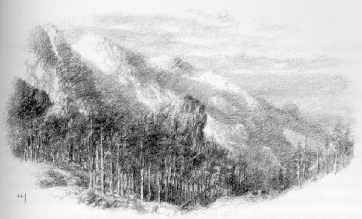
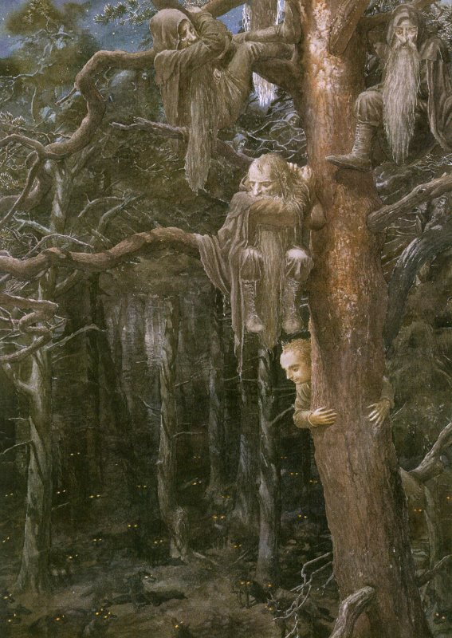
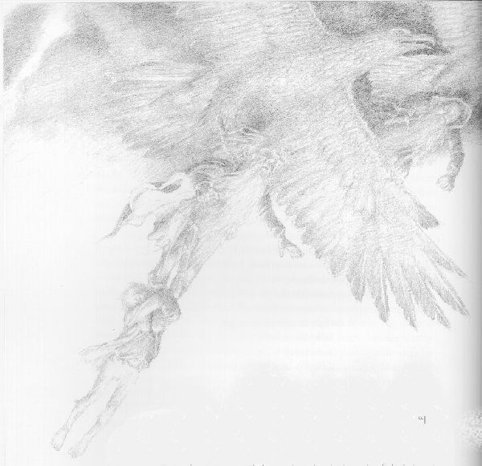

## Kapitel 6: Vom Feuer in die Flammen

Bilbo war den <abbr title="der Goblin, die Goblins — гоблин">Goblins</abbr> entkommen. Aber viel Grund zur Freude hatte er nicht. Er war allein, ohne Mantel, ohne Pony, ohne Freunde und ohne Essen. Er <abbr title="gehen (ging, ist gegangen) — шёл">ging</abbr> einfach irgendwohin. Der Weg führte ihn weiter und weiter. Schließlich sank die Sonne hinter die Berge. Ja, hinter die Berge! Lange <abbr title="der Schatten, die Schatten — тень">Schatten</abbr> lagen auf dem Weg. Vor ihm wurden die Hügel langsam niedriger. Dahinter lag eine Ebene voller Wald. Die schrecklichen Berge waren offenbar hinter ihm.

— Unglaublich! — rief Bilbo. Er konnte seinen Augen kaum glauben. — Ich bin über die Berge gekommen! Wunderbar! Jetzt muss ich nur noch Gandalf und die <abbr title="der Zwerg, die Zwerge — гном">Zwerge</abbr> finden. Ob sie wohl auch entkommen sind?

Er verließ das kleine Tal und <abbr title="gehen (ging, ist gegangen) — шёл">ging</abbr> weiter. Dabei dachte er nach, was nun zu tun war. <abbr title="der Zweifel, die Zweifel — сомнение">Zweifel</abbr> und dunkle Gedanken ließen ihn nicht in Ruhe. Musste er zurück in die schrecklichen <abbr title="die Höhle, die Höhlen — нора; пещера">Höhlen</abbr> und die anderen suchen? Er hatte doch jetzt seinen wunderbaren Ring. Schließlich sagte er sich: Er musste zurück. Freunde lässt man nicht allein in Gefahr! Seine eigene <abbr title="die Entschlossenheit — решимость">Entschlossenheit</abbr> machte ihm große Angst. Genau da hörte er Stimmen.

Bilbo blieb stehen. Nein, das waren wohl keine <abbr title="der Goblin, die Goblins — гоблин">Goblins</abbr>. Vorsichtig <abbr title="gehen (ging, ist gegangen) — шёл">ging</abbr> er weiter. Links vom Weg stand ein <abbr title="der Felsen, die Felsen — скала; утёс">Felsen</abbr>. Rechts fiel der Hang ab. Zwischen den Bäumen und Büschen unten lagen kleine Täler. Von dort kamen die Stimmen.

Er kam näher und <abbr title="sehen (sah, hat gesehen) — увидел">sah</abbr> plötzlich einen Kopf mit roter <abbr title="die Kapuze, die Kapuzen — капюшон">Kapuze</abbr> zwischen zwei <abbr title="der Felsbrocken, die Felsbrocken — валун; обломок скалы">Felsbrocken</abbr>. Balin! Er hielt <abbr title="die Wache, die Wachen — часовой; стражник">Wache</abbr>. Bilbo tanzte vor Freude beinahe los. Aber Vorsicht war wichtiger. Hier war die Gegend fremd, und überall konnte Gefahr warten. Außerdem wollte er den Zwergen einen Streich spielen. Der Ring war noch an seinem Finger. Balin schaute direkt zu ihm hin und <abbr title="sehen (sah, hat gesehen) — увидел">sah</abbr> ihn trotzdem nicht.

„Jetzt werdet ihr euch wundern, meine Lieben“, dachte Herr Baggins und kroch unter die Bäume.

Seine Freunde sprachen über die schrecklichen <abbr title="die Höhle, die Höhlen — нора; пещера">Höhlen</abbr> und ihre nächsten Schritte. Gandalf stritt mit den Zwergen. Ohne Herrn Baggins durften sie nicht fortgehen. Sie mussten wenigstens herausfinden, ob er noch lebte. Wenn er in den Händen der <abbr title="der Goblin, die Goblins — гоблин">Goblins</abbr> war, mussten sie versuchen, ihn zu befreien.

— Er ist mein Freund, — sagte Gandalf. — Ein zuverlässiger, <abbr title="treu — верный">treuer</abbr> Freund. Ich lasse ihn nicht einfach allein. Und euch lasse ich das auch nicht tun.

Die <abbr title="der Zwerg, die Zwerge — гном">Zwerge</abbr> fragten, wo er diesen hilflosen Dicken gefunden hatte. Der machte nur Schwierigkeiten. Gab es denn niemanden, der mehr verstand?

— Mit ihm hat man immer Ärger, — brummte einer. — Ich gehe nicht wegen irgendeines Hobbits wieder in die <abbr title="die Höhle, die Höhlen — нора; пещера">Höhlen</abbr>. Meinetwegen soll er verschwinden und nie wiederkommen!

— Er ist mein Freund, — wiederholte Gandalf streng. — Und meine Freunde sind keine Dummköpfe. Helft mir, ihn zu finden. Sonst trennen wir uns, hier und jetzt. Wenn er lebt und wir ihn finden, dankt ihr mir noch lange. Dori, warum hast du den Hobbit zurückgelassen?

— Was sollte ich denn tun? — antwortete Dori ärgerlich. — Niemand hat dich am Bein gepackt und in den Rücken gestoßen! Da konnte ich nicht an den Hobbit denken.

— Gut, gut. Aber warum bist du nicht zurückgegangen?

— Hört euch das an! Alles war dunkel. Überall <abbr title="der Goblin, die Goblins — гоблин">Goblins</abbr>, die schrien und bissen. Ich musste ständig ausweichen. Du und Thorin habt eure <abbr title="das Schwert, die Schwerter — меч">Schwerter</abbr> geschwungen. Mit Glamdring hast du mir fast den Kopf abgeschlagen! Dann blitzte etwas. Die <abbr title="der Goblin, die Goblins — гоблин">Goblins</abbr> liefen weg, und du hast gerufen: „Alle hinter mir her!“ Also sind wir gerannt. Ich dachte, der Hobbit lief auch hinter uns. Zum Zählen und Umschauen war keine Zeit, das weißt du selbst. Ein schönes Geschenk hast du uns da gebracht, Gandalf! Wo sollen wir deinen <abbr title="der Schatzsucher, die Schatzsucher — добытчик; искатель сокровищ">Schatzsucher</abbr> jetzt finden?

— Hier bin ich! — rief Bilbo und zog den Ring vom Finger.

Vor Überraschung sprangen die <abbr title="der Zwerg, die Zwerge — гном">Zwerge</abbr> hoch. Stellt euch ihre Sprünge nur vor! Dann jubelten sie laut. Gandalf war genauso erstaunt und freute sich wohl noch mehr. Aber statt mitzujubeln, rief er Balin zu sich. Er sagte ihm deutlich, was er von einer schlafenden <abbr title="die Wache, die Wachen — часовой; стражник">Wache</abbr> hielt.

Von diesem Augenblick an achteten die <abbr title="der Zwerg, die Zwerge — гном">Zwerge</abbr> Bilbo wirklich. Bisher hatten sie trotz Gandalfs Worten an seinen Fähigkeiten gezweifelt. Jetzt waren ihre <abbr title="der Zweifel, die Zweifel — сомнение">Zweifel</abbr> vorbei. Alle bewunderten seine Geschicklichkeit. Besonders lange wunderte sich Balin.

Herr Baggins platzte beinahe vor <abbr title="der Stolz — гордость">Stolz</abbr>. Vom Ring erzählte er natürlich nichts. Sonst schien alles nur Glück zu sein. Wie war er an der <abbr title="die Wache, die Wachen — часовой; стражник">Wache</abbr> vorbeigekommen? Bilbo erklärte <abbr title="bescheiden — скромный; скромно">bescheiden</abbr>:

— So sind wir Hobbits. Wir schlüpfen durch, und niemand merkt etwas.

— Das ist mir noch nie passiert, — sagte Balin traurig. — Ich dachte immer, nicht einmal eine Maus kommt an mir vorbei. Du hast mir etwas beigebracht.

Er senkte den Kopf.

— Dein gehorsamer Diener.

— Mach dir nichts daraus, — tröstete Bilbo ihn. — Das kann jedem passieren.

Die anderen fragten ihn nach allem. Bilbo setzte sich und erzählte von dem Augenblick an, als er allein gewesen war. Aber kein Wort über den Ring! Alle hörten ihm gespannt zu. Bei seiner Beschreibung von Gollum schauderten die <abbr title="der Zwerg, die Zwerge — гном">Zwerge</abbr> vor <abbr title="der Ekel — отвращение">Ekel</abbr>.

— Mir fiel nichts mehr ein, — erzählte Bilbo. — Er saß neben mir und zischte so hässlich. Da sagte ich: „Was habe ich in meiner Tasche?“ Mit drei Versuchen fand er es nicht heraus. Also sollte er mir den Weg zeigen, wie versprochen. Aber dieses hässliche Wesen hatte andere Pläne. Ich rannte weg und fiel hin. Er lief an mir vorbei. Danach hörte ich ihn mit sich selbst reden. Aus irgendeinem Grund dachte er, dass ich den Ausgang kannte. Schließlich führte er mich zu einem Flur und setzte sich direkt davor. Ich musste über ihn springen.

— Waren denn keine <abbr title="die Wache, die Wachen — часовой; стражник">Wachen</abbr> am Tor? — fragten die <abbr title="der Zwerg, die Zwerge — гном">Zwerge</abbr>.

— Keine <abbr title="die Wache, die Wachen — часовой; стражник">Wachen</abbr>? Sehr viele <abbr title="der Goblin, die Goblins — гоблин">Goblins</abbr> waren da! Aber ich kam geschickt an ihnen vorbei und durch die Tür. Nur meine Knöpfe habe ich verloren.

Mit einem Seufzen schaute er seine Jacke an. Sein Rätselspiel mit Gollum, die überlisteten <abbr title="die Wache, die Wachen — часовой; стражник">Wachen</abbr>, die Flucht durch die Tür: Alles erzählte er wie Kleinigkeiten. Die <abbr title="der Zwerg, die Zwerge — гном">Zwerge</abbr> hörten mit offenen Mündern zu.

— Was habe ich euch gesagt? — lachte Gandalf. — Herr Baggins ist etwas Besonderes.

Unter seinen dichten <abbr title="die Augenbraue, die Augenbrauen — бровь">Augenbrauen</abbr> schaute er den Hobbit von der Seite an. Dieser genaue Blick machte Bilbo unruhig. Offenbar ahnte Gandalf, dass er etwas verschwieg.

Jetzt hatte Bilbo alle Fragen beantwortet und stellte seine eigenen. Wie war Gandalf in die <abbr title="die Höhle, die Höhlen — нора; пещера">Höhle</abbr> gekommen? Und wo waren sie jetzt?

Gandalf hatte den Zwergen schon alles erzählt und wollte sich nicht wiederholen. Trotzdem gab er Bilbo Auskunft. Er und Elrond wussten von den bösen <abbr title="der Goblin, die Goblins — гоблин">Goblins</abbr> in den Misty Mountains. Deshalb hatten sie einen Weg abseits vom breiteren Hauptweg gewählt. Am Hauptweg lag der große Eingang zu den Goblinhöhlen. Dort legten die <abbr title="der Goblin, die Goblins — гоблин">Goblins</abbr> oft einen <abbr title="der Hinterhalt, die Hinterhalte — засада">Hinterhalt</abbr>. Aber selbst Elrond wusste nichts von ihrer <abbr title="die Falle, die Fallen — ловушка">Falle</abbr> am zweiten Weg.

— Ein <abbr title="der Riese, die Riesen — великан">Riese</abbr> muss kommen und diese Tore mit Steinen schließen, — sagte Gandalf. — Sonst kann bald niemand mehr über die Berge.

Als Bilbo schrie, verstand Gandalf sofort alles. Mit einem <abbr title="der Blitz, die Blitze — молния">Blitz</abbr> tötete er die <abbr title="der Goblin, die Goblins — гоблин">Goblins</abbr> vor sich. Dann schlüpfte er durch den <abbr title="der Riss, die Risse — трещина">Riss</abbr>, der sich schon fast geschlossen hatte. Niemand <abbr title="sehen (sah, hat gesehen) — увидел">sah</abbr> ihn. Er erreichte die Thronhöhle. Dort fragte der Great Goblin die <abbr title="der Gefangene, die Gefangenen — пленник">Gefangenen</abbr> aus. Inzwischen bereitete Gandalf seinen Zauber vor.

— So einfach ist das nicht, — erklärte er. — Man muss genau den richtigen Augenblick wählen.

Der Zauber gelang wunderbar. Das war nicht erstaunlich. Denkt nur an Gandalfs <abbr title="das Feuerwerk, die Feuerwerke — фейерверк">Feuerwerke</abbr> für den Old Took! Den Rest kennt ihr. Gandalf kannte auch die Hintertür schon lange. Dort hatte Bilbo seine Knöpfe verloren. Eigentlich kannte jeder dieses untere Tor, der mit dieser Gegend etwas vertraut war. Aber im Durcheinander ruhig zu bleiben und gleich den richtigen Weg zu wählen, das konnte ein <abbr title="der Zauberer, die Zauberer — волшебник">Zauberer</abbr> besonders gut.

— Das Tor gibt es schon sehr lange, — sagte Gandalf. — Es ist ein Ausgang für die Flucht. Dahinter liegt das Land jenseits der Berge. <abbr title="der Goblin, die Goblins — гоблин">Goblins</abbr> <abbr title="gehen (ging, ist gegangen) — шёл">gehen</abbr> nachts oft hindurch und bewachen es ständig. Jetzt stellen sie dort sicher doppelt so viele <abbr title="die Wache, die Wachen — часовой; стражник">Wachen</abbr> auf.

Er lachte.

— Trotzdem sind wir geschickt entkommen!

Die <abbr title="der Zwerg, die Zwerge — гном">Zwerge</abbr> nickten gemeinsam. Sie hatten wirklich Glück gehabt. Sie hatten den Great Goblin getötet und waren ungestraft geflohen. Ein paar blaue Flecken und Beulen zählten kaum. Darüber durften sie lachen.

Gandalf wurde aber schnell wieder ernst.

— Genug ausgeruht? Dann weiter! Es ist schon Abend. Heute Nacht <abbr title="verfolgen — преследовать">verfolgen</abbr> sie uns. Sie riechen unsere Spuren. Vor der Dunkelheit müssen wir so weit wie möglich weg sein. Wenigstens scheint heute Nacht der Mond, wenn das Wetter gut bleibt. Unseren Feinden macht der Mond nichts aus. Aber wir <abbr title="sehen (sah, hat gesehen) — увидел">sehen</abbr> dann etwas.

Er schaute Bilbo an und erkannte die Frage in seinen Augen.

— Ja, mein Lieber. Heute ist Donnerstag. Der Angriff war in der Nacht von Montag auf Dienstag. Wir sind unter der Erde viele Meilen gegangen, quer durch die Berge. Jetzt sind wir auf der anderen Seite. Leider sind wir zu weit nach Norden gekommen. Der Weg über die Berge führt in weniger gefährliche Gegenden. Außerdem liegt noch ein langer Abstieg vor uns. Also keine Zeit verlieren. Los!

— Ich habe Hunger! — stöhnte Bilbo.

Plötzlich merkte er: Seit vorgestern Abend hatte er nichts gegessen. Stellt euch das bei einem Hobbit vor! Sein Bauch war leer, und die Beine gehorchten ihm kaum noch.

— Leider musst du warten, — sagte Gandalf. — Oder geh zurück und bitte die <abbr title="der Goblin, die Goblins — гоблин">Goblins</abbr>. Vielleicht geben sie dir etwas.

— Danke schön, — antwortete Bilbo finster. — Ich warte lieber.

— Gut. Ziehen wir die Gürtel enger und <abbr title="gehen (ging, ist gegangen) — шёл">gehen</abbr> weiter. Sonst frühstücken sie mit uns. Ich bin lieber hungrig als im Bauch eines <abbr title="der Goblin, die Goblins — гоблин">Goblins</abbr>.

Sie gingen los. Bilbo suchte nach etwas zu essen. Aber er fand fast nichts. Die <abbr title="die Brombeere, die Brombeeren — ежевика">Brombeeren</abbr> begannen erst zu blühen, und Nüsse gab es noch nicht. Er kaute ein wenig <abbr title="der Sauerampfer — щавель">Sauerampfer</abbr>. Dann trank er aus einem Bergbach. Am Ufer fand er drei kleine Erdbeeren. Danach hatte er noch mehr Hunger als vorher.

Sie kamen aus dem kleinen Tal mit seinen Bäumen. Zwischen den Grasflecken, an denen Kaninchen gefressen hatten, blühten <abbr title="der Thymian — тимьян">Thymian</abbr>, <abbr title="der Salbei — шалфей">Salbei</abbr>, <abbr title="der Majoran — майоран">Majoran</abbr> und gelbe <abbr title="der Rhododendron, die Rhododendren — рододендрон">Rhododendren</abbr>. Vor ihnen lag ein Hang voller loser Steine. Als sie hinabgingen, rollten zuerst kleine Steinchen unter ihren Füßen fort. Dann bewegten sich größere Steine. Schließlich donnerten riesige <abbr title="der Felsbrocken, die Felsbrocken — валун; обломок скалы">Felsbrocken</abbr> mit Wolken von <abbr title="der Staub — пыль">Staub</abbr> hinunter. Niemand konnte sich halten. Die Reisenden rollten den Hang hinab. Ungeheure Steine flogen immer wieder an ihnen vorbei.

Die Bäume retteten sie. Unten begann ein Kiefernwald. Er stand wie ein Wächter vor den dunklen Wäldern in der Ebene. Einige Reisende packten Baumstämme. Andere hingen an Ästen. Bilbo versteckte sich einfach hinter einem Baum. Bald war die Gefahr vorbei. Der Steinschlag hörte auf, und der Lärm wurde still. Nur die letzten <abbr title="der Felsbrocken, die Felsbrocken — валун; обломок скалы">Felsbrocken</abbr> krachten noch in der Ferne. Sie bahnten sich einen Weg durch den <abbr title="der Farn, die Farne — папоротник">Farn</abbr>.

— Ende gut, alles gut, — sagte Gandalf.

Die <abbr title="der Zwerg, die Zwerge — гном">Zwerge</abbr> schauten ihn finster an und rieben ihre schmerzenden Stellen.

— Hoffentlich kommen die <abbr title="der Goblin, die Goblins — гоблин">Goblins</abbr> hier nicht nur mit blauen Flecken davon.

— Sie können uns die übrigen Steine auf den Kopf rollen, — brummte Bombur.

— Unsinn! Wir bleiben nicht bis morgen hier. Wir müssen uns beeilen. Schaut!

Die Sonne war schon lange hinter den Bergen verschwunden. Die <abbr title="der Schatten, die Schatten — тень">Schatten</abbr> wurden dunkler. Unten im Tal leuchteten kleine freundliche Lichter zwischen den Bäumen. Die Reisenden gingen schneller. Durch den Kiefernwald führte ein Weg langsam nach Süden hinunter. Manchmal mussten sie durch dichtes Gebüsch. Darin verschwand Bilbo fast ganz. Die Dunkelheit wurde tiefer, die Stille machte Angst. Nicht einmal ihre Schritte hörte man auf dem Teppich aus Kiefernnadeln. Es war völlig windstill. Kein einziger Ast bewegte sich.

* * *

— Ist es noch weit? — fragte Bilbo.

Es war jetzt so dunkel, dass er nur manchmal Thorins weißen <abbr title="der Bart, die Bärte — борода">Bart</abbr> vor sich <abbr title="sehen (sah, hat gesehen) — увидел">sah</abbr>. Die Atemzüge der <abbr title="der Zwerg, die Zwerge — гном">Zwerge</abbr> klangen in der Stille fast wie <abbr title="der Donner — гром">Donner</abbr>.

— Meine Arme sind blau. Meine Beine tun weh. Und ich habe großen Hunger.

— Wir sind fast da, — antwortete Gandalf.

Es schien eine Ewigkeit zu dauern. Dann führte der Weg auf eine <abbr title="die Lichtung, die Lichtungen — лесная поляна">Lichtung</abbr> zwischen den Bäumen. Der Mond stand darüber. Eigentlich <abbr title="sehen (sah, hat gesehen) — увидел">sah</abbr> der Platz nicht gefährlich aus. Trotzdem fühlten die <abbr title="der Zwerg, die Zwerge — гном">Zwerge</abbr> und Bilbo sich dort unwohl.

Plötzlich hörten sie hinter einem Hügel ein langes, unterbrochenes Heulen. Ein anderes antwortete rechts, viel näher. Auch links heulte es. Wölfe sammelten sich zu einem <abbr title="das Rudel, die Rudel — стая волков">Rudel</abbr>.

Bei Herrn Baggins zu Hause gab es keine Wölfe. Aber aus Märchen und alten Geschichten kannte er ihr Heulen. Ein Vetter aus der Familie Took war viel gereist. Oft hatte er wie ein Wolf geheult, um Bilbo zu erschrecken. Damals war es nur ein Spiel gewesen. Jetzt war die Gefahr echt. Bilbo hatte Todesangst. Er griff nach seinem Ring. Dann verstand er: Der Ring half nicht einmal gegen gewöhnliche Wölfe. Noch weniger gegen diese Wölfe an der Grenze von Wilderland, die mit <abbr title="der Goblin, die Goblins — гоблин">Goblins</abbr> zusammenlebten. Wölfe rochen so gut, dass sie ihre Opfer nicht <abbr title="sehen (sah, hat gesehen) — увидел">sehen</abbr> mussten.

— Was machen wir? — jammerte Bilbo. — Von den <abbr title="der Goblin, die Goblins — гоблин">Goblins</abbr> weg, direkt in den Wolfsmund!

Diese Worte wurden später eine Redensart. Heute sagen wir bei einem Unglück nach dem anderen: „Vom Feuer in die Flammen.“

— Hinauf! Schnell! — rief Gandalf.

Alle rannten zu den Bäumen und suchten nach einem mit niedrigen Ästen. Zum Glück gab es mehrere geeignete Bäume. Sie kletterten möglichst hoch. Aus sicherer Entfernung könnt ihr diese bärtigen <abbr title="der Zwerg, die Zwerge — гном">Zwerge</abbr> bestimmt lustig finden. Wie alte Männer, die wieder Kinder spielen! Fili und Kili saßen oben auf einer hohen <abbr title="die Lärche, die Lärchen — лиственница">Lärche</abbr>. Sie <abbr title="sehen (sah, hat gesehen) — увидел">sah</abbr> wie ein Weihnachtsbaum aus. Dori, Nori, Ori, Oin und Gloin wählten eine große <abbr title="die Kiefer, die Kiefern — сосна">Kiefer</abbr>. Ihre Äste standen gleichmäßig nach allen Seiten wie die Speichen eines Rades. Bifur, Bofur, Bombur und Thorin saßen auf dem Nachbarbaum. Balin und Dwalin kletterten auf eine hohe, dünne <abbr title="die Tanne, die Tannen — пихта">Tanne</abbr> mit wenigen Ästen. Sie versuchten, ganz nach oben zu kommen. Gandalf wählte eine <abbr title="die Kiefer, die Kiefern — сосна">Kiefer</abbr> am Rand der <abbr title="die Lichtung, die Lichtungen — лесная поляна">Lichtung</abbr>. Sie war so hoch, dass die <abbr title="der Zwerg, die Zwerge — гном">Zwerge</abbr> nicht hinaufkamen. Er versteckte sich in den Ästen. Wenn sein Kopf hervorschaute, leuchteten seine Augen im Mondlicht.

Und Bilbo? Wie ein Kaninchen vor Hunden rannte er von Baum zu Baum. Kein Ast war für ihn niedrig genug.

— Wieder hast du den <abbr title="der Schatzsucher, die Schatzsucher — добытчик; искатель сокровищ">Schatzsucher</abbr> vergessen, — sagte Nori und schaute hinunter.

— Trag ihn erst so lange wie ich! — antwortete Dori ärgerlich. — Unter der Erde trage ich ihn, im Wald trage ich ihn. Wie lange noch? Bin ich ein Lastenträger?

— Wenn wir nichts tun, <abbr title="fressen (fraß, hat gefressen) — жрать">fressen</abbr> sie ihn, — sagte Thorin.

Das Heulen wurde immer lauter.

— Dori! Hilf Herrn Baggins hinauf. Schnell!

Dori brummte gern. Aber auch ohne Befehl ließ er keinen Freund allein in Gefahr. Er stieg zum untersten Ast hinunter und streckte die Hand aus. Bilbo erreichte seine Finger trotzdem nicht. Deshalb sprang Dori auf den Boden. Bilbo sollte auf seine Schultern klettern.

Genau jetzt kamen die Wölfe auf die <abbr title="die Lichtung, die Lichtungen — лесная поляна">Lichtung</abbr>. Sehr viele Wölfe mit brennenden Augen! Dori ließ Bilbo nicht allein. Er wartete, bis der Hobbit von seinen Schultern auf den Ast kam. Dann sprang er selbst hinauf und hielt sich fest. Gerade rechtzeitig! Ein Wolf sprang nach ihm, schnappte zu und riss ihm den Mantel ab. Bald saß ein ganzes <abbr title="das Rudel, die Rudel — стая волков">Rudel</abbr> unter dem Baum. Die Wölfe zeigten die Zähne und ließen ihre Zungen seitlich aus dem Mund hängen.

Aber auch wilde <abbr title="der Warg, die Warge — варг; злобный волк">Warge</abbr> konnten nicht auf Bäume klettern. So hießen diese bösen Wölfe an der Grenze von Wilderland. Für eine Weile waren die Reisenden sicher. Zum Glück war die Nacht warm und windstill. Auf einem Baum saß man schon unbequem genug. Mit Kälte, Wind und wilden Wölfen darunter war es noch schlimmer.

Die <abbr title="die Lichtung, die Lichtungen — лесная поляна">Lichtung</abbr> war offenbar ein Lieblingsplatz der Wölfe. Von überall liefen sie herbei. Sie ließen <abbr title="die Wache, die Wachen — часовой; стражник">Wachen</abbr> unter Bilbos und Doris Baum. Dann rochen sie am Boden und fanden auch die anderen <abbr title="der Zwerg, die Zwerge — гном">Zwerge</abbr>. Unter jedem Baum blieb eine <abbr title="die Wache, die Wachen — часовой; стражник">Wache</abbr>. Die unzähligen übrigen Wölfe setzten sich im Kreis auf die <abbr title="die Lichtung, die Lichtungen — лесная поляна">Lichtung</abbr>. In der Mitte stand ein riesiger grauer Wolf. Er sprach in der schrecklichen Sprache der <abbr title="der Warg, die Warge — варг; злобный волк">Warge</abbr>. Nur Gandalf verstand sie. Aber auch Bilbo merkte, dass das Gespräch für sie nichts Gutes bedeutete. Immer wieder heulten die <abbr title="der Warg, die Warge — варг; злобный волк">Warge</abbr> gemeinsam als Antwort. Jedes Mal fiel Bilbo vor Angst beinahe vom Baum.

Ich erzähle euch, was die Wölfe besprachen und Gandalf hörte. <abbr title="der Warg, die Warge — варг; злобный волк">Warge</abbr> und <abbr title="der Goblin, die Goblins — гоблин">Goblins</abbr> halfen einander oft. Die <abbr title="der Goblin, die Goblins — гоблин">Goblins</abbr> blieben gern nahe bei den Bergen. Nur wenn jemand sie vertrieb, suchten sie eine neue Heimat oder zogen in den Krieg. Zum Glück gab es schon lange keinen Krieg mehr. Manchmal machten sie aber <abbr title="der Raubzug, die Raubzüge — набег">Raubzüge</abbr>. Sie brauchten Essen oder neue <abbr title="der Sklave, die Sklaven — раб">Sklaven</abbr>. Dann riefen sie die <abbr title="der Warg, die Warge — варг; злобный волк">Warge</abbr> und gaben ihnen einen Teil der <abbr title="die Beute — добыча">Beute</abbr>. <abbr title="der Goblin, die Goblins — гоблин">Goblins</abbr> ritten manchmal auf Wölfen wie <abbr title="der Zwerg, die Zwerge — гном">Zwerge</abbr> auf Ponys. Auch heute Nacht war ein <abbr title="der Raubzug, die Raubzüge — набег">Raubzug</abbr> geplant. Ihr Treffpunkt war die <abbr title="die Lichtung, die Lichtungen — лесная поляна">Lichtung</abbr>, aber die <abbr title="der Goblin, die Goblins — гоблин">Goblins</abbr> kamen zu spät. Die <abbr title="der Warg, die Warge — варг; злобный волк">Warge</abbr> wussten nichts vom Tod des Great Goblin. Auch nichts von dem Schrecken, den Gandalf, Bilbo und die <abbr title="der Zwerg, die Zwerge — гном">Zwerge</abbr> in den <abbr title="die Höhle, die Höhlen — нора; пещера">Höhlen</abbr> verbreitet hatten.

Die Gegend hatte einen schlechten Ruf. Trotzdem waren <abbr title="mutig — храбрый">mutige</abbr> Leute aus dem Süden hierhergezogen. Sie bauten Häuser in der Ebene nahe beim Fluss. Es waren viele, und sie besaßen gute <abbr title="die Waffe, die Waffen — оружие">Waffen</abbr>. Nicht einmal <abbr title="der Warg, die Warge — варг; злобный волк">Warge</abbr> wagten tagsüber einen Angriff. Jetzt wollten Wölfe und <abbr title="der Goblin, die Goblins — гоблин">Goblins</abbr> die Dörfer nahe den Bergen gemeinsam überfallen. Wenn alles gelang, standen die Häuser am Morgen leer. Die <abbr title="der Goblin, die Goblins — гоблин">Goblins</abbr> nahmen <abbr title="der Sklave, die Sklaven — раб">Sklaven</abbr> mit in die <abbr title="die Höhle, die Höhlen — нора; пещера">Höhlen</abbr>. Die übrigen Menschen fraßen die Wölfe.

Darüber sprach der <abbr title="der Anführer, die Anführer — предводитель">Anführer</abbr>. Das <abbr title="das Rudel, die Rudel — стая волков">Rudel</abbr> antwortete mit lautem Heulen. Gandalf verstand: Nicht nur die <abbr title="mutig — храбрый">mutigen</abbr> Holzfäller waren in Gefahr, sondern auch er und seine Freunde. Die Wölfe hielten sie für Spione und waren sehr wütend. Niemand durfte lebend von der <abbr title="die Lichtung, die Lichtungen — лесная поляна">Lichtung</abbr> entkommen. Sonst erreichte eine Warnung die Häuser, und die Menschen waren auf den Angriff vorbereitet. Die <abbr title="der Warg, die Warge — варг; злобный волк">Warge</abbr> wollten bleiben, bis es Morgen wurde oder die <abbr title="der Goblin, die Goblins — гоблин">Goblins</abbr> kamen. <abbr title="der Goblin, die Goblins — гоблин">Goblins</abbr> konnten bestimmt auf Bäume klettern.

Gandalf bekam also ein wenig Angst. Ein schönes Versteck hatten sie gefunden! Aber ein wirklicher <abbr title="der Zauberer, die Zauberer — волшебник">Zauberer</abbr> verlor nicht den Kopf. Auch nicht auf einem Baum über wilden Tieren. Gandalf pflückte einige <abbr title="der Zapfen, die Zapfen — шишка">Zapfen</abbr>. Der erste brannte plötzlich blau in seiner Hand. Er warf ihn auf einen großen <abbr title="der Warg, die Warge — варг; злобный волк">Warg</abbr> und traf seinen Rücken. Das Fell fing Feuer. Heulend rannte der Wolf über die <abbr title="die Lichtung, die Lichtungen — лесная поляна">Lichtung</abbr>. Ein zweiter <abbr title="der Zapfen, die Zapfen — шишка">Zapfen</abbr> folgte, dann ein dritter. Bald war die <abbr title="die Lichtung, die Lichtungen — лесная поляна">Lichtung</abbr> voller blauer, grüner und roter Flammen.

Die <abbr title="der Zapfen, die Zapfen — шишка">Zapfen</abbr> rauchten und warfen Feuerzungen und <abbr title="der Funke, die Funken — искра">Funken</abbr>. Der größte traf die Nase des Anführers. Er sprang auf und rannte im Kreis. Dabei biss er jeden Wolf, der ihm im Weg war. Bilbo und die <abbr title="der Zwerg, die Zwerge — гном">Zwerge</abbr> lachten sehr. Die schrecklichen <abbr title="der Warg, die Warge — варг; злобный волк">Warge</abbr> sahen plötzlich viel weniger schrecklich aus. Wölfe fürchteten jedes Feuer. Und dieses Feuer war besonders, ein Zauberfeuer. Ein winziger <abbr title="der Funke, die Funken — искра">Funke</abbr> genügte, und ihr Fell brannte. Die <abbr title="der Warg, die Warge — варг; злобный волк">Warge</abbr> rannten wie lebende <abbr title="die Fackel, die Fackeln — факел">Fackeln</abbr> zwischen den Bäumen. Sie rollten auf dem Boden und versuchten, das Feuer zu löschen. Nur wenige flohen. Die <abbr title="die Belagerung, die Belagerungen — осада">Belagerung</abbr> <abbr title="gehen (ging, ist gegangen) — шёл">ging</abbr> weiter.

* * *

— Was ist das für ein Lärm im Wald? — fragte der Lord of the Eagles.

Er saß wie ein schwarzer <abbr title="der Schatten, die Schatten — тень">Schatten</abbr> auf einem einsamen Berg am östlichen Rand der Bergkette.

— Ich höre Wölfe. Sicher haben die bösen <abbr title="der Goblin, die Goblins — гоблин">Goblins</abbr> wieder etwas vor.

Er flog hinauf, und zwei andere <abbr title="der Adler, die Adler — орёл">Adler</abbr> folgten ihm. Hoch über der Erde sahen sie die <abbr title="die Lichtung, die Lichtungen — лесная поляна">Lichtung</abbr> als winzigen hellen Fleck in der Nacht. <abbr title="der Adler, die Adler — орёл">Adler</abbr> hatten scharfe Augen. Im Mondlicht erkannten sie sogar ein Kaninchen am Eingang seiner <abbr title="die Höhle, die Höhlen — нора; пещера">Höhle</abbr>. Die <abbr title="der Zwerg, die Zwerge — гном">Zwerge</abbr> hinter den Ästen <abbr title="sehen (sah, hat gesehen) — увидел">sah</abbr> der Lord of the Eagles nicht. Aber er <abbr title="sehen (sah, hat gesehen) — увидел">sah</abbr> die fast verrückten Wölfe. Auch <abbr title="der Goblin, die Goblins — гоблин">Goblins</abbr> kamen in langen Reihen aus dem unteren Tor. Ihre Helme und Speere glänzten im Mondlicht.

<abbr title="der Adler, die Adler — орёл">Adler</abbr> waren verschieden. Einige waren feige oder grausam. Aber das alte Volk aus den nördlichen Bergen war das größte unter allen Vogelvölkern. Diese <abbr title="der Adler, die Adler — орёл">Adler</abbr> waren stark, stolz und <abbr title="edel — благородный">edel</abbr>. Sie hassten <abbr title="der Goblin, die Goblins — гоблин">Goblins</abbr>. Oft beachteten sie die <abbr title="der Goblin, die Goblins — гоблин">Goblins</abbr> zwar nicht, denn sie fraßen sie nicht. Aber wenn sie auf sie achteten, trieben sie sie zurück in die <abbr title="die Höhle, die Höhlen — нора; пещера">Höhlen</abbr> und verdarben ihre bösen Pläne. Die <abbr title="der Goblin, die Goblins — гоблин">Goblins</abbr> hassten die <abbr title="der Adler, die Adler — орёл">Adler</abbr> ebenso. Sie erreichten aber ihre <abbr title="das Nest, die Nester — гнездо">Nester</abbr> hoch in den Bergen nicht.

Der Lord of the Eagles wollte wissen, was unten geschah. Woher kam der Lärm, und wohin gingen die <abbr title="der Goblin, die Goblins — гоблин">Goblins</abbr>? Er rief seine <abbr title="der Untertan, die Untertanen — подданный">Untertanen</abbr>. Die <abbr title="der Adler, die Adler — орёл">Adler</abbr> flogen zum Wald. In ruhigen Kreisen sanken sie tiefer. Unbemerkt und unaufhaltsam kamen sie der <abbr title="die Lichtung, die Lichtungen — лесная поляна">Lichtung</abbr> mit den tobenden Wargen näher.

Unten war alles schrecklich durcheinander. An mehreren Stellen brannte der Wald. Es war mitten im Sommer, und lange hatte es nicht geregnet. Ein <abbr title="der Funke, die Funken — искра">Funke</abbr> genügte für ein Feuer. Alles brannte: trockenes Gras, Haufen von Kiefernnadeln, Äste und tote Bäume. Eine Feuerwand umgab die <abbr title="die Lichtung, die Lichtungen — лесная поляна">Lichtung</abbr>. Aber die Wölfe gingen nicht fort. Wütend sprangen sie unter den Bäumen und verfluchten die <abbr title="der Zwerg, die Zwerge — гном">Zwerge</abbr> in ihrer hässlichen Sprache. Aus ihren offenen Mündern tropfte <abbr title="der Speichel — слюна">Speichel</abbr>. Ihre blutroten Augen leuchteten heller als die Flammen.

Dann kamen die <abbr title="der Goblin, die Goblins — гоблин">Goblins</abbr> mit lautem Geschrei. Zuerst glaubten sie, die Wölfe kämpften gegen Holzfäller. Schnell verstanden sie die Lage. Sie lachten laut und schlugen ihre Speere gegen die <abbr title="der Schild, die Schilde — щит">Schilde</abbr>. <abbr title="der Goblin, die Goblins — гоблин">Goblins</abbr> fürchteten Feuer nicht. Ganz im Gegenteil! Nach einer kurzen Beratung wollten sie sich an den Zwergen rächen. Die hatten sie ja vor Kurzem so sehr gedemütigt.

Einige trieben die Wölfe zur Seite. Andere traten und löschten das Feuer. Überall, nur nicht unter den Bäumen mit den Zwergen! Dorthin brachten sie vielmehr trockenes Holz, <abbr title="das Moos — мох">Moos</abbr> und Kiefernnadeln. Bald standen die Bäume in einem Feuerring. Es gab keinen Weg hinaus. Der Ring wurde immer enger. Rauch brannte in den Augen, und es wurde heißer. Die <abbr title="der Goblin, die Goblins — гоблин">Goblins</abbr> tanzten vor Freude im Kreis, wie Menschen am längsten Sommertag. Außerhalb des Feuers standen Kämpfer mit Speeren und <abbr title="die Axt, die Äxte — топор">Äxten</abbr>. Weiter weg warteten die Wölfe und schauten genau zu.

Die <abbr title="der Goblin, die Goblins — гоблин">Goblins</abbr> sangen:

> Fünfzehn Vögel auf fünf Bäumen!  
> Fünfzehn Vögel über fünf Feuern!  
> Aber Flügel haben sie nicht!  
> Gutes Hähnchenfleisch zum Mittagessen!  
> Erst <abbr title="braten (briet, hat gebraten) — жарить">braten</abbr> wir sie lebendig, dann kommen sie in den Topf.  
> Heiße Küken kommen auf den Tisch!

Danach riefen sie:

— Fliegt, kleine Vögel! Wenn ihr könnt, fliegt! Oder kommt herunter, solange ihr noch nicht lebendig brennt! He, ihr da oben!

— Weg mit euch, ihr ungezogenen Kinder! — rief Gandalf zurück. — Wer lässt euch mit Feuer spielen? Ihr bekommt noch ordentlich Schläge dafür!

Er neckte die <abbr title="der Goblin, die Goblins — гоблин">Goblins</abbr> absichtlich. Sie sollten glauben, dass er keine Angst hatte. In Wirklichkeit fürchtete er sich sehr. Wer hatte in seiner Lage keine Angst? Die <abbr title="der Goblin, die Goblins — гоблин">Goblins</abbr> hörten nicht darauf und sangen wieder:

> Brenn hell, Feuer, geh nicht aus!  
> Brenn noch stärker, heller im Wald!  
> Hell wie der Tag und warm mit Feuer!  
> Jo-ho-ho!  
> Wir trocknen sie, wir <abbr title="braten (briet, hat gebraten) — жарить">braten</abbr> sie!  
> Haare brennen, Nasen werden braun!  
> Augen platzen, Fett läuft heraus!  
> Die <abbr title="die Haut, die Häute — кожа">Haut</abbr> wird dunkel, die <abbr title="der Knochen, die Knochen — кость">Knochen</abbr> werden Kohle!  
> Heiß sind die Kohlen!  
> Hoch ist der Himmel!  
> Die <abbr title="der Zwerg, die Zwerge — гном">Zwerge</abbr> sind am Ende!  
> Tanz, du guter <abbr title="der Goblin, die Goblins — гоблин">Goblin</abbr>!  
> Jo-ho-ho!  
> Hipp, hipp, hurra!  
> Jo-ho-ho!

Bei den letzten Worten kam das Feuer an Gandalfs Baum. Bald brannten auch die anderen. Flammen leckten an der Rinde. Die unteren Äste knisterten leise. Gandalf kletterte höher. Von seinem <abbr title="der Stab, die Stäbe — посох">Stab</abbr> flog ein Bündel <abbr title="der Funke, die Funken — искра">Funken</abbr>. Offenbar wollte er auf die <abbr title="der Goblin, die Goblins — гоблин">Goblins</abbr> springen. Er musste sowieso sterben. Also wollte er möglichst viele Feinde mitnehmen. Aber zu diesem Sprung kam es nicht.

Genau in dem Augenblick packte der Lord of the Eagles ihn und flog mit ihm in den Himmel.

* * *

Die <abbr title="der Goblin, die Goblins — гоблин">Goblins</abbr> schrien vor Wut. Gandalf sagte seinem Retter etwas, und der <abbr title="der Adler, die Adler — орёл">Adler</abbr> rief laut. Sofort erschienen andere <abbr title="der Adler, die Adler — орёл">Adler</abbr> über der <abbr title="die Lichtung, die Lichtungen — лесная поляна">Lichtung</abbr>, riesige schwarze <abbr title="der Schatten, die Schatten — тень">Schatten</abbr>. Wölfe jammerten und schnappten mit den Zähnen. <abbr title="der Goblin, die Goblins — гоблин">Goblins</abbr> heulten und stießen vergeblich mit ihren Speeren in die Luft. Das Adlerheer kämpfte gegen <abbr title="der Warg, die Warge — варг; злобный волк">Warge</abbr> und <abbr title="der Goblin, die Goblins — гоблин">Goblins</abbr>. Einige Vögel holten inzwischen die fast leblosen <abbr title="der Zwerg, die Zwerge — гном">Zwerge</abbr> von den Bäumen.

Den armen Bilbo vergaßen sie beinahe wieder. Im letzten Augenblick packte er gerade noch Doris Beine. Die <abbr title="der Adler, die Adler — орёл">Adler</abbr> stiegen über die Bäume. Der Hobbit hing unten und hielt Doris <abbr title="der Knöchel, die Knöchel — лодыжка">Knöchel</abbr> mit aller Kraft fest.

Bald war der Wald verschwunden. Unten leuchteten nur noch kleine rote Flecken. In weiten Kreisen flogen die <abbr title="der Adler, die Adler — орёл">Adler</abbr> höher und höher.

— Oh, meine Arme! Meine armen Arme! — stöhnte Bilbo.

Diesen Flug vergaß er sein ganzes Leben nicht.

— Oh, meine Beine! Meine armen Beine! — antwortete Dori.

Von Höhe wurde Bilbo immer schwindlig. Schon ein Blick von einem kleinen Hügel genügte. Treppen mochte er nicht, und auf Bäume war er nie geklettert. Vor Wölfen hatte er bisher auch nie fliehen müssen. Stellt euch also vor, wie er jetzt nach unten schaute! Seine Beine hingen in der Luft. Darunter lagen im Mondlicht <abbr title="der Felsen, die Felsen — скала; утёс">Felsen</abbr>, kleine Täler und Flüsse. Die <abbr title="der Gipfel, die Gipfel — горная вершина">Gipfel</abbr> kamen immer näher. Senkrechte Felswände tauchten aus der Dunkelheit auf. Obwohl es Sommer war, fror Bilbo schrecklich. Er schloss die Augen fest. Wie lange hielt er noch durch? Wenn seine Hände plötzlich losließen? Dieser Gedanke machte ihm übel.

Gerade rechtzeitig endete der Flug. Bilbos Hände hatten keine Kraft mehr. Mit einem Seufzen öffnete er die Finger und fiel auf den harten Boden eines Adlernestes. Lange konnte er nicht aufstehen. Seine Gedanken waren durcheinander. Einerseits war er <abbr title="erleichtert — испытывающий облегчение">erleichtert</abbr>: Sie waren den <abbr title="der Goblin, die Goblins — гоблин">Goblins</abbr> entkommen! Andererseits fürchtete er den tiefen Abgrund. Die drei hungrigen Tage hatten ihn geschwächt. Er merkte nicht gleich, dass er laut dachte.

— Jetzt weiß ich, wie sich ein Stück Schweinebrust fühlt. Plötzlich aus der Pfanne heraus und wieder in die Vorratskammer!

— Unsinn, — sagte Dori. — Schweinebrust kommt irgendwann wieder in die Pfanne. Wir haben mehr Glück. Und Adlerkrallen sind kein Messer und keine Gabel.

— Nein, kein Kabel, — stimmte Bilbo zu. — Ich meine, keine Gabel.

Vorsichtig schaute er den <abbr title="der Adler, die Adler — орёл">Adler</abbr> neben sich an. Was hatte er gerade gesagt? War der Vogel vielleicht <abbr title="beleidigt — оскорблённый">beleidigt</abbr>? In einem Adlernest durfte man zum <abbr title="der Gastgeber, die Gastgeber — хозяин, принимающий гостей">Gastgeber</abbr> besser nicht unhöflich sein.

Der <abbr title="der Adler, die Adler — орёл">Adler</abbr> beachtete Bilbo aber gar nicht. Er putzte seine Federn. Bald kam ein zweiter Vogel.

— Der Herr befiehlt: Bringt die <abbr title="der Gefangene, die Gefangenen — пленник">Gefangenen</abbr> zum Great Shelf! — rief der Bote.

Der <abbr title="der Adler, die Adler — орёл">Adler</abbr> packte Dori und verschwand in der Nacht. Bilbo blieb allein zurück. Warum nannten sie die <abbr title="der Zwerg, die Zwerge — гном">Zwerge</abbr> „<abbr title="der Gefangene, die Gefangenen — пленник">Gefangene</abbr>“? Das gefiel ihm überhaupt nicht. Vielleicht war das Great Shelf die Speisestelle der <abbr title="der Adler, die Adler — орёл">Adler</abbr>? Weiter konnte er nicht denken. Jetzt war er dran.

Ein <abbr title="der Adler, die Adler — орёл">Adler</abbr> nahm ihn am Mantel und flog hinauf. Diesmal war der Flug sehr kurz. Zitternd landete Bilbo auf einem breiten Felsvorsprung. Nur mit Flügeln konnte man dorthin gelangen. Ebenso konnte man nur mit Flügeln weg. Oder mit einem Sprung in den Abgrund. Bilbo <abbr title="sehen (sah, hat gesehen) — увидел">sah</abbr> die <abbr title="der Zwerg, die Zwerge — гном">Zwerge</abbr> und Gandalf. Der <abbr title="der Zauberer, die Zauberer — волшебник">Zauberer</abbr> sprach mit dem Lord of the Eagles.

Offenbar wollte niemand den kleinen Hobbit essen. Gandalf hatte sich mit dem Lord of the Eagles angefreundet. Bilbo wusste nicht, dass Gandalf oft in den Misty Mountains gewesen war. Einmal hatte er dem Lord of the Eagles eine Stichwunde geheilt. „<abbr title="der Gefangene, die Gefangenen — пленник">Gefangene</abbr>“ bedeutete hier <abbr title="der Gefangene, die Gefangenen — пленник">Gefangene</abbr> der <abbr title="der Goblin, die Goblins — гоблин">Goblins</abbr>, nicht <abbr title="der Gefangene, die Gefangenen — пленник">Gefangene</abbr> der <abbr title="der Adler, die Adler — орёл">Adler</abbr>. Langsam glaubte Bilbo wirklich an ihre Flucht vor den mörderischen Wesen. Gandalf bat den <abbr title="der Adler, die Adler — орёл">Adler</abbr>, sie über den Great River zu tragen.

Aber der Lord of the Eagles wollte nicht zu den Häusern der Menschen fliegen.

— Sie schießen mit ihren großen Bögen auf uns. Sie denken, wir stehlen ihre Schafe. Sonst tun wir das natürlich manchmal. Aber die Menschen fragen nicht, warum wir kommen. Es tut mir leid, <abbr title="der Zauberer, die Zauberer — волшебник">Zauberer</abbr>. Wir haben dir gern geholfen und helfen dir wieder. Doch die Ebenen im Süden sind nichts für <abbr title="der Adler, die Adler — орёл">Adler</abbr>.

— Uns ist jeder Ort recht, — rief Gandalf. — Hauptsache, weit weg von hier! Wir können nichts verlangen. Übrigens sterbe ich vor Hunger.

— Ich bin schon fast gestorben, — sagte Bilbo leise. Aber niemand hörte ihn.

— Dagegen können wir etwas tun, — antwortete der Lord of the Eagles.

Etwas später brannte auf dem Felsvorsprung ein helles Feuer. Die <abbr title="der Zwerg, die Zwerge — гном">Zwerge</abbr> brieten Fleisch, das wunderbar duftete. Zuerst brachten die <abbr title="der Adler, die Adler — орёл">Adler</abbr> trockene Äste für das Feuer. Danach brachten sie Kaninchen, Hasen und ein kleines Schaf. Bilbo lag beim Feuer und wärmte sich. Er war zu schwach, um den Zwergen zu helfen. Außerdem konnte er Kaninchen nicht richtig die <abbr title="die Haut, die Häute — кожа">Haut</abbr> abziehen oder Fleisch zerteilen. Beim Fleischer auf The Hill hatte er immer fertige Stücke gekauft. Die musste er nur in die Pfanne legen. Auch Gandalf ruhte sich aus. Vorher hatte er beim Feuermachen geholfen. Oin und Gloin hatten nämlich ihre <abbr title="der Feuerstein, die Feuersteine — кремень; огниво">Feuersteine</abbr> verloren. <abbr title="der Zwerg, die Zwerge — гном">Zwerge</abbr> benutzen bis heute keine <abbr title="das Streichholz, die Streichhölzer — спичка">Streichhölzer</abbr>.

So endeten die <abbr title="das Abenteuer, die Abenteuer — приключение">Abenteuer</abbr> in den Misty Mountains. Bilbo mochte ein Butterbrot lieber als Fleisch von einem Stock. Aber auf das Abendessen verzichten konnte er nicht. Satt rollte er sich zusammen und schlief ein. In dieser Nacht schlief er fester als gewöhnlich in seinem weichen Bett. Er träumte von seinem Haus. Dort <abbr title="gehen (ging, ist gegangen) — шёл">ging</abbr> er von Zimmer zu Zimmer und suchte etwas. Nur wohin hatte er es gelegt? Er konnte sich nicht erinnern.

---

### Neue und schwierige Wörter

- **der Goblin, die Goblins** — гоблин *(Wiederholung)*
- **gehen (ging, ist gegangen)** — шёл *(neu)*
- **der Schatten, die Schatten** — тень *(Wiederholung)*
- **der Zwerg, die Zwerge** — гном *(Wiederholung)*
- **der Zweifel, die Zweifel** — сомнение *(Wiederholung)*
- **die Höhle, die Höhlen** — нора; пещера *(Wiederholung)*
- **die Entschlossenheit** — решимость *(neu)*
- **der Felsen, die Felsen** — скала; утёс *(Wiederholung)*
- **sehen (sah, hat gesehen)** — увидел *(neu)*
- **die Kapuze, die Kapuzen** — капюшон *(Wiederholung)*
- **der Felsbrocken, die Felsbrocken** — валун; обломок скалы *(Wiederholung)*
- **die Wache, die Wachen** — часовой; стражник *(Wiederholung)*
- **treu** — верный *(neu)*
- **das Schwert, die Schwerter** — меч *(Wiederholung)*
- **der Schatzsucher, die Schatzsucher** — добытчик; искатель сокровищ *(Wiederholung)*
- **der Stolz** — гордость *(neu)*
- **bescheiden** — скромный; скромно *(neu)*
- **der Ekel** — отвращение *(neu)*
- **die Augenbraue, die Augenbrauen** — бровь *(Wiederholung)*
- **der Hinterhalt, die Hinterhalte** — засада *(neu)*
- **die Falle, die Fallen** — ловушка *(Wiederholung)*
- **der Riese, die Riesen** — великан *(Wiederholung)*
- **der Blitz, die Blitze** — молния *(Wiederholung)*
- **der Riss, die Risse** — трещина *(Wiederholung)*
- **der Gefangene, die Gefangenen** — пленник *(Wiederholung)*
- **das Feuerwerk, die Feuerwerke** — фейерверк *(Wiederholung)*
- **der Zauberer, die Zauberer** — волшебник *(Wiederholung)*
- **verfolgen** — преследовать *(Wiederholung)*
- **die Brombeere, die Brombeeren** — ежевика *(neu)*
- **der Sauerampfer** — щавель *(neu)*
- **der Thymian** — тимьян *(neu)*
- **der Salbei** — шалфей *(neu)*
- **der Majoran** — майоран *(neu)*
- **der Rhododendron, die Rhododendren** — рододендрон *(neu)*
- **der Staub** — пыль *(Wiederholung)*
- **der Farn, die Farne** — папоротник *(neu)*
- **der Bart, die Bärte** — борода *(Wiederholung)*
- **der Donner** — гром *(Wiederholung)*
- **die Lichtung, die Lichtungen** — лесная поляна *(Wiederholung)*
- **das Rudel, die Rudel** — стая волков *(neu)*
- **die Lärche, die Lärchen** — лиственница *(neu)*
- **die Kiefer, die Kiefern** — сосна *(Wiederholung)*
- **die Tanne, die Tannen** — пихта *(neu)*
- **fressen (fraß, hat gefressen)** — жрать *(Wiederholung)*
- **der Warg, die Warge** — варг; злобный волк *(neu)*
- **der Raubzug, die Raubzüge** — набег *(neu)*
- **der Sklave, die Sklaven** — раб *(Wiederholung)*
- **die Beute** — добыча *(Wiederholung)*
- **mutig** — храбрый *(Wiederholung)*
- **die Waffe, die Waffen** — оружие *(Wiederholung)*
- **der Anführer, die Anführer** — предводитель *(Wiederholung)*
- **der Zapfen, die Zapfen** — шишка *(neu)*
- **der Funke, die Funken** — искра *(Wiederholung)*
- **die Fackel, die Fackeln** — факел *(Wiederholung)*
- **die Belagerung, die Belagerungen** — осада *(neu)*
- **der Adler, die Adler** — орёл *(neu)*
- **edel** — благородный *(neu)*
- **das Nest, die Nester** — гнездо *(Wiederholung)*
- **der Untertan, die Untertanen** — подданный *(Wiederholung)*
- **der Speichel** — слюна *(neu)*
- **der Schild, die Schilde** — щит *(Wiederholung)*
- **das Moos** — мох *(Wiederholung)*
- **die Axt, die Äxte** — топор *(Wiederholung)*
- **braten (briet, hat gebraten)** — жарить *(Wiederholung)*
- **die Haut, die Häute** — кожа *(Wiederholung)*
- **der Knochen, die Knochen** — кость *(Wiederholung)*
- **der Stab, die Stäbe** — посох *(Wiederholung)*
- **der Knöchel, die Knöchel** — лодыжка *(neu)*
- **der Gipfel, die Gipfel** — горная вершина *(Wiederholung)*
- **erleichtert** — испытывающий облегчение *(Wiederholung)*
- **beleidigt** — оскорблённый *(Wiederholung)*
- **der Gastgeber, die Gastgeber** — хозяин, принимающий гостей *(Wiederholung)*
- **der Feuerstein, die Feuersteine** — кремень; огниво *(neu)*
- **das Streichholz, die Streichhölzer** — спичка *(Wiederholung)*
- **das Abenteuer, die Abenteuer** — приключение *(Wiederholung)*

### Schwierige Sätze

- **„Er ging einfach irgendwohin.“**  
  «Он шёл куда глаза глядят». `ging` — Präteritum от `gehen`. С этой главы повествование переходит с Präsens на Präteritum; прямые реплики героев остаются в подходящем для них времени.
- **„Aber statt mitzujubeln, rief er Balin zu sich.“**  
  «Но вместо того, чтобы радоваться со всеми, он подозвал Балина». `statt … zu` — «вместо того чтобы…». У отделяемого `mitjubeln` частица `zu` стоит после приставки: `mitzujubeln`.
- **„Er griff nach seinem Ring.“**  
  «Он полез за кольцом». `greifen nach` требует Dativ: `nach seinem Ring`. Präteritum глагола `greifen` — `griff`.
- **„Oft hatte er wie ein Wolf geheult, um Bilbo zu erschrecken.“**  
  «Он часто выл по-волчьи, чтобы напугать Бильбо». `um … zu` обозначает цель. `hatte geheult` — действие, которое было раньше описываемого события.
- **„Sonst erreichte eine Warnung die Häuser, und die Menschen waren auf den Angriff vorbereitet.“**  
  «Иначе предупреждение дошло бы до домов, и люди подготовились бы к нападению». Рассказчик передаёт расчёт волков. `auf etwas vorbereitet sein` — быть готовым к чему-то; здесь это состояние, не действие в пассиве.
- **„Obwohl es Sommer war, fror Bilbo schrecklich.“**  
  «Хотя стояло лето, Бильбо страшно замёрз». `obwohl` вводит противопоставление ожидаемому. `fror` — Präteritum от `frieren`.
- **„Er war zu schwach, um den Zwergen zu helfen.“**  
  «Он был слишком слаб, чтобы помогать гномам». `zu …, um … zu` здесь означает недостаточную возможность. `helfen` требует Dativ: `den Zwergen`.
- **„Zwerge benutzen bis heute keine Streichhölzer.“**  
  «Гномы до сих пор не пользуются спичками». `bis heute` выходит за рамки времени приключения и относится к настоящему рассказчика; обобщение о гномах сохраняется.
- **„Nur wohin hatte er es gelegt?“**  
  «Вот только куда он это положил?» `hatte gelegt` — Plusquamperfekt: во сне Бильбо ищет предмет, который до того куда-то положил.

[← Zurück](kapitel-05.md) · [Inhalt](README.md) · [Weiter →](kapitel-07.md)
