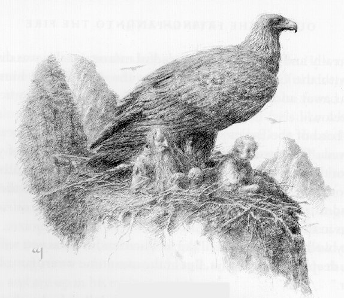
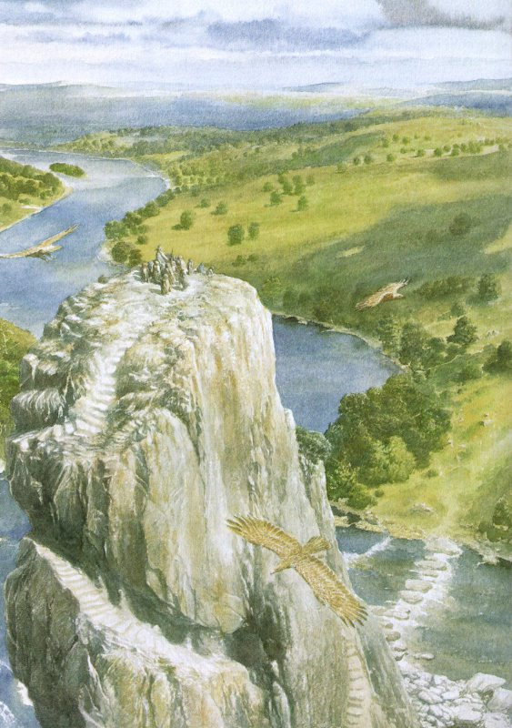
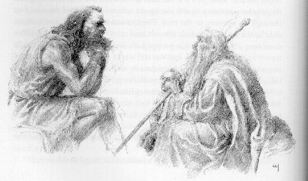
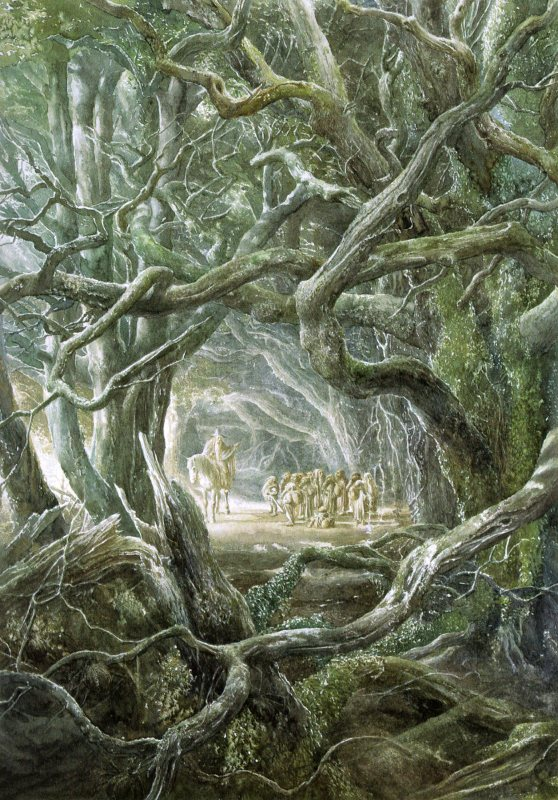

## Kapitel 7: Zu Gast bei Beorn

Sonnenlicht weckte Bilbo. Fröhlich sprang er auf. Wie gewöhnlich wollte er nach der Uhr schauen und Kaffee aufsetzen. Dann erinnerte er sich: Sein Zuhause war sehr, sehr weit weg. Auch die Zähne konnte er nicht putzen. Er hatte nichts dafür. Zum Frühstück bekam er nur zwei kalte Stücke Fleisch: <abbr title="das Schaffleisch — баранина">Schaffleisch</abbr> und Kaninchenfleisch. Kein Speck, kein Tee, keine Kekse! Nach diesem kleinen Essen bereitete er sich auf die Reise vor.

Diesmal durfte er auf dem Rücken eines Adlers sitzen. Der Vogel breitete seine riesigen Flügel aus und sprang vom <abbr title="der Felsen, die Felsen — скала; утёс">Felsen</abbr>. Der Wind pfiff in Bilbos Ohren. Ängstlich schloss er die Augen und hielt sich fest. Die <abbr title="der Zwerg, die Zwerge — гном">Zwerge</abbr> folgten ihm. Sie hatten sich herzlich vom Lord of the Eagles verabschiedet, ihm gedankt und Hilfe für später versprochen. Der Morgen war kalt. <abbr title="der Nebel — туман">Nebel</abbr> lag unten im Land, und die <abbr title="der Gipfel, die Gipfel — горная вершина">Gipfel</abbr> verschwanden im <abbr title="der Dunst — дымка">Dunst</abbr>. Die Sonne stand noch niedrig. Bilbo öffnete vorsichtig ein Auge. Die Vögel flogen hoch, die Erde war nicht zu erkennen, und die Berge wurden langsam kleiner. Schnell schloss er das Auge wieder und packte die Federn am Hals des Adlers fester.

— He, nicht so fest! — sagte der <abbr title="der Adler, die Adler — орёл">Adler</abbr>. — Und hör auf zu zittern! Bist du wirklich mit Kaninchen verwandt? Der Morgen ist wunderbar. Fast kein Wind! Was kann schöner sein als Fliegen?

„Ein heißes Bad und Frühstück auf einer Wiese“, wollte Bilbo antworten. Aber er sagte nichts. Nur seine Finger ließ er ein wenig lockerer.

Sie flogen lange. Schließlich fanden die <abbr title="der Adler, die Adler — орёл">Adler</abbr> wohl, was sie suchten. Aus dieser Höhe sahen sie ja sehr weit! Langsam sanken sie in Kreisen tiefer. Bilbo wagte wieder, die Augen zu öffnen. Unten erkannte er Bäume, wohl <abbr title="die Eiche, die Eichen — дуб">Eichen</abbr> und <abbr title="die Ulme, die Ulmen — вяз">Ulmen</abbr>. Durch eine Ebene voller Gras floss ein Fluss. Mitten darin stand ein riesiger <abbr title="der Felsen, die Felsen — скала; утёс">Felsen</abbr>, fast ein eigener Berg. Er war wie der letzte Rest der fernen Berge. Vielleicht hatte ein starker <abbr title="der Riese, die Riesen — великан">Riese</abbr> ihn ins Wasser geworfen.

Einer nach dem anderen landeten die <abbr title="der Adler, die Adler — орёл">Adler</abbr> auf dem <abbr title="der Felsen, die Felsen — скала; утёс">Felsen</abbr> und setzten die Reisenden ab.

— Viel Glück! — riefen sie gemeinsam. — Viel Glück bei allem, was ihr tut! Mögen eure <abbr title="das Nest, die Nester — гнездо">Nester</abbr> auf euch warten!

So verabschiedeten sich <abbr title="der Adler, die Adler — орёл">Adler</abbr>.

— Der Wind soll euch dorthin tragen, wohin Sonne und Mond ziehen! — antwortete Gandalf für alle.

Nur er kannte die richtigen Worte. So trennten sie sich. Später wurde der Lord of the Eagles zum King of All Birds. Er bekam eine goldene Krone. Fünfzehn seiner <abbr title="der Untertan, die Untertanen — подданный">Untertanen</abbr> bekamen goldene Ketten, Geschenke von den Zwergen. Aber Bilbo traf sie nie wieder. Er <abbr title="sehen (sah, hat gesehen) — увидел">sah</abbr> sie nur noch einmal hoch am Himmel, über der Battle of Five Armies. Doch wir greifen der Geschichte nicht vor. Ihr erfahrt alles zur richtigen Zeit.

Die Spitze des Felsens war flach wie ein Tisch. Eine Treppe führte zum Wasser hinunter. Viele Füße hatten ihre Stufen abgenutzt. Unten lagen große <abbr title="der Felsbrocken, die Felsbrocken — валун; обломок скалы">Felsbrocken</abbr> als Weg durch den Fluss. Nahe beim ersten Stein gab es eine gemütliche kleine <abbr title="die Höhle, die Höhlen — нора; пещера">Höhle</abbr>. Auf ihrem Boden lagen <abbr title="der Kiesel, die Kiesel — галька; небольшой округлый камень">Kiesel</abbr>. Dort setzten sie sich und besprachen ihre nächsten Schritte.

— Ich habe euch über die Berge geholfen, wie ich es vorhatte, — sagte Gandalf. — Jetzt seid ihr sicher. Dank unserem Glück, Elronds gutem Rat und unseren anderen Freunden! Aber wir sind weiter nach Osten gekommen, als ich erwartet habe. Deshalb muss ich mich beeilen. Ja, ja, ich gehe fort. Es ist nicht mein <abbr title="das Abenteuer, die Abenteuer — приключение">Abenteuer</abbr>. Vielleicht komme ich später wieder zu euch. Jetzt warten andere <abbr title="das Geschäft, die Geschäfte — дело; предприятие">Geschäfte</abbr> auf mich.

Die <abbr title="der Zwerg, die Zwerge — гном">Zwerge</abbr> waren sehr traurig. Bilbo weinte sogar. Alle hatten gedacht, dass Gandalf bis zum Lonely Mountain bei ihnen blieb. Immer bereit, ihnen zu helfen!

— Hör auf! — sagte Gandalf streng zu Bilbo. — Ich gehe doch nicht sofort. Einen oder zwei Tage bleibe ich noch. Ich helfe euch, so gut ich kann. Danach müsst ihr ohne mich auskommen. Ihr habt kein Essen, keine <abbr title="die Ausrüstung, die Ausrüstungen — снаряжение">Ausrüstung</abbr> und kennt nicht einmal diesen Ort. Ich kenne ihn und erkläre euch alles. Unser geplanter Weg liegt ein paar Meilen weiter nördlich. Die <abbr title="der Goblin, die Goblins — гоблин">Goblins</abbr> haben unsere Pläne geändert. Hier wohnt niemand, jedenfalls bei meinem letzten Besuch vor zwei oder drei Jahren. Vielleicht hat sich das inzwischen geändert. Verlasst euch also nur auf euch selbst. In der Nähe wohnt aber ein guter Bekannter von mir. Er hat diese Treppe in den <abbr title="der Felsen, die Felsen — скала; утёс">Felsen</abbr> gehauen. Übrigens heißt der <abbr title="der Felsen, die Felsen — скала; утёс">Felsen</abbr> Carrock. Tagsüber kommt er selten hierher. Warten hilft also nicht. Wir müssen ihn selbst suchen. Wenn wir Glück haben und ihn finden, verabschiede ich mich. Dann wünsche ich euch Glück wie die <abbr title="der Adler, die Adler — орёл">Adler</abbr>.

Die <abbr title="der Zwerg, die Zwerge — гном">Zwerge</abbr> baten Gandalf zu bleiben. Sie boten ihm Gold, Silber und <abbr title="der Edelstein, die Edelsteine — драгоценный камень">Edelsteine</abbr> aus dem Drachenschatz an. Aber er blieb bei seinem Entschluss.

— Es ist schon entschieden. Und euer Gold müsst ihr erst einmal bekommen. Außerdem habe ich meinen Anteil wohl längst verdient.

* * *

Sie badeten im Fluss. Am Ufer war das Wasser klar und flach. Sie wuschen ihre Kleidung und lagen in der Sonne. Dann waren sie ausgeruht, aber wieder etwas hungrig. Sie gingen durch das flache Wasser auf die andere Seite. Bilbo trug man wieder auf den Schultern. Gandalf führte sie durch hohes Gras, an breiten <abbr title="die Eiche, die Eichen — дуб">Eichen</abbr> und mächtigen <abbr title="die Ulme, die Ulmen — вяз">Ulmen</abbr> vorbei.

— Warum nennt Ihr Bekannter diesen <abbr title="der Felsen, die Felsen — скала; утёс">Felsen</abbr> Carrock? — fragte Bilbo neben dem <abbr title="der Zauberer, die Zauberer — волшебник">Zauberer</abbr>.

— Weil er das will. Alle <abbr title="der Felsen, die Felsen — скала; утёс">Felsen</abbr> nennt er Carrocks. Dieser steht bei seinem Haus. Deshalb ist es für ihn der Carrock, mit einem großen Anfangsbuchstaben.

— Wer ist er denn?

— Oh, eine sehr wichtige Person. Hört alle zu! Seid besonders höflich. Sonst verspreche ich euch nichts Gutes. Eigentlich ist er freundlich. Aber wenn er wütend ist, ist er schrecklich. Und wütend wird er leicht.

Die <abbr title="der Zwerg, die Zwerge — гном">Zwerge</abbr> kamen näher und brummten:

— Immer dasselbe! Sind alle deine Bekannten so streng, Gandalf? Einer schlimmer als der andere! Erkläre es uns bitte einmal genauer.

— Wie oft denn noch? — fragte Gandalf ärgerlich. — Meine Bekannten sind streng, aber niemand sagt etwas Schlechtes über sie. Dieser heißt Beorn. Er ist ein <abbr title="der Gestaltwandler, die Gestaltwandler — оборотень; тот, кто меняет облик">Gestaltwandler</abbr>. Er „wechselt seine <abbr title="die Haut, die Häute — кожа">Haut</abbr>“, wie man sagt.

— Ein <abbr title="der Kürschner, die Kürschner — скорняк">Kürschner</abbr>? — fragte Bilbo. — Solche Leute kenne ich. Passt man nicht auf, verkaufen sie einem Kaninchenfell als Eichhörnchenfell.

— Großer Himmel, nein! — rief Gandalf. — Nein, nein, nein! Denk nach, Herr Baggins! Sprich bei Beorn bloß nicht von Kürschnern. Auch nicht von Teppichen, Decken, Schals oder Mänteln. Er kann seine <abbr title="die Gestalt, die Gestalten — облик; форма">Gestalt</abbr> ändern, wann er will. Manchmal ist er ein riesiger schwarzer Bär. Dann wieder ein riesiger Mann mit schwarzen Haaren und langem <abbr title="der Bart, die Bärte — борода">Bart</abbr>. Einige sagen, er ist wirklich ein Bär. Seine <abbr title="der Vorfahre, die Vorfahren — предок">Vorfahren</abbr> waren die großen alten Bären in den Bergen, noch vor den <abbr title="der Riese, die Riesen — великан">Riesen</abbr>. Andere sagen, seine <abbr title="der Vorfahre, die Vorfahren — предок">Vorfahren</abbr> waren Menschen. Sie wohnten hier schon lange vor Smaug. Damals kamen noch keine <abbr title="der Goblin, die Goblins — гоблин">Goblins</abbr> aus dem Norden. Mehr kann ich euch nicht sagen. Über solche Leute stellt man keine Fragen.

Kein Zauber konnte Beorn beherrschen. Er wohnte in einem großen Holzhaus zwischen <abbr title="die Eiche, die Eichen — дуб">Eichen</abbr>. Er hielt Vieh und viele <abbr title="der Bienenstock, die Bienenstöcke — улей">Bienenstöcke</abbr>. Meist aß er Honig und <abbr title="die Sahne — сливки">Sahne</abbr>. Seine Pferde waren wunderbar. Sie konnten sprechen. Beorn jagte nicht und aß kein Fleisch. Als Bär wanderte er viel. Gandalf hatte ihn einmal nachts oben auf dem Carrock gesehen. Er schaute zum Mond, der hinter die Misty Mountains sank, und brummte leise: „Eines Tages komme ich nach Hause zurück.“ Deshalb glaubte Gandalf, dass Beorn aus den Bergen stammte.

Bilbo und die <abbr title="der Zwerg, die Zwerge — гном">Zwerge</abbr> hatten genug zum Nachdenken. Sie fragten nichts mehr. Der Weg war lang. Bald <abbr title="gehen (ging, ist gegangen) — шёл">ging</abbr> es hinauf, bald hinunter, über Hügel und durch kleine Täler. Es wurde heißer. Manchmal ruhten sie im <abbr title="der Schatten, die Schatten — тень">Schatten</abbr> aus. Bilbo war so hungrig, dass er sogar eine Handvoll <abbr title="die Eichel, die Eicheln — жёлудь">Eicheln</abbr> essen wollte. Aber sie waren noch nicht reif. Das machte ihn sehr traurig.

Gegen Mittag kamen sie zu gut gepflegten Wiesen. Jemand hatte überall <abbr title="der Klee — клевер">Klee</abbr> gesät: rosa, roten und weißen <abbr title="der Klee — клевер">Klee</abbr> mit süßem Honigduft. Auch <abbr title="der Hahnenkamm — петушиный гребешок; растение">Hahnenkamm</abbr> wuchs dort. In der Luft summte es. Bienen arbeiteten auf den Wiesen. Was für Bienen! Bilbo hatte solche noch nie gesehen. Größer als <abbr title="die Hornisse, die Hornissen — шершень">Hornissen</abbr>, länger als ein Finger! Gelbe Streifen glänzten wie Gold auf ihren schwarzen Rücken.

„Wenn mich nur eine sticht, schwelle ich wie bei <abbr title="die Wassersucht — водянка; старое название отёка">Wassersucht</abbr> an“, dachte er.

— Wir kommen näher, — sagte Gandalf. — Das sind Beorns Bienenwiesen.

* * *

Sie gingen durch einen Kreis von hohen, uralten <abbr title="die Eiche, die Eichen — дуб">Eichen</abbr>. Dahinter stand eine dichte <abbr title="die Hecke, die Hecken — живая изгородь">Hecke</abbr>. Niemand konnte hindurchsehen oder darüberklettern. Das brauchte man gar nicht erst zu versuchen.

— Bleibt hier und wartet auf mein <abbr title="das Zeichen, die Zeichen — знак">Zeichen</abbr>, — sagte Gandalf. — Wenn ich pfeife, kommt ihr zu mir. Zu zweit, unbedingt zu zweit! Zwischen den Paaren liegen fünf Minuten. Bombur kommt allein. Er ist so dick, dass er für zwei zählt. Komm, Herr Baggins! Irgendwo muss ein Tor sein.

Er <abbr title="gehen (ging, ist gegangen) — шёл">ging</abbr> an der <abbr title="die Hecke, die Hecken — живая изгородь">Hecke</abbr> entlang und zog den vor Angst zitternden Hobbit hinter sich her.

Bald fanden sie ein hohes, breites Holztor. Dahinter lagen Gärten und Gebäude aus groben Baumstämmen mit Strohdächern. Es gab <abbr title="die Scheune, die Scheunen — амбар; сарай">Scheunen</abbr>, offene Unterstände und Ställe. Weiter hinten stand ein niedriges Haus. An der Südseite der <abbr title="die Hecke, die Hecken — живая изгородь">Hecke</abbr> standen Reihen von <abbr title="der Bienenstock, die Bienenstöcke — улей">Bienenstöcken</abbr>, auch mit Strohdächern. Lautes Summen kam von dort. Riesige Bienen flogen hin und her oder krochen hinein und heraus.

Das Tor knarrte, als Gandalf es öffnete. Auf einem breiten Weg <abbr title="gehen (ging, ist gegangen) — шёл">ging</abbr> er zum Haus. Bilbo lief mit kleinen Schritten hinterher. Einige Pferde mit glänzenden Seiten grasten in der Nähe. Sie hoben ihre klugen Köpfe und betrachteten die Fremden. Dann rannten sie gemeinsam fort.

— Sie sagen Beorn, dass Fremde gekommen sind, — erklärte Gandalf.

Hinter dem Haus lag ein Hof. Auf drei Seiten standen die Wände vom Haus und von zwei Nebengebäuden. Mitten im Hof lag ein riesiger Eichenstamm. Abgeschnittene Äste lagen auf dem Boden. Neben dem dicken Ende stand ein großer Mann mit schwarzem Haar und schwarzem <abbr title="der Bart, die Bärte — борода">Bart</abbr>. Seine Arme waren riesig und nackt, seine Beine voller Muskeln. Er trug ein Wollgewand bis zu den Knien und stützte sich auf eine ungeheure Axt. Die Pferde berührten seine Schulter mit ihren Nasen.

— Ah, da sind sie, — sagte der Mann mit tiefer, rollender Stimme zu den Pferden. — Gefährlich <abbr title="sehen (sah, hat gesehen) — увидел">sehen</abbr> sie wohl nicht aus. Geht nur.

Er lachte, warf die Axt auf den Boden und kam näher.

— Wer seid ihr? Was wollt ihr?

Er war viel größer als Gandalf. Bilbo konnte zwischen seinen Beinen hindurchgehen, ohne mit dem Kopf sein schmutzig braunes Gewand zu berühren.

— Ich heiße Gandalf, — sagte der <abbr title="der Zauberer, die Zauberer — волшебник">Zauberer</abbr>.

— Nie gehört, — brummte der Mann. — Und was ist das für ein kleiner Kerl?

Er beugte sich hinunter und schaute unter seinen dichten schwarzen <abbr title="die Augenbraue, die Augenbrauen — бровь">Augenbrauen</abbr> finster auf Bilbo.

— Herr Baggins. Ein Hobbit aus einer anständigen Familie mit einem ausgezeichneten Ruf.

Bilbo verbeugte sich schweigend. Seinen Hut konnte er nicht abnehmen, denn er hatte keinen dabei. Das war unangenehm. Außerdem fehlten seine Knöpfe. Sicher hielt Beorn ihn für unhöflich und unordentlich.

— Ich bin ein <abbr title="der Zauberer, die Zauberer — волшебник">Zauberer</abbr>, — fuhr Gandalf fort. — Du kennst mich nicht, aber ich habe viel von dir gehört. Vielleicht kennst du meinen <abbr title="der Verwandte, die Verwandten — родственник">Verwandten</abbr> Radagast? Er wohnt nahe beim südlichen Rand von Mirkwood.

— Natürlich! Kein schlechter Kerl, obwohl er ein <abbr title="der Zauberer, die Zauberer — волшебник">Zauberer</abbr> ist. Manchmal treffen wir uns. Jetzt weiß ich also, wer ihr seid. Jedenfalls nach euren eigenen Worten. Was braucht ihr?

— Wir haben unsere Sachen verloren, uns verirrt und brauchen Hilfe. Wenigstens einen Rat. Wir kommen über die Berge. Unterwegs haben uns <abbr title="der Goblin, die Goblins — гоблин">Goblins</abbr> angegriffen …

— <abbr title="der Goblin, die Goblins — гоблин">Goblins</abbr>?

Beorn wurde etwas freundlicher.

— Sie haben euch angegriffen? Warum seid ihr zu ihnen gegangen?

— Wir haben niemandem etwas getan. Sie lagen im <abbr title="der Hinterhalt, die Hinterhalte — засада">Hinterhalt</abbr> und überraschten uns. Wir kommen aus dem <abbr title="die Weste, die Westen — жилет">Westen</abbr> … Es ist eine lange Geschichte.

— Dann hören wir sie uns an.

Beorn <abbr title="gehen (ging, ist gegangen) — шёл">ging</abbr> zur Haustür.

— Kommt. Ein paar Minuten habe ich für euch.

Sie folgten ihm durch die große Halle. In ihrer Mitte brannte ein Feuer, obwohl es Sommer war. Rauch stieg zu den schwarzen Dachbalken und zog durch ein Loch im Dach hinaus. Durch dasselbe Loch fiel Licht herein. Eine niedrige Tür führte auf eine <abbr title="die Terrasse, die Terrassen — терраса">Terrasse</abbr> mit Stützen aus Eichenholz. Sie lag im Süden und bekam noch Sonne. Direkt unter ihren Stufen begann ein kleiner Garten mit unglaublich vielen Blumen.

Alle setzten sich auf Holzbänke im Abendlicht. Gandalf erzählte. Bilbo ließ die Beine baumeln und betrachtete die Blumen. Wie hießen sie? Mehr als die Hälfte kannte er überhaupt nicht.

— Als meine Freunde und ich über die Berge kamen …

— Freunde? — unterbrach Beorn. — Waren es viele? Ich sehe nur einen.

— Ich wollte nicht alle gleichzeitig bringen. Wir wollten dich nicht bei der Arbeit stören. Wenn du nichts dagegen hast, rufe ich sie.

— Dann ruf sie.

Gandalf pfiff laut. Bald erschienen Thorin und Dori. Sie stellten sich vor Beorn und verbeugten sich tief.

— So etwas! Das sind keine Hobbits, oder? Das sind <abbr title="der Zwerg, die Zwerge — гном">Zwerge</abbr>.

— Thorin Oakenshield, zu deinen Diensten. Dori, zu deinen Diensten.

Wieder verbeugten sie sich.

— Danke. Eure Dienste brauche ich nicht. Eher ist es umgekehrt. <abbr title="der Zwerg, die Zwerge — гном">Zwerge</abbr> mag ich eigentlich nicht besonders. Aber wenn du wirklich Thorin bist, der Sohn von Thrain und Enkel von Thror … Wenn dein Freund ebenso gut ist, ihr <abbr title="der Goblin, die Goblins — гоблин">Goblins</abbr> hasst und nichts Böses wollt … Übrigens, wie seid ihr hierhergekommen?

— Sie wollen in das Land ihrer <abbr title="der Vorfahre, die Vorfahren — предок">Vorfahren</abbr> östlich von Mirkwood, — antwortete Gandalf für die <abbr title="der Zwerg, die Zwerge — гном">Zwerge</abbr>. — Unser geplanter Weg führte nicht hierher. Wir gingen durch den High Pass. Von dort wollten wir auf die Straße weit weg von deinem Land kommen. Aber die <abbr title="der Goblin, die Goblins — гоблин">Goblins</abbr> änderten unsere Pläne. Das habe ich schon erzählt.

— Wiederholen schadet dir nicht, — sagte Beorn wenig höflich. — Was kam danach?

— Ein schreckliches Gewitter. Steinriesen warfen <abbr title="der Felsbrocken, die Felsbrocken — валун; обломок скалы">Felsbrocken</abbr> umher. Wir fanden Schutz in einer <abbr title="die Höhle, die Höhlen — нора; пещера">Höhle</abbr>: der Hobbit, ich und einige Freunde …

— Einige? Zwei sind doch nicht einige!

— Es waren tatsächlich mehr.

— Wo sind sie? Tot, bei den <abbr title="der Goblin, die Goblins — гоблин">Goblins</abbr> oder schon wieder zu Hause?

— Hier. Sie trauen sich wohl nicht, alle zusammen zu kommen. Wir fürchteten, dass wir zu viele für deine <abbr title="die Gastfreundschaft — гостеприимство">Gastfreundschaft</abbr> waren.

— Dann pfeif noch einmal. Wo zwei Platz haben, haben auch vier Platz. Das wird wohl ein nettes Beisammensein.

Gandalf pfiff. Sofort erschienen Nori und Ori. Er hatte ihnen ja gesagt: Zu zweit kommen, mit fünf Minuten Abstand.

— Hallo! — sagte Beorn. — Ihr seid schnell, ihr kleinen <abbr title="der Schlingel, die Schlingel — плут; проказник">Schlingel</abbr>. Kommt herein.

— Nori, zu deinen Diensten. Ori …

— Behaltet eure Dienste für euch, — unterbrach Beorn. — Wenn ich sie brauche, sage ich es. Du, <abbr title="der Zauberer, die Zauberer — волшебник">Zauberer</abbr>, erzähl weiter. Sonst gibt es heute kein Abendessen mehr.

— Kaum waren wir eingeschlafen, öffnete sich hinten in der <abbr title="die Höhle, die Höhlen — нора; пещера">Höhle</abbr> ein <abbr title="der Riss, die Risse — трещина">Riss</abbr>. Er wurde breiter, und <abbr title="der Goblin, die Goblins — гоблин">Goblins</abbr> sprangen heraus. Sie packten alle: Hobbit, <abbr title="der Zwerg, die Zwerge — гном">Zwerge</abbr> und Ponys. Davon hatten wir etwa zehn …

— Zehn Ponys? Seid ihr ein reisender <abbr title="der Zirkus, die Zirkusse — цирк">Zirkus</abbr>? Oder habt ihr so viele Sachen dabei?

— Nun, wir waren nicht nur sechs. Dort sind noch zwei.

Balin und Dwalin kamen gerade in den Garten. Sie verbeugten sich so tief, dass ihre <abbr title="der Bart, die Bärte — борода">Bärte</abbr> den Boden berührten. Beorn wollte finster schauen. Aber die <abbr title="der Zwerg, die Zwerge — гном">Zwerge</abbr> verbeugten sich, gingen in die Knie und schwangen ihre Hüte so lustig, dass er lachen musste.

— Herrlich! Kommt, ihr Spaßmacher. Wie heißt ihr?

— Balin. Und Dwalin. Wir …

— Keine Dienste! Genug <abbr title="sich verbeugen — поклониться">verbeugt</abbr>. Setzt euch lieber.

Etwas verwirrt gehorchten die <abbr title="der Zwerg, die Zwerge — гном">Zwerge</abbr>. Beorn drehte sich wieder zu Gandalf.

— Weiter.

— Wo war ich? Ach ja. Sie fingen alle, nur mich nicht. Ich tötete ein paar <abbr title="der Goblin, die Goblins — гоблин">Goblins</abbr> mit einem <abbr title="der Blitz, die Blitze — молния">Blitz</abbr> …

— Gut! Manchmal sind sogar <abbr title="der Zauberer, die Zauberer — волшебник">Zauberer</abbr> nützlich.

— Dann kam ich durch den <abbr title="der Riss, die Risse — трещина">Riss</abbr>, bevor er sich schloss. Der unterirdische Weg führte in die Thronhöhle. Dort saß der Great Goblin mit dreißig oder vierzig Kämpfern. Wie sollte ein <abbr title="das Dutzend, die Dutzende — дюжина">Dutzend</abbr> Freunde gegen vierzig kämpfen? Sogar ohne <abbr title="die Handschelle, die Handschellen — ручные кандалы; наручники">Handschellen</abbr> war das kaum möglich.

— Ein <abbr title="das Dutzend, die Dutzende — дюжина">Dutzend</abbr>? Seit wann sind acht ein <abbr title="das Dutzend, die Dutzende — дюжина">Dutzend</abbr>? Oder versteckst du noch jemanden unter deinem Mantel?

— Eigentlich ja. Ich glaube, sie heißen Fili und Kili.

Genau jetzt erschienen die beiden und verbeugten sich.

— Setzt euch und seid still! — befahl Beorn. — Gandalf, weiter.

Der <abbr title="der Zauberer, die Zauberer — волшебник">Zauberer</abbr> erzählte vom Kampf im Dunkeln. Dann vom Weg zum unteren Tor. Dort hatten sie mit Schrecken gemerkt, dass Herr Baggins fehlte.

— Wir zählten alle und fanden den Hobbit nicht. Wir waren vierzehn.

— Zehn minus eins macht doch nicht vierzehn! Ich dachte immer, das macht neun. Oder kenne ich noch nicht alle?

— Du hast Oin und Gloin noch nicht gesehen. Dort sind sie. Hoffentlich stören sie uns nicht?

— Nun gut. Setzt euch, ihr zwei. Gandalf, deine Zahlen passen nicht zusammen. Zehn <abbr title="der Zwerg, die Zwerge — гном">Zwerge</abbr> und ein verlorener Hobbit machen elf. Du sagst vierzehn. Zählen <abbr title="der Zauberer, die Zauberer — волшебник">Zauberer</abbr> anders? Aber das ist nicht wichtig. Erzähl weiter.

Beorn hörte jetzt mit großem Interesse zu. Er versuchte nur, es nicht zu zeigen. Den Teil der Berge in Gandalfs Geschichte kannte er sehr gut. Gandalf erzählte von Bilbos plötzlicher Rückkehr. Beorn brummte zufrieden. Dann kamen die rollenden Steine und die Wölfe. Beim Klettern auf die Bäume sprang Beorn auf. Er <abbr title="gehen (ging, ist gegangen) — шёл">ging</abbr> auf der <abbr title="die Terrasse, die Terrassen — терраса">Terrasse</abbr> hin und her.

— Wenn ich dort wäre! Ich würde es ihnen zeigen! Ein bisschen verbranntes Fell wäre nicht alles!

— Jeder auf seine Weise, — sagte Gandalf <abbr title="bescheiden — скромный; скромно">bescheiden</abbr>.

Er freute sich, dass Beorn die Geschichte offenbar mochte.

— Also saßen wir auf den Bäumen. Die Wölfe sprangen darunter. Der Wald begann zu brennen. Dann kamen <abbr title="der Goblin, die Goblins — гоблин">Goblins</abbr> und lachten über uns: fünfzehn kleine Vögel …

— Warte, <abbr title="der Zauberer, die Zauberer — волшебник">Zauberer</abbr>! — brüllte Beorn. — Sag nicht, dass <abbr title="der Goblin, die Goblins — гоблин">Goblins</abbr> nicht zählen können. Sie wissen genau, dass zwölf nicht fünfzehn ist!

— Ich auch. Darf ich vorstellen: Bifur und Bofur.

— Und mich, — keuchte Bombur hinter den beiden.

Er wollte nicht fünf Minuten allein warten. Deshalb hatte er Gandalfs Befehl nicht beachtet.

— Aha, — sagte Beorn. — Jetzt seid ihr wirklich fünfzehn. Die <abbr title="der Goblin, die Goblins — гоблин">Goblins</abbr> können also zählen. Alle von den Bäumen sind hier. Hoffentlich unterbricht mich nun niemand mehr.

Bilbo bewunderte Gandalfs <abbr title="die List, die Listen — хитрость">List</abbr>. Der <abbr title="der Zauberer, die Zauberer — волшебник">Zauberer</abbr> hatte alles genau geplant. Seine spannende Geschichte fesselte Beorn. Die ständigen Unterbrechungen machten ihn nur neugieriger. Sonst ließ Beorn wohl keinen <abbr title="der Zwerg, die Zwerge — гном">Zwerg</abbr> in sein Haus. Er lud fast nie jemanden ein. Seine wenigen Freunde wohnten weit weg. Sie kamen einzeln, höchstens zu zweit. Jetzt saßen fünfzehn Fremde auf seiner <abbr title="die Terrasse, die Terrassen — терраса">Terrasse</abbr>.

Gandalf erzählte von den Adlern, vom Carrock und von der Flussüberquerung. Als er fertig war, stand die Sonne schon hinter den Misty Mountains. Dunkle <abbr title="der Schatten, die Schatten — тень">Schatten</abbr> lagen in Beorns Garten.

— Eine gute Geschichte, — sagte der <abbr title="der Gastgeber, die Gastgeber — хозяин, принимающий гостей">Gastgeber</abbr>. — So etwas habe ich lange nicht gehört. Wenn alle Bettler hier solche Geschichten erzählen, bin ich bald vom Füttern müde. Vielleicht habt ihr alles erfunden. Essen habt ihr euch trotzdem verdient. Kommt. Etwas essen? Oder wollt ihr nicht?

— Doch! — riefen <abbr title="der Zwerg, die Zwerge — гном">Zwerge</abbr> und Hobbit gemeinsam. — Vielen Dank!

* * *

Im Haus war es dunkel. Beorn klatschte in die Hände. Vier wunderbare weiße Ponys und große graue Hunde erschienen. Er sprach in einer seltsamen Sprache mit ihnen. Offenbar verstanden sie ihn in ihrer eigenen Sprache. Die Tiere gingen fort und kamen bald mit <abbr title="die Fackel, die Fackeln — факел">Fackeln</abbr> zurück. Sie zündeten sie an und steckten sie in Halterungen an den Pfosten beim Feuer. Die Hunde gingen auf den Hinterbeinen. Ihre Vorderpfoten benutzten sie wie Hände. Beim Feuer stellten sie niedrige Stühle auf und legten Bretter darüber. Das war nun ein Tisch. Sogar für Bilbo war er etwas niedrig. Wahrscheinlich saßen gewöhnlich Tiere daran.

Ein langes „Mäh!“ erklang. Schneeweiße Schafe kamen herein. Ein riesiger schwarzer <abbr title="der Widder, die Widder — баран">Widder</abbr> führte sie an. Ein Schaf trug ein weißes <abbr title="das Tischtuch, die Tischtücher — скатерть">Tischtuch</abbr> mit gestickten Tierbildern. Die anderen brachten <abbr title="das Tablett, die Tabletts — поднос">Tabletts</abbr> mit Tassen, Tellern, Messern und Holzlöffeln. Die Hunde nahmen die <abbr title="das Tablett, die Tabletts — поднос">Tabletts</abbr> und deckten schnell den Tisch. Für Gandalf und Thorin gab es zwei niedrige Stühle mit breiten Sitzen aus geflochtenem <abbr title="das Schilf — тростник; камыш">Schilf</abbr>. Am anderen Tischende setzte sich Beorn in seinen schwarzen Sessel und streckte die Beine aus. Weitere Möbel gab es nicht. Aber auch die anderen mussten nicht stehen. Die Ponys rollten glatte, polierte Holzstücke herbei. Sie waren rund wie Trommeln. Bald saßen alle und aßen. So viele Gäste hatte die Halle seit Jahren nicht gesehen.

Es war ein großes Abendessen. Oder war es noch Mittagessen? Jedenfalls das erste gute Essen seit Elrond und dem Last Homely House! Die <abbr title="die Fackel, die Fackeln — факел">Fackeln</abbr> leuchteten schwach, das Feuer knisterte. Auf dem Tisch brannten zwei lange Kerzen mit rötlichem Licht. Beorn erzählte mit tiefer Stimme alte Geschichten über die wilden Länder auf dieser Seite der Berge. Oft <abbr title="gehen (ging, ist gegangen) — шёл">ging</abbr> es um einen gefährlichen dunklen Wald. Er zog sich viele Meilen von Norden nach Süden und versperrte den Weg nach Osten. Mirkwood! Der Wald war nur einen Tagesritt entfernt.

Die <abbr title="der Zwerg, die Zwerge — гном">Zwerge</abbr> hörten zu und schüttelten die Köpfe. Mirkwood war die größte Gefahr auf dem Weg zum Lonely Mountain. Natürlich erst nach den Misty Mountains! Als Beorn satt war, wurde er schläfrig. Die <abbr title="der Zwerg, die Zwerge — гном">Zwerge</abbr> sprachen nun über Gold, <abbr title="der Edelstein, die Edelsteine — драгоценный камень">Edelsteine</abbr> und die Feinheiten ihrer Schmiedearbeit. Beorn interessierte das nicht. In seinem Haus gab es weder Gold noch Silber, auch kein anderes Metall außer eisernen Messern.

Lange saßen sie noch am Tisch und tranken langsam <abbr title="der Met — мёд; медовуха, напиток из мёда">Met</abbr> aus tiefen Schalen. Draußen wurde es Nacht. Jemand legte Holz ins Feuer. Die <abbr title="die Fackel, die Fackeln — факел">Fackeln</abbr> gingen aus, aber die Gäste blieben sitzen. Im Feuerschein sahen die hohen Holzpfosten wie lebende Bäume im Wald aus. Bilbo glaubte plötzlich, Wind und Eulenrufe zu hören. Es war wie wirkliche Zauberei.

Seine Augen fielen langsam zu. Die Stimmen wurden leiser. Dann knarrte und schlug die Tür. Beorn war fortgegangen. Die <abbr title="der Zwerg, die Zwerge — гном">Zwerge</abbr> verließen den Tisch und setzten sich am Feuer auf den Boden. Sie sangen viele Lieder. Hier ist nur eines davon:

> Im leichten Wind rauschen Gras und <abbr title="das Heidekraut — вереск">Heidekraut</abbr>.  
> Doch die Blätter im Wald bleiben still.  
> Dort ist der <abbr title="der Schatten, die Schatten — тень">Schatten</abbr> den ganzen Tag schwarz,  
> Und Wesen verstecken sich darin.  
> Dann kommt der Wind von den kalten Bergen herab.  
> Wie ein Strom stürzt er ins weite Land.  
> Er brüllt und heult und biegt die Äste.  
> Die Bäume stöhnen gemeinsam.  
> Von Osten nach <abbr title="die Weste, die Westen — жилет">Westen</abbr> fliegt der Wind.  
> Zurück führt kein Weg für ihn!  
> Über <abbr title="der Sumpf, die Sümpfe — болото; трясина">Sümpfe</abbr> und über <abbr title="die Espe, die Espen — осина">Espen</abbr> hinweg,  
> Und der ganze Wald zittert vor Angst.  
> <abbr title="die Segge, die Seggen — осока">Seggen</abbr> und <abbr title="das Schilf — тростник; камыш">Schilf</abbr> rauschen leise.  
> <abbr title="die Binse, die Binsen — камыш; ситник">Binsen</abbr> neigen sich zum Wasser hinunter.  
> Der tiefe Teich kocht und wirbelt,  
> Die Himmelsfahne hat Löcher wie ein alter Teppich.  
> Über den Lonely Mountain fliegt der Wind,  
> Über die <abbr title="die Höhle, die Höhlen — нора; пещера">Höhle</abbr> des <abbr title="der Drache, die Drachen — дракон">Drachen</abbr>,  
> Wo Angst und Gestank im Dunkeln liegen,  
> Wo manchmal Rauch herauszieht.  
> Dann fort, über die Grenzen der Welt,  
> Dorthin, wo das blaue Meer die Nacht ist,  
> Wo das Mondboot auf den Wellen fährt  
> Und die Sterne wie <abbr title="das Leuchtfeuer, die Leuchtfeuer — маяк; сигнальный огонь">Leuchtfeuer</abbr> scheinen.

Bilbo schlief fast wieder ein. Da stand Gandalf auf.

— Zeit fürs Bett. Hier sind wir sicher. Aber denkt an Beorns Warnung. Geht vor Sonnenaufgang nicht hinaus. Unser <abbr title="der Gastgeber, die Gastgeber — хозяин, принимающий гостей">Gastgeber</abbr> sagt nichts ohne Grund. Also hört auf ihn.

In einer Ecke der Halle machte man ihnen Betten. Sie lagen auf einer erhöhten Fläche zwischen den Holzpfosten und der Außenwand. Bilbo bekam eine <abbr title="die Strohmatratze, die Strohmatratzen — соломенный матрац">Strohmatratze</abbr> und eine Wolldecke. Obwohl die Nacht warm war, zog er sie gern über sich. Im Feuer glühten nur noch wenige Kohlen.

Er schlief fest, bis ihn mitten in der Nacht etwas weckte. Gandalf und die <abbr title="der Zwerg, die Zwerge — гном">Zwerge</abbr> atmeten ruhig im Schlaf. Im Feuer glühten kleine rote Reste. Durch das Dachloch <abbr title="sehen (sah, hat gesehen) — увидел">sah</abbr> man ein Stück Mond. Draußen hörte Bilbo ein Knurren. Dann klang es, als kratzte ein riesiges Tier an der Tür.

„Was ist das?“, dachte er ängstlich. „Beorn als Bär? Kommt er herein und reißt uns auseinander?“

Schnell versteckte Bilbo sich unter der Decke und zog sie über den Kopf. Müdigkeit und das gute Essen ließen ihn wieder einschlafen.

* * *

Am nächsten Morgen weckte ihn nicht sein eigener Wille. Es war schon spät. Ein <abbr title="der Zwerg, die Zwerge — гном">Zwerg</abbr> stolperte über ihn und fiel laut auf den Boden. Bofur!

— Aufstehen, du Schlafmütze! — sagte er und kam brummend auf die Füße. — Sonst bekommst du kein Frühstück mehr.

— Frühstück! Wo ist es?

Bilbo sprang sofort auf.

— Unser Frühstück ist schon in uns, — antworteten die <abbr title="der Zwerg, die Zwerge — гном">Zwerge</abbr>. — Deines steht auf der <abbr title="die Terrasse, die Terrassen — терраса">Terrasse</abbr>. Beorn ist weg. Seit Sonnenaufgang suchen wir ihn, ohne ihn zu finden. Zum Glück hat er ans Frühstück gedacht.

— Wo ist Gandalf? — fragte Bilbo auf dem Weg nach draußen.

— Wenn er wiederkommt, frag ihn selbst!

Gandalf kam erst gegen Abend zurück. Bei Sonnenuntergang trat er ins Haus und setzte sich zur Gruppe beim Abendessen. Wieder deckten Beorns wunderbare Tiere den Tisch und brachten das Essen. Vom <abbr title="der Gastgeber, die Gastgeber — хозяин, принимающий гостей">Gastgeber</abbr> fehlte noch immer jede Spur.

— Wo warst du? Wo ist Beorn? — fragten die <abbr title="der Zwerg, die Zwerge — гном">Zwerge</abbr> durcheinander.

— Nicht alles auf einmal. Und erst nach dem Essen. Seit heute Morgen habe ich keinen Bissen bekommen.

Gandalf aß zwei ganze Brote mit Butter und <abbr title="die Sahne — сливки">Sahne</abbr>. Er trank mindestens ein Quart <abbr title="der Met — мёд; медовуха, напиток из мёда">Met</abbr>. Danach schob er den leeren Teller weg und nahm seine <abbr title="die Pfeife, die Pfeifen — курительная трубка">Pfeife</abbr>.

— Zuerst die zweite Frage. Habt ihr die hohe Decke bemerkt? Gut für Rauchringe!

Lange sagte er nichts mehr. Seine Ringe flogen um die Holzpfosten, änderten Form und Farbe und stiegen durchs Dachloch hinaus. Von draußen <abbr title="sehen (sah, hat gesehen) — увидел">sah</abbr> das bestimmt seltsam aus. Große und kleine Ringe, blau, silbern, gelb und weiß, schwebten über dem Dach. Sie vereinten und trennten sich und verschwanden langsam in der Luft.

— Ich bin den Bärenspuren gefolgt, — sagte Gandalf schließlich. — Genauer gesagt waren es mehrere Spuren. Eine kam von Beorn, die anderen von anderen Bären. Letzte Nacht haben sich hier wohl viele Bären getroffen, große und kleine. Sie kamen aus Osten, Norden und Süden. Danach gingen sie nach <abbr title="die Weste, die Westen — жилет">Westen</abbr>. Eine Spur führt dorthin. Keine führt zurück. Ich folgte ihr bis zum Carrock. Dort endete sie. Bis zum Carrock geht man durch das flache Wasser, das wisst ihr. Dahinter ist der Fluss zu tief, die Strömung zu stark. Niemand kann dort hindurchgehen oder schwimmen. Also <abbr title="gehen (ging, ist gegangen) — шёл">ging</abbr> ich zurück und suchte weiter am Ufer eine Stelle zum Überqueren. Dann <abbr title="gehen (ging, ist gegangen) — шёл">ging</abbr> ich auf der anderen Seite zurück. Die Spur führt genau zu unserer <abbr title="die Lichtung, die Lichtungen — лесная поляна">Lichtung</abbr> mit den Wargen. Damit sind beide Fragen wohl beantwortet.

Wieder schwieg er. Bilbo glaubte, ihn verstanden zu haben.

— Was sollen wir tun? Wenn Beorn <abbr title="der Goblin, die Goblins — гоблин">Goblins</abbr> und <abbr title="der Warg, die Warge — варг; злобный волк">Warge</abbr> hierherbringt, töten sie uns alle! Dabei sagtest du, dass er Wölfe hasst!

— Das tut er auch. Sei nicht dumm, Bilbo. Geh lieber schlafen, wenn dein Kopf nicht arbeiten will.

Bilbo wurde traurig. Er konnte ohnehin nichts tun. Also legte er sich schlafen. Die <abbr title="der Zwerg, die Zwerge — гном">Zwerge</abbr> sangen noch. Er träumte von Hunderten schwarzer Bären. Schwer und langsam tanzten sie im Mondlicht auf dem Hof. Er erwachte, als alle anderen noch schliefen. Wieder hörte er die seltsamen Geräusche der letzten Nacht.

Am Morgen weckte Beorn sie.

— Wie geht es euch, ihr kleinen Kerle?

Er hob Bilbo hoch und lachte.

— Weder Wölfe noch <abbr title="der Goblin, die Goblins — гоблин">Goblins</abbr> noch schreckliche Bären haben euch gefressen? Schau, das Kaninchen ist schön dick geworden!

Beorn zog ohne Umstände an Bilbos <abbr title="der Hosenträger, die Hosenträger — подтяжка">Hosenträger</abbr>.

— Kommt frühstücken.

Alle gingen gemeinsam zum Frühstück. Beorn war wunderbar gelaunt. Er lachte und scherzte viel. Bald erzählte er selbst, wo er gewesen war. Am Abend hatte er das Haus verlassen. Schon in der Nacht war er über den Fluss und weit in die Berge gekommen. Daran seht ihr, wie schnell er als Bär war! Seine Füße, oder waren es Pfoten, führten ihn zur verbrannten <abbr title="die Lichtung, die Lichtungen — лесная поляна">Lichtung</abbr>. Später fing er in der Nähe einen Wolf und einen <abbr title="der Goblin, die Goblins — гоблин">Goblin</abbr>. Von ihnen erfuhr er, dass Gandalfs Geschichte stimmte.

Wölfe und <abbr title="der Goblin, die Goblins — гоблин">Goblins</abbr> suchten noch immer die <abbr title="der Zwerg, die Zwerge — гном">Zwerge</abbr>. Sie waren sehr wütend. Einige elende <abbr title="der Zwerg, die Zwerge — гном">Zwerge</abbr> hatten den Great Goblin getötet, die Nase des Wolfsanführers verbrannt und viele <abbr title="der Warg, die Warge — варг; злобный волк">Warge</abbr> lebendig angezündet! Die <abbr title="der Gefangene, die Gefangenen — пленник">Gefangenen</abbr> erzählten nicht alles. Aber aus ihren Worten verstand Beorn ihre Pläne. Bald sollte ein großer <abbr title="der Raubzug, die Raubzüge — набег">Raubzug</abbr> gegen die nahen Dörfer beginnen. Zuerst wollten sie die <abbr title="der Zwerg, die Zwerge — гном">Zwerge</abbr> finden. Dann die Menschen und Tiere bestrafen, die ihnen vielleicht geholfen hatten.

— Eure Geschichte war wunderbar, — sagte Beorn. — Als ich wusste, dass sie wahr war, gefiel sie mir noch besser. Verzeiht mein Misstrauen. Am Rand von Mirkwood glaubt man nur Leuten, die man sehr gut kennt. Sonst landet man irgendwann in einer <abbr title="die Falle, die Fallen — ловушка">Falle</abbr>. Nach meinen Fragen beeilte ich mich nach Hause. Ich wollte <abbr title="sehen (sah, hat gesehen) — увидел">sehen</abbr>, wie es euch geht, und euch jede mögliche Hilfe anbieten. <abbr title="der Zwerg, die Zwerge — гном">Zwerge</abbr> gefallen mir nun besser. Den Great Goblin töten, das muss man erst einmal schaffen!

Er lachte wild.

— Habt Ihr den <abbr title="der Goblin, die Goblins — гоблин">Goblin</abbr> und den <abbr title="der Warg, die Warge — варг; злобный волк">Warg</abbr> wieder freigelassen? — fragte Bilbo.

— Sie sind im Hof. Geh und schau sie dir an.

Der Kopf des <abbr title="der Goblin, die Goblins — гоблин">Goblins</abbr> steckte auf einem <abbr title="der Pfahl, die Pfähle — кол; заострённый столб">Pfahl</abbr> über dem Tor. Etwas weiter hing das Wolfsfell an einem Baum.

„Mit diesem Feind macht man keine Späße“, dachte Bilbo. „Gut, dass er auf unserer Seite ist.“

Gandalf erzählte Beorn nun den wirklichen Grund ihrer Reise. Vielleicht konnte ihr <abbr title="der Gastgeber, die Gastgeber — хозяин, принимающий гостей">Gastgeber</abbr> ihnen dabei helfen.

Beorn versprach jedem <abbr title="der Zwerg, die Zwerge — гном">Zwerg</abbr> ein Pony und Gandalf ein Pferd. Auch Essen bekamen sie: Nüsse, Mehl, getrocknete Früchte und Honig in Töpfen. Dazu wunderbare Kuchen, die lange frisch blieben. Schon ein kleines Stück davon gab Kraft für einen ganzen Tag. Nur Beorn konnte solche Kuchen backen. In das Mehl mischte er Honig, genauso wie in seine anderen Gerichte. Alles wurde so verpackt, dass sie es bequem tragen konnten. Unterwegs fanden sie genug Wasser, sagte Beorn. Es gab überall Bäche und <abbr title="die Quelle, die Quellen — родник">Quellen</abbr>.

— In Mirkwood ist das anders, — fügte er hinzu. — Dort findet ihr Wasser und Essen nur schwer. Die Nüsse sind noch nicht reif. Andere Pflanzen im Wald könnt ihr nicht essen. Vielleicht sind die Nüsse längst reif und wieder <abbr title="verfaulen — сгнить">verfault</abbr>, bevor ihr die andere Seite erreicht. Und im Wald leben böse Wesen. Ich gebe euch Bögen, Pfeile und <abbr title="der Wasserschlauch, die Wasserschläuche — бурдюк с водой">Wasserschläuche</abbr>. Geht sparsam mit dem Wasser um. Vielleicht könnt ihr die Schläuche nicht wieder füllen. Euer Weg führt an einem schwarzen Fluss vorbei. Trinkt nicht daraus und badet nicht darin! Das Wasser ist <abbr title="verzaubert — зачарованный">verzaubert</abbr>. Es macht euch schläfrig und nimmt euch die Erinnerung. Die Bögen sind nicht für die Jagd gedacht. Sie sind nur für alle Fälle. Verlasst niemals den Weg! Hört ihr? Niemals!

— Mehr kann ich nicht für euch tun. Am Waldrand seid ihr auf euren <abbr title="der Mut — смелость">Mut</abbr> und euer Glück angewiesen. Schickt dort die Ponys und das Pferd zurück. Vergesst das nicht! Viel Glück! Wenn ihr auf diesem Weg zurückkommt, seid ihr bei mir willkommen.

* * *

Lange dankten sie Beorn. Sie verbeugten sich, schwangen die Hüte und sagten immer wieder:

— Zu deinen Diensten, Herr der hölzernen Halle!

Aber Beorns Worte machten sie unruhig. Jetzt verstanden alle: Ihre Reise war kein einfacher Spaziergang. Bis zum <abbr title="der Schatz, die Schätze — клад; сокровище">Schatz</abbr> warteten noch viele Schwierigkeiten und Gefahren.

Der ganze Morgen verging mit den Vorbereitungen. Kurz nach Mittag aßen sie ein letztes Mal mit Beorn. Dann stiegen sie auf die Ponys, verabschiedeten sich freundlich und ritten durchs Tor.

Hinter der hohen <abbr title="die Hecke, die Hecken — живая изгородь">Hecke</abbr> wendeten sie nach Norden und ritten schnell weiter. Auf Beorns Rat ließen sie die Hauptstraße zur Seite liegen. Nach ihrem ursprünglichen Plan sollten sie über die Misty Mountains zu einer anderen Stelle kommen. Dort mündete ein kleinerer Fluss in den Great River, einige Meilen südlich vom Carrock. An einer flachen Stelle begann die alte Straße durch den Wald. Aber Beorn hatte sie gewarnt: Jetzt benutzten nur <abbr title="der Goblin, die Goblins — гоблин">Goblins</abbr> diese Straße. Gras wuchs darüber, und sie endete in einem <abbr title="der Sumpf, die Sümpfe — болото; трясина">Sumpf</abbr>, durch den niemand kam. Außerdem führte sie weit südlich am Lonely Mountain vorbei. Nördlich vom Carrock kam Mirkwood dagegen bis an den Great River. Dort lag das Waldtor. Von dort führte ein selten benutzter Weg fast direkt zum Lonely Mountain.

— Nördlich vom Carrock wagen <abbr title="der Goblin, die Goblins — гоблин">Goblins</abbr> nicht, den Fluss zu überqueren, — hatte Beorn erklärt. — Sie kommen auch nicht nahe an mein Haus. Ich würde mich trotzdem beeilen. Bei einem <abbr title="der Raubzug, die Raubzüge — набег">Raubzug</abbr> <abbr title="gehen (ging, ist gegangen) — шёл">gehen</abbr> sie im Süden über den Fluss. Dann suchen sie den ganzen Waldrand ab. Vergesst nicht, dass Wölfe schneller laufen als Ponys. Nach Norden ist es sicherer. Die Berge sind dort zwar näher, aber die <abbr title="der Goblin, die Goblins — гоблин">Goblins</abbr> erwarten euch nicht in dieser Richtung. Reitet schnell, damit sie euch nicht einholen!

Zuerst ritten sie schweigend. Auf ebenem Boden gingen die Ponys in den <abbr title="der Galopp — галоп">Galopp</abbr>. Links standen die dunklen Berge. Die ferne Linie vom Fluss und den Bäumen an seinem Ufer kam langsam näher. Die Sonne schien hell. Alles war ruhig und friedlich. Bald vergaßen sie die <abbr title="der Goblin, die Goblins — гоблин">Goblins</abbr> und begannen wieder zu reden und zu singen. Aber am Abend, als die <abbr title="der Gipfel, die Gipfel — горная вершина">Gipfel</abbr> im Sonnenuntergang leuchteten, machten sie ihr <abbr title="das Lager, die Lager — лагерь">Lager</abbr> und stellten <abbr title="die Wache, die Wachen — часовой; стражник">Wachen</abbr> auf. In vielen Träumen hörte man Wölfe und <abbr title="der Goblin, die Goblins — гоблин">Goblins</abbr>.

Der nächste Morgen war wunderbar. Weißer <abbr title="der Nebel — туман">Nebel</abbr> lag über der Erde, fast wie im Herbst. Es war kühl. Bald wärmte die Sonne, und der <abbr title="der Nebel — туман">Nebel</abbr> verschwand. Die Reisenden warteten nicht, bis der letzte <abbr title="der Dunst — дымка">Dunst</abbr> fort war. Sie ritten los. Noch zwei Tage <abbr title="gehen (ging, ist gegangen) — шёл">ging</abbr> es weiter, ohne dass ihnen jemand begegnete. Nur Gras, Blumen, Vögel und kleine Herden von <abbr title="der Hirsch, die Hirsche — олень">Hirschen</abbr> gab es ringsum. Bilbo hielt ihre verzweigten <abbr title="das Geweih, die Geweihe — ветвистые оленьи рога">Geweihe</abbr> zuerst für Äste. Bald lernte er den Unterschied.

Am dritten Tag hielten sie kaum an. Nach Beorns Worten sollten sie früh am vierten Tag das Waldtor erreichen. Deshalb ritten sie auch nachts im Mondlicht. Manchmal glaubte Bilbo im Dunkeln einen riesigen Bären neben der Gruppe zu <abbr title="sehen (sah, hat gesehen) — увидел">sehen</abbr>. Als er Gandalf davon erzählte, sagte der <abbr title="der Zauberer, die Zauberer — волшебник">Zauberer</abbr> nur, dass er nicht darauf achten sollte.

Um Mitternacht machten sie eine kurze Pause. Noch vor Sonnenaufgang saßen alle wieder im <abbr title="der Sattel, die Sättel — седло">Sattel</abbr>. Mit dem ersten Sonnenlicht sahen sie den Wald: eine schwarze, finstere Wand von Bäumen. Der Weg stieg langsam an. Die Stille schien sie ganz zu umgeben. <abbr title="der Hirsch, die Hirsche — олень">Hirsche</abbr> und Kaninchen waren verschwunden. Gegen Mittag erreichten sie den Rand von Mirkwood und ruhten etwas aus. Die Bäume hatten dicke, krumme Stämme und knorrige Äste. Lange dunkle Blätter und Ranken von <abbr title="der Efeu — плющ">Efeu</abbr> hingen daran.

— Hier ist Mirkwood, — sagte Gandalf. — Der größte Wald im Norden. Er sieht gewaltig aus, nicht wahr? Jetzt müssen wir an eure Ponys denken. Ihr schickt sie zurück.

Die <abbr title="der Zwerg, die Zwerge — гном">Zwerge</abbr> begannen zu <abbr title="brummen — ворчать; бурчать">brummen</abbr>. Gandalf brachte sie aber schnell zur Ruhe.

— Dummköpfe! Glaubt ihr, Beorn ist weit weg? Wollt ihr ihn zum Feind haben? Sogar Herr Baggins hat den großen Bären bemerkt. Er <abbr title="gehen (ging, ist gegangen) — шёл">ging</abbr> hinter uns her und bewachte nachts euren Schlaf. Beorn passte nicht nur auf euch auf, sondern auch auf seine Ponys. Merkt euch: Ihr seid seine Freunde. Aber seine Tiere liebt er wie Kinder. Ihr wisst nicht, wie schwer es ihm fiel, seine Ponys Zwergen zu geben. Was er tut, wenn ihr sie in den Wald führt, möchte ich mir nicht vorstellen!

— Gut, gut, — brummte Thorin. — Und dein Pferd? Das schickst du nicht zurück?

— Richtig.

— Du hast es aber auch versprochen.

— Das ist meine Sorge. Ich brauche es noch.

Erst jetzt verstanden die <abbr title="der Zwerg, die Zwerge — гном">Zwerge</abbr>, dass Gandalf sie verlassen wollte. Genau hier am Rand von Mirkwood! Sie waren völlig <abbr title="verzweifelt — отчаявшийся">verzweifelt</abbr>. Aber der <abbr title="der Zauberer, die Zauberer — волшебник">Zauberer</abbr> blieb bei seinem Entschluss.

— Auf dem Carrock habe ich euch alles erklärt. Im Süden warten dringende <abbr title="das Geschäft, die Geschäfte — дело; предприятие">Geschäfte</abbr> auf mich. Durch euch bin ich wohl schon spät dran. Vielleicht treffen wir uns wieder, bevor ihr vom Berg zurückkommt. Vielleicht auch nicht. Das hängt von eurem Glück ab und von Herrn Baggins' Geschick und <abbr title="der Verstand — ум; рассудок">Verstand</abbr>. Verlasst euch auf ihn. Im entscheidenden Augenblick hilft er euch. Bilbo, hör auf, so traurig zu sein! Thorin, mehr <abbr title="der Mut — смелость">Mut</abbr>! Es ist eure Reise, nicht meine. Denkt an den <abbr title="der Schatz, die Schätze — клад; сокровище">Schatz</abbr>, nicht an den <abbr title="der Drache, die Drachen — дракон">Drachen</abbr> und Mirkwood. Wenigstens bis morgen früh, wenn ihr in den Wald geht.

Am nächsten Morgen sagte Gandalf noch einmal dasselbe. Die <abbr title="der Zwerg, die Zwerge — гном">Zwerge</abbr> nahmen die <abbr title="der Sattel, die Sättel — седло">Sättel</abbr> von den Ponys und luden ihre Sachen ab. Dann verteilten sie die Last möglichst gerecht. Auch Bilbo bekam einen <abbr title="der Sack, die Säcke — мешок">Sack</abbr>. Natürlich glaubte er, dass seiner am schwersten war. Wie sollte er dieses Gewicht tragen?

— Keine Sorge, — sagte Thorin. — Bald wünschen wir uns, dass die <abbr title="der Sack, die Säcke — мешок">Säcke</abbr> nicht so schnell leer werden.

Sie füllten die <abbr title="der Wasserschlauch, die Wasserschläuche — бурдюк с водой">Wasserschläuche</abbr> an einer <abbr title="die Quelle, die Quellen — родник">Quelle</abbr>. Dann ließen sie die Ponys frei. Die Tiere liefen schnell davon. Offenbar wollten sie so weit wie möglich von Mirkwood weg. Bilbo konnte fast <abbr title="schwören (schwor, hat geschworen) — поклясться">schwören</abbr>, dass er einen riesigen Bären aus dem Wald kommen <abbr title="sehen (sah, hat gesehen) — увидел">sah</abbr>. Der Bär lief hinter den Ponys her.

Gandalf begann, sich zu verabschieden. Bilbo setzte sich auf den Boden und fühlte sich völlig allein gelassen. Am liebsten <abbr title="gehen (ging, ist gegangen) — шёл">ging</abbr> er mit dem <abbr title="der Zauberer, die Zauberer — волшебник">Zauberer</abbr> und ließ die <abbr title="der Zwerg, die Zwerge — гном">Zwerge</abbr> hier! Nach seinem kleinen Frühstück hatte er schon in den Wald geschaut. Dort war es dunkel und schrecklich.

— Es scheint, dass jemand dich beobachtet, — sagte er zu sich.

— Leb wohl, Thorin! Lebt alle wohl! — sagte Gandalf. — Euer Weg führt gerade durch den Wald. Verlasst ihn nicht! Sonst findet ihr ihn mit größter Wahrscheinlichkeit nie wieder. Tausend gegen eins! Dann kommt ihr nie aus Mirkwood heraus. Und ich möchte euch doch wiedersehen.

— Warum müssen wir durch diesen Wald? — stöhnte Bilbo. — Warum?

— Weil es keinen anderen Weg gibt. Ihr geht hindurch oder kehrt nach Hause zurück. Schäm dich, Herr Baggins! Jetzt ist keine Zeit, den Feigling zu spielen. Übrigens bist du für die <abbr title="der Zwerg, die Zwerge — гном">Zwerge</abbr> verantwortlich. Ja, du, Bilbo. Verstanden?

— Verstanden, — antwortete er traurig. — Aber können wir nicht um den Wald herumgehen?

— Natürlich. Im Norden macht ihr einen Umweg von etwa zweihundert Meilen. Im Süden ist es noch weiter. Aber Gefahren gibt es überall. Sichere Wege findest du hier nicht. Du bist in Wilderland, und hier kann alles passieren. Im Norden stehen die Grey Mountains. Dort gibt es <abbr title="der Goblin, die Goblins — гоблин">Goblins</abbr>, Hobgoblins und schreckliche Orks. Im Süden herrscht der Necromancer. Sogar du hast wohl etwas von ihm gehört, mein lieber Bilbo. Wenn dir dein Leben wichtig ist, bleib aus seinem Land. Von der schwarzen <abbr title="die Festung, die Festungen — крепость">Festung</abbr> Dol Guldur schaut er darüber. Bleib auf dem Waldweg. Verlier nicht den <abbr title="der Mut — смелость">Mut</abbr> und hoffe auf das Beste. Mit sehr viel Glück kommst du am anderen Ende hinaus. Dort liegen die Long Marshes. Dahinter im Osten siehst du den Lonely Mountain mit dem alten Smaug darunter. Hoffentlich erwartet er euch nicht.

— Hoffentlich geht dein Wunsch in Erfüllung, — brummte Thorin. — Leb wohl, <abbr title="der Zauberer, die Zauberer — волшебник">Zauberer</abbr>. Wenn du <abbr title="gehen (ging, ist gegangen) — шёл">gehen</abbr> willst, dann geh. Genug geredet.

— Lebt wohl! Lebt wohl!

Gandalf wendete sein Pferd und ritt nach <abbr title="die Weste, die Westen — жилет">Westen</abbr>. Aber einen letzten Rat konnte er sich nicht verkneifen. Als die anderen ihn gerade noch hören konnten, drehte er sich um. Er hielt die Hände vor den Mund und rief:

— Lebt wohl! Viel Glück! Seid vorsichtig und verlasst den Weg nicht!

Bald war er nicht mehr zu <abbr title="sehen (sah, hat gesehen) — увидел">sehen</abbr>.

— Dann geh doch! — brummte einer der <abbr title="der Zwerg, die Zwerge — гном">Zwerge</abbr>.

Sie waren verwirrt und deshalb auf die ganze Welt ärgerlich. Aber es gab nichts anderes zu tun. Jeder nahm einen schweren <abbr title="der Sack, die Säcke — мешок">Sack</abbr> und einen <abbr title="der Wasserschlauch, die Wasserschläuche — бурдюк с водой">Wasserschlauch</abbr> auf die Schultern. Die <abbr title="der Zwerg, die Zwerge — гном">Zwerge</abbr> und Herr Baggins gingen in den dunklen Wald von Mirkwood.

---

### Neue und schwierige Wörter

- **das Schaffleisch** — баранина *(Wiederholung)*
- **der Felsen, die Felsen** — скала; утёс *(Wiederholung)*
- **der Zwerg, die Zwerge** — гном *(Wiederholung)*
- **der Nebel** — туман *(Wiederholung)*
- **der Gipfel, die Gipfel** — горная вершина *(Wiederholung)*
- **der Dunst** — дымка *(Wiederholung)*
- **der Adler, die Adler** — орёл *(Wiederholung)*
- **die Eiche, die Eichen** — дуб *(Wiederholung)*
- **die Ulme, die Ulmen** — вяз *(neu)*
- **der Riese, die Riesen** — великан *(Wiederholung)*
- **das Nest, die Nester** — гнездо *(Wiederholung)*
- **der Untertan, die Untertanen** — подданный *(Wiederholung)*
- **sehen (sah, hat gesehen)** — увидел *(Wiederholung)*
- **der Felsbrocken, die Felsbrocken** — валун; обломок скалы *(Wiederholung)*
- **die Höhle, die Höhlen** — нора; пещера *(Wiederholung)*
- **der Kiesel, die Kiesel** — галька; небольшой округлый камень *(neu)*
- **das Abenteuer, die Abenteuer** — приключение *(Wiederholung)*
- **das Geschäft, die Geschäfte** — дело; предприятие *(Wiederholung)*
- **die Ausrüstung, die Ausrüstungen** — снаряжение *(neu)*
- **der Goblin, die Goblins** — гоблин *(Wiederholung)*
- **der Edelstein, die Edelsteine** — драгоценный камень *(Wiederholung)*
- **der Zauberer, die Zauberer** — волшебник *(Wiederholung)*
- **der Gestaltwandler, die Gestaltwandler** — оборотень; тот, кто меняет облик *(neu)*
- **die Haut, die Häute** — кожа *(Wiederholung)*
- **der Kürschner, die Kürschner** — скорняк *(neu)*
- **die Gestalt, die Gestalten** — облик; форма *(Wiederholung)*
- **der Bart, die Bärte** — борода *(Wiederholung)*
- **der Vorfahre, die Vorfahren** — предок *(Wiederholung)*
- **der Bienenstock, die Bienenstöcke** — улей *(neu)*
- **die Sahne** — сливки *(neu)*
- **gehen (ging, ist gegangen)** — шёл *(Wiederholung)*
- **der Schatten, die Schatten** — тень *(Wiederholung)*
- **die Eichel, die Eicheln** — жёлудь *(neu)*
- **der Klee** — клевер *(neu)*
- **der Hahnenkamm** — петушиный гребешок; растение *(neu)*
- **die Hornisse, die Hornissen** — шершень *(neu)*
- **die Wassersucht** — водянка; старое название отёка *(neu)*
- **die Hecke, die Hecken** — живая изгородь *(neu)*
- **das Zeichen, die Zeichen** — знак *(Wiederholung)*
- **die Scheune, die Scheunen** — амбар; сарай *(neu)*
- **die Augenbraue, die Augenbrauen** — бровь *(Wiederholung)*
- **der Verwandte, die Verwandten** — родственник *(Wiederholung)*
- **der Hinterhalt, die Hinterhalte** — засада *(Wiederholung)*
- **die Weste, die Westen** — жилет *(Wiederholung)*
- **die Terrasse, die Terrassen** — терраса *(neu)*
- **die Gastfreundschaft** — гостеприимство *(Wiederholung)*
- **der Schlingel, die Schlingel** — плут; проказник *(neu)*
- **der Riss, die Risse** — трещина *(Wiederholung)*
- **der Zirkus, die Zirkusse** — цирк *(neu)*
- **sich verbeugen** — поклониться *(Wiederholung)*
- **der Blitz, die Blitze** — молния *(Wiederholung)*
- **das Dutzend, die Dutzende** — дюжина *(neu)*
- **die Handschelle, die Handschellen** — ручные кандалы; наручники *(Wiederholung)*
- **bescheiden** — скромный; скромно *(Wiederholung)*
- **die List, die Listen** — хитрость *(Wiederholung)*
- **der Gastgeber, die Gastgeber** — хозяин, принимающий гостей *(Wiederholung)*
- **die Fackel, die Fackeln** — факел *(Wiederholung)*
- **der Widder, die Widder** — баран *(neu)*
- **das Tischtuch, die Tischtücher** — скатерть *(neu)*
- **das Tablett, die Tabletts** — поднос *(Wiederholung)*
- **das Schilf** — тростник; камыш *(neu)*
- **der Met** — мёд; медовуха, напиток из мёда *(neu)*
- **das Heidekraut** — вереск *(Wiederholung)*
- **der Sumpf, die Sümpfe** — болото; трясина *(neu)*
- **die Espe, die Espen** — осина *(neu)*
- **die Segge, die Seggen** — осока *(neu)*
- **die Binse, die Binsen** — камыш; ситник *(neu)*
- **der Drache, die Drachen** — дракон *(Wiederholung)*
- **das Leuchtfeuer, die Leuchtfeuer** — маяк; сигнальный огонь *(neu)*
- **die Strohmatratze, die Strohmatratzen** — соломенный матрац *(neu)*
- **die Pfeife, die Pfeifen** — курительная трубка *(Wiederholung)*
- **die Lichtung, die Lichtungen** — лесная поляна *(Wiederholung)*
- **der Warg, die Warge** — варг; злобный волк *(Wiederholung)*
- **der Hosenträger, die Hosenträger** — подтяжка *(Wiederholung)*
- **der Gefangene, die Gefangenen** — пленник *(Wiederholung)*
- **der Raubzug, die Raubzüge** — набег *(Wiederholung)*
- **die Falle, die Fallen** — ловушка *(Wiederholung)*
- **der Pfahl, die Pfähle** — кол; заострённый столб *(neu)*
- **die Quelle, die Quellen** — родник *(Wiederholung)*
- **verfaulen** — сгнить *(neu)*
- **der Wasserschlauch, die Wasserschläuche** — бурдюк с водой *(neu)*
- **verzaubert** — зачарованный *(Wiederholung)*
- **der Mut** — смелость *(Wiederholung)*
- **der Schatz, die Schätze** — клад; сокровище *(Wiederholung)*
- **der Galopp** — галоп *(neu)*
- **das Lager, die Lager** — лагерь *(Wiederholung)*
- **die Wache, die Wachen** — часовой; стражник *(Wiederholung)*
- **der Hirsch, die Hirsche** — олень *(neu)*
- **das Geweih, die Geweihe** — ветвистые оленьи рога *(neu)*
- **der Sattel, die Sättel** — седло *(Wiederholung)*
- **der Efeu** — плющ *(neu)*
- **brummen** — ворчать; бурчать *(Wiederholung)*
- **verzweifelt** — отчаявшийся *(Wiederholung)*
- **der Verstand** — ум; рассудок *(Wiederholung)*
- **der Sack, die Säcke** — мешок *(Wiederholung)*
- **schwören (schwor, hat geschworen)** — поклясться *(Wiederholung)*
- **die Festung, die Festungen** — крепость *(Wiederholung)*

### Schwierige Sätze

- **„die Erde war nicht zu erkennen“**  
  «Земли было не различить». В тексте это часть описания полёта. `sein + zu + Infinitiv` здесь означает невозможность: с высоты и сквозь дымку землю нельзя разглядеть.
- **„Vielleicht hatte ein starker Riese ihn ins Wasser geworfen.“**  
  «Может быть, какой-нибудь силач-великан бросил его в воду». `hatte geworfen` — Plusquamperfekt: воображаемое действие произошло бы до того, как путники увидели скалу. `ihn` обозначает огромный валун.
- **„Wir wollten dich nicht bei der Arbeit stören.“**  
  «Мы не хотели отвлекать тебя от работы». После модального `wollten` второй глагол идёт в инфинитиве без `zu`. Это вежливое объяснение Гэндальфа, скрывающее его замысел привести всю компанию постепенно.
- **„Dann kam ich durch den Riss, bevor er sich schloss.“**  
  «Потом я пробрался в трещину прежде, чем она закрылась». `bevor` задаёт порядок событий. `schloss` — Präteritum от `schließen`; `sich schließen` — закрыться.
- **„Wenn ich dort wäre!“**  
  «Эх, если бы я был там!» `wäre` — Konjunktiv II от `sein`. Беорн воображает себя на месте битвы; сложная форма прошедшего нереального условия здесь заменена простым желанием.
- **„In seinem Haus gab es weder Gold noch Silber, auch kein anderes Metall außer eisernen Messern.“**  
  «В его доме не было ни золота, ни серебра, ни другого металла, кроме железных ножей». `weder … noch …` — «ни… ни…». После `außer` здесь Dativ: `eisernen Messern`.
- **„Obwohl die Nacht warm war, zog er sie gern über sich.“**  
  «Хотя ночь была тёплая, он с удовольствием укрылся ею». `sie` — шерстяное одеяло. `obwohl` противопоставляет действие ожидаемому; `zog` — Präteritum от `ziehen`.
- **„Seit Sonnenaufgang suchen wir ihn, ohne ihn zu finden.“**  
  «Мы ищем его с восхода солнца, но никак не найдём». `seit` обозначает начало продолжающегося действия. `ohne … zu` — «не делая…»; здесь отсутствие результата поиска.
- **„Alles wurde so verpackt, dass sie es bequem tragen konnten.“**  
  «Всё упаковали так, чтобы нести было удобно». `wurde verpackt` — простой пассив в Präteritum: важно, что сделали с припасами, а не кто их упаковал. `so …, dass …` выражает результат.
- **„Reitet schnell, damit sie euch nicht einholen!“**  
  «Скачите быстро, чтобы вас не догнали!» `damit` обозначает цель. Подлежащее придаточной части — преследователи, поэтому здесь нужна личная форма глагола, а не просто `um … zu`.
- **„Das hängt von eurem Glück ab und von Herrn Baggins' Geschick und Verstand.“**  
  «Это зависит от вашей удачи, а также от ловкости и ума господина Бэггинса». `abhängen von` — зависеть от; `von` требует Dativ. `Baggins'` — притяжательная форма имени, оканчивающегося на `s`.
- **„Bald wünschen wir uns, dass die Säcke nicht so schnell leer werden.“**  
  «Скоро нам захочется, чтобы мешки пустели не так быстро». `sich wünschen, dass …` — желать, чтобы…; для `wir` используется `uns`. Торин намекает, что тяжесть припасов приятнее голода.

[← Zurück](kapitel-06.md) · [Inhalt](README.md) · [Weiter →](kapitel-08.md)
