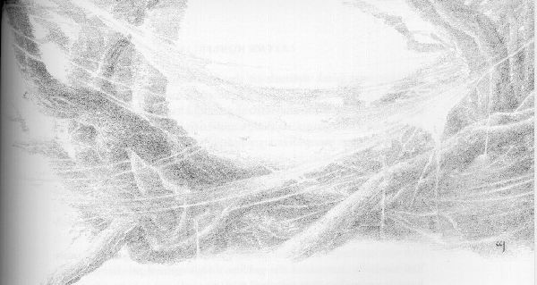
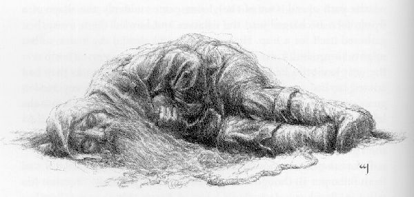
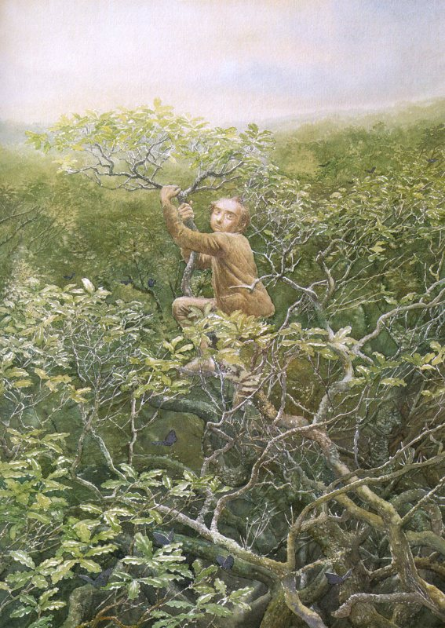
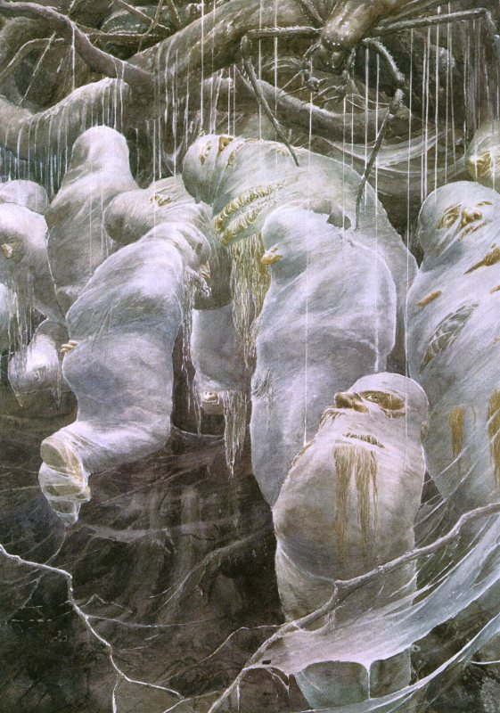
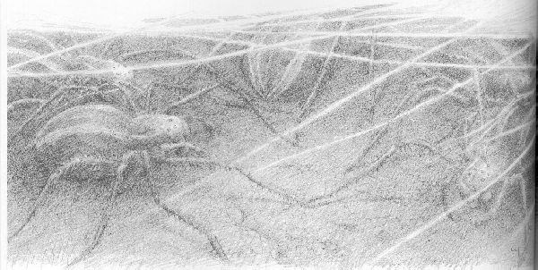
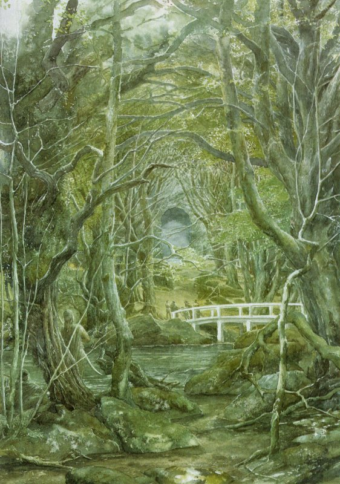

## Kapitel 8: Fliegen und Spinnen

Sie gingen einer hinter dem anderen. Am Anfang führte der Pfad durch etwas, das wie ein gebogenes Tor aussah. Dahinter lag ein dunkler Tunnel. Zwei große Bäume bildeten das Tor. Sie neigten sich zueinander. Beide waren uralt und vom <abbr title="der Efeu — плющ">Efeu</abbr> so fest umwachsen, dass sie fast erstickten. Von ihren Ästen hingen <abbr title="die Flechte, die Flechten — лишайник">Flechten</abbr>. Nur wenige schwärzliche Blätter konnten noch an ihnen wachsen. Der Pfad selbst war schmal und wand sich zwischen den Stämmen hin und her. Bald <abbr title="sehen (sah, hat gesehen) — увидел">sah</abbr> das Licht am Eingang wie ein kleines helles Loch weit hinter ihnen aus. Die Stille war so tief, dass ihre Schritte laut zu dröhnen schienen. Alle Bäume neigten sich über sie und schienen zuzuhören.

Ihre Augen gewöhnten sich langsam an das schwache Licht. Nun sahen sie ein kleines Stück zu beiden Seiten, in einem dunklen grünen Schimmer. Gelegentlich hatte ein schmaler Sonnenstrahl das Glück, durch eine Öffnung in den Blättern weit oben zu fallen. Noch mehr Glück brauchte er, um nicht in den wirren Ästen und dicht verbundenen Zweigen darunter hängen zu bleiben. Dann stach er dünn und hell vor ihnen bis zum Boden hinunter. Aber das geschah selten und hörte bald ganz auf.

Im Wald lebten schwarze <abbr title="das Eichhörnchen, die Eichhörnchen — белка">Eichhörnchen</abbr>. Bilbos scharfe, neugierige Augen gewöhnten sich daran, Dinge im Dunkeln zu erkennen. So <abbr title="sehen (sah, hat gesehen) — увидел">sah</abbr> er manchmal eines vom Pfad huschen und hinter einem Baumstamm verschwinden. Es gab auch seltsame Geräusche: Grunzen, Scharren und hastige Bewegungen im dichten Pflanzenwuchs. Auch in den Blättern raschelte es. An manchen Stellen lagen sie unendlich tief auf dem Waldboden. Doch Bilbo <abbr title="sehen (sah, hat gesehen) — увидел">sah</abbr> nicht, wer die Geräusche machte. Das Schlimmste, was sie sahen, waren die <abbr title="das Spinnennetz, die Spinnennetze — паутина">Spinnennetze</abbr>. Es waren dunkle, dichte Netze mit ungewöhnlich dicken Fäden. Oft waren sie von Baum zu Baum gespannt oder zwischen den niedrigen Ästen zu beiden Seiten verwickelt. Über den Pfad selbst führte keines. Vielleicht hielt ein Zauber ihn frei. Vielleicht gab es einen anderen Grund. Sie konnten es nicht erraten.

Bald hassten sie den Wald ebenso sehr wie zuvor die Tunnel der <abbr title="der Goblin, die Goblins — гоблин">Goblins</abbr>. Hier schien es noch weniger Hoffnung auf ein Ende zu geben. Aber sie mussten weiter und immer weiter. Längst sehnten sie sich schmerzlich nach Sonne und Himmel und nach Wind auf ihren Gesichtern. Unter dem Dach des Waldes bewegte sich keine Luft. Dort war es ständig still, dunkel und <abbr title="stickig — душный">stickig</abbr>. Selbst die <abbr title="der Zwerg, die Zwerge — гном">Zwerge</abbr> spürten es. Sie waren an Tunnel gewöhnt und lebten manchmal lange ohne Sonnenlicht. Der Hobbit liebte zwar <abbr title="die Höhle, die Höhlen — нора; пещера">Höhlen</abbr> als Wohnungen, aber nicht als Orte für Sommertage. Er hatte das Gefühl, langsam zu ersticken.

Am schlimmsten waren die Nächte. Dann wurde es <abbr title="pechschwarz — чёрный как смоль">pechschwarz</abbr>. Nicht so, wie ihr etwas <abbr title="pechschwarz — чёрный как смоль">pechschwarz</abbr> nennt, sondern wirklich wie Pech: Man konnte tatsächlich gar nichts <abbr title="sehen (sah, hat gesehen) — увидел">sehen</abbr>. Bilbo bewegte die Hand vor seiner Nase hin und her, doch er <abbr title="sehen (sah, hat gesehen) — увидел">sah</abbr> sie überhaupt nicht. Nun, vielleicht stimmt es nicht ganz, dass sie nichts sahen. Sie konnten Augen <abbr title="sehen (sah, hat gesehen) — увидел">sehen</abbr>. Sie schliefen alle dicht aneinander und hielten abwechselnd <abbr title="die Wache, die Wachen — часовой; стражник">Wache</abbr>. Wenn Bilbo an der Reihe war, <abbr title="sehen (sah, hat gesehen) — увидел">sah</abbr> er ringsum etwas im Dunkeln glänzen. Manchmal starrten ihn aus geringer Entfernung zwei gelbe, rote oder grüne Augen an. Langsam wurden sie schwächer und verschwanden. Dann leuchteten sie ebenso langsam an einer anderen Stelle wieder auf. Manchmal glänzten sie aus den Zweigen direkt über ihm herunter. Das war besonders schrecklich. Am wenigsten mochte er jedoch eine Art bleicher Augen, die dick hervorstanden.

„Insektenaugen“, dachte er. „Keine Tieraugen. Nur sind sie viel zu groß.“

Obwohl es noch nicht sehr kalt war, versuchten sie nachts, Feuer für die <abbr title="die Wache, die Wachen — часовой; стражник">Wachen</abbr> anzuzünden. Doch bald gaben sie das auf. Das Feuer schien Hunderte und Aberhunderte von Augen ringsum anzulocken. Die Wesen, was sie auch sein mochten, blieben vorsichtig. Ihre Körper zeigten sie nie im schwachen Flackern der Flammen. Noch schlimmer waren die Tausende dunkelgrauen und schwarzen <abbr title="der Nachtfalter, die Nachtfalter — ночная бабочка; мотылёк">Nachtfalter</abbr>, die das Feuer anlockte. Einige waren fast so groß wie eure Hand. Sie flatterten und surrten um ihre Ohren. Das konnten die Reisenden nicht ertragen, ebenso wenig wie die riesigen <abbr title="die Fledermaus, die Fledermäuse — летучая мышь">Fledermäuse</abbr>, schwarz wie ein <abbr title="der Zylinderhut, die Zylinderhüte — цилиндр (шляпа)">Zylinderhut</abbr>. Also verzichteten sie auf Feuer. Nachts saßen sie da und dösten in der riesigen, unheimlichen Dunkelheit.

So <abbr title="gehen (ging, ist gegangen) — шёл">ging</abbr> es weiter, dem Hobbit schien es eine Ewigkeit nach der anderen. Er war ständig hungrig, denn sie gingen äußerst sparsam mit ihren <abbr title="der Vorrat, die Vorräte — запас">Vorräten</abbr> um. Trotzdem wurden sie unruhig, als ein Tag auf den anderen folgte und der Wald immer gleich blieb. Das Essen würde nicht ewig reichen. Tatsächlich wurde es schon knapp. Sie versuchten, auf die <abbr title="das Eichhörnchen, die Eichhörnchen — белка">Eichhörnchen</abbr> zu schießen. Dabei verschwendeten sie viele <abbr title="der Pfeil, die Pfeile — стрела">Pfeile</abbr>, bis endlich eines auf den Pfad herunterfiel. Aber als sie es brieten, schmeckte es schrecklich. Danach schossen sie keine <abbr title="das Eichhörnchen, die Eichhörnchen — белка">Eichhörnchen</abbr> mehr.

Auch Durst hatten sie, denn ihr Wasser war ziemlich knapp. Während der ganzen Zeit hatten sie weder eine <abbr title="die Quelle, die Quellen — родник">Quelle</abbr> noch einen Bach gesehen. So stand es um sie, als eines Tages fließendes Wasser ihren Pfad versperrte. Der Bach floss schnell und kräftig quer über den Weg, war aber nicht besonders breit. Er war schwarz, oder <abbr title="sehen (sah, hat gesehen) — увидел">sah</abbr> in der Dunkelheit so aus. Zum Glück hatte Beorn sie vor ihm gewarnt. Sonst hätten sie daraus getrunken, ganz gleich, welche Farbe das Wasser hatte. Sie hätten am Ufer auch einige ihrer leeren <abbr title="der Wasserschlauch, die Wasserschläuche — бурдюк с водой">Wasserschläuche</abbr> gefüllt. Jetzt überlegten sie nur, wie sie hinüberkämen, ohne im Wasser nass zu werden. Früher hatte eine Holzbrücke über den Bach geführt. Aber sie war <abbr title="verfaulen — сгнить">verfault</abbr> und eingestürzt. Nur die abgebrochenen Pfosten nahe am Ufer waren geblieben.

Bilbo kniete am Rand und spähte hinüber.

— Am anderen Ufer liegt ein Boot! — rief er. — Warum konnte es nicht auf dieser Seite liegen!

— Wie weit ist es wohl weg? — fragte Thorin.

Inzwischen wussten sie, dass Bilbo von ihnen allen die schärfsten Augen hatte.

— Gar nicht weit. Ich glaube, nicht mehr als zwölf Yards.

— Zwölf Yards! Ich hätte mindestens dreißig gedacht. Aber meine Augen <abbr title="sehen (sah, hat gesehen) — увидел">sehen</abbr> nicht mehr so gut wie vor hundert Jahren. Trotzdem sind zwölf Yards für uns genauso weit wie eine Meile. Wir können nicht hinüberspringen. Und wir dürfen nicht versuchen, durchs Wasser zu <abbr title="gehen (ging, ist gegangen) — шёл">gehen</abbr> oder zu schwimmen.

— Kann einer von euch ein <abbr title="das Seil, die Seile — верёвка">Seil</abbr> werfen?

— Was soll das nützen? Das Boot ist sicher festgebunden. Selbst wenn wir es mit einem <abbr title="der Haken, die Haken — крюк">Haken</abbr> fassen könnten, was ich bezweifle.

— Ich glaube nicht, dass es festgebunden ist, — sagte Bilbo. — Natürlich kann ich bei diesem Licht nicht sicher sein. Aber es sieht aus, als wäre es nur ein Stück aufs Ufer gezogen. Genau dort ist das Ufer niedrig, wo der Pfad ins Wasser hinunterführt.

— Dori ist der Stärkste. Aber Fili ist der Jüngste und sieht noch am besten, — sagte Thorin. — Komm her, Fili. Schau, ob du das Boot <abbr title="sehen (sah, hat gesehen) — увидел">sehen</abbr> kannst, von dem Herr Baggins spricht.

Fili glaubte, es zu <abbr title="sehen (sah, hat gesehen) — увидел">sehen</abbr>. Er starrte lange hinüber, um sich die Richtung einzuprägen. Dann brachten die anderen ihm ein <abbr title="das Seil, die Seile — верёвка">Seil</abbr>. Sie hatten mehrere dabei. Am Ende des längsten befestigten sie einen ihrer großen eisernen <abbr title="der Haken, die Haken — крюк">Haken</abbr>. Mit diesen <abbr title="der Haken, die Haken — крюк">Haken</abbr> hatten sie ihre Taschen an den <abbr title="der Riemen, die Riemen — ремень">Riemen</abbr> über ihren Schultern befestigt. Fili nahm den <abbr title="der Haken, die Haken — крюк">Haken</abbr> in die Hand, prüfte kurz sein Gewicht und warf ihn dann über den Bach.

Platsch! Er fiel ins Wasser.

— Nicht weit genug! — sagte Bilbo, der aufmerksam hinübersah. — Noch zwei Fuß weiter, und er wäre im Boot gelandet. <abbr title="der Versuch, die Versuche — попытка">Versuch</abbr> es noch einmal. Der Zauber wird wohl nicht stark genug sein, dir zu schaden, wenn du nur ein wenig nasses <abbr title="das Seil, die Seile — верёвка">Seil</abbr> berührst.

Fili zog den <abbr title="der Haken, die Haken — крюк">Haken</abbr> zurück und nahm ihn wieder auf, allerdings mit einigen <abbr title="der Zweifel, die Zweifel — сомнение">Zweifeln</abbr>. Diesmal warf er mit großer Kraft.

— Langsam! — sagte Bilbo. — Jetzt hast du ihn direkt in den Wald auf der anderen Seite geworfen. Zieh ihn vorsichtig zurück.

Fili zog das <abbr title="das Seil, die Seile — верёвка">Seil</abbr> langsam ein. Nach einer Weile sagte Bilbo:

— Vorsicht! Er liegt auf dem Boot. Hoffentlich hält der <abbr title="der Haken, die Haken — крюк">Haken</abbr>.

Er hielt. Das <abbr title="das Seil, die Seile — верёвка">Seil</abbr> wurde <abbr title="straff — натянутый">straff</abbr>, und Fili zog vergeblich daran. Kili half ihm, dann auch Oin und Gloin. Sie zogen und zogen. Plötzlich fielen sie alle auf den Rücken. Bilbo hatte jedoch gut aufgepasst. Er packte das <abbr title="das Seil, die Seile — верёвка">Seil</abbr> und hielt das kleine schwarze Boot mit einem Stock ab. Es kam schnell über den Bach auf sie zu.

— Hilfe! — schrie er.

Balin konnte das Boot gerade noch packen, bevor die Strömung es forttrug.

— Es war also doch festgebunden, — sagte er.

Er betrachtete die gerissene <abbr title="die Leine, die Leinen — верёвка; поводок">Leine</abbr>, die noch vom Boot herunterhing.

— Gut gezogen, meine Jungs! Zum Glück war unser <abbr title="das Seil, die Seile — верёвка">Seil</abbr> stärker.

— Wer fährt zuerst hinüber? — fragte Bilbo.

— Ich, — sagte Thorin. — Du kommst mit mir, außerdem Fili und Balin. Mehr passen nicht auf einmal ins Boot. Danach kommen Kili, Oin, Gloin und Dori. Dann Ori, Nori, Bifur und Bofur. Zuletzt Dwalin und Bombur.

— Ich bin immer der Letzte, und das gefällt mir nicht, — sagte Bombur. — Heute ist jemand anderes dran.

— Du solltest nicht so dick sein. So musst du mit der letzten und leichtesten Bootsladung fahren. Fang nicht an, über Befehle zu <abbr title="brummen — ворчать">brummen</abbr>. Sonst passiert dir etwas Schlimmes.

— Es gibt keine <abbr title="das Ruder, die Ruder — весло">Ruder</abbr>. Wie wollt ihr das Boot wieder ans andere Ufer bringen? — fragte der Hobbit.

— Gebt mir noch ein <abbr title="das Seil, die Seile — верёвка">Seil</abbr> und noch einen <abbr title="der Haken, die Haken — крюк">Haken</abbr>, — sagte Fili.

Als alles bereit war, warf er den <abbr title="der Haken, die Haken — крюк">Haken</abbr> vor sich in die Dunkelheit, so hoch er konnte. Er fiel nicht wieder herunter. Deshalb wussten sie, dass er in den Ästen hängen geblieben sein musste.

— Steigt jetzt ein, — sagte Fili. — Einer von euch zieht an dem <abbr title="das Seil, die Seile — верёвка">Seil</abbr>, das drüben in einem Baum hängt. Einer von den anderen muss den <abbr title="der Haken, die Haken — крюк">Haken</abbr> festhalten, den wir zuerst benutzt haben. Wenn wir sicher drüben sind, kann er ihn wieder befestigen. Dann könnt ihr das Boot zurückziehen.

So waren sie bald alle sicher über den <abbr title="verzaubert — зачарованный">verzauberten</abbr> Bach ans andere Ufer gekommen. Dwalin war gerade herausgeklettert. Das zusammengerollte <abbr title="das Seil, die Seile — верёвка">Seil</abbr> hing über seinem Arm. Bombur brummte noch immer und wollte ihm folgen. Da geschah tatsächlich etwas Schlimmes. Von vorn hörten sie auf dem Pfad rasende <abbr title="der Huf, die Hufe — копыто">Hufe</abbr>. Plötzlich kam die <abbr title="die Gestalt, die Gestalten — облик; форма">Gestalt</abbr> eines rennenden Hirsches aus der Dunkelheit. Er stürmte gegen die <abbr title="der Zwerg, die Zwerge — гном">Zwerge</abbr> und warf sie um. Dann sammelte er sich zum Sprung. Hoch sprang er auf und setzte mit einem gewaltigen Satz über das Wasser. Doch er erreichte das andere Ufer nicht unversehrt.

Nur Thorin war auf den Füßen geblieben und hatte den <abbr title="der Verstand — ум; рассудок">Verstand</abbr> behalten. Gleich nach der Landung hatte er seinen Bogen gespannt und einen <abbr title="der Pfeil, die Pfeile — стрела">Pfeil</abbr> aufgelegt. Vielleicht würde ja ein verborgener Wächter des Bootes auftauchen. Nun schoss er schnell und sicher auf das springende Tier. Als der <abbr title="der Hirsch, die Hirsche — олень">Hirsch</abbr> das gegenüberliegende Ufer erreichte, <abbr title="stolpern — споткнуться">stolperte</abbr> er. Die <abbr title="der Schatten, die Schatten — тень">Schatten</abbr> verschluckten ihn. Doch sie hörten, wie seine Hufschläge rasch unsicher wurden und dann verstummten.

Bevor sie den Schuss loben konnten, hörten sie jedoch einen schrecklichen Klageruf von Bilbo. Sofort vergaßen sie das Hirschfleisch.

— Bombur ist hineingefallen! Bombur <abbr title="ertrinken (ertrank, ist ertrunken) — тонуть">ertrinkt</abbr>! — schrie er.

Es stimmte leider nur zu sehr. Bombur hatte erst einen Fuß an Land gehabt, als der <abbr title="der Hirsch, die Hirsche — олень">Hirsch</abbr> auf ihn zustürmte und über ihn sprang. Er war gestolpert und hatte das Boot vom Ufer weggestoßen. Dann war er rückwärts ins dunkle Wasser gefallen. Seine Hände waren von den <abbr title="schleimig — скользкий; покрытый слизью">schleimigen</abbr> Wurzeln am Rand abgerutscht. Das Boot drehte sich langsam fort und verschwand.

Als sie zum Ufer rannten, sahen sie seine <abbr title="die Kapuze, die Kapuzen — капюшон">Kapuze</abbr> noch über dem Wasser. Schnell warfen sie ihm ein <abbr title="das Seil, die Seile — верёвка">Seil</abbr> mit einem <abbr title="der Haken, die Haken — крюк">Haken</abbr> zu. Er packte es, und sie zogen ihn ans Ufer. Natürlich war er von den Haaren bis zu den Stiefeln völlig nass. Aber das war nicht das Schlimmste. Als sie ihn ans Ufer legten, schlief er bereits tief und fest. Eine Hand hielt das <abbr title="das Seil, die Seile — верёвка">Seil</abbr> so fest umklammert, dass sie es ihm nicht aus den Fingern lösen konnten. Und er schlief weiter, ganz gleich, was sie versuchten.

Sie standen noch immer über ihm und <abbr title="verfluchen — проклинать">verfluchten</abbr> ihr Unglück und Bomburs Ungeschick. Sie beklagten auch den Verlust des Bootes. Ohne das Boot konnten sie nicht zurückfahren und den <abbr title="der Hirsch, die Hirsche — олень">Hirsch</abbr> suchen. Da hörten sie schwache Hornklänge im Wald und etwas wie das ferne Bellen jagender Hunde. Alle verstummten. Während sie dasaßen, schienen sie nördlich vom Pfad den Lärm einer großen Jagd vorbeiziehen zu hören. Doch sie sahen nichts davon.

Dort saßen sie lange und wagten nicht, sich zu bewegen. Bombur schlief weiter, mit einem Lächeln auf seinem dicken Gesicht. Es war, als kümmerten ihn die Schwierigkeiten nicht mehr, die den anderen so viel Ärger machten. Plötzlich erschienen vor ihnen auf dem Pfad einige weiße <abbr title="der Hirsch, die Hirsche — олень">Hirsche</abbr>: eine Hirschkuh und ihre <abbr title="das Junge, die Jungen — детёныш">Jungen</abbr>. Sie waren so schneeweiß, wie der vorige <abbr title="der Hirsch, die Hirsche — олень">Hirsch</abbr> dunkel gewesen war. Sie schimmerten in den <abbr title="der Schatten, die Schatten — тень">Schatten</abbr>. Bevor Thorin etwas rufen konnte, sprangen drei <abbr title="der Zwerg, die Zwerge — гном">Zwerge</abbr> auf und schossen <abbr title="der Pfeil, die Pfeile — стрела">Pfeile</abbr> aus ihren Bögen ab. Keiner schien zu treffen. Die Tiere drehten sich um und verschwanden lautlos zwischen den Bäumen, ebenso lautlos, wie sie gekommen waren. Vergeblich schossen die <abbr title="der Zwerg, die Zwerge — гном">Zwerge</abbr> hinter ihnen her.

— Halt! Halt! — schrie Thorin.

Doch es war zu spät. Die aufgeregten <abbr title="der Zwerg, die Zwerge — гном">Zwerge</abbr> hatten ihre letzten <abbr title="der Pfeil, die Pfeile — стрела">Pfeile</abbr> verschwendet. Nun waren die Bögen, die Beorn ihnen gegeben hatte, nutzlos.

In dieser Nacht waren sie eine traurige Gesellschaft. In den folgenden Tagen wurde ihre Stimmung noch dunkler. Sie hatten den <abbr title="verzaubert — зачарованный">verzauberten</abbr> Bach überquert. Dahinter führte der Pfad aber genauso wie zuvor weiter, scheinbar ohne Ziel. Im Wald erkannten sie keine Veränderung. Hätten sie mehr darüber gewusst und über die Bedeutung der Jagd und der weißen <abbr title="der Hirsch, die Hirsche — олень">Hirsche</abbr> nachgedacht! Dann hätten sie erkannt, dass sie endlich dem östlichen Rand näher kamen. Bald wären die Bäume weniger dicht geworden, und sie wären an Stellen gekommen, wo wieder Sonnenlicht durchfiel. Dazu hätten sie nur ihren <abbr title="der Mut — смелость">Mut</abbr> und ihre Hoffnung behalten müssen.

Aber sie wussten das nicht. Außerdem lastete Bomburs schwerer Körper auf ihnen. Sie mussten ihn mitnehmen und so gut wie möglich tragen. Immer vier übernahmen abwechselnd die <abbr title="mühsam — трудный; утомительный">mühsame</abbr> Arbeit, während die anderen ihre Taschen unter sich verteilten. Wären diese in den letzten Tagen nicht viel zu leicht geworden, hätten sie es niemals geschafft. Doch ein schlafender, lächelnder Bombur war ein schlechter Tausch gegen Taschen voller Essen, wie schwer diese auch sein mochten. Nach wenigen Tagen blieb praktisch nichts mehr zum Essen oder Trinken übrig. Im Wald sahen sie nichts Gesundes wachsen. Es gab nur Pilze und Kräuter mit bleichen Blättern und unangenehmem Geruch.

Etwa vier Tage hinter dem <abbr title="verzaubert — зачарованный">verzauberten</abbr> Bach kamen sie in ein Gebiet, in dem hauptsächlich <abbr title="die Buche, die Buchen — бук">Buchen</abbr> wuchsen. Zuerst machte ihnen diese Veränderung etwas Hoffnung. Hier wuchsen keine <abbr title="der Busch, die Büsche — куст">Büsche</abbr> am Boden, und die <abbr title="der Schatten, die Schatten — тень">Schatten</abbr> waren weniger tief. Ein grünliches Licht umgab sie. An manchen Stellen konnten sie ziemlich weit zu beiden Seiten des Pfades <abbr title="sehen (sah, hat gesehen) — увидел">sehen</abbr>. Doch das Licht zeigte ihnen nur endlose Reihen gerader grauer Stämme. Sie sahen wie die <abbr title="die Säule, die Säulen — колонна">Säulen</abbr> einer riesigen Halle im Halbdunkel aus. Ein schwacher Luftzug kam, und sie hörten Wind, doch er klang traurig. Einige Blätter fielen raschelnd herab und erinnerten sie daran, dass draußen der Herbst begann. Ihre Füße raschelten durch tote Blätter von zahllosen früheren Herbsten. Tiefrote Blätterteppiche bedeckten den Wald. Von dort sammelten sich die Blätter über den Rändern des Pfades.

Noch immer schlief Bombur, und die anderen wurden sehr müde. Manchmal hörten sie ein Lachen, das sie beunruhigte. Gelegentlich kam auch Gesang aus der Ferne. Das Lachen kam von schönen Stimmen, nicht von <abbr title="der Goblin, die Goblins — гоблин">Goblins</abbr>. Auch der Gesang war schön, doch er klang <abbr title="unheimlich — жуткий">unheimlich</abbr> und fremd. Das tröstete sie nicht. Stattdessen eilten sie mit ihrer letzten Kraft weiter, fort von diesen Stellen.

Zwei Tage später führte ihr Pfad bergab. Bald waren sie in einem Tal, das fast ganz von mächtigen <abbr title="die Eiche, die Eichen — дуб">Eichen</abbr> ausgefüllt war.

— Hat dieser <abbr title="verfluchen — проклясть">verfluchte</abbr> Wald denn kein Ende? — sagte Thorin. — Jemand muss auf einen Baum steigen. Vielleicht kann er den Kopf über das Blätterdach <abbr title="stecken bleiben — застрять">stecken</abbr> und sich umsehen. Anders geht es nicht. Wir müssen den höchsten Baum wählen, der über den Pfad ragt.

Natürlich bedeutete „jemand“ Bilbo. Sie wählten ihn, weil der Kletterer den Kopf über die obersten Blätter bekommen musste. Sonst wäre die Mühe nutzlos. Er musste also leicht genug sein, damit selbst die höchsten und dünnsten Äste ihn tragen konnten. Der arme Herr Baggins hatte nie viel Übung im Baumklettern gehabt. Doch sie hoben ihn in die untersten Äste einer riesigen <abbr title="die Eiche, die Eichen — дуб">Eiche</abbr>, die direkt über den Pfad wuchs. Nun musste er hinauf, so gut er konnte. Er drängte sich durch die verwirrten Zweige und bekam dabei manchen Schlag ins Auge. Die alte <abbr title="die Rinde, die Rinden — кора">Rinde</abbr> der dickeren Äste färbte ihn grün und machte ihn schmutzig. Mehr als einmal rutschte er aus und hielt sich gerade noch rechtzeitig fest. Schließlich kam er nahe an die Spitze. Vorher musste er sich durch eine schrecklich schwierige Stelle kämpfen. Dort schien es überhaupt keinen passenden Ast zu geben. Die ganze Zeit fragte er sich, ob <abbr title="die Spinne, die Spinnen — паук">Spinnen</abbr> im Baum lebten. Auch fragte er sich, wie er wieder hinunterkommen sollte — außer durch einen Sturz.

Endlich steckte er den Kopf über das Blätterdach. Und tatsächlich fand er dort <abbr title="die Spinne, die Spinnen — паук">Spinnen</abbr>. Aber es waren nur kleine von gewöhnlicher Größe, die Schmetterlinge jagten. Das Licht blendete Bilbos Augen fast völlig. Er hörte die <abbr title="der Zwerg, die Zwerge — гном">Zwerge</abbr> weit unten zu ihm hinaufrufen. Doch er konnte nicht antworten, sondern sich nur festhalten und <abbr title="blinzeln — моргать от яркого света">blinzeln</abbr>. Die Sonne strahlte hell. Lange konnte er ihr Licht nicht ertragen. Als es endlich <abbr title="gehen (ging, ist gegangen) — шёл">ging</abbr>, <abbr title="sehen (sah, hat gesehen) — увидел">sah</abbr> er ringsum ein dunkelgrünes Meer. Der Wind bewegte es hier und da in kleinen Wellen. Überall flogen Hunderte von Schmetterlingen.

Ich vermute, es war eine Art <abbr title="der Schillerfalter, die Schillerfalter — бабочка-переливница">Schillerfalter</abbr>, den man auch „purpurnen Kaiser“ nennt. Solche Schmetterlinge lieben die Wipfel von Eichenwäldern. Doch diese waren überhaupt nicht purpurn. Sie waren sehr, sehr dunkel und samtig schwarz, ohne erkennbare Zeichnung.

Lange betrachtete er die „schwarzen Kaiser“ und genoss den Wind in seinen Haaren und auf seinem Gesicht. Doch schließlich erinnerten ihn die Rufe der <abbr title="der Zwerg, die Zwerge — гном">Zwerge</abbr> an seine eigentliche Aufgabe. Unten stampften sie jetzt schon vor <abbr title="die Ungeduld — нетерпение">Ungeduld</abbr>. Es war vergeblich. So sehr er auch schaute, in keiner Richtung <abbr title="sehen (sah, hat gesehen) — увидел">sah</abbr> er ein Ende der Bäume und Blätter. Sonne und Wind hatten ihm das Herz leicht gemacht. Nun sank ihm der <abbr title="der Mut — смелость">Mut</abbr> wieder bis in die Zehen. Dort unten wartete kein Essen auf ihn.

Tatsächlich waren sie, wie ich euch schon gesagt habe, nicht weit vom Waldrand entfernt. Bilbo hätte nur klug genug sein müssen, die Lage zu erkennen. Sein Baum war zwar hoch, stand aber nahe am Boden eines breiten Tales. Deshalb schienen die Bäume ringsum von seiner Spitze aus immer höher zu steigen, wie die Ränder einer großen Schüssel. Er konnte von dort gar nicht erwarten, das Ende des Waldes zu <abbr title="sehen (sah, hat gesehen) — увидел">sehen</abbr>. Doch er erkannte das nicht und kletterte voller <abbr title="die Verzweiflung — отчаяние">Verzweiflung</abbr> hinunter. Endlich war er wieder unten, zerkratzt, heiß und unglücklich. In der Dunkelheit dort konnte er nun überhaupt nichts erkennen. Sein Bericht machte die anderen bald ebenso unglücklich wie ihn selbst.

— Der Wald geht ewig und ewig und ewig in alle Richtungen weiter! Was sollen wir bloß tun? Wozu schicken wir überhaupt einen Hobbit hinauf! — riefen sie, als wäre es seine Schuld.

Für die Schmetterlinge interessierten sie sich kein bisschen. Als er vom schönen Wind erzählte, wurden sie nur noch ärgerlicher. Sie waren selbst zu schwer, um hinaufzuklettern und ihn zu spüren.

In dieser Nacht aßen sie ihre allerletzten Reste und <abbr title="der Krümel, die Krümel — крошка">Krümel</abbr>. Am nächsten Morgen merkten sie gleich nach dem Erwachen, dass der Hunger noch immer schmerzhaft an ihnen nagte. Dann merkten sie, dass es regnete. Hier und da fielen schwere Tropfen auf den Waldboden. Das erinnerte sie nur daran, dass sie auch einen brennenden Durst hatten. Helfen konnte es ihnen nicht. Einen schrecklichen Durst löscht man nicht, indem man unter riesigen <abbr title="die Eiche, die Eichen — дуб">Eichen</abbr> steht und auf einen Tropfen auf der Zunge wartet. Der einzige kleine Trost kam ganz unerwartet von Bombur.

Er erwachte plötzlich, setzte sich auf und kratzte sich am Kopf. Er konnte überhaupt nicht verstehen, wo er war und warum er so hungrig war. Denn er hatte alles vergessen, was seit ihrem Aufbruch an jenem fernen Maimorgen geschehen war. Seine letzte Erinnerung war das Fest im Haus des Hobbits. Sie hatten große Mühe, ihn von all den vielen Abenteuern zu überzeugen, die sie seitdem erlebt hatten.

Als er hörte, dass es nichts zu essen gab, setzte er sich hin und weinte. Er fühlte sich sehr schwach und war <abbr title="wacklig — неустойчивый; шаткий">wacklig</abbr> auf den Beinen.

— Warum bin ich nur aufgewacht! — rief er. — Ich hatte so schöne Träume. Ich träumte, ich <abbr title="gehen (ging, ist gegangen) — шёл">ging</abbr> durch einen Wald, ganz ähnlich wie diesen. Nur waren dort <abbr title="die Fackel, die Fackeln — факел">Fackeln</abbr> an den Bäumen. Lampen schaukelten an den Ästen, und auf dem Boden brannten Feuer. Es gab ein großes Fest, das immer weiterging, ohne Ende. Ein König des Waldes war dort, mit einer Krone aus Blättern. Alle sangen fröhlich. Die Dinge zum Essen und Trinken könnte ich gar nicht zählen oder beschreiben.

— Du brauchst es nicht zu versuchen, — sagte Thorin. — Wenn du über nichts anderes reden kannst, sei lieber still. Wir sind auch so schon ärgerlich genug auf dich. Wärst du nicht aufgewacht, hätten wir dich mit deinen idiotischen Träumen im Wald zurückgelassen. Dich zu tragen ist kein Spaß, selbst nachdem du wochenlang so wenig zu essen bekommen hast.

Nun blieb ihnen nichts anderes übrig, als die Gürtel um ihre leeren Bäuche enger zu ziehen. Sie hoben ihre leeren <abbr title="der Sack, die Säcke — мешок">Säcke</abbr> und Taschen auf und <abbr title="sich schleppen — тащиться">schleppten sich</abbr> weiter über den Pfad. Große Hoffnung hatten sie nicht mehr. Vielleicht würden sie sich hinlegen und verhungern, ehe sie das Ende erreichten. So gingen sie den ganzen Tag, sehr langsam und müde. Bombur jammerte ständig, seine Beine könnten ihn nicht mehr tragen. Er wolle sich hinlegen und schlafen.

— Das wirst du nicht! — sagten sie. — Lass deine Beine ihren Anteil leisten. Wir haben dich weit genug getragen.

Trotzdem weigerte er sich plötzlich, noch einen Schritt zu <abbr title="gehen (ging, ist gegangen) — шёл">gehen</abbr>, und warf sich auf den Boden.

— Geht weiter, wenn ihr müsst, — sagte er. — Ich bleibe hier liegen und schlafe. Wenn ich sonst kein Essen bekomme, träume ich eben davon. Hoffentlich wache ich nie wieder auf.

Genau in diesem Augenblick rief Balin, der ein kleines Stück voraus war:

— Was war das? Ich glaube, ich habe im Wald ein Licht funkeln <abbr title="sehen (sah, hat gesehen) — увидел">sehen</abbr>.

Alle schauten hin. Ziemlich weit entfernt, wie es schien, sahen sie etwas Rotes im Dunkeln funkeln. Dann erschien ein zweites Licht daneben, dann ein drittes. Selbst Bombur stand auf. Nun eilten sie weiter. Es war ihnen gleich, ob dort <abbr title="der Troll, die Trolle — тролль">Trolle</abbr> oder <abbr title="der Goblin, die Goblins — гоблин">Goblins</abbr> waren. Das Licht lag vor ihnen, links vom Pfad. Als sie endlich auf gleicher Höhe waren, schien es deutlich: Unter den Bäumen brannten <abbr title="die Fackel, die Fackeln — факел">Fackeln</abbr> und Feuer. Doch sie waren ein gutes Stück von ihrem Weg entfernt.

— Es sieht aus, als würden meine Träume wahr, — keuchte Bombur, der atemlos von hinten kam.

Er wollte sofort in den Wald zu den Lichtern stürzen. Aber die anderen erinnerten sich nur zu gut an die Warnungen des Zauberers und Beorns.

— Ein Fest nützt uns nichts, wenn wir nicht lebend davon zurückkommen, — sagte Thorin.

— Aber ohne ein Fest bleiben wir sowieso nicht mehr lange am Leben, — sagte Bombur.

Bilbo stimmte ihm von ganzem Herzen zu. Lange stritten sie hin und her. Schließlich beschlossen sie, ein paar <abbr title="der Kundschafter, die Kundschafter — разведчик">Kundschafter</abbr> zu schicken. Diese sollten zu den Lichtern schleichen und mehr darüber herausfinden. Doch dann konnten sie sich nicht einigen, wer <abbr title="gehen (ging, ist gegangen) — шёл">gehen</abbr> sollte. Niemand hatte Lust, sich womöglich zu <abbr title="sich verirren — заблудиться">verirren</abbr> und seine Freunde nie wiederzufinden. Am Ende entschied der Hunger, trotz aller Warnungen. Bombur beschrieb nämlich immer weiter all die guten Dinge, die man nach seinem Traum auf dem Waldfest aß. So verließen sie alle gemeinsam den Pfad und drangen in den Wald ein.

Sie schlichen und krochen lange. Dann spähten sie um die Stämme herum auf eine <abbr title="die Lichtung, die Lichtungen — лесная поляна">Lichtung</abbr>. Dort waren einige Bäume gefällt und der Boden eben gemacht worden. Viele Leute waren dort, die wie <abbr title="der Elf, die Elfen — эльф">Elfen</abbr> aussahen. Alle trugen Grün und Braun. Sie saßen in einem großen Kreis auf runden Scheiben der gefällten Baumstämme. In ihrer Mitte brannte ein Feuer. An einigen Bäumen ringsum waren <abbr title="die Fackel, die Fackeln — факел">Fackeln</abbr> befestigt. Doch der herrlichste Anblick war: Sie aßen und tranken und lachten fröhlich.

Der Duft des gebratenen Fleisches war so verlockend, dass keiner auf die anderen wartete oder sich mit ihnen besprach. Alle standen auf und drängten vorwärts in den Kreis. Sie hatten nur einen Gedanken: um etwas Essen bitten. Kaum hatte der Erste die <abbr title="die Lichtung, die Lichtungen — лесная поляна">Lichtung</abbr> betreten, da gingen alle Lichter aus, wie durch Zauberei. Jemand trat gegen das Feuer. Es schoss in Raketen aus glitzernden <abbr title="der Funke, die Funken — искра">Funken</abbr> hoch und verschwand. Nun standen sie in völlig lichtloser Dunkelheit. Sie konnten nicht einmal einander finden, jedenfalls lange Zeit nicht.

<abbr title="verzweifelt — отчаявшийся; в отчаянии">Verzweifelt</abbr> irrten sie im Dunkeln herum. Sie fielen über Baumstämme, stießen krachend gegen Bäume und schrien und riefen. Sie mussten alles im Wald auf Meilen hinaus geweckt haben. Endlich gelang es ihnen, sich dicht zu sammeln und durch Abtasten zu zählen. Natürlich hatten sie inzwischen völlig vergessen, in welcher Richtung der Pfad lag. Sie waren alle hoffnungslos verirrt, zumindest bis zum Morgen.

Es blieb ihnen nichts anderes übrig, als dort die Nacht zu verbringen. Sie wagten nicht einmal, am Boden nach Essensresten zu suchen. Zu groß war die Angst, wieder getrennt zu werden. Aber sie lagen noch nicht lange da, und Bilbo wurde gerade erst schläfrig. Da sagte Dori, der zuerst <abbr title="die Wache, die Wachen — часовой; стражник">Wache</abbr> hielt, in einem lauten Flüstern:

— Dort drüben erscheinen die Lichter wieder. Es sind noch mehr als vorher.

Alle sprangen auf. Tatsächlich funkelten nicht weit entfernt <abbr title="das Dutzend, die Dutzende — дюжина">Dutzende</abbr> von Lichtern. Sie hörten die Stimmen und das Lachen ganz deutlich. Langsam schlichen sie darauf zu, einer hinter dem anderen. Jeder berührte den Rücken des Vordermanns. Als sie näher kamen, sagte Thorin:

— Diesmal stürmt niemand vor! Keiner bewegt sich aus seinem Versteck, bevor ich es sage. Ich schicke zuerst Herrn Baggins allein hin, um mit ihnen zu reden. Vor ihm werden sie keine Angst haben.

„Und was ist mit meiner Angst vor ihnen?“, dachte Bilbo.

— Jedenfalls hoffe ich, dass sie ihm nichts Böses antun.

Am Rand des Lichterkreises stießen sie Bilbo plötzlich von hinten an. Bevor er seinen Ring auf den Finger schieben konnte, <abbr title="stolpern — споткнуться">stolperte</abbr> er ins volle Licht der Feuer und <abbr title="die Fackel, die Fackeln — факел">Fackeln</abbr>. Es half nichts. Wieder erloschen alle Lichter, und völlige Dunkelheit fiel über sie.

Schon vorher war es schwer gewesen, einander wiederzufinden. Diesmal war es noch viel schlimmer. Und den Hobbit konnten sie einfach nicht finden. Jedes Mal, wenn sie zählten, waren es nur dreizehn. Sie schrien und riefen:

— Bilbo Baggins! Hobbit! Du verfluchter Hobbit! He! Hobbit, zum Donnerwetter, wo bist du?

Und anderes in dieser Art. Doch es kam keine Antwort.

Sie wollten gerade die Hoffnung aufgeben. Da <abbr title="stolpern — споткнуться">stolperte</abbr> Dori durch reinen Zufall über ihn. Im Dunkeln fiel er über etwas, das er für einen Baumstamm hielt. Doch es war der Hobbit. Er lag zusammengerollt da und schlief tief und fest. Sie mussten ihn kräftig schütteln, um ihn aufzuwecken. Als er endlich wach war, freute er sich überhaupt nicht.

— Ich hatte so einen schönen Traum, — brummte er. — Von einem ganz wunderbaren Abendessen.

— Großer Himmel! Jetzt ist er genau wie Bombur, — sagten sie. — Erzähl uns nichts von Träumen. Traum-Abendessen nützen nichts. Wir können sie auch nicht mitessen.

— Es sind wohl die besten Abendessen, die ich an diesem abscheulichen Ort bekommen werde, — <abbr title="murmeln — пробормотать">murmelte</abbr> er.

Er legte sich neben die <abbr title="der Zwerg, die Zwerge — гном">Zwerge</abbr>. Er wollte wieder einschlafen und seinen Traum wiederfinden. Doch die Lichter im Wald waren noch nicht zum letzten Mal erschienen. Später, als die Nacht schon weit fortgeschritten sein musste, kam Kili. Jetzt hielt er <abbr title="die Wache, die Wachen — часовой; стражник">Wache</abbr>. Er weckte alle wieder und sagte:

— Nicht weit weg hat ein richtiges Lichtermeer angefangen. Hunderte von <abbr title="die Fackel, die Fackeln — факел">Fackeln</abbr> und viele Feuer müssen plötzlich angezündet worden sein, durch Zauberei. Und hört nur den Gesang und die <abbr title="die Harfe, die Harfen — арфа">Harfen</abbr>!

Eine Weile lagen sie da und lauschten. Dann konnten sie ihrem Wunsch nicht mehr <abbr title="widerstehen (widerstand, hat widerstanden) — устоять перед">widerstehen</abbr>. Sie mussten näher hin und noch einmal versuchen, Hilfe zu bekommen. Wieder standen sie auf. Diesmal endete es in einer Katastrophe. Das Fest, das sie jetzt sahen, war größer und prächtiger als zuvor. Am Kopf einer langen Reihe von Gästen saß ein König des Waldes. Auf seinem goldenen Haar trug er eine Blätterkrone. Er <abbr title="sehen (sah, hat gesehen) — увидел">sah</abbr> fast genauso aus, wie Bombur ihn in seinem Traum beschrieben hatte.

Die <abbr title="der Elf, die Elfen — эльф">Elfen</abbr> reichten Schalen von Hand zu Hand, auch über die Feuer hinweg. Einige spielten <abbr title="die Harfe, die Harfen — арфа">Harfe</abbr>, viele sangen. In ihr glänzendes Haar waren Blumen geflochten. Grüne und weiße <abbr title="der Edelstein, die Edelsteine — драгоценный камень">Edelsteine</abbr> funkelten an ihren Kragen und Gürteln. Ihre Gesichter und ihre Lieder waren voller Freude. Laut, klar und schön erklangen die Lieder. Da trat Thorin mitten unter sie.

Mitten in einem Wort wurde es totenstill. Alles Licht erlosch. Die Feuer schossen in schwarzem Rauch auf. <abbr title="die Asche — пепел">Asche</abbr> und glühende Kohlenreste gerieten in die Augen der <abbr title="der Zwerg, die Zwerge — гном">Zwerge</abbr>. Wieder erfüllten ihr Lärm und ihre Schreie den Wald.

Bilbo lief, wie er glaubte, immer im Kreis herum. Er rief und rief:

— Dori, Nori, Ori, Oin, Gloin, Fili, Kili, Bombur, Bifur, Bofur, Dwalin, Balin, Thorin Oakenshield!

Ringsum taten Leute, die er weder <abbr title="sehen (sah, hat gesehen) — увидел">sehen</abbr> noch berühren konnte, dasselbe. Gelegentlich war auch ein „Bilbo!“ darunter. Doch die Rufe der anderen wurden immer ferner und schwächer. Nach einer Weile schienen sie sich in Schreie und Hilferufe weit in der Ferne zu verwandeln. Schließlich verstummte aber jedes Geräusch. Er blieb allein zurück, in völliger Stille und Dunkelheit.

Das war einer seiner unglücklichsten Augenblicke. Aber bald entschied er, dass er bis zum Tageslicht nichts versuchen konnte. Völlig nutzlos wäre es, blind herumzuirren und sich zu erschöpfen. Er hatte ja nicht einmal Hoffnung auf ein Frühstück, das ihm neue Kraft geben könnte. Also setzte er sich mit dem Rücken an einen Baum. Nicht zum letzten Mal dachte er an seine ferne Hobbithöhle mit ihren herrlichen <abbr title="die Vorratskammer, die Vorratskammern — кладовая">Vorratskammern</abbr>.

Er dachte gerade tief versunken an Speck, Eier, Toast und Butter, als ihn etwas berührte. An seiner linken Hand fühlte er etwas wie eine feste, <abbr title="klebrig — липкий">klebrige</abbr> Schnur. Als er sich bewegen wollte, merkte er, dass seine Beine bereits mit demselben Zeug umwickelt waren. Er stand auf und fiel sofort hin.

Während er gedöst hatte, hatte eine große <abbr title="die Spinne, die Spinnen — паук">Spinne</abbr> ihn eifrig festgebunden. Nun kam sie von hinten hervor und griff ihn an. Er <abbr title="sehen (sah, hat gesehen) — увидел">sah</abbr> nur ihre Augen. Aber er fühlte ihre haarigen Beine, als sie ihre <abbr title="widerlich — отвратительный">widerlichen</abbr> Fäden immer weiter um ihn wickeln wollte. Zum Glück war er rechtzeitig zu sich gekommen. Bald hätte er sich überhaupt nicht mehr bewegen können. Doch auch so musste er <abbr title="verzweifelt — отчаявшийся">verzweifelt</abbr> kämpfen, bevor er freikam.

Er schlug das Wesen mit den Händen zurück. Es versuchte, ihn zu vergiften, um ihn ruhigzustellen, wie kleine <abbr title="die Spinne, die Spinnen — паук">Spinnen</abbr> es mit Fliegen tun. Dann erinnerte er sich an sein <abbr title="das Schwert, die Schwerter — меч">Schwert</abbr> und zog es. Die <abbr title="die Spinne, die Spinnen — паук">Spinne</abbr> sprang zurück, und er hatte Zeit, seine Beine freizuschneiden. Danach war er an der Reihe mit dem Angriff. Offenbar war die <abbr title="die Spinne, die Spinnen — паук">Spinne</abbr> keine Gegner gewöhnt, die solche Stacheln an der Seite trugen. Sonst wäre sie schneller geflohen. Bilbo griff sie an, bevor sie verschwinden konnte, und stach ihr mit dem <abbr title="das Schwert, die Schwerter — меч">Schwert</abbr> direkt in die Augen. Nun wurde sie wild. Sie sprang und tanzte und schleuderte ihre Beine in schrecklichen Bewegungen umher. Mit einem weiteren Schlag tötete er sie. Dann fiel er hin und wusste lange Zeit von nichts mehr.

Als er wieder zu sich kam, umgab ihn das übliche schwache graue Licht eines Waldtages. Die <abbr title="die Spinne, die Spinnen — паук">Spinne</abbr> lag tot neben ihm. Seine <abbr title="die Schwertklinge, die Schwertklingen — клинок меча">Schwertklinge</abbr> war schwarz befleckt. Irgendwie veränderte dieser Sieg Herrn Baggins sehr. Ganz allein hatte er die Riesenspinne im Dunkeln getötet. Weder der <abbr title="der Zauberer, die Zauberer — волшебник">Zauberer</abbr> noch die <abbr title="der Zwerg, die Zwerge — гном">Zwerge</abbr> oder irgendjemand sonst hatten ihm geholfen. Er fühlte sich wie ein anderer Mensch, viel wilder und mutiger, trotz seines leeren Magens. Er wischte sein <abbr title="das Schwert, die Schwerter — меч">Schwert</abbr> im Gras ab und steckte es in die <abbr title="die Scheide, die Scheiden — ножны">Scheide</abbr> zurück.

— Ich gebe dir einen Namen, — sagte er zu ihm. — Ich nenne dich Sting.

Danach machte er sich auf, die Umgebung zu erkunden. Der Wald war finster und still. Aber zuerst musste er natürlich seine Freunde suchen. Sie waren wahrscheinlich nicht sehr weit weg, es sei denn, die <abbr title="der Elf, die Elfen — эльф">Elfen</abbr> hatten sie gefangen genommen — oder schlimmere Dinge. Bilbo hielt es für gefährlich, zu rufen. Lange stand er da und überlegte, in welcher Richtung der Pfad liegen mochte. In welcher Richtung sollte er zuerst nach den Zwergen suchen?

— O! Warum haben wir nicht an Beorns Rat gedacht und an Gandalfs! — klagte er. — In was für Schwierigkeiten <abbr title="stecken bleiben — застрять">stecken</abbr> wir jetzt! Wir! Wenn es nur wirklich „wir“ wären. Es ist schrecklich, ganz allein zu sein.

Schließlich versuchte er möglichst gut zu erraten, aus welcher Richtung nachts die Hilferufe gekommen waren. Zum Glück lag er ungefähr richtig, wie ihr noch <abbr title="sehen (sah, hat gesehen) — увидел">sehen</abbr> werdet. Mit einer guten Portion Glück war er schließlich geboren worden. Nachdem er sich entschieden hatte, schlich er so geschickt weiter, wie er konnte. Hobbits verstehen sich darauf, leise zu sein, besonders im Wald. Das habe ich euch schon erzählt. Außerdem hatte Bilbo vor dem Aufbruch seinen Ring auf den Finger geschoben. Deshalb sahen und hörten die <abbr title="die Spinne, die Spinnen — паук">Spinnen</abbr> ihn nicht kommen.

Er war schon eine Weile vorsichtig weitergeschlichen, als er vor sich einen dichten schwarzen <abbr title="der Schatten, die Schatten — тень">Schatten</abbr> bemerkte. Selbst für diesen Wald war er schwarz. Er <abbr title="sehen (sah, hat gesehen) — увидел">sah</abbr> aus wie ein Stück Mitternacht, das man nie fortgeräumt hatte. Beim Näherkommen erkannte Bilbo den Grund: Dort lagen <abbr title="das Spinnennetz, die Spinnennetze — паутина">Spinnennetze</abbr> hintereinander und übereinander, völlig ineinander verwickelt. Plötzlich <abbr title="sehen (sah, hat gesehen) — увидел">sah</abbr> er auch riesige, schreckliche <abbr title="die Spinne, die Spinnen — паук">Spinnen</abbr> auf den Ästen über sich sitzen. Ob mit Ring oder ohne — er zitterte vor Angst, dass sie ihn entdecken könnten. Hinter einem Baum blieb er stehen und beobachtete eine Gruppe von ihnen.

Nach einer Weile erkannte er in der Stille des Waldes, dass diese <abbr title="widerlich — отвратительный">widerlichen</abbr> Wesen miteinander sprachen. Ihre Stimmen klangen wie dünnes Knarren und Zischen. Doch viele ihrer Worte konnte er verstehen. Sie redeten über die <abbr title="der Zwerg, die Zwerge — гном">Zwerge</abbr>!

— Das war ein harter Kampf, aber er hat sich gelohnt, — sagte eine. — Was für ekelhaft dicke <abbr title="die Haut, die Häute — кожа">Haut</abbr> sie haben! Aber ich wette, innen steckt guter Saft.

— Ja, sie werden schön schmecken, wenn sie eine Weile gehangen haben, — sagte eine andere.

— Lasst sie nicht zu lange hängen, — sagte eine dritte. — Sie sind nicht so dick, wie sie sein könnten. Haben wohl in letzter Zeit nicht besonders gut gegessen.

— Tötet sie, sage ich, — zischte eine vierte. — Tötet sie jetzt und lasst sie eine Weile tot hängen.

— Die sind schon tot, das kann ich euch versichern, — sagte die erste.

— Sind sie nicht. Eben habe ich einen zappeln <abbr title="sehen (sah, hat gesehen) — увидел">sehen</abbr>. Er wacht wohl gerade wieder auf, nach einem wuuunderschönen Schlaf. Ich zeige es euch.

Damit lief eine der dicken <abbr title="die Spinne, die Spinnen — паук">Spinnen</abbr> an einem <abbr title="das Seil, die Seile — верёвка">Seil</abbr> entlang. Sie kam zu einem <abbr title="das Dutzend, die Dutzende — дюжина">Dutzend</abbr> <abbr title="das Bündel, die Bündel — свёрток">Bündel</abbr>, die nebeneinander von einem hohen Ast hingen. Bilbo bemerkte sie jetzt zum ersten Mal. Entsetzt <abbr title="sehen (sah, hat gesehen) — увидел">sah</abbr> er sie in den <abbr title="der Schatten, die Schatten — тень">Schatten</abbr> schaukeln. Unten ragte aus manchen ein Zwergenfuß heraus. Hier und da zeigte sich eine Nasenspitze, ein Stück <abbr title="der Bart, die Bärte — борода">Bart</abbr> oder ein Stück <abbr title="die Kapuze, die Kapuzen — капюшон">Kapuze</abbr>.

Die <abbr title="die Spinne, die Spinnen — паук">Spinne</abbr> <abbr title="gehen (ging, ist gegangen) — шёл">ging</abbr> zum dicksten dieser <abbr title="das Bündel, die Bündel — свёрток">Bündel</abbr>.

„Das ist sicher der arme alte Bombur“, dachte Bilbo.

Sie kniff kräftig in die Nase, die herausragte. Drinnen erklang ein gedämpfter Schrei. Dann schoss eine Fußspitze hoch und trat die <abbr title="die Spinne, die Spinnen — паук">Spinne</abbr> hart und gerade. In Bombur steckte noch Leben. Es klang, als würde jemand einen schlaffen Fußball treten. Die wütende <abbr title="die Spinne, die Spinnen — паук">Spinne</abbr> fiel vom Ast. Gerade noch rechtzeitig fing sie sich an ihrem eigenen Faden auf.

Die anderen lachten.

— Du hattest völlig recht, — sagten sie. — Das Fleisch lebt und tritt noch!

— Damit mache ich gleich Schluss, — zischte die wütende <abbr title="die Spinne, die Spinnen — паук">Spinne</abbr> und kletterte zurück auf den Ast.

Bilbo erkannte, dass er jetzt etwas tun musste. Er konnte nicht zu den Ungeheuern hinauf und hatte nichts zum Schießen. Doch als er sich umsah, bemerkte er viele Steine. Sie lagen in etwas, das wie das trockene Bett eines kleinen Baches aussah. Bilbo konnte mit Steinen ziemlich gut treffen. Schnell fand er einen schönen, glatten, eiförmigen Stein, der gut in seine Hand passte.

Als <abbr title="der Junge, die Jungen — мальчик">Junge</abbr> hatte er oft geübt, mit Steinen nach Dingen zu werfen. Kaninchen und <abbr title="das Eichhörnchen, die Eichhörnchen — белка">Eichhörnchen</abbr>, ja sogar Vögel, waren blitzschnell geflohen, sobald sie sahen, dass er sich bückte. Auch als Erwachsener hatte er noch viel Zeit mit solchen Spielen verbracht. Er hatte Ringe und kleine <abbr title="der Pfeil, die Pfeile — стрела">Pfeile</abbr> geworfen, auf einen <abbr title="der Stab, die Stäbe — посох">Stab</abbr> geschossen und mit Kugeln und <abbr title="der Kegel, die Kegel — кегля">Kegeln</abbr> gespielt. Auch andere ruhige Spiele, bei denen man zielen und werfen musste, hatte er gern gespielt. Tatsächlich konnte er noch vieles außer Rauchringe blasen, <abbr title="das Rätsel, die Rätsel — загадка">Rätsel</abbr> stellen und kochen. Ich hatte bloß noch keine Zeit, euch davon zu erzählen. Auch jetzt ist keine Zeit dafür.

Während er Steine sammelte, war die <abbr title="die Spinne, die Spinnen — паук">Spinne</abbr> bei Bombur angekommen. Bald wäre er tot gewesen. Genau da warf Bilbo. Der Stein traf die <abbr title="die Spinne, die Spinnen — паук">Spinne</abbr> — plonk! — mitten auf den Kopf. <abbr title="bewusstlos — без сознания">Bewusstlos</abbr> fiel sie vom Baum und klatschte auf den Boden. Alle Beine hatte sie eingerollt.

Der nächste Stein sauste durch ein großes Netz und zerriss seine Fäden. Die <abbr title="die Spinne, die Spinnen — паук">Spinne</abbr> in der Mitte riss er mit herunter. Zack, tot! Danach war in der Spinnensiedlung einiges los. Die <abbr title="der Zwerg, die Zwerge — гном">Zwerge</abbr> vergaßen sie erst einmal, das kann ich euch sagen. Sie sahen Bilbo nicht. Aber sie konnten ziemlich gut erraten, aus welcher Richtung die Steine kamen. Blitzschnell liefen und schwangen sie sich auf den Hobbit zu. Dabei schleuderten sie ihre langen Fäden in alle Richtungen. Bald schien die Luft voller schwingender <abbr title="die Schlinge, die Schlingen — петля; силок">Schlingen</abbr> zu sein.

Bilbo schlüpfte jedoch bald an eine andere Stelle. Er hatte eine Idee: Vielleicht konnte er die wütenden <abbr title="die Spinne, die Spinnen — паук">Spinnen</abbr> immer weiter von den Zwergen weglocken. Dazu wollte er sie gleichzeitig neugierig, aufgeregt und zornig machen. Als etwa fünfzig an die Stelle gekommen waren, wo er vorher gestanden hatte, warf er weitere Steine. Er zielte auf diese <abbr title="die Spinne, die Spinnen — паук">Spinnen</abbr> und auch auf die, die zurückgeblieben waren. Dann tanzte er zwischen den Bäumen herum und begann ein Lied zu singen. Es sollte sie rasend machen und alle hinter ihm herlocken. Außerdem sollten die <abbr title="der Zwerg, die Zwerge — гном">Zwerge</abbr> seine Stimme hören.

> Das sang er:  
> Alte dicke <abbr title="die Spinne, die Spinnen — паук">Spinne</abbr>, die im Baume spinnt!  
> Alte dicke <abbr title="die Spinne, die Spinnen — паук">Spinne</abbr>, die mich niemals sieht!  
> <abbr title="die Giftspinne, die Giftspinnen — ядовитый паук">Giftspinne</abbr>! <abbr title="die Giftspinne, die Giftspinnen — ядовитый паук">Giftspinne</abbr>!  
> Schluss mit dem <abbr title="das Gespinne, die Gespinne — паутина">Gespinne</abbr>!  
> Hör auf zu spinnen, such mich doch geschwind!  

> Alter <abbr title="der Dummkopf, die Dummköpfe — болван">Dummkopf</abbr>, dicker Bauch,  
> findest mich nicht, suchst du auch!  
> <abbr title="die Giftspinne, die Giftspinnen — ядовитый паук">Giftspinne</abbr>! <abbr title="die Giftspinne, die Giftspinnen — ядовитый паук">Giftspinne</abbr>!  
> Runter mit dir aus dem <abbr title="das Gespinne, die Gespinne — паутина">Gespinne</abbr>!  
> Auf deinem Baum erwischst du mich nie!

Vielleicht war es kein besonders gutes Lied. Aber ihr müsst bedenken: Er musste es selbst erfinden, ganz plötzlich in einem äußerst schwierigen Augenblick. Jedenfalls erreichte es seinen Zweck. Beim Singen warf er weitere Steine und stampfte. Fast alle <abbr title="die Spinne, die Spinnen — паук">Spinnen</abbr> an diesem Ort kamen hinter ihm her. Einige ließen sich auf den Boden fallen. Andere rannten über die Äste, schwangen sich von Baum zu Baum oder warfen neue <abbr title="das Seil, die Seile — верёвка">Seile</abbr> durch die dunklen Zwischenräume. Viel schneller als erwartet stürmten sie auf sein Geräusch zu. Sie waren fürchterlich wütend. Ganz abgesehen von den Steinen: Keine <abbr title="die Spinne, die Spinnen — паук">Spinne</abbr> ließ sich jemals gern „<abbr title="die Giftspinne, die Giftspinnen — ядовитый паук">Giftspinne</abbr>“ nennen. Und „<abbr title="der Dummkopf, die Dummköpfe — болван">Dummkopf</abbr>“ ist natürlich für jeden eine Beleidigung.

Bilbo huschte fort an eine neue Stelle. Doch inzwischen waren mehrere <abbr title="die Spinne, die Spinnen — паук">Spinnen</abbr> an verschiedene Stellen ihrer <abbr title="die Lichtung, die Lichtungen — лесная поляна">Lichtung</abbr> gelaufen. Eifrig spannten sie Netze durch alle Zwischenräume zwischen den Stämmen. Sehr bald sollte der Hobbit ringsum in einem dichten Zaun aus Netzen gefangen sein. Das jedenfalls war der Plan der <abbr title="die Spinne, die Spinnen — паук">Spinnen</abbr>. Bilbo stand nun mitten unter den jagenden und spinnenden Insekten. Er nahm seinen <abbr title="der Mut — смелость">Mut</abbr> zusammen und begann ein neues Lied:

> Fauler <abbr title="der Faulpelz, die Faulpelze — лентяй">Faulpelz</abbr>, irrer <abbr title="der Wirrkopf, die Wirrköpfe — путаник; взбалмошный человек">Wirrkopf</abbr>,  
> sie weben Netze, mich zu binden.  
> Ich bin viel süßer als anderes Fleisch,  
> doch können sie mich nicht finden!  

> Hier bin ich, kleine freche Fliege;  
> ihr seid dick und faul.  
> Ihr fangt mich nicht, so sehr ihr es versucht,  
> in euren wirren Netzen.  

Damit drehte er sich um. Auch die letzte Lücke zwischen zwei hohen Bäumen war nun mit einem Netz geschlossen. Zum Glück war es kein richtiges Netz. Es bestand nur aus großen Strängen doppelt dicker Spinnenseile. Hastig waren sie von Stamm zu Stamm hin und her gezogen worden. Bilbo zog sein kleines <abbr title="das Schwert, die Schwerter — меч">Schwert</abbr>, zerschlug die Fäden und <abbr title="gehen (ging, ist gegangen) — шёл">ging</abbr> singend fort.

Die <abbr title="die Spinne, die Spinnen — паук">Spinnen</abbr> sahen das <abbr title="das Schwert, die Schwerter — меч">Schwert</abbr>. Allerdings glaube ich nicht, dass sie wussten, was es war. Sofort eilten sie alle hinter dem Hobbit her, über den Boden und die Äste. Haarige Beine schwangen, <abbr title="das Beißwerkzeug, die Beißwerkzeuge — ротовые органы для укуса">Beißwerkzeuge</abbr> und <abbr title="die Spinnwarze, die Spinnwarzen — паутинный орган">Spinnwarzen</abbr> schnappten. Ihre Augen quollen hervor, und sie waren voller Schaum und Wut. Sie folgten ihm in den Wald, bis Bilbo so weit gegangen war, wie er sich traute. Dann schlich er leiser als eine Maus zurück.

Er wusste, dass er nur sehr wenig Zeit hatte. Bald würden die <abbr title="die Spinne, die Spinnen — паук">Spinnen</abbr> ärgerlich aufgeben und zu ihren Bäumen zurückkommen, wo die <abbr title="der Zwerg, die Zwerge — гном">Zwerge</abbr> hingen. Bis dahin musste er seine Freunde retten. Am schwierigsten war es, auf den langen Ast zu kommen, von dem die <abbr title="das Bündel, die Bündel — свёрток">Bündel</abbr> baumelten. Ich glaube nicht, dass er es geschafft hätte, wenn nicht glücklicherweise eine <abbr title="die Spinne, die Spinnen — паук">Spinne</abbr> ein <abbr title="das Seil, die Seile — верёвка">Seil</abbr> hängen gelassen hätte. Daran kletterte er hinauf. Es klebte an seiner Hand und tat ihm weh.

Oben traf er auf eine alte, langsame, böse <abbr title="die Spinne, die Spinnen — паук">Spinne</abbr> mit einem dicken Körper. Sie war zurückgeblieben, um die <abbr title="der Gefangene, die Gefangenen — пленник">Gefangenen</abbr> zu bewachen. Eifrig hatte sie sie gekniffen, um herauszufinden, welcher am saftigsten schmeckte. Sie hatte daran gedacht, das Fest zu beginnen, während die anderen fort waren. Aber Herr Baggins hatte es eilig. Bevor die <abbr title="die Spinne, die Spinnen — паук">Spinne</abbr> wusste, was geschah, spürte sie seinen Stachel und rollte tot vom Ast.

Als Nächstes musste Bilbo einen <abbr title="der Zwerg, die Zwerge — гном">Zwerg</abbr> befreien. Was sollte er tun? Schnitt er den Faden durch, an dem der arme <abbr title="der Zwerg, die Zwerge — гном">Zwerg</abbr> hing, würde dieser tief hinunterfallen und hart aufschlagen. Bilbo kroch über den Ast. Dabei tanzten und baumelten die armen <abbr title="der Zwerg, die Zwerge — гном">Zwerge</abbr> alle wie reife Früchte. So erreichte er das erste <abbr title="das Bündel, die Bündel — свёрток">Bündel</abbr>.

„Fili oder Kili“, dachte er, denn oben ragte die Spitze einer blauen <abbr title="die Kapuze, die Kapuzen — капюшон">Kapuze</abbr> heraus. „Wahrscheinlich Fili“, dachte er dann. Eine lange Nasenspitze stach nämlich zwischen den umwickelten Fäden hervor. Er beugte sich hinüber und konnte die meisten festen, klebrigen Fäden durchschneiden, die den <abbr title="der Zwerg, die Zwerge — гном">Zwerg</abbr> umgaben. Dann trat und zappelte es, und tatsächlich kam der größte Teil von Fili zum Vorschein. Ich fürchte, Bilbo lachte sogar bei diesem Anblick. Fili bewegte seine steifen Arme und Beine ruckartig. Dabei tanzte er am Spinnenfaden unter seinen Achseln, wie eines dieser lustigen Spielzeuge, die an einem Draht hüpfen.

Irgendwie brachten sie Fili auf den Ast. Dann half er dem Hobbit, so gut er konnte, obwohl ihm sehr übel war. Das Spinnengift machte ihn krank. Außerdem hatte er fast die ganze Nacht und den folgenden Tag fest umwickelt gehangen. Nur durch seine Nase hatte er atmen können. Es dauerte ewig, das widerliche Zeug aus seinen Augen und <abbr title="die Augenbraue, die Augenbrauen — бровь">Augenbrauen</abbr> zu bekommen. Von seinem <abbr title="der Bart, die Bärte — борода">Bart</abbr> musste er den größten Teil abschneiden.

Nun zogen die beiden einen <abbr title="der Zwerg, die Zwerge — гном">Zwerg</abbr> nach dem anderen hoch und schnitten sie frei. Keinem <abbr title="gehen (ging, ist gegangen) — шёл">ging</abbr> es besser als Fili, einigen sogar schlechter. Manche hatten kaum atmen können. Lange Nasen sind eben manchmal nützlich, versteht ihr. Andere hatten mehr Gift abbekommen.

So retteten sie Kili, Bifur, Bofur, Dori und Nori. Der arme alte Bombur war völlig <abbr title="erschöpft — изнурённый">erschöpft</abbr>. Er war der Dickste und war ständig gekniffen und gestoßen worden. Er rollte einfach vom Ast und fiel — plumps! — auf den Boden. Zum Glück landete er auf Blättern. Dort blieb er liegen. Doch am Ende des Astes hingen noch fünf <abbr title="der Zwerg, die Zwerge — гном">Zwerge</abbr>, als die <abbr title="die Spinne, die Spinnen — паук">Spinnen</abbr> zurückkamen, wütender als je zuvor.

Bilbo <abbr title="gehen (ging, ist gegangen) — шёл">ging</abbr> sofort zu dem Ende des Astes, das dem Stamm am nächsten war. Dort hielt er die <abbr title="die Spinne, die Spinnen — паук">Spinnen</abbr> zurück, die heraufkrochen. Bei Filis Rettung hatte er seinen Ring abgezogen und vergessen, ihn wieder aufzustecken. Deshalb begannen nun alle zu spucken und zu <abbr title="zischen — прошипеть">zischen</abbr>:

— Jetzt <abbr title="sehen (sah, hat gesehen) — увидел">sehen</abbr> wir dich, du widerliches kleines Wesen! Wir <abbr title="fressen (fraß, hat gefressen) — жрать">fressen</abbr> dich. Deine <abbr title="der Knochen, die Knochen — кость">Knochen</abbr> und deine <abbr title="die Haut, die Häute — кожа">Haut</abbr> lassen wir an einem Baum hängen. Ugh! Einen Stachel hat er also? Na, wir kriegen ihn trotzdem. Dann hängen wir ihn für ein oder zwei Tage mit dem Kopf nach unten auf.

Währenddessen arbeiteten die anderen <abbr title="der Zwerg, die Zwerge — гном">Zwerge</abbr> an den übrigen <abbr title="der Gefangene, die Gefangenen — пленник">Gefangenen</abbr>. Mit ihren Messern schnitten sie die Fäden durch. Bald würden alle frei sein. Doch was danach geschehen sollte, war unklar. In der letzten Nacht hatten die <abbr title="die Spinne, die Spinnen — паук">Spinnen</abbr> sie ziemlich leicht gefangen. Damals waren sie jedoch unvorbereitet gewesen, und es war dunkel gewesen. Diesmal <abbr title="sehen (sah, hat gesehen) — увидел">sah</abbr> es nach einem schrecklichen Kampf aus.

Plötzlich bemerkte Bilbo einige <abbr title="die Spinne, die Spinnen — паук">Spinnen</abbr>, die sich unten um den alten Bombur gesammelt hatten. Sie hatten ihn wieder festgebunden und zerrten ihn fort. Bilbo schrie auf und schlug nach den <abbr title="die Spinne, die Spinnen — паук">Spinnen</abbr> vor ihm. Schnell wichen sie zurück. Er kletterte und fiel den Baum hinunter, direkt mitten unter die <abbr title="die Spinne, die Spinnen — паук">Spinnen</abbr> auf dem Boden. Sein kleines <abbr title="das Schwert, die Schwerter — меч">Schwert</abbr> war für sie eine ganz neue Art von Stachel. Wie es hin und her blitzte! Es glänzte vor Freude, als er nach ihnen stach. Ein halbes <abbr title="das Dutzend, die Dutzende — дюжина">Dutzend</abbr> wurde getötet. Dann zogen sich die übrigen zurück und überließen Bombur Bilbo.

— Kommt herunter! Kommt herunter! — rief er zu den Zwergen auf dem Ast. — Bleibt nicht dort oben, wo sie euch in Netze wickeln können!

Er <abbr title="sehen (sah, hat gesehen) — увидел">sah</abbr> nämlich <abbr title="die Spinne, die Spinnen — паук">Spinnen</abbr> auf alle benachbarten Bäume schwärmen. Sie krochen über die Äste oberhalb der Köpfe der <abbr title="der Zwerg, die Zwerge — гном">Zwerge</abbr>.

Die <abbr title="der Zwerg, die Zwerge — гном">Zwerge</abbr> kletterten, sprangen oder fielen herunter, elf auf einen Haufen. Die meisten zitterten stark und konnten kaum ihre Beine benutzen. Endlich standen sie da, zwölf, wenn man den armen alten Bombur mitzählte. Sein Vetter Bifur stützte ihn auf der einen Seite, sein Bruder Bofur auf der anderen. Bilbo tanzte um sie herum und schwang Sting. Ringsum und über ihnen glotzten Hunderte wütende <abbr title="die Spinne, die Spinnen — паук">Spinnen</abbr> auf sie. Es <abbr title="sehen (sah, hat gesehen) — увидел">sah</abbr> ziemlich hoffnungslos aus.

Dann begann der Kampf. Einige <abbr title="der Zwerg, die Zwerge — гном">Zwerge</abbr> hatten Messer, andere hatten Stöcke, und alle konnten Steine aufheben. Bilbo hatte seinen Elfendolch. Wieder und wieder wurden die <abbr title="die Spinne, die Spinnen — паук">Spinnen</abbr> zurückgeschlagen, und viele starben. Doch das konnte nicht lange so weitergehen. Bilbo war fast völlig müde. Nur vier <abbr title="der Zwerg, die Zwerge — гном">Zwerge</abbr> konnten noch fest auf ihren Füßen stehen. Bald würden sie alle <abbr title="überwältigen — одолеть">überwältigt</abbr> werden, wie müde Fliegen. Schon begannen die <abbr title="die Spinne, die Spinnen — паук">Spinnen</abbr> wieder, ringsum ihre Netze von Baum zu Baum zu weben.

Am Ende fiel Bilbo kein anderer Plan ein. Er musste die <abbr title="der Zwerg, die Zwerge — гном">Zwerge</abbr> in das Geheimnis seines Ringes einweihen. Es tat ihm ein wenig leid, doch es ließ sich nicht vermeiden.

— Ich werde verschwinden, — sagte er. — Wenn ich kann, locke ich die <abbr title="die Spinne, die Spinnen — паук">Spinnen</abbr> fort. Ihr müsst zusammenbleiben und in die andere Richtung <abbr title="gehen (ging, ist gegangen) — шёл">gehen</abbr>. Dort nach links. Das ist ungefähr die Richtung zu der Stelle, wo wir zuletzt die Elfenfeuer gesehen haben.

Es war schwer, ihnen das verständlich zu machen. Ihre Köpfe waren schwindlig, und ringsum wurde geschrien, mit Stöcken geschlagen und mit Steinen geworfen. Doch schließlich konnte Bilbo nicht länger warten. Die <abbr title="die Spinne, die Spinnen — паук">Spinnen</abbr> zogen ihren Kreis immer enger. Plötzlich schob er den Ring auf den Finger. Zum großen Erstaunen der <abbr title="der Zwerg, die Zwerge — гном">Zwerge</abbr> verschwand er.

Bald erklangen rechts zwischen den Bäumen „Fauler <abbr title="der Faulpelz, die Faulpelze — лентяй">Faulpelz</abbr>“ und „<abbr title="die Giftspinne, die Giftspinnen — ядовитый паук">Giftspinne</abbr>“. Das brachte die <abbr title="die Spinne, die Spinnen — паук">Spinnen</abbr> völlig durcheinander. Sie rückten nicht mehr vor, und einige liefen in die Richtung der Stimme. „<abbr title="die Giftspinne, die Giftspinnen — ядовитый паук">Giftspinne</abbr>“ machte sie so wütend, dass sie den <abbr title="der Verstand — ум; рассудок">Verstand</abbr> verloren. Da führte Balin einen Angriff an. Er hatte Bilbos Plan besser als die anderen verstanden. Die <abbr title="der Zwerg, die Zwerge — гном">Zwerge</abbr> drängten sich dicht zusammen. Sie schleuderten einen Regen aus Steinen und stürmten gegen die <abbr title="die Spinne, die Spinnen — паук">Spinnen</abbr> links. So brachen sie durch den Kreis. Hinter ihnen hörten das Rufen und Singen plötzlich auf.

Die <abbr title="der Zwerg, die Zwerge — гном">Zwerge</abbr> gingen weiter. <abbr title="verzweifelt — отчаявшийся; в отчаянии">Verzweifelt</abbr> hofften sie, dass Bilbo nicht gefangen worden war. Doch sie waren nicht schnell genug. Sie waren krank und müde und konnten nur humpeln und schwanken. Viele <abbr title="die Spinne, die Spinnen — паук">Spinnen</abbr> folgten dicht hinter ihnen. Immer wieder mussten sie sich umdrehen und gegen die Wesen kämpfen, die sie einholten. Schon waren einige <abbr title="die Spinne, die Spinnen — паук">Spinnen</abbr> in den Bäumen über ihnen und warfen ihre langen klebrigen Fäden herunter.

Wieder <abbr title="sehen (sah, hat gesehen) — увидел">sah</abbr> es ziemlich schlimm aus. Da erschien Bilbo plötzlich wieder. Unerwartet stürmte er von der Seite mitten unter die erstaunten <abbr title="die Spinne, die Spinnen — паук">Spinnen</abbr>.

— Weiter! Weiter! — schrie er. — Ich übernehme das Stechen!

Und das tat er. Er sprang hin und her, zerschnitt Spinnenfäden und hieb nach ihren Beinen. Kamen sie zu nahe, stach er in ihre dicken Körper. Die <abbr title="die Spinne, die Spinnen — паук">Spinnen</abbr> blähten sich vor Wut auf. Sie spuckten und schäumten und zischten schreckliche Flüche. Aber inzwischen hatten sie Todesangst vor Sting. Nun, da es wieder da war, wagten sie sich nicht mehr sehr nahe heran. Sie konnten fluchen, so viel sie wollten: Ihre <abbr title="die Beute — добыча">Beute</abbr> entfernte sich langsam, aber stetig.

Es war eine furchtbare Sache und schien Stunden zu dauern. Schließlich glaubte Bilbo, die Hand für keinen einzigen weiteren Schlag mehr heben zu können. Genau da gaben die <abbr title="die Spinne, die Spinnen — паук">Spinnen</abbr> plötzlich auf. Sie verfolgten die Reisenden nicht mehr, sondern kehrten enttäuscht zu ihrer dunklen Siedlung zurück.

Nun bemerkten die <abbr title="der Zwerg, die Zwerge — гном">Zwerge</abbr>, dass sie den Rand eines Kreises erreicht hatten, in dem Elfenfeuer gebrannt hatten. Ob es einer der Orte aus der letzten Nacht war, konnten sie nicht sagen. Doch an solchen Stellen schien ein guter Zauber zurückzubleiben, den die <abbr title="die Spinne, die Spinnen — паук">Spinnen</abbr> nicht mochten. Jedenfalls war das Licht hier grüner. Die Äste waren weniger dicht und weniger bedrohlich. Hier konnten sie sich ausruhen und Atem holen.

Eine Weile lagen sie dort und keuchten und schnauften. Doch sehr bald begannen sie Fragen zu stellen. Bilbo musste ihnen die ganze Sache mit dem Verschwinden genau erklären. Der Fund des Ringes interessierte sie so sehr, dass sie eine Zeit lang ihre eigenen Schwierigkeiten vergaßen. Besonders Balin bestand darauf, die Geschichte mit Gollum noch einmal ganz zu hören, mit allen Rätseln. Dabei musste der Ring jetzt an seiner richtigen Stelle vorkommen.

Nach einer Weile wurde das Licht schwächer. Nun kamen andere Fragen. Wo waren sie? Wo war ihr Pfad? Wo gab es Essen? Was sollten sie als Nächstes tun? Diese Fragen stellten sie immer wieder. Die Antworten schienen sie vom kleinen Bilbo zu erwarten. Daran könnt ihr erkennen, wie sehr sich ihre Meinung über Herrn Baggins verändert hatte. Sie begannen, großen <abbr title="der Respekt — уважение">Respekt</abbr> vor ihm zu haben, wie Gandalf es vorausgesagt hatte. Tatsächlich erwarteten sie von ihm einen wunderbaren Plan zu ihrer Rettung. Sie brummten nicht nur.

Sie wussten nur zu gut, dass sie ohne den Hobbit bald alle tot gewesen wären. Viele Male dankten sie ihm. Einige standen sogar auf und verbeugten sich vor ihm bis zum Boden. Allerdings fielen sie dabei um und kamen eine Weile nicht wieder auf die Beine. Die Wahrheit über sein Verschwinden verringerte ihre gute Meinung von Bilbo überhaupt nicht. Denn sie sahen, dass er neben Glück und einem Zauberring auch <abbr title="der Verstand — ум; рассудок">Verstand</abbr> besaß. Alle drei sind sehr nützliche Dinge. Sie lobten ihn so sehr, dass Bilbo am Ende wirklich etwas von einem kühnen Abenteurer in sich spürte. Allerdings hätte er sich noch viel kühner gefühlt, wenn es etwas zu essen gegeben hätte.

Aber es gab nichts, überhaupt nichts. Keiner von ihnen war kräftig genug, um etwas zu suchen oder den verlorenen Pfad wiederzufinden. Der verlorene Pfad! Kein anderer Gedanke kam mehr in Bilbos müden Kopf. Er saß nur da und starrte geradeaus auf die endlosen Bäume. Nach einer Weile verstummten alle wieder. Alle außer Balin. Lange nachdem die anderen aufgehört hatten zu reden und die Augen geschlossen hatten, <abbr title="murmeln — пробормотать">murmelte</abbr> und kicherte er noch vor sich hin.

— Gollum! Na, so etwas! So ist er also an mir vorbeigeschlichen? Jetzt weiß ich es! Einfach leise vorbeigekrochen, Herr Baggins? Knöpfe überall auf der Türschwelle! Guter alter Bilbo — Bilbo — Bilbo — bo — bo — bo —

Dann schlief er ein. Lange herrschte völlige Stille.

Plötzlich öffnete Dwalin ein Auge und schaute sich um.

— Wo ist Thorin? — fragte er.

Das war ein schrecklicher Schock. Natürlich waren sie nur dreizehn: zwölf <abbr title="der Zwerg, die Zwerge — гном">Zwerge</abbr> und der Hobbit. Wo war Thorin denn? Sie fragten sich, welches böse <abbr title="das Schicksal, die Schicksale — судьба">Schicksal</abbr> ihn getroffen hatte, ein Zauber oder dunkle Ungeheuer. Verloren im Wald lagen sie da und schauderten. Einer nach dem anderen fiel in einen unruhigen Schlaf voller schrecklicher Träume. Der Abend wurde zur schwarzen Nacht. Dort müssen auch wir sie vorerst lassen. Sie waren zu krank und müde, um <abbr title="die Wache, die Wachen — часовой; стражник">Wachen</abbr> aufzustellen oder abwechselnd aufzupassen.

Thorin war viel schneller gefangen worden als die anderen. Erinnert ihr euch, wie Bilbo beim Betreten eines Lichterkreises wie ein Baumstamm eingeschlafen war? Beim nächsten Mal war Thorin vorgetreten. Als die Lichter erloschen, fiel er wie ein Stein zu Boden, vom Zauber getroffen. Er hörte nichts von dem Lärm der <abbr title="der Zwerg, die Zwerge — гном">Zwerge</abbr>, die sich in der Nacht verirrt hatten. Auch ihre Schreie hörte er nicht, als die <abbr title="die Spinne, die Spinnen — паук">Spinnen</abbr> sie fingen und festbanden. Alle Geräusche des Kampfes am nächsten Tag gingen ebenso ungehört über ihn hinweg. Dann waren die <abbr title="der Waldelf, die Waldelfen — лесной эльф">Waldelfen</abbr> gekommen. Sie hatten ihn gefesselt und fortgetragen.

Die Leute beim Fest waren natürlich <abbr title="der Waldelf, die Waldelfen — лесной эльф">Waldelfen</abbr>. Sie sind kein böses Volk. Wenn sie einen Fehler haben, dann ist es Misstrauen gegenüber Fremden. Obwohl ihr Zauber stark war, waren sie selbst damals vorsichtig. Sie unterschieden sich von den High Elves des Westens. Sie waren gefährlicher und weniger weise. Denn die meisten von ihnen stammten von uralten Stämmen ab, die nie nach Faerie im <abbr title="die Weste, die Westen — жилет">Westen</abbr> gegangen waren. Das galt auch für ihre verstreuten <abbr title="der Verwandte, die Verwandten — родственник">Verwandten</abbr> in den Hügeln und Bergen.

Dorthin waren die <abbr title="der Lichtelf, die Lichtelfen — светлый эльф">Lichtelfen</abbr>, die <abbr title="der Tiefenelf, die Tiefenelfen — глубинный эльф">Tiefenelfen</abbr> und die <abbr title="der Meerelf, die Meerelfen — морской эльф">Meerelfen</abbr> gegangen. Sie hatten dort viele Zeitalter gelebt. Dabei waren sie schöner, weiser und gelehrter geworden. Sie hatten ihre Zauberei entwickelt und ihre geschickte Kunst, schöne und wunderbare Dinge herzustellen. Erst danach kehrten einige in die weite Welt zurück.

In der weiten Welt blieben die <abbr title="der Waldelf, die Waldelfen — лесной эльф">Waldelfen</abbr> im Halbdunkel unserer Sonne und unseres Mondes. Am meisten liebten sie jedoch die Sterne. Sie wanderten durch die großen Wälder, die hoch in heute verlorenen Ländern wuchsen. Meist wohnten sie an den Waldrändern. Von dort konnten sie gelegentlich hinausgehen, um zu jagen. Oder sie ritten und liefen bei Mondlicht oder Sternenlicht durch das offene Land. Nach der Ankunft der Menschen zogen sie sich immer mehr in die Dämmerung und das Zwielicht zurück. Trotzdem waren und bleiben sie <abbr title="der Elf, die Elfen — эльф">Elfen</abbr>, und das heißt: das Gute Volk.

In einer großen <abbr title="die Höhle, die Höhlen — нора; пещера">Höhle</abbr> lebte zu dieser Zeit ihr mächtigster König. Sie lag einige Meilen innerhalb des östlichen Randes von Mirkwood. Vor seinen riesigen Steintüren floss ein Fluss aus den Höhen des Waldes herab. Er floss weiter hinaus in die <abbr title="der Sumpf, die Sümpfe — болото; трясина">Sümpfe</abbr> am Fuß des hohen Waldlandes. Diese große <abbr title="die Höhle, die Höhlen — нора; пещера">Höhle</abbr> wand sich weit unter die Erde. Nach allen Seiten öffneten sich zahllose kleinere <abbr title="die Höhle, die Höhlen — нора; пещера">Höhlen</abbr>. Sie hatte viele Gänge und weite Hallen. Aber sie war heller und gesünder als jede Wohnung von <abbr title="der Goblin, die Goblins — гоблин">Goblins</abbr>, weder so tief noch so gefährlich.

Die <abbr title="der Untertan, die Untertanen — подданный">Untertanen</abbr> des Königs lebten und jagten meist draußen im Wald. Sie hatten Häuser oder Hütten auf dem Boden und in den Ästen. Ihre liebsten Bäume waren <abbr title="die Buche, die Buchen — бук">Buchen</abbr>. Die Königshöhle war sein <abbr title="der Palast, die Paläste — дворец">Palast</abbr>, der sichere Ort für seinen <abbr title="der Schatz, die Schätze — клад; сокровище">Schatz</abbr> und die <abbr title="die Festung, die Festungen — крепость">Festung</abbr> seines Volkes gegen Feinde.

Sie war auch das unterirdische <abbr title="das Gefängnis, die Gefängnisse — тюрьма; темница">Gefängnis</abbr> für seine <abbr title="der Gefangene, die Gefangenen — пленник">Gefangenen</abbr>. Dorthin zerrten sie Thorin, nicht besonders sanft. Denn sie liebten keine <abbr title="der Zwerg, die Zwerge — гном">Zwerge</abbr> und hielten ihn für einen Feind. In uralten Zeiten hatten sie mit einigen Zwergen Krieg geführt. Sie hatten diese beschuldigt, ihren <abbr title="der Schatz, die Schätze — клад; сокровище">Schatz</abbr> gestohlen zu haben. Gerechterweise muss man sagen, dass die <abbr title="der Zwerg, die Zwerge — гном">Zwerge</abbr> eine andere Geschichte erzählten. Sie sagten, sie hätten nur genommen, was ihnen zustand. Der Elfenkönig hatte nämlich mit ihnen vereinbart, sein rohes Gold und Silber zu bearbeiten. Danach hatte er sich geweigert, ihnen ihren Lohn zu geben.

Wenn der Elfenkönig eine Schwäche hatte, dann war es seine Liebe zu Schätzen, besonders zu Silber und weißen <abbr title="der Edelstein, die Edelsteine — драгоценный камень">Edelsteinen</abbr>. Sein <abbr title="der Schatz, die Schätze — клад; сокровище">Schatz</abbr> war zwar reich, doch er wollte immer mehr. Denn er besaß noch keinen so großen <abbr title="der Schatz, die Schätze — клад; сокровище">Schatz</abbr> wie andere Elfenfürsten in alten Zeiten. Sein Volk grub nicht nach Metallen und bearbeitete auch keine Metalle oder <abbr title="der Edelstein, die Edelsteine — драгоценный камень">Edelsteine</abbr>. Mit Handel und Ackerbau beschäftigten sie sich ebenfalls nicht viel.

Das alles wusste jeder <abbr title="der Zwerg, die Zwerge — гном">Zwerg</abbr> sehr gut. Thorins Familie hatte jedoch nichts mit dem alten Streit zu tun gehabt, von dem ich gesprochen habe. Deshalb war Thorin zornig über die Behandlung. Die <abbr title="der Elf, die Elfen — эльф">Elfen</abbr> nahmen den Zauber von ihm, und er kam wieder zu sich. Außerdem war er fest entschlossen, sich kein Wort über Gold oder <abbr title="der Edelstein, die Edelsteine — драгоценный камень">Edelsteine</abbr> entlocken zu lassen.

Der König blickte Thorin streng an, als dieser vor ihn gebracht wurde, und stellte ihm viele Fragen. Doch Thorin sagte nur, dass er am Verhungern war.

— Warum habt du und deine Leute dreimal versucht, mein Volk bei seinem Fest anzugreifen? — fragte der König.

— Wir haben sie nicht angegriffen, — antwortete Thorin. — Wir kamen, um zu bitten, weil wir am Verhungern waren.

— Wo sind deine Freunde jetzt, und was tun sie?

— Ich weiß es nicht. Aber ich nehme an, sie verhungern im Wald.

— Was habt ihr im Wald getan?

— Essen und Trinken gesucht, weil wir am Verhungern waren.

— Aber was hat euch überhaupt in den Wald geführt? — fragte der König ärgerlich.

Darauf schloss Thorin den Mund und wollte kein einziges Wort mehr sagen.

— Sehr gut! — sagte der König. — Bringt ihn fort und bewacht ihn sicher. Bis er Lust hat, die Wahrheit zu sagen, auch wenn er hundert Jahre wartet.

Dann fesselten ihn die <abbr title="der Elf, die Elfen — эльф">Elfen</abbr> mit Lederriemen. Sie schlossen ihn in eine der innersten <abbr title="die Höhle, die Höhlen — нора; пещера">Höhlen</abbr> mit starken Holztüren ein und ließen ihn allein. Sie gaben ihm Essen und Trinken, reichlich von beidem, wenn auch nichts besonders Feines. Denn <abbr title="der Waldelf, die Waldelfen — лесной эльф">Waldelfen</abbr> waren keine <abbr title="der Goblin, die Goblins — гоблин">Goblins</abbr>. Selbst ihre schlimmsten Feinde behandelten sie als <abbr title="der Gefangene, die Gefangenen — пленник">Gefangene</abbr> einigermaßen anständig. Die Riesenspinnen waren die einzigen Lebewesen, mit denen sie kein <abbr title="das Erbarmen — милосердие; жалость">Erbarmen</abbr> hatten.

Dort lag der arme Thorin im <abbr title="unterirdisch — подземный">unterirdischen</abbr> <abbr title="das Gefängnis, die Gefängnisse — тюрьма; темница">Gefängnis</abbr> des Königs. Zuerst war er nur dankbar für Brot, Fleisch und Wasser. Als diese Dankbarkeit nachließ, fragte er sich, was aus seinen unglücklichen Freunden geworden war. Es dauerte nicht sehr lange, bis er es erfuhr. Aber das gehört ins nächste Kapitel und an den Anfang eines weiteren Abenteuers. Darin zeigte der Hobbit erneut, wie nützlich er war.

---

### Neue und schwierige Wörter

- **der Efeu** — плющ *(Wiederholung)*
- **die Flechte, die Flechten** — лишайник *(neu)*
- **sehen (sah, hat gesehen)** — увидел *(Wiederholung)*
- **das Eichhörnchen, die Eichhörnchen** — белка *(neu)*
- **das Spinnennetz, die Spinnennetze** — паутина *(neu)*
- **der Goblin, die Goblins** — гоблин *(Wiederholung)*
- **stickig** — душный *(neu)*
- **der Zwerg, die Zwerge** — гном *(Wiederholung)*
- **die Höhle, die Höhlen** — нора; пещера *(Wiederholung)*
- **pechschwarz** — чёрный как смоль *(neu)*
- **die Wache, die Wachen** — часовой; стражник *(Wiederholung)*
- **der Nachtfalter, die Nachtfalter** — ночная бабочка; мотылёк *(Wiederholung)*
- **die Fledermaus, die Fledermäuse** — летучая мышь *(Wiederholung)*
- **der Zylinderhut, die Zylinderhüte** — цилиндр (шляпа) *(neu)*
- **gehen (ging, ist gegangen)** — шёл *(Wiederholung)*
- **der Vorrat, die Vorräte** — запас *(Wiederholung)*
- **der Pfeil, die Pfeile** — стрела *(neu)*
- **die Quelle, die Quellen** — родник *(Wiederholung)*
- **der Wasserschlauch, die Wasserschläuche** — бурдюк с водой *(Wiederholung)*
- **verfaulen** — сгнить *(Wiederholung)*
- **das Seil, die Seile** — верёвка *(Wiederholung)*
- **der Haken, die Haken** — крюк *(neu)*
- **der Riemen, die Riemen** — ремень *(neu)*
- **der Versuch, die Versuche** — попытка *(Wiederholung)*
- **der Zweifel, die Zweifel** — сомнение *(Wiederholung)*
- **straff** — натянутый *(neu)*
- **die Leine, die Leinen** — верёвка; поводок *(Wiederholung)*
- **brummen** — ворчать *(Wiederholung)*
- **das Ruder, die Ruder** — весло *(Wiederholung)*
- **verzaubert** — зачарованный *(Wiederholung)*
- **der Huf, die Hufe** — копыто *(Wiederholung)*
- **die Gestalt, die Gestalten** — облик; форма *(Wiederholung)*
- **der Verstand** — ум; рассудок *(Wiederholung)*
- **der Hirsch, die Hirsche** — олень *(Wiederholung)*
- **stolpern** — споткнуться *(Wiederholung)*
- **der Schatten, die Schatten** — тень *(Wiederholung)*
- **ertrinken (ertrank, ist ertrunken)** — тонуть *(Wiederholung)*
- **schleimig** — скользкий; покрытый слизью *(neu)*
- **die Kapuze, die Kapuzen** — капюшон *(Wiederholung)*
- **verfluchen** — проклинать *(Wiederholung)*
- **das Junge, die Jungen** — детёныш *(neu)*
- **der Mut** — смелость *(Wiederholung)*
- **mühsam** — трудный; утомительный *(neu)*
- **die Buche, die Buchen** — бук *(Wiederholung)*
- **der Busch, die Büsche** — куст *(Wiederholung)*
- **die Säule, die Säulen** — колонна *(neu)*
- **unheimlich** — жуткий *(neu)*
- **die Eiche, die Eichen** — дуб *(Wiederholung)*
- **stecken bleiben** — застрять *(Wiederholung)*
- **die Rinde, die Rinden** — кора *(neu)*
- **die Spinne, die Spinnen** — паук *(neu)*
- **blinzeln** — моргать от яркого света *(Wiederholung)*
- **der Schillerfalter, die Schillerfalter** — бабочка-переливница *(neu)*
- **die Ungeduld** — нетерпение *(Wiederholung)*
- **die Verzweiflung** — отчаяние *(neu)*
- **der Krümel, die Krümel** — крошка *(neu)*
- **wacklig** — неустойчивый; шаткий *(neu)*
- **die Fackel, die Fackeln** — факел *(Wiederholung)*
- **der Sack, die Säcke** — мешок *(Wiederholung)*
- **sich schleppen** — тащиться *(neu)*
- **der Troll, die Trolle** — тролль *(Wiederholung)*
- **der Kundschafter, die Kundschafter** — разведчик *(neu)*
- **sich verirren** — заблудиться *(Wiederholung)*
- **die Lichtung, die Lichtungen** — лесная поляна *(Wiederholung)*
- **der Elf, die Elfen** — эльф *(Wiederholung)*
- **der Funke, die Funken** — искра *(Wiederholung)*
- **verzweifelt** — отчаявшийся; в отчаянии *(Wiederholung)*
- **das Dutzend, die Dutzende** — дюжина *(Wiederholung)*
- **murmeln** — пробормотать *(Wiederholung)*
- **die Harfe, die Harfen** — арфа *(Wiederholung)*
- **widerstehen (widerstand, hat widerstanden)** — устоять перед *(Wiederholung)*
- **der Edelstein, die Edelsteine** — драгоценный камень *(Wiederholung)*
- **die Asche** — пепел *(neu)*
- **die Vorratskammer, die Vorratskammern** — кладовая *(neu)*
- **klebrig** — липкий *(neu)*
- **widerlich** — отвратительный *(neu)*
- **das Schwert, die Schwerter** — меч *(Wiederholung)*
- **die Schwertklinge, die Schwertklingen** — клинок меча *(neu)*
- **der Zauberer, die Zauberer** — волшебник *(Wiederholung)*
- **die Scheide, die Scheiden** — ножны *(Wiederholung)*
- **die Haut, die Häute** — кожа *(Wiederholung)*
- **das Bündel, die Bündel** — свёрток *(neu)*
- **der Bart, die Bärte** — борода *(Wiederholung)*
- **der Stab, die Stäbe** — посох *(Wiederholung)*
- **der Kegel, die Kegel** — кегля *(neu)*
- **das Rätsel, die Rätsel** — загадка *(Wiederholung)*
- **bewusstlos** — без сознания *(Wiederholung)*
- **die Schlinge, die Schlingen** — петля; силок *(neu)*
- **die Giftspinne, die Giftspinnen** — ядовитый паук *(neu)*
- **das Gespinne, die Gespinne** — паутина *(neu)*
- **der Dummkopf, die Dummköpfe** — болван *(neu)*
- **der Faulpelz, die Faulpelze** — лентяй *(neu)*
- **der Wirrkopf, die Wirrköpfe** — путаник; взбалмошный человек *(neu)*
- **das Beißwerkzeug, die Beißwerkzeuge** — ротовые органы для укуса *(neu)*
- **die Spinnwarze, die Spinnwarzen** — паутинный орган *(neu)*
- **der Gefangene, die Gefangenen** — пленник *(Wiederholung)*
- **die Augenbraue, die Augenbrauen** — бровь *(Wiederholung)*
- **erschöpft** — изнурённый *(neu)*
- **zischen** — прошипеть *(Wiederholung)*
- **fressen (fraß, hat gefressen)** — жрать *(Wiederholung)*
- **der Knochen, die Knochen** — кость *(Wiederholung)*
- **überwältigen** — одолеть *(neu)*
- **die Beute** — добыча *(Wiederholung)*
- **der Respekt** — уважение *(neu)*
- **das Schicksal, die Schicksale** — судьба *(neu)*
- **der Waldelf, die Waldelfen** — лесной эльф *(neu)*
- **die Weste, die Westen** — жилет *(Wiederholung)*
- **der Verwandte, die Verwandten** — родственник *(Wiederholung)*
- **der Lichtelf, die Lichtelfen** — светлый эльф *(neu)*
- **der Tiefenelf, die Tiefenelfen** — глубинный эльф *(neu)*
- **der Meerelf, die Meerelfen** — морской эльф *(neu)*
- **der Sumpf, die Sümpfe** — болото; трясина *(Wiederholung)*
- **der Untertan, die Untertanen** — подданный *(Wiederholung)*
- **der Palast, die Paläste** — дворец *(neu)*
- **der Schatz, die Schätze** — клад; сокровище *(Wiederholung)*
- **die Festung, die Festungen** — крепость *(Wiederholung)*
- **das Gefängnis, die Gefängnisse** — тюрьма; темница *(Wiederholung)*
- **das Erbarmen** — милосердие; жалость *(neu)*
- **unterirdisch** — подземный *(Wiederholung)*

### Schwierige Sätze

- **„Sie waren alle hoffnungslos verirrt, zumindest bis zum Morgen.“** — Все они безнадёжно заблудились, по крайней мере до утра. *Verirrt sein* описывает состояние; *zumindest* ограничивает утверждение.
- **„Bevor er seinen Ring auf den Finger schieben konnte, stolperte er ins volle Licht der Feuer und Fackeln.“** — Прежде чем он успел надеть кольцо на палец, он споткнулся и попал прямо в яркий свет костров и факелов. Придаточное с *bevor* ставит личную форму *konnte* в конец; главное предложение начинается со сказуемого *stolperte*.
- **„Es versuchte, ihn zu vergiften, um ihn ruhigzustellen, wie kleine Spinnen es mit Fliegen tun.“** — Оно пыталось отравить его, чтобы обездвижить, как маленькие пауки поступают с мухами. *Um … zu* обозначает цель; *ruhigzustellen* — инфинитив отделяемого глагола с *zu* внутри.
- **„Bald hätte er sich überhaupt nicht mehr bewegen können.“** — Вскоре он уже совсем не смог бы двигаться. *Hätte … bewegen können* выражает нереализованную возможность в прошлом; с модальным глаголом употребляется двойной инфинитив.
- **„Ob mit Ring oder ohne — er zitterte vor Angst, dass sie ihn entdecken könnten.“** — С кольцом или без него — он дрожал от страха, что они могут его обнаружить. *Ob … oder* означает «будь то … или»; *könnten* передаёт опасаемую возможность.
- **„Schnitt er den Faden durch, an dem der arme Zwerg hing, würde dieser tief hinunterfallen und hart aufschlagen.“** — Если бы он перерезал нить, на которой висел бедный гном, тот упал бы с большой высоты и сильно ударился. Условие выражено без *wenn*: глагол *schnitt* стоит первым. *An dem* — относительное местоимение с предлогом и дательным падежом.
- **„Am Ende fiel Bilbo kein anderer Plan ein.“** — В конце концов Бильбо не пришёл в голову никакой другой план. *Jemandem einfallen* требует дательного падежа для человека; подлежащее здесь *kein anderer Plan*.
- **„Sie konnten fluchen, so viel sie wollten: Ihre Beute entfernte sich langsam, aber stetig.“** — Они могли ругаться сколько угодно: их добыча медленно, но неуклонно удалялась. *So viel sie wollten* подчёркивает бесполезность действия; *sich entfernen* — возвратный глагол «удаляться».
- **„Sie wussten nur zu gut, dass sie ohne den Hobbit bald alle tot gewesen wären.“** — Они слишком хорошо знали, что без хоббита вскоре все были бы мертвы. *Tot gewesen wären* — Konjunktiv II прошедшего времени, нереальное последствие; *nur zu gut* означает «слишком хорошо».
- **„Außerdem war er fest entschlossen, sich kein Wort über Gold oder Edelsteine entlocken zu lassen.“** — Кроме того, он твёрдо решил не позволить выудить из себя ни слова о золоте или драгоценных камнях. *Sich etwas entlocken lassen* означает позволить добиться от себя сведений; отрицание *kein* делает решение категоричным.

[← Zurück](kapitel-07.md) · [Inhalt](README.md) · [Weiter →](kapitel-09.md)
