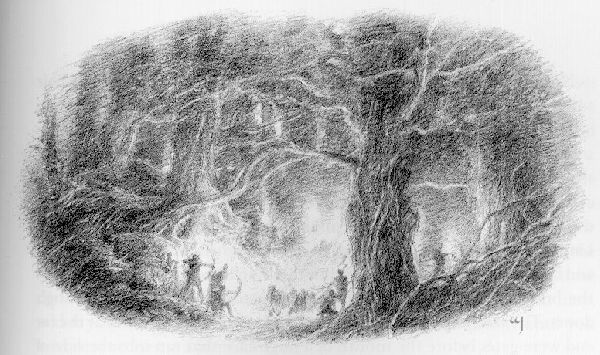
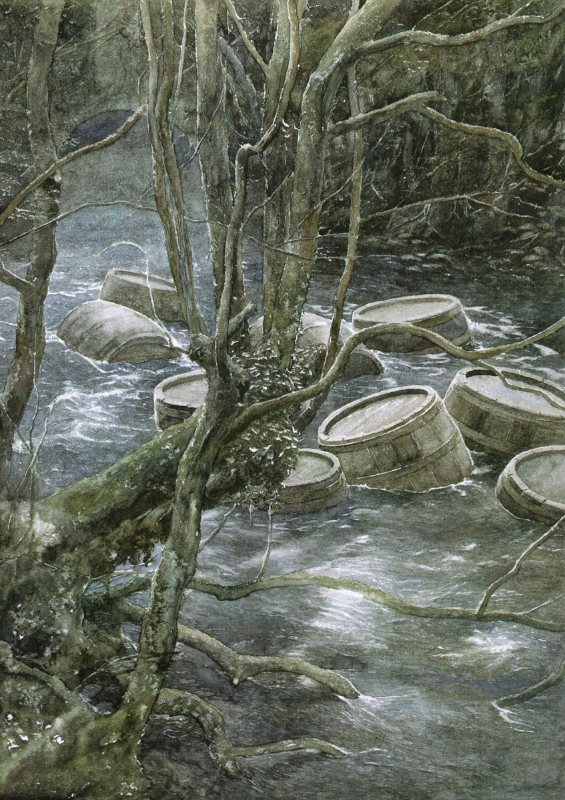
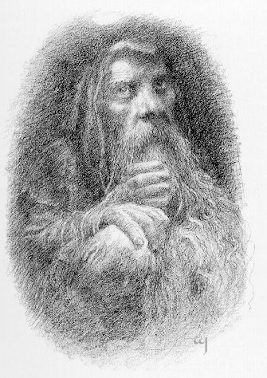

## Kapitel 9: In Fässern in die Freiheit

Am Tag nach dem Kampf mit den <abbr title="die Spinne, die Spinnen — паук">Spinnen</abbr> versuchten Bilbo und die <abbr title="der Zwerg, die Zwerge — гном">Zwerge</abbr> ein letztes Mal, einen Ausgang zu finden. Es war ein <abbr title="verzweifelt — отчаянный">verzweifelter</abbr> <abbr title="der Versuch, die Versuche — попытка">Versuch</abbr>, bevor sie vor Hunger und Durst starben. Sie standen auf und gingen mit unsicheren Schritten weiter. Acht von den dreizehn glaubten, der Pfad liege in dieser Richtung. Aber sie erfuhren nie, ob sie recht hatten. Das wenige Tageslicht, das es im Wald überhaupt gab, verschwand wieder in der schwarzen Nacht. Da flammten plötzlich rings um sie viele <abbr title="die Fackel, die Fackeln — факел">Fackeln</abbr> auf, wie Hunderte roter Sterne. <abbr title="der Waldelf, die Waldelfen — лесной эльф">Waldelfen</abbr> sprangen mit ihren Bogen und <abbr title="der Speer, die Speere — копьё">Speeren</abbr> hervor und riefen den Zwergen zu, stehen zu bleiben.

An einen Kampf dachte niemand. Den Zwergen <abbr title="gehen (ging, ist gegangen) — шёл">ging</abbr> es so schlecht, dass sie sogar froh waren, gefangen zu werden. Doch auch sonst hätten ihnen ihre kleinen Messer nicht geholfen. Das waren ihre einzigen <abbr title="die Waffe, die Waffen — оружие">Waffen</abbr>. Die <abbr title="der Pfeil, die Pfeile — стрела">Pfeile</abbr> der <abbr title="der Elf, die Elfen — эльф">Elfen</abbr> konnten im Dunkeln das Auge eines Vogels treffen. Deshalb blieben sie einfach stehen, setzten sich hin und warteten. Nur Bilbo nicht: Er steckte schnell seinen Ring auf und schlüpfte zur Seite. Die <abbr title="der Elf, die Elfen — эльф">Elfen</abbr> banden die <abbr title="der Zwerg, die Zwerge — гном">Zwerge</abbr> zu einer langen Reihe zusammen, einen hinter den anderen. Dann zählten sie sie. Den Hobbit fanden und zählten sie deshalb nicht.

Sie hörten und spürten ihn auch nicht, als er weit hinter ihrem Fackellicht herlief. Sie führten ihre <abbr title="der Gefangene, die Gefangenen — пленник">Gefangenen</abbr> in den Wald. Jedem <abbr title="der Zwerg, die Zwerge — гном">Zwerg</abbr> waren die Augen verbunden, aber das machte kaum einen Unterschied. Selbst Bilbo, der seine Augen benutzen konnte, <abbr title="sehen (sah, hat gesehen) — увидел">sah</abbr> nicht, wohin sie gingen. Außerdem wussten weder er noch die anderen, von wo sie aufgebrochen waren. Bilbo musste sich sehr anstrengen, um mit den <abbr title="die Fackel, die Fackeln — факел">Fackeln</abbr> Schritt zu halten. Die <abbr title="der Elf, die Elfen — эльф">Elfen</abbr> trieben die <abbr title="der Zwerg, die Zwerge — гном">Zwerge</abbr> so schnell vorwärts, wie diese nur konnten, obwohl sie krank und müde waren. Der König hatte ihnen befohlen, sich zu beeilen. Plötzlich blieben die <abbr title="die Fackel, die Fackeln — факел">Fackeln</abbr> stehen. Der Hobbit holte sie gerade noch ein, bevor sie über die Brücke gingen.

Diese Brücke führte über den Fluss zu den Türen des Königs. Darunter floss das dunkle Wasser schnell und mit großer Kraft. Am anderen Ende standen Tore vor dem Eingang einer riesigen <abbr title="die Höhle, die Höhlen — пещера">Höhle</abbr>. Sie führte in einen steilen, mit Bäumen bedeckten Hang hinein. Die großen <abbr title="die Buche, die Buchen — бук">Buchen</abbr> wuchsen dort bis direkt ans Ufer. Ihre Füße standen im Wasser.

Die <abbr title="der Elf, die Elfen — эльф">Elfen</abbr> stießen ihre <abbr title="der Gefangene, die Gefangenen — пленник">Gefangenen</abbr> über die Brücke, doch Bilbo <abbr title="zögern — медлить; колебаться">zögerte</abbr> hinten. Der Eingang der <abbr title="die Höhle, die Höhlen — нора; пещера">Höhle</abbr> gefiel ihm überhaupt nicht. Gerade noch rechtzeitig beschloss er, seine Freunde nicht im Stich zu lassen. Er huschte unmittelbar hinter den letzten <abbr title="der Elf, die Elfen — эльф">Elfen</abbr> hinüber. Dann schlossen sich die großen Tore des Königs mit lautem Klang hinter ihnen.

Drinnen leuchtete rotes Fackellicht in den Gängen. Die Elfenwachen sangen, während sie durch die Wege mit ihren vielen Kurven marschierten. Diese kreuzten sich, und überall klang ein <abbr title="das Echo, die Echos — эхо">Echo</abbr>. Sie waren anders als die Gänge der Goblinstädte: kleiner, weniger tief unter der Erde, und die Luft war sauberer. In einem großen Saal saß der Elvenking auf einem Stuhl aus <abbr title="schnitzen — вырезать из дерева">geschnitztem</abbr> Holz. Die <abbr title="die Säule, die Säulen — колонна">Säulen</abbr> des Saals waren aus dem Fels selbst gehauen. Auf dem Kopf trug er eine Krone aus Beeren und roten Blättern, denn der Herbst war wieder gekommen. Im Frühling trug er eine Krone aus Waldblumen. In der Hand hielt er einen <abbr title="schnitzen — вырезать из дерева">geschnitzten</abbr> <abbr title="der Stab, die Stäbe — посох">Stab</abbr> aus Eichenholz.

Die <abbr title="der Gefangene, die Gefangenen — пленник">Gefangenen</abbr> wurden vor ihn gebracht. Obwohl er sie finster ansah, befahl er seinen Leuten, die <abbr title="das Seil, die Seile — верёвка">Seile</abbr> zu lösen. Ihre Kleider waren zerrissen, und sie waren <abbr title="erschöpft — изнурённый">erschöpft</abbr>.

— Außerdem brauchen sie hier keine <abbr title="das Seil, die Seile — верёвка">Seile</abbr>, — sagte er. — Wer einmal hineingebracht worden ist, kann durch meine Zaubertüren nicht entkommen.

Lange und gründlich fragte er die <abbr title="der Zwerg, die Zwerge — гном">Zwerge</abbr> aus. Was hatten sie getan? Wohin wollten sie, und woher kamen sie? Doch er erfuhr kaum mehr von ihnen als von Thorin. Sie waren schlecht gelaunt und wütend. Sie versuchten nicht einmal, höflich zu wirken.

— Was haben wir getan, o König? — fragte Balin, der Älteste unter den übrigen Zwergen. — Ist es ein <abbr title="das Verbrechen, die Verbrechen — преступление">Verbrechen</abbr>, sich im Wald zu <abbr title="sich verirren — заблудиться">verirren</abbr>? Hunger und Durst zu haben? Von <abbr title="die Spinne, die Spinnen — паук">Spinnen</abbr> gefangen zu werden? Sind die <abbr title="die Spinne, die Spinnen — паук">Spinnen</abbr> etwa eure <abbr title="zahm — ручной; приручённый">zahmen</abbr> Tiere oder eure Haustiere? Oder warum seid ihr böse, wenn man sie tötet?

Solche Fragen machten den König natürlich noch wütender. Er antwortete:

— Es ist ein <abbr title="das Verbrechen, die Verbrechen — преступление">Verbrechen</abbr>, ohne <abbr title="die Erlaubnis, die Erlaubnisse — разрешение">Erlaubnis</abbr> in meinem Reich herumzuwandern. Habt ihr vergessen, dass ihr in meinem Königreich wart? Ihr habt den Weg benutzt, den mein Volk angelegt hat. Habt ihr nicht dreimal mein Volk im Wald verfolgt und gestört? Habt ihr nicht mit eurem wilden Lärm die <abbr title="die Spinne, die Spinnen — паук">Spinnen</abbr> geweckt? Nach all dieser Unruhe habe ich ein Recht zu wissen, was euch herbringt. Wenn ihr es mir jetzt nicht sagt, behalte ich euch alle im <abbr title="das Gefängnis, die Gefängnisse — тюрьма">Gefängnis</abbr>. Dort bleibt ihr, bis ihr Vernunft und gute Manieren gelernt habt!

Dann befahl er, jeden <abbr title="der Zwerg, die Zwerge — гном">Zwerg</abbr> in eine eigene <abbr title="die Zelle, die Zellen — камера">Zelle</abbr> zu bringen. Sie sollten Essen und Trinken bekommen. Aber keiner durfte durch die Tür seines kleinen Gefängnisses hinaus. Erst musste wenigstens einer bereit sein, dem König alles zu erzählen, was er wissen wollte. Dass auch Thorin bei ihm gefangen war, sagte er ihnen jedoch nicht. Das fand Bilbo heraus.

Armer Herr Baggins! Lange, <abbr title="mühsam — трудный; утомительный">mühsame</abbr> Zeit lebte er dort ganz allein und musste sich immer verstecken. Nie wagte er, seinen Ring abzunehmen. Selbst in den dunkelsten, entferntesten Ecken, die er finden konnte, wagte er kaum zu schlafen. Um etwas zu tun zu haben, begann er, im <abbr title="der Palast, die Paläste — дворец">Palast</abbr> des Elvenking herumzuwandern. Zauber verschloss die Tore, aber manchmal konnte er hinaus, wenn er schnell war. Von Zeit zu Zeit ritten Gruppen von <abbr title="der Waldelf, die Waldelfen — лесной эльф">Waldelfen</abbr> fort. Manchmal führte der König selbst sie an. Sie gingen auf die Jagd oder erledigten andere Dinge im Wald und in den Ländern im Osten.

War Bilbo sehr flink, konnte er unmittelbar hinter ihnen hinausschlüpfen. Das war allerdings gefährlich. Mehr als einmal hätten die Türen ihn beinahe eingeklemmt. Sie schlugen zusammen, sobald der letzte <abbr title="der Elf, die Elfen — эльф">Elf</abbr> hindurch war. Doch mitten unter ihnen zu <abbr title="gehen (ging, ist gegangen) — шёл">gehen</abbr>, wagte er nicht. Sein <abbr title="der Schatten, die Schatten — тень">Schatten</abbr> konnte ihn <abbr title="verraten (verriet, hat verraten) — выдать; раскрыть">verraten</abbr>, obwohl er im Fackellicht sehr dünn war und unruhig schwankte. Oder jemand konnte gegen ihn stoßen und ihn entdecken.

Wenn er hinausging, was nicht oft geschah, half es ihm auch nicht weiter. Er wollte die <abbr title="der Zwerg, die Zwerge — гном">Zwerge</abbr> nicht verlassen. Und er wusste wirklich nicht, wohin in aller Welt er ohne sie <abbr title="gehen (ging, ist gegangen) — шёл">gehen</abbr> sollte. Er konnte nicht während der ganzen Jagd mit den <abbr title="der Elf, die Elfen — эльф">Elfen</abbr> Schritt halten. Deshalb entdeckte er nie einen Weg aus dem Wald. Er musste unglücklich zwischen den Bäumen umherwandern, bis sich eine Gelegenheit zur Rückkehr bot. Dabei hatte er große Angst, sich zu <abbr title="sich verirren — заблудиться">verirren</abbr>. Draußen war er auch hungrig, denn er war kein Jäger. In den <abbr title="die Höhle, die Höhlen — нора; пещера">Höhlen</abbr> konnte er irgendwie leben. Er stahl Essen aus dem Vorratsraum oder vom Tisch, wenn niemand in der Nähe war.

„Ich bin wie ein <abbr title="der Einbrecher, die Einbrecher — взломщик">Einbrecher</abbr>, der nicht wegkommt“, dachte er. „Tag für Tag muss ich unglücklich im selben Haus weiter einbrechen. Das ist der traurigste und langweiligste Teil dieses ganzen schrecklichen, anstrengenden, unbequemen Abenteuers! Ich wäre gern wieder in meiner Hobbithöhle, an meinem eigenen warmen <abbr title="der Kamin, die Kamine — камин; очаг">Kamin</abbr>, mit der leuchtenden Lampe!“

Oft wünschte er auch, er könnte dem <abbr title="der Zauberer, die Zauberer — волшебник">Zauberer</abbr> eine Nachricht schicken und ihn um Hilfe bitten. Aber das war natürlich völlig unmöglich. Bald begriff er: Wenn etwas geschehen sollte, musste Herr Baggins es tun, allein und ohne jede Hilfe.

Ein oder zwei Wochen lebte er auf diese heimliche Art. Er beobachtete die <abbr title="die Wache, die Wachen — часовой; стражник">Wachen</abbr>, folgte ihnen und nutzte jede Gelegenheit. Schließlich fand er heraus, wo jeder <abbr title="der Zwerg, die Zwerge — гном">Zwerg</abbr> gefangen war. Er entdeckte alle zwölf <abbr title="die Zelle, die Zellen — камера">Zellen</abbr> in verschiedenen Teilen des Palasts. Nach einiger Zeit kannte er sich dort sehr gut aus. Eines Tages hörte er zufällig einige <abbr title="die Wache, die Wachen — часовой; стражник">Wachen</abbr> reden. Wie <abbr title="überrascht — удивлённый">überrascht</abbr> war er, als er erfuhr, dass noch ein <abbr title="der Zwerg, die Zwerge — гном">Zwerg</abbr> im <abbr title="das Gefängnis, die Gefängnisse — тюрьма; темница">Gefängnis</abbr> saß! Dieser war an einem besonders tiefen und dunklen Ort eingesperrt. Natürlich vermutete er sofort, dass es Thorin war. Nach einer Weile stellte sich heraus, dass er recht hatte. Endlich, nach vielen Schwierigkeiten, fand er den Ort, als niemand in der Nähe war. So konnte er mit dem <abbr title="der Anführer, die Anführer — предводитель">Anführer</abbr> der <abbr title="der Zwerg, die Zwerge — гном">Zwerge</abbr> sprechen.

Thorin war inzwischen zu unglücklich, um noch wütend über sein Unglück zu sein. Er dachte sogar schon daran, dem König alles über seinen <abbr title="der Schatz, die Schätze — клад; сокровище">Schatz</abbr> und seine Suche zu erzählen. Das zeigt, wie mutlos er geworden war. Da hörte er Bilbos kleine Stimme an seinem <abbr title="das Schlüsselloch, die Schlüssellöcher — замочная скважина">Schlüsselloch</abbr>. Er konnte seinen Ohren kaum glauben. Doch bald war er sicher, dass er sich nicht täuschte. Er kam zur Tür. Lange sprach er flüsternd mit dem Hobbit auf der anderen Seite.

So konnte Bilbo heimlich jedem der anderen gefangenen <abbr title="der Zwerg, die Zwerge — гном">Zwerge</abbr> Thorins Nachricht bringen. Ihr <abbr title="der Anführer, die Anführer — предводитель">Anführer</abbr> war ebenfalls gefangen, ganz in der Nähe. Niemand sollte dem König ihren Auftrag <abbr title="verraten (verriet, hat verraten) — выдать; раскрыть">verraten</abbr>. Noch nicht, und keinesfalls, bevor Thorin die <abbr title="die Erlaubnis, die Erlaubnisse — разрешение">Erlaubnis</abbr> dazu gab. Thorin hatte nämlich wieder <abbr title="der Mut — смелость">Mut</abbr> gefasst. Er hatte gehört, wie der Hobbit seine <abbr title="der Gefährte, die Gefährten — спутник; соратник">Gefährten</abbr> vor den <abbr title="die Spinne, die Spinnen — паук">Spinnen</abbr> gerettet hatte. Nun wollte er dem König wieder keinen Teil des Schatzes versprechen, um damit seine Freiheit zu bezahlen. Erst musste jede Hoffnung verschwunden sein, auf andere Weise zu entkommen. Er wollte also warten, bis selbst dem <abbr title="bemerkenswert — примечательный; замечательный">bemerkenswerten</abbr> Herrn Unsichtbar Baggins keine kluge Idee mehr einfiel. Von diesem Herrn begann Thorin nämlich eine wirklich sehr hohe Meinung zu haben.

Die anderen <abbr title="der Zwerg, die Zwerge — гном">Zwerge</abbr> waren völlig einverstanden, als sie die Nachricht bekamen. Sie hielten ihre eigenen <abbr title="der Anteil, die Anteile — доля">Anteile</abbr> am <abbr title="der Schatz, die Schätze — клад; сокровище">Schatz</abbr> bereits für ihren Besitz. Und das trotz ihrer Not und obwohl der <abbr title="der Drache, die Drachen — дракон">Drache</abbr> noch immer nicht besiegt war! Wenn die <abbr title="der Waldelf, die Waldelfen — лесной эльф">Waldelfen</abbr> einen Teil verlangten, würden diese <abbr title="der Anteil, die Anteile — доля">Anteile</abbr> ihrer Meinung nach viel kleiner werden. Außerdem vertrauten sie alle Bilbo. Genau das, seht ihr, hatte Gandalf vorhergesagt. Vielleicht war das einer der Gründe gewesen, weshalb er fortgegangen war und sie allein gelassen hatte.

Bilbo selbst war jedoch längst nicht so voller Hoffnung wie sie. Es gefiel ihm nicht, dass alle <abbr title="auf jemanden angewiesen sein — зависеть от кого-либо">auf ihn angewiesen waren</abbr>. Er wünschte sich den <abbr title="der Zauberer, die Zauberer — волшебник">Zauberer</abbr> herbei. Aber das half nichts. Wahrscheinlich lag die ganze dunkle Weite von Mirkwood zwischen ihnen. Er saß und dachte und dachte, bis sein Kopf beinahe <abbr title="platzen — лопнуть">platzte</abbr>. Doch keine gute Idee kam. Ein Ring, der <abbr title="unsichtbar — невидимый">unsichtbar</abbr> machte, war eine sehr feine Sache. Aber für vierzehn Leute half er nicht viel. Natürlich rettete er am Ende doch seine Freunde, wie ihr schon vermutet habt. Und so geschah es.

Eines Tages entdeckte Bilbo beim Herumwandern und Suchen etwas sehr Interessantes. Die großen Tore waren nicht der einzige Eingang zu den <abbr title="die Höhle, die Höhlen — нора; пещера">Höhlen</abbr>. Ein Bach floss unter einem Teil der tiefsten Räume des Palasts hindurch. Etwas weiter östlich mündete er in den Forest River. Das war jenseits des steilen Hangs, in dem der Haupteingang lag. Wo das unterirdische Wasser aus dem Hügel kam, gab es ein Tor über dem Bach. Dort reichte die Felsdecke fast bis zur Wasseroberfläche hinunter. Von ihr konnte man ein <abbr title="das Fallgatter, die Fallgatter — опускная решётка">Fallgatter</abbr> bis zum Grund des Flusses herunterlassen. Dann konnte niemand auf diesem Weg hinein oder hinaus. Aber das Gatter war oft offen, denn durch dieses Wassertor wurden viele Waren hin- und hergebracht.

Wer auf diesem Weg hineingekommen wäre, hätte sich in einem dunklen Tunnel mit rauen Wänden wiedergefunden. Er führte tief ins Innere des Hügels. An einer Stelle verlief er unter den <abbr title="die Höhle, die Höhlen — нора; пещера">Höhlen</abbr>. Dort hatte man die Decke entfernt und große <abbr title="die Falltür, die Falltüren — люк">Falltüren</abbr> aus Eichenholz darübergelegt. Sie öffneten sich nach oben in die Keller des Königs. Dort standen <abbr title="das Fass, die Fässer — бочонок; бочка">Fässer</abbr> und <abbr title="das Fass, die Fässer — бочонок; бочка">Fässer</abbr> und noch mehr <abbr title="das Fass, die Fässer — бочонок; бочка">Fässer</abbr>. Die <abbr title="der Waldelf, die Waldelfen — лесной эльф">Waldelfen</abbr>, besonders ihr König, tranken nämlich sehr gern Wein. Dabei wuchsen in dieser Gegend keine Weintrauben. Wein und andere Waren kamen aus weiter Ferne. Ihre <abbr title="der Verwandte, die Verwandten — родственник">Verwandten</abbr> im Süden schickten sie, oder sie kamen aus den Weingärten der Menschen in fernen Ländern.

Hinter einem der größten <abbr title="das Fass, die Fässer — бочка">Fässer</abbr> entdeckte Bilbo die <abbr title="die Falltür, die Falltüren — люк">Falltüren</abbr> und wozu sie dienten. Er blieb dort versteckt und <abbr title="lauschen — прислушиваться">lauschte</abbr> den Gesprächen der Diener des Königs. So erfuhr er, wie Wein und andere Waren zum Long Lake gelangten: über Flüsse oder über Land. Offenbar gab es dort noch immer eine Stadt der Menschen, der es gut <abbr title="gehen (ging, ist gegangen) — шёл">ging</abbr>. Sie war auf Brücken weit ins Wasser hinaus gebaut. Das schützte sie vor Feinden aller Art, besonders vor dem <abbr title="der Drache, die Drachen — дракон">Drachen</abbr> des Berges. Von Lake-town brachte man die <abbr title="das Fass, die Fässer — бочонок; бочка">Fässer</abbr> den Forest River hinauf. Oft band man sie einfach zu großen <abbr title="das Floß, die Flöße — плот">Flößen</abbr> zusammen. Mit langen Stangen schob man diese auf dem Wasser vorwärts. Oder man benutzte <abbr title="das Ruder, die Ruder — весло">Ruder</abbr>, um sie den Fluss hinaufzubringen. Manchmal lud man die <abbr title="das Fass, die Fässer — бочонок; бочка">Fässer</abbr> auch auf flache Boote.

Wenn die <abbr title="das Fass, die Fässer — бочонок; бочка">Fässer</abbr> leer waren, warfen die <abbr title="der Elf, die Elfen — эльф">Elfen</abbr> sie durch die <abbr title="die Falltür, die Falltüren — люк">Falltüren</abbr>. Dann öffneten sie das Wassertor. Die <abbr title="das Fass, die Fässer — бочонок; бочка">Fässer</abbr> schwammen hinaus und hüpften auf dem Wasser weiter. Die <abbr title="die Strömung, die Strömungen — течение">Strömung</abbr> trug sie weit flussabwärts zu einer Stelle, wo das Ufer vorsprang. Sie lag fast am östlichen Rand von Mirkwood. Dort sammelte man die <abbr title="das Fass, die Fässer — бочонок; бочка">Fässer</abbr> und band sie zusammen. Dann ließ man sie zurück nach Lake-town treiben. Diese Stadt stand nahe der Stelle, wo der Forest River in den Long Lake floss.

Eine Zeit lang saß Bilbo da und dachte über dieses Wassertor nach. Könnten seine Freunde auf diesem Weg fliehen? Endlich entstanden die ersten Teile eines verzweifelten Plans.

Das Abendessen war den <abbr title="der Gefangene, die Gefangenen — пленник">Gefangenen</abbr> gebracht worden. Die <abbr title="die Wache, die Wachen — часовой; стражник">Wachen</abbr> marschierten durch die Gänge davon und nahmen das Fackellicht mit. Hinter ihnen blieb alles dunkel. Da hörte Bilbo, wie der <abbr title="der Haushofmeister, die Haushofmeister — дворецкий">Haushofmeister</abbr> des Königs dem <abbr title="der Anführer, die Anführer — предводитель">Anführer</abbr> der <abbr title="die Wache, die Wachen — часовой; стражник">Wachen</abbr> gute Nacht wünschte.

— Komm jetzt mit, — sagte er, — und probier den neuen Wein, der gerade angekommen ist. Ich habe heute Nacht viel zu tun. Das leere Holz muss aus den Kellern. Trinken wir also vorher etwas, damit die Arbeit leichter wird.

— Sehr gut, — lachte der <abbr title="der Anführer, die Anführer — предводитель">Anführer</abbr> der <abbr title="die Wache, die Wachen — часовой; стражник">Wachen</abbr>. — Ich probiere mit dir und prüfe, ob er für den Tisch des Königs gut genug ist. Heute Nacht gibt es ein Fest. Da dürfen wir keinen schlechten Wein hinaufschicken!

Als Bilbo das hörte, wurde er ganz aufgeregt. Er <abbr title="sehen (sah, hat gesehen) — увидел">sah</abbr>, dass das Glück auf seiner Seite war. Sofort bot sich eine Gelegenheit, seinen verzweifelten Plan zu versuchen. Er folgte den beiden <abbr title="der Elf, die Elfen — эльф">Elfen</abbr>. Sie betraten einen kleinen Keller und setzten sich an einen Tisch. Darauf standen zwei große <abbr title="der Krug, die Krüge — кувшин">Krüge</abbr>. Bald tranken sie und lachten fröhlich.

Bilbo hatte damals ganz besonderes Glück. Es brauchte starken Wein, um einen <abbr title="der Waldelf, die Waldelfen — лесной эльф">Waldelfen</abbr> schläfrig zu machen. Dieser Wein war offenbar von der starken, <abbr title="berauschend — опьяняющий">berauschenden</abbr> Sorte aus den großen Gärten von Dorwinion. Er war nicht für die Soldaten oder Diener bestimmt, sondern nur für die Feste des Königs. Und man sollte ihn aus kleineren Schalen trinken, nicht aus den riesigen Krügen des Haushofmeisters.

Bald begann der Kopf des Anführers der <abbr title="die Wache, die Wachen — часовой; стражник">Wachen</abbr> zu sinken. Dann legte er ihn auf den Tisch und schlief fest ein. Der <abbr title="der Haushofmeister, die Haushofmeister — дворецкий">Haushofmeister</abbr> redete und lachte noch eine Weile allein weiter. Er schien nichts zu merken. Aber bald sank auch sein Kopf auf den Tisch. Er schlief ein und <abbr title="schnarchen — храпеть">schnarchte</abbr> neben seinem Freund. Nun schlich der Hobbit hinein. Sehr bald hatte der <abbr title="der Anführer, die Anführer — предводитель">Anführer</abbr> der <abbr title="die Wache, die Wachen — часовой; стражник">Wachen</abbr> keine Schlüssel mehr. Bilbo dagegen lief so schnell er konnte durch die Gänge zu den <abbr title="die Zelle, die Zellen — камера">Zellen</abbr>. Der große Schlüsselbund war für seine Arme sehr schwer. Trotz seines Rings <abbr title="das Herz schlägt jemandem bis zum Hals — сердце сильно колотится от страха">schlug ihm das Herz oft bis zum Hals</abbr>. Er konnte nicht verhindern, dass die Schlüssel ab und zu laut klingelten und gegeneinanderschlugen. Dann zitterte er am ganzen Körper.

Zuerst schloss er Balins Tür auf. Sobald der <abbr title="der Zwerg, die Zwerge — гном">Zwerg</abbr> draußen war, verschloss er sie wieder sorgfältig. Balin war sehr <abbr title="überrascht — удивлённый">überrascht</abbr>, wie ihr euch vorstellen könnt. Er war froh, aus seinem langweiligen kleinen Steinzimmer hinauszukommen. Trotzdem wollte er stehen bleiben und Fragen stellen. Was wollte Bilbo tun? Er wollte alles darüber wissen.

— Jetzt ist keine Zeit! — sagte der Hobbit. — Folg mir einfach! Wir müssen alle zusammenbleiben und dürfen nicht riskieren, getrennt zu werden. Entweder entkommen wir alle oder keiner. Das ist unsere letzte Gelegenheit. Wird das entdeckt, weiß der Himmel, wohin der König euch als Nächstes steckt. Wahrscheinlich bekommt ihr dann noch <abbr title="die Kette, die Ketten — цепь">Ketten</abbr> an Hände und Füße. Widersprich nicht, sei so gut!

Dann eilte er von Tür zu Tür, bis ihm zwölf <abbr title="der Zwerg, die Zwerge — гном">Zwerge</abbr> folgten. Keiner war besonders flink, wegen der Dunkelheit und der langen Zeit im <abbr title="das Gefängnis, die Gefängnisse — тюрьма; темница">Gefängnis</abbr>. Bilbos Herz schlug jedes Mal heftig, wenn einer gegen einen anderen stieß, brummte oder im Dunkeln flüsterte. „Verflucht sei dieser Zwergenlärm!“, sagte er sich. Aber alles <abbr title="gehen (ging, ist gegangen) — шёл">ging</abbr> gut. Sie trafen keine <abbr title="die Wache, die Wachen — часовой; стражник">Wachen</abbr>. Tatsächlich gab es in dieser Nacht ein großes Herbstfest im Wald und in den oberen Sälen. Fast das ganze Volk des Königs feierte fröhlich.

Nach vielen falschen Schritten erreichten sie endlich Thorins <abbr title="der Kerker, die Kerker — темница">Kerker</abbr>. Er lag weit unten, an einer tiefen Stelle und glücklicherweise nicht weit von den Kellern.

Bilbo flüsterte ihm zu, er solle herauskommen und zu seinen Freunden <abbr title="gehen (ging, ist gegangen) — шёл">gehen</abbr>.

— Wahrhaftig! — sagte Thorin. — Gandalf hatte wie gewöhnlich recht! Du scheinst ein wirklich guter <abbr title="der Einbrecher, die Einbrecher — взломщик">Einbrecher</abbr> zu sein, wenn es darauf ankommt. Wir stehen wohl alle für immer zu deinen Diensten, was danach auch geschieht. Aber was kommt als Nächstes?

Bilbo <abbr title="sehen (sah, hat gesehen) — увидел">sah</abbr>, dass er ihnen jetzt seine Idee erklären musste, soweit er konnte. Doch er war keineswegs sicher, wie die <abbr title="der Zwerg, die Zwerge — гном">Zwerge</abbr> sie aufnehmen würden. Er hatte allen Grund zu dieser Angst. Ihnen gefiel die Idee überhaupt nicht. Trotz der Gefahr begannen sie laut zu schimpfen.

— Wir werden bestimmt voller <abbr title="der blaue Fleck, die blauen Flecken — синяк">blauer Flecken</abbr> sein und völlig zerschlagen! Und <abbr title="ertrinken (ertrank, ist ertrunken) — утонуть">ertrinken</abbr> werden wir auch! — murmelten sie. — Als du die Schlüssel bekommen hast, dachten wir, du hättest eine vernünftige Idee. Das ist doch <abbr title="verrückt — сумасбродный; сумасшедший">verrückt</abbr>!

— Na gut! — sagte Bilbo sehr traurig und auch ziemlich ärgerlich. — Kommt zurück in eure schönen <abbr title="die Zelle, die Zellen — камера">Zellen</abbr>. Ich schließe euch alle wieder ein. Dann könnt ihr dort <abbr title="gemütlich — уютный">gemütlich</abbr> sitzen und euch einen besseren Plan überlegen. Aber ich glaube nicht, dass ich die Schlüssel noch einmal bekomme. Selbst wenn ich Lust hätte, es zu versuchen.

Das <abbr title="gehen (ging, ist gegangen) — шёл">ging</abbr> ihnen zu weit, und sie beruhigten sich. Schließlich mussten sie natürlich genau tun, was Bilbo vorschlug. Sie konnten unmöglich versuchen, einen Weg in die oberen Säle zu finden. Durch Tore, die sich durch Zauber schlossen, konnten sie sich auch nicht hinaus kämpfen. Und in den Gängen zu schimpfen, bis sie wieder gefangen wurden, half ebenfalls nichts. Also folgten sie dem Hobbit und schlichen in die tiefsten Keller hinunter.

Sie kamen an einer Tür vorbei. Dahinter sahen sie den <abbr title="der Anführer, die Anführer — предводитель">Anführer</abbr> der <abbr title="die Wache, die Wachen — часовой; стражник">Wachen</abbr> und den <abbr title="der Haushofmeister, die Haushofmeister — дворецкий">Haushofmeister</abbr> noch immer glücklich <abbr title="schnarchen — храпеть">schnarchen</abbr>. Beide lächelten im Schlaf. Der Wein von Dorwinion bringt tiefe und angenehme Träume. Am nächsten Tag würde das Gesicht des Anführers der <abbr title="die Wache, die Wachen — часовой; стражник">Wachen</abbr> anders aussehen. Dabei schlich Bilbo sogar noch hinein, bevor sie weitergingen. <abbr title="gutherzig — добросердечный">Gutherzig</abbr> wie er war, hängte er die Schlüssel wieder an dessen Gürtel.

„Das erspart ihm einen Teil des Ärgers, der auf ihn wartet“, sagte Herr Baggins sich. „Er war kein schlechter Kerl. Zu den <abbr title="der Gefangene, die Gefangenen — пленник">Gefangenen</abbr> war er ganz anständig. Außerdem wird das alle verwirren. Sie werden glauben, dass wir einen sehr starken Zauber hatten. Durch all diese verschlossenen Türen <abbr title="gehen (ging, ist gegangen) — шёл">gehen</abbr> und verschwinden! Verschwinden! Wenn das geschehen soll, müssen wir uns jetzt sehr schnell an die Arbeit machen!“

Balin bekam den Auftrag, den Wächter und den <abbr title="der Haushofmeister, die Haushofmeister — дворецкий">Haushofmeister</abbr> zu beobachten. Falls sie sich bewegten, sollte er die anderen warnen. Die übrigen gingen in den Keller daneben, wo die <abbr title="die Falltür, die Falltüren — люк">Falltüren</abbr> waren. Sie hatten wenig Zeit. Bilbo wusste, dass bald einige <abbr title="der Elf, die Elfen — эльф">Elfen</abbr> herunterkommen sollten. Sie sollten dem <abbr title="der Haushofmeister, die Haushofmeister — дворецкий">Haushofmeister</abbr> helfen, die leeren <abbr title="das Fass, die Fässer — бочонок; бочка">Fässer</abbr> durch die Türen in den Bach zu werfen. Die <abbr title="das Fass, die Fässer — бочонок; бочка">Fässer</abbr> standen schon mitten auf dem Boden in Reihen und warteten darauf, hinuntergestoßen zu werden. Einige waren Weinfässer. Die waren nicht sehr <abbr title="geeignet — подходящий">geeignet</abbr>. Man konnte sie am Ende nicht leicht öffnen, ohne viel Lärm zu machen. Danach konnte man sie auch nicht leicht wieder sicher verschließen. Doch dazwischen standen mehrere andere <abbr title="das Fass, die Fässer — бочонок; бочка">Fässer</abbr>. Darin hatte man Butter, Äpfel und alle möglichen Dinge zum <abbr title="der Palast, die Paläste — дворец">Palast</abbr> des Königs gebracht.

Bald fanden sie dreizehn <abbr title="das Fass, die Fässer — бочонок; бочка">Fässer</abbr> mit genug Platz für je einen <abbr title="der Zwerg, die Zwerge — гном">Zwerg</abbr>. Einige waren sogar zu groß. Beim Hineinklettern dachten die <abbr title="der Zwerg, die Zwerge — гном">Zwerge</abbr> ängstlich daran, wie sie darin geschüttelt und herumgestoßen werden würden. Bilbo suchte so gut er konnte nach <abbr title="das Stroh — солома">Stroh</abbr> und anderen Dingen. Damit wollte er sie möglichst <abbr title="gemütlich — уютный">gemütlich</abbr> einpacken, so gut das in der kurzen Zeit <abbr title="gehen (ging, ist gegangen) — шёл">ging</abbr>. Schließlich waren zwölf <abbr title="der Zwerg, die Zwerge — гном">Zwerge</abbr> verstaut. Thorin hatte viele Schwierigkeiten gemacht. Er hatte sich in seinem <abbr title="das Fass, die Fässer — бочонок; бочка">Fass</abbr> gedreht und gewunden und wie ein großer Hund in einer kleinen Hütte gebrummt. Balin kam als Letzter. Er machte viel Aufhebens um seine Luftlöcher und sagte, er <abbr title="ersticken — задыхаться">ersticke</abbr>, noch bevor sein Deckel darauf war.

Bilbo hatte so gut er konnte die Löcher in den Seiten der <abbr title="das Fass, die Fässer — бочонок; бочка">Fässer</abbr> verschlossen. Er hatte alle Deckel so sicher befestigt, wie es möglich war. Nun war er wieder allein. Er lief herum und verbesserte noch hier und da die Verpackung. Fast ohne Hoffnung hoffte er trotzdem, dass sein Plan gelingen würde.

Es war keine Minute zu früh geschehen. Nur ein oder zwei Minuten, nachdem Balins Deckel befestigt worden war, hörte man Stimmen. Lichter flackerten. Mehrere <abbr title="der Elf, die Elfen — эльф">Elfen</abbr> kamen lachend und redend in die Keller und sangen Teile von Liedern. Sie hatten ein fröhliches Fest in einem der Säle verlassen und wollten so schnell wie möglich zurückkehren.

— Wo ist der alte Galion, der <abbr title="der Haushofmeister, die Haushofmeister — дворецкий">Haushofmeister</abbr>? — fragte einer. — Ich habe ihn heute Abend nicht an den Tischen gesehen. Jetzt müsste er hier sein und uns zeigen, was wir tun sollen.

— Ich werde böse, wenn der alte <abbr title="der Trödler, die Trödler — копуша">Trödler</abbr> zu spät kommt, — sagte ein anderer. — Ich will hier unten keine Zeit verschwenden, während oben gesungen wird!

— Ha, ha! — rief jemand. — Hier sitzt der alte <abbr title="der Bösewicht, die Bösewichte — злодей">Bösewicht</abbr>, mit dem Kopf auf einem <abbr title="der Krug, die Krüge — кувшин; большая кружка">Krug</abbr>! Er hat ganz allein ein kleines Fest gefeiert, zusammen mit seinem Freund, dem Hauptmann.

— Schüttelt ihn! Weckt ihn! — riefen die anderen ungeduldig.

Galion gefiel es überhaupt nicht, geschüttelt oder geweckt zu werden. Noch weniger gefiel es ihm, dass man ihn auslachte.

— Ihr seid alle zu spät, — brummte er. — Ich warte hier unten und warte. Währenddessen trinkt und feiert ihr und vergesst eure Aufgaben. Kein Wunder, wenn ich vor Müdigkeit einschlafe!

— Kein Wunder, — sagten sie, — wenn die Erklärung gleich neben dir in einem <abbr title="der Krug, die Krüge — кувшин; большая кружка">Krug</abbr> steht! Komm, lass uns deinen <abbr title="der Schlaftrunk, die Schlaftrünke — сонное зелье">Schlaftrunk</abbr> probieren, bevor wir anfangen! Den Gefängniswächter dort brauchen wir nicht zu wecken. Wie es aussieht, hat er seinen Teil schon bekommen.

Dann tranken sie alle einmal der Reihe nach und wurden plötzlich sehr lustig. Doch sie verloren ihren <abbr title="der Verstand — ум; рассудок">Verstand</abbr> nicht ganz.

— Guter Himmel, Galion! — riefen einige. — Du hast früh mit dem Feiern angefangen und deinen Kopf durcheinandergebracht! Hier hast du einige volle <abbr title="das Fass, die Fässer — бочонок; бочка">Fässer</abbr> statt der leeren hingestellt, wenn man nach dem Gewicht urteilen kann.

— <abbr title="die Macht, die Mächte — власть; сила">Macht</abbr> weiter mit der Arbeit! — knurrte der <abbr title="der Haushofmeister, die Haushofmeister — дворецкий">Haushofmeister</abbr>. — Was ein fauler <abbr title="der Säufer, die Säufer — пьяница">Säufer</abbr> in seinen Armen als schwer empfindet, bedeutet gar nichts. Diese <abbr title="das Fass, die Fässer — бочонок; бочка">Fässer</abbr> sollen fort und keine anderen. Tut, was ich sage!

— Schon gut, schon gut, — antworteten sie und rollten die <abbr title="das Fass, die Fässer — бочонок; бочка">Fässer</abbr> zur Öffnung. — Du trägst die Schuld, wenn die vollen Butterfässer und der beste Wein des Königs im Fluss landen! Dann können die Leute am See umsonst davon essen und feiern!

> Roll — roll — roll — roll,  
> roll-roll-rollt durchs Loch, jawohl!  
> Hauruck! Platsch und plump!  
> Abwärts geht's mit Stoß und Bumm!  

So sangen sie, während ein <abbr title="das Fass, die Fässer — бочонок; бочка">Fass</abbr> nach dem anderen zur dunklen Öffnung <abbr title="rumpeln — грохотать">rumpelte</abbr>. Dann wurde es ins kalte Wasser gestoßen, das einige Fuß tiefer lag. Manche <abbr title="das Fass, die Fässer — бочонок; бочка">Fässer</abbr> waren wirklich leer. In anderen war je ein <abbr title="der Zwerg, die Zwerge — гном">Zwerg</abbr> ordentlich eingepackt. Doch alle fielen hinunter, eines nach dem anderen, mit viel Gekrach und vielen Stößen. Sie schlugen auf die <abbr title="das Fass, die Fässer — бочонок; бочка">Fässer</abbr> darunter, klatschten ins Wasser und stießen gegen die Tunnelwände und gegeneinander. Dann hüpften sie auf der <abbr title="die Strömung, die Strömungen — течение">Strömung</abbr> davon.

Genau in diesem Augenblick entdeckte Bilbo plötzlich den <abbr title="der Schwachpunkt, die Schwachpunkte — слабое место">Schwachpunkt</abbr> seines Plans. Wahrscheinlich habt ihr ihn schon früher gesehen und über Bilbo gelacht. Aber ich glaube nicht, dass ihr an seiner Stelle auch nur halb so gut gehandelt hättet. Natürlich saß er selbst nicht in einem <abbr title="das Fass, die Fässer — бочонок; бочка">Fass</abbr>! Außerdem war niemand da, der ihn einpacken konnte, selbst wenn dazu noch Gelegenheit gewesen wäre. Diesmal würde er seine Freunde offenbar wirklich verlieren. Fast alle waren schon durch die dunkle <abbr title="die Falltür, die Falltüren — люк">Falltür</abbr> verschwunden. Er würde völlig allein zurückbleiben. Für immer müsste er als <abbr title="der Einbrecher, die Einbrecher — взломщик">Einbrecher</abbr> in den Elfenhöhlen leben und sich verstecken.

Selbst wenn er sofort durch die oberen Tore hätte entkommen können, hätte er die <abbr title="der Zwerg, die Zwerge — гном">Zwerge</abbr> wohl kaum wiedergefunden. Er kannte den Weg über Land nicht zu der Stelle, wo man die <abbr title="das Fass, die Fässer — бочонок; бочка">Fässer</abbr> sammelte. Was sollte nur ohne ihn aus den Zwergen werden? Er hatte keine Zeit gehabt, ihnen alles zu erzählen, was er erfahren hatte. Auch nicht, was er tun wollte, sobald sie aus dem Wald heraus waren.

Während ihm all diese Gedanken durch den Kopf gingen, begannen die sehr fröhlichen <abbr title="der Elf, die Elfen — эльф">Elfen</abbr> an der Öffnung zum Fluss zu singen. Einige waren bereits fortgegangen, um an den Seilen zu ziehen, die das <abbr title="das Fallgatter, die Fallgatter — опускная решётка">Fallgatter</abbr> am Wassertor hochzogen. Sobald alle <abbr title="das Fass, die Fässer — бочонок; бочка">Fässer</abbr> unten schwammen, sollten sie hinausgelassen werden.

> Den schnellen dunklen Strom hinab,  
> zurück ins Land, das ihr einst kanntet!  
> Verlasst die Säle, <abbr title="die Höhle, die Höhlen — нора; пещера">Höhlen</abbr> tief,  
> die steilen Berge hoch im Norden,  
> wo weit der Wald im Dunkel steht,  
> sich grau und finster niederbeugt!  
> Treibt aus der Welt der Bäume fort,  
> hinaus zum flüsternden Wind,  
> vorbei an <abbr title="die Binse, die Binsen — камыш; ситник">Binsen</abbr>, vorbei am <abbr title="das Schilf — тростник; камыш">Schilf</abbr>,  
> am schwankenden Gras des Sumpfes,  
> durch weißen <abbr title="der Nebel — туман">Nebel</abbr>, der nachts steigt,  
> von See und Teich empor!  
> Folgt, folgt den Sternen, die hinauf  
> zum kalten steilen Himmel springen!  
> Wendet euch, wenn der Morgen übers Land zieht,  
> über <abbr title="die Stromschnelle, die Stromschnellen — речной порог">Stromschnellen</abbr>, über Sand,  
> nach Süden fort! Nach Süden fort!  
> Sucht Sonnenlicht und hellen Tag,  
> zurück zur <abbr title="die Weide, die Weiden — ива">Weide</abbr>, zurück zur Wiese,  
> wo Kühe und die <abbr title="der Ochse, die Ochsen — вол">Ochsen</abbr> grasen!  
> Zurück zu Gärten auf den Hügeln,  
> wo Beeren <abbr title="schwellen (schwoll, ist geschwollen) — набухать">schwellen</abbr> und sich füllen,  
> im Sonnenlicht, am hellen Tag!  
> Nach Süden fort! Nach Süden fort!  
> Den schnellen dunklen Strom hinab,  
> zurück ins Land, das ihr einst kanntet!  

Jetzt wurde das allerletzte <abbr title="das Fass, die Fässer — бочонок; бочка">Fass</abbr> zu den Türen gerollt! <abbr title="verzweifelt — отчаявшийся; в отчаянии">Verzweifelt</abbr> und ohne eine andere Idee packte der arme kleine Bilbo es. Zusammen mit dem <abbr title="das Fass, die Fässer — бочонок; бочка">Fass</abbr> wurde er über den Rand gestoßen. Er fiel ins Wasser, platsch! Ins kalte dunkle Wasser, und das <abbr title="das Fass, die Fässer — бочонок; бочка">Fass</abbr> fiel auf ihn.

Er tauchte hustend und <abbr title="prusten — фыркать">prustend</abbr> wieder auf und klammerte sich wie eine Ratte an das Holz. Doch trotz aller Mühe konnte er nicht hinaufklettern. Jedes Mal, wenn er es versuchte, drehte sich das <abbr title="das Fass, die Fässer — бочонок; бочка">Fass</abbr> und tauchte ihn wieder unter. Es war wirklich leer und schwamm leicht wie ein <abbr title="der Korken, die Korken — пробка">Korken</abbr>. Obwohl seine Ohren voller Wasser waren, hörte er die <abbr title="der Elf, die Elfen — эльф">Elfen</abbr> oben im Keller noch singen. Dann fielen die <abbr title="die Falltür, die Falltüren — люк">Falltüren</abbr> plötzlich mit einem Dröhnen zu, und ihre Stimmen wurden immer leiser. Er trieb im dunklen Tunnel im eiskalten Wasser, ganz allein. Denn Freunde, die alle in <abbr title="das Fass, die Fässer — бочонок; бочка">Fässer</abbr> verpackt sind, kann man nicht mitzählen.

Bald erschien vor ihm ein grauer Fleck in der Dunkelheit. Er hörte das Wassertor knarren, als es hochgezogen wurde. Rings um ihn hüpften und stießen große Mengen von Fässern auf dem Wasser. Sie drängten sich alle zusammen, um unter dem Bogen hindurch in den freien Bach zu gelangen. Bilbo musste sich sehr anstrengen, um nicht herumgestoßen und völlig zerschlagen zu werden. Doch endlich löste sich die drängende Menge auf. Ein <abbr title="das Fass, die Fässer — бочонок; бочка">Fass</abbr> nach dem anderen schwang unter dem Steinbogen hindurch und trieb davon. Nun <abbr title="sehen (sah, hat gesehen) — увидел">sah</abbr> er: Es hätte ihm gar nicht geholfen, wenn er auf sein <abbr title="das Fass, die Fässer — бочонок; бочка">Fass</abbr> hätte klettern können. Zwischen seiner Oberseite und der plötzlich niedrigen Felsdecke am Tor war kein Platz. Nicht einmal für einen Hobbit.

Sie trieben hinaus unter die Äste, die von beiden Ufern über das Wasser hingen. Bilbo fragte sich, wie es den Zwergen wohl <abbr title="gehen (ging, ist gegangen) — шёл">ging</abbr> und ob viel Wasser in ihre <abbr title="das Fass, die Fässer — бочонок; бочка">Fässer</abbr> eindrang. Einige <abbr title="das Fass, die Fässer — бочонок; бочка">Fässer</abbr> hüpften in der Dunkelheit neben ihm her und lagen ziemlich tief im Wasser. Er vermutete, dass <abbr title="der Zwerg, die Zwerge — гном">Zwerge</abbr> darin waren.

„Hoffentlich habe ich die Deckel fest genug angebracht!“, dachte er. Doch bald sorgte er sich zu sehr um sich selbst, um noch an die <abbr title="der Zwerg, die Zwerge — гном">Zwerge</abbr> zu denken. Er konnte seinen Kopf über Wasser halten, aber er zitterte vor Kälte. <abbr title="die Würde — достоинство">Würde</abbr> er daran sterben, bevor das Glück sich wendete? Wie lange konnte er sich noch festhalten? Sollte er das Risiko eingehen, loszulassen und zum Ufer zu schwimmen?

Das Glück wendete sich tatsächlich bald. Die <abbr title="die Strömung, die Strömungen — течение">Strömung</abbr> drehte sich an einer Stelle im Kreis und trug mehrere <abbr title="das Fass, die Fässer — бочонок; бочка">Fässer</abbr> dicht ans Ufer. Dort blieben sie eine Weile an einer verborgenen <abbr title="die Wurzel, die Wurzeln — корень">Wurzel</abbr> hängen. Bilbo nutzte die Gelegenheit und kletterte an der Seite seines Fasses hinauf. Es wurde gerade von einem anderen <abbr title="das Fass, die Fässer — бочонок; бочка">Fass</abbr> festgehalten. Wie eine ertrunkene Ratte kroch er nach oben. Er legte sich flach darauf und breitete Arme und Beine aus, um möglichst das Gleichgewicht zu halten. Der Wind war kalt, aber besser als das Wasser. Er hoffte, er würde nicht plötzlich wieder herunterrollen, wenn die <abbr title="das Fass, die Fässer — бочонок; бочка">Fässer</abbr> erneut lostrieben.

Bald kamen die <abbr title="das Fass, die Fässer — бочонок; бочка">Fässer</abbr> wieder frei. Sie drehten und wendeten sich den Bach hinab, hinaus in die Hauptströmung. Nun war es tatsächlich so schwierig, oben zu bleiben, wie Bilbo befürchtet hatte. Aber irgendwie schaffte er es, obwohl es schrecklich unbequem war. Zum Glück war er sehr leicht, und das <abbr title="das Fass, die Fässer — бочонок; бочка">Fass</abbr> war schön groß. Außerdem konnte etwas Wasser hineinlaufen, und inzwischen war schon eine kleine Menge darin. Trotzdem war es, als wollte man auf einem Pony mit rundem Bauch reiten, ohne <abbr title="das Zaumzeug — уздечка">Zaumzeug</abbr> oder <abbr title="der Steigbügel, die Steigbügel — стремя">Steigbügel</abbr>. Und dieses Pony dachte ständig daran, sich im Gras <abbr title="sich wälzen — валяться; кататься по земле">zu wälzen</abbr>.

So kam Herr Baggins endlich an eine Stelle, wo die Bäume auf beiden Seiten weniger dicht wuchsen. Dazwischen konnte er den helleren Himmel <abbr title="sehen (sah, hat gesehen) — увидел">sehen</abbr>. Plötzlich wurde der dunkle Bach breit. Hier vereinigte er sich mit dem Hauptwasser des Forest River. Dieser floss eilig von den großen Türen des Königs herab. Vor Bilbo lag eine schwach sichtbare Wasserfläche, die nicht mehr im <abbr title="der Schatten, die Schatten — тень">Schatten</abbr> lag. Auf der gleitenden Oberfläche spiegelten sich Wolken und Sterne in tanzenden, gebrochenen Bildern.

Dann trug das schnelle Wasser des Forest River die ganze Gesellschaft der <abbr title="das Fass, die Fässer — бочонок; бочка">Fässer</abbr> zum nördlichen Ufer. Dort hatte der Fluss eine breite <abbr title="die Bucht, die Buchten — бухта">Bucht</abbr> ausgewaschen. Unter den überhängenden Ufern lag ein Strand mit kleinen Steinen. Am östlichen Ende begrenzte ihn ein kleines, vorspringendes Stück harten Felsens. Am flachen Ufer blieben die meisten <abbr title="das Fass, die Fässer — бочонок; бочка">Fässer</abbr> auf dem Grund liegen. Einige trieben weiter und stießen gegen den steinernen Steg.

An den Ufern standen Leute, die den Fluss beobachteten. Schnell schoben sie mit langen Stangen alle <abbr title="das Fass, die Fässer — бочонок; бочка">Fässer</abbr> im flachen Wasser zusammen. Sie zählten sie, banden sie mit Seilen aneinander und ließen sie bis zum Morgen liegen. Arme <abbr title="der Zwerg, die Zwerge — гном">Zwerge</abbr>! Bilbo <abbr title="gehen (ging, ist gegangen) — шёл">ging</abbr> es jetzt nicht schlecht. Er glitt von seinem <abbr title="das Fass, die Fässer — бочонок; бочка">Fass</abbr> und <abbr title="waten — брести по воде">watete</abbr> ans Ufer. Dann schlich er zu einigen Hütten, die er am Wasser <abbr title="sehen (sah, hat gesehen) — увидел">sehen</abbr> konnte. Er dachte nicht mehr lange darüber nach, sich ungebeten ein Abendessen zu holen, wenn er Gelegenheit hatte. So lange hatte er das tun müssen!

Außerdem wusste er jetzt nur zu gut, was wirklicher Hunger war. Nicht bloß höfliches Interesse an den feinen Speisen in einem gut gefüllten Vorratsraum! Durch die Bäume hatte er auch ein Feuer gesehen, und das zog ihn an. Seine tropfenden, zerrissenen Kleider klebten kalt und <abbr title="feucht — сырой; влажный">feucht</abbr> an ihm.

Über seine <abbr title="das Abenteuer, die Abenteuer — приключение">Abenteuer</abbr> in dieser Nacht brauche ich euch nicht viel zu erzählen. Wir nähern uns jetzt dem Ende der Reise nach Osten und dem letzten und größten <abbr title="das Abenteuer, die Abenteuer — приключение">Abenteuer</abbr>. Deshalb müssen wir uns beeilen. Mit Hilfe seines Zauberrings kam Bilbo anfangs natürlich sehr gut zurecht. Doch zuletzt verrieten ihn die feuchten Stellen, die seine Füße hinterließen. Auch hinterließ er überall, wo er <abbr title="gehen (ging, ist gegangen) — шёл">ging</abbr> oder saß, Wassertropfen. Außerdem begann er zu <abbr title="schniefen — шмыгать носом">schniefen</abbr>. Wo immer er sich versteckte, verrieten ihn die gewaltigen <abbr title="die Explosion, die Explosionen — взрыв">Explosionen</abbr> seines Niesens, das er zu unterdrücken versuchte.

Bald <abbr title="gehen (ging, ist gegangen) — шёл">ging</abbr> es im Dorf am Fluss ordentlich durcheinander. Doch Bilbo entkam in den Wald. Er trug ein Brot, eine Lederflasche Wein und eine <abbr title="die Pastete, die Pasteten — пирог с начинкой">Pastete</abbr> bei sich, die ihm nicht gehörten. Den Rest der Nacht musste er so nass, wie er war, weit von einem Feuer verbringen. Aber die Flasche half ihm dabei. Tatsächlich schlief er auf einigen trockenen Blättern sogar ein wenig. Und das, obwohl das Jahr schon weit fortgeschritten und die Luft kalt war.

Er wachte mit einem besonders lauten Niesen wieder auf. Der graue Morgen war schon da, und unten am Fluss hörte man fröhlichen Lärm. Dort bauten sie ein <abbr title="das Floß, die Flöße — плот">Floß</abbr> aus Fässern. Bald würden die Floßelfen es den Fluss hinab nach Lake-town steuern. Bilbo nieste wieder. Er tropfte nicht mehr, aber sein ganzer Körper war kalt. So schnell seine steifen Beine ihn trugen, kletterte er hinunter. Gerade noch rechtzeitig gelangte er auf die Menge der <abbr title="das Fass, die Fässer — бочонок; бочка">Fässer</abbr>. Zwischen all den beschäftigten <abbr title="der Elf, die Elfen — эльф">Elfen</abbr> bemerkte ihn niemand. Zum Glück schien gerade keine Sonne, die einen störenden <abbr title="der Schatten, die Schatten — тень">Schatten</abbr> werfen konnte. Und glücklicherweise musste er eine ganze Weile nicht mehr niesen.

Mit den Stangen wurde kräftig geschoben. Die <abbr title="der Elf, die Elfen — эльф">Elfen</abbr> im flachen Wasser stemmten und drückten. Alle <abbr title="das Fass, die Fässer — бочонок; бочка">Fässer</abbr> waren jetzt fest zusammengebunden. Sie knarrten und rieben sich aneinander.

— Das ist eine schwere Ladung! — brummten einige. — Sie liegen zu tief im Wasser. Einige davon sind ganz bestimmt nicht leer. Wenn sie bei Tageslicht ans Ufer gekommen wären, hätten wir hineinsehen können.

— Jetzt ist keine Zeit! — rief der Floßführer. — Stoßt ab!

Endlich fuhren sie los, zuerst langsam. Sie kamen an dem Felsvorsprung vorbei, wo andere <abbr title="der Elf, die Elfen — эльф">Elfen</abbr> mit Stangen standen und sie davon fernhielten. Dann <abbr title="gehen (ging, ist gegangen) — шёл">ging</abbr> es schneller und schneller. Sie erreichten die Hauptströmung und fuhren davon, hinunter, immer weiter hinunter zum See.

Sie waren aus den Kerkern des Königs entkommen und hatten den Wald hinter sich. Aber ob lebendig oder tot, das bleibt noch abzuwarten.

---

### Neue und schwierige Wörter

- **die Spinne, die Spinnen** — паук *(Wiederholung)*
- **der Zwerg, die Zwerge** — гном *(Wiederholung)*
- **verzweifelt** — отчаянный *(Wiederholung)*
- **der Versuch, die Versuche** — попытка *(Wiederholung)*
- **die Fackel, die Fackeln** — факел *(Wiederholung)*
- **der Waldelf, die Waldelfen** — лесной эльф *(Wiederholung)*
- **der Speer, die Speere** — копьё *(neu)*
- **gehen (ging, ist gegangen)** — шёл *(Wiederholung)*
- **die Waffe, die Waffen** — оружие *(Wiederholung)*
- **der Pfeil, die Pfeile** — стрела *(Wiederholung)*
- **der Elf, die Elfen** — эльф *(Wiederholung)*
- **der Gefangene, die Gefangenen** — пленник *(Wiederholung)*
- **sehen (sah, hat gesehen)** — увидел *(Wiederholung)*
- **die Höhle, die Höhlen** — пещера *(Wiederholung)*
- **die Buche, die Buchen** — бук *(Wiederholung)*
- **zögern** — медлить; колебаться *(neu)*
- **das Echo, die Echos** — эхо *(Wiederholung)*
- **schnitzen** — вырезать из дерева *(neu)*
- **die Säule, die Säulen** — колонна *(Wiederholung)*
- **der Stab, die Stäbe** — посох *(Wiederholung)*
- **das Seil, die Seile** — верёвка *(Wiederholung)*
- **erschöpft** — изнурённый *(Wiederholung)*
- **das Verbrechen, die Verbrechen** — преступление *(neu)*
- **sich verirren** — заблудиться *(Wiederholung)*
- **zahm** — ручной; приручённый *(neu)*
- **die Erlaubnis, die Erlaubnisse** — разрешение *(Wiederholung)*
- **das Gefängnis, die Gefängnisse** — тюрьма *(Wiederholung)*
- **die Zelle, die Zellen** — камера *(neu)*
- **mühsam** — трудный; утомительный *(Wiederholung)*
- **der Palast, die Paläste** — дворец *(Wiederholung)*
- **der Schatten, die Schatten** — тень *(Wiederholung)*
- **verraten (verriet, hat verraten)** — выдать; раскрыть *(neu)*
- **der Einbrecher, die Einbrecher** — взломщик *(neu)*
- **der Kamin, die Kamine** — камин; очаг *(Wiederholung)*
- **der Zauberer, die Zauberer** — волшебник *(Wiederholung)*
- **die Wache, die Wachen** — часовой; стражник *(Wiederholung)*
- **überrascht** — удивлённый *(neu)*
- **der Anführer, die Anführer** — предводитель *(Wiederholung)*
- **der Schatz, die Schätze** — клад; сокровище *(Wiederholung)*
- **das Schlüsselloch, die Schlüssellöcher** — замочная скважина *(Wiederholung)*
- **der Mut** — смелость *(Wiederholung)*
- **der Gefährte, die Gefährten** — спутник; соратник *(Wiederholung)*
- **bemerkenswert** — примечательный; замечательный *(neu)*
- **der Anteil, die Anteile** — доля *(neu)*
- **der Drache, die Drachen** — дракон *(Wiederholung)*
- **auf jemanden angewiesen sein** — зависеть от кого-либо *(neu)*
- **platzen** — лопнуть *(neu)*
- **unsichtbar** — невидимый *(Wiederholung)*
- **das Fallgatter, die Fallgatter** — опускная решётка *(neu)*
- **die Falltür, die Falltüren** — люк *(neu)*
- **das Fass, die Fässer** — бочонок; бочка *(Wiederholung)*
- **der Verwandte, die Verwandten** — родственник *(Wiederholung)*
- **lauschen** — прислушиваться *(Wiederholung)*
- **das Floß, die Flöße** — плот *(neu)*
- **das Ruder, die Ruder** — весло *(Wiederholung)*
- **die Strömung, die Strömungen** — течение *(neu)*
- **der Haushofmeister, die Haushofmeister** — дворецкий *(neu)*
- **der Krug, die Krüge** — кувшин *(Wiederholung)*
- **berauschend** — опьяняющий *(neu)*
- **schnarchen** — храпеть *(neu)*
- **das Herz schlägt jemandem bis zum Hals** — сердце сильно колотится от страха *(neu)*
- **die Kette, die Ketten** — цепь *(neu)*
- **der Kerker, die Kerker** — темница *(neu)*
- **der blaue Fleck, die blauen Flecken** — синяк *(neu)*
- **ertrinken (ertrank, ist ertrunken)** — утонуть *(Wiederholung)*
- **verrückt** — сумасбродный; сумасшедший *(Wiederholung)*
- **gemütlich** — уютный *(Wiederholung)*
- **gutherzig** — добросердечный *(neu)*
- **geeignet** — подходящий *(neu)*
- **das Stroh** — солома *(Wiederholung)*
- **ersticken** — задыхаться *(neu)*
- **der Trödler, die Trödler** — копуша *(neu)*
- **der Bösewicht, die Bösewichte** — злодей *(Wiederholung)*
- **der Schlaftrunk, die Schlaftrünke** — сонное зелье *(neu)*
- **der Verstand** — ум; рассудок *(Wiederholung)*
- **die Macht, die Mächte** — власть; сила *(Wiederholung)*
- **der Säufer, die Säufer** — пьяница *(neu)*
- **rumpeln** — грохотать *(neu)*
- **der Schwachpunkt, die Schwachpunkte** — слабое место *(neu)*
- **die Binse, die Binsen** — камыш; ситник *(Wiederholung)*
- **das Schilf** — тростник; камыш *(Wiederholung)*
- **der Nebel** — туман *(Wiederholung)*
- **die Stromschnelle, die Stromschnellen** — речной порог *(neu)*
- **die Weide, die Weiden** — ива *(Wiederholung)*
- **der Ochse, die Ochsen** — вол *(neu)*
- **schwellen (schwoll, ist geschwollen)** — набухать *(neu)*
- **prusten** — фыркать *(neu)*
- **der Korken, die Korken** — пробка *(neu)*
- **die Würde** — достоинство *(Wiederholung)*
- **die Wurzel, die Wurzeln** — корень *(neu)*
- **das Zaumzeug** — уздечка *(neu)*
- **der Steigbügel, die Steigbügel** — стремя *(neu)*
- **sich wälzen** — валяться; кататься по земле *(neu)*
- **die Bucht, die Buchten** — бухта *(neu)*
- **waten** — брести по воде *(neu)*
- **feucht** — сырой; влажный *(Wiederholung)*
- **das Abenteuer, die Abenteuer** — приключение *(Wiederholung)*
- **schniefen** — шмыгать носом *(neu)*
- **die Explosion, die Explosionen** — взрыв *(Wiederholung)*
- **die Pastete, die Pasteten** — пирог с начинкой *(neu)*

### Schwierige Sätze

- **„Wer einmal hineingebracht worden ist, kann durch meine Zaubertüren nicht entkommen.“** — Кто однажды был приведён внутрь, не может сбежать через мои волшебные двери. **Грамматика:** `wer` вводит обобщённое придаточное; `hineingebracht worden ist` — Perfekt пассива.
- **„Es gefiel ihm nicht, dass alle auf ihn angewiesen waren.“** — Ему не нравилось, что все зависели от него. **Выражение:** `auf jemanden angewiesen sein` — зависеть от кого-либо; после `dass` глагол стоит в конце.
- **„Wer auf diesem Weg hineingekommen wäre, hätte sich in einem dunklen Tunnel mit rauen Wänden wiedergefunden.“** — Тот, кто вошёл бы этим путём, оказался бы в тёмном тоннеле с неровными стенами. **Грамматика:** `wäre ... gekommen` и `hätte ... gefunden` — Konjunktiv II прошедшего времени: воображаемая ситуация.
- **„Entweder entkommen wir alle oder keiner.“** — Либо мы спасаемся все, либо никто. **Грамматика:** парная конструкция `entweder ... oder` соединяет взаимоисключающие варианты; во второй части повтор глагола опущен.
- **„Selbst wenn ich Lust hätte, es zu versuchen.“** — Даже если бы мне захотелось попробовать. **Грамматика:** `selbst wenn` — «даже если»; `hätte` выражает условие, а `es zu versuchen` уточняет, на что было бы желание.
- **„Zwischen seiner Oberseite und der plötzlich niedrigen Felsdecke am Tor war kein Platz.“** — Между его верхней поверхностью и внезапно низким каменным потолком у ворот не было места. **Грамматика:** `zwischen` здесь обозначает местоположение и требует Dativ.
- **„Er hoffte, er würde nicht plötzlich wieder herunterrollen, wenn die Fässer erneut lostrieben.“** — Он надеялся, что не скатится внезапно обратно вниз, когда бочки снова поплывут. **Грамматика:** `würde ... herunterrollen` передаёт будущее с точки зрения прошлого; `wenn` вводит ожидаемое событие.
- **„Wenn sie bei Tageslicht ans Ufer gekommen wären, hätten wir hineinsehen können.“** — Если бы они приплыли к берегу при дневном свете, мы могли бы заглянуть внутрь. **Грамматика:** нереальное условие в прошлом; `hätten ... hineinsehen können` использует два инфинитива с модальным глаголом.

[← Zurück](kapitel-08.md) · [Inhalt](README.md) · [Weiter →](kapitel-10.md)
