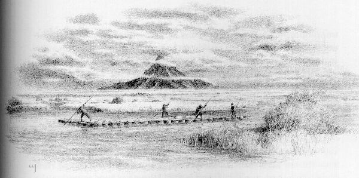
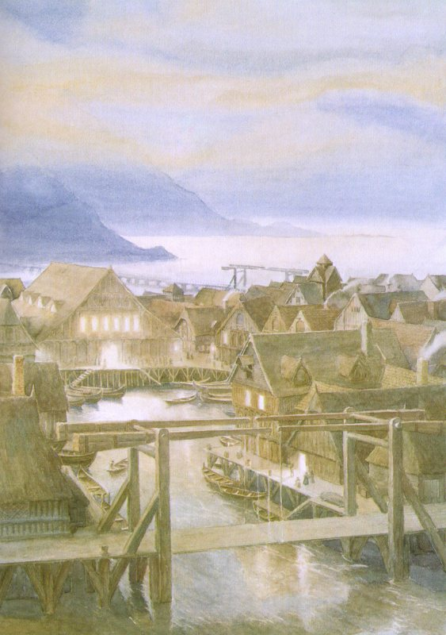

## Kapitel 10: Ein herzlicher Empfang

Der Tag wurde heller und wärmer, während sie weitertrieben. Nach einer Weile floss der Fluss um einen steilen Hügel herum. Dieser reichte links von ihnen bis ans Wasser. Unter seinem felsigen Fuß lag die tiefste Stelle des Flusses. Dort hatte das Wasser gegen die <abbr title="der Felsen, die Felsen — скала; утёс">Felsen</abbr> geschlagen und geblubbert, wie unter einer <abbr title="die Klippe, die Klippen — обрыв; утёс">Klippe</abbr> weit weg vom Meer. Plötzlich endete die <abbr title="die Klippe, die Klippen — обрыв; утёс">Klippe</abbr>. Die Ufer wurden niedrig. Die Bäume hörten auf. Dann <abbr title="sehen (sah, hat gesehen) — увидел">sah</abbr> Bilbo ein Bild:

Das Land öffnete sich weit um ihn herum und war voller Flusswasser. Der Fluss teilte sich in hundert <abbr title="gewunden — извилистый">gewundene</abbr> Arme, die in alle Richtungen liefen. Anderswo blieb das Wasser in <abbr title="der Sumpf, die Sümpfe — болото">Sümpfen</abbr> und Teichen stehen. Überall lagen kleine Inseln darin. Doch mitten hindurch floss immer noch ein starker Strom gleichmäßig weiter. Und weit entfernt ragte der Berg auf! Sein dunkler Kopf steckte in einer zerrissenen Wolke. Seine nächsten Nachbarn im Nordosten waren nicht zu <abbr title="sehen (sah, hat gesehen) — увидел">sehen</abbr>. Auch das wilde Hügelland, das ihn mit ihnen verband, blieb verborgen. Ganz allein erhob er sich und blickte über die <abbr title="der Sumpf, die Sümpfe — болото; трясина">Sümpfe</abbr> zum Wald. Der Lonely Mountain! Bilbo war weit gereist und hatte viele <abbr title="das Abenteuer, die Abenteuer — приключение">Abenteuer</abbr> erlebt, um ihn zu <abbr title="sehen (sah, hat gesehen) — увидел">sehen</abbr>. Nun gefiel ihm sein Anblick überhaupt nicht.

Er hörte den Männern auf dem <abbr title="das Floß, die Flöße — плот">Floß</abbr> zu. Aus einzelnen Bemerkungen setzte er nach und nach ein Bild zusammen. Bald begriff er: Er hatte großes Glück gehabt, den Berg überhaupt zu <abbr title="sehen (sah, hat gesehen) — увидел">sehen</abbr>, selbst aus dieser Entfernung. Seine Gefangenschaft war <abbr title="trostlos — безрадостный; унылый">trostlos</abbr> gewesen, und seine jetzige Lage war unangenehm. Von den armen Zwergen unter ihm wollen wir gar nicht erst reden! Trotzdem hatte er mehr Glück gehabt, als er gedacht hatte.

Die Männer sprachen ständig vom Handel auf den Wasserwegen. Auf dem Fluss gab es immer mehr Verkehr. Denn die Straßen, die aus dem Osten nach Mirkwood führten, verschwanden oder wurden nicht mehr benutzt. Außerdem stritten sich die Menschen vom See und die <abbr title="der Waldelf, die Waldelfen — лесной эльф">Waldelfen</abbr>. Wer sollte den Forest River in Ordnung halten und seine Ufer pflegen?

Dieses Land hatte sich stark verändert, seit die <abbr title="der Zwerg, die Zwerge — гном">Zwerge</abbr> im Berg gewohnt hatten. Die meisten Menschen erinnerten sich an jene Zeit nur noch durch eine sehr undeutliche <abbr title="die Überlieferung, die Überlieferungen — предание">Überlieferung</abbr>. Selbst in den letzten Jahren hatte es Veränderungen gegeben, seit den letzten Nachrichten, die Gandalf bekommen hatte. Große <abbr title="die Überschwemmung, die Überschwemmungen — наводнение">Überschwemmungen</abbr> und Regenfälle hatten die nach Osten fließenden Gewässer <abbr title="anschwellen (schwoll an, ist angeschwollen) — подниматься; набухать">anschwellen</abbr> lassen. Auch ein oder zwei <abbr title="das Erdbeben, die Erdbeben — землетрясение">Erdbeben</abbr> hatte es gegeben. Manche wollten den <abbr title="der Drache, die Drachen — дракон">Drachen</abbr> dafür verantwortlich machen. Wenn sie von ihm sprachen, <abbr title="verfluchen — проклинали">verfluchten</abbr> sie ihn meist und nickten <abbr title="unheilvoll — зловеще">unheilvoll</abbr> in Richtung des Berges.

<abbr title="der Sumpf, die Sümpfe — болото; трясина">Sümpfe</abbr> und <abbr title="das Moor, die Moore — топь; торфяное болото">Moore</abbr> hatten sich auf beiden Seiten immer weiter ausgebreitet. Wege waren verschwunden, und auch mancher Reiter und Wanderer. Sie hatten versucht, die verlorenen Wege durch das sumpfige Land zu finden. Die <abbr title="der Zwerg, die Zwerge — гном">Zwerge</abbr> waren auf Beorns Rat dem Elfenweg durch den Wald gefolgt. Doch dieser Weg endete nun am östlichen Waldrand an einer unsicheren, kaum noch benutzten Stelle. Nur der Fluss bot noch einen sicheren Weg. Er führte vom nördlichen Rand von Mirkwood zu den Ebenen dahinter, über denen die <abbr title="der Schatten, die Schatten — тень">Schatten</abbr> der Berge lagen. Und der König der <abbr title="der Waldelf, die Waldelfen — лесной эльф">Waldelfen</abbr> bewachte den Fluss.

Ihr seht also: Bilbo war am Ende auf dem einzigen brauchbaren Weg angekommen. Herr Baggins zitterte auf den Fässern. Vielleicht hätte ihn eine Nachricht ein wenig getröstet. Gandalf hatte weit entfernt von diesen Veränderungen gehört und war deshalb sehr besorgt. Tatsächlich brachte er gerade seine anderen <abbr title="das Geschäft, die Geschäfte — дело; предприятие">Geschäfte</abbr> zu Ende. Sie gehören nicht in diese Geschichte. Dann wollte er sich auf die Suche nach Thorins Gesellschaft machen. Aber Bilbo wusste nichts davon.

Er wusste nur, dass der Fluss immer und immer und immer weiterzugehen schien. Er hatte Hunger und einen bösen Schnupfen. Außerdem gefiel ihm nicht, wie der Berg ihn scheinbar finster ansah und bedrohte, während er ständig näher kam. Nach einer Weile wandte sich der Fluss jedoch mehr nach Süden. Der Berg rückte wieder in die Ferne. Schließlich, spät am Tag, wurden die Ufer felsig. Der Fluss sammelte seine weit verstreuten Gewässer wieder zu einem tiefen, schnellen Strom. Mit großer Geschwindigkeit wurden sie weitergetragen.

Die Sonne war untergegangen, als der Waldfluss wieder einen weiten Bogen nach Osten machte und in den Long Lake stürzte. Seine <abbr title="die Mündung, die Mündungen — устье">Mündung</abbr> war breit. Auf beiden Seiten standen steinerne <abbr title="der Felsen, die Felsen — скала; утёс">Felsen</abbr> wie Tore. An ihrem Fuß häuften sich <abbr title="der Kiesel, die Kiesel — галька; небольшой округлый камень">Kiesel</abbr>. Der Long Lake! Bilbo hatte sich nie vorgestellt, dass ein Gewässer außer dem Meer so groß aussehen konnte. Der See war so breit, dass das andere Ufer klein und fern erschien. Aber er war so lang, dass man sein nördliches Ende überhaupt nicht <abbr title="sehen (sah, hat gesehen) — увидел">sah</abbr>. Dieses Ende zeigte zum Berg.

Nur von der Karte wusste Bilbo, was weit dort oben lag, wo bereits die Sterne des Großen Wagens funkelten. Dort kam der River Running von Dale herunter und floss in den See. Zusammen mit dem Forest River füllte er ein tiefes Becken mit Wasser. Es musste früher einmal ein großes, tiefes Tal aus <abbr title="der Felsen, die Felsen — скала; утёс">Felsen</abbr> gewesen sein. Am südlichen Ende strömte das vereinte Wasser über hohe <abbr title="der Wasserfall, die Wasserfälle — водопад">Wasserfälle</abbr> hinaus. Eilig lief es in unbekannte Länder weiter. In der stillen Abendluft hörte man die Fälle wie ein fernes Brüllen.

Nicht weit von der <abbr title="die Mündung, die Mündungen — устье">Mündung</abbr> des Forest River lag die seltsame Stadt. Bilbo hatte die <abbr title="der Elf, die Elfen — эльф">Elfen</abbr> in den Kellern des Königs davon sprechen hören. Sie stand nicht am Ufer, obwohl es dort einige Hütten und Gebäude gab. Die Stadt lag mitten draußen auf dem See. Ein felsiger <abbr title="der Vorsprung, die Vorsprünge — выступ">Vorsprung</abbr> schützte sie vor den Wasserwirbeln des einströmenden Flusses und bildete eine ruhige <abbr title="die Bucht, die Buchten — бухта">Bucht</abbr>. Eine große Holzbrücke führte hinaus zur Stadt. Diese geschäftige Holzstadt stand auf riesigen Pfählen aus Waldbäumen. Hier wohnten keine <abbr title="der Elf, die Elfen — эльф">Elfen</abbr>, sondern Menschen. Sie wagten es noch immer, im <abbr title="der Schatten, die Schatten — тень">Schatten</abbr> des fernen Drachenberges zu leben.

Noch immer <abbr title="gehen (ging, ist gegangen) — шёл">ging</abbr> es ihnen durch den Handel gut. Waren kamen auf dem großen Fluss aus dem Süden herauf. Man fuhr sie auf Wagen an den Wasserfällen vorbei zur Stadt. Doch in den großen alten Zeiten waren die Menschen hier reich und mächtig gewesen. Damals hatte im Norden auch Dale in Reichtum und Glück gelebt. Ganze <abbr title="die Flotte, die Flotten — флот">Flotten</abbr> von Booten waren über das Wasser gefahren. Manche waren mit Gold beladen gewesen, andere mit Kriegern in <abbr title="die Rüstung, die Rüstungen — доспехи">Rüstungen</abbr>. Es hatte Kriege und große Taten gegeben. Jetzt lebten sie nur noch in Geschichten weiter. Wenn das Wasser bei einer <abbr title="die Dürre, die Dürren — засуха">Dürre</abbr> sank, <abbr title="sehen (sah, hat gesehen) — увидел">sah</abbr> man am Ufer noch die faulenden <abbr title="der Pfahl, die Pfähle — кол; заострённый столб">Pfähle</abbr> einer größeren Stadt.

Aber die Menschen erinnerten sich nur wenig an all das. Einige sangen noch alte Lieder von den Zwergenkönigen des Berges. Sie sangen von Thror und Thrain aus Durins Geschlecht, von der Ankunft des <abbr title="der Drache, die Drachen — дракон">Drachen</abbr> und dem Untergang der Herren von Dale. Manche sangen auch, dass Thror und Thrain eines Tages zurückkommen würden. Dann würde Gold in Strömen durch die Tore des Berges fließen. Das ganze Land wäre voller neuer Lieder und neuen Lachens. Doch diese schöne alte Geschichte beeinflusste ihre täglichen <abbr title="das Geschäft, die Geschäfte — дело; предприятие">Geschäfte</abbr> kaum.

Sobald das Fassfloß sichtbar wurde, ruderten Boote zwischen den Pfählen der Stadt hervor. Stimmen begrüßten die Männer, die das <abbr title="das Floß, die Flöße — плот">Floß</abbr> lenkten. Dann warf man <abbr title="das Seil, die Seile — верёвка">Seile</abbr> und zog an den <abbr title="das Ruder, die Ruder — весло">Rudern</abbr>. Bald wurde das <abbr title="das Floß, die Flöße — плот">Floß</abbr> aus der <abbr title="die Strömung, die Strömungen — течение">Strömung</abbr> des Forest River gezogen. Man <abbr title="schleppen — тащить; буксировать">schleppte</abbr> es um den hohen Felsrücken herum in die kleine <abbr title="die Bucht, die Buchten — бухта">Bucht</abbr> von Lake-town. Dort machte man es fest, nahe beim landseitigen Ende der großen Brücke. Bald würden Menschen aus dem Süden kommen und einige <abbr title="das Fass, die Fässer — бочонок; бочка">Fässer</abbr> mitnehmen. Andere würden sie mit mitgebrachten Waren füllen. Diese sollten den Fluss hinauf zur Heimat der <abbr title="der Waldelf, die Waldelfen — лесной эльф">Waldelfen</abbr> gebracht werden. Inzwischen ließ man die <abbr title="das Fass, die Fässer — бочонок; бочка">Fässer</abbr> im Wasser. Die <abbr title="der Elf, die Elfen — эльф">Elfen</abbr> vom <abbr title="das Floß, die Flöße — плот">Floß</abbr> und die Bootsleute gingen zum Festessen nach Lake-town.

Sie hätten gestaunt, wenn sie gesehen hätten, was nach ihrem Fortgehen unten am Ufer geschah, als die Nacht hereinbrach. Zuerst schnitt Bilbo ein <abbr title="das Fass, die Fässer — бочонок; бочка">Fass</abbr> los, schob es ans Ufer und öffnete es. Von innen kam <abbr title="stöhnen — стонать">Stöhnen</abbr>, und ein höchst unglücklicher <abbr title="der Zwerg, die Zwerge — гном">Zwerg</abbr> kroch heraus. Nasses <abbr title="das Stroh — солома">Stroh</abbr> hing in seinem verklebten <abbr title="der Bart, die Bärte — борода">Bart</abbr>. Alles tat ihm weh, seine Glieder waren steif, und überall hatte er <abbr title="der blaue Fleck, die blauen Flecken — синяк">blaue Flecken</abbr>. Er war so stark hin und her geschlagen worden, dass er kaum stehen konnte. Nur mit Mühe <abbr title="stolpern — споткнуться">stolperte</abbr> er durchs flache Wasser und legte sich stöhnend ans Ufer. Er <abbr title="sehen (sah, hat gesehen) — увидел">sah</abbr> <abbr title="ausgehungert — изголодавшийся">ausgehungert</abbr> und wild aus. So sieht ein Hund aus, den man eine Woche lang angekettet in seiner Hütte vergessen hat.

Es war Thorin, aber das konnte man nur an seiner goldenen <abbr title="die Kette, die Ketten — цепь">Kette</abbr> erkennen. Auch die Farbe seiner himmelblauen <abbr title="die Kapuze, die Kapuzen — капюшон">Kapuze</abbr> verriet ihn. Diese war jetzt schmutzig und zerrissen, und ihr silberner <abbr title="der Fadenbüschel, die Fadenbüschel — кисточка из нитей">Fadenbüschel</abbr> glänzte nicht mehr. Es dauerte eine Weile, bis er auch nur höflich zu dem Hobbit sein konnte.

— Nun, lebst du, oder bist du tot? — fragte Bilbo ziemlich ärgerlich.

Vielleicht hatte er vergessen, dass er wenigstens eine gute Mahlzeit mehr als die <abbr title="der Zwerg, die Zwerge — гном">Zwerge</abbr> bekommen hatte. Außerdem hatte er Arme und Beine benutzen können. Von der viel größeren Menge Luft ganz zu schweigen.

— Bist du noch im <abbr title="das Gefängnis, die Gefängnisse — тюрьма; темница">Gefängnis</abbr>, oder bist du frei? Wenn du etwas essen willst und dieses dumme <abbr title="das Abenteuer, die Abenteuer — приключение">Abenteuer</abbr> fortsetzen möchtest, dann tu etwas! Es ist schließlich dein <abbr title="das Abenteuer, die Abenteuer — приключение">Abenteuer</abbr> und nicht meines. Klopf dir auf die Arme, reib dir die Beine und hilf mir, die anderen herauszuholen! Solange wir noch die Gelegenheit haben!

Thorin <abbr title="sehen (sah, hat gesehen) — увидел">sah</abbr> natürlich ein, dass dies <abbr title="vernünftig — разумный">vernünftig</abbr> war. Nachdem er noch ein paarmal gestöhnt hatte, stand er auf und half dem Hobbit, so gut er konnte. Im Dunkeln bewegten sie sich <abbr title="mühsam — трудный; утомительный">mühsam</abbr> durchs kalte Wasser. Die richtigen <abbr title="das Fass, die Fässer — бочонок; бочка">Fässer</abbr> zu finden war eine schwierige und höchst unangenehme Arbeit. Sie klopften von außen und riefen. So fanden sie nur etwa sechs <abbr title="der Zwerg, die Zwerge — гном">Zwerge</abbr>, die antworten konnten. Sie packten sie aus und halfen ihnen ans Ufer. Dort saßen oder lagen die <abbr title="der Zwerg, die Zwerge — гном">Zwerge</abbr>, <abbr title="murmeln — бормотать">murmelten</abbr> und <abbr title="stöhnen — стонать">stöhnten</abbr>. Sie waren völlig durchnässt, voller blauer Flecken, und ihre Glieder waren schmerzhaft verkrampft. Noch begriffen sie kaum, dass sie frei waren. Auch richtig dankbar konnten sie noch nicht sein.

Dwalin und Balin gehörten zu den Unglücklichsten. Es hatte keinen Sinn, sie um Hilfe zu bitten. Bifur und Bofur waren weniger zerschlagen und trockener. Doch sie legten sich hin und wollten nichts tun. Fili und Kili dagegen waren jung — für <abbr title="der Zwerg, die Zwerge — гном">Zwerge</abbr>. Außerdem hatte man sie ordentlich in kleinere <abbr title="das Fass, die Fässer — бочонок; бочка">Fässer</abbr> gepackt, mit viel <abbr title="das Stroh — солома">Stroh</abbr>. Sie kamen mehr oder weniger lächelnd heraus. Sie hatten nur ein oder zwei blaue Flecken. Ihre steifen Glieder wurden bald wieder beweglich.

— Hoffentlich rieche ich nie wieder Äpfel! — sagte Fili. — Mein <abbr title="das Fass, die Fässer — бочонок; бочка">Fass</abbr> war voll von diesem Geruch. Immer nur Äpfel riechen, während man sich kaum bewegen kann und vor Kälte und Hunger krank ist! Das macht einen <abbr title="verrückt — сумасбродный; сумасшедший">verrückt</abbr>. Jetzt könnte ich stundenlang alles essen, was es auf der weiten Welt gibt — nur keinen Apfel!

Fili und Kili halfen gern. Zusammen mit ihnen fanden Thorin und Bilbo schließlich den Rest der Gesellschaft und holten alle heraus. Der arme dicke Bombur schlief oder war <abbr title="bewusstlos — без сознания">bewusstlos</abbr>. Dori, Nori, Ori, Oin und Gloin waren voller Wasser und schienen nur halb lebendig. Man musste sie einzeln tragen und hilflos am Ufer hinlegen.

— Nun! Da wären wir! — sagte Thorin. — Wir sollten wohl unseren Glückssternen und Herrn Baggins danken. Sicher hat er das Recht, es zu erwarten. Allerdings wünsche ich, er hätte uns eine bequemere Reise verschaffen können. Trotzdem: Wieder ganz zu deinen Diensten, Herr Baggins! Wenn wir gegessen haben und erholt sind, werden wir gewiss richtig dankbar sein. Aber inzwischen: Was kommt als Nächstes?

— Ich schlage Lake-town vor, — sagte Bilbo. — Was gibt es sonst?

Natürlich konnte niemand etwas anderes vorschlagen. Deshalb ließen Thorin, Fili, Kili und der Hobbit die anderen zurück. Am Ufer entlang gingen sie zur großen Brücke. An ihrem Ende standen <abbr title="die Wache, die Wachen — часовой; стражник">Wachen</abbr>. Doch sie passten nicht besonders gut auf. Schon lange hatte es keinen wirklichen Grund zur Vorsicht mehr gegeben. Abgesehen von gelegentlichem Streit über <abbr title="der Flusszoll, die Flusszölle — речная пошлина">Flusszölle</abbr> waren sie mit den <abbr title="der Waldelf, die Waldelfen — лесной эльф">Waldelfen</abbr> befreundet. Andere Völker lebten weit entfernt. Einige jüngere Menschen in der Stadt bezweifelten offen, dass überhaupt ein <abbr title="der Drache, die Drachen — дракон">Drache</abbr> im Berg lebte. Sie lachten über die alten Männer mit grauen <abbr title="der Bart, die Bärte — борода">Bärten</abbr> und die alten Frauen. Diese behaupteten, den <abbr title="der Drache, die Drachen — дракон">Drachen</abbr> in ihrer Jugend am Himmel fliegen gesehen zu haben.

So ist es nicht erstaunlich, dass die <abbr title="die Wache, die Wachen — часовой; стражник">Wachen</abbr> in ihrer Hütte am Feuer saßen, tranken und lachten. Sie hörten weder das Auspacken der <abbr title="der Zwerg, die Zwerge — гном">Zwerge</abbr> noch die Schritte der vier <abbr title="der Kundschafter, die Kundschafter — разведчик">Kundschafter</abbr>. Sie staunten ungeheuer, als Thorin Oakenshield durch die Tür trat.

— Wer seid ihr, und was wollt ihr? — riefen sie.

Sie sprangen auf und suchten hastig nach ihren <abbr title="die Waffe, die Waffen — оружие">Waffen</abbr>.

— Thorin, Sohn von Thrain, Sohn von Thror, König unter dem Berg! — sagte der <abbr title="der Zwerg, die Zwerge — гном">Zwerg</abbr> laut.

Und so <abbr title="sehen (sah, hat gesehen) — увидел">sah</abbr> er auch aus, trotz seiner zerrissenen Kleidung und der verklebten <abbr title="die Kapuze, die Kapuzen — капюшон">Kapuze</abbr>. Gold glänzte an seinem Hals und um seine Hüften. Seine Augen waren dunkel und tief.

— Ich bin zurückgekommen. Ich möchte den Herrn eurer Stadt <abbr title="sehen (sah, hat gesehen) — увидел">sehen</abbr>!

Nun entstand gewaltige Aufregung. Einige besonders dumme <abbr title="die Wache, die Wachen — часовой; стражник">Wachen</abbr> rannten aus der Hütte. Sie schienen zu erwarten, dass der Berg noch in dieser Nacht golden würde. Und alles Wasser im See sollte wohl sofort gelb werden. Der <abbr title="der Hauptmann, die Hauptleute — капитан; командир">Hauptmann</abbr> der <abbr title="die Wache, die Wachen — часовой; стражник">Wache</abbr> trat vor.

— Und wer sind diese hier? — fragte er und zeigte auf Fili, Kili und Bilbo.

— Die Söhne der Tochter meines Vaters, — antwortete Thorin. — Fili und Kili aus Durins Geschlecht. Und Herr Baggins, der mit uns aus dem <abbr title="die Weste, die Westen — жилет">Westen</abbr> gereist ist.

— Wenn ihr in Frieden kommt, legt eure <abbr title="die Waffe, die Waffen — оружие">Waffen</abbr> nieder! — sagte der <abbr title="der Hauptmann, die Hauptleute — капитан; командир">Hauptmann</abbr>.

— Wir haben keine, — sagte Thorin.

Das stimmte durchaus. Die <abbr title="der Waldelf, die Waldelfen — лесной эльф">Waldelfen</abbr> hatten ihnen ihre Messer genommen und auch das große <abbr title="das Schwert, die Schwerter — меч">Schwert</abbr> Orcrist. Bilbo hatte sein kurzes <abbr title="das Schwert, die Schwerter — меч">Schwert</abbr> wie gewöhnlich versteckt. Aber davon sagte er nichts.

— Wir brauchen keine <abbr title="die Waffe, die Waffen — оружие">Waffen</abbr>. Endlich kehren wir zu dem zurück, was uns gehört, wie es seit alters versprochen wurde. Außerdem könnten wir gegen so viele nicht kämpfen. Bringt uns zu eurem Herrn!

— Er ist beim Festessen, — sagte der <abbr title="der Hauptmann, die Hauptleute — капитан; командир">Hauptmann</abbr>.

— Dann habt ihr erst recht einen Grund, uns zu ihm zu bringen! — fiel Fili ein.

Diese <abbr title="die Förmlichkeit, die Förmlichkeiten — формальность; церемония">Förmlichkeiten</abbr> machten ihn langsam ungeduldig.

— Nach unserem langen Weg sind wir <abbr title="erschöpft — изнурённый">erschöpft</abbr> und <abbr title="ausgehungert — изголодавшийся">ausgehungert</abbr>. Außerdem haben wir kranke Kameraden. Beeilt euch jetzt, und spart euch weitere Worte! Sonst hat euer Herr vielleicht etwas mit euch zu besprechen.

— Dann folgt mir, — sagte der <abbr title="der Hauptmann, die Hauptleute — капитан; командир">Hauptmann</abbr>.

Mit sechs Männern um sie herum führte er sie über die Brücke, durch die Tore und zum Marktplatz der Stadt. Dieser war ein weiter Kreis aus ruhigem Wasser. Ringsum standen die hohen <abbr title="der Pfahl, die Pfähle — кол; заострённый столб">Pfähle</abbr>, auf denen die größeren Häuser gebaut waren. Dazwischen lagen lange hölzerne <abbr title="die Kaianlage, die Kaianlagen — причал; набережная">Kaianlagen</abbr>. Viele Treppen und Leitern führten von ihnen hinunter zum Wasser. Aus einer großen Halle schienen zahlreiche Lichter. Auch viele Stimmen waren zu hören. Sie traten durch die Türen und standen blinzelnd im Licht. Vor ihnen standen lange Tische voller Menschen.

— Ich bin Thorin, Sohn von Thrain, Sohn von Thror, König unter dem Berg! Ich kehre zurück! — rief Thorin laut von der Tür her.

Der <abbr title="der Hauptmann, die Hauptleute — капитан; командир">Hauptmann</abbr> hatte noch kein Wort sagen können.

Alle sprangen auf. Der Herr der Stadt erhob sich hastig von seinem großen Stuhl. Doch niemand stand erstaunter auf als die <abbr title="der Elf, die Elfen — эльф">Elfen</abbr> vom <abbr title="das Floß, die Flöße — плот">Floß</abbr>. Sie saßen am unteren Ende der Halle. Nun drängten sie nach vorn vor den Tisch des Stadtherrn und riefen:

— Das sind entflohene <abbr title="der Gefangene, die Gefangenen — пленник">Gefangene</abbr> unseres Königs! Herumziehende <abbr title="der Landstreicher, die Landstreicher — бродяга">Landstreicher</abbr> von Zwergen, die keine anständige Erklärung für ihr Verhalten geben konnten! Sie schlichen durch die Wälder und <abbr title="belästigen — докучать; приставать">belästigten</abbr> unser Volk!

— Ist das wahr? — fragte der Stadtherr.

Tatsächlich hielt er das für viel wahrscheinlicher als die Rückkehr des Königs unter dem Berg. Falls es einen solchen König überhaupt jemals gegeben hatte.

— Es ist wahr, dass der Elvenking uns zu Unrecht überfallen hat, — antwortete Thorin. — Wir waren auf dem Weg zurück in unser eigenes Land. Er hat uns ohne Grund gefangen gehalten. Doch weder Schloss noch <abbr title="der Riegel, die Riegel — засов">Riegel</abbr> kann die Heimkehr verhindern, die seit alters versprochen wurde. Auch gehört diese Stadt nicht zum Reich der <abbr title="der Waldelf, die Waldelfen — лесной эльф">Waldelfen</abbr>. Ich spreche mit dem Herrn der Stadt der Menschen vom See. Nicht mit den Floßleuten des Königs.

Der Stadtherr <abbr title="zögern — медлить; колебаться">zögerte</abbr> und schaute von einem zum anderen. Der Elvenking war in dieser Gegend sehr mächtig. Der Stadtherr wollte keine <abbr title="die Feindschaft, die Feindschaften — вражда">Feindschaft</abbr> mit ihm. Auch hielt er nicht viel von alten Liedern. Seine Gedanken galten dem Handel und den Zöllen, den Warenladungen und dem Gold. Dieser Gewohnheit verdankte er seine Stellung.

Andere Menschen dachten jedoch anders. Schon bald wurde die Sache ohne ihn entschieden. Von den Türen der Halle aus hatte sich die Nachricht wie Feuer über die ganze Stadt verbreitet. Die Menschen riefen in der Halle und draußen. Über die <abbr title="die Kaianlage, die Kaianlagen — причал; набережная">Kaianlagen</abbr> liefen dicht gedrängt viele eilige Füße. Einige begannen, Teile alter Lieder von der Rückkehr des Königs unter dem Berg zu singen. Dass Thrors Enkel zurückgekehrt war und nicht Thror selbst, störte sie überhaupt nicht. Andere stimmten ein. Laut und hoch rollte das Lied über den See.

> Der König unter Bergen,  
> der König im <abbr title="hauen (hieb, hat gehauen) — рубить; высекать">gehauenen</abbr> Stein,  
> der Herr der Silberquellen  
> erhält, was er besaß!  

> Man wird die Krone heben,  
> die <abbr title="die Harfe, die Harfen — арфа">Harfe</abbr> neu <abbr title="bespannen — натягивать струны">bespannen</abbr>;  
> die Hallen werden golden klingen,  
> singt man die alten Lieder dann.  

> Auf Bergen werden Wälder wehen,  
> im Sonnenlicht das Gras;  
> sein Reichtum strömt aus <abbr title="die Quelle, die Quellen — родник">Quellen</abbr>,  
> und Flüsse fließen golden.  

> Die Bäche fließen freudig,  
> die Seen glühn im Schein;  
> Leid, Kummer müssen schwinden,  
> kehrt unser Bergkönig heim!  

So sangen sie, oder ungefähr so. Nur war das Lied noch viel länger. Dazu kamen laute Rufe und die Musik von <abbr title="die Harfe, die Harfen — арфа">Harfen</abbr> und <abbr title="die Geige, die Geigen — скрипка">Geigen</abbr>. Selbst der älteste Großvater erinnerte sich nicht an eine solche Aufregung in der Stadt. Die <abbr title="der Waldelf, die Waldelfen — лесной эльф">Waldelfen</abbr> selbst wunderten sich nun sehr und bekamen sogar Angst. Natürlich wussten sie nicht, wie Thorin entkommen war. Sie begannen zu glauben, dass ihr König einen schweren Fehler gemacht hatte.

Der Stadtherr <abbr title="sehen (sah, hat gesehen) — увидел">sah</abbr> dagegen, dass ihm keine andere Wahl blieb. Zumindest für den Augenblick musste er dem allgemeinen <abbr title="der Jubel — ликование">Jubel</abbr> nachgeben. Er musste so tun, als würde er glauben, dass Thorin wirklich der war, der er zu sein behauptete. Deshalb überließ er ihm seinen eigenen großen Stuhl. Fili und Kili setzte er auf Ehrenplätze neben ihn. Selbst Bilbo bekam einen Platz am oberen Tisch. Im allgemeinen Durcheinander fragte niemand, welche Rolle er eigentlich spielte. Kein Lied hatte ihn auch nur auf die undeutlichste Weise erwähnt.

Bald darauf brachte man auch die anderen <abbr title="der Zwerg, die Zwerge — гном">Zwerge</abbr> in die Stadt. Überall empfing man sie mit erstaunlicher <abbr title="die Begeisterung — восторг; воодушевление">Begeisterung</abbr>. Man behandelte ihre Beschwerden, gab ihnen zu essen, brachte sie unter und <abbr title="verwöhnen — баловать">verwöhnte</abbr> sie. Alles geschah auf die angenehmste Weise und zu ihrer größten Zufriedenheit. Ein großes Haus wurde Thorin und seiner Gesellschaft überlassen. Boote und Ruderer standen ihnen zur Verfügung. Draußen saßen Menschenmengen und sangen den ganzen Tag Lieder. Sobald ein <abbr title="der Zwerg, die Zwerge — гном">Zwerg</abbr> auch nur die Nase zeigte, jubelten sie.

Einige Lieder waren alt. Andere aber waren ganz neu. Voller <abbr title="die Zuversicht — уверенность; надежда">Zuversicht</abbr> handelten sie vom plötzlichen Tod des <abbr title="der Drache, die Drachen — дракон">Drachen</abbr>. Sie besangen auch Boote voller kostbarer Geschenke, die den Fluss hinab nach Lake-town kommen würden. Der Stadtherr hatte die Menschen besonders zu solchen Liedern angeregt. Den Zwergen gefielen sie nicht besonders. Doch zunächst waren sie sehr zufrieden und wurden schnell wieder dick und kräftig.

Schon nach einer Woche waren sie völlig erholt. Sie trugen schöne Kleidung in ihren eigenen Farben. Ihre <abbr title="der Bart, die Bärte — борода">Bärte</abbr> waren gekämmt und ordentlich geschnitten, und sie gingen mit stolzen Schritten. Thorin <abbr title="sehen (sah, hat gesehen) — увидел">sah</abbr> aus und <abbr title="gehen (ging, ist gegangen) — шёл">ging</abbr> umher, als hätte er sein Königreich schon zurückgewonnen und Smaug in kleine Stücke gehackt.

Wie Thorin gesagt hatte, wuchs die <abbr title="die Zuneigung — расположение; привязанность">Zuneigung</abbr> der <abbr title="der Zwerg, die Zwerge — гном">Zwerge</abbr> zu dem kleinen Hobbit nun jeden Tag. Kein <abbr title="stöhnen — стонать">Stöhnen</abbr> und kein Brummen war mehr zu hören. Sie tranken auf seine Gesundheit, klopften ihm auf den Rücken und kümmerten sich sehr um ihn. Das war auch gut so, denn er war nicht besonders fröhlich. Er hatte den Anblick des Berges nicht vergessen und auch nicht den Gedanken an den <abbr title="der Drache, die Drachen — дракон">Drachen</abbr>. Außerdem hatte er einen schrecklichen Schnupfen. Drei Tage lang nieste und hustete er und konnte nicht hinausgehen. Selbst danach beschränkten sich seine Reden bei Festessen auf:

— Vielen Dang!

Inzwischen waren die <abbr title="der Waldelf, die Waldelfen — лесной эльф">Waldelfen</abbr> mit ihren Warenladungen den Forest River hinauf zurückgefahren. Im <abbr title="der Palast, die Paläste — дворец">Palast</abbr> des Königs herrschte große Aufregung. Ich habe nie gehört, was mit dem obersten Wächter und dem <abbr title="der Haushofmeister, die Haushofmeister — дворецкий">Haushofmeister</abbr> geschah. Solange die <abbr title="der Zwerg, die Zwerge — гном">Zwerge</abbr> in Lake-town waren, sagte natürlich niemand etwas über Schlüssel oder <abbr title="das Fass, die Fässer — бочонок; бочка">Fässer</abbr>. Bilbo achtete sorgfältig darauf, niemals <abbr title="unsichtbar — невидимый">unsichtbar</abbr> zu werden. Trotzdem vermutete man wohl mehr, als man tatsächlich wusste. Herr Baggins blieb allerdings ohne <abbr title="der Zweifel, die Zweifel — сомнение">Zweifel</abbr> ein kleines <abbr title="das Rätsel, die Rätsel — загадка">Rätsel</abbr>. Jedenfalls kannte der König jetzt das Ziel der <abbr title="der Zwerg, die Zwerge — гном">Zwerge</abbr>, oder er glaubte es zu kennen. Er sagte zu sich selbst:

— Sehr gut! Wir werden <abbr title="sehen (sah, hat gesehen) — увидел">sehen</abbr>! Kein <abbr title="der Schatz, die Schätze — клад; сокровище">Schatz</abbr> kommt durch Mirkwood zurück, ohne dass ich dabei mitzureden habe. Aber ich erwarte, dass sie alle ein böses Ende nehmen. Und das geschieht ihnen recht!

Er jedenfalls glaubte nicht daran, dass <abbr title="der Zwerg, die Zwerge — гном">Zwerge</abbr> gegen <abbr title="der Drache, die Drachen — дракон">Drachen</abbr> wie Smaug kämpfen und sie töten konnten. Er hatte den starken <abbr title="der Verdacht — подозрение">Verdacht</abbr>, dass sie einen <abbr title="der Einbruch, die Einbrüche — взлом; кража со взломом">Einbruch</abbr> oder etwas Ähnliches versuchen wollten. Daran sieht man, dass er ein weiser <abbr title="der Elf, die Elfen — эльф">Elf</abbr> war, weiser als die Menschen in der Stadt. Allerdings hatte er nicht ganz recht, wie wir am Ende <abbr title="sehen (sah, hat gesehen) — увидел">sehen</abbr> werden. Er schickte seine <abbr title="der Spion, die Spione — шпион">Spione</abbr> an die Ufer des Sees. Nach Norden sollten sie so weit zum Berg <abbr title="gehen (ging, ist gegangen) — шёл">gehen</abbr>, wie sie es wagen würden. Dann wartete er.

Nach zwei Wochen begann Thorin an die Abreise zu denken. Jetzt musste er sich Hilfe sichern, solange die <abbr title="die Begeisterung — восторг; воодушевление">Begeisterung</abbr> in der Stadt noch anhielt. Er durfte nicht so lange warten, bis alle wieder <abbr title="gleichgültig — равнодушный">gleichgültig</abbr> wurden. Deshalb sprach er mit dem Stadtherrn und seinen <abbr title="der Ratgeber, die Ratgeber — советник">Ratgebern</abbr>. Er sagte ihnen, dass er und seine Gesellschaft bald zum Berg weiterziehen müssten.

Nun war der Stadtherr zum ersten Mal <abbr title="überrascht — удивлённый">überrascht</abbr> und ein wenig erschrocken. Er fragte sich, ob Thorin doch wirklich ein <abbr title="der Nachkomme, die Nachkommen — потомок">Nachkomme</abbr> der alten Könige war. Nie hatte er gedacht, dass die <abbr title="der Zwerg, die Zwerge — гном">Zwerge</abbr> tatsächlich wagen würden, sich Smaug zu nähern. Er hielt sie für <abbr title="der Betrüger, die Betrüger — мошенник; самозванец">Betrüger</abbr>. Früher oder später würde man sie entdecken und hinauswerfen, hatte er geglaubt. Er irrte sich. Natürlich war Thorin wirklich der Enkel des Königs unter dem Berg. Und niemand weiß, was ein <abbr title="der Zwerg, die Zwerge — гном">Zwerg</abbr> alles wagen und tun wird, um sich zu rächen oder sein Eigentum zurückzugewinnen.

Aber der Stadtherr ließ sie durchaus gern <abbr title="gehen (ging, ist gegangen) — шёл">gehen</abbr>. Ihr <abbr title="der Unterhalt — содержание; расходы на проживание">Unterhalt</abbr> kostete viel Geld. Ihre Ankunft hatte das Leben in der Stadt in einen langen Feiertag verwandelt. Alle <abbr title="das Geschäft, die Geschäfte — дело; предприятие">Geschäfte</abbr> standen still.

„Sollen sie doch <abbr title="gehen (ging, ist gegangen) — шёл">gehen</abbr> und Smaug ärgern und <abbr title="sehen (sah, hat gesehen) — увидел">sehen</abbr>, wie er sie empfängt!“, dachte er.

Was er sagte, war dagegen:

— Gewiss, o Thorin, Sohn von Thrain, Sohn von Thror! Ihr müsst fordern, was euch gehört. Die seit alters versprochene Stunde ist nah. Jede Hilfe, die wir anbieten können, soll die eure sein. Und wenn Ihr Euer Königreich zurückgewonnen habt, vertrauen wir auf Eure <abbr title="die Dankbarkeit — благодарность">Dankbarkeit</abbr>.

So verließen eines Tages drei große Boote Lake-town. Der Herbst war schon weit fortgeschritten, die Winde waren kalt, und die Blätter fielen rasch. In den Booten saßen Ruderer, <abbr title="der Zwerg, die Zwerge — гном">Zwerge</abbr> und Herr Baggins. Dazu kamen viele <abbr title="der Vorrat, die Vorräte — запас">Vorräte</abbr>. Pferde und Ponys hatte man auf Umwegen vorausgeschickt. Sie sollten die Reisenden an der vereinbarten Stelle treffen, wo diese an Land <abbr title="gehen (ging, ist gegangen) — шёл">gehen</abbr> würden. Der Stadtherr und seine <abbr title="der Ratgeber, die Ratgeber — советчик">Ratgeber</abbr> verabschiedeten sie von den großen Stufen des Rathauses, die zum See hinunterführten. Auf den <abbr title="die Kaianlage, die Kaianlagen — причал; набережная">Kaianlagen</abbr> und aus den Fenstern sangen die Menschen. Die weißen <abbr title="das Ruder, die Ruder — весло">Ruder</abbr> tauchten ein und ließen das Wasser spritzen. Fort <abbr title="gehen (ging, ist gegangen) — шёл">ging</abbr> es nach Norden über den See, auf die letzte Etappe ihrer langen Reise. Die einzige Person, die ganz und gar unglücklich war, war Bilbo.

---

### Neue und schwierige Wörter

- **der Felsen, die Felsen** — скала; утёс *(Wiederholung)*
- **die Klippe, die Klippen** — обрыв; утёс *(neu)*
- **sehen (sah, hat gesehen)** — увидел *(Wiederholung)*
- **gewunden** — извилистый *(neu)*
- **der Sumpf, die Sümpfe** — болото *(Wiederholung)*
- **das Abenteuer, die Abenteuer** — приключение *(Wiederholung)*
- **das Floß, die Flöße** — плот *(Wiederholung)*
- **trostlos** — безрадостный; унылый *(neu)*
- **der Waldelf, die Waldelfen** — лесной эльф *(Wiederholung)*
- **der Zwerg, die Zwerge** — гном *(Wiederholung)*
- **die Überlieferung, die Überlieferungen** — предание *(Wiederholung)*
- **die Überschwemmung, die Überschwemmungen** — наводнение *(neu)*
- **anschwellen (schwoll an, ist angeschwollen)** — подниматься; набухать *(neu)*
- **das Erdbeben, die Erdbeben** — землетрясение *(neu)*
- **der Drache, die Drachen** — дракон *(Wiederholung)*
- **verfluchen** — проклинали *(Wiederholung)*
- **unheilvoll** — зловеще *(neu)*
- **das Moor, die Moore** — топь; торфяное болото *(neu)*
- **der Schatten, die Schatten** — тень *(Wiederholung)*
- **das Geschäft, die Geschäfte** — дело; предприятие *(Wiederholung)*
- **die Mündung, die Mündungen** — устье *(neu)*
- **der Kiesel, die Kiesel** — галька; небольшой округлый камень *(Wiederholung)*
- **der Wasserfall, die Wasserfälle** — водопад *(Wiederholung)*
- **der Elf, die Elfen** — эльф *(Wiederholung)*
- **der Vorsprung, die Vorsprünge** — выступ *(neu)*
- **die Bucht, die Buchten** — бухта *(Wiederholung)*
- **gehen (ging, ist gegangen)** — шёл *(Wiederholung)*
- **die Flotte, die Flotten** — флот *(neu)*
- **die Rüstung, die Rüstungen** — доспехи *(neu)*
- **die Dürre, die Dürren** — засуха *(neu)*
- **der Pfahl, die Pfähle** — кол; заострённый столб *(Wiederholung)*
- **das Seil, die Seile** — верёвка *(Wiederholung)*
- **das Ruder, die Ruder** — весло *(Wiederholung)*
- **die Strömung, die Strömungen** — течение *(Wiederholung)*
- **schleppen** — тащить; буксировать *(neu)*
- **das Fass, die Fässer** — бочонок; бочка *(Wiederholung)*
- **stöhnen** — стонать *(neu)*
- **das Stroh** — солома *(Wiederholung)*
- **der Bart, die Bärte** — борода *(Wiederholung)*
- **der blaue Fleck, die blauen Flecken** — синяк *(Wiederholung)*
- **stolpern** — споткнуться *(Wiederholung)*
- **ausgehungert** — изголодавшийся *(neu)*
- **die Kette, die Ketten** — цепь *(Wiederholung)*
- **die Kapuze, die Kapuzen** — капюшон *(Wiederholung)*
- **der Fadenbüschel, die Fadenbüschel** — кисточка из нитей *(Wiederholung)*
- **das Gefängnis, die Gefängnisse** — тюрьма; темница *(Wiederholung)*
- **vernünftig** — разумный *(Wiederholung)*
- **mühsam** — трудный; утомительный *(Wiederholung)*
- **murmeln** — бормотать *(Wiederholung)*
- **verrückt** — сумасбродный; сумасшедший *(Wiederholung)*
- **bewusstlos** — без сознания *(Wiederholung)*
- **die Wache, die Wachen** — часовой; стражник *(Wiederholung)*
- **der Flusszoll, die Flusszölle** — речная пошлина *(neu)*
- **der Kundschafter, die Kundschafter** — разведчик *(Wiederholung)*
- **die Waffe, die Waffen** — оружие *(Wiederholung)*
- **der Hauptmann, die Hauptleute** — капитан; командир *(neu)*
- **die Weste, die Westen** — жилет *(Wiederholung)*
- **das Schwert, die Schwerter** — меч *(Wiederholung)*
- **die Förmlichkeit, die Förmlichkeiten** — формальность; церемония *(neu)*
- **erschöpft** — изнурённый *(Wiederholung)*
- **die Kaianlage, die Kaianlagen** — причал; набережная *(neu)*
- **der Gefangene, die Gefangenen** — пленник *(Wiederholung)*
- **der Landstreicher, die Landstreicher** — бродяга *(neu)*
- **belästigen** — докучать; приставать *(neu)*
- **der Riegel, die Riegel** — засов *(neu)*
- **zögern** — медлить; колебаться *(Wiederholung)*
- **die Feindschaft, die Feindschaften** — вражда *(neu)*
- **hauen (hieb, hat gehauen)** — рубить; высекать *(neu)*
- **die Harfe, die Harfen** — арфа *(Wiederholung)*
- **bespannen** — натягивать струны *(neu)*
- **die Quelle, die Quellen** — родник *(Wiederholung)*
- **die Geige, die Geigen** — скрипка *(Wiederholung)*
- **der Jubel** — ликование *(neu)*
- **die Begeisterung** — восторг; воодушевление *(neu)*
- **verwöhnen** — баловать *(neu)*
- **die Zuversicht** — уверенность; надежда *(neu)*
- **die Zuneigung** — расположение; привязанность *(neu)*
- **der Palast, die Paläste** — дворец *(Wiederholung)*
- **der Haushofmeister, die Haushofmeister** — дворецкий *(Wiederholung)*
- **unsichtbar** — невидимый *(Wiederholung)*
- **der Zweifel, die Zweifel** — сомнение *(Wiederholung)*
- **das Rätsel, die Rätsel** — загадка *(Wiederholung)*
- **der Schatz, die Schätze** — клад; сокровище *(Wiederholung)*
- **der Verdacht** — подозрение *(Wiederholung)*
- **der Einbruch, die Einbrüche** — взлом; кража со взломом *(neu)*
- **der Spion, die Spione** — шпион *(neu)*
- **gleichgültig** — равнодушный *(neu)*
- **der Ratgeber, die Ratgeber** — советник *(Wiederholung)*
- **überrascht** — удивлённый *(Wiederholung)*
- **der Nachkomme, die Nachkommen** — потомок *(Wiederholung)*
- **der Betrüger, die Betrüger** — мошенник; самозванец *(neu)*
- **der Unterhalt** — содержание; расходы на проживание *(neu)*
- **die Dankbarkeit** — благодарность *(neu)*
- **der Vorrat, die Vorräte** — запас *(Wiederholung)*

### Schwierige Sätze

- **„Doch mitten hindurch floss immer noch ein starker Strom gleichmäßig weiter.“** — Но через середину по-прежнему ровно текло сильное течение. Наречие *hindurch* обозначает движение сквозь пространство; *weiterfließen* — продолжать течь, приставка стоит в конце.
- **„Vielleicht hätte ihn eine Nachricht ein wenig getröstet.“** — Возможно, одна новость немного утешила бы его. *Hätte … getröstet* — Konjunktiv II прошедшего времени: возможность, которая не осуществилась.
- **„Sie hätten gestaunt, wenn sie gesehen hätten, was nach ihrem Fortgehen unten am Ufer geschah, als die Nacht hereinbrach.“** — Они бы удивились, если бы увидели, что произошло внизу на берегу после их ухода, когда наступила ночь. Два оборота с *hätten* выражают нереальное условие в прошлом; *als* вводит одно событие в прошлом.
- **„Noch begriffen sie kaum, dass sie frei waren.“** — Они ещё почти не понимали, что были свободны. После *dass* сказуемое *waren* стоит в конце; *begriffen* — Präteritum глагола *begreifen*.
- **„Dass Thrors Enkel zurückgekehrt war und nicht Thror selbst, störte sie überhaupt nicht.“** — Их нисколько не беспокоило, что вернулся внук Трора, а не сам Трор. Придаточное с *dass* служит подлежащим; *war zurückgekehrt* — Plusquamperfekt, предшествующее действие.
- **„Er musste so tun, als würde er glauben, dass Thorin wirklich der war, der er zu sein behauptete.“** — Ему пришлось притвориться, будто он верит, что Торин действительно тот, кем себя называет. *So tun, als …* — притворяться; *würde … glauben* — нереальное сравнение. *Zu sein behaupten* — утверждать, что являешься кем-то.
- **„Thorin sah aus und ging umher, als hätte er sein Königreich schon zurückgewonnen und Smaug in kleine Stücke gehackt.“** — Торин выглядел и ходил так, будто уже вернул себе королевство и изрубил Смауга на маленькие кусочки. *Als hätte er …* выражает нереальное сравнение; вспомогательный глагол относится к обоим причастиям.
- **„Er hatte den starken Verdacht, dass sie einen Einbruch oder etwas Ähnliches versuchen wollten.“** — Он сильно подозревал, что они хотели попытаться совершить кражу со взломом или нечто подобное. *Den Verdacht haben* — подозревать; в придаточном *wollten* стоит после инфинитива *versuchen*.

[← Zurück](kapitel-09.md) · [Inhalt](README.md) · [Weiter →](kapitel-11.md)
