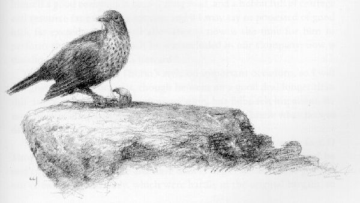

## Kapitel 11: An der Türschwelle

Zwei Tage lang ruderten sie über den ganzen Long Lake und gelangten dann in den River Running. Nun konnten alle den Lonely Mountain <abbr title="sehen (sah, hat gesehen) — увидел">sehen</abbr>. Dunkel und drohend stand er hoch vor ihnen. Das Wasser strömte stark gegen sie, und sie kamen nur langsam voran. Am Ende des dritten Tages waren sie einige Meilen flussaufwärts gekommen. Sie legten am linken, also westlichen Ufer an und gingen an Land. Hier trafen die Pferde ein, die man ihnen mit weiteren Lebensmitteln und anderen nötigen Dingen nachgeschickt hatte. Auch die Ponys für ihre eigene Reise waren dabei. Sie beluden die Ponys mit allem, was diese tragen konnten. Der Rest wurde als <abbr title="der Vorrat, die Vorräte — запас">Vorrat</abbr> unter einem Zelt gelagert. Doch keiner der Männer aus der Stadt wollte bei ihnen bleiben, nicht einmal für eine Nacht. So nah am <abbr title="der Schatten, die Schatten — тень">Schatten</abbr> des Berges wollte niemand schlafen.

— Jedenfalls nicht, bevor die Lieder wahr geworden sind! — sagten sie.

Hier in der Wildnis glaubte man leichter an den <abbr title="der Drache, die Drachen — дракон">Drachen</abbr> als an Thorin. Ihre <abbr title="der Vorrat, die Vorräte — запас">Vorräte</abbr> brauchten tatsächlich keine <abbr title="die Wache, die Wachen — стражник; охрана">Wache</abbr>. Das ganze Land war verlassen und leer. Deshalb verließen ihre Begleiter sie. Schnell fuhren die einen den Fluss hinunter, die anderen eilten auf den Wegen am Ufer davon. Dabei brach schon die Nacht an.

Sie verbrachten eine kalte, einsame Nacht, und ihre Stimmung sank. Am nächsten Tag brachen sie wieder auf. Balin und Bilbo ritten hinten. Jeder führte noch ein schwer beladenes Pony neben sich. Die anderen waren ein Stück voraus und suchten langsam einen gangbaren Weg, denn es gab keine Pfade. Sie zogen nach Nordwesten, schräg vom River Running fort. Dabei kamen sie einem großen <abbr title="der Ausläufer, die Ausläufer — отрог">Ausläufer</abbr> des Berges immer näher. Er streckte sich ihnen nach Süden entgegen.

Es war eine <abbr title="mühsam — трудный; утомительный">mühsame</abbr> Reise. Still und <abbr title="heimlich — тайно; украдкой">heimlich</abbr> bewegten sie sich vorwärts. Niemand lachte oder sang, keine <abbr title="die Harfe, die Harfen — арфа">Harfe</abbr> erklang. Beim Singen der alten Lieder am See waren <abbr title="der Stolz — гордость">Stolz</abbr> und Hoffnung in ihren Herzen erwacht. Nun starben diese Gefühle. Sie gingen nur noch müde und traurig weiter. Sie wussten, dass ihre Reise bald zu Ende war. Und dieses Ende konnte sehr schrecklich werden.

Das Land um sie herum wurde kahl und <abbr title="unfruchtbar — бесплодный">unfruchtbar</abbr>. Einst war es grün und schön gewesen, wie Thorin ihnen erzählte. Es gab wenig Gras. Bald sahen sie weder <abbr title="der Busch, die Büsche — куст">Busch</abbr> noch Baum. Nur abgebrochene, verbrannte <abbr title="der Baumstumpf, die Baumstümpfe — пень">Baumstümpfe</abbr> erinnerten an Bäume, die längst verschwunden waren. Sie waren in das vom <abbr title="der Drache, die Drachen — дракон">Drachen</abbr> <abbr title="verwüsten — опустошать">verwüstete</abbr> Land gekommen. Und sie kamen, als das Jahr seinem Ende zuging.

Trotzdem erreichten sie den Fuß des Berges ohne Gefahr. Sie sahen auch kein <abbr title="das Zeichen, die Zeichen — знак">Zeichen</abbr> des <abbr title="der Drache, die Drachen — дракон">Drachen</abbr>, außer dem zerstörten Land um seine <abbr title="die Höhle, die Höhlen — пещера">Höhle</abbr>. Der Berg lag dunkel und still vor ihnen und ragte immer höher über ihnen auf. Ihr erstes <abbr title="das Lager, die Lager — лагерь">Lager</abbr> errichteten sie westlich des großen südlichen Ausläufers. Dieser endete in einer Höhe namens Ravenhill. Dort hatte einst ein alter Wachposten gestanden. Doch sie wagten noch nicht hinaufzusteigen. Dort oben wären sie zu leicht zu <abbr title="sehen (sah, hat gesehen) — увидел">sehen</abbr> gewesen.

Alle ihre Hoffnungen ruhten auf der versteckten Tür. Sie wollten sie an den westlichen Ausläufern des Berges suchen. Vorher schickte Thorin jedoch eine Gruppe aus, um das Land im Süden <abbr title="auskundschaften — разведать">auszukundschaften</abbr>. Dort lag Front Gate.

Dafür wählte er Balin, Fili und Kili aus, und Bilbo <abbr title="gehen (ging, ist gegangen) — шёл">ging</abbr> mit ihnen. Unter den grauen, stillen Felswänden gingen sie zum Fuß von Ravenhill. Dort wandte sich der Fluss vom Berg weg und strömte schnell und laut zum See. Zuvor hatte er eine weite Schleife durch das Tal von Dale gezogen. Sein Ufer war kahl und felsig. Hoch und steil fiel es zum Wasser ab. Sie schauten über den schmalen Fluss. Zwischen vielen <abbr title="der Felsbrocken, die Felsbrocken — валун">Felsbrocken</abbr> schäumte und spritzte das Wasser. Dahinter sahen sie das weite Tal im <abbr title="der Schatten, die Schatten — тень">Schatten</abbr> der Arme des Berges. Dort lagen die grauen <abbr title="die Ruine, die Ruinen — руины">Ruinen</abbr> alter Häuser, Türme und Mauern.

— Dort liegt alles, was von Dale übrig ist, — sagte Balin. — An den Hängen des Berges wuchsen grüne Wälder. Das ganze geschützte Tal war reich und schön, damals, als in der Stadt noch die Glocken <abbr title="läuten — звонить (о колоколах)">läuteten</abbr>.

Er <abbr title="sehen (sah, hat gesehen) — увидел">sah</abbr> traurig und finster aus, als er dies sagte. Am Tag, als der <abbr title="der Drache, die Drachen — дракон">Drache</abbr> kam, war er einer von Thorins <abbr title="der Gefährte, die Gefährten — соратник">Gefährten</abbr> gewesen.

Sie wagten nicht, dem Fluss noch viel weiter zum Tor zu folgen. Doch sie gingen über das Ende des südlichen Ausläufers hinaus. Hinter einem <abbr title="der Felsen, die Felsen — скала; утёс">Felsen</abbr> versteckten sie sich und sahen von dort die dunkle, große Öffnung einer <abbr title="die Höhle, die Höhlen — нора; пещера">Höhle</abbr>. Sie lag in einer gewaltigen Felswand zwischen den Armen des Berges. Aus ihr sprang das Wasser des River Running hervor. Auch <abbr title="der Dampf — пар">Dampf</abbr> und dunkler Rauch kamen heraus. Nichts bewegte sich in dem leeren Land außer dem <abbr title="der Dunst — дымка">Dunst</abbr> und dem Wasser. Nur manchmal flog eine schwarze <abbr title="die Krähe, die Krähen — ворона">Krähe</abbr> vorüber, die nichts Gutes versprach. Man hörte nur das Wasser zwischen den Steinen. Hin und wieder erklang der raue Ruf eines Vogels. Balin schauderte.

— Gehen wir zurück! — sagte er. — Hier können wir nichts ausrichten! Und diese dunklen Vögel gefallen mir nicht. Sie <abbr title="sehen (sah, hat gesehen) — увидел">sehen</abbr> wie <abbr title="der Spion, die Spione — шпион">Spione</abbr> des Bösen aus.

— Dann lebt der <abbr title="der Drache, die Drachen — дракон">Drache</abbr> also noch und ist in den Hallen unter dem Berg, — sagte der Hobbit. — Jedenfalls denke ich das, wenn ich den Rauch sehe.

— Das beweist es nicht, — sagte Balin. — Obwohl ich nicht daran zweifle, dass du recht hast. Aber vielleicht ist er für eine Weile fortgegangen. Oder er liegt draußen am Berghang und hält <abbr title="die Wache, die Wachen — часовой; стражник">Wache</abbr>. Trotzdem würden wohl Rauch und <abbr title="der Dampf — пар">Dampf</abbr> aus den Toren kommen. Alle Hallen dort drinnen müssen voll von seinem <abbr title="widerlich — отвратительный">widerlichen</abbr> <abbr title="der Gestank — зловоние">Gestank</abbr> sein.

Mit solchen traurigen Gedanken machten sie sich müde auf den Rückweg zum <abbr title="das Lager, die Lager — лагерь">Lager</abbr>. Über ihnen folgten ständig rufende <abbr title="die Krähe, die Krähen — ворона">Krähen</abbr>. Erst im Juni waren sie Gäste in Elronds schönem Haus gewesen. Nun kroch der Herbst dem Winter entgegen. Doch jene angenehme Zeit schien schon Jahre zurückzuliegen. Sie waren allein in dieser gefährlichen Wildnis. Auf weitere Hilfe konnten sie nicht hoffen. Ihre Reise war zu Ende. Doch das Ziel ihrer <abbr title="die Suche, die Suchen — поиск">Suche</abbr> schien so weit entfernt wie immer. Keiner von ihnen hatte noch viel <abbr title="der Mut — смелость">Mut</abbr>.

Seltsamerweise hatte Herr Baggins mehr <abbr title="der Mut — смелость">Mut</abbr> als die anderen. Oft lieh er sich Thorins Karte und betrachtete sie lange. Er dachte über die <abbr title="die Rune, die Runen — руна">Runen</abbr> nach. Auch die Botschaft der Mondbuchstaben, die Elrond gelesen hatte, beschäftigte ihn. Er brachte die <abbr title="der Zwerg, die Zwerge — гном">Zwerge</abbr> dazu, an den westlichen Hängen die gefährliche <abbr title="die Suche, die Suchen — поиск">Suche</abbr> nach der geheimen Tür zu beginnen.

Sie verlegten ihr <abbr title="das Lager, die Lager — лагерь">Lager</abbr> in ein langes Tal. Es war schmaler als das große Tal im Süden mit den Toren des Flusses. Niedrigere <abbr title="der Ausläufer, die Ausläufer — отрог">Ausläufer</abbr> des Berges bildeten seine Wände. Zwei davon erstreckten sich hier vom großen Bergkörper nach <abbr title="die Weste, die Westen — жилет">Westen</abbr>. Ihre langen <abbr title="der Bergrücken, die Bergrücken — горный хребет">Bergrücken</abbr> hatten steile Seiten und senkten sich allmählich zur Ebene hin. Auf dieser Westseite gab es weniger Spuren von den Füßen des <abbr title="der Drache, die Drachen — дракон">Drachen</abbr>, die überall Zerstörung hinterlassen hatten. Auch etwas Gras für die Ponys wuchs dort.

Ihr westliches <abbr title="das Lager, die Lager — лагерь">Lager</abbr> lag fast den ganzen Tag im <abbr title="der Schatten, die Schatten — тень">Schatten</abbr> der Felswände. Erst wenn die Sonne zum Wald hinabsank, erreichte sie das <abbr title="das Lager, die Lager — лагерь">Lager</abbr>. Von hier aus gingen sie täglich in Gruppen los. Mühsam suchten sie Wege den Berghang hinauf. Wenn die Karte stimmte, musste die geheime Tür irgendwo hoch über der Felswand am oberen Talende liegen. Tag für Tag kehrten sie ohne Erfolg zurück.

Doch schließlich fanden sie ganz unerwartet, was sie suchten. Eines Tages gingen Fili, Kili und der Hobbit wieder das Tal hinunter. An seiner südlichen Ecke kletterten sie zwischen herabgestürzten <abbr title="der Felsen, die Felsen — скала; утёс">Felsen</abbr> umher. Gegen Mittag kroch Bilbo hinter einen großen Stein. Dieser stand allein wie eine <abbr title="die Säule, die Säulen — колонна">Säule</abbr>. Dort entdeckte er etwas, das wie grobe Stufen nach oben aussah. Aufgeregt folgten er und die <abbr title="der Zwerg, die Zwerge — гном">Zwerge</abbr> ihnen. Sie fanden Spuren eines schmalen Pfades. Oft verloren sie ihn, oft entdeckten sie ihn wieder. Er schlängelte sich bis auf den südlichen <abbr title="der Bergrücken, die Bergrücken — горный хребет">Bergrücken</abbr> hinauf. Schließlich führte er sie auf einen noch schmaleren <abbr title="der Felsvorsprung, die Felsvorsprünge — скальный выступ">Felsvorsprung</abbr>. Dieser wandte sich nach Norden und verlief quer über die Vorderseite des Berges.

Sie schauten hinunter. Nun standen sie oben auf der Felswand am oberen Talende und blickten auf ihr eigenes <abbr title="das Lager, die Lager — лагерь">Lager</abbr> herab. Still gingen sie einer hinter dem anderen auf dem <abbr title="der Vorsprung, die Vorsprünge — выступ">Vorsprung</abbr> weiter. Dabei hielten sie sich rechts an der Felswand fest. Schließlich öffnete sich die Wand. Sie <abbr title="biegen (bog, hat gebogen) — гнуть">bogen</abbr> in eine kleine <abbr title="die Bucht, die Buchten — бухта; углубление">Bucht</abbr> mit steilen Felswänden ein. Gras bedeckte den Boden, alles war still und ruhig. Den Eingang konnte man von unten nicht <abbr title="sehen (sah, hat gesehen) — увидел">sehen</abbr>, weil die Felswand darüber hinausragte. Auch aus größerer Entfernung war er nicht zu erkennen. Er war so klein, dass er nur wie ein dunkler <abbr title="der Riss, die Risse — трещина">Riss</abbr> aussah.

Es war keine <abbr title="die Höhle, die Höhlen — нора; пещера">Höhle</abbr>: Über ihnen lag der offene Himmel. Aber am hinteren Ende erhob sich eine flache Wand. Ihr unterer Teil dicht über dem Boden war glatt und <abbr title="senkrecht — вертикальный">senkrecht</abbr> wie die Arbeit von <abbr title="der Maurer, die Maurer — каменщик">Maurern</abbr>. Doch man <abbr title="sehen (sah, hat gesehen) — увидел">sah</abbr> keine <abbr title="die Fuge, die Fugen — стык; шов">Fuge</abbr> und keine <abbr title="die Spalte, die Spalten — расселина; щель">Spalte</abbr>. Es gab weder seitliche <abbr title="der Türpfosten, die Türpfosten — дверной косяк">Türpfosten</abbr> noch einen Balken darüber, weder eine <abbr title="die Schwelle, die Schwellen — порог">Schwelle</abbr> noch irgendein <abbr title="das Zeichen, die Zeichen — знак">Zeichen</abbr> von Balken zum Verschließen, <abbr title="der Riegel, die Riegel — засов">Riegel</abbr> oder <abbr title="das Schlüsselloch, die Schlüssellöcher — замочная скважина">Schlüsselloch</abbr>. Trotzdem zweifelten sie nicht daran, dass sie endlich die Tür gefunden hatten.

Sie schlugen dagegen, drückten und schoben. Sie <abbr title="flehen — умолять">flehten</abbr> die Tür an, sich zu bewegen. Sie sprachen Bruchstücke halb vergessener <abbr title="der Zauberspruch, die Zaubersprüche — заклинание">Zaubersprüche</abbr>, die Türen öffnen sollten. Nichts rührte sich. Schließlich waren sie völlig müde und ruhten sich auf dem Gras vor der Wand aus. Am Abend begannen sie den langen Abstieg.

In dieser Nacht war das <abbr title="das Lager, die Lager — лагерь">Lager</abbr> voller Aufregung. Am Morgen bereiteten sie sich darauf vor, noch einmal umzuziehen. Nur Bofur und Bombur blieben zurück. Sie bewachten die Ponys und die <abbr title="der Vorrat, die Vorräte — запас">Vorräte</abbr>, die sie vom Fluss mitgebracht hatten. Die anderen gingen das Tal hinunter und dann den neuen Pfad hinauf. So erreichten sie den schmalen <abbr title="der Vorsprung, die Vorsprünge — выступ">Vorsprung</abbr>. Dort konnten sie keine <abbr title="das Bündel, die Bündel — связка; узел">Bündel</abbr> oder Gepäckstücke tragen. Der Weg war so eng, dass ihnen beinahe der Atem wegblieb! Neben ihnen <abbr title="gehen (ging, ist gegangen) — шёл">ging</abbr> es hundertfünfzig Fuß tief hinunter auf scharfe <abbr title="der Felsen, die Felsen — скала; утёс">Felsen</abbr>. Doch jeder hatte ein langes <abbr title="das Seil, die Seile — верёвка">Seil</abbr> eng um die Hüfte gewickelt. So erreichten sie schließlich ohne Unfall die kleine grasige <abbr title="die Bucht, die Buchten — бухта">Bucht</abbr>.

Dort errichteten sie ihr drittes <abbr title="das Lager, die Lager — лагерь">Lager</abbr>. Mit den Seilen zogen sie alles Nötige von unten herauf. Auf demselben Weg konnten sie gelegentlich einen der beweglicheren <abbr title="der Zwerg, die Zwerge — гном">Zwerge</abbr> hinunterlassen, etwa Kili. Er konnte Neuigkeiten austauschen, soweit es welche gab, oder einen Teil der <abbr title="die Wache, die Wachen — часовой; стражник">Wache</abbr> unten übernehmen. Dann zogen sie dafür Bofur ins obere <abbr title="das Lager, die Lager — лагерь">Lager</abbr> hinauf. Bombur wollte weder am <abbr title="das Seil, die Seile — верёвка">Seil</abbr> noch auf dem Pfad nach oben kommen.

— Für solche Fliegenwege bin ich zu dick, — sagte er. — Mir würde <abbr title="schwindelig — головокружительно">schwindelig</abbr> werden. Dann würde ich auf meinen <abbr title="der Bart, die Bärte — борода">Bart</abbr> treten, und ihr wärt wieder dreizehn. Außerdem sind die <abbr title="das Seil, die Seile — верёвка">Seile</abbr> mit ihren Knoten zu dünn für mein Gewicht.

Zu seinem Glück stimmte das nicht, wie ihr noch <abbr title="sehen (sah, hat gesehen) — увидел">sehen</abbr> werdet.

Inzwischen erkundeten einige den <abbr title="der Vorsprung, die Vorsprünge — выступ">Vorsprung</abbr> jenseits des Eingangs. Sie fanden einen Pfad, der immer höher auf den Berg führte. Doch sie wagten sich nicht sehr weit in diese Richtung. Viel hätte es auch nicht genutzt. Dort oben herrschte Stille. Kein Vogel unterbrach sie, und kein Laut war zu hören außer dem Wind in den Felsspalten. Sie sprachen leise und riefen oder sangen nie. In jedem <abbr title="der Felsen, die Felsen — скала; утёс">Felsen</abbr> schien Gefahr zu <abbr title="lauern — таиться; подстерегать">lauern</abbr>.

Die anderen beschäftigten sich mit dem <abbr title="das Geheimnis, die Geheimnisse — тайна">Geheimnis</abbr> der Tür. Sie hatten ebenso wenig Erfolg. Vor lauter <abbr title="der Eifer — рвение">Eifer</abbr> wollten sie sich nicht mit <abbr title="die Rune, die Runen — руна">Runen</abbr> oder Mondbuchstaben aufhalten. Ohne Pause versuchten sie herauszufinden, wo genau die Tür in der glatten Felswand verborgen war. Aus Lake-town hatten sie <abbr title="die Spitzhacke, die Spitzhacken — кирка">Spitzhacken</abbr> und viele andere <abbr title="das Werkzeug, die Werkzeuge — инструмент">Werkzeuge</abbr> mitgebracht. Zuerst versuchten sie, diese zu benutzen. Doch sobald sie auf den Stein schlugen, <abbr title="zersplittern — раскалываться на щепки">zersplitterten</abbr> die Griffe. Die Schläge taten ihren Armen furchtbar weh. Die Köpfe aus <abbr title="der Stahl — сталь">Stahl</abbr> brachen oder <abbr title="biegen (bog, hat gebogen) — гнуть">bogen</abbr> sich wie <abbr title="das Blei — свинец">Blei</abbr>. Nun sahen sie deutlich: Mit Bergwerksarbeit konnten sie nichts gegen den Zauber tun, der diese Tür verschlossen hatte. Außerdem machte ihnen der Lärm mit seinem lauten <abbr title="das Echo, die Echos — эхо">Echo</abbr> Angst.

Bilbo fand das Sitzen auf der <abbr title="die Türschwelle, die Türschwellen — дверной порог">Türschwelle</abbr> einsam und ermüdend. Natürlich gab es in Wirklichkeit gar keine <abbr title="die Türschwelle, die Türschwellen — дверной порог">Türschwelle</abbr>. So nannten sie im Spaß den kleinen Grasplatz zwischen der Wand und dem Eingang. Sie erinnerten sich an Bilbos Worte bei der unerwarteten Gesellschaft in seiner Hobbithöhle, vor langer Zeit. Damals hatte er gesagt, sie könnten auf der <abbr title="die Türschwelle, die Türschwellen — дверной порог">Türschwelle</abbr> sitzen, bis ihnen etwas einfiel. Und sie saßen und dachten tatsächlich nach. Oder sie wanderten ohne Ziel umher und wurden immer trauriger.

Als sie den Pfad gefunden hatten, war ihre Stimmung etwas gestiegen. Nun sank sie ihnen bis in die Stiefel. Doch sie wollten nicht aufgeben und fortgehen. Der Hobbit war jetzt kaum noch fröhlicher als die <abbr title="der Zwerg, die Zwerge — гном">Zwerge</abbr>. Er tat nichts anderes, als mit dem Rücken zur Felswand zu sitzen und nach <abbr title="die Weste, die Westen — жилет">Westen</abbr> zu starren. Er schaute durch den Eingang, über die Felswand hinweg und über das weite Land zur schwarzen Wand von Mirkwood. Auch in die Ferne dahinter blickte er. Manchmal glaubte er dort die Misty Mountains zu <abbr title="sehen (sah, hat gesehen) — увидел">sehen</abbr>, klein und weit entfernt. Wenn die <abbr title="der Zwerg, die Zwerge — гном">Zwerge</abbr> ihn fragten, was er tat, antwortete er:

— Ihr habt gesagt, meine Arbeit wäre das Sitzen auf der <abbr title="die Türschwelle, die Türschwellen — дверной порог">Türschwelle</abbr> und das Nachdenken. Vom Hineinkommen ganz zu schweigen. Also sitze ich und denke nach.

Doch ich fürchte, er dachte nicht viel über diese Arbeit nach. Er dachte an das, was hinter der blauen Ferne lag. An das stille Land im <abbr title="die Weste, die Westen — жилет">Westen</abbr>, an The Hill und an seine Hobbithöhle darunter.

Mitten im Gras lag ein großer grauer Stein. Er starrte traurig darauf oder beobachtete die großen <abbr title="die Schnecke, die Schnecken — улитка">Schnecken</abbr>. Sie schienen die kleine geschlossene <abbr title="die Bucht, die Buchten — бухта">Bucht</abbr> mit ihren kühlen Felswänden zu lieben. Viele von ihnen waren riesig. Langsam krochen sie mit klebrigem <abbr title="der Schleim — слизь">Schleim</abbr> an den Seiten entlang.

— Morgen beginnt die letzte Herbstwoche, — sagte Thorin eines Tages.

— Und nach dem Herbst kommt der Winter, — sagte Bifur.

— Und danach kommt das nächste Jahr, — sagte Dwalin. — Unsere <abbr title="der Bart, die Bärte — борода">Bärte</abbr> werden wachsen, bis sie über die Felswand ins Tal hinunterhängen, bevor hier etwas geschieht. Was tut unser <abbr title="der Einbrecher, die Einbrecher — взломщик">Einbrecher</abbr> eigentlich für uns? Er hat jetzt einen Ring, der <abbr title="unsichtbar — невидимый">unsichtbar</abbr> macht. Damit sollte er doch ganz besonders gut arbeiten können. Langsam denke ich, er könnte durch Front Gate hineingehen und sich dort ein bisschen umsehen!

Bilbo hörte das. Die <abbr title="der Zwerg, die Zwerge — гном">Zwerge</abbr> standen auf den <abbr title="der Felsen, die Felsen — скала; утёс">Felsen</abbr> gleich über dem abgeschlossenen Platz, auf dem er saß.

„Großer Himmel!“, dachte er. „Darauf kommen sie also jetzt? Immer muss der arme Bilbo sie aus ihren Schwierigkeiten retten. Jedenfalls seit der <abbr title="der Zauberer, die Zauberer — волшебник">Zauberer</abbr> fort ist. Was soll ich bloß tun? Ich hätte wissen müssen, dass mir am Ende etwas Schreckliches passieren würde. Den traurigen Anblick des Tals von Dale könnte ich wohl nicht noch einmal ertragen. Und erst dieses dampfende Tor!!!“

In jener Nacht fühlte er sich sehr elend und schlief kaum. Am nächsten Tag gingen alle <abbr title="der Zwerg, die Zwerge — гном">Zwerge</abbr> in verschiedenen Richtungen fort. Einige bewegten unten die Ponys, andere wanderten am Berghang umher. Den ganzen Tag saß Bilbo traurig in der grasigen <abbr title="die Bucht, die Buchten — бухта">Bucht</abbr>. Er betrachtete den Stein oder schaute durch den schmalen Eingang nach <abbr title="die Weste, die Westen — жилет">Westen</abbr>. Er hatte das seltsame Gefühl, auf etwas zu warten.

„Vielleicht kommt der <abbr title="der Zauberer, die Zauberer — волшебник">Zauberer</abbr> heute plötzlich zurück“, dachte er.

Wenn er den Kopf hob, konnte er ein Stück des fernen Waldes <abbr title="sehen (sah, hat gesehen) — увидел">sehen</abbr>. Als die Sonne nach <abbr title="die Weste, die Westen — жилет">Westen</abbr> zog, glänzte sein fernes Blätterdach gelb. Es war, als finge das Licht die letzten blassen Blätter ein. Bald <abbr title="sehen (sah, hat gesehen) — увидел">sah</abbr> Bilbo den orangefarbenen Sonnenball auf die Höhe seiner Augen sinken. Er <abbr title="gehen (ging, ist gegangen) — шёл">ging</abbr> zum Eingang. Dort stand über dem Rand der Erde ein dünner neuer Mond, blass und kaum sichtbar.

Genau in diesem Augenblick hörte er hinter sich ein scharfes Knacken. Auf dem grauen Stein im Gras saß eine gewaltige <abbr title="die Drossel, die Drosseln — дрозд">Drossel</abbr>. Sie war fast schwarz wie Kohle. Auf ihrer blassgelben Brust waren viele dunkle Flecken. Knack! Sie hatte eine <abbr title="die Schnecke, die Schnecken — слизень; улитка">Schnecke</abbr> gefangen und schlug sie gegen den Stein. Knack! Knack!

Plötzlich verstand Bilbo. Er vergaß jede Gefahr, stellte sich auf den <abbr title="der Vorsprung, die Vorsprünge — выступ">Vorsprung</abbr> und rief die <abbr title="der Zwerg, die Zwerge — гном">Zwerge</abbr>. Er schrie und winkte. Die nächsten kamen über die <abbr title="der Felsen, die Felsen — скала; утёс">Felsen</abbr> gestolpert und liefen so schnell wie möglich auf dem <abbr title="der Vorsprung, die Vorsprünge — выступ">Vorsprung</abbr> zu ihm. Sie fragten sich, was um alles in der Welt los war. Die anderen riefen, man solle sie an den Seilen hinaufziehen. Außer Bombur natürlich: Er schlief.

Schnell erklärte Bilbo alles. Alle wurden still. Der Hobbit stand beim grauen Stein. Die <abbr title="der Zwerg, die Zwerge — гном">Zwerge</abbr> schauten ungeduldig zu, und ihre <abbr title="der Bart, die Bärte — борода">Bärte</abbr> wackelten. Die Sonne sank tiefer und tiefer, und mit ihr sank ihre Hoffnung. Sie versank in einem Streifen rötlicher Wolken und verschwand. Die <abbr title="der Zwerg, die Zwerge — гном">Zwerge</abbr> <abbr title="stöhnen — стонать">stöhnten</abbr>, doch Bilbo stand noch immer fast ohne Bewegung da. Der kleine Mond senkte sich zum Horizont. Der Abend brach an.

Da kam plötzlich, als ihre Hoffnung am kleinsten war, ein roter Sonnenstrahl durch einen <abbr title="der Riss, die Risse — трещина">Riss</abbr> in der Wolke. Wie ein Finger streckte er sich heraus. Ein heller Schein fiel gerade durch den Eingang in die <abbr title="die Bucht, die Buchten — бухта">Bucht</abbr> und auf die glatte Felswand. Die alte <abbr title="die Drossel, die Drosseln — дрозд">Drossel</abbr> hatte von einem hohen Sitzplatz aus zugesehen. Ihre kleinen runden Augen glänzten, und sie hielt den Kopf schief. Plötzlich ließ sie einen kurzen, hellen Gesang hören. Es knackte laut. Ein dünnes Stück Stein brach von der Wand ab und fiel hinunter. Plötzlich erschien ein Loch, etwa drei Fuß über dem Boden.

Schnell stürzten die <abbr title="der Zwerg, die Zwerge — гном">Zwerge</abbr> zur Wand. Sie zitterten vor Angst, die Gelegenheit könnte vergehen, und drückten gegen den <abbr title="der Felsen, die Felsen — скала; утёс">Felsen</abbr>. Doch es war <abbr title="vergeblich — напрасно">vergeblich</abbr>.

— Der Schlüssel! Der Schlüssel! — rief Bilbo. — Wo ist Thorin?

Thorin kam herbeigeeilt.

— Der Schlüssel! — schrie Bilbo. — Der Schlüssel, der zur Karte gehörte! <abbr title="der Versuch, die Versuche — попытка">Versuch</abbr> es jetzt, solange noch Zeit ist!

Dann trat Thorin vor. Er zog den Schlüssel hervor, der an einer <abbr title="die Kette, die Ketten — цепь">Kette</abbr> um seinen Hals hing. Er steckte ihn in das Loch. Er passte und ließ sich drehen! Klick! Der Lichtschein <abbr title="gehen (ging, ist gegangen) — шёл">ging</abbr> aus, die Sonne versank, der Mond war fort. Der Abend sprang an den Himmel.

Nun drückten alle gemeinsam, und langsam gab ein Teil der Felswand nach. Lange gerade <abbr title="der Riss, die Risse — трещина">Risse</abbr> erschienen und wurden breiter. Die Form einer Tür wurde sichtbar, fünf Fuß hoch und drei Fuß breit. Langsam und ganz ohne Laut schwang sie nach innen. Es schien, als würde Dunkelheit wie <abbr title="der Dunst — дымка">Dunst</abbr> aus dem Loch im Berghang strömen. Vor ihren Augen lag tiefe Dunkelheit, in der nichts zu erkennen war. Wie ein weit offener <abbr title="der Rachen, die Rachen — пасть; глотка">Rachen</abbr> führte die Öffnung hinein und hinunter.

---

### Neue und schwierige Wörter

- **sehen (sah, hat gesehen)** — увидел *(Wiederholung)*
- **der Vorrat, die Vorräte** — запас *(Wiederholung)*
- **der Schatten, die Schatten** — тень *(Wiederholung)*
- **der Drache, die Drachen** — дракон *(Wiederholung)*
- **die Wache, die Wachen** — стражник; охрана *(Wiederholung)*
- **der Ausläufer, die Ausläufer** — отрог *(neu)*
- **mühsam** — трудный; утомительный *(Wiederholung)*
- **heimlich** — тайно; украдкой *(neu)*
- **die Harfe, die Harfen** — арфа *(Wiederholung)*
- **der Stolz** — гордость *(Wiederholung)*
- **unfruchtbar** — бесплодный *(neu)*
- **der Busch, die Büsche** — куст *(Wiederholung)*
- **der Baumstumpf, die Baumstümpfe** — пень *(neu)*
- **verwüsten** — опустошать *(neu)*
- **das Zeichen, die Zeichen** — знак *(Wiederholung)*
- **die Höhle, die Höhlen** — пещера *(Wiederholung)*
- **das Lager, die Lager** — лагерь *(Wiederholung)*
- **auskundschaften** — разведать *(neu)*
- **gehen (ging, ist gegangen)** — шёл *(Wiederholung)*
- **der Felsbrocken, die Felsbrocken** — валун *(Wiederholung)*
- **die Ruine, die Ruinen** — руины *(Wiederholung)*
- **läuten** — звонить (о колоколах) *(neu)*
- **der Gefährte, die Gefährten** — соратник *(Wiederholung)*
- **der Felsen, die Felsen** — скала; утёс *(Wiederholung)*
- **der Dampf** — пар *(Wiederholung)*
- **der Dunst** — дымка *(Wiederholung)*
- **die Krähe, die Krähen** — ворона *(neu)*
- **der Spion, die Spione** — шпион *(Wiederholung)*
- **widerlich** — отвратительный *(Wiederholung)*
- **der Gestank** — зловоние *(neu)*
- **die Suche, die Suchen** — поиск *(neu)*
- **der Mut** — смелость *(Wiederholung)*
- **die Rune, die Runen** — руна *(Wiederholung)*
- **der Zwerg, die Zwerge** — гном *(Wiederholung)*
- **die Weste, die Westen** — жилет *(Wiederholung)*
- **der Bergrücken, die Bergrücken** — горный хребет *(neu)*
- **die Säule, die Säulen** — колонна *(Wiederholung)*
- **der Felsvorsprung, die Felsvorsprünge** — скальный выступ *(neu)*
- **der Vorsprung, die Vorsprünge** — выступ *(Wiederholung)*
- **biegen (bog, hat gebogen)** — гнуть *(Wiederholung)*
- **die Bucht, die Buchten** — бухта; углубление *(Wiederholung)*
- **der Riss, die Risse** — трещина *(Wiederholung)*
- **senkrecht** — вертикальный *(neu)*
- **der Maurer, die Maurer** — каменщик *(neu)*
- **die Fuge, die Fugen** — стык; шов *(neu)*
- **die Spalte, die Spalten** — расселина; щель *(Wiederholung)*
- **der Türpfosten, die Türpfosten** — дверной косяк *(neu)*
- **die Schwelle, die Schwellen** — порог *(neu)*
- **der Riegel, die Riegel** — засов *(Wiederholung)*
- **das Schlüsselloch, die Schlüssellöcher** — замочная скважина *(Wiederholung)*
- **flehen** — умолять *(neu)*
- **der Zauberspruch, die Zaubersprüche** — заклинание *(neu)*
- **das Bündel, die Bündel** — связка; узел *(Wiederholung)*
- **das Seil, die Seile** — верёвка *(Wiederholung)*
- **schwindelig** — головокружительно *(neu)*
- **der Bart, die Bärte** — борода *(Wiederholung)*
- **lauern** — таиться; подстерегать *(neu)*
- **das Geheimnis, die Geheimnisse** — тайна *(neu)*
- **der Eifer** — рвение *(neu)*
- **die Spitzhacke, die Spitzhacken** — кирка *(Wiederholung)*
- **das Werkzeug, die Werkzeuge** — инструмент *(Wiederholung)*
- **zersplittern** — раскалываться на щепки *(neu)*
- **der Stahl** — сталь *(Wiederholung)*
- **das Blei** — свинец *(neu)*
- **das Echo, die Echos** — эхо *(Wiederholung)*
- **die Türschwelle, die Türschwellen** — дверной порог *(neu)*
- **die Schnecke, die Schnecken** — улитка *(Wiederholung)*
- **der Schleim** — слизь *(neu)*
- **der Einbrecher, die Einbrecher** — взломщик *(Wiederholung)*
- **unsichtbar** — невидимый *(Wiederholung)*
- **der Zauberer, die Zauberer** — волшебник *(Wiederholung)*
- **die Drossel, die Drosseln** — дрозд *(Wiederholung)*
- **stöhnen** — стонать *(Wiederholung)*
- **vergeblich** — напрасно *(neu)*
- **der Versuch, die Versuche** — попытка *(Wiederholung)*
- **die Kette, die Ketten** — цепь *(Wiederholung)*
- **der Rachen, die Rachen** — пасть; глотка *(neu)*

### Schwierige Sätze

- **„Doch keiner der Männer aus der Stadt wollte bei ihnen bleiben, nicht einmal für eine Nacht.“**  
  «Но никто из городских мужчин не хотел оставаться с ними даже на одну ночь». `keiner der Männer` — «ни один из мужчин»; после отрицания `nicht einmal` подчёркивает: «даже не».
- **„Dabei brach schon die Nacht an.“**  
  «А между тем уже наступала ночь». `anbrechen` — отделяемый глагол; в Präteritum приставка `an` стоит в конце. `dabei` здесь обозначает сопутствующее обстоятельство.
- **„Wenn die Karte stimmte, musste die geheime Tür irgendwo hoch über der Felswand am oberen Talende liegen.“**  
  «Если карта была верна, тайная дверь должна была находиться где-то высоко над скалой у верхнего конца долины». `stimmen` здесь — «соответствовать действительности»; `musste` выражает логический вывод.
- **„Den Eingang konnte man von unten nicht sehen, weil die Felswand darüber hinausragte.“**  
  «Вход нельзя было увидеть снизу, потому что над ним нависала скала». `man` обозначает неопределённого наблюдателя; после `weil` глагол `hinausragte` переносится в конец.
- **„Zu seinem Glück stimmte das nicht, wie ihr noch sehen werdet.“**  
  «К его счастью, это было неправдой, как вы ещё увидите». `zu seinem Glück` — устойчивое «к его счастью». Рассказчик обращается к читателям; `werdet sehen` — Futur I.
- **„Vor lauter Eifer wollten sie sich nicht mit Runen oder Mondbuchstaben aufhalten.“**  
  «От чрезмерного рвения они не хотели тратить время на руны или лунные буквы». `vor lauter` указывает на причину, вызванную сильным чувством; `sich mit etwas aufhalten` — задерживаться на чём-либо.
- **„Ich hätte wissen müssen, dass mir am Ende etwas Schreckliches passieren würde.“**  
  «Мне следовало знать, что в конце со мной случится что-нибудь ужасное». `hätte wissen müssen` выражает нереализованную необходимость в прошлом; `würde passieren` — будущее с точки зрения прошлого.
- **„Sie zitterten vor Angst, die Gelegenheit könnte vergehen, und drückten gegen den Felsen.“**  
  «Они дрожали от страха, что возможность может исчезнуть, и давили на скалу». `vor Angst` обозначает причину дрожи; `könnte` — Konjunktiv II, передающий опасение о возможном событии.
- **„Es schien, als würde Dunkelheit wie Dunst aus dem Loch im Berghang strömen.“**  
  «Казалось, будто темнота струится, словно дымка, из отверстия в склоне горы». `als` вводит воображаемое сравнение; `würde strömen` — Konjunktiv II, а не утверждение о буквальном потоке.

[← Zurück](kapitel-10.md) · [Inhalt](README.md) · [Weiter →](kapitel-12.md)
