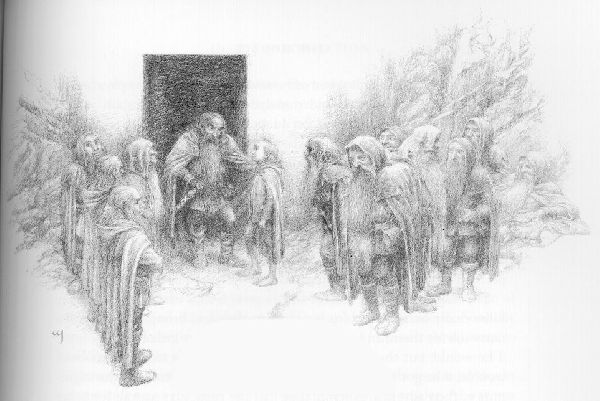
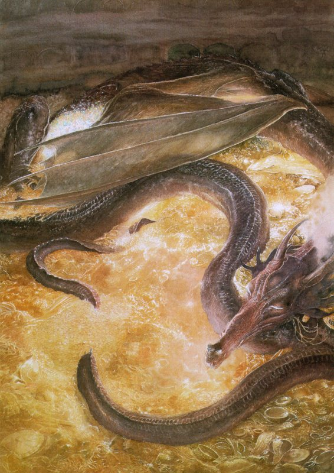
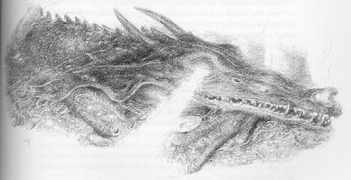
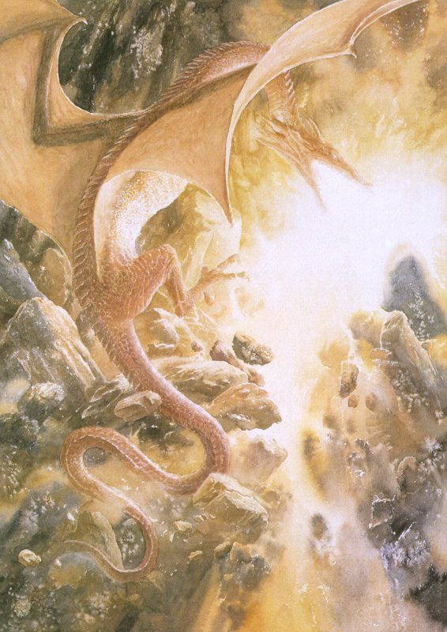
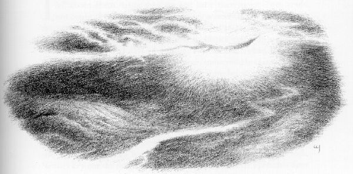

## Kapitel 12: Nachrichten aus dem Inneren

Lange standen die <abbr title="der Zwerg, die Zwerge — гном">Zwerge</abbr> im Dunkeln vor der Tür und berieten sich. Schließlich sprach Thorin:

— Nun ist die Zeit für unseren geschätzten Herrn Baggins gekommen. Auf unserem langen Weg erwies er sich als guter <abbr title="der Gefährte, die Gefährten — соратник">Gefährte</abbr>. Sein <abbr title="der Mut — смелость">Mut</abbr> und seine Ideen übertreffen seine Körpergröße bei Weitem. Und, wenn ich das sagen darf, sein Glück übertrifft das gewöhnliche Maß ebenfalls bei Weitem. Nun ist die Zeit, den Dienst zu leisten, für den wir ihn in unsere Gesellschaft aufnahmen. Nun ist die Zeit, seine <abbr title="die Belohnung, die Belohnungen — вознаграждение">Belohnung</abbr> zu verdienen.

Ihr kennt Thorins Art bei wichtigen Gelegenheiten. Deshalb gebe ich nicht noch mehr davon wieder, obwohl er viel länger weitersprach. Es war gewiss eine wichtige Gelegenheit, aber Bilbo wurde ungeduldig. Auch er kannte Thorin inzwischen gut und wusste, worauf er hinauswollte.

— Wenn du meinst, ich soll als Erster in den geheimen Gang <abbr title="gehen (ging, ist gegangen) — шёл">gehen</abbr>, dann sag es gleich! — sagte er ärgerlich. — O Thorin Oakenshield, Thrains Sohn, möge dein <abbr title="der Bart, die Bärte — борода">Bart</abbr> immer länger wachsen! Sag es und mach ein Ende! Ich könnte mich weigern. Ich habe euch schon aus zwei schlimmen Lagen gerettet. Die gehörten kaum zu unserer ursprünglichen <abbr title="die Abmachung, die Abmachungen — договорённость">Abmachung</abbr>. Deshalb schuldet ihr mir, glaube ich, bereits eine <abbr title="die Belohnung, die Belohnungen — вознаграждение">Belohnung</abbr>. Aber „Das dritte Mal zahlt für alles“, wie mein Vater immer sagte. Und irgendwie glaube ich nicht, dass ich mich weigern werde. Vielleicht vertraue ich meinem Glück jetzt mehr als in den alten Tagen.

Damit meinte er das letzte Frühjahr, bevor er sein Haus verlassen hatte. Doch das schien Jahrhunderte zurückzuliegen.

— Jedenfalls gehe ich wohl gleich hinunter und schaue kurz hinein. Dann habe ich es hinter mir. Wer kommt mit?

Er erwartete nicht, dass sich alle zugleich freiwillig meldeten. Deshalb war er nicht enttäuscht. Fili und Kili sahen <abbr title="verlegen — смущённый">verlegen</abbr> aus und standen auf einem Bein. Die anderen taten nicht einmal so, als wollten sie mitgehen. Nur der alte Balin, ihr Beobachter, bildete eine Ausnahme. Er mochte den Hobbit recht gern. Er wollte wenigstens hineingehen, vielleicht auch ein Stück des Weges mitkommen. Wenn nötig, konnte er dann Hilfe rufen.

Das Beste, was man zur Verteidigung der <abbr title="der Zwerg, die Zwerge — гном">Zwerge</abbr> sagen kann, ist dies: Sie wollten Bilbo wirklich sehr gut bezahlen. Sie hatten ihn mitgenommen, damit er eine unangenehme Arbeit für sie erledigte. Und sie hatten nichts dagegen, dass der arme kleine Kerl sie erledigte, wenn er dazu bereit war. Aber wäre er in Schwierigkeiten geraten, hätten sie alle ihr Bestes getan, um ihn herauszuholen. So hatten sie es bei den Trollen zu Beginn ihrer <abbr title="das Abenteuer, die Abenteuer — приключение">Abenteuer</abbr> getan. Damals hatten sie noch keinen besonderen Grund, ihm dankbar zu sein. So ist es eben: <abbr title="der Zwerg, die Zwerge — гном">Zwerge</abbr> sind keine <abbr title="der Held, die Helden — герой">Helden</abbr>. Sie sind <abbr title="berechnend — расчётливый">berechnende</abbr> Leute und halten viel vom Wert des Geldes. Manche sind voller Tricks, <abbr title="verraten (verriet, hat verraten) — предавать; выдавать">verraten</abbr> andere und sind ziemlich üble Gesellen. Andere nicht. Sie sind ganz anständige Leute wie Thorin und seine Gesellschaft, wenn man nicht zu viel erwartet.

Hinter dem Hobbit erschienen die Sterne an einem blassen Himmel mit schwarzen Streifen. Er kroch durch die <abbr title="verzaubert — зачарованный">verzauberte</abbr> Tür und schlich in den Berg. Der Weg war viel leichter, als er erwartet hatte. Dies war kein Goblineingang und keine grobe <abbr title="die Höhle, die Höhlen — нора; пещера">Höhle</abbr> der <abbr title="der Waldelf, die Waldelfen — лесной эльф">Waldelfen</abbr>. <abbr title="der Zwerg, die Zwerge — гном">Zwerge</abbr> hatten diesen Gang gebaut, auf dem Höhepunkt ihres Reichtums und ihrer Kunst. Er war gerade wie ein Lineal. Boden und Wände waren glatt. Mit leichter, immer gleicher <abbr title="die Neigung, die Neigungen — уклон">Neigung</abbr> führte er direkt hinunter, zu einem fernen Ende in der Schwärze.

Nach einer Weile wünschte Balin Bilbo viel Glück und blieb stehen. Von dort konnte er die schwachen Umrisse der Tür noch <abbr title="sehen (sah, hat gesehen) — увидел">sehen</abbr>. Durch ein seltsames Spiel der <abbr title="das Echo, die Echos — эхо">Echos</abbr> hörte er auch das leise Flüstern der anderen draußen. Dann steckte der Hobbit seinen Ring an den Finger. Die <abbr title="das Echo, die Echos — эхо">Echos</abbr> warnten ihn, noch vorsichtiger als ein Hobbit sonst zu sein und keinen Laut zu machen. Geräuschlos schlich er hinunter, hinunter, hinunter ins Dunkel. Er zitterte vor Angst, doch sein kleines Gesicht war fest und <abbr title="grimmig — суровый; мрачный">grimmig</abbr>. Er war schon ein ganz anderer Hobbit als jener, der einst ohne <abbr title="das Taschentuch, die Taschentücher — носовой платок">Taschentuch</abbr> aus Bag End gelaufen war. Seit einer Ewigkeit hatte er kein <abbr title="das Taschentuch, die Taschentücher — носовой платок">Taschentuch</abbr> mehr besessen. Er lockerte seinen <abbr title="der Dolch, die Dolche — кинжал">Dolch</abbr> in der <abbr title="die Scheide, die Scheiden — ножны">Scheide</abbr>, zog den Gürtel enger und <abbr title="gehen (ging, ist gegangen) — шёл">ging</abbr> weiter.

— Jetzt sitzt du endlich richtig drin, Bilbo Baggins, — sagte er zu sich. — Am Abend des Festes bist du mitten <abbr title="ins Fettnäpfchen treten (trat, ist getreten) — попасть впросак">ins Fettnäpfchen getreten</abbr>. Jetzt musst du den Fuß wieder herausziehen und dafür bezahlen! Ach, was für ein Narr ich war und bin!

So sprach der Teil von ihm, der am wenigsten nach den Tooks geraten war.

— Mit Schätzen, die <abbr title="der Drache, die Drachen — дракон">Drachen</abbr> bewachen, kann ich überhaupt nichts anfangen. Das ganze Zeug könnte für immer hierbleiben. Wenn ich nur aufwachen könnte und dieser scheußliche Tunnel wäre mein eigener Hausflur daheim!

Natürlich wachte er nicht auf. Er <abbr title="gehen (ging, ist gegangen) — шёл">ging</abbr> immer weiter, bis hinter ihm jede Spur der Tür verschwunden war. Er war völlig allein. Bald glaubte er, dass es wärmer wurde.

„Sehe ich da vorne unten etwa einen Lichtschein?“, dachte er.

Das tat er. Mit jedem Schritt wurde der Schein stärker, bis kein <abbr title="der Zweifel, die Zweifel — сомнение">Zweifel</abbr> mehr möglich war. Es war rotes Licht, das immer röter wurde. Auch im Tunnel war es jetzt eindeutig heiß. Dünne Streifen von <abbr title="der Dampf — пар">Dampf</abbr> stiegen auf und zogen an ihm vorbei. Er begann zu schwitzen. Dazu pochte ein <abbr title="der Klang, die Klänge — звук; звон">Klang</abbr> in seinen Ohren. Es blubberte wie ein großer Topf, dessen Inhalt über dem Feuer wild kochte. Darunter lag ein Grollen wie das Schnurren eines riesigen Katers. Daraus wurde das unverkennbare Gurgeln eines gewaltigen Tieres, das dort unten im roten Schein schlafend <abbr title="schnarchen — храпеть">schnarchte</abbr>.

An dieser Stelle blieb Bilbo stehen. Von dort weiterzugehen, war das Mutigste, was er je tat. Die gewaltigen Dinge, die später geschahen, waren nichts dagegen. Den wirklichen Kampf führte er allein im Tunnel. Er führte ihn, bevor er die riesige Gefahr überhaupt <abbr title="sehen (sah, hat gesehen) — увидел">sah</abbr>, die auf ihn wartete. Jedenfalls <abbr title="gehen (ging, ist gegangen) — шёл">ging</abbr> er nach einer kurzen Pause tatsächlich weiter.

Ihr könnt euch vorstellen, wie er das Ende des Tunnels erreichte. Dort war eine Öffnung, fast so groß und so geformt wie die Tür oben. Der kleine Kopf des Hobbits schaute hindurch. Vor ihm lag die große, tiefste Keller- oder Kerkerhalle der alten <abbr title="der Zwerg, die Zwerge — гном">Zwerge</abbr>, ganz an der <abbr title="die Wurzel, die Wurzeln — корень">Wurzel</abbr> des Berges. Es war fast dunkel, sodass ihre gewaltige Größe nur zu erahnen war. Doch nahe bei ihm stieg vom felsigen Boden ein mächtiger Schein auf. Smaugs Schein!

Da lag er, ein riesiger rotgoldener <abbr title="der Drache, die Drachen — дракон">Drache</abbr>, und schlief fest. Aus seinem Maul und seinen Nasenlöchern kamen ein tiefes Dröhnen und dünne Rauchstreifen. Im Schlaf brannten seine Feuer jedoch nur schwach. Unter ihm, unter all seinen <abbr title="das Glied, die Glieder — конечность">Gliedern</abbr> und seinem gewaltigen eingerollten Schwanz lagen unzählige Haufen kostbarer Dinge. Sie lagen auch rings um ihn und reichten weit über die unsichtbaren Böden. Da war verarbeitetes und unverarbeitetes Gold, da waren <abbr title="der Edelstein, die Edelsteine — драгоценный камень">Edelsteine</abbr> und Schmuck. Silber wurde vom rötlichen Licht rot gefärbt.

Mit gefalteten Flügeln lag Smaug da, wie eine unermesslich große <abbr title="die Fledermaus, die Fledermäuse — летучая мышь">Fledermaus</abbr>. Er war halb auf eine Seite gedreht. So konnte der Hobbit seine Unterseite und seinen langen blassen Bauch <abbr title="sehen (sah, hat gesehen) — увидел">sehen</abbr>. Darauf klebten <abbr title="der Edelstein, die Edelsteine — драгоценный камень">Edelsteine</abbr> und Goldstücke als feste Schicht. So lange hatte er auf seinem kostbaren Bett gelegen. Hinter ihm, wo die Wände am nächsten waren, erkannte man schwach <abbr title="das Kettenhemd, die Kettenhemden — кольчуга">Kettenhemden</abbr>, Helme und Äxte, <abbr title="das Schwert, die Schwerter — меч">Schwerter</abbr> und <abbr title="der Speer, die Speere — копьё">Speere</abbr>. Sie hingen dort an den Wänden. Große <abbr title="der Krug, die Krüge — кувшин; большая кружка">Krüge</abbr> und andere Gefäße standen in Reihen. Sie waren mit einem Reichtum gefüllt, dessen Menge niemand erraten konnte.

Zu sagen, Bilbo blieb die Luft weg, beschreibt es überhaupt nicht. Für sein ungeheures Staunen gibt es keine Worte mehr. Die Menschen haben die Sprache verändert, die sie einst von den <abbr title="der Elf, die Elfen — эльф">Elfen</abbr> lernten. Damals war die ganze Welt noch voller Wunder. Bilbo hatte schon Geschichten und Lieder von Drachenschätzen gehört. Aber nie hatte er die <abbr title="die Pracht — великолепие">Pracht</abbr>, das Verlangen und die Herrlichkeit eines solchen Schatzes wirklich verstanden. Zauber erfüllte und durchdrang sein Herz, und mit ihm das Verlangen der <abbr title="der Zwerg, die Zwerge — гном">Zwerge</abbr>. Regungslos starrte er auf das Gold, das sich weder bezahlen noch zählen ließ. Fast vergaß er seinen schrecklichen Wächter.

Er schaute so lange, dass es ihm wie eine Ewigkeit vorkam. Dann zog es ihn fast gegen seinen Willen vorwärts. Er schlich aus dem <abbr title="der Schatten, die Schatten — тень">Schatten</abbr> des Eingangs über den Boden zum nächsten Rand der Schatzhaufen. Über ihm lag der schlafende <abbr title="der Drache, die Drachen — дракон">Drache</abbr>. Selbst im Schlaf war er furchtbar gefährlich. Bilbo packte einen großen Becher mit zwei <abbr title="der Henkel, die Henkel — ручка сосуда">Henkeln</abbr>, so schwer, wie er nur tragen konnte. Ängstlich blickte er nach oben. Smaug bewegte einen Flügel und öffnete eine <abbr title="die Klaue, die Klauen — когтистая лапа">Klaue</abbr>. Sein schnarchendes Grollen änderte den Ton.

Da floh Bilbo. Doch der <abbr title="der Drache, die Drachen — дракон">Drache</abbr> wachte nicht auf, noch nicht. Er <abbr title="gehen (ging, ist gegangen) — шёл">ging</abbr> nur zu anderen Träumen von <abbr title="die Gier — алчность">Gier</abbr> und <abbr title="die Gewalt — сила; насилие">Gewalt</abbr> über. Er lag in seiner gestohlenen Halle, während der kleine Hobbit sich den langen Tunnel hinaufmühte. Bilbos Herz schlug heftig. Seine Beine zitterten noch fieberhafter als auf dem Weg hinunter. Trotzdem hielt er den Becher fest. Sein wichtigster Gedanke war: „Ich habe es geschafft! Jetzt werden sie es <abbr title="sehen (sah, hat gesehen) — увидел">sehen</abbr>. ‚Mehr wie ein Lebensmittelhändler als ein <abbr title="der Einbrecher, die Einbrecher — взломщик">Einbrecher</abbr>‘, tatsächlich! Na, das werden wir nicht mehr hören.“

Und er hörte es auch nicht mehr. Balin war außer sich vor Freude, als er den Hobbit wieder <abbr title="sehen (sah, hat gesehen) — увидел">sah</abbr>. Er war ebenso erfreut wie <abbr title="überrascht — удивлённый">überrascht</abbr>. Er hob Bilbo hoch und trug ihn hinaus ins Freie. Es war Mitternacht. Wolken hatten die Sterne verdeckt. Doch Bilbo lag mit geschlossenen Augen da und schnappte nach Luft. Er genoss es, wieder frische Luft zu fühlen. Die Aufregung der <abbr title="der Zwerg, die Zwerge — гном">Zwerge</abbr> bemerkte er kaum. Sie lobten ihn und klopften ihm auf den Rücken. Sich selbst und ihre ganzen Familien stellten sie ihm zu Diensten, für viele kommende Generationen.

Die <abbr title="der Zwerg, die Zwerge — гном">Zwerge</abbr> reichten den Becher noch von Hand zu Hand. Begeistert sprachen sie davon, wie sie ihren <abbr title="der Schatz, die Schätze — клад; сокровище">Schatz</abbr> zurückgewinnen würden. Da erwachte plötzlich tief unter ihnen im Berg ein gewaltiges Grollen. Es klang, als hätte ein alter <abbr title="der Vulkan, die Vulkane — вулкан">Vulkan</abbr> beschlossen, wieder auszubrechen. Die Tür hinter ihnen war fast zugezogen. Ein Stein verhinderte, dass sie ganz zufiel. Doch durch den langen Tunnel kamen schreckliche <abbr title="das Echo, die Echos — эхо">Echos</abbr> aus der fernen Tiefe hinauf. Ein Brüllen und Stampfen ließ den Boden unter ihnen zittern.

Da vergaßen die <abbr title="der Zwerg, die Zwerge — гном">Zwerge</abbr> ihre Freude und ihre selbstsicheren Prahlereien von eben. Vor Angst duckten sie sich nieder. Mit Smaug mussten sie immer noch rechnen. Wer neben einem lebenden <abbr title="der Drache, die Drachen — дракон">Drachen</abbr> wohnt, darf ihn nicht aus seinen Berechnungen lassen. <abbr title="der Drache, die Drachen — дракон">Drachen</abbr> können ihren ganzen Reichtum vielleicht nicht wirklich gebrauchen. Aber gewöhnlich kennen sie ihn bis auf die letzte <abbr title="die Unze, die Unzen — унция">Unze</abbr>, besonders nach langem Besitz. Smaug war keine Ausnahme.

Aus einem unruhigen Traum war er in einen Halbschlaf und daraus ins volle Wachsein geraten. In dem Traum hatte ein winziger Krieger eine äußerst unangenehme Rolle gespielt. Er war ganz unbedeutend klein gewesen, aber mit einem scharfen <abbr title="das Schwert, die Schwerter — меч">Schwert</abbr> und großem <abbr title="der Mut — смелость">Mut</abbr> ausgerüstet. Nun lag ein Hauch fremder Luft in Smaugs <abbr title="die Höhle, die Höhlen — нора; пещера">Höhle</abbr>. Kam etwa <abbr title="die Zugluft — сквозняк">Zugluft</abbr> aus jenem kleinen Loch? Obwohl es so klein war, hatte es ihm nie ganz gefallen. Jetzt starrte er misstrauisch darauf und fragte sich, warum er es nie verschlossen hatte. In letzter Zeit hatte er sich manchmal eingebildet, schwache <abbr title="das Echo, die Echos — эхо">Echos</abbr> eines Klopfens zu hören. Von weit oben waren sie durch das Loch in sein <abbr title="das Lager, die Lager — лагерь">Lager</abbr> gedrungen. Er bewegte sich und streckte den Hals aus, um zu schnuppern. Da vermisste er den Becher!

Diebe! Feuer! Mord! So etwas war seit seiner Ankunft im Berg nicht mehr geschehen! Seine Wut lässt sich nicht beschreiben. Es war jene Wut, die man nur bei reichen Leuten sieht, die mehr besitzen, als sie genießen können. Plötzlich verlieren sie etwas, das sie lange besaßen, aber nie benutzt oder gebraucht hatten. Sein Feuer brach hervor. Die Halle füllte sich mit Rauch. Er erschütterte die <abbr title="die Wurzel, die Wurzeln — корень">Wurzeln</abbr> des Berges. Vergeblich stieß er seinen Kopf gegen das kleine Loch. Dann zog er seinen langen Körper zusammen. Er brüllte wie <abbr title="der Donner — гром">Donner</abbr> unter der Erde und raste aus seinem tiefen <abbr title="das Lager, die Lager — лагерь">Lager</abbr> durch dessen großes Tor. Durch die riesigen Gänge des Bergpalastes <abbr title="gehen (ging, ist gegangen) — шёл">ging</abbr> es hinauf zum Front Gate.

Nur einen Gedanken hatte er: den ganzen Berg durchsuchen, bis er den Dieb gefangen, zerrissen und zerstampft hatte. Er kam aus dem Tor. Die Wasser stiegen als heftig pfeifender <abbr title="der Dampf — пар">Dampf</abbr> auf. Brennend erhob er sich in die Luft. In einem Strahl grüner und <abbr title="scharlachrot — ярко-красный, алый">scharlachroter</abbr> Flammen ließ er sich auf der Bergspitze nieder. Die <abbr title="der Zwerg, die Zwerge — гном">Zwerge</abbr> hörten das schreckliche Brausen seines Fluges. Sie pressten sich an die Wände der grasigen <abbr title="die Terrasse, die Terrassen — терраса">Terrasse</abbr> und duckten sich unter <abbr title="der Felsbrocken, die Felsbrocken — валун; обломок скалы">Felsbrocken</abbr>. Irgendwie hofften sie, den furchtbaren Augen des jagenden <abbr title="der Drache, die Drachen — дракон">Drachen</abbr> zu entkommen.

Sie wären dort alle getötet worden, wäre nicht wieder Bilbo gewesen.

— Schnell! Schnell! — keuchte er. — Die Tür! Der Tunnel! Hier hilft uns nichts!

Diese Worte rüttelten sie auf. Gerade wollten sie in den Tunnel kriechen, als Bifur aufschrie:

— Meine Vettern! Bombur und Bofur! Wir haben sie vergessen! Sie sind unten im Tal!

— Sie werden getötet, und unsere Ponys auch! Alle unsere <abbr title="der Vorrat, die Vorräte — запас">Vorräte</abbr> <abbr title="gehen (ging, ist gegangen) — шёл">gehen</abbr> verloren! — jammerten die anderen. — Wir können nichts tun.

— Unsinn! — sagte Thorin und gewann seine <abbr title="die Würde — достоинство">Würde</abbr> zurück. — Wir können sie nicht zurücklassen. Herr Baggins und Balin, geht hinein! Ihr beide auch, Fili und Kili! Der <abbr title="der Drache, die Drachen — дракон">Drache</abbr> soll uns nicht alle bekommen. Ihr anderen: Wo sind die <abbr title="das Seil, die Seile — верёвка">Seile</abbr>? Beeilt euch!

Dies waren vielleicht die schlimmsten Augenblicke, die sie bisher erlebt hatten. Hoch über ihnen hallten die schrecklichen Laute von Smaugs Wut in den felsigen Hohlräumen. Jeden Moment konnte er brennend herunterkommen oder um den Berg fliegen und sie dort entdecken. Sie standen nahe am gefährlichen Klippenrand und zogen wie wahnsinnig an den Seilen. Bofur kam herauf, und noch war alles sicher. Bombur kam herauf, pustend und keuchend, während die <abbr title="das Seil, die Seile — верёвка">Seile</abbr> <abbr title="knarren — скрипеть">knarrten</abbr>. Noch immer war alles sicher. Ein paar <abbr title="das Werkzeug, die Werkzeuge — инструмент">Werkzeuge</abbr> und <abbr title="das Bündel, die Bündel — свёрток">Bündel</abbr> mit <abbr title="der Vorrat, die Vorräte — запас">Vorräten</abbr> kamen herauf. Dann war die Gefahr da.

Sie hörten ein Schwirren. Rotes Licht berührte die Spitzen der aufragenden <abbr title="der Felsen, die Felsen — скала; утёс">Felsen</abbr>. Der <abbr title="der Drache, die Drachen — дракон">Drache</abbr> kam.

Kaum hatten sie Zeit, zurück in den Tunnel zu fliehen und ihre <abbr title="das Bündel, die Bündel — свёрток">Bündel</abbr> hineinzuziehen und hineinzuzerren. Schon raste Smaug von Norden heran. Seine Flammen leckten die Berghänge. Seine großen Flügel schlugen mit einem Lärm wie ein brüllender Wind. Sein heißer Atem ließ das Gras vor der Tür vertrocknen. Er drang durch den Spalt, den sie gelassen hatten, und <abbr title="versengen — опалить">versengte</abbr> die Versteckten. Flackernde Feuer sprangen auf, und schwarze Felsschatten tanzten. Dann wurde es dunkel, als er wieder vorbeiflog. Die Ponys schrien vor Angst, rissen ihre <abbr title="das Seil, die Seile — верёвка">Seile</abbr> los und galoppierten wild davon. Der <abbr title="der Drache, die Drachen — дракон">Drache</abbr> stieß hinunter, drehte ab, um sie zu <abbr title="verfolgen — преследовать">verfolgen</abbr>, und verschwand.

— Das ist das Ende unserer armen Tiere! — sagte Thorin. — Nichts entkommt Smaug, sobald er es sieht. Hier sind wir, und hier müssen wir bleiben. Es sei denn, jemand möchte die vielen offenen Meilen bis zum Fluss zurückmarschieren, während Smaug <abbr title="die Wache, die Wachen — часовой; стражник">Wache</abbr> hält!

Das war kein angenehmer Gedanke! Sie krochen weiter in den Tunnel hinein. Dort lagen sie und zitterten, obwohl es warm und <abbr title="stickig — душный">stickig</abbr> war. Erst im Morgengrauen fiel blasses Licht durch den Türspalt. Die ganze Nacht hörten sie immer wieder das Brüllen des fliegenden <abbr title="der Drache, die Drachen — дракон">Drachen</abbr>. Es wurde lauter, zog vorbei und verklang. Er jagte in immer neuen Runden um die Berghänge.

Aus den Ponys und den entdeckten Lagerspuren zog Smaug einen Schluss. Menschen waren vom Fluss und vom See gekommen. Aus dem Tal, wo die Ponys gestanden hatten, waren sie den Berghang hinaufgeklettert. Doch die Tür widerstand seinem suchenden Blick. Die kleine <abbr title="die Bucht, die Buchten — бухта">Bucht</abbr> mit ihren hohen Wänden hatte sogar seine heftigsten Flammen abgehalten. Lange hatte er <abbr title="vergeblich — напрасно">vergeblich</abbr> gejagt. Dann kühlte die Morgenluft seine Wut. Er kehrte zu seinem goldenen Bett zurück, um zu schlafen und neue Kraft zu sammeln. Den Diebstahl würde er weder vergessen noch vergeben. Nicht einmal, wenn tausend Jahre ihn in einen <abbr title="glimmen (glomm, hat geglommen) — тлеть">glimmenden</abbr> Stein verwandelten. Aber er konnte sich das Warten leisten. Langsam und lautlos kroch er in sein <abbr title="das Lager, die Lager — лагерь">Lager</abbr> zurück und schloss die Augen halb.

Als der Morgen kam, ließ die Angst der <abbr title="der Zwerg, die Zwerge — гном">Zwerge</abbr> nach. Sie verstanden, dass solche Gefahren bei einem solchen Wächter unvermeidlich waren. Jetzt schon ihre <abbr title="die Suche, die Suchen — поиск">Suche</abbr> aufzugeben, würde nichts nützen. Außerdem konnten sie im Augenblick nicht fort, wie Thorin erklärt hatte. Ihre Ponys waren verloren oder getötet. Sie mussten warten, bis Smaug weniger aufmerksam <abbr title="die Wache, die Wachen — часовой; стражник">Wache</abbr> hielt. Erst dann konnten sie den langen Weg zu Fuß wagen. Zum Glück hatten sie genug von ihren <abbr title="der Vorrat, die Vorräte — запас">Vorräten</abbr> gerettet, um noch eine Weile davon zu leben.

Lange berieten sie, was zu tun war. Aber ihnen fiel kein Weg ein, Smaug loszuwerden. Das war immer eine Schwäche ihrer Pläne gewesen, wie Bilbo gern bemerkt hätte. Wie es völlig ratlose Leute oft tun, begannen sie dann, über den Hobbit zu <abbr title="murren — роптать">murren</abbr>. Sie warfen ihm genau das vor, was sie zuerst so erfreut hatte: Er hatte einen Becher mitgebracht und Smaugs Wut so früh geweckt.

— Was soll ein <abbr title="der Einbrecher, die Einbrecher — взломщик">Einbrecher</abbr> eurer Meinung nach sonst tun? — fragte Bilbo zornig. — Ihr habt mich nicht angestellt, um <abbr title="der Drache, die Drachen — дракон">Drachen</abbr> zu töten. Das ist Arbeit für Krieger. Ich soll <abbr title="der Schatz, die Schätze — клад; сокровище">Schätze</abbr> stehlen. Ich habe den besten Anfang gemacht, den ich konnte. Habt ihr erwartet, dass ich mit Thrors ganzem <abbr title="der Schatz, die Schätze — клад; сокровище">Schatz</abbr> auf dem Rücken zurücktrabe? Wenn hier jemand <abbr title="murren — роптать">murren</abbr> darf, dann wohl ich! Ihr hättet fünfhundert <abbr title="der Einbrecher, die Einbrecher — взломщик">Einbrecher</abbr> mitbringen sollen, nicht einen. Gewiss macht dieser Reichtum deinem Großvater große Ehre, Thorin. Aber ihr könnt nicht behaupten, dass ihr mir seine gewaltige Größe je klargemacht habt. Ich bräuchte Hunderte von Jahren, um alles heraufzutragen. Selbst wenn ich fünfzigmal so groß wäre und Smaug so <abbr title="zahm — ручной">zahm</abbr> wie ein Kaninchen!

Danach baten die <abbr title="der Zwerg, die Zwerge — гном">Zwerge</abbr> ihn natürlich um Verzeihung.

— Was schlägst du denn vor, Herr Baggins? — fragte Thorin höflich.

— Im Augenblick habe ich keine Idee, falls du meinst, wie wir den <abbr title="der Schatz, die Schätze — клад; сокровище">Schatz</abbr> fortbringen sollen. Das hängt offensichtlich ganz von neuem Glück ab und davon, dass wir Smaug loswerden. <abbr title="der Drache, die Drachen — дракон">Drachen</abbr> loszuwerden ist überhaupt nicht mein Fach. Aber ich werde mein Bestes tun, darüber nachzudenken. Ich selbst habe gar keine Hoffnung und wünschte, ich wäre sicher zu Hause.

— Lass das für den Augenblick! Was sollen wir jetzt tun, heute?

— Nun, wenn ihr wirklich meinen Rat wollt: Wir können nur bleiben, wo wir sind. Tagsüber können wir wohl sicher genug hinauskriechen, um frische Luft zu bekommen. Vielleicht wählen wir bald einen oder zwei aus. Sie könnten zu unserem <abbr title="das Lager, die Lager — лагерь">Lager</abbr> am Fluss zurückgehen und unsere <abbr title="der Vorrat, die Vorräte — запас">Vorräte</abbr> <abbr title="auffüllen — пополнить">auffüllen</abbr>. Aber inzwischen sollte jeder nachts tief im Tunnel bleiben.

— Jetzt mache ich euch ein Angebot. Ich habe meinen Ring und werde noch heute Mittag hinunterschleichen. Wenn Smaug überhaupt ein Nickerchen macht, dann müsste er es um diese Zeit machen. Ich sehe nach, was er treibt. Vielleicht ergibt sich etwas. „Jeder <abbr title="der Wurm, die Würmer — червь">Wurm</abbr> hat seine schwache Stelle“, wie mein Vater immer sagte. Allerdings sagte er das gewiss nicht aus eigener Erfahrung.

Natürlich nahmen die <abbr title="der Zwerg, die Zwerge — гном">Zwerge</abbr> das Angebot eifrig an. Schon vorher hatten sie begonnen, den kleinen Bilbo zu achten. Nun war er zum wirklichen <abbr title="der Anführer, die Anführer — предводитель">Anführer</abbr> ihres Abenteuers geworden. Er entwickelte eigene Ideen und Pläne. Als es Mittag wurde, bereitete er sich auf eine weitere Reise ins Innere des Berges vor. Natürlich gefiel ihm das nicht. Aber jetzt war es weniger schlimm. Er wusste mehr oder weniger, was vor ihm lag. Hätte er mehr über <abbr title="der Drache, die Drachen — дракон">Drachen</abbr> und ihre <abbr title="listig — хитрый">listigen</abbr> Gewohnheiten gewusst, wäre seine Angst vielleicht größer gewesen. Dann hätte er weniger gehofft, diesen <abbr title="der Drache, die Drachen — дракон">Drachen</abbr> schlafend zu erwischen.

Als er aufbrach, schien die Sonne. Doch im Tunnel war es dunkel wie in der Nacht. Das Licht der fast geschlossenen Tür verschwand bald, während er hinunterging. So lautlos bewegte er sich, dass Rauch in einem sanften Wind kaum stiller gewesen wäre. Er wurde ein wenig stolz auf sich, als er sich dem unteren Eingang näherte. Nur ein äußerst schwacher Schein war zu <abbr title="sehen (sah, hat gesehen) — увидел">sehen</abbr>.

„Der alte Smaug ist müde und schläft“, dachte er. „Er kann mich nicht <abbr title="sehen (sah, hat gesehen) — увидел">sehen</abbr> und wird mich nicht hören. Nur <abbr title="der Mut — смелость">Mut</abbr>, Bilbo!“

Er hatte den <abbr title="der Geruchssinn — обоняние">Geruchssinn</abbr> der <abbr title="der Drache, die Drachen — дракон">Drachen</abbr> vergessen oder nie davon gehört. Auch eine andere Tatsache ist unangenehm: Wenn sie misstrauisch sind, können sie beim Schlafen ein Auge halb offen halten und beobachten.

Smaug <abbr title="sehen (sah, hat gesehen) — увидел">sah</abbr> tatsächlich aus, als schliefe er fest, fast tot und dunkel. Sein Schnarchen war kaum mehr als ein Hauch unsichtbaren Dampfes. So <abbr title="sehen (sah, hat gesehen) — увидел">sah</abbr> Bilbo ihn, als er noch einmal durch den Eingang schaute. Gerade wollte er auf den Boden hinaustreten. Da <abbr title="sehen (sah, hat gesehen) — увидел">sah</abbr> er unter dem herabhängenden Lid von Smaugs linkem Auge einen plötzlichen, dünnen, stechenden roten Strahl. Er tat nur so, als schliefe er! Er beobachtete den Tunneleingang! Hastig trat Bilbo zurück und pries das Glück seines Ringes. Dann sprach Smaug.

— Nun, Dieb! Ich rieche dich und fühle die Luft um dich. Ich höre deinen Atem. Komm schon! <abbr title="sich bedienen — угощаться; брать себе">Bediene dich</abbr> wieder. Es gibt genug und noch mehr!

Aber so wenig wusste Bilbo nun doch nicht über <abbr title="der Drache, die Drachen — дракон">Drachen</abbr>. Falls Smaug hoffte, ihn so leicht näherzulocken, wurde er enttäuscht.

— Nein, danke, o Smaug der Gewaltige! — antwortete er.

— Ich bin nicht wegen Geschenken gekommen. Ich wollte dich nur anschauen. Ich wollte <abbr title="sehen (sah, hat gesehen) — увидел">sehen</abbr>, ob du wirklich so großartig bist, wie die Geschichten sagen. Ich habe ihnen nicht geglaubt.

— Glaubst du ihnen jetzt? — fragte der <abbr title="der Drache, die Drachen — дракон">Drache</abbr> etwas <abbr title="geschmeichelt — польщённый">geschmeichelt</abbr>. Dabei glaubte er selbst kein Wort davon.

— Wahrhaftig, Lieder und Geschichten reichen nicht im Entferntesten an die Wirklichkeit heran, — antwortete Bilbo. — O Smaug, du oberste und größte aller Katastrophen!

— Du hast gute Manieren für einen Dieb und Lügner, — sagte der <abbr title="der Drache, die Drachen — дракон">Drache</abbr>. — Meinen Namen scheinst du zu kennen. Aber ich erinnere mich nicht, dich früher schon gerochen zu haben. Wer bist du, und woher kommst du, wenn ich fragen darf?

— Das darfst du allerdings! Ich komme von unter dem Hügel. Unter den Hügeln und über die Hügel führten meine Wege. Und durch die Luft. Ich bin der, der ungesehen geht.

— Das kann ich gut glauben, — sagte Smaug. — Aber das ist wohl kaum dein gewöhnlicher Name.

— Ich bin der Spurenfinder, der Netzschneider, die stechende Fliege. Ich wurde für die Glückszahl ausgewählt.

— Schöne Titel! — <abbr title="spotten — насмехаться">spottete</abbr> der <abbr title="der Drache, die Drachen — дракон">Drache</abbr>. — Aber Glückszahlen bringen nicht immer Glück.

— Ich bin der, der seine Freunde lebendig begräbt und ertränkt und sie lebendig wieder aus dem Wasser zieht. Ich kam vom Ende eines Beutels, doch kein Beutel kam über mich.

— Das klingt weniger ehrenvoll, — <abbr title="spotten — насмехаться">spottete</abbr> Smaug.

— Ich bin der Freund der Bären und der Gast der <abbr title="der Adler, die Adler — орёл">Adler</abbr>. Ich bin Ringgewinner und Glücksträger. Und ich bin Fassreiter, — fuhr Bilbo fort. Seine <abbr title="das Rätsel, die Rätsel — загадка">Rätsel</abbr> begannen ihm selbst zu gefallen.

— Das ist besser! — sagte Smaug. — Aber lass deine Fantasie nicht mit dir durchgehen!

So spricht man natürlich mit <abbr title="der Drache, die Drachen — дракон">Drachen</abbr>, wenn man seinen richtigen Namen nicht <abbr title="verraten (verriet, hat verraten) — выдать; раскрыть">verraten</abbr> will. Und das ist klug. Wenn man sie außerdem nicht durch eine glatte Weigerung wütend machen will, ist es ebenfalls sehr klug. Kein <abbr title="der Drache, die Drachen — дракон">Drache</abbr> kann dem Reiz rätselhafter Worte <abbr title="widerstehen (widerstand, hat widerstanden) — устоять; сопротивляться соблазну">widerstehen</abbr>. Sie verschwenden gern Zeit damit, diese Worte zu verstehen. Vieles davon verstand Smaug überhaupt nicht. Ihr versteht es vermutlich, denn ihr kennt all die <abbr title="das Abenteuer, die Abenteuer — приключение">Abenteuer</abbr>, auf die Bilbo anspielte. Aber Smaug glaubte genug zu verstehen. In seinem bösen Inneren lachte er leise.

„Das dachte ich mir schon gestern Nacht“, sagte er lächelnd zu sich. „Menschen vom See! Ein übler Plan dieser elenden, mit <abbr title="der Bottich, die Bottiche — кадка">Bottichen</abbr> handelnden Seemenschen, oder ich bin eine <abbr title="die Eidechse, die Eidechsen — ящерица">Eidechse</abbr>! Seit einer Ewigkeit war ich nicht mehr dort unten. Aber das werde ich bald ändern!“

— Sehr gut, o Fassreiter! — sagte er laut. — Vielleicht hieß dein Pony <abbr title="das Fass, die Fässer — бочонок; бочка">Fass</abbr>. Vielleicht auch nicht, obwohl es dick genug war. Du gehst vielleicht ungesehen, aber du bist nicht den ganzen Weg gegangen. Lass dir sagen: Gestern Nacht habe ich sechs Ponys gefressen. Die anderen werde ich auch bald fangen und <abbr title="fressen (fraß, hat gefressen) — жрать">fressen</abbr>. Für diese ausgezeichnete Mahlzeit gebe ich dir einen guten Rat: Habe mit Zwergen so wenig zu tun, wie du nur kannst!

— <abbr title="der Zwerg, die Zwerge — гном">Zwerge</abbr>! — sagte Bilbo und tat <abbr title="überrascht — удивлённый">überrascht</abbr>.

— Erzähl mir nichts! — sagte Smaug. — Ich kenne den Geruch und den Geschmack von Zwergen. Niemand kennt sie besser. Sag mir nicht, ich könnte ein von Zwergen gerittenes Pony <abbr title="fressen (fraß, hat gefressen) — жрать">fressen</abbr>, ohne es zu merken! Mit solchen Freunden wirst du ein böses Ende nehmen, Dieb Fassreiter. Du kannst ruhig zurückgehen und ihnen das von mir sagen.

Doch er sagte Bilbo nicht, dass es einen Geruch gab, den er überhaupt nicht erkannte: den Geruch eines Hobbits. Er lag völlig außerhalb seiner Erfahrung und machte ihn äußerst <abbr title="ratlos — растерянный; не знающий, что делать">ratlos</abbr>.

— Ich nehme an, für den Becher hast du gestern Nacht einen anständigen Preis bekommen? — fuhr er fort. — Na, hast du? Überhaupt nichts! Ja, so sind sie. Und vermutlich verstecken sie sich draußen. Du sollst die ganze gefährliche Arbeit tun und holen, was du kannst, wenn ich nicht hinsehe. Für sie! Und du bekommst einen gerechten <abbr title="der Anteil, die Anteile — доля">Anteil</abbr>? Glaube das ja nicht! Wenn du lebendig davonkommst, hast du Glück.

Bilbo begann sich jetzt wirklich unbehaglich zu fühlen. Smaugs Auge wanderte umher und suchte ihn in den <abbr title="der Schatten, die Schatten — тень">Schatten</abbr>. Wenn dessen heller Blick über ihn glitt, zitterte er. Ein unerklärliches Verlangen packte ihn. Er wollte hinauslaufen, sich zeigen und Smaug die ganze Wahrheit sagen. Tatsächlich war er in großer Gefahr, unter den <abbr title="der Drachenzauber — чары дракона">Drachenzauber</abbr> zu geraten. Doch er fasste <abbr title="der Mut — смелость">Mut</abbr> und sprach wieder.

— Du weißt nicht alles, o Smaug der Mächtige, — sagte er. — Nicht Gold allein brachte uns hierher.

— Ha! Ha! Du gibst das „uns“ zu! — lachte Smaug. — Warum sagst du nicht gleich „uns vierzehn“, Herr Glückszahl? Es freut mich, dass ihr in dieser Gegend noch andere <abbr title="das Geschäft, die Geschäfte — дело; предприятие">Geschäfte</abbr> habt als mein Gold. Dann verschwendet ihr eure Zeit vielleicht nicht ganz.

— Hast du überhaupt daran gedacht? Selbst wenn du das Gold Stück für Stück stehlen könntest, könntest du es nicht weit bringen. Das Stehlen würde etwa hundert Jahre dauern. Am Berghang nützt es nicht viel, was? Im Wald auch nicht, was? Du meine Güte! Hast du nie an den <abbr title="der Haken, die Haken — крюк">Haken</abbr> gedacht? Ein Vierzehntel, nehme ich an, oder ungefähr so viel. Das waren die Bedingungen, wie? Aber was ist mit der Lieferung? Was ist mit der Beförderung auf Wagen? Was ist mit bewaffneten <abbr title="die Wache, die Wachen — часовой; стражник">Wachen</abbr> und <abbr title="der Zoll, die Zölle — пошлина">Zöllen</abbr>?

Smaug lachte laut. Er hatte ein böses und listiges Herz. Er wusste, dass seine Vermutungen nicht weit von der Wahrheit entfernt waren. Allerdings vermutete er, dass die Menschen vom See hinter den Plänen standen. Der größte Teil der <abbr title="die Beute — добыча">Beute</abbr> sollte seiner Meinung nach dort in der Stadt am Ufer bleiben. In seinen jungen Tagen hatte sie Esgaroth geheißen.

Ihr werdet es kaum glauben, aber der arme Bilbo war wirklich sehr erschrocken. Bisher hatte er alle Gedanken und Kräfte nur auf den Weg zum Berg und die <abbr title="die Suche, die Suchen — поиск">Suche</abbr> nach dem Eingang gerichtet. Nie hatte er sich gefragt, wie der <abbr title="der Schatz, die Schätze — клад; сокровище">Schatz</abbr> fortgebracht werden sollte. Schon gar nicht hatte er sich gefragt, wie sein eigener möglicher <abbr title="der Anteil, die Anteile — доля">Anteil</abbr> den ganzen Weg nach Bag End unter dem Hügel zurückgebracht werden sollte.

Nun wuchs ein unangenehmer <abbr title="der Verdacht — подозрение">Verdacht</abbr> in ihm. Hatten die <abbr title="der Zwerg, die Zwerge — гном">Zwerge</abbr> diesen wichtigen Punkt ebenfalls vergessen? Oder lachten sie die ganze Zeit <abbr title="heimlich — тайно; украдкой">heimlich</abbr> über ihn? So wirken Drachenworte auf Leute ohne Erfahrung. Bilbo hätte natürlich auf der Hut sein müssen. Doch Smaug hatte eine ziemlich <abbr title="überwältigend — ошеломляющий; подавляющий">überwältigende</abbr> Persönlichkeit.

— Ich sage dir, das Gold war für uns nur ein späterer Gedanke, — sagte Bilbo. Er bemühte sich, seinen Freunden <abbr title="treu — верный">treu</abbr> zu bleiben und sich zu behaupten. — Wir kamen über Hügel und unter Hügeln, mit Wellen und Wind, wegen der Rache. O Smaug, dessen Reichtum niemand bemessen kann! Du musst doch wissen, dass deine Erfolge dir einige <abbr title="erbittert — ожесточённый">erbitterte</abbr> Feinde gemacht haben?

Da lachte Smaug wirklich. Der vernichtende Laut warf Bilbo zu Boden. Weit oben im Tunnel drängten sich die <abbr title="der Zwerg, die Zwerge — гном">Zwerge</abbr> zusammen. Sie glaubten, der Hobbit habe ein plötzliches und schreckliches Ende gefunden.

— Rache! — schnaubte er. Das Licht seiner Augen erhellte die Halle vom Boden bis zur Decke wie scharlachrote <abbr title="der Blitz, die Blitze — молния">Blitze</abbr>. — Rache! Der König unter dem Berg ist tot. Wo sind seine <abbr title="der Verwandte, die Verwandten — родственник">Verwandten</abbr>, die Rache zu suchen wagen? Girion, der Herr von Dale, ist tot. Sein Volk habe ich gefressen wie ein Wolf unter Schafen. Wo sind die Söhne seiner Söhne, die sich mir zu nähern wagen? Ich töte, wo ich will, und niemand wagt Widerstand. Ich habe die alten Krieger niedergestreckt. Ihresgleichen gibt es heute nicht mehr auf der Welt. Damals war ich noch jung und weich. Jetzt bin ich alt und stark, stark, stark, Dieb in den <abbr title="der Schatten, die Schatten — тень">Schatten</abbr>! — prahlte er voller böser Freude. — Mein <abbr title="der Panzer, die Panzer — панцирь">Panzer</abbr> ist wie zehnfache <abbr title="der Schild, die Schilde — щит">Schilde</abbr>. Meine Zähne sind <abbr title="das Schwert, die Schwerter — меч">Schwerter</abbr>, meine <abbr title="die Klaue, die Klauen — когтистая лапа">Klauen</abbr> <abbr title="der Speer, die Speere — копьё">Speere</abbr>. Der Schlag meines Schwanzes ist ein Donnerkeil, meine Flügel ein <abbr title="der Orkan, die Orkane — ураган">Orkan</abbr> und mein Atem der Tod!

— Ich habe immer gehört, — sagte Bilbo mit einem ängstlichen Quieken, — dass <abbr title="der Drache, die Drachen — дракон">Drachen</abbr> an der Unterseite weicher sind. Besonders in der Gegend der, äh, Brust. Aber einer, der so gut geschützt ist, hat gewiss daran gedacht.

Der <abbr title="der Drache, die Drachen — дракон">Drache</abbr> brach seine Prahlerei plötzlich ab.

— Deine Kenntnisse sind veraltet, — fauchte er. — Oben und unten bin ich mit eisernen <abbr title="die Schuppe, die Schuppen — чешуйка">Schuppen</abbr> und harten <abbr title="der Edelstein, die Edelsteine — драгоценный камень">Edelsteinen</abbr> gepanzert. Keine <abbr title="die Klinge, die Klingen — клинок">Klinge</abbr> kann mich durchbohren.

— Das hätte ich mir denken können, — sagte Bilbo. — Wirklich, nirgendwo findet sich einer wie Herr Smaug der Undurchdringliche. Welche <abbr title="die Pracht — великолепие">Pracht</abbr>, eine <abbr title="die Weste, die Westen — жилет">Weste</abbr> aus feinen Diamanten zu besitzen!

— Ja, sie ist wirklich selten und wunderbar, — sagte Smaug. Er freute sich auf geradezu lächerliche Weise. Er wusste nicht, dass der Hobbit bei seinem vorigen Besuch seine seltsame Bauchdecke schon kurz gesehen hatte. Und aus eigenen Gründen wollte Bilbo sie unbedingt genauer anschauen. Der <abbr title="der Drache, die Drachen — дракон">Drache</abbr> drehte sich herum.

— Sieh her! — sagte er. — Was sagst du dazu?

— Blendend wunderbar! Vollkommen! <abbr title="makellos — безупречный">Makellos</abbr>! Unglaublich! — rief Bilbo laut.

Aber innerlich dachte er: „Alter Narr! In der Vertiefung seiner linken Brust ist eine große kahle Stelle. So nackt wie eine <abbr title="die Schnecke, die Schnecken — слизень; улитка">Schnecke</abbr> außerhalb ihres Hauses!“

Nachdem Herr Baggins das gesehen hatte, wollte er nur noch fort.

— Nun darf ich Eure Herrlichkeit wirklich nicht länger aufhalten, — sagte er. — Ich darf dich nicht von der dringend nötigen Ruhe abhalten. Ponys sind schwer zu fangen, glaube ich, wenn sie einen großen <abbr title="der Vorsprung, die Vorsprünge — выступ">Vorsprung</abbr> haben. Und <abbr title="der Einbrecher, die Einbrecher — взломщик">Einbrecher</abbr> ebenfalls!

Diesen letzten <abbr title="der Seitenhieb, die Seitenhiebe — язвительное замечание">Seitenhieb</abbr> fügte er hinzu, während er zurücksprang und den Tunnel hinauffloh.

Es war eine unglückliche Bemerkung. Der <abbr title="der Drache, die Drachen — дракон">Drache</abbr> schickte ihm gewaltige Flammen nach. So schnell Bilbo auch den Hang hinaufrannte, er war noch lange nicht weit genug für seine Sicherheit. Schon presste sich Smaugs schrecklicher Kopf gegen die Öffnung hinter ihm. Zum Glück passten der ganze Kopf und das Maul nicht hinein. Aber die Nasenlöcher sandten Feuer und <abbr title="der Dampf — пар">Dampf</abbr> aus, die ihn verfolgten. Fast überwältigten sie ihn. Blind <abbr title="stolpern — спотыкаться">stolperte</abbr> er weiter, voller Schmerzen und Angst. Gerade noch hatte er sich über sein kluges Gespräch mit Smaug gefreut. Doch sein Fehler am Ende brachte ihn wieder zur Vernunft.

— Lache niemals über lebende <abbr title="der Drache, die Drachen — дракон">Drachen</abbr>, Bilbo, du Narr! — sagte er zu sich.

Später wurde das einer seiner Lieblingssprüche und schließlich ein <abbr title="das Sprichwort, die Sprichwörter — пословица">Sprichwort</abbr>.

— Dieses <abbr title="das Abenteuer, die Abenteuer — приключение">Abenteuer</abbr> hast du noch lange nicht hinter dir, — fügte er hinzu. Auch das war ziemlich wahr.

Der Nachmittag <abbr title="gehen (ging, ist gegangen) — шёл">ging</abbr> schon in den Abend über, als er wieder herauskam. Er <abbr title="stolpern — споткнуться">stolperte</abbr> und fiel auf der „Türstufe“ <abbr title="bewusstlos — без сознания">bewusstlos</abbr> hin. Die <abbr title="der Zwerg, die Zwerge — гном">Zwerge</abbr> brachten ihn wieder zu sich. Sie behandelten seine Brandwunden, so gut sie konnten. Doch es dauerte lange, bis die Haare an seinem Hinterkopf und seinen Fersen wieder richtig wuchsen. Alles war bis auf die <abbr title="die Haut, die Häute — кожа">Haut</abbr> versengt und <abbr title="kräuseln — завить; скрутить">gekräuselt</abbr>. Inzwischen taten seine Freunde ihr Bestes, um ihn aufzumuntern. Sie wollten seine Geschichte unbedingt hören. Besonders wollten sie wissen, warum der <abbr title="der Drache, die Drachen — дракон">Drache</abbr> so einen schrecklichen Lärm gemacht hatte und wie Bilbo entkommen war.

Aber der Hobbit war besorgt und fühlte sich unwohl. Sie bekamen kaum etwas aus ihm heraus. Als er alles überdachte, bereute er nun einige Dinge, die er dem <abbr title="der Drache, die Drachen — дракон">Drachen</abbr> gesagt hatte. Er wollte sie nicht gern wiederholen. Die alte <abbr title="die Drossel, die Drosseln — дрозд">Drossel</abbr> saß auf einem <abbr title="der Felsen, die Felsen — скала; утёс">Felsen</abbr> in der Nähe. Sie legte den Kopf schräg und hörte alles mit an. Daran könnt ihr <abbr title="sehen (sah, hat gesehen) — увидел">sehen</abbr>, wie schlecht Bilbo gelaunt war: Er hob einen Stein auf und warf ihn nach ihr. Sie flatterte nur zur Seite und kam wieder zurück.

— Verflixter Vogel! — sagte Bilbo ärgerlich. — Ich glaube, er hört zu, und sein Aussehen gefällt mir nicht.

— Lass ihn in Ruhe! — sagte Thorin. — Die <abbr title="die Drossel, die Drosseln — дрозд">Drosseln</abbr> sind gut und freundlich. Dieser Vogel ist wirklich sehr alt. Vielleicht ist er der letzte der alten Art, die früher hier lebte. Sie waren so <abbr title="zahm — ручной; приручённый">zahm</abbr>, dass sie meinem Vater und Großvater auf die Hand kamen. Es war ein langlebiges, zauberhaftes Geschlecht. Dieser könnte sogar einer jener Vögel sein, die damals lebten, vor zweihundert Jahren oder noch länger. Die Menschen von Dale verstanden früher ihre Sprache. Sie benutzten sie als Boten, die zu den Menschen am See und an andere Orte flogen.

— Nun, Nachrichten für Lake-town wird er jedenfalls haben, wenn er darauf aus ist, — sagte Bilbo. — Allerdings glaube ich nicht, dass dort noch Leute übrig sind, die sich mit der Drosselsprache abgeben.

— Wieso? Was ist denn geschehen? — riefen die <abbr title="der Zwerg, die Zwerge — гном">Zwerge</abbr>. — Erzähl doch endlich weiter!

Also erzählte Bilbo alles, woran er sich erinnern konnte. Er <abbr title="gestehen (gestand, hat gestanden) — признаться">gestand</abbr>, dass er ein unangenehmes Gefühl hatte. Zusammen mit den Lagern und den Ponys hatten seine <abbr title="das Rätsel, die Rätsel — загадка">Rätsel</abbr> dem <abbr title="der Drache, die Drachen — дракон">Drachen</abbr> wohl zu viel <abbr title="verraten (verriet, hat verraten) — выдать; раскрыть">verraten</abbr>.

— Ich bin sicher, er weiß, dass wir aus Lake-town kamen und von dort Hilfe hatten. Und ich habe das furchtbare Gefühl, dass sein nächster Weg dorthin führen könnte. Hätte ich doch nie das mit dem Fassreiter gesagt! In dieser Gegend würde selbst ein blindes Kaninchen dabei an die Menschen vom See denken.

— Na, na! Es lässt sich nicht mehr ändern. Und im Gespräch mit einem <abbr title="der Drache, die Drachen — дракон">Drachen</abbr> sagt man leicht etwas Falsches. So habe ich es jedenfalls immer gehört, — sagte Balin. Er wollte ihn unbedingt trösten. — Ich finde, du hast dich sehr gut geschlagen. Du hast jedenfalls etwas sehr Nützliches herausgefunden und bist lebendig zurückgekommen. Das können die meisten nicht sagen, die mit jemandem wie Smaug gesprochen haben. Die kahle Stelle in der Diamantenweste des alten Wurms zu kennen, könnte noch ein Glück und ein <abbr title="der Segen — благословение; благо">Segen</abbr> sein.

Das brachte das Gespräch auf ein anderes Thema. Alle besprachen nun Drachentötungen: geschichtlich belegte, zweifelhafte und solche aus Sagen. Sie sprachen über die verschiedenen Stiche, Stöße und Hiebe von unten. Sie sprachen über all die Künste, Hilfsmittel und <abbr title="die List, die Listen — хитрость">Listen</abbr>, mit denen <abbr title="der Drache, die Drachen — дракон">Drachen</abbr> getötet worden waren. Allgemein glaubten sie, einen <abbr title="der Drache, die Drachen — дракон">Drachen</abbr> im Schlaf zu erwischen sei nicht so leicht, wie es klang. Wer einen schlafenden <abbr title="der Drache, die Drachen — дракон">Drachen</abbr> stechen oder anstoßen wollte, würde eher in einer Katastrophe enden als bei einem kühnen Angriff von vorn. Während sie redeten, hörte die <abbr title="die Drossel, die Drosseln — дрозд">Drossel</abbr> zu. Erst als die Sterne hervorkamen, breitete sie lautlos ihre Flügel aus und flog davon. Und während sie redeten und die <abbr title="der Schatten, die Schatten — тень">Schatten</abbr> länger wurden, wurde Bilbo immer unglücklicher. Seine böse <abbr title="die Vorahnung, die Vorahnungen — предчувствие">Vorahnung</abbr> wuchs.

Schließlich unterbrach er sie.

— Ich bin sicher, hier sind wir sehr unsicher, — sagte er. — Ich sehe keinen Sinn darin, hier zu sitzen. Der <abbr title="der Drache, die Drachen — дракон">Drache</abbr> hat das ganze schöne Grün vertrocknen lassen. Außerdem ist es Nacht geworden, und es ist kalt. Aber ich spüre es in den <abbr title="der Knochen, die Knochen — кость">Knochen</abbr>: Dieser Ort wird wieder angegriffen. Smaug weiß jetzt, wie ich in seine Halle kam. Ihr könnt euch darauf verlassen, dass er errät, wo das andere Ende des Tunnels liegt. Wenn nötig, zertrümmert er diese ganze Bergseite, um unseren Eingang zu verschließen. Und wenn wir dabei mit zerschlagen werden, wird ihm das noch besser gefallen.

— Du siehst aber schwarz, Herr Baggins! — sagte Thorin. — Warum hat Smaug dann nicht das untere Ende verschlossen? Wenn er uns unbedingt fernhalten will? Er hat es nicht getan, sonst hätten wir ihn gehört.

— Ich weiß es nicht, ich weiß es nicht. Vermutlich wollte er mich zuerst noch einmal <abbr title="anlocken — заманить">anlocken</abbr>. Vielleicht wartet er jetzt bis nach der heutigen Jagd. Oder er will sein Schlafzimmer nicht beschädigen, wenn er es vermeiden kann. Aber ich wünschte, ihr würdet nicht widersprechen. Smaug kann jeden Augenblick herauskommen. Unsere einzige Hoffnung ist, tief in den Tunnel zu <abbr title="gehen (ging, ist gegangen) — шёл">gehen</abbr> und die Tür zu schließen.

Er schien es so ernst zu meinen, dass die <abbr title="der Zwerg, die Zwerge — гном">Zwerge</abbr> schließlich taten, was er sagte. Doch mit dem Schließen der Tür zögerten sie. Es schien ein <abbr title="verzweifelt — отчаянный">verzweifelter</abbr> Plan. Niemand wusste, ob oder wie sie die Tür von innen wieder öffnen konnten. Sie mochten den Gedanken nicht, eingeschlossen zu sein. Der einzige Ausgang würde dann durch das <abbr title="das Lager, die Lager — лагерь">Lager</abbr> des <abbr title="der Drache, die Drachen — дракон">Drachen</abbr> führen. Außerdem schien alles still, draußen wie unten im Tunnel. So saßen sie eine ganze Weile drinnen, nicht weit von der halb offenen Tür, und redeten weiter.

Das Gespräch kam auf die bösen Worte des <abbr title="der Drache, die Drachen — дракон">Drachen</abbr> über die <abbr title="der Zwerg, die Zwerge — гном">Zwerge</abbr>. Bilbo wünschte, er hätte sie nie gehört. Wenigstens wollte er sich ganz sicher sein, dass die <abbr title="der Zwerg, die Zwerge — гном">Zwerge</abbr> jetzt völlig ehrlich waren. Sie erklärten, sie hätten nie darüber nachgedacht, was nach der Gewinnung des Schatzes geschehen sollte.

— Wir wussten, dass es ein verzweifeltes <abbr title="das Unternehmen, die Unternehmen — предприятие; затея">Unternehmen</abbr> sein würde, — sagte Thorin. — Und das wissen wir noch. Ich glaube weiterhin, nach unserem Sieg ist noch genug Zeit, über das Weitere nachzudenken. Was deinen <abbr title="der Anteil, die Anteile — доля">Anteil</abbr> betrifft, Herr Baggins: Ich versichere dir, wir sind dir mehr als dankbar. Du darfst dein Vierzehntel selbst auswählen, sobald wir etwas zu teilen haben. Es tut mir leid, wenn du dir Sorgen um den Transport machst. Ich gebe zu, die Schwierigkeiten sind groß. Die Länder sind mit der Zeit nicht weniger wild geworden, eher im Gegenteil. Aber wir werden für dich tun, was wir können. Wenn es so weit ist, übernehmen wir unseren Teil der Kosten. Glaube mir oder nicht, wie du willst!

Von dort kam das Gespräch auf den großen <abbr title="der Schatz, die Schätze — клад; сокровище">Schatz</abbr> selbst. Thorin und Balin erinnerten sich an viele Dinge. Sie fragten sich, ob diese noch unbeschädigt in der Halle unten lagen.

Da waren die <abbr title="der Speer, die Speere — копьё">Speere</abbr> für die Heere des großen Königs Bladorthin, der längst tot war. Jeder hatte eine dreimal <abbr title="schmieden — ковать">geschmiedete</abbr> Spitze. In die <abbr title="der Schaft, die Schäfte — древко">Schäfte</abbr> war kunstvoll Gold eingelegt. Doch sie waren nie geliefert oder bezahlt worden. Da waren <abbr title="der Schild, die Schilde — щит">Schilde</abbr> für längst gestorbene Krieger. Da war Thrors großer goldener Becher mit zwei <abbr title="der Henkel, die Henkel — ручка сосуда">Henkeln</abbr>. Er war gehämmert und mit eingeschnittenen Vögeln und Blumen verziert. Ihre Augen und Blütenblätter bestanden aus <abbr title="der Edelstein, die Edelsteine — драгоценный камень">Edelsteinen</abbr>. Da waren <abbr title="vergolden — позолотить">vergoldete</abbr> und <abbr title="versilbern — посеребрить">versilberte</abbr> <abbr title="das Kettenhemd, die Kettenhemden — кольчуга">Kettenhemden</abbr>, die sich nicht durchdringen ließen.

Und da war die <abbr title="die Halskette, die Halsketten — ожерелье">Halskette</abbr> von Girion, dem Herrn von Dale. Sie bestand aus fünfhundert <abbr title="der Smaragd, die Smaragde — изумруд">Smaragden</abbr>, grün wie Gras. Er hatte sie als Bezahlung für ein <abbr title="das Kettenhemd, die Kettenhemden — кольчуга">Kettenhemd</abbr> gegeben, das sein ältester Sohn tragen sollte. Dessen Ringe hatten <abbr title="der Zwerg, die Zwerge — гном">Zwerge</abbr> miteinander verbunden. Nie zuvor war etwas Gleiches gemacht worden. Denn es bestand aus reinem Silber, das so stark wie dreifacher <abbr title="der Stahl — сталь">Stahl</abbr> geschmiedet war. Doch am schönsten war der große weiße <abbr title="der Edelstein, die Edelsteine — драгоценный камень">Edelstein</abbr>. Die <abbr title="der Zwerg, die Zwerge — гном">Zwerge</abbr> hatten ihn unter den <abbr title="die Wurzel, die Wurzeln — корень">Wurzeln</abbr> des Berges gefunden: das Herz des Berges, Thrains Arkenstone.

— Der Arkenstone! Der Arkenstone! — <abbr title="murmeln — пробормотать">murmelte</abbr> Thorin im Dunkeln. Halb träumend hatte er sein <abbr title="das Kinn, die Kinne — подбородок">Kinn</abbr> auf die Knie gelegt. — Er war wie eine Kugel mit tausend <abbr title="die Facette, die Facetten — грань">Facetten</abbr>. Er glänzte wie Silber im Feuerschein, wie Wasser in der Sonne, wie Schnee unter den Sternen, wie Regen auf dem Mond!

Doch das <abbr title="verzaubert — зачарованный">verzauberte</abbr> Begehren nach dem <abbr title="der Schatz, die Schätze — клад; сокровище">Schatz</abbr> war von Bilbo abgefallen. Während des ganzen Gesprächs hörte er nur halb zu. Er saß der Tür am nächsten. Ein Ohr <abbr title="lauschen — прислушиваться">lauschte</abbr> auf den ersten Laut von draußen. Das andere achtete hinter dem Murmeln der <abbr title="der Zwerg, die Zwerge — гном">Zwerge</abbr> auf <abbr title="das Echo, die Echos — эхо">Echos</abbr>, auf das leiseste Geräusch einer Bewegung weit unten.

Es wurde dunkler, und seine Unruhe wuchs immer weiter.

— Schließt die Tür! — bat er sie. — Ich fürchte diesen <abbr title="der Drache, die Drachen — дракон">Drachen</abbr> bis ins Mark. Diese Stille gefällt mir noch viel weniger als der Lärm von gestern Nacht. Schließt die Tür, bevor es zu spät ist!

Etwas in seiner Stimme gab den Zwergen ein unangenehmes Gefühl. Langsam schüttelte Thorin seine Träume ab. Er stand auf und trat den Stein weg, der die Tür offen hielt. Dann drückten sie dagegen, und die Tür schloss sich mit einem Knacken und <abbr title="der Klang, die Klänge — звон; звук">Klang</abbr>. Innen war keine Spur eines Schlüssellochs zu <abbr title="sehen (sah, hat gesehen) — увидел">sehen</abbr>. Sie waren im Berg eingeschlossen!

Und keinen Augenblick zu früh. Sie waren kaum ein Stück den Tunnel hinuntergegangen, als ein Schlag die Bergseite traf. Es krachte, als schwängen <abbr title="der Riese, die Riesen — великан">Riesen</abbr> <abbr title="der Rammbock, die Rammböcke — таран">Rammböcke</abbr> aus Waldeichen dagegen. Der Fels dröhnte. Die Wände rissen, und Steine fielen ihnen von der Decke auf die Köpfe. Was geschehen wäre, wenn die Tür noch offen gewesen wäre, mag ich mir nicht vorstellen. Sie flohen weiter den Tunnel hinunter, froh, noch am Leben zu sein. Hinter ihnen hörten sie draußen das Brüllen und Grollen von Smaugs Wut.

Er zerbrach <abbr title="der Felsen, die Felsen — скала; утёс">Felsen</abbr> und zerschlug Wand und <abbr title="die Klippe, die Klippen — обрыв; утёс">Klippe</abbr> mit den Schlägen seines riesigen Schwanzes. Ihr kleiner hoher Lagerplatz verschwand in einem Durcheinander winziger Trümmer. Das <abbr title="versengen — опалить">versengte</abbr> Gras, der Stein der <abbr title="die Drossel, die Drosseln — дрозд">Drossel</abbr>, die schneckenbedeckten Wände, der schmale <abbr title="der Felsvorsprung, die Felsvorsprünge — скальный выступ">Felsvorsprung</abbr>: Alles verschwand. Eine <abbr title="die Lawine, die Lawinen — лавина">Lawine</abbr> aus <abbr title="zersplittern — раскалываться на щепки">zersplitterten</abbr> Steinen stürzte über die <abbr title="die Klippe, die Klippen — обрыв; утёс">Klippe</abbr> ins Tal hinunter.

Smaug hatte sein <abbr title="das Lager, die Lager — лагерь">Lager</abbr> <abbr title="heimlich — тайно; украдкой">heimlich</abbr> und lautlos verlassen und sich still in die Luft erhoben. Dann war er schwer und langsam wie eine ungeheure <abbr title="die Krähe, die Krähen — ворона">Krähe</abbr> durch die Dunkelheit geglitten. Mit dem Wind war er zur Westseite des Berges geflogen. Er hoffte, dort irgendetwas oder irgendjemanden zu überraschen. Außerdem wollte er den Ausgang des Ganges entdecken, den der Dieb benutzt hatte. Weil er niemanden fand und nichts <abbr title="sehen (sah, hat gesehen) — увидел">sah</abbr>, brach nun seine Wut aus. Selbst an der Stelle, wo er den Ausgang vermutete, hatte er nichts erkennen können.

Nachdem er seine Wut so ausgetobt hatte, fühlte er sich besser. In seinem Herzen glaubte er, von dieser Seite würde ihn niemand mehr stören. Inzwischen hatte er noch andere Rache zu nehmen.

— Fassreiter! — schnaubte er. — Deine Füße kamen vom Ufer, und du bist zweifellos den Fluss heraufgekommen. Ich kenne deinen Geruch nicht. Aber wenn du keiner von den Menschen am See bist, haben sie dir geholfen. Sie sollen mich <abbr title="sehen (sah, hat gesehen) — увидел">sehen</abbr> und sich erinnern, wer der wahre König unter dem Berg ist!

In Feuer erhob er sich und flog nach Süden zum River Running davon.

---

### Neue und schwierige Wörter

- **der Zwerg, die Zwerge** — гном *(Wiederholung)*
- **der Gefährte, die Gefährten** — соратник *(Wiederholung)*
- **der Mut** — смелость *(Wiederholung)*
- **die Belohnung, die Belohnungen** — вознаграждение *(Wiederholung)*
- **gehen (ging, ist gegangen)** — шёл *(Wiederholung)*
- **der Bart, die Bärte** — борода *(Wiederholung)*
- **die Abmachung, die Abmachungen** — договорённость *(neu)*
- **verlegen** — смущённый *(Wiederholung)*
- **das Abenteuer, die Abenteuer** — приключение *(Wiederholung)*
- **der Held, die Helden** — герой *(Wiederholung)*
- **berechnend** — расчётливый *(neu)*
- **verraten (verriet, hat verraten)** — предавать; выдавать *(Wiederholung)*
- **verzaubert** — зачарованный *(Wiederholung)*
- **die Höhle, die Höhlen** — нора; пещера *(Wiederholung)*
- **der Waldelf, die Waldelfen** — лесной эльф *(Wiederholung)*
- **die Neigung, die Neigungen** — уклон *(neu)*
- **sehen (sah, hat gesehen)** — увидел *(Wiederholung)*
- **das Echo, die Echos** — эхо *(Wiederholung)*
- **grimmig** — суровый; мрачный *(neu)*
- **das Taschentuch, die Taschentücher** — носовой платок *(Wiederholung)*
- **der Dolch, die Dolche** — кинжал *(Wiederholung)*
- **die Scheide, die Scheiden** — ножны *(Wiederholung)*
- **ins Fettnäpfchen treten (trat, ist getreten)** — попасть впросак *(neu)*
- **der Drache, die Drachen** — дракон *(Wiederholung)*
- **der Zweifel, die Zweifel** — сомнение *(Wiederholung)*
- **der Dampf** — пар *(Wiederholung)*
- **der Klang, die Klänge** — звук; звон *(neu)*
- **schnarchen** — храпеть *(Wiederholung)*
- **die Wurzel, die Wurzeln** — корень *(Wiederholung)*
- **das Glied, die Glieder** — конечность *(neu)*
- **der Edelstein, die Edelsteine** — драгоценный камень *(Wiederholung)*
- **die Fledermaus, die Fledermäuse** — летучая мышь *(Wiederholung)*
- **das Kettenhemd, die Kettenhemden** — кольчуга *(neu)*
- **das Schwert, die Schwerter** — меч *(Wiederholung)*
- **der Speer, die Speere** — копьё *(Wiederholung)*
- **der Krug, die Krüge** — кувшин; большая кружка *(Wiederholung)*
- **der Elf, die Elfen** — эльф *(Wiederholung)*
- **die Pracht** — великолепие *(neu)*
- **der Schatten, die Schatten** — тень *(Wiederholung)*
- **der Henkel, die Henkel** — ручка сосуда *(neu)*
- **die Klaue, die Klauen** — когтистая лапа *(neu)*
- **die Gier** — алчность *(neu)*
- **die Gewalt** — сила; насилие *(Wiederholung)*
- **der Einbrecher, die Einbrecher** — взломщик *(Wiederholung)*
- **überrascht** — удивлённый *(Wiederholung)*
- **der Schatz, die Schätze** — клад; сокровище *(Wiederholung)*
- **der Vulkan, die Vulkane** — вулкан *(neu)*
- **die Unze, die Unzen** — унция *(neu)*
- **die Zugluft** — сквозняк *(neu)*
- **das Lager, die Lager** — лагерь *(Wiederholung)*
- **der Donner** — гром *(Wiederholung)*
- **scharlachrot** — ярко-красный, алый *(neu)*
- **die Terrasse, die Terrassen** — терраса *(Wiederholung)*
- **der Felsbrocken, die Felsbrocken** — валун; обломок скалы *(Wiederholung)*
- **der Vorrat, die Vorräte** — запас *(Wiederholung)*
- **die Würde** — достоинство *(Wiederholung)*
- **das Seil, die Seile** — верёвка *(Wiederholung)*
- **knarren** — скрипеть *(neu)*
- **das Werkzeug, die Werkzeuge** — инструмент *(Wiederholung)*
- **das Bündel, die Bündel** — свёрток *(Wiederholung)*
- **der Felsen, die Felsen** — скала; утёс *(Wiederholung)*
- **versengen** — опалить *(neu)*
- **verfolgen** — преследовать *(Wiederholung)*
- **die Wache, die Wachen** — часовой; стражник *(Wiederholung)*
- **stickig** — душный *(Wiederholung)*
- **die Bucht, die Buchten** — бухта *(Wiederholung)*
- **vergeblich** — напрасно *(Wiederholung)*
- **glimmen (glomm, hat geglommen)** — тлеть *(neu)*
- **die Suche, die Suchen** — поиск *(Wiederholung)*
- **murren** — роптать *(neu)*
- **zahm** — ручной *(Wiederholung)*
- **auffüllen** — пополнить *(neu)*
- **der Wurm, die Würmer** — червь *(Wiederholung)*
- **der Anführer, die Anführer** — предводитель *(Wiederholung)*
- **listig** — хитрый *(neu)*
- **der Geruchssinn** — обоняние *(neu)*
- **sich bedienen** — угощаться; брать себе *(neu)*
- **geschmeichelt** — польщённый *(neu)*
- **spotten** — насмехаться *(neu)*
- **der Adler, die Adler** — орёл *(Wiederholung)*
- **das Rätsel, die Rätsel** — загадка *(Wiederholung)*
- **widerstehen (widerstand, hat widerstanden)** — устоять; сопротивляться соблазну *(Wiederholung)*
- **der Bottich, die Bottiche** — кадка *(neu)*
- **die Eidechse, die Eidechsen** — ящерица *(neu)*
- **das Fass, die Fässer** — бочонок; бочка *(Wiederholung)*
- **fressen (fraß, hat gefressen)** — жрать *(Wiederholung)*
- **ratlos** — растерянный; не знающий, что делать *(neu)*
- **der Anteil, die Anteile** — доля *(Wiederholung)*
- **der Drachenzauber** — чары дракона *(neu)*
- **das Geschäft, die Geschäfte** — дело; предприятие *(Wiederholung)*
- **der Haken, die Haken** — крюк *(Wiederholung)*
- **der Zoll, die Zölle** — пошлина *(neu)*
- **die Beute** — добыча *(Wiederholung)*
- **der Verdacht** — подозрение *(Wiederholung)*
- **heimlich** — тайно; украдкой *(Wiederholung)*
- **überwältigend** — ошеломляющий; подавляющий *(neu)*
- **treu** — верный *(Wiederholung)*
- **erbittert** — ожесточённый *(neu)*
- **der Blitz, die Blitze** — молния *(Wiederholung)*
- **der Verwandte, die Verwandten** — родственник *(Wiederholung)*
- **der Panzer, die Panzer** — панцирь *(neu)*
- **der Schild, die Schilde** — щит *(Wiederholung)*
- **der Orkan, die Orkane** — ураган *(Wiederholung)*
- **die Schuppe, die Schuppen** — чешуйка *(Wiederholung)*
- **die Klinge, die Klingen** — клинок *(Wiederholung)*
- **die Weste, die Westen** — жилет *(Wiederholung)*
- **makellos** — безупречный *(neu)*
- **die Schnecke, die Schnecken** — слизень; улитка *(Wiederholung)*
- **der Vorsprung, die Vorsprünge** — выступ *(Wiederholung)*
- **der Seitenhieb, die Seitenhiebe** — язвительное замечание *(neu)*
- **stolpern** — спотыкаться *(Wiederholung)*
- **das Sprichwort, die Sprichwörter** — пословица *(neu)*
- **bewusstlos** — без сознания *(Wiederholung)*
- **die Haut, die Häute** — кожа *(Wiederholung)*
- **kräuseln** — завить; скрутить *(neu)*
- **die Drossel, die Drosseln** — дрозд *(Wiederholung)*
- **gestehen (gestand, hat gestanden)** — признаться *(neu)*
- **der Segen** — благословение; благо *(neu)*
- **die List, die Listen** — хитрость *(Wiederholung)*
- **die Vorahnung, die Vorahnungen** — предчувствие *(neu)*
- **der Knochen, die Knochen** — кость *(Wiederholung)*
- **anlocken** — заманить *(neu)*
- **verzweifelt** — отчаянный *(Wiederholung)*
- **das Unternehmen, die Unternehmen** — предприятие; затея *(neu)*
- **schmieden** — ковать *(neu)*
- **der Schaft, die Schäfte** — древко *(neu)*
- **vergolden** — позолотить *(neu)*
- **versilbern** — посеребрить *(neu)*
- **die Halskette, die Halsketten** — ожерелье *(Wiederholung)*
- **der Smaragd, die Smaragde** — изумруд *(neu)*
- **der Stahl** — сталь *(Wiederholung)*
- **murmeln** — пробормотать *(Wiederholung)*
- **das Kinn, die Kinne** — подбородок *(Wiederholung)*
- **die Facette, die Facetten** — грань *(neu)*
- **lauschen** — прислушиваться *(Wiederholung)*
- **der Riese, die Riesen** — великан *(Wiederholung)*
- **der Rammbock, die Rammböcke** — таран *(neu)*
- **die Klippe, die Klippen** — обрыв; утёс *(Wiederholung)*
- **der Felsvorsprung, die Felsvorsprünge** — скальный выступ *(Wiederholung)*
- **die Lawine, die Lawinen** — лавина *(neu)*
- **zersplittern** — раскалываться на щепки *(Wiederholung)*
- **die Krähe, die Krähen** — ворона *(Wiederholung)*

### Schwierige Sätze

- **„Und irgendwie glaube ich nicht, dass ich mich weigern werde.“** — И почему-то я не думаю, что откажусь. В придаточном с *dass* форма *werde* стоит в конце; *sich weigern* — «отказываться».
- **„Sie sind ganz anständige Leute wie Thorin und seine Gesellschaft, wenn man nicht zu viel erwartet.“** — Это вполне порядочные люди, как Торин и его спутники, если не ожидать слишком многого. *Wenn* выражает условие; *man* обозначает людей вообще.
- **„Er war schon ein ganz anderer Hobbit als jener, der einst ohne Taschentuch aus Bag End gelaufen war.“** — Он был уже совсем не тем хоббитом, который когда-то выбежал из Бэг-Энда без носового платка. *Anderer ... als* — сравнение; *gelaufen war* — Plusquamperfekt, действие до описываемого момента.
- **„Sie wären dort alle getötet worden, wäre nicht wieder Bilbo gewesen.“** — Их всех там убили бы, если бы снова не оказалось Бильбо. *Wären getötet worden* — пассив в Konjunktiv II прошлого; условие без *wenn* начинается с глагола.
- **„Selbst wenn ich fünfzigmal so groß wäre und Smaug so zahm wie ein Kaninchen!“** — Даже если бы я был в пятьдесят раз больше, а Смауг ручным, как кролик! *Selbst wenn* — «даже если»; *wäre* обозначает нереальное условие.
- **„So lautlos bewegte er sich, dass Rauch in einem sanften Wind kaum stiller gewesen wäre.“** — Он двигался так бесшумно, что дым на лёгком ветру едва ли был бы тише. *So ... dass* показывает степень и следствие; *gewesen wäre* — нереальное сравнение в прошлом.
- **„Hätte ich doch nie das mit dem Fassreiter gesagt!“** — Лучше бы я никогда не говорил про всадника на бочке! *Hätte ... gesagt* с *doch* выражает сожаление о прошлом.
- **„Niemand wusste, ob oder wie sie die Tür von innen wieder öffnen konnten.“** — Никто не знал, смогут ли они снова открыть дверь изнутри и как. *Ob* вводит косвенный вопрос «ли»; *konnten* стоит в конце придаточного.
- **„Was geschehen wäre, wenn die Tür noch offen gewesen wäre, mag ich mir nicht vorstellen.“** — Что случилось бы, если бы дверь оставалась открытой, я не хочу себе представлять. Два Konjunktiv II прошлого описывают несостоявшуюся опасность; *sich etwas vorstellen* — «представлять себе».

[← Zurück](kapitel-11.md) · [Inhalt](README.md) · [Weiter →](kapitel-13.md)
