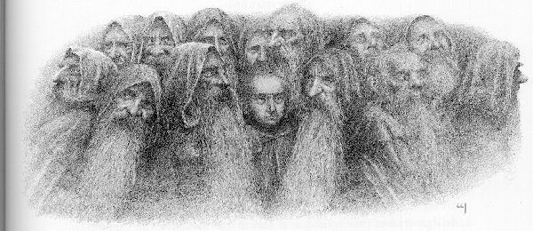
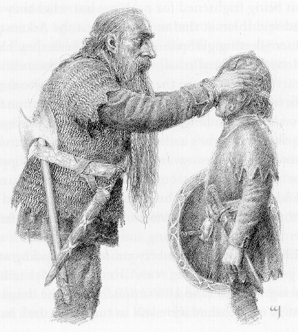
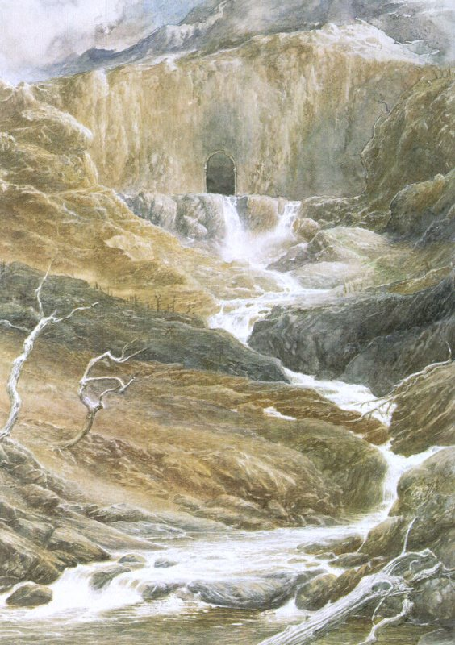

## Kapitel 13: Nicht zu Hause

Unterdessen saßen die <abbr title="der Zwerg, die Zwerge — гном">Zwerge</abbr> im Dunkeln, und völlige Stille legte sich um sie. Sie aßen wenig und sprachen wenig. Wie viel Zeit verging, konnten sie nicht zählen; sie wagten sich kaum zu bewegen, denn schon das Flüstern ihrer Stimmen hallte und raschelte im Gang. Wenn sie einnickten, erwachten sie wieder in derselben Dunkelheit und derselben ungebrochenen Stille. Schließlich, nachdem sie, wie ihnen schien, tagelang gewartet hatten und vor Luftmangel kaum noch atmen konnten und ganz <abbr title="benommen — одурманенный; с затуманенной головой">benommen</abbr> waren, hielten sie es nicht länger aus. Fast hätten sie die Geräusche willkommen geheißen, die von unten die Rückkehr des <abbr title="der Drache, die Drachen — дракон">Drachen</abbr> ankündigten. In der Stille fürchteten sie irgendeine teuflische <abbr title="die List, die Listen — хитрость">List</abbr> von ihm, doch sie konnten nicht ewig dort sitzen.

Thorin ergriff das Wort. — Versuchen wir es mit der Tür! — sagte er. — Ich muss bald den Wind im Gesicht spüren, sonst sterbe ich. Ich glaube, ich würde lieber draußen von Smaug <abbr title="zerschmettern — разбить; сокрушить">zerschmettert</abbr> werden als hier drinnen <abbr title="ersticken — задохнуться">ersticken</abbr>!

So standen mehrere <abbr title="der Zwerg, die Zwerge — гном">Zwerge</abbr> auf und tasteten sich dorthin zurück, wo die Tür gewesen war. Doch das obere Ende des Ganges war <abbr title="zerschmettern — разбить; сокрушить">zerschmettert</abbr> und mit Felsstücken versperrt. Weder der Schlüssel noch die Magie, der diese Tür einst gehorcht hatte, würden sie jemals wieder öffnen.

— Wir sitzen in der <abbr title="die Falle, die Fallen — ловушка">Falle</abbr>! — <abbr title="stöhnen — стонать">stöhnten</abbr> sie. — Das ist das Ende. Wir werden hier sterben.

Doch ausgerechnet jetzt, als die <abbr title="der Zwerg, die Zwerge — гном">Zwerge</abbr> am tiefsten <abbr title="verzweifelt — отчаявшийся">verzweifelt</abbr> waren, wurde Bilbo auf seltsame Weise leichter ums Herz, als sei unter seiner <abbr title="die Weste, die Westen — жилет">Weste</abbr> eine schwere Last verschwunden.

— Nur <abbr title="der Mut — смелость">Mut</abbr>, nur <abbr title="der Mut — смелость">Mut</abbr>! — sagte er. — „Solange man lebt, darf man hoffen“, sagte mein Vater immer, und: „Beim dritten Mal wird alles gut.“ Ich gehe noch einmal den Gang hinunter. Zweimal bin ich diesen Weg gegangen, obwohl ich wusste, dass am anderen Ende ein <abbr title="der Drache, die Drachen — дракон">Drache</abbr> war; da werde ich einen dritten Besuch wagen, wenn ich es nicht mehr sicher weiß. Jedenfalls führt der einzige Weg hinaus nach unten. Und ich glaube, diesmal kommt ihr besser alle mit.

In ihrer <abbr title="die Verzweiflung — отчаяние">Verzweiflung</abbr> willigten sie ein, und Thorin <abbr title="gehen (ging, ist gegangen) — шёл">ging</abbr> als Erster an Bilbos Seite vorwärts.

— Seid jetzt aber vorsichtig! — <abbr title="flüstern — шептать">flüsterte</abbr> der Hobbit. — Und so leise, wie ihr nur könnt! Vielleicht ist Smaug nicht unten, vielleicht aber doch. Gehen wir kein unnötiges Risiko ein!

Hinunter, immer weiter hinunter gingen sie. Mit dem Hobbit konnten die <abbr title="der Zwerg, die Zwerge — гном">Zwerge</abbr> sich natürlich nicht messen, wenn es darum <abbr title="gehen (ging, ist gegangen) — шёл">ging</abbr>, wirklich lautlos zu schleichen. Sie schnauften und <abbr title="schlurfen — шаркать ногами">schlurften</abbr> erheblich, und die <abbr title="das Echo, die Echos — эхо">Echos</abbr> verstärkten diese Geräusche auf beängstigende Weise; doch obwohl Bilbo aus Furcht immer wieder stehen blieb und <abbr title="lauschen — прислушиваться">lauschte</abbr>, regte sich unten kein Laut. Als sie, soweit er es beurteilen konnte, fast am Ende waren, steckte Bilbo seinen Ring an und <abbr title="gehen (ging, ist gegangen) — шёл">ging</abbr> voraus. Aber er brauchte ihn gar nicht: Die Dunkelheit war vollkommen, und sie waren alle <abbr title="unsichtbar — невидимый">unsichtbar</abbr>, mit oder ohne Ring. Tatsächlich war es so schwarz, dass der Hobbit ganz unvermutet die Öffnung erreichte, mit der Hand ins Leere griff, nach vorn <abbr title="stolpern — споткнуться">stolperte</abbr> und kopfüber in die Halle rollte!

Dort lag er mit dem Gesicht nach unten auf dem Boden und wagte nicht aufzustehen, ja kaum zu atmen. Aber nichts bewegte sich. Kein Lichtschimmer war zu <abbr title="sehen (sah, hat gesehen) — увидел">sehen</abbr> — es sei denn, dass ihm, als er endlich langsam den Kopf hob, hoch über sich und weit entfernt in der Finsternis ein blasser weißer Glanz auffiel. Doch ein <abbr title="der Funke, die Funken — искра">Funke</abbr> von Drachenfeuer war es gewiss nicht, obwohl schwerer Drachengestank in der Halle hing und er den <abbr title="der Dunst — испарения; дымка">Dunst</abbr> auf der Zunge schmeckte.

Endlich hielt Herr Baggins es nicht mehr aus. — Verflucht sollst du sein, Smaug, du <abbr title="der Wurm, die Würmer — червь; здесь: дракон">Wurm</abbr>! — <abbr title="quieken — пищать; визжать">quiekte</abbr> er laut. — Hör auf, Verstecken zu spielen! Gib mir Licht und friss mich dann, wenn du mich fangen kannst!

Schwache <abbr title="das Echo, die Echos — эхо">Echos</abbr> liefen durch die unsichtbare Halle, doch eine Antwort kam nicht.

Bilbo stand auf und merkte, dass er nicht wusste, in welche Richtung er sich wenden sollte.

— Was Smaug bloß im Sinn hat? — sagte er. — Er ist heute nicht zu Hause, glaube ich wirklich — oder heute Nacht, oder was immer es gerade ist. Wenn Oin und Gloin ihre <abbr title="die Zunderbüchse, die Zunderbüchsen — коробочка с трутом и огнивом">Zunderbüchsen</abbr> nicht verloren haben, können wir vielleicht ein wenig Licht machen und uns umsehen, bevor unser Glück sich wendet.

— Licht! — rief er. — Kann jemand Licht machen?

Die <abbr title="der Zwerg, die Zwerge — гном">Zwerge</abbr> waren natürlich sehr erschrocken, als Bilbo über die Stufe nach vorn gestürzt und mit einem dumpfen Schlag in der Halle gelandet war. Eng zusammengedrängt saßen sie genau dort am Ende des Ganges, wo er sie zurückgelassen hatte.

— Pst! Pst! — <abbr title="zischen — шипеть">zischten</abbr> sie, als sie seine Stimme hörten. Das half dem Hobbit zwar festzustellen, wo sie waren, doch es dauerte eine Weile, bis er sonst noch etwas aus ihnen herausbekam. Schließlich begann Bilbo tatsächlich auf den Boden zu stampfen und mit seiner <abbr title="schrill — пронзительный">schrillen</abbr> Stimme so laut er konnte „Licht!“ zu schreien. Da gab Thorin nach, und Oin und Gloin wurden zu ihren Bündeln am oberen Ende des Ganges zurückgeschickt.

Nach einer Weile zeigte ein flackernder Schein ihre Rückkehr an: Oin hielt eine kleine brennende Kiefernfackel in der Hand, Gloin trug ein <abbr title="das Bündel, die Bündel — свёрток">Bündel</abbr> weiterer <abbr title="die Fackel, die Fackeln — факел">Fackeln</abbr> unter dem Arm. Schnell lief Bilbo mit kleinen Schritten zur Tür und nahm die <abbr title="die Fackel, die Fackeln — факел">Fackel</abbr>; doch er konnte die <abbr title="der Zwerg, die Zwerge — гном">Zwerge</abbr> noch immer nicht dazu bewegen, die übrigen anzuzünden oder zu ihm zu kommen. Wie Thorin ihm eingehend erklärte, war Herr Baggins offiziell noch immer ihr erfahrener <abbr title="der Einbrecher, die Einbrecher — взломщик">Einbrecher</abbr> und <abbr title="der Kundschafter, die Kundschafter — разведчик">Kundschafter</abbr>. Wenn er mit einem Licht ein Risiko eingehen wollte, so war das seine Sache. Sie würden im Gang auf seinen Bericht warten. Also saßen sie bei der Tür und schauten zu.

Sie sahen, wie die kleine dunkle <abbr title="die Gestalt, die Gestalten — фигура; облик">Gestalt</abbr> des Hobbits über den Boden <abbr title="gehen (ging, ist gegangen) — шёл">ging</abbr> und ihr winziges Licht hochhielt. Solange er noch nahe genug war, bemerkten sie hin und wieder ein Aufblitzen und hörten ein Klimpern, wenn er über irgendeinen goldenen Gegenstand <abbr title="stolpern — споткнуться">stolperte</abbr>. Das Licht wurde kleiner, während er weiter in die <abbr title="gewaltig — огромный; мощный">gewaltige</abbr> Halle wanderte; dann begann es, tanzend in die Höhe zu steigen. Bilbo kletterte auf den großen Schatzhaufen. Bald stand er oben und <abbr title="gehen (ging, ist gegangen) — шёл">ging</abbr> noch immer weiter. Dann sahen sie, wie er stehen blieb und sich einen Augenblick bückte; warum, wussten sie jedoch nicht.

Es war der Arkenstone, das Herz des Berges. Das vermutete Bilbo nach Thorins Beschreibung; und tatsächlich konnte es keine zwei solchen <abbr title="der Edelstein, die Edelsteine — драгоценный камень">Edelsteine</abbr> geben, nicht einmal in einem so wunderbaren <abbr title="der Hort, die Horte — сокровищница; клад">Hort</abbr> und nicht einmal auf der ganzen Welt. Während er hinaufstieg, hatte derselbe weiße Glanz immer vor ihm geleuchtet und seine Schritte zu sich gezogen. Langsam war er zu einer kleinen Kugel aus blassem Licht angewachsen. Jetzt, als Bilbo näher kam, spielte auf ihrer Oberfläche ein flackerndes Funkeln in vielen Farben, das schwankende Licht seiner <abbr title="die Fackel, die Fackeln — факел">Fackel</abbr> spiegelte und brach sich darin. Endlich blickte er auf den Stein hinunter, und ihm stockte der Atem. Das große Juwel leuchtete vor seinen Füßen aus eigenem innerem Licht. Und doch nahm es, geschliffen und geformt von den Zwergen, die es vor langer Zeit aus dem Herzen des Berges gegraben hatten, alles Licht auf, das darauf fiel, und verwandelte es in zehntausend weiße, strahlende <abbr title="der Funke, die Funken — искра">Funken</abbr>, durchzogen vom Glanz des Regenbogens.

Plötzlich streckte Bilbo den Arm danach aus, von seinem Zauber angezogen. Seine kleine Hand konnte den Stein nicht umschließen, denn es war ein großes, schweres Juwel; doch er hob ihn auf, schloss die Augen und steckte ihn in seine tiefste Tasche.

„Jetzt bin ich wirklich ein <abbr title="der Einbrecher, die Einbrecher — взломщик">Einbrecher</abbr>!“, dachte er. „Aber ich muss den Zwergen wohl davon erzählen — irgendwann. Sie haben doch gesagt, ich dürfte meinen <abbr title="der Anteil, die Anteile — доля">Anteil</abbr> selbst aussuchen; und ich glaube, ich würde diesen hier nehmen, wenn sie auch alles andere bekämen!“ Dennoch hatte er das <abbr title="unbehaglich — неуютный; тревожный">unbehagliche</abbr> Gefühl, dass dieses wunderbare Juwel nicht eigentlich zur freien Auswahl hatte gehören sollen und dass daraus noch Schwierigkeiten entstehen würden.

Nun <abbr title="gehen (ging, ist gegangen) — шёл">ging</abbr> er wieder weiter. Er kletterte auf der anderen Seite des großen Haufens hinunter, und der <abbr title="der Funke, die Funken — искра">Funke</abbr> seiner <abbr title="die Fackel, die Fackeln — факел">Fackel</abbr> verschwand aus den Augen der zuschauenden <abbr title="der Zwerg, die Zwerge — гном">Zwerge</abbr>. Bald aber sahen sie ihn wieder, weit entfernt in der Ferne. Bilbo <abbr title="gehen (ging, ist gegangen) — шёл">ging</abbr> über den Boden der Halle.

Er <abbr title="gehen (ging, ist gegangen) — шёл">ging</abbr> weiter, bis er die großen Türen an der gegenüberliegenden Seite erreichte. Dort erfrischte ihn ein <abbr title="der Luftzug, die Luftzüge — сквозняк; струя воздуха">Luftzug</abbr>, blies aber beinahe sein Licht aus. Ängstlich spähte er hindurch und erblickte große Gänge und die undeutlichen Anfänge breiter Treppen, die in die Finsternis hinaufführten. Noch immer war von Smaug weder etwas zu <abbr title="sehen (sah, hat gesehen) — увидел">sehen</abbr> noch zu hören. Eben wollte Bilbo umkehren und zurückgehen, als eine schwarze <abbr title="die Gestalt, die Gestalten — облик; форма">Gestalt</abbr> auf ihn herabschoss und sein Gesicht streifte. Er <abbr title="quieken — пищать; визжать">quiekte</abbr> und fuhr zusammen, <abbr title="stolpern — споткнуться">stolperte</abbr> rückwärts und fiel. Seine <abbr title="die Fackel, die Fackeln — факел">Fackel</abbr> fiel mit der brennenden Spitze nach unten und <abbr title="erlöschen (erlosch, ist erloschen) — погаснуть">erlosch</abbr>!

— Nur eine <abbr title="die Fledermaus, die Fledermäuse — летучая мышь">Fledermaus</abbr>, vermute und hoffe ich! — sagte er kläglich. — Aber was mache ich jetzt? Wo ist Osten, Süden, Norden oder <abbr title="die Weste, die Westen — жилет">Westen</abbr>?

— Thorin! Balin! Oin! Gloin! Fili! Kili! — rief er so laut er konnte; in der weiten Schwärze klang es wie ein dünnes, winziges Geräusch. — Das Licht ist ausgegangen! Einer von euch soll kommen, mich suchen und mir helfen!

Für den Augenblick hatte ihn sein <abbr title="der Mut — смелость">Mut</abbr> völlig verlassen.

Schwach hörten die <abbr title="der Zwerg, die Zwerge — гном">Zwerge</abbr> seine kleinen Rufe, doch das einzige Wort, das sie verstehen konnten, war „Hilfe!“.

— Was um alles in oder unter der Welt ist denn jetzt passiert? — sagte Thorin. — Der <abbr title="der Drache, die Drachen — дракон">Drache</abbr> ist es gewiss nicht, sonst würde er nicht immer weiter <abbr title="quieken — пищать; визжать">quieken</abbr>.

Sie warteten einen Augenblick oder zwei, doch noch immer gab es keine Drachengeräusche, überhaupt keinen Laut außer Bilbos ferner Stimme. — Los, einer von euch soll noch ein oder zwei Lichter holen! — befahl Thorin. — Wir müssen anscheinend <abbr title="gehen (ging, ist gegangen) — шёл">gehen</abbr> und unserem <abbr title="der Einbrecher, die Einbrecher — взломщик">Einbrecher</abbr> helfen.

— Jetzt ist es wohl an uns zu helfen, — sagte Balin, — und ich gehe gern mit. Jedenfalls wird es im Augenblick, denke ich, sicher sein.

Gloin zündete mehrere weitere <abbr title="die Fackel, die Fackeln — факел">Fackeln</abbr> an. Dann schlichen sie alle hinaus, einer nach dem anderen, und gingen so rasch wie möglich an der Wand entlang. Es dauerte nicht lange, bis sie Bilbo selbst trafen, der ihnen entgegenkam. Sobald er das Flackern ihrer Lichter gesehen hatte, war er rasch wieder zur Besinnung gekommen.

— Nur eine <abbr title="die Fledermaus, die Fledermäuse — летучая мышь">Fledermaus</abbr> und eine fallengelassene <abbr title="die Fackel, die Fackeln — факел">Fackel</abbr>, nichts Schlimmeres! — antwortete er auf ihre Fragen. Sie waren zwar sehr <abbr title="erleichtert — испытывающий облегчение">erleichtert</abbr>, doch da sie grundlos erschreckt worden waren, neigten sie nun zum <abbr title="murren — ворчать; роптать">Murren</abbr>. Was sie aber gesagt hätten, wenn er ihnen in diesem Augenblick vom Arkenstone erzählt hätte, weiß ich nicht. Schon die kurzen, flüchtigen Blicke auf <abbr title="der Schatz, die Schätze — клад; сокровище">Schätze</abbr>, die sie unterwegs erhascht hatten, hatten das ganze Feuer ihrer Zwergenherzen wieder entfacht. Und wenn Gold und Juwelen das Herz eines Zwerges wecken, selbst des anständigsten, dann wird er plötzlich kühn und kann auch wild werden.

Die <abbr title="der Zwerg, die Zwerge — гном">Zwerge</abbr> mussten nun wirklich nicht länger <abbr title="anspornen — подбадривать; побуждать">angespornt</abbr> werden. Alle wollten eifrig die Halle erkunden, solange sich ihnen die Gelegenheit bot, und waren bereit zu glauben, dass Smaug fürs Erste nicht zu Hause war. Jeder hielt jetzt eine brennende <abbr title="die Fackel, die Fackeln — факел">Fackel</abbr> fest in der Hand; und während sie bald hierhin, bald dorthin blickten, vergaßen sie ihre Furcht und sogar ihre Vorsicht. Sie sprachen laut und riefen einander zu, während sie alte <abbr title="der Schatz, die Schätze — клад; сокровище">Schätze</abbr> vom Haufen oder von der Wand nahmen, sie ins Licht hielten, streichelten und mit den Fingern betasteten.

Fili und Kili waren beinahe fröhlich. Als sie viele goldene <abbr title="die Harfe, die Harfen — арфа">Harfen</abbr> entdeckten, die noch dort hingen und mit silbernen <abbr title="die Saite, die Saiten — струна">Saiten</abbr> bespannt waren, nahmen sie sie und spielten darauf. Da die <abbr title="die Harfe, die Harfen — арфа">Harfen</abbr> <abbr title="verzaubert — зачарованный">verzaubert</abbr> waren und außerdem vom <abbr title="der Drache, die Drachen — дракон">Drachen</abbr>, der sich wenig für Musik interessierte, nicht angerührt worden waren, waren sie noch immer richtig gestimmt. Die dunkle Halle füllte sich mit einer Melodie, die lange geschwiegen hatte. Doch die meisten <abbr title="der Zwerg, die Zwerge — гном">Zwerge</abbr> waren praktischer: Sie sammelten <abbr title="der Edelstein, die Edelsteine — драгоценный камень">Edelsteine</abbr> und stopften sie in ihre Taschen; was sie nicht tragen konnten, ließen sie <abbr title="seufzen — вздыхать">seufzend</abbr> wieder durch ihre Finger fallen. Thorin stand ihnen darin keineswegs nach; doch die ganze Zeit suchte er überall nach etwas, das er nicht finden konnte. Es war der Arkenstone; aber noch sprach er mit niemandem davon.

Nun nahmen die <abbr title="der Zwerg, die Zwerge — гном">Zwerge</abbr> <abbr title="das Kettenhemd, die Kettenhemden — кольчуга">Kettenhemden</abbr> und <abbr title="die Waffe, die Waffen — оружие">Waffen</abbr> von den Wänden und bewaffneten sich. Wahrhaft königlich <abbr title="sehen (sah, hat gesehen) — увидел">sah</abbr> Thorin aus, in einem Hemd aus vergoldeten Ringen, mit einer Axt mit silbernem Stiel in einem Gürtel, der dicht mit <abbr title="scharlachrot — алый">scharlachroten</abbr> Steinen besetzt war.

— Herr Baggins! — rief er. — Hier ist die erste Zahlung deiner <abbr title="die Belohnung, die Belohnungen — вознаграждение">Belohnung</abbr>! Leg deinen alten Rock ab und zieh das hier an!

Damit zog er Bilbo ein kleines <abbr title="das Kettenhemd, die Kettenhemden — кольчуга">Kettenhemd</abbr> an, das vor langer Zeit für einen jungen Elfenfürsten <abbr title="schmieden — ковать">geschmiedet</abbr> worden war. Es bestand aus Silberstahl, den die <abbr title="der Elf, die Elfen — эльф">Elfen</abbr> mithril nennen, und dazu gehörte ein Gürtel aus Perlen und Kristallen. Man setzte dem Hobbit einen leichten Helm aus gemustertem <abbr title="das Leder — кожа (материал)">Leder</abbr> auf den Kopf, der innen mit Stahlreifen verstärkt und rings am Rand mit weißen <abbr title="der Edelstein, die Edelsteine — драгоценный камень">Edelsteinen</abbr> besetzt war.

„Ich fühle mich großartig“, dachte er, „aber ich sehe vermutlich ziemlich <abbr title="lächerlich — нелепый; смешной">lächerlich</abbr> aus. Wie sie zu Hause auf The Hill lachen würden! Trotzdem wünschte ich, es wäre ein Spiegel zur Hand!“

Dennoch hielt Herr Baggins seinen Kopf besser frei vom Zauber des Hortes als die <abbr title="der Zwerg, die Zwerge — гном">Zwerge</abbr>. Lange bevor die <abbr title="der Zwerg, die Zwerge — гном">Zwerge</abbr> genug davon hatten, die <abbr title="der Schatz, die Schätze — клад; сокровище">Schätze</abbr> zu untersuchen, hatte er genug davon und setzte sich auf den Boden; nervös begann er sich zu fragen, wie das alles enden würde. „Ich würde viele dieser kostbaren <abbr title="der Kelch, die Kelche — кубок">Kelche</abbr> hergeben“, dachte er, „für einen Schluck von etwas Aufmunterndem aus einer von Beorns Holzschalen!“

— Thorin! — rief er laut. — Was nun? Wir sind bewaffnet, aber was hat irgendeine <abbr title="die Rüstung, die Rüstungen — доспехи">Rüstung</abbr> je gegen Smaug den Schrecklichen ausgerichtet? Dieser <abbr title="der Schatz, die Schätze — клад; сокровище">Schatz</abbr> ist noch nicht zurückgewonnen. Wir suchen noch nicht nach Gold, sondern nach einem Weg hinaus; und wir haben unser Glück schon zu lange herausgefordert!

— Du sprichst die Wahrheit! — antwortete Thorin, der wieder zu <abbr title="der Verstand — ум; рассудок">Verstand</abbr> kam. — Gehen wir! Ich werde euch führen. Nicht in tausend Jahren würde ich die Wege dieses Palastes vergessen.

Dann rief er die anderen herbei, und sie versammelten sich. Mit den <abbr title="die Fackel, die Fackeln — факел">Fackeln</abbr> über den Köpfen schritten sie durch die weit offenen Türen, nicht ohne manchen <abbr title="sehnsüchtig — тоскующий; полный страстного желания">sehnsüchtigen</abbr> Blick zurückzuwerfen.

Ihre glänzenden <abbr title="das Kettenhemd, die Kettenhemden — кольчуга">Kettenhemden</abbr> hatten sie wieder mit ihren alten Mänteln bedeckt, die hellen Helme mit ihren zerrissenen <abbr title="die Kapuze, die Kapuzen — капюшон">Kapuzen</abbr>. Einer nach dem anderen gingen sie hinter Thorin her, eine Reihe kleiner Lichter in der Dunkelheit, die oft stehen blieb und wieder ängstlich auf jedes Geräusch <abbr title="lauschen — прислушиваться">lauschte</abbr>, das die Rückkehr des <abbr title="der Drache, die Drachen — дракон">Drachen</abbr> <abbr title="verraten (verriet, hat verraten) — выдать; раскрыть">verraten</abbr> konnte.

Obwohl aller alte Schmuck längst <abbr title="vermodern — истлеть; сгнить">vermodert</abbr> oder zerstört war und das Kommen und Gehen des Ungeheuers alles beschmutzt und verwüstet hatte, kannte Thorin jeden Gang und jede Biegung. Sie stiegen lange Treppen hinauf, <abbr title="biegen (bog, hat gebogen) — гнуть">bogen</abbr> ab und gingen breite, hallende Gänge entlang, <abbr title="biegen (bog, hat gebogen) — гнуть">bogen</abbr> wieder ab und stiegen noch mehr Treppen hinauf, und dann abermals weitere Treppen. Diese waren glatt, breit und schön aus dem gewachsenen Fels gehauen; und höher, immer höher stiegen die <abbr title="der Zwerg, die Zwerge — гном">Zwerge</abbr>, ohne eine Spur von etwas Lebendigem zu finden. Nur heimliche <abbr title="der Schatten, die Schatten — тень">Schatten</abbr> flohen vor ihren näher kommenden <abbr title="die Fackel, die Fackeln — факел">Fackeln</abbr>, deren Flammen in den Luftzügen flatterten.

Für Hobbitbeine waren diese Stufen allerdings nicht gemacht, und Bilbo glaubte eben, keinen Schritt mehr tun zu können, als plötzlich die Decke hoch und weit über die Reichweite ihres Fackellichts emporstieg. Durch irgendeine Öffnung weit oben war ein weißer Schimmer zu <abbr title="sehen (sah, hat gesehen) — увидел">sehen</abbr>, und die Luft roch frischer. Vor ihnen fiel mattes Licht durch große Türen, die verdreht in ihren <abbr title="die Angel, die Angeln — петля двери">Angeln</abbr> hingen und halb verbrannt waren.

— Das ist der große Saal von Thror, — sagte Thorin, — die Halle für Feste und Beratungen. Jetzt ist das Front Gate nicht mehr weit.

Sie durchquerten den zerstörten Saal. Tische verfaulten dort; Stühle und Bänke lagen umgestürzt, <abbr title="verkohlen — обуглиться">verkohlt</abbr> und zerfallend umher. Auf dem Boden lagen <abbr title="der Schädel, die Schädel — череп">Schädel</abbr> und <abbr title="der Knochen, die Knochen — кость">Knochen</abbr> zwischen Krügen und Schalen und zerbrochenen Trinkhörnern und <abbr title="der Staub — пыль">Staub</abbr>. Als sie durch weitere Türen am anderen Ende traten, drang das Rauschen von Wasser an ihre Ohren, und das graue Licht wurde plötzlich viel heller.

— Dort entspringt der River Running, — sagte Thorin. — Von hier eilt er zum Tor. Folgen wir ihm!

Aus einer dunklen Öffnung in einer Felswand quoll <abbr title="brodeln — бурлить">brodelndes</abbr> Wasser hervor und floss wirbelnd durch eine schmale <abbr title="die Rinne, die Rinnen — желоб; русло">Rinne</abbr>, die durch die Kunst längst vergangener Hände tief ausgehauen und gerade angelegt worden war. Daneben verlief eine mit Steinen gepflasterte Straße, breit genug für viele Männer nebeneinander. Rasch liefen sie daran entlang und um eine weite Biegung — und siehe da! Vor ihnen stand das volle Tageslicht. Ein hoher Bogen erhob sich vor ihnen, in dessen Innerem noch Reste alter <abbr title="die Steinmetzarbeit, die Steinmetzarbeiten — резьба по камню">Steinmetzarbeit</abbr> zu <abbr title="sehen (sah, hat gesehen) — увидел">sehen</abbr> waren, wenn auch abgenutzt, zersplittert und geschwärzt. Eine dunstige Sonne schickte ihr blasses Licht zwischen die Arme des Berges, und goldene Strahlen fielen auf das Pflaster an der <abbr title="die Schwelle, die Schwellen — порог">Schwelle</abbr>.

Ein Schwarm <abbr title="die Fledermaus, die Fledermäuse — летучая мышь">Fledermäuse</abbr>, von ihren rauchenden <abbr title="die Fackel, die Fackeln — факел">Fackeln</abbr> aus dem Schlaf aufgeschreckt, flatterte wirr über sie hinweg. Als sie vorwärtssprangen, glitten ihre Füße auf den Steinen aus, die der <abbr title="der Drache, die Drachen — дракон">Drache</abbr> beim Darübergleiten glatt gerieben und mit <abbr title="der Schleim — слизь">Schleim</abbr> bedeckt hatte. Nun stürzte das Wasser vor ihnen laut rauschend hinaus und schäumte zum Tal hinab. Sie warfen ihre blass brennenden <abbr title="die Fackel, die Fackeln — факел">Fackeln</abbr> auf den Boden und standen da, mit geblendeten Augen hinausblickend. Sie hatten das Front Gate erreicht und schauten auf Dale hinaus.

— Also! — sagte Bilbo. — Ich hätte nie gedacht, dass ich einmal aus dieser Tür hinausschauen würde. Und ich hätte nie gedacht, dass ich mich so freuen würde, die Sonne wiederzusehen und den Wind im Gesicht zu spüren. Aber, au! Dieser Wind ist kalt!

Das war er. Ein bitterkalter Ostwind blies und drohte mit dem nahenden Winter. Er wirbelte über die Arme des Berges und um sie herum ins Tal und <abbr title="seufzen — вздыхать">seufzte</abbr> zwischen den <abbr title="der Felsen, die Felsen — скала; утёс">Felsen</abbr>. Nach der langen Zeit in den drückend heißen Tiefen der vom <abbr title="der Drache, die Drachen — дракон">Drachen</abbr> heimgesuchten <abbr title="die Höhle, die Höhlen — нора; пещера">Höhlen</abbr> zitterten sie in der Sonne.

Plötzlich merkte Bilbo, dass er nicht nur müde war, sondern auch ganz entsetzlich hungrig. — Es scheint später Vormittag zu sein, — sagte er, — also mehr oder weniger Frühstückszeit, nehme ich an — falls es überhaupt ein Frühstück gibt. Aber Smaugs vordere Türstufe scheint mir nicht der sicherste Ort für eine Mahlzeit zu sein. Gehen wir doch irgendwohin, wo wir eine Weile in Ruhe sitzen können!

— Ganz richtig! — sagte Balin. — Und ich glaube, ich weiß, wohin wir <abbr title="gehen (ging, ist gegangen) — шёл">gehen</abbr> sollten: zum alten <abbr title="der Ausguck, die Ausgucke — наблюдательный пост">Ausguck</abbr> an der Südwestecke des Berges.

— Wie weit ist das? — fragte der Hobbit.

— Fünf Stunden Fußmarsch, denke ich. Es wird ein beschwerlicher Weg. Die Straße vom Tor am linken Rand des Baches entlang scheint ganz zerstört zu sein. Aber sieh dort unten! Der Fluss macht plötzlich einen Bogen nach Osten, quer durch Dale vor der zerstörten Stadt. Dort stand einst eine Brücke, die zu einer steilen Treppe führte. Die stieg am rechten Ufer hinauf zu einer Straße in Richtung Ravenhill. Es gibt — oder gab — einen Pfad, der von dieser Straße abzweigt und zum Posten hinaufsteigt. Das ist ein harter Aufstieg, selbst wenn die alten Stufen noch da sind.

— Ach, du meine Güte! — <abbr title="brummen — ворчать; бурчать">brummte</abbr> der Hobbit. — Noch mehr <abbr title="gehen (ging, ist gegangen) — шёл">gehen</abbr> und noch mehr klettern, ohne Frühstück! Wie viele Frühstücke und andere Mahlzeiten haben wir wohl in diesem scheußlichen Loch ohne Uhr und Zeit verpasst?

Tatsächlich waren zwei Nächte und der Tag dazwischen vergangen — und nicht ganz ohne Essen —, seit der <abbr title="der Drache, die Drachen — дракон">Drache</abbr> die Zaubertür <abbr title="zerschmettern — разбить; сокрушить">zerschmettert</abbr> hatte. Doch Bilbo hatte völlig den Überblick verloren; soweit er wusste, hätte es eine einzige Nacht oder eine ganze Woche voller Nächte sein können.

— Na, na! — sagte Thorin lachend; seine Stimmung hatte sich wieder zu heben begonnen, und er ließ die kostbaren Steine in seinen Taschen klappern. — Nenn meinen <abbr title="der Palast, die Paläste — дворец">Palast</abbr> nicht ein scheußliches Loch! Warte nur, bis er gereinigt und neu ausgeschmückt ist!

— Das wird erst sein, wenn Smaug tot ist, — sagte Bilbo düster. — Und wo ist er inzwischen? Ein gutes Frühstück würde ich hergeben, um das zu wissen. Hoffentlich sitzt er nicht oben auf dem Berg und schaut auf uns herab!

Dieser Gedanke beunruhigte die <abbr title="der Zwerg, die Zwerge — гном">Zwerge</abbr> sehr, und sie entschieden rasch, dass Bilbo und Balin recht hatten.

— Wir müssen von hier fort, — sagte Dori. — Ich habe das Gefühl, als würden seine Augen mir in den <abbr title="der Hinterkopf, die Hinterköpfe — затылок">Hinterkopf</abbr> starren.

— Es ist ein kalter, einsamer Ort, — sagte Bombur. — Zu trinken mag es hier etwas geben, aber von Essen sehe ich keine Spur. In solchen Gegenden wäre ein <abbr title="der Drache, die Drachen — дракон">Drache</abbr> immer hungrig.

— Weiter! Weiter! — riefen die anderen. — Nehmen wir Balins Weg!

Unter der Felswand rechts gab es keinen Pfad, also gingen sie <abbr title="mühsam — трудный; утомительный">mühsam</abbr> zwischen den Steinen auf der linken Flussseite weiter. Die Leere und <abbr title="die Verwüstung, die Verwüstungen — опустошение">Verwüstung</abbr> brachten bald sogar Thorin wieder zur Besinnung. Die Brücke, von der Balin gesprochen hatte, fanden sie längst eingestürzt; die meisten ihrer Steine lagen nun als bloße <abbr title="der Felsbrocken, die Felsbrocken — валун; обломок скалы">Felsbrocken</abbr> im flachen, rauschenden Bach. Doch sie <abbr title="waten — идти вброд">wateten</abbr> ohne große Mühe durchs Wasser, fanden die uralten Stufen und stiegen das hohe Ufer hinauf. Nach einem kurzen Wegstück erreichten sie die alte Straße und kamen bald in eine tiefe kleine Talmulde, die geschützt zwischen den <abbr title="der Felsen, die Felsen — скала; утёс">Felsen</abbr> lag. Dort ruhten sie eine Weile und frühstückten, so gut es <abbr title="gehen (ging, ist gegangen) — шёл">ging</abbr>, hauptsächlich <abbr title="das Hartbrot — сухой дорожный хлеб">Hartbrot</abbr> und Wasser. (Wenn ihr wissen wollt, was dieses <abbr title="das Hartbrot — сухой дорожный хлеб">Hartbrot</abbr> ist, kann ich nur sagen, dass ich das Rezept nicht kenne. Es ist keksartig, hält sich unbegrenzt, soll kräftigen und ist gewiss nicht unterhaltsam; tatsächlich ist es völlig uninteressant, außer als Kauübung. Die Menschen vom See stellten es für lange Reisen her.)

Danach gingen sie wieder weiter. Nun wandte sich die Straße nach <abbr title="die Weste, die Westen — жилет">Westen</abbr> und verließ den Fluss; die große Schulter des nach Süden gerichteten <abbr title="der Bergausläufer, die Bergausläufer — отрог горы">Bergausläufers</abbr> rückte immer näher. Endlich erreichten sie den Bergpfad. Er führte steil hinauf, und sie stapften langsam einer hinter dem anderen weiter, bis sie am späten Nachmittag schließlich die Höhe des Kammes erreichten und die winterliche Sonne im <abbr title="die Weste, die Westen — жилет">Westen</abbr> sinken sahen.

Hier fanden sie einen ebenen Platz, der auf drei Seiten keine Wand hatte, im Norden jedoch von einer Felswand begrenzt wurde, in der sich eine türartige Öffnung befand. Von dieser Tür aus bot sich ein weiter Blick nach Osten, Süden und <abbr title="die Weste, die Westen — жилет">Westen</abbr>.

— Hier, — sagte Balin, — standen in den alten Zeiten immer unsere <abbr title="die Wache, die Wachen — часовой; стражник">Wachen</abbr>. Die Tür hinter uns führt in eine aus dem <abbr title="der Felsen, die Felsen — скала; утёс">Felsen</abbr> gehauene Kammer, die hier als Wachraum angelegt wurde. Rund um den Berg gab es mehrere solche Orte. Doch in den Tagen unseres <abbr title="der Wohlstand — благосостояние; достаток">Wohlstands</abbr> schien kaum Wachsamkeit nötig zu sein, und vielleicht hatten es die <abbr title="die Wache, die Wachen — часовой; стражник">Wachen</abbr> zu bequem. Sonst hätten wir womöglich früher von der Ankunft des <abbr title="der Drache, die Drachen — дракон">Drachen</abbr> erfahren, und alles hätte anders kommen können. Immerhin können wir jetzt eine Weile hier verborgen und geschützt liegen und vieles <abbr title="sehen (sah, hat gesehen) — увидел">sehen</abbr>, ohne selbst gesehen zu werden.

— Das hilft nicht viel, wenn man uns schon auf dem Weg hierher gesehen hat, — sagte Dori. Er blickte ständig zum <abbr title="der Gipfel, die Gipfel — горная вершина">Gipfel</abbr> des Berges hinauf, als erwarte er, Smaug dort sitzen zu <abbr title="sehen (sah, hat gesehen) — увидел">sehen</abbr> wie einen Vogel auf einem <abbr title="der Kirchturm, die Kirchtürme — церковная башня">Kirchturm</abbr>.

— Das müssen wir eben riskieren, — sagte Thorin. — Heute können wir nicht weitergehen.

— Sehr richtig! — rief Bilbo und warf sich auf den Boden.

In der Felskammer hätten hundert Platz gehabt, und weiter im Innern lag noch eine kleine Kammer, die von der Kälte draußen besser abgeschirmt war. Alles war völlig verlassen; nicht einmal wilde Tiere schienen die Räume während der ganzen Zeit von Smaugs Herrschaft benutzt zu haben. Dort legten sie ihre Lasten ab. Einige warfen sich sofort nieder und schliefen, die anderen aber saßen bei der äußeren Tür und besprachen ihre Pläne. In all ihren Gesprächen kehrten sie immer wieder zu einer Frage zurück: Wo war Smaug? Sie blickten nach <abbr title="die Weste, die Westen — жилет">Westen</abbr>, und da war nichts, und nach Osten, und da war nichts. Auch im Süden war vom <abbr title="der Drache, die Drachen — дракон">Drachen</abbr> keine Spur, doch dort sammelten sich sehr viele Vögel. Darauf starrten sie und wunderten sich; aber als die ersten kalten Sterne erschienen, waren sie dem Verständnis noch keinen Schritt näher.

---

### Neue und schwierige Wörter

- **der Zwerg, die Zwerge** — гном *(Wiederholung)*
- **benommen** — одурманенный; с затуманенной головой *(neu)*
- **der Drache, die Drachen** — дракон *(Wiederholung)*
- **die List, die Listen** — хитрость *(Wiederholung)*
- **zerschmettern** — разбить; сокрушить *(neu)*
- **ersticken** — задохнуться *(Wiederholung)*
- **die Falle, die Fallen** — ловушка *(Wiederholung)*
- **stöhnen** — стонать *(Wiederholung)*
- **verzweifelt** — отчаявшийся *(Wiederholung)*
- **die Weste, die Westen** — жилет *(Wiederholung)*
- **der Mut** — смелость *(Wiederholung)*
- **die Verzweiflung** — отчаяние *(Wiederholung)*
- **gehen (ging, ist gegangen)** — шёл *(Wiederholung)*
- **flüstern** — шептать *(Wiederholung)*
- **schlurfen** — шаркать ногами *(neu)*
- **das Echo, die Echos** — эхо *(Wiederholung)*
- **lauschen** — прислушиваться *(Wiederholung)*
- **unsichtbar** — невидимый *(Wiederholung)*
- **stolpern** — споткнуться *(Wiederholung)*
- **sehen (sah, hat gesehen)** — увидел *(Wiederholung)*
- **der Funke, die Funken** — искра *(Wiederholung)*
- **der Dunst** — испарения; дымка *(Wiederholung)*
- **der Wurm, die Würmer** — червь; здесь: дракон *(Wiederholung)*
- **quieken** — пищать; визжать *(neu)*
- **die Zunderbüchse, die Zunderbüchsen** — коробочка с трутом и огнивом *(neu)*
- **zischen** — шипеть *(Wiederholung)*
- **schrill** — пронзительный *(neu)*
- **das Bündel, die Bündel** — свёрток *(Wiederholung)*
- **die Fackel, die Fackeln** — факел *(Wiederholung)*
- **der Einbrecher, die Einbrecher** — взломщик *(Wiederholung)*
- **der Kundschafter, die Kundschafter** — разведчик *(Wiederholung)*
- **die Gestalt, die Gestalten** — фигура; облик *(Wiederholung)*
- **gewaltig** — огромный; мощный *(neu)*
- **der Edelstein, die Edelsteine** — драгоценный камень *(Wiederholung)*
- **der Hort, die Horte** — сокровищница; клад *(neu)*
- **der Anteil, die Anteile** — доля *(Wiederholung)*
- **unbehaglich** — неуютный; тревожный *(neu)*
- **der Luftzug, die Luftzüge** — сквозняк; струя воздуха *(neu)*
- **erlöschen (erlosch, ist erloschen)** — погаснуть *(neu)*
- **die Fledermaus, die Fledermäuse** — летучая мышь *(Wiederholung)*
- **erleichtert** — испытывающий облегчение *(Wiederholung)*
- **murren** — ворчать; роптать *(Wiederholung)*
- **der Schatz, die Schätze** — клад; сокровище *(Wiederholung)*
- **anspornen** — подбадривать; побуждать *(neu)*
- **die Harfe, die Harfen** — арфа *(Wiederholung)*
- **die Saite, die Saiten** — струна *(Wiederholung)*
- **verzaubert** — зачарованный *(Wiederholung)*
- **seufzen** — вздыхать *(Wiederholung)*
- **das Kettenhemd, die Kettenhemden** — кольчуга *(Wiederholung)*
- **die Waffe, die Waffen** — оружие *(Wiederholung)*
- **scharlachrot** — алый *(Wiederholung)*
- **die Belohnung, die Belohnungen** — вознаграждение *(Wiederholung)*
- **schmieden** — ковать *(Wiederholung)*
- **der Elf, die Elfen** — эльф *(Wiederholung)*
- **das Leder** — кожа (материал) *(Wiederholung)*
- **lächerlich** — нелепый; смешной *(neu)*
- **der Kelch, die Kelche** — кубок *(neu)*
- **die Rüstung, die Rüstungen** — доспехи *(Wiederholung)*
- **der Verstand** — ум; рассудок *(Wiederholung)*
- **sehnsüchtig** — тоскующий; полный страстного желания *(neu)*
- **die Kapuze, die Kapuzen** — капюшон *(Wiederholung)*
- **verraten (verriet, hat verraten)** — выдать; раскрыть *(Wiederholung)*
- **vermodern** — истлеть; сгнить *(neu)*
- **biegen (bog, hat gebogen)** — гнуть *(Wiederholung)*
- **der Schatten, die Schatten** — тень *(Wiederholung)*
- **die Angel, die Angeln** — петля двери *(neu)*
- **verkohlen** — обуглиться *(neu)*
- **der Schädel, die Schädel** — череп *(neu)*
- **der Knochen, die Knochen** — кость *(Wiederholung)*
- **der Staub** — пыль *(Wiederholung)*
- **brodeln** — бурлить *(neu)*
- **die Rinne, die Rinnen** — желоб; русло *(neu)*
- **die Steinmetzarbeit, die Steinmetzarbeiten** — резьба по камню *(neu)*
- **die Schwelle, die Schwellen** — порог *(Wiederholung)*
- **der Schleim** — слизь *(Wiederholung)*
- **der Felsen, die Felsen** — скала; утёс *(Wiederholung)*
- **die Höhle, die Höhlen** — нора; пещера *(Wiederholung)*
- **der Ausguck, die Ausgucke** — наблюдательный пост *(neu)*
- **brummen** — ворчать; бурчать *(Wiederholung)*
- **der Palast, die Paläste** — дворец *(Wiederholung)*
- **der Hinterkopf, die Hinterköpfe** — затылок *(neu)*
- **mühsam** — трудный; утомительный *(Wiederholung)*
- **die Verwüstung, die Verwüstungen** — опустошение *(neu)*
- **der Felsbrocken, die Felsbrocken** — валун; обломок скалы *(Wiederholung)*
- **waten** — идти вброд *(Wiederholung)*
- **das Hartbrot** — сухой дорожный хлеб *(neu)*
- **der Bergausläufer, die Bergausläufer** — отрог горы *(neu)*
- **die Wache, die Wachen** — часовой; стражник *(Wiederholung)*
- **der Wohlstand** — благосостояние; достаток *(neu)*
- **der Gipfel, die Gipfel** — горная вершина *(Wiederholung)*
- **der Kirchturm, die Kirchtürme** — церковная башня *(neu)*

### Schwierige Sätze

- **„Weder der Schlüssel noch die Magie, der diese Tür einst gehorcht hatte, würden sie jemals wieder öffnen.“**  
  «Ни ключ, ни магия, которой эта дверь некогда подчинялась, никогда больше её не откроют». `weder … noch` — «ни… ни…»; `der` относится к `Magie`, Dativ после `gehorchen`. `hatte gehorcht` обозначает предшествующее прошлое.
- **„Doch ausgerechnet jetzt, als die Zwerge am tiefsten verzweifelt waren, wurde Bilbo auf seltsame Weise leichter ums Herz, als sei unter seiner Weste eine schwere Last verschwunden.“**  
  «Но именно теперь, когда гномы были в самом глубоком отчаянии, Бильбо стало странным образом легче на сердце, словно из-под его жилета исчезла тяжёлая ноша». `leichter ums Herz werden` — почувствовать облегчение; `als sei … verschwunden` — предположительное сравнение с Konjunktiv I Perfekt.
- **„Tatsächlich war es so schwarz, dass der Hobbit ganz unvermutet die Öffnung erreichte, mit der Hand ins Leere griff, nach vorn stolperte und kopfüber in die Halle rollte!“**  
  «На самом деле было так темно, что хоббит совершенно неожиданно дошёл до проёма, схватил рукой пустоту, споткнулся и полетел головой вперёд в зал!» `so …, dass` выражает следствие; несколько глаголов одного придаточного образуют цепочку действий.
- **„Was sie aber gesagt hätten, wenn er ihnen in diesem Augenblick vom Arkenstone erzählt hätte, weiß ich nicht.“**  
  «Но что они сказали бы, если бы он в ту минуту рассказал им об Аркенстоне, я не знаю». `hätten gesagt` и `hätte erzählt` — Konjunktiv II прошедшего времени: событие не произошло. Придаточный вопрос вынесен перед главным предложением.
- **„Lange bevor die Zwerge genug davon hatten, die Schätze zu untersuchen, hatte er genug davon und setzte sich auf den Boden; nervös begann er sich zu fragen, wie das alles enden würde.“**  
  «Задолго до того, как гномам надоело рассматривать сокровища, ему это наскучило и он сел на пол; он начал тревожно спрашивать себя, чем всё это кончится». `bevor` вводит временное придаточное; `genug davon haben` — пресытиться чем-либо, причём `davon` здесь отсылает к действию `die Schätze zu untersuchen`. `enden würde` обозначает будущее с точки зрения прошлого.
- **„Nicht in tausend Jahren würde ich die Wege dieses Palastes vergessen.“**  
  «И за тысячу лет я не забыл бы ходов этого дворца». `würde + Infinitiv` передаёт уверенное гипотетическое утверждение; вынесенное вперёд `Nicht in tausend Jahren` усиливает отрицание.
- **„Sonst hätten wir womöglich früher von der Ankunft des Drachen erfahren, und alles hätte anders kommen können.“**  
  «Иначе мы, возможно, раньше узнали бы о прибытии дракона, и всё могло бы сложиться по-другому». `sonst` — «иначе»; `hätte … kommen können` — Konjunktiv II Vergangenheit с двойным инфинитивом при модальном глаголе.
- **„Immerhin können wir jetzt eine Weile hier verborgen und geschützt liegen und vieles sehen, ohne selbst gesehen zu werden.“**  
  «Во всяком случае, теперь мы можем некоторое время укрываться здесь под защитой и многое видеть, оставаясь невидимыми для других». `ohne … zu` обозначает отсутствие сопутствующего действия; `gesehen zu werden` — пассивный инфинитив.
- **„In der Felskammer hätten hundert Platz gehabt, und weiter im Innern lag noch eine kleine Kammer, die von der Kälte draußen besser abgeschirmt war.“**  
  «В каменной комнате могли бы разместиться сто человек, а дальше внутри была ещё маленькая комната, лучше защищённая от наружного холода». `hätten Platz gehabt` описывает неиспользованную вместимость; `die` вводит относительное придаточное, `war abgeschirmt` описывает состояние.

[← Zurück](kapitel-12.md) · [Inhalt](README.md) · [Weiter →](kapitel-14.md)
