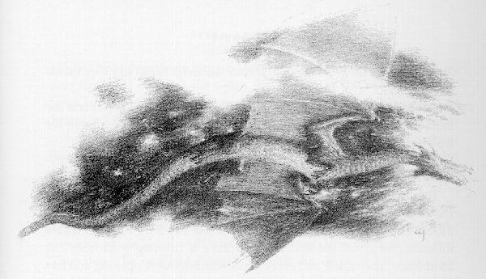
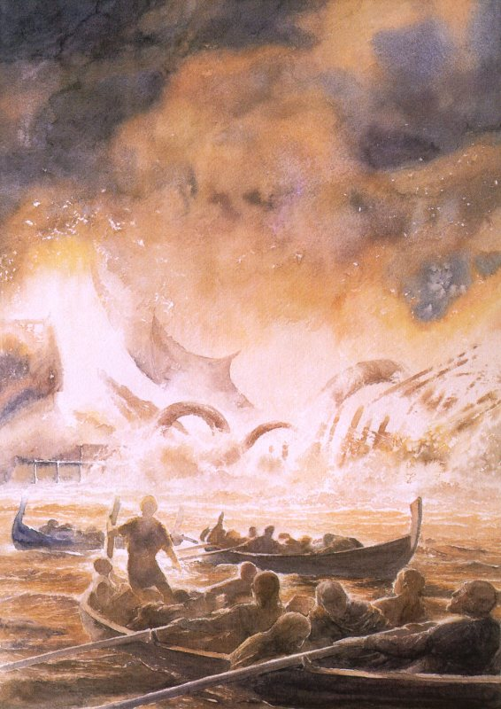

## Kapitel 14: Feuer und Wasser

Wenn ihr nun, wie die <abbr title="der Zwerg, die Zwerge — гном">Zwerge</abbr>, Nachrichten von Smaug hören wollt, müsst ihr noch einmal zu jenem Abend zurückkehren, an dem er die Tür zerschlug und wütend davonflog, zwei Tage zuvor.

Die Menschen in der Seestadt Esgaroth waren meist in ihren Häusern, denn der Wind kam kalt aus dem schwarzen Osten. Einige aber gingen auf den <abbr title="der Uferkai, die Uferkais — набережная">Uferkais</abbr> spazieren und beobachteten, wie sie es gern taten, die Sterne. Sobald diese am Himmel hervortraten, glänzten ihre Spiegelbilder auf den glatten Stellen des Sees. Von der Stadt aus verdeckten die niedrigen Hügel am fernen Ende des Sees den größten Teil des Lonely Mountain; durch eine Lücke zwischen ihnen kam der River Running aus dem Norden herab. Nur seinen hohen <abbr title="der Gipfel, die Gipfel — вершина">Gipfel</abbr> konnten sie bei klarem Wetter <abbr title="sehen (sah, hat gesehen) — увидел">sehen</abbr>. Selten schauten sie zu ihm hin, denn selbst im Morgenlicht wirkte er <abbr title="unheilvoll — зловещий">unheilvoll</abbr> und <abbr title="trostlos — безрадостный; унылый">trostlos</abbr>. Jetzt war er verschwunden, von der Dunkelheit ausgelöscht.

Plötzlich flackerte er wieder auf; ein kurzer Lichtschein berührte ihn und <abbr title="erlöschen (erlosch, ist erloschen) — погаснуть">erlosch</abbr>.

— Seht! — sagte einer. — Wieder die Lichter! Letzte Nacht haben die <abbr title="die Wache, die Wachen — стражник">Wachen</abbr> sie von Mitternacht bis zum Morgengrauen aufleuchten und <abbr title="erlöschen (erlosch, ist erloschen) — погаснуть">erlöschen</abbr> <abbr title="sehen (sah, hat gesehen) — увидел">sehen</abbr>. Dort oben geschieht etwas.

— Vielleicht <abbr title="schmieden — ковать">schmiedet</abbr> der König unter dem Berg Gold, — sagte ein anderer. — Es ist lange her, seit er nach Norden zog. Es wird Zeit, dass die Lieder wieder wahr werden.

— Welcher König? — fragte ein anderer mit finsterer Stimme. — Wahrscheinlich ist es das plündernde Feuer des <abbr title="der Drache, die Drachen — дракон">Drachen</abbr>, des einzigen Königs unter dem Berg, den wir je gekannt haben.

— Du sagst immer nur düstere Dinge voraus! — sagten die anderen. — Alles, von <abbr title="die Überschwemmung, die Überschwemmungen — наводнение">Überschwemmungen</abbr> bis zu vergifteten Fischen. Denk doch einmal an etwas Erfreuliches!

Da erschien plötzlich ein gewaltiges Licht in der Senke zwischen den Hügeln, und das nördliche Ende des Sees wurde golden.

— Der König unter dem Berg! — riefen sie. — Sein Reichtum gleicht der Sonne, sein Silber einem Quell, und golden strömen seine Flüsse! Der Fluss trägt Gold vom Berg herab!

Überall öffneten sich Fenster, überall eilten Füße herbei.

Wieder herrschten ungeheure Aufregung und <abbr title="die Begeisterung — восторг; воодушевление">Begeisterung</abbr>. Doch der Mann mit der finsteren Stimme rannte so schnell er konnte zum Stadtherrn.

— Der <abbr title="der Drache, die Drachen — дракон">Drache</abbr> kommt, oder ich bin ein Narr! — schrie er. — Reißt die Brücken ab! Zu den <abbr title="die Waffe, die Waffen — оружие">Waffen</abbr>! Zu den <abbr title="die Waffe, die Waffen — оружие">Waffen</abbr>!

Plötzlich wurden warnende <abbr title="die Trompete, die Trompeten — труба (инструмент)">Trompeten</abbr> geblasen; ihr <abbr title="das Echo, die Echos — эхо">Echo</abbr> lief an den felsigen Ufern entlang. Der <abbr title="der Jubel — ликование">Jubel</abbr> verstummte, und die Freude verwandelte sich in Angst. So fand der <abbr title="der Drache, die Drachen — дракон">Drache</abbr> sie nicht völlig unvorbereitet.

Bei seiner ungeheuren Geschwindigkeit dauerte es nicht lange, bis sie ihn <abbr title="sehen (sah, hat gesehen) — увидел">sehen</abbr> konnten: einen <abbr title="der Funke, die Funken — искра">Funken</abbr> aus Feuer, der auf sie zuraste und immer größer und heller wurde. Nicht einmal der Dümmste zweifelte nun daran, dass die <abbr title="die Prophezeiung, die Prophezeiungen — пророчество">Prophezeiungen</abbr> ziemlich fehlgegangen waren. Doch ihnen blieb noch ein wenig Zeit. Jedes Gefäß in der Stadt wurde mit Wasser gefüllt, jeder Krieger bewaffnet, jeder <abbr title="der Pfeil, die Pfeile — стрела">Pfeil</abbr> und jeder Wurfspieß bereitgelegt. Die Brücke zum Land wurde abgebrochen und zerstört, bevor das Dröhnen von Smaugs schrecklichem Anflug laut wurde und der See unter den furchtbaren Schlägen seiner Flügel feuerrot Wellen schlug. Zwischen Schreien, Klagen und den Rufen der Männer kam er über sie, schoss auf die Brücken zu — und <abbr title="sehen (sah, hat gesehen) — увидел">sah</abbr> seinen Plan <abbr title="vereiteln — сорвать; помешать">vereitelt</abbr>! Die Brücke war fort, und seine Feinde befanden sich auf einer Insel in tiefem Wasser: zu tief, zu dunkel und zu kühl für seinen Geschmack. Tauchte er hinein, so würden genug <abbr title="der Dunst — дымка">Dunst</abbr> und <abbr title="der Dampf — пар">Dampf</abbr> aufsteigen, um das ganze Land tagelang in <abbr title="der Nebel, die Nebel — туман">Nebel</abbr> zu hüllen. Doch der See war mächtiger als er; er würde sein Feuer löschen, bevor er hindurchkam.

Brüllend flog er wieder über die Stadt. Ein <abbr title="der Hagel — град">Hagel</abbr> dunkler <abbr title="der Pfeil, die Pfeile — стрела">Pfeile</abbr> sprang empor, knackte und klapperte auf seinen <abbr title="die Schuppe, die Schuppen — чешуйка">Schuppen</abbr> und <abbr title="der Edelstein, die Edelsteine — драгоценный камень">Edelsteinen</abbr>. Ihre <abbr title="der Schaft, die Schäfte — древко">Schäfte</abbr> fielen, von seinem Atem entzündet, brennend und <abbr title="zischen — шипеть">zischend</abbr> in den See zurück. Kein <abbr title="das Feuerwerk, die Feuerwerke — фейерверк">Feuerwerk</abbr>, das ihr euch je vorgestellt habt, kam den Bildern jener Nacht gleich. Beim Singen der Bogensehnen und dem <abbr title="schrill — пронзительный">schrillen</abbr> <abbr title="der Klang, die Klänge — звук; звон">Klang</abbr> der <abbr title="die Trompete, die Trompeten — труба (инструмент)">Trompeten</abbr> loderte der Zorn des <abbr title="der Drache, die Drachen — дракон">Drachen</abbr> so hoch auf, dass er blind und <abbr title="verrückt — безумный">verrückt</abbr> davon wurde. Seit vielen Menschenaltern hatte niemand gewagt, gegen ihn zu kämpfen; und auch jetzt hätte es niemand gewagt, wäre nicht der Mann mit der finsteren Stimme gewesen. Bard hieß er. Er lief hin und her, feuerte die <abbr title="der Bogenschütze, die Bogenschützen — лучник">Bogenschützen</abbr> an und drängte den Stadtherrn, ihnen den Befehl zu geben, bis zum letzten <abbr title="der Pfeil, die Pfeile — стрела">Pfeil</abbr> zu kämpfen.

Feuer sprang aus dem <abbr title="der Rachen, die Rachen — пасть; глотка">Rachen</abbr> des <abbr title="der Drache, die Drachen — дракон">Drachen</abbr>. Eine Weile kreiste er hoch in der Luft über ihnen und erhellte den ganzen See. Die Bäume an den Ufern glänzten wie <abbr title="das Kupfer — медь">Kupfer</abbr> und wie Blut; zu ihren Füßen sprangen tiefschwarze <abbr title="der Schatten, die Schatten — тень">Schatten</abbr>. Dann stieß er hinab, gerade durch den Pfeilsturm, in seinem Zorn ohne jede Vorsicht. Er achtete nicht darauf, seinen Feinden die schuppigen Seiten zuzuwenden, sondern wollte nur ihre Stadt in Brand setzen.

Feuer sprang aus den Strohdächern und den Enden der Holzbalken, während er hinabstürzte, vorbeischoss und wieder herumflog, obwohl man alles vor seiner Ankunft mit Wasser <abbr title="durchtränken — пропитать; промочить">durchtränkt</abbr> hatte. Wieder schleuderten hundert Hände Wasser auf jede Stelle, an der ein <abbr title="der Funke, die Funken — искра">Funke</abbr> erschien. Der <abbr title="der Drache, die Drachen — дракон">Drache</abbr> wirbelte zurück. Ein Schlag seines Schwanzes, und das Dach des großen Hauses zerbrach und stürzte krachend herab. Flammen, die sich nicht löschen ließen, sprangen hoch in die Nacht. Noch ein Sturzflug und noch einer: Ein weiteres Haus fing Feuer und fiel zusammen, dann noch eines. Und immer noch hielt kein <abbr title="der Pfeil, die Pfeile — стрела">Pfeil</abbr> Smaug auf oder tat ihm mehr weh als eine Fliege aus den <abbr title="der Sumpf, die Sümpfe — болото">Sümpfen</abbr>.

Schon sprangen ringsum Männer ins Wasser. Frauen und Kinder wurden in die vollgeladenen Boote im Wasserbecken am Markt <abbr title="drängen — теснить; подталкивать">gedrängt</abbr>. <abbr title="die Waffe, die Waffen — оружие">Waffen</abbr> wurden fortgeworfen. Wo man noch vor kurzem die alten Lieder über die <abbr title="der Zwerg, die Zwerge — гном">Zwerge</abbr> und die kommende Freude gesungen hatte, wurde nun geklagt und geweint. Jetzt <abbr title="verfluchen — проклинать">verfluchten</abbr> die Menschen ihre Namen. Der Stadtherr selbst wandte sich seinem großen vergoldeten Boot zu; er hoffte, im Durcheinander davonrudern und sich retten zu können. Bald würde die ganze Stadt verlassen sein, bis zur Oberfläche des Sees niedergebrannt.

Darauf hoffte der <abbr title="der Drache, die Drachen — дракон">Drache</abbr>. Sie konnten ruhig alle in Boote steigen; das war ihm nur recht. Dann konnte er sich prächtig <abbr title="sich vergnügen — развлекаться">vergnügen</abbr>, indem er sie jagte, oder sie konnten bleiben, bis sie verhungerten. Sollten sie nur versuchen, ans Land zu gelangen: Er würde bereit sein. Bald würde er alle Wälder am Ufer anzünden und jedes Feld und jede <abbr title="die Weide, die Weiden — ива">Weide</abbr> verdorren lassen. Gerade jetzt machte es ihm mehr Spaß, die Stadt zu hetzen und zu quälen, als irgendetwas seit Jahren.

Doch eine Gruppe <abbr title="der Bogenschütze, die Bogenschützen — лучник">Bogenschützen</abbr> hielt zwischen den brennenden Häusern immer noch <abbr title="standhalten (hielt stand, hat standgehalten) — держаться; не отступать">stand</abbr>. Ihr <abbr title="der Hauptmann, die Hauptleute — капитан; командир">Hauptmann</abbr> war Bard, mit finsterer Stimme und finsterem Gesicht. Seine Freunde hatten ihm vorgeworfen, <abbr title="die Überschwemmung, die Überschwemmungen — наводнение">Überschwemmungen</abbr> und vergiftete Fische vorauszusagen, obwohl sie seinen Wert und seinen <abbr title="der Mut — мужество">Mut</abbr> kannten. In einer langen Ahnenreihe stammte er von Girion ab, dem Herrn von Dale, dessen Frau und Kind vor langer Zeit den River Running hinab vor der Zerstörung geflohen waren. Jetzt schoss er mit einem großen Bogen aus <abbr title="das Eibenholz — древесина тиса">Eibenholz</abbr>, bis ihm nur noch ein <abbr title="der Pfeil, die Pfeile — стрела">Pfeil</abbr> blieb. Die Flammen waren nahe. Seine <abbr title="der Gefährte, die Gefährten — спутник; соратник">Gefährten</abbr> verließen ihn. Zum letzten Mal spannte er seinen Bogen.

Plötzlich flatterte etwas aus der Dunkelheit auf seine Schulter. Er zuckte zusammen — doch es war nur eine alte <abbr title="die Drossel, die Drosseln — дрозд">Drossel</abbr>. Ohne Furcht saß sie neben seinem Ohr und brachte ihm Nachrichten. Staunend merkte er, dass er ihre Sprache verstand, denn er gehörte zum Volk von Dale.

— Warte! Warte! — sagte sie zu ihm. — Der Mond geht auf. <abbr title="die Suche, die Suchen — поиск">Suche</abbr> die <abbr title="die Vertiefung, die Vertiefungen — углубление">Vertiefung</abbr> an der linken Brust, wenn er über dir fliegt und sich dreht!

Und während Bard verwundert innehielt, berichtete sie ihm von den Ereignissen oben im Berg und von allem, was sie gehört hatte.

Dann zog Bard die Bogensehne bis an sein Ohr. Der <abbr title="der Drache, die Drachen — дракон">Drache</abbr> kam im Bogen zurück und flog tief; als er herannahte, stieg der Mond über dem östlichen Ufer auf und überzog seine großen Flügel mit Silber.

— <abbr title="der Pfeil, die Pfeile — стрела">Pfeil</abbr>! — sagte der <abbr title="der Bogenschütze, die Bogenschützen — лучник">Bogenschütze</abbr>. — Schwarzer <abbr title="der Pfeil, die Pfeile — стрела">Pfeil</abbr>! Dich habe ich bis zuletzt <abbr title="aufbewahren — сберечь; хранить">aufbewahrt</abbr>. Du hast mich nie im Stich gelassen, und immer habe ich dich wiedergefunden. Mein Vater gab dich mir, und er hatte dich aus alter Zeit. Wenn du jemals aus den Schmieden des wahren Königs unter dem Berg gekommen bist, so fliege jetzt, und fliege gut!

Der <abbr title="der Drache, die Drachen — дракон">Drache</abbr> stieß noch einmal herab, tiefer als je zuvor. Als er sich drehte und hinabtauchte, glänzte sein Bauch weiß im Mondlicht, vom funkelnden Feuer der <abbr title="der Edelstein, die Edelsteine — драгоценный камень">Edelsteine</abbr> — doch an einer Stelle nicht. Der große Bogen sang. Der schwarze <abbr title="der Pfeil, die Pfeile — стрела">Pfeil</abbr> schoss gerade von der Sehne, gerade auf die <abbr title="die Vertiefung, die Vertiefungen — углубление">Vertiefung</abbr> an der linken Brust zu, wo das Vorderbein weit abgespreizt war. Er schlug ein und verschwand, <abbr title="der Widerhaken, die Widerhaken — зазубрина">Widerhaken</abbr>, <abbr title="der Schaft, die Schäfte — древко">Schaft</abbr> und Feder: So <abbr title="gewaltig — огромный; мощный">gewaltig</abbr> war sein Flug. Mit einem Schrei, der Menschen taub machte, Bäume fällte und Stein spaltete, schoss Smaug feuerspeiend in die Luft, überschlug sich und stürzte aus großer Höhe vernichtet herab.

Mitten auf die Stadt fiel er. Seine letzten <abbr title="der Todeskampf, die Todeskämpfe — предсмертная агония">Todeskämpfe</abbr> <abbr title="zersplittern — раскалываться на щепки">zersplitterten</abbr> sie zu <abbr title="der Funke, die Funken — искра">Funken</abbr> und glühenden Kohlen. Der See strömte brüllend herein. Eine <abbr title="gewaltig — огромный; мощный">gewaltige</abbr> Dampfwolke schoss empor, weiß in der plötzlichen Dunkelheit unter dem Mond. Es zischte, ein sprudelnder Wirbel entstand, dann war es still. Und das war das Ende von Smaug und Esgaroth, aber nicht von Bard.

Der zunehmende Mond stieg höher und höher, und der Wind wurde laut und kalt. Er drehte den weißen <abbr title="der Nebel — туман">Nebel</abbr> zu gekrümmten <abbr title="die Säule, die Säulen — колонна">Säulen</abbr> und jagenden Wolken und trieb ihn nach <abbr title="die Weste, die Westen — жилет">Westen</abbr>, wo er sich in zerrissenen <abbr title="der Fetzen, die Fetzen — клочок; обрывок">Fetzen</abbr> über den <abbr title="der Sumpf, die Sümpfe — болото">Sümpfen</abbr> vor Mirkwood zerstreute. Nun <abbr title="sehen (sah, hat gesehen) — увидел">sah</abbr> man die vielen Boote als dunkle Punkte auf der Oberfläche des Sees. Mit dem Wind kamen die Stimmen der Menschen von Esgaroth, die ihre verlorene Stadt, ihre Güter und ihre zerstörten Häuser beklagten. Eigentlich hatten sie jedoch vieles, wofür sie dankbar sein konnten, hätten sie daran gedacht — obwohl man das gerade jetzt kaum von ihnen erwarten durfte: Drei Viertel der Stadtbewohner waren wenigstens mit dem Leben davongekommen; ihre Wälder, Felder, <abbr title="die Weide, die Weiden — ива">Weiden</abbr> und ihr Vieh sowie die meisten Boote waren unbeschädigt geblieben; und der <abbr title="der Drache, die Drachen — дракон">Drache</abbr> war tot. Was das bedeutete, hatten sie noch nicht begriffen.

In traurigen Scharen sammelten sie sich am westlichen Ufer und zitterten im kalten Wind. Ihre ersten Klagen und ihr Zorn richteten sich gegen den Stadtherrn, der die Stadt so früh verlassen hatte, während einige noch bereit gewesen waren, sie zu verteidigen.

— Er mag etwas von Geschäften verstehen — vor allem von seinen eigenen, — <abbr title="murmeln — бормотать">murmelten</abbr> einige, — aber wenn etwas Ernstes geschieht, taugt er nichts!

Sie priesen Bards <abbr title="der Mut — смелость">Mut</abbr> und seinen letzten gewaltigen Schuss.

— Wenn er nur nicht umgekommen wäre, — sagten sie alle, — dann würden wir ihn zum König machen. Bard, der Drachenschütze, aus dem <abbr title="das Geschlecht, die Geschlechter — род; династия">Geschlecht</abbr> Girions! Ach, dass er verloren ist!

Und mitten in ihren Gesprächen trat eine hochgewachsene <abbr title="die Gestalt, die Gestalten — фигура">Gestalt</abbr> aus dem <abbr title="der Schatten, die Schatten — тень">Schatten</abbr>. Er war vom Wasser völlig durchnässt, sein schwarzes Haar hing nass über Gesicht und Schultern, und in seinen Augen brannte ein wildes Licht.

— Bard ist nicht verloren! — rief er. — Er sprang von Esgaroth ins Wasser, als der Feind erschlagen war. Ich bin Bard, aus Girions <abbr title="das Geschlecht, die Geschlechter — род; династия">Geschlecht</abbr>; ich bin der <abbr title="der Drachentöter, die Drachentöter — убийца дракона">Drachentöter</abbr>!

— König Bard! König Bard! — riefen sie; doch der Stadtherr knirschte mit seinen vor Kälte klappernden Zähnen.

— Girion war Herr von Dale, nicht König von Esgaroth, — sagte er. — In Lake-town haben wir unsere Stadtherren immer unter den Alten und Weisen gewählt und die Herrschaft bloßer Kriegsmänner nicht <abbr title="dulden — терпеть; допускать">geduldet</abbr>. Soll „König Bard“ doch in sein eigenes Reich zurückkehren! Dale ist nun durch seine Tapferkeit befreit, und nichts hindert ihn an der Rückkehr. Wer will, kann mit ihm <abbr title="gehen (ging, ist gegangen) — шёл">gehen</abbr>, wenn ihm die kalten Steine im <abbr title="der Schatten, die Schatten — тень">Schatten</abbr> des Berges lieber sind als die grünen Ufer des Sees. Die Weisen bleiben hier und hoffen, unsere Stadt wieder aufzubauen und mit der Zeit wieder ihren Frieden und ihren Reichtum zu genießen.

— Wir wollen König Bard! — riefen die Menschen in seiner Nähe zurück. — Wir haben genug von den alten Männern und den Geldzählern!

Und die weiter entfernt Stehenden nahmen den Ruf auf:

— Hoch der <abbr title="der Bogenschütze, die Bogenschützen — лучник">Bogenschütze</abbr>, nieder mit dem <abbr title="der Geldsack, die Geldsäcke — толстосум">Geldsack</abbr>!

Der Lärm hallte am Ufer entlang.

— Ich bin der Letzte, der Bard den <abbr title="der Bogenschütze, die Bogenschützen — лучник">Bogenschützen</abbr> gering achten würde, — sagte der Stadtherr vorsichtig, denn Bard <abbr title="standhalten (hielt stand, hat standgehalten) — держаться; не отступать">stand</abbr> nun dicht neben ihm. — Heute Nacht hat er sich einen hervorragenden Platz im Verzeichnis der <abbr title="der Wohltäter, die Wohltäter — благодетель">Wohltäter</abbr> unserer Stadt verdient, und er ist vieler unvergänglicher Lieder würdig. Aber warum, o Volk? — Hier erhob sich der Stadtherr und sprach sehr laut und deutlich. — Warum gebt ihr mir an allem die Schuld? Wegen welches Fehlers soll ich abgesetzt werden? Wer hat den <abbr title="der Drache, die Drachen — дракон">Drachen</abbr> aus seinem Schlaf geweckt, möchte ich fragen? Wer hat reiche Geschenke und reichliche Hilfe von uns bekommen und uns glauben gemacht, die alten Lieder könnten wahr werden? Wer hat unsere weichen Herzen und unsere schönen Wunschträume ausgenutzt? Was für Gold haben sie den Fluss hinabgesandt, um uns zu belohnen? Drachenfeuer und Zerstörung! Von wem sollten wir <abbr title="die Entschädigung, die Entschädigungen — возмещение; компенсация">Entschädigung</abbr> für unseren Schaden verlangen und Hilfe für unsere Witwen und Waisen?

Wie ihr seht, hatte der Stadtherr seine Stellung nicht umsonst erlangt. Seine Worte bewirkten, dass die Menschen ihren Gedanken an einen neuen König für den Augenblick völlig vergaßen und ihren Zorn auf Thorin und seine <abbr title="der Gefährte, die Gefährten — спутник; соратник">Gefährten</abbr> richteten. Von vielen Seiten wurden wilde, bittere Worte geschrien; und einige von denen, die zuvor die alten Lieder am lautesten gesungen hatten, hörte man jetzt ebenso laut rufen, die <abbr title="der Zwerg, die Zwerge — гном">Zwerge</abbr> hätten den <abbr title="der Drache, die Drachen — дракон">Drachen</abbr> <abbr title="absichtlich — намеренно">absichtlich</abbr> gegen sie aufgebracht!

— Narren! — sagte Bard. — Warum verschwendet ihr Worte und Zorn auf diese unglücklichen Geschöpfe? Zweifellos sind sie zuerst im Feuer umgekommen, bevor Smaug zu uns kam.

Doch noch während er sprach, kam ihm der Gedanke an den sagenhaften <abbr title="der Schatz, die Schätze — сокровище">Schatz</abbr> des Berges, der nun ohne Wächter und Besitzer dalag, und plötzlich verstummte er. Er dachte an die Worte des Stadtherrn und an ein wieder aufgebautes Dale, erfüllt vom <abbr title="der Klang, die Klänge — звук; звон">Klang</abbr> goldener Glocken, wenn er nur die nötigen Männer finden könnte.

Schließlich sprach er wieder:

— Dies ist nicht die Zeit für zornige Worte, Stadtherr, oder dafür, <abbr title="weitreichend — далеко идущий">weitreichende</abbr> Pläne für Veränderungen zu erwägen. Es gibt Arbeit zu tun. Ich diene Euch noch immer — obwohl ich nach einer Weile vielleicht wieder über Eure Worte nachdenken und mit allen, die mir folgen wollen, nach Norden ziehen werde.

Dann schritt er davon, um beim Ordnen der <abbr title="das Lager, die Lager — лагерь">Lager</abbr> und bei der Pflege der Kranken und Verwundeten zu helfen. Der Stadtherr aber blickte ihm finster nach und blieb auf dem Boden sitzen. Er dachte viel, sagte jedoch wenig, außer wenn er laut nach Männern rief, die ihm Feuer und Essen bringen sollten.

Wohin Bard nun auch <abbr title="gehen (ging, ist gegangen) — шёл">ging</abbr>, überall fand er, dass sich die Gespräche über den ungeheuren, jetzt unbewachten <abbr title="der Schatz, die Schätze — клад; сокровище">Schatz</abbr> wie Feuer unter den Menschen verbreiteten. Sie sprachen von der <abbr title="die Entschädigung, die Entschädigungen — возмещение; компенсация">Entschädigung</abbr> für all ihren Schaden, die sie bald daraus bekommen würden, und von Reichtum im <abbr title="der Überfluss — изобилие">Überfluss</abbr>, mit dem sie kostbare Dinge aus dem Süden kaufen könnten. Das tröstete sie sehr in ihrer Not. Es war auch gut so, denn die Nacht war bitter und elend. Nur für wenige konnte man ein Schutzdach errichten — der Stadtherr hatte eines —, und es gab wenig Essen; sogar der Stadtherr bekam nicht genug. Viele, die unversehrt aus der zerstörten Stadt entkommen waren, wurden in jener Nacht durch Nässe, Kälte und Kummer krank und starben später. Auch in den folgenden Tagen gab es viele Krankheiten und großen Hunger.

Unterdessen übernahm Bard die Führung und ordnete die Dinge nach seinem Willen, doch immer im Namen des Stadtherrn. Es war eine schwere Aufgabe, die Menschen zu führen und die Vorbereitungen für ihren Schutz und ihre Unterbringung zu leiten. Wahrscheinlich wären die meisten von ihnen im Winter umgekommen, der jetzt dem Herbst eilig folgte, wenn keine Hilfe nahe gewesen wäre. Doch die Hilfe kam rasch: Bard hatte sofort schnelle <abbr title="der Bote, die Boten — гонец; посланник">Boten</abbr> den Fluss hinauf in den Wald geschickt, um den König der <abbr title="der Waldelf, die Waldelfen — лесной эльф">Waldelfen</abbr> um Hilfe zu bitten. Diese <abbr title="der Bote, die Boten — гонец; посланник">Boten</abbr> hatten ein Heer gefunden, das bereits unterwegs war, obwohl es erst der dritte Tag nach Smaugs Sturz war.

Der Elvenking hatte von seinen eigenen <abbr title="der Bote, die Boten — гонец; посланник">Boten</abbr> und von den Vögeln, die sein Volk liebten, Nachrichten erhalten und wusste bereits viel von dem, was geschehen war. Gewaltig war die Aufregung unter allen geflügelten Wesen, die an den Grenzen der Drachenöde lebten. Kreisende Schwärme füllten die Luft, und ihre schnellen <abbr title="der Bote, die Boten — гонец; посланник">Boten</abbr> flogen hierhin und dorthin über den Himmel. Über den Grenzen des Waldes wurde gepfiffen, geschrien und gepiepst. Weit über Mirkwood verbreitete sich die Nachricht: „Smaug ist tot!“ Blätter raschelten, und aufgeschreckte Ohren richteten sich auf. Noch bevor der Elvenking ausritt, war die Nachricht westwärts bis in die Kiefernwälder der Misty Mountains gelangt. Beorn hatte sie in seinem Holzhaus gehört, und die <abbr title="der Goblin, die Goblins — гоблин">Goblins</abbr> hielten in ihren <abbr title="die Höhle, die Höhlen — нора; пещера">Höhlen</abbr> Rat.

— Das wird wohl das Letzte sein, was wir von Thorin Oakenshield hören, fürchte ich, — sagte der König. — Er hätte besser daran getan, mein Gast zu bleiben. Doch es ist ein schlechter Wind, — fügte er hinzu, — der niemandem etwas Gutes bringt.

Denn auch er hatte die Sage von Thrors Reichtum nicht vergessen. So fanden Bards <abbr title="der Bote, die Boten — гонец; посланник">Boten</abbr> ihn auf dem Marsch mit vielen <abbr title="der Speerträger, die Speerträger — копейщик">Speerträgern</abbr> und <abbr title="der Bogenschütze, die Bogenschützen — лучник">Bogenschützen</abbr>. Dicht sammelten sich <abbr title="die Krähe, die Krähen — ворона">Krähen</abbr> über ihm, denn sie glaubten, der Krieg erwache wieder, wie es ihn in diesen Gegenden seit langen Zeiten nicht gegeben hatte.

Als der König jedoch Bards Bitten erhielt, hatte er <abbr title="das Mitgefühl — сочувствие">Mitgefühl</abbr>, denn er war der Herr eines guten und freundlichen Volkes. Er änderte deshalb die Richtung seines Marsches, der zunächst gerade auf den Berg zugeführt hatte, und eilte nun den Fluss hinab zum Long Lake. Für sein Heer hatte er nicht genug Boote und <abbr title="das Floß, die Flöße — плот">Flöße</abbr>, und so mussten sie den langsameren Weg zu Fuß nehmen; doch große Mengen an Gütern schickte er auf dem Wasser voraus. Nun sind <abbr title="der Elf, die Elfen — эльф">Elfen</abbr> aber leichtfüßig. Obwohl sie in diesen Tagen an die <abbr title="der Sumpf, die Sümpfe — болото; трясина">Sümpfe</abbr> und das tückische Land zwischen Wald und See nicht sehr gewöhnt waren, kamen sie rasch voran. Nur fünf Tage nach dem Tod des <abbr title="der Drache, die Drachen — дракон">Drachen</abbr> erreichten sie die Ufer und betrachteten die <abbr title="die Ruine, die Ruinen — развалины">Ruinen</abbr> der Stadt. Wie man sich denken kann, wurden sie freundlich empfangen. Die Menschen und ihr Stadtherr waren bereit, für die Zukunft jeden Handel einzugehen, wenn sie dafür die Hilfe des Elvenking erhielten.

Ihre Pläne waren bald gemacht. Mit den Frauen und Kindern, den Alten und denen, die nicht zum Kampf taugten, blieb der Stadtherr zurück. Bei ihm waren einige <abbr title="der Handwerker, die Handwerker — ремесленник">Handwerker</abbr> und viele geschickte <abbr title="der Elf, die Elfen — эльф">Elfen</abbr>. Sie fällten Bäume und sammelten das Holz, das aus dem Wald herabgeschickt wurde. Dann begannen sie, am Ufer viele Hütten zum Schutz vor dem kommenden Winter zu errichten. Unter der Leitung des Stadtherrn begannen sie auch, eine neue Stadt zu planen, noch schöner und größer als zuvor, doch nicht an derselben Stelle. Sie zogen nordwärts, weiter am Ufer hinauf; denn von da an fürchteten sie sich stets vor dem Wasser, in dem der <abbr title="der Drache, die Drachen — дракон">Drache</abbr> lag. Er würde nie wieder zu seinem goldenen Bett zurückkehren, sondern lag kalt wie Stein, verdreht auf dem Grund des flachen Wassers. Dort konnte man noch lange Zeiten bei ruhigem Wetter seine gewaltigen <abbr title="der Knochen, die Knochen — кость">Knochen</abbr> zwischen den zerstörten Pfählen der alten Stadt <abbr title="sehen (sah, hat gesehen) — увидел">sehen</abbr>. Doch nur wenige wagten sich über die <abbr title="verfluchen — проклясть">verfluchte</abbr> Stelle, und niemand wagte, in das Wasser zu tauchen, das einen schaudern ließ, oder die <abbr title="der Edelstein, die Edelsteine — драгоценный камень">Edelsteine</abbr> heraufzuholen, die aus seinem verfaulenden Körper fielen.

Doch alle noch kampffähigen Männer und der größte Teil des Heeres des Elvenking machten sich bereit, nach Norden zum Berg zu marschieren. So kam es, dass elf Tage nach der Zerstörung der Stadt die Spitze ihres Heeres durch die Felsentore am Ende des Sees zog und das verödete Land betrat.

---

### Neue und schwierige Wörter

- **der Zwerg, die Zwerge** — гном *(Wiederholung)*
- **der Uferkai, die Uferkais** — набережная *(neu)*
- **der Gipfel, die Gipfel** — вершина *(Wiederholung)*
- **sehen (sah, hat gesehen)** — увидел *(Wiederholung)*
- **unheilvoll** — зловещий *(Wiederholung)*
- **trostlos** — безрадостный; унылый *(Wiederholung)*
- **erlöschen (erlosch, ist erloschen)** — погаснуть *(Wiederholung)*
- **die Wache, die Wachen** — стражник *(Wiederholung)*
- **schmieden** — ковать *(Wiederholung)*
- **der Drache, die Drachen** — дракон *(Wiederholung)*
- **die Überschwemmung, die Überschwemmungen** — наводнение *(Wiederholung)*
- **die Begeisterung** — восторг; воодушевление *(Wiederholung)*
- **die Waffe, die Waffen** — оружие *(Wiederholung)*
- **die Trompete, die Trompeten** — труба (инструмент) *(neu)*
- **das Echo, die Echos** — эхо *(Wiederholung)*
- **der Jubel** — ликование *(Wiederholung)*
- **der Funke, die Funken** — искра *(Wiederholung)*
- **die Prophezeiung, die Prophezeiungen** — пророчество *(neu)*
- **der Pfeil, die Pfeile** — стрела *(Wiederholung)*
- **vereiteln** — сорвать; помешать *(neu)*
- **der Dunst** — дымка *(Wiederholung)*
- **der Dampf** — пар *(Wiederholung)*
- **der Nebel, die Nebel** — туман *(Wiederholung)*
- **der Hagel** — град *(Wiederholung)*
- **die Schuppe, die Schuppen** — чешуйка *(Wiederholung)*
- **der Edelstein, die Edelsteine** — драгоценный камень *(Wiederholung)*
- **der Schaft, die Schäfte** — древко *(Wiederholung)*
- **zischen** — шипеть *(Wiederholung)*
- **das Feuerwerk, die Feuerwerke** — фейерверк *(Wiederholung)*
- **schrill** — пронзительный *(Wiederholung)*
- **der Klang, die Klänge** — звук; звон *(Wiederholung)*
- **verrückt** — безумный *(Wiederholung)*
- **der Bogenschütze, die Bogenschützen** — лучник *(neu)*
- **der Rachen, die Rachen** — пасть; глотка *(Wiederholung)*
- **das Kupfer** — медь *(Wiederholung)*
- **der Schatten, die Schatten** — тень *(Wiederholung)*
- **durchtränken** — пропитать; промочить *(neu)*
- **der Sumpf, die Sümpfe** — болото *(Wiederholung)*
- **drängen** — теснить; подталкивать *(neu)*
- **verfluchen** — проклинать *(Wiederholung)*
- **sich vergnügen** — развлекаться *(neu)*
- **die Weide, die Weiden** — ива *(Wiederholung)*
- **standhalten (hielt stand, hat standgehalten)** — держаться; не отступать *(neu)*
- **der Hauptmann, die Hauptleute** — капитан; командир *(Wiederholung)*
- **der Mut** — мужество *(Wiederholung)*
- **das Eibenholz** — древесина тиса *(neu)*
- **der Gefährte, die Gefährten** — спутник; соратник *(Wiederholung)*
- **die Drossel, die Drosseln** — дрозд *(Wiederholung)*
- **die Suche, die Suchen** — поиск *(Wiederholung)*
- **die Vertiefung, die Vertiefungen** — углубление *(neu)*
- **aufbewahren** — сберечь; хранить *(neu)*
- **der Widerhaken, die Widerhaken** — зазубрина *(neu)*
- **gewaltig** — огромный; мощный *(Wiederholung)*
- **der Todeskampf, die Todeskämpfe** — предсмертная агония *(neu)*
- **zersplittern** — раскалываться на щепки *(Wiederholung)*
- **die Säule, die Säulen** — колонна *(Wiederholung)*
- **die Weste, die Westen** — жилет *(Wiederholung)*
- **der Fetzen, die Fetzen** — клочок; обрывок *(neu)*
- **murmeln** — бормотать *(Wiederholung)*
- **das Geschlecht, die Geschlechter** — род; династия *(neu)*
- **die Gestalt, die Gestalten** — фигура *(Wiederholung)*
- **der Drachentöter, die Drachentöter** — убийца дракона *(neu)*
- **dulden** — терпеть; допускать *(neu)*
- **gehen (ging, ist gegangen)** — шёл *(Wiederholung)*
- **der Geldsack, die Geldsäcke** — толстосум *(neu)*
- **der Wohltäter, die Wohltäter** — благодетель *(neu)*
- **die Entschädigung, die Entschädigungen** — возмещение; компенсация *(neu)*
- **absichtlich** — намеренно *(neu)*
- **der Schatz, die Schätze** — сокровище *(Wiederholung)*
- **weitreichend** — далеко идущий *(neu)*
- **das Lager, die Lager** — лагерь *(Wiederholung)*
- **der Überfluss** — изобилие *(neu)*
- **der Bote, die Boten** — гонец; посланник *(neu)*
- **der Waldelf, die Waldelfen** — лесной эльф *(Wiederholung)*
- **der Goblin, die Goblins** — гоблин *(Wiederholung)*
- **die Höhle, die Höhlen** — нора; пещера *(Wiederholung)*
- **der Speerträger, die Speerträger** — копейщик *(neu)*
- **die Krähe, die Krähen** — ворона *(Wiederholung)*
- **das Mitgefühl** — сочувствие *(Wiederholung)*
- **das Floß, die Flöße** — плот *(Wiederholung)*
- **der Elf, die Elfen** — эльф *(Wiederholung)*
- **die Ruine, die Ruinen** — развалины *(Wiederholung)*
- **der Handwerker, die Handwerker** — ремесленник *(neu)*
- **der Knochen, die Knochen** — кость *(Wiederholung)*

### Schwierige Sätze

- **„Wenn ihr nun, wie die Zwerge, Nachrichten von Smaug hören wollt, müsst ihr noch einmal zu jenem Abend zurückkehren, an dem er die Tür zerschlug und wütend davonflog, zwei Tage zuvor.“**  
  «Если вы теперь, как и гномы, хотите узнать новости о Смауге, вам нужно снова вернуться к тому вечеру, когда он разбил дверь и в ярости улетел, двумя днями раньше». `an dem` — относительное придаточное к `Abend`; модальные глаголы управляют инфинитивами без `zu`.
- **„So fand der Drache sie nicht völlig unvorbereitet.“**  
  «Поэтому дракон не застал их совершенно неподготовленными». `fand` — Präteritum от `finden`; `unvorbereitet` характеризует состояние людей при встрече.
- **„Tauchte er hinein, so würden genug Dunst und Dampf aufsteigen, um das ganze Land tagelang in Nebel zu hüllen.“**  
  «Если бы он погрузился в воду, поднялось бы достаточно испарений и пара, чтобы на много дней окутать всю землю туманом». Условие без `wenn` начинается с глагола; `würden … aufsteigen` передаёт воображаемое следствие.
- **„Seit vielen Menschenaltern hatte niemand gewagt, gegen ihn zu kämpfen; und auch jetzt hätte es niemand gewagt, wäre nicht der Mann mit der finsteren Stimme gewesen.“**  
  «Много поколений никто не отваживался сражаться с ним; и сейчас никто бы не осмелился, если бы не человек с мрачным голосом». `hätte … gewagt` и `wäre … gewesen` — Konjunktiv II Vergangenheit; условие опять обходится без `wenn`.
- **„Er schlug ein und verschwand, Widerhaken, Schaft und Feder: So gewaltig war sein Flug.“**  
  «Он вонзился и исчез целиком: зазубрина, древко и оперение — так могуч был его полёт». Перечисление после запятой подчёркивает, что стрела ушла в тело полностью; `so` выражает степень.
- **„Was das bedeutete, hatten sie noch nicht begriffen.“**  
  «Что это означало, они ещё не осознали». Придаточное с `was` стоит перед главным; `hatten … begriffen` — Plusquamperfekt от `begreifen`.
- **„Ich bin der Letzte, der Bard den Bogenschützen gering achten würde,“**  
  «Я последний, кто стал бы недооценивать Барда-лучника». `der Letzte, der …` означает, что говорящий менее всех склонен так поступать; `würde` подчёркивает гипотетичность.
- **„Wahrscheinlich wären die meisten von ihnen im Winter umgekommen, der jetzt dem Herbst eilig folgte, wenn keine Hilfe nahe gewesen wäre.“**  
  «Вероятно, большинство погибло бы зимой, которая теперь спешила вслед за осенью, если бы помощь не была рядом». Нереальное условие в прошлом: `wären … umgekommen` и `gewesen wäre`; относительное `der` относится к зиме.
- **„Die Menschen und ihr Stadtherr waren bereit, für die Zukunft jeden Handel einzugehen, wenn sie dafür die Hilfe des Elvenking erhielten.“**  
  «Люди и их градоначальник были готовы заключить на будущее любую сделку, если взамен получат помощь короля эльфов». `bereit sein, … zu` — быть готовым сделать что-либо; `einen Handel eingehen` — заключить сделку.

[← Zurück](kapitel-13.md) · [Inhalt](README.md) · [Weiter →](kapitel-15.md)
